If you want on-screen navigation without hardware keys, these **[alternatives to Assistive Touch](/glossary/what-is-a-floating-window/)** go from simple floating balls to full overlays and gesture control. (iPhone users: **AssistiveTouch is built into iOS** — Settings > Accessibility > Touch > AssistiveTouch — so no app is needed.)

Below we compare six Android tools across price, capabilities and the things that actually matter, so you can pick the right one.

## Why look beyond a basic Assistive Touch app

Six Android Assistive Touch alternatives now go beyond the virtual ball, adding a floating clock, live CPU/RAM/battery monitoring, gesture control and hardware-button remapping. In 2026 the common reasons to switch are clear: ad-heavy free apps interrupt the overlay, basic tools stay limited to virtual buttons, broad accessibility permissions come with unclear data practices, and some users would rather remap hardware keys or use gestures than tap a floating ball. A good replacement bundles more useful floating tools in one place while keeping the controls inside thumb reach on a tall screen.

- **Ad-heavy free apps** that interrupt the calm overlay experience.
- **Limited to virtual buttons** — no clock, no monitor, no extras.
- **Broad accessibility permissions** with unclear data practices in some clones.
- You may want **gestures or hardware-button remapping** instead of a floating ball.
- A good alternative bundles **more useful floating tools** in one place.

## The best Assistive Touch alternatives at a glance

Six Assistive Touch alternatives are compared below on 2026 price, core controls and extras, so the shortlist reflects what each app actually does rather than brand recognition. Floating Assistant pairs assistive touch with a floating clock and a live CPU/RAM/battery monitor in one free-core overlay; Easy Touch, Assistive Touch Easy Tools, Button Mapper, All in One Gestures and Assistive Touch cover the iOS-style ball, quick toggles, hardware remapping and gesture control. Only one entry combines buttons, a clock and real-time monitoring.

{: width="180" .normal }
{: width="180" .normal }
{: width="180" .normal }
{: width="180" .normal }
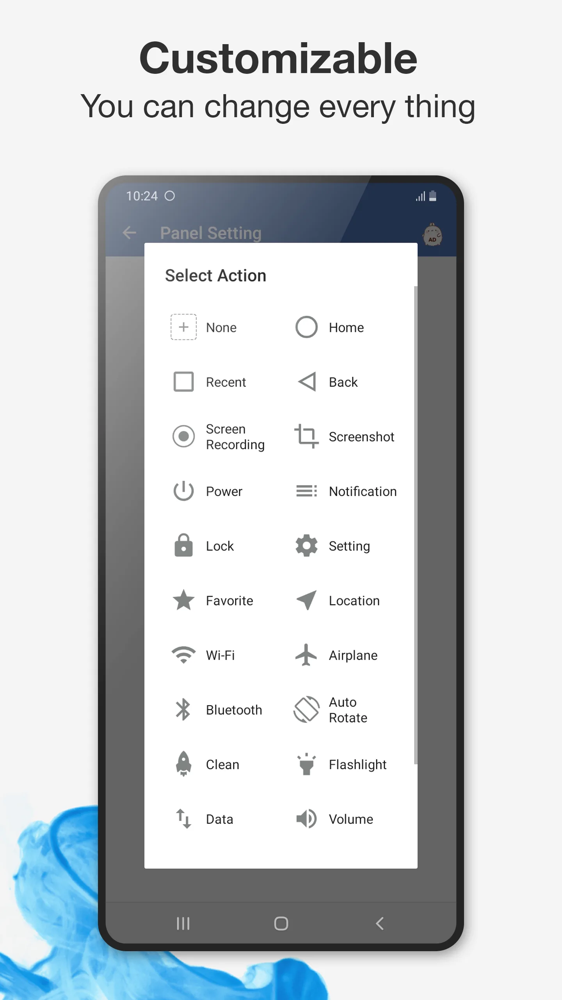{: width="180" .normal }

| App | Price (2026) | Core | Extras |
|---|---|---|---|
| **Floating Assistant** | Free core + unlock | Assistive touch | Floating clock + live monitor |
| **Easy Touch** | Free (ads) | iOS-style ball | Virtual buttons, gestures |
| **Assistive Touch, Easy Tools** | Free (ads) | Navigation bar | Quick toggles, screenshot |
| **Button Mapper** | Free + Pro | Hardware remap | Custom button actions |
| **All in One Gestures** | Free + Pro | Gesture control | Hide soft keys |
| **Assistive Touch** | Free (ads) | Floating touch | Virtual buttons, quick settings |

---

### 1. Floating Assistant — best all-in-one

{: width="180" .normal }
{: width="180" .normal }
{: width="180" .normal }
{: width="180" .normal }
{: width="180" .normal }

Floating Assistant brings **assistive touch, a floating clock and a floating system monitor** to your Android screen, letting you control your phone from one handy overlay.

**Strengths**
- **Assistive touch ball** with virtual home, back, recent and volume buttons, one-tap boost, screen lock, screenshot, flashlight and quick app access.
- **Floating clock and countdown** above other apps — handy during full-screen use.
- **Floating monitor** shows real-time CPU temperature, usage, RAM and battery, with one-tap boost — ideal while gaming.
- **Uses Accessibility services only for listed controls** and does not collect personal or sensitive data.
- Protects physical buttons and works great on large-screen phones.
- Free core with an unlock for extra customization.

**Weaknesses**
- Android only — no iOS app.
- Some themes and monitor extras sit behind the unlock.
- Floating layers take a little screen space.

**Best for:** users who want one overlay that does buttons, clock and monitoring.

**Download Floating Assistant**
- [Google Play](https://play.google.com/store/apps/details?id=com.glgjing.floating.apps.assistive.touch.pro)

---

### 2. Easy Touch — best iOS-style ball

Easy Touch is a popular **iOS-style assistive ball** for Android, with virtual navigation, quick toggles, gestures and themes that mimic iPhone's AssistiveTouch.

**Strengths**
- **Floating ball** with home, back, recent and volume controls.
- **Quick toggles** for Wi-Fi, Bluetooth, flashlight, screen brightness and sound mode.
- **Gestures** (double-tap, long-press) to trigger actions.
- **Themes** updated regularly to personalize the ball.
- Free to use.

**Weaknesses**
- **Ad-supported**, which can interrupt use.
- No built-in clock or system monitor.
- Lighter on deep customization than Floating Assistant.

**Best for:** users who specifically want the iPhone-style floating ball.

**Download Easy Touch**
- [Google Play](https://play.google.com/store/apps/details?id=com.easytouch.assistivetouch)

---

### 3. Assistive Touch, Easy Tools — best quick toggles

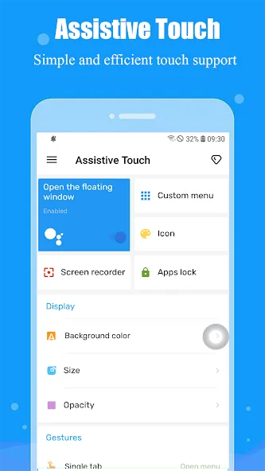{: width="180" .normal }
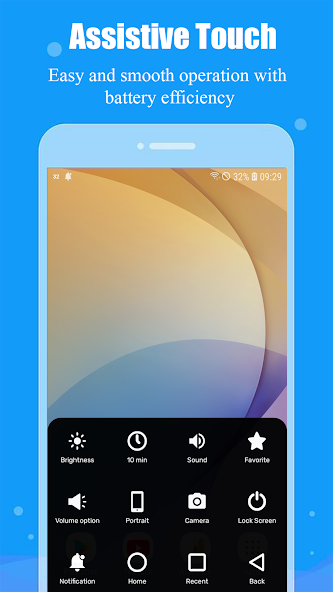{: width="180" .normal }
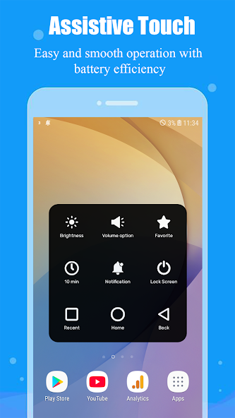{: width="180" .normal }
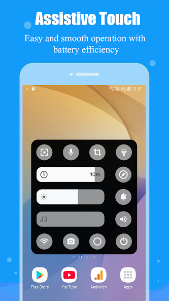{: width="180" .normal }

Assistive Touch, Easy Tools adds a **navigation bar overlay** with recent/home/back plus a broad set of quick toggles, screenshot and screen recording.

**Strengths**
- **Navigation controls** (recent, home, back) without hardware keys.
- **Quick toggles** for Wi-Fi, Bluetooth, flashlight, power, airplane mode, location.
- **Brightness/volume** adjustment and favorite-app launcher.
- **Screenshot and screen recording** shortcuts.
- Free with ads.

**Weaknesses**
- Ad-supported free tier.
- No floating clock or monitor.
- Overlay can feel busy with many toggles.

**Best for:** users who want the most quick settings in one panel.

**Download Assistive Touch, Easy Tools**
- [Google Play](https://play.google.com/store/apps/details?id=mtr.assistivetouch.easytools)

---

### 4. Button Mapper — best hardware-button remapping

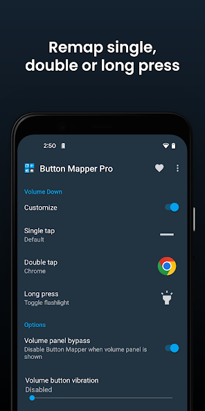{: width="180" .normal }
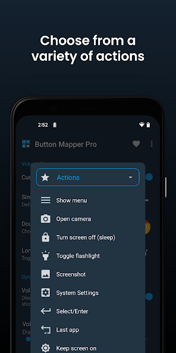{: width="180" .normal }
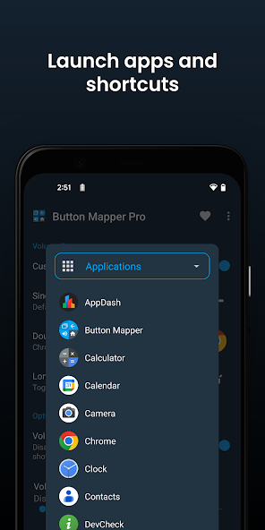{: width="180" .normal }
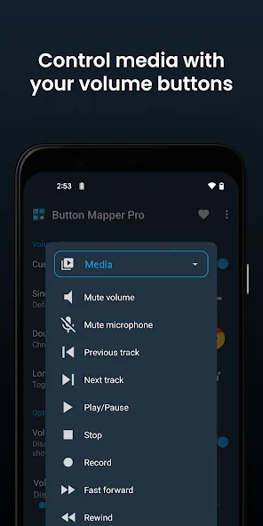{: width="180" .normal }
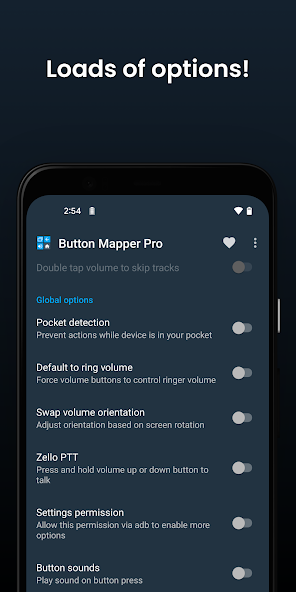{: width="180" .normal }

Button Mapper **remaps your physical buttons** (volume, Bixby, and more) to custom actions — a different approach to "assistive control" that doesn't need a floating ball at all.

**Strengths**
- **Remap hardware buttons** to launch apps, toggle torch, screenshot, media control and more.
- **Works without an overlay**, so nothing floats over your screen.
- Great for **broken or awkward buttons** and accessibility needs.
- Trusted developer (same as DevCheck), free with a Pro upgrade.
- No ads in the core experience.

**Weaknesses**
- Not a floating assistive ball — different paradigm.
- Some buttons and actions need the Pro version.
- Setup is more technical than a simple ball.

**Best for:** users who'd rather repurpose real buttons than use a floating icon.

**Download Button Mapper**
- [Google Play](https://play.google.com/store/apps/details?id=flar2.homebutton)

---

### 5. All in One Gestures — best gesture control

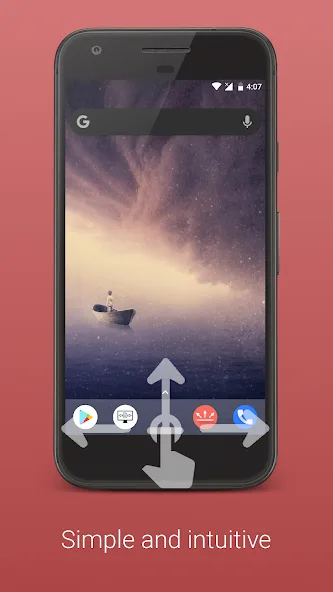{: width="180" .normal }
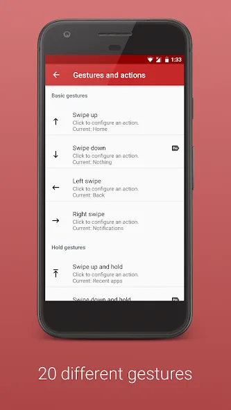{: width="180" .normal }
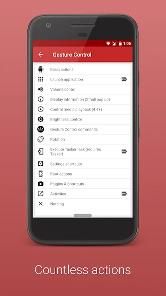{: width="180" .normal }
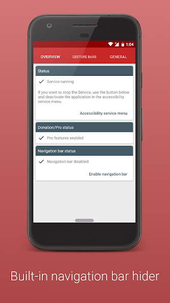{: width="180" .normal }
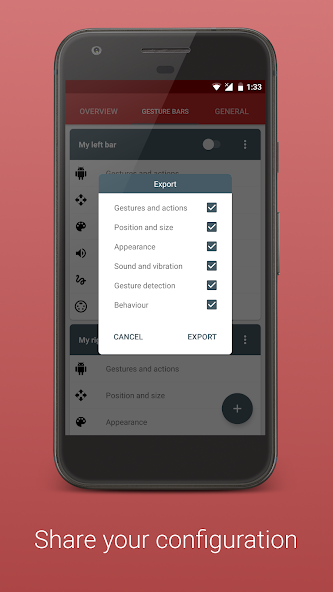{: width="180" .normal }

All in One Gestures lets you **hide the soft keys and control your device with gestures** — swipes, pinch and more — for a clean, button-free experience.

**Strengths**
- **Gesture control** (swipe, pinch, long-press) to trigger actions.
- **Hide navigation bar** for a full-screen, immersive feel.
- Customizable gesture-to-action mapping.
- Lightweight and stable.
- Free with a Pro upgrade.

**Weaknesses**
- Gesture learning curve for new users.
- No floating clock or monitor.
- Less "assistive" for users who want visible buttons.

**Best for:** users who prefer gestures over a floating ball.

**Download All in One Gestures**
- [Google Play](https://play.google.com/store/apps/details?id=com.conena.navigation.gesture.control)

---

### 6. Assistive Touch — best simple floating touch

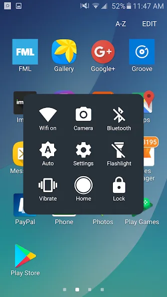{: width="180" .normal }
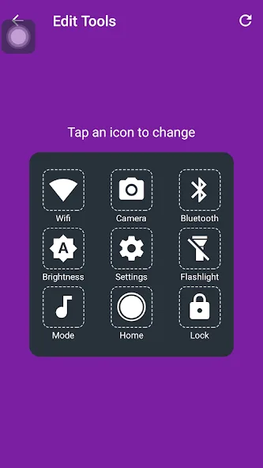{: width="180" .normal }
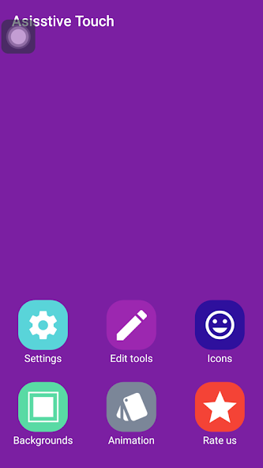{: width="180" .normal }

Assistive Touch (smarttool) is a **straightforward floating-touch app** with virtual buttons and quick settings, close to the classic AssistiveTouch experience.

**Strengths**
- **Floating touch button** with home/back/recent and volume.
- **Quick settings** shortcuts for common toggles.
- Simple, familiar layout.
- Free to use.
- Easy to enable and hide.

**Weaknesses**
- Ad-supported.
- Fewer extras (no clock/monitor) than Floating Assistant.
- Clone-style UI with limited theming.

**Best for:** users who want the classic floating-touch behavior, nothing more.

**Download Assistive Touch**
- [Google Play](https://play.google.com/store/apps/details?id=com.wanata.assistive.touch)

---

## Core-capability comparison

The core-capability comparison puts six Android apps side by side across platform, overlay controls, extras, privacy posture and pricing. Only Floating Assistant pairs a floating clock with a live CPU/RAM/battery monitor; the other five cover the virtual ball, gesture control or hardware-button remapping without a clock or system readout. The privacy split is just as clear — Floating Assistant, Button Mapper and All in One Gestures do not collect personal data, while three ad-supported clones carry ads. Every option has a free tier, and three add a Pro or unlock option for deeper customization.

| Capability | Floating Assistant | Easy Touch | Assistive Touch, Easy Tools | Button Mapper | All in One Gestures | Assistive Touch |
|---|---|---|---|---|---|---|
| **Platforms** | Android | Android | Android | Android | Android | Android |
| **Floating assistive ball** | Yes | Yes | Yes (nav bar) | No (hardware) | No (gestures) | Yes |
| **Virtual home/back/recent** | Yes | Yes | Yes | Via buttons | Via gestures | Yes |
| **Volume / quick toggles** | Yes | Yes | Yes | Yes (mapped) | Yes (mapped) | Yes |
| **One-tap boost / cleaner** | Yes | No | No | No | No | No |
| **Screenshot / flashlight** | Yes | Yes | Yes | Mappable | Mappable | Partial |
| **Floating clock** | Yes | No | No | No | No | No |
| **Floating system monitor** | Yes (CPU/RAM/battery) | No | No | No | No | No |
| **Gestures** | Partial | Yes | Partial | No | Yes (strong) | Partial |
| **Customizable shortcuts/apps** | Yes | Yes | Yes | Yes (buttons) | Yes (gestures) | Yes |
| **Privacy posture** | Strong (no data) | Caution (ads) | Caution (ads) | Strong | Strong | Caution (ads) |
| **Ads / IAP** | Free core | Ads | Ads | Free + Pro (no ads) | Free + Pro | Ads |
| **Free tier** | Generous | Yes | Yes | Yes | Yes | Yes |

---

## How to choose

Six pick-by-need rules cut through the Assistive Touch alternative field in 2026: choose Floating Assistant for buttons plus a clock and live monitor in one overlay, Easy Touch for the iPhone-style ball, Assistive Touch Easy Tools for a broad quick-toggle panel, Button Mapper to repurpose real buttons, All in One Gestures for swipes over a ball, and Assistive Touch for the classic simple floating touch. Each rule follows a single use case, so the six apps do not compete on the same axis. Match the rule to what you actually press or watch each day.

- Want **buttons + clock + live monitor in one overlay** → **Floating Assistant**
- Want the **iPhone-style floating ball** → **Easy Touch**
- Want the **most quick toggles in a panel** → **Assistive Touch, Easy Tools**
- Prefer **repurposing real buttons** → **Button Mapper**
- Prefer **gestures over a ball** → **All in One Gestures**
- Want the **classic simple floating touch** → **Assistive Touch**

## Which Assistive Touch alternative fits each kind of user

Six Assistive Touch alternatives are grouped below by the setup you are leaving behind — an iOS-style ball on a tall phone, hardware-button remapping, gesture navigation, an ad-heavy clone with vague permissions, or iPhone's built-in AssistiveTouch. The comparison table ranks capabilities; this section starts from the setup you are leaving behind. That framing matches each starting point to the app that solves it — Floating Assistant for the ball and privacy cases, Button Mapper for real buttons, All in One Gestures for swipes — and notes that iPhone users have nothing to replace.

| If you are coming from... | Pick | Why it fits |
|---|---|---|
| An iOS-style floating ball on a tall phone | **Floating Assistant** | The edge floating ball stays inside thumb reach, and the same overlay adds a floating clock and a live CPU/RAM/battery readout. |
| Hardware-button remapping | **Button Mapper** | Volume keys keep doing real work with nothing drawn over your apps. |
| Gesture navigation and no ball at all | **All in One Gestures** | Edge swipes replace the navigation bar, so the screen stays clear. |
| An ad-heavy clone with vague permissions | **Floating Assistant** or **Button Mapper** | The free core does not collect personal data, and Accessibility services are used only for the actions you enable. |
| AssistiveTouch on an iPhone | Nothing to install | AssistiveTouch is built into iOS, so there is nothing to replace on that platform. |

Before settling on any floating button app, check two things: which actions actually require **Accessibility services**, and whether the ball can be parked inside the thumb-reach zone on a tall screen. Those two checks separate a usable one-hand helper from an overlay you eventually switch off.

## How to migrate to a better Assistive Touch alternative

Assistive Touch alternative setup takes five steps — decide your control style, install the app and grant only the permissions its controls need, customize the ball or gestures, enable the extras you will use, and review privacy — before you retire the old app. Choose from a floating ball, hardware remap or gesture setup among six Android tools, with display-over-other-apps for overlays and Accessibility for button or gesture actions. Prefer apps that do not collect personal data over ad-heavy clones. Five short steps keep the move from becoming a weekend project.

1. **Decide your style** — floating ball, hardware remap, or gestures — then pick from the table.
2. **Install and grant permissions**: display-over-other-apps for overlays, and Accessibility for button/gesture actions.
3. **Customize the ball or gestures** — add your most-used apps, toggles and screenshot.
4. **Enable extras you'll use** — Floating Assistant's clock/monitor, or Button Mapper's volume-key shortcuts.
5. **Review privacy**: prefer apps that don't collect data (Floating Assistant, Button Mapper, All in One Gestures) over ad-heavy clones.

## FAQ

**Is Floating Assistant the best Assistive Touch alternative?**
{:.faq-q}

If you want one overlay that does assistive touch + a floating clock + live CPU/RAM/battery monitoring with one-tap boost, yes — the other five are single-purpose (ball, gestures, or hardware remap) with no clock or monitor.

**Which Assistive Touch alternative has a floating clock and monitor?**
{:.faq-q}

Only Floating Assistant. Easy Touch, Assistive Touch and the rest offer virtual buttons or gestures but no clock and no live system readout.

**Which Assistive Touch alternative avoids ads?**
{:.faq-q}

Floating Assistant (free core, optional unlock), Button Mapper and All in One Gestures (free + Pro, no ads) are the ad-light picks; the Easy Touch / Assistive Touch clones are ad-supported.

**Is there an Assistive Touch for iPhone?**
{:.faq-q}

Yes — AssistiveTouch is built into iOS (Settings > Accessibility > Touch > AssistiveTouch), so no app is needed on iPhone.

[Get Floating Assistant](/apps/floating-assistant/) — available on Android.

## Related terms

- [What Is Assistive Touch?](/glossary/what-is-assistive-touch/)
- [What Is a Floating Window?](/glossary/what-is-a-floating-window/)
