CCleaner is well known, but on modern Android its effect is limited and some users want **lighter cleaning or real monitoring**. These **[alternatives to CCleaner](/glossary/what-is-a-system-monitor/)** cover both — and we'll be honest about what cleaners can and can't do.

Below we compare six apps across price, platforms and the capabilities that actually matter, so you can pick the right tool instead of just a brand name. Most readers arrive with one blocker — subscription pricing, unclear deletion lists, or no live readings — so each pick is framed around that reason.

## Why look beyond CCleaner

- **Limited effect on modern Android** — the OS already manages cache and background tasks; "cleaning" often frees little.
- **App was pulled from some stores** and is no longer the must-have it once was.
- **Ads and subscription nags** in the mobile version.
- **Privacy concerns** — some cleaners ask for broad permissions.
- You may want **real monitoring** (what's using CPU/battery) rather than just cleanup.

> Reality check: on modern Android, the biggest storage win is deleting unused files and large media — not "clearing RAM." Pick a tool for *safe storage management*, and use a monitor to find what's actually draining resources.

## The best CCleaner alternatives at a glance

| App | Price (2026) | Platforms | Best for |
|---|---|---|---|
| **System Monitor** | Free core + unlock | Android | Monitor + boost + light cleaner |
| **Files by Google** | Free | Android | Safe, official storage cleanup |
| **SD Maid** | Free + Pro | Android | Deep, careful cleaning |
| **CCleaner** | Free + sub | Android | Familiar brand, quick clean |
| **Avast Cleanup** | Free + sub | Android | Clean + photo cleanup |
| **Norton Clean** | Free | Android | Simple junk/cache cleaner |

---

### 1. System Monitor — best for monitoring plus cleanup

{: width="180" .normal }
{: width="180" .normal }
{: width="180" .normal }
{: width="180" .normal }
{: width="180" .normal }

System Monitor is an **all-in-one Android tool** with CPU monitor, storage cleaner, RAM booster and battery doctor — so you get insight *and* cleanup in one place.

**Strengths**
- **Live CPU, RAM and battery monitoring** with overheat protection.
- **Storage cleaner** for junk and cache, plus a RAM analyzer with one-tap boost.
- **Battery doctor** with health, voltage and temperature curves.
- **Floating window and widgets** for ongoing visibility.
- Multi-theme and free core.

**Weaknesses**
- Android only.
- Cleaning is lighter than dedicated cleaners (its strength is monitoring).
- Some features sit behind the Pro unlock.

**Best for:** users who want to *see* what's wrong and fix it, not just sweep cache.

**Download System Monitor**
- [Google Play](https://play.google.com/store/apps/details?id=com.glgjing.marvel)

---

### 2. Files by Google — best safe cleaner

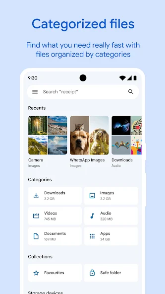{: width="180" .normal }
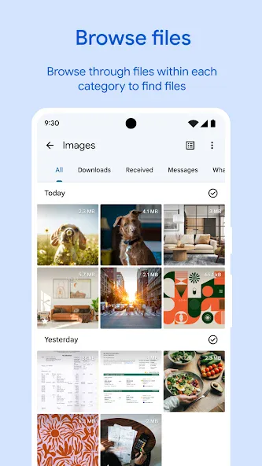{: width="180" .normal }
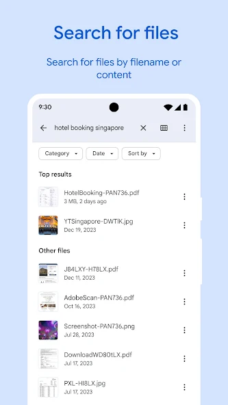{: width="180" .normal }
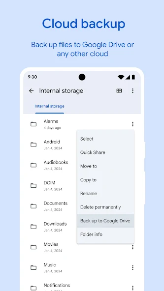{: width="180" .normal }
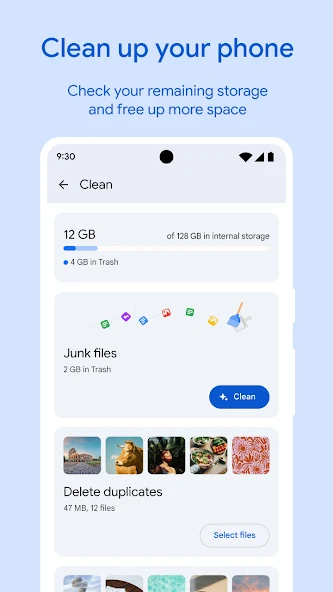{: width="180" .normal }

Files by Google is Google's **official storage manager** — it clears unused files, finds duplicates, and helps you free space with a privacy-friendly design and no aggressive background tasks.

**Strengths**
- **Official and safe** — made by Google, minimal permissions, no shady behavior.
- **Smart storage cleanup**: unused files, duplicates, large media, and app cache.
- **File browsing and sharing** offline with peers.
- **No ads, no subscription** — completely free.
- Clear, simple UI anyone can use.

**Weaknesses**
- **No RAM boost or system monitoring** — it's storage only.
- No deep "corpse" file hunting like SD Maid.
- Android only.

**Best for:** users who want a trustworthy, no-nonsense way to reclaim storage.

**Download Files by Google**
- [Google Play](https://play.google.com/store/apps/details?id=com.google.android.apps.nbu.files)

---

### 3. SD Maid — best deep cleaner

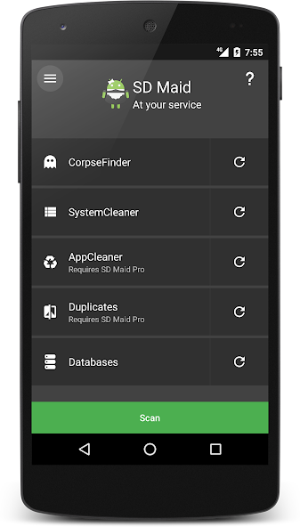{: width="180" .normal }
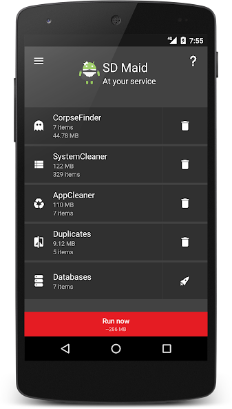{: width="180" .normal }
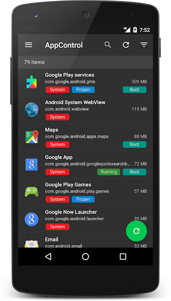{: width="180" .normal }
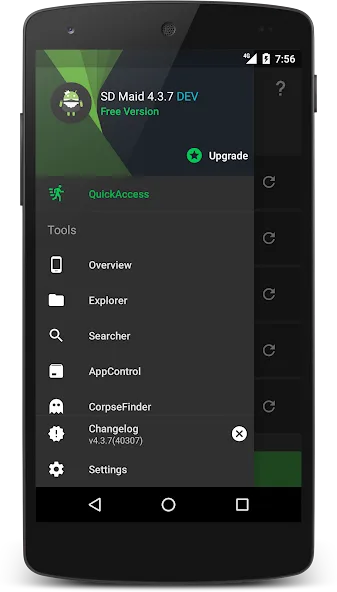{: width="180" .normal }
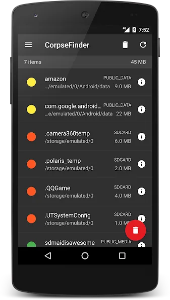{: width="180" .normal }

SD Maid is a **careful, deep cleaner** for Android: it finds leftover ("corpse") files from uninstalled apps, duplicates, databases to optimize, and app control.

**Strengths**
- **Corpse finder** removes leftovers other cleaners miss.
- **Duplicate and file search** across storage.
- **App control / freezer** and database optimizer.
- **Scheduler** for automatic maintenance.
- Strong reputation among power users; free tier is useful.

**Weaknesses**
- Android only.
- Best features (corpse finder, app control, scheduler) need SD Maid Pro.
- UI is denser — less friendly for casual users.

**Best for:** power users who want thorough, controllable cleanup.

**Download SD Maid**
- [Google Play](https://play.google.com/store/apps/details?id=eu.thedarken.sdm)

---

### 4. CCleaner — best familiar quick clean

{: width="180" .normal }
{: width="180" .normal }
{: width="180" .normal }
{: width="180" .normal }
{: width="180" .normal }

CCleaner for mobile is the **phone version of the famous PC tool** — a quick way to clear cache, browsing history and unused files, plus basic photo and battery helpers.

**Strengths**
- **Familiar brand and flow** if you've used CCleaner on desktop.
- **Quick cache/history cleanup** and a simple storage overview.
- **Battery and app hibernation** helpers in the premium tier.
- Easy one-tap scans.
- Free tier available.

**Weaknesses**
- **Limited real impact** on modern Android cache management.
- Ads and subscription prompts in the free version.
- **No longer available on iOS** — Android only now.

**Best for:** users who just want the CCleaner name and a quick scan.

**Download CCleaner**
- [Google Play](https://play.google.com/store/apps/details?id=com.piriform.ccleaner)

---

### 5. Avast Cleanup — best for photo cleanup

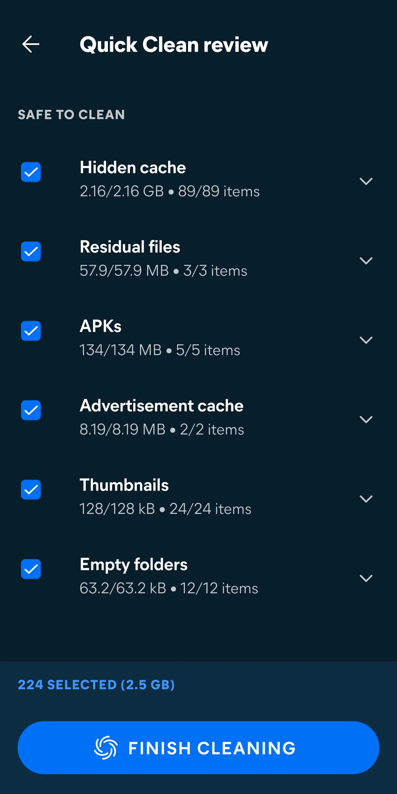{: width="180" .normal }
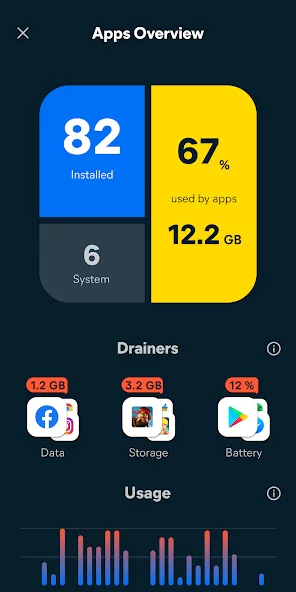{: width="180" .normal }
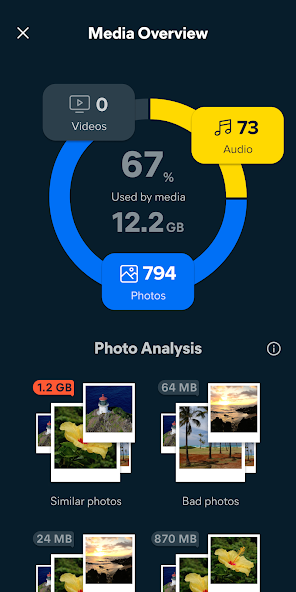{: width="180" .normal }
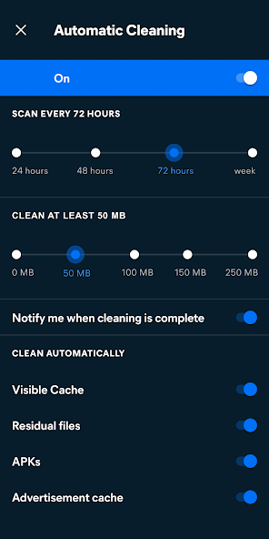{: width="180" .normal }

Avast Cleanup focuses on **freeing space from photos and files** — it finds low-quality, similar and duplicate photos, plus clears junk and app cache.

**Strengths**
- **Photo cleanup** that flags blurry, duplicate and similar shots to delete.
- **Junk and cache removal** with a clear storage overview.
- **App hibernation** to reduce background load.
- Reputable security-brand backing.
- Free with a premium subscription.

**Weaknesses**
- Android only.
- Best photo features sit behind the subscription.
- No live system monitoring.

**Best for:** users whose storage is dominated by photos.

**Download Avast Cleanup**
- [Google Play](https://play.google.com/store/apps/details?id=com.avast.android.cleaner)

---

### 6. Norton Clean — best simple junk cleaner

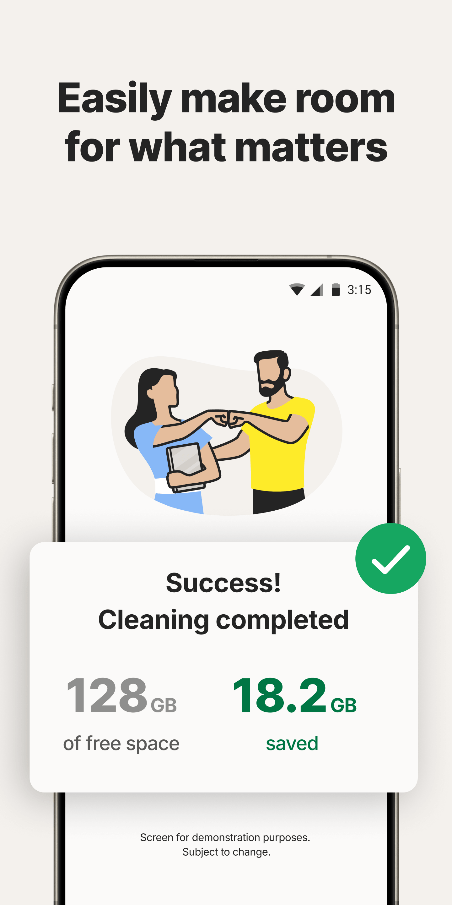{: width="180" .normal }
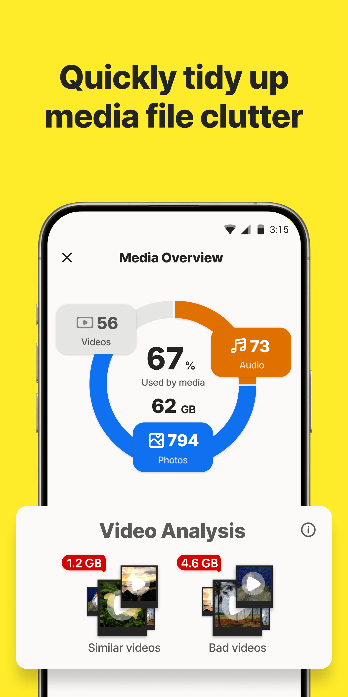{: width="180" .normal }
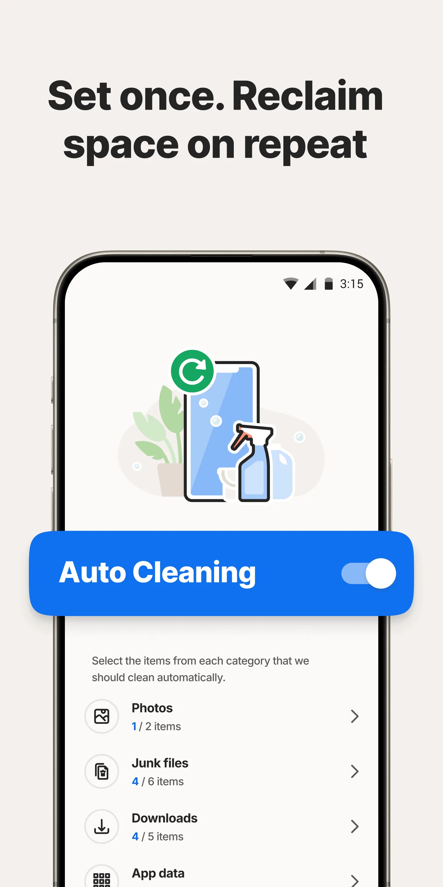{: width="180" .normal }
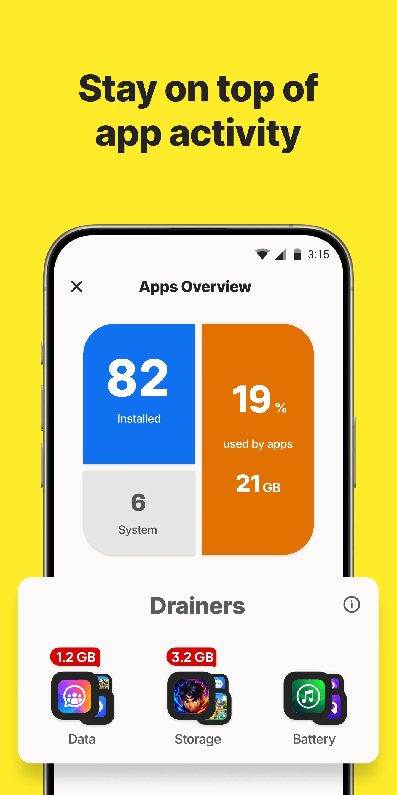{: width="180" .normal }

Norton Clean is a **straightforward junk and cache cleaner** that removes temporary files, residual data and app leftovers with a simple tap.

**Strengths**
- **Simple junk/cache removal** — easy for anyone.
- **Residual file cleanup** after uninstalls.
- Backed by the Norton security brand.
- Free to use.
- Lightweight and unobtrusive.

**Weaknesses**
- Android only.
- Few extras beyond basic cleaning.
- No monitoring, no RAM boost, no photo tools.

**Best for:** users who want a minimal, trusted one-tap cleaner.

**Download Norton Clean**
- [Google Play](https://play.google.com/store/apps/details?id=com.symantec.cleaner)

---

## Core-capability comparison

| Capability | System Monitor | Files by Google | SD Maid | CCleaner | Avast Cleanup | Norton Clean |
|---|---|---|---|---|---|---|
| **Platforms** | Android | Android | Android | Android | Android | Android |
| **Junk / cache cleaning** | Yes (light) | Yes (safe) | Yes (deep) | Yes | Yes | Yes |
| **Storage analysis** | Yes | Yes | Yes (advanced) | Basic | Yes | Basic |
| **Duplicate / corpse finder** | No | Duplicates | Yes (corpse) | No | Photos | No |
| **RAM boost** | Yes | No | Partial | No | App hibernation | No |
| **Battery saver** | Yes (doctor) | No | No | Basic | Basic | No |
| **Real-time monitoring** | Yes (CPU/RAM/battery) | No | No | No | No | No |
| **Safe / official** | Yes | Yes (Google) | Yes (power-user) | Caution | Yes (brand) | Yes (brand) |
| **Ads / subscription** | Free core | No ads | Free + Pro | Ads + sub | Free + sub | Free |
| **Root required** | No | No | No (Pro extras optional) | No | No | No |
| **Best at** | Monitor + boost | Safe storage | Deep clean | Familiar brand | Photo cleanup | Simple clean |

---

## Which CCleaner alternative fits each kind of user

The table ranks features; here the same six are grouped by *what you were actually trying to achieve*.

- **Understanding a slowdown** — a **CCleaner alternative** that reports CPU, RAM, battery and temperature (System Monitor) answers a different question than one that deletes caches. If nothing is visibly wrong with storage, cleaning will not explain a stutter.
- **Safe, official storage cleanup** — a **Files by Google alternative** search is about reviewing large files and duplicates before deletion; Norton Clean is the minimal version of that job.
- **Deep, rule-based residue cleaning** — an **SD Maid alternative** or **AVG Cleaner alternative** fits people who want to see exactly which leftovers get removed. A **Clean Master alternative** is the older, broader "one-tap" version of the same idea.
- **A full toolbox** — a **3C Toolbox alternative** combines monitoring, tuning and battery statistics in one install, at the cost of complexity.
- **Photos and subscriptions** — Avast Cleanup targets photo libraries, and most of these apps put their deeper scan behind a paid tier; check what the free core actually deletes.

Whatever the label, ask two questions before migrating: can you review the deletion list first, and does the app explain a slowdown as well as freeing space?

## How to choose

- Want **monitoring + boost + light cleanup** → **System Monitor**
- Want **safe, official, no-nonsense storage cleanup** → **Files by Google**
- Want **deep, careful cleaning** → **SD Maid**
- Want the **CCleaner name and quick scan** → **CCleaner**
- Storage is **photos** → **Avast Cleanup**
- Want a **minimal trusted cleaner** → **Norton Clean**

## How to migrate away from CCleaner

1. **Decide your real goal** — more free space, or a faster phone? They're different fixes.
2. **Install a storage tool** (Files by Google or SD Maid) and run a one-time cleanup of duplicates and unused files.
3. **Add a monitor** (System Monitor) to find what's actually draining CPU/battery instead of "boosting" blindly.
4. **Uninstall CCleaner** once the new tool covers your needs — modern Android needs less constant cleaning.
5. **Keep it simple**: delete big media and old apps regularly; let the OS handle the rest.

## FAQ

**Is System Monitor the best CCleaner alternative?**
If you want monitoring plus cleanup, yes. System Monitor is the only app here with live CPU/RAM/battery monitoring, an overheat alarm and a one-tap boost — the others are cleaners or storage tools without real-time insight.

**Which CCleaner alternative is safest for storage?**
Files by Google is the safest pick — official, no ads, no aggressive background tasks. SD Maid is the deepest cleaner for power users.

**Which CCleaner alternative actually frees RAM?**
System Monitor is the only one here with a one-tap RAM boost; the rest manage storage and cache but don't monitor or free memory live.

**Is System Monitor free?**
Yes. The core monitor, widgets, floating window and overheat alarm are free; an optional unlock adds deeper themes and history.

[System Monitor app page](/apps/system-monitor/) — available on Android.

## Related terms

- [What Is a CPU Temperature Monitor?](/glossary/what-is-a-cpu-temperature-monitor/)
- [What Is a System Monitor?](/glossary/what-is-a-system-monitor/)
- [What Is a RAM Booster?](/glossary/what-is-a-ram-booster/)
