CPU-Z is great for a quick spec sheet, but on Android it **doesn't show [live temperature](/glossary/what-is-a-cpu-temperature-monitor/)**, lacks a floating window, and offers no widgets or overheat alarms. If you want real-time monitoring, the field has mature options.

Below we compare six **alternatives to CPU-Z** — from a live temperature monitor to deep spec reporters — across price, platforms and the capabilities that actually matter. Most readers arrive with one blocker — no live temperature, no floating window, or no widgets — so each pick is framed around that reason.

## Why look beyond CPU-Z

Six CPU-Z alternatives in 2026 fill the gaps a quick spec sheet leaves on Android: no live temperature, no floating window, no widgets and no overheat alarm. CPU-Z reports hardware, not heat, and its mobile version is ad-supported and shallower than the PC classic. The shortlist runs from a real-time temperature monitor with a floating overlay to deep hardware reporters that read sensors and battery health. Readers usually arrive with one blocker — no live thermal reading, no at-a-glance widget, or no way to watch frequency while gaming — so each pick is framed around that need.

{: width="180" .normal }
{: width="180" .normal }
{: width="180" .normal }
{: width="180" .normal }
{: width="180" .normal }

- **No live CPU temperature** on most Android devices — it reports specs, not heat.
- **No floating window or widgets** for at-a-glance monitoring.
- **Light on sensors and battery health** compared with dedicated tools.
- **Mobile version is ad-supported** and less deep than the PC classic.
- You may want **overheat alarms or one-tap boost**, which it doesn't provide.

## The best CPU-Z alternatives at a glance

Six CPU-Z alternatives are compared below on 2026 price, platforms and best use, so a spec sheet is weighed against live monitoring. CPU Monitor is the free-core pick for temperature, frequency and a floating window; DevCheck and AIDA64 cover deep hardware and sensor reports across Android and iOS; Device Info HW breaks components down one by one; Droid Hardware Info is the quick free readout; and System Monitor adds cleaning and boosting to monitoring. Only two entries here put a live CPU readout on screen while you game.

| App | Price (2026) | Platforms | Best for |
|---|---|---|---|
| **CPU Monitor** | Free core + unlock | Android | Live temp, frequency, floating window |
| **DevCheck** | Free + Pro | Android, iOS | Detailed hardware and sensors |
| **AIDA64** | Free | Android, iOS | Deep spec report |
| **Device Info HW** | Free + Pro | Android | Per-component hardware info |
| **Droid Hardware Info** | Free | Android | Quick device specification |
| **System Monitor** | Free core + unlock | Android | Monitor + cleaner + booster |

---

### 1. CPU Monitor — best for live temperature

{: width="180" .normal }
{: width="180" .normal }
{: width="180" .normal }
{: width="180" .normal }
{: width="180" .normal }

CPU Monitor shows **real-time CPU temperature and frequency**, RAM, battery and multicore usage, with a floating window, widgets, one-tap boost and an overheat alarm.

**Strengths**
- **Real-time CPU temperature and frequency** with history analysis.
- **Multicore CPU monitoring** and per-core usage.
- **Floating window** (status bar + desktop) and RAM/CPU/battery widgets.
- **Overheat alarm** that warns you to close heavy apps and cool down.
- **One-tap boost** shortcut to free RAM quickly.
- Multi-theme, lightweight, and free core.

**Weaknesses**
- Android only — no iOS app.
- Advanced history/theme features sit behind an unlock.
- Temperature accuracy depends on device sensor availability.

**Best for:** users who want to actually watch heat and frequency while gaming or charging.

**Download CPU Monitor**
- [Google Play](https://play.google.com/store/apps/details?id=com.glgjing.stark)

---

### 2. DevCheck — best for detailed sensors

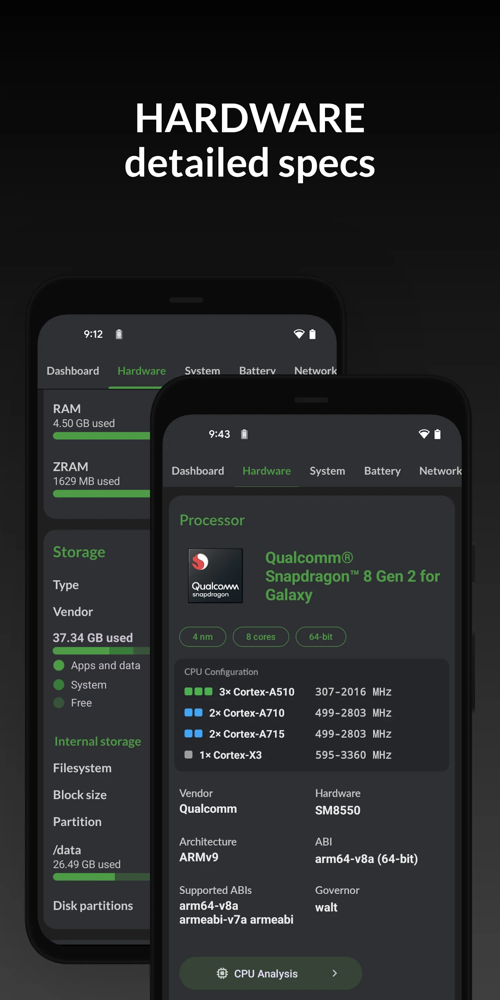{: width="180" .normal }
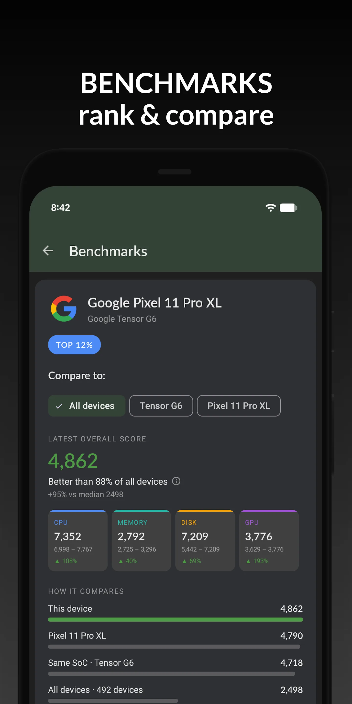{: width="180" .normal }
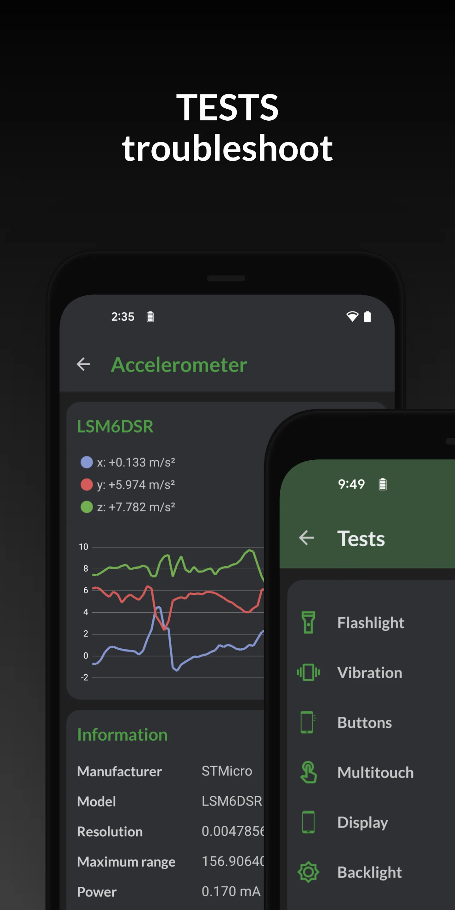{: width="180" .normal }
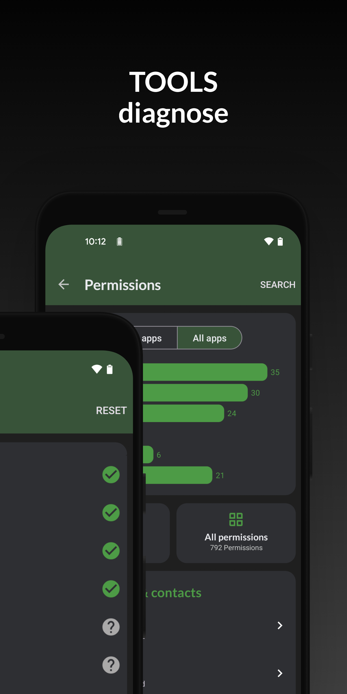{: width="180" .normal }
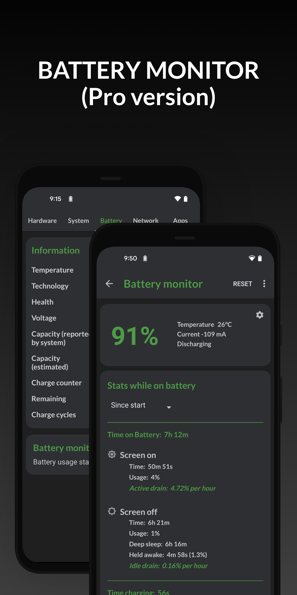{: width="180" .normal }

DevCheck is a **comprehensive hardware and sensor reporter** with a clean dashboard: CPU, GPU, battery, network, sensors, and more, plus a system monitor and widgets.

**Strengths**
- **Deep hardware readout** — SoC, GPU, memory, storage, camera, sensors.
- **Live dashboard** for CPU, battery and thermal info.
- **Widgets and a system monitor** for ongoing tracking.
- Clean, ad-light interface.
- Free with a Pro upgrade for extra dashboards.

**Weaknesses**
- No floating window overlay.
- Overheat alarms and one-tap boost are not its focus.
- Best depth is behind DevCheck Pro.

**Best for:** tinkerers who want a full hardware inventory and sensor list.

**Download DevCheck**
- [Google Play](https://play.google.com/store/apps/details?id=flar2.devcheck)
- [App Store](https://apps.apple.com/us/app/devcheck/id1475762785)

---

### 3. AIDA64 — best deep spec report

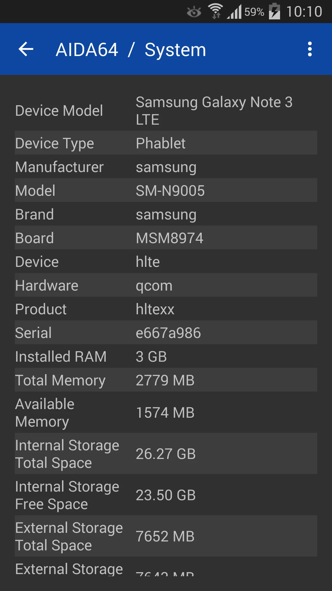{: width="180" .normal }
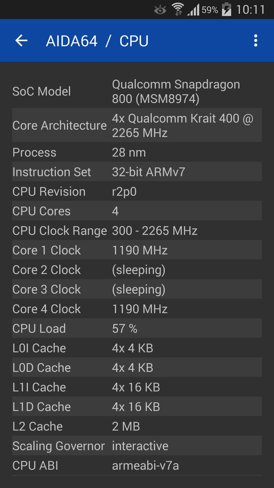{: width="180" .normal }
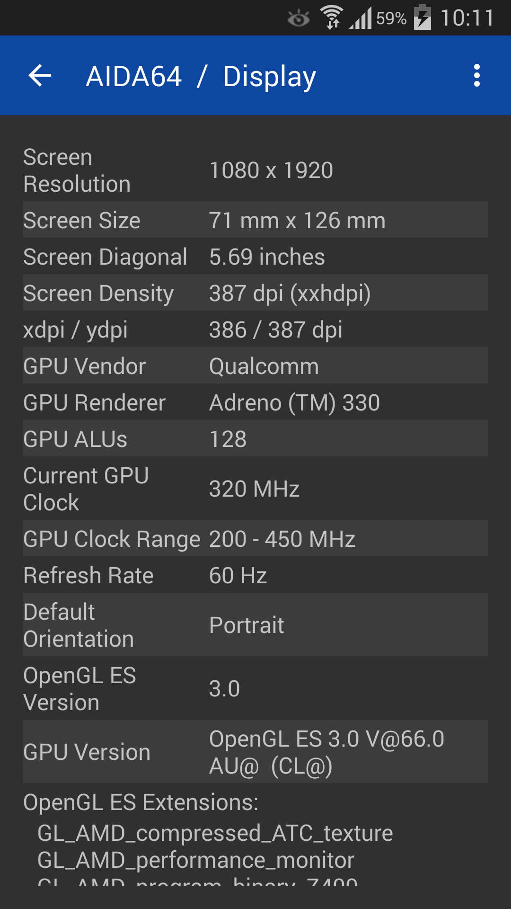{: width="180" .normal }
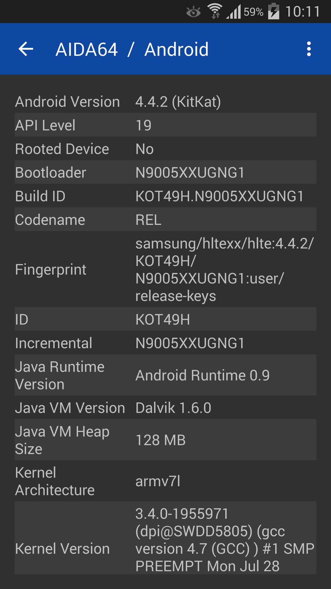{: width="180" .normal }
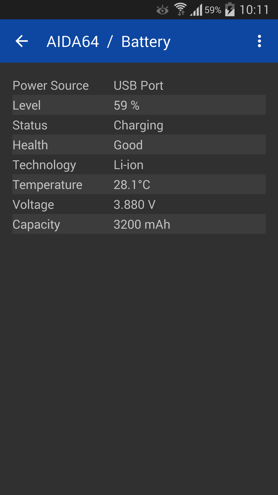{: width="180" .normal }

AIDA64 brings the well-known PC diagnostic brand to Android and iOS, with a thorough **device specification report** and live sensor readings.

**Strengths**
- **Trusted, detailed spec report** across CPU, screen, battery, network and more.
- **Live sensor pages** for thermal, battery and load.
- Available on **both Android and iOS**.
- No ads in the free version.
- Familiar layout for desktop AIDA64 users.

**Weaknesses**
- No floating window or widgets.
- Not focused on overheat alarms or boosting.
- Less "real-time monitoring" than dedicated monitors.

**Best for:** users who want a reputable, deep spec sheet on phone or tablet.

**Download AIDA64**
- [Google Play](https://play.google.com/store/apps/details?id=com.finalwire.aida64)
- [App Store](https://apps.apple.com/us/app/aida64/id979579523)

---

### 4. Device Info HW — best per-component info

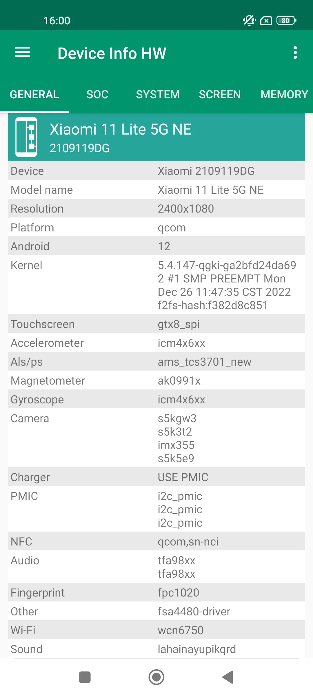{: width="180" .normal style="height:360px;object-fit:cover" }
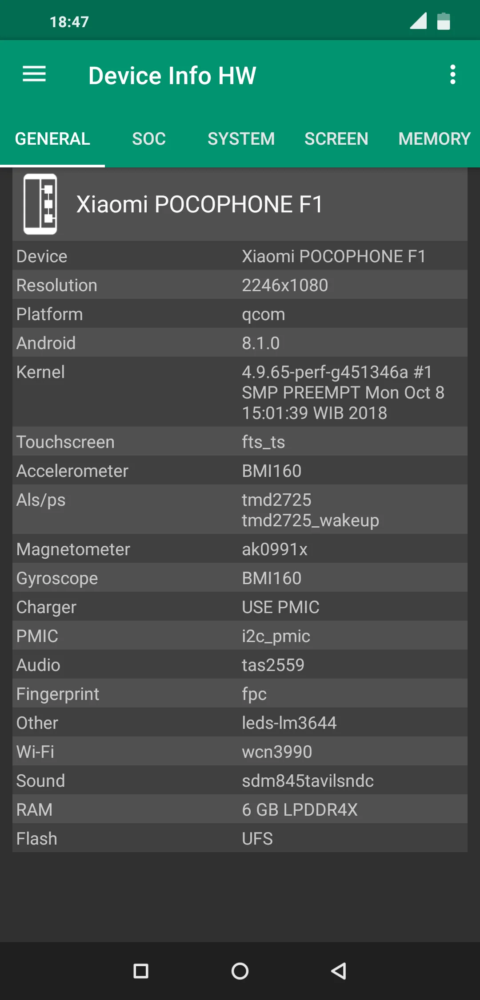{: width="180" .normal style="height:360px;object-fit:cover" }
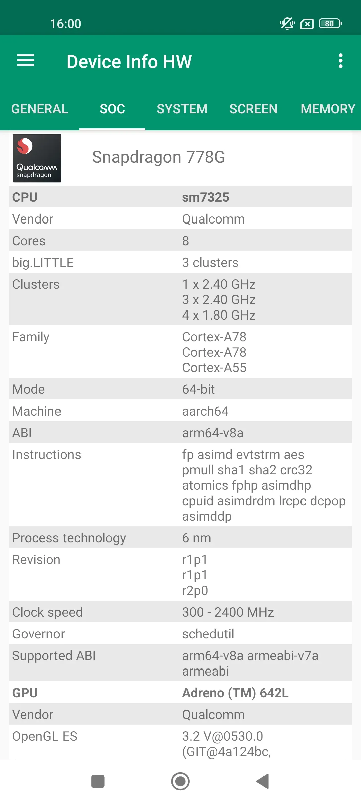{: width="180" .normal style="height:360px;object-fit:cover" }
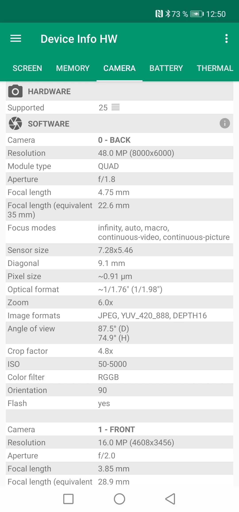{: width="180" .normal style="height:360px;object-fit:cover" }
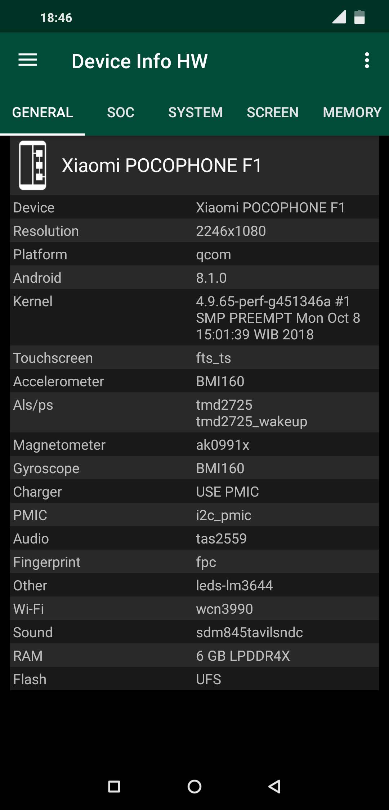{: width="180" .normal style="height:360px;object-fit:cover" }

Device Info HW is a **hardware info app** that breaks down each component — CPU, GPU, battery, camera, sensors, storage — with a clear, component-level view.

**Strengths**
- **Component-level detail** (e.g., exact camera sensor, GPU model).
- **Battery info** including health and charge details.
- **Sensors list** with live values.
- Clean reporting and export-friendly layout.
- Free with a Pro upgrade.

**Weaknesses**
- Android only.
- No live floating window or overheat alarm.
- Not a performance/thermal monitor by design.

**Best for:** users who want to know exactly what's inside their device.

**Download Device Info HW**
- [Google Play](https://play.google.com/store/apps/details?id=ru.andr7e.deviceinfohw)

---

### 5. Droid Hardware Info — best quick specification

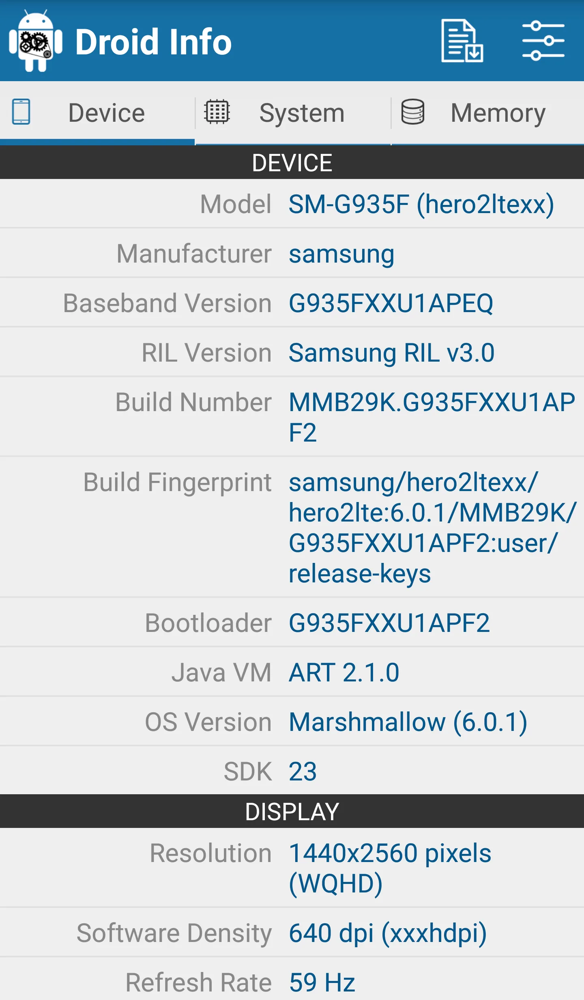{: width="180" .normal }
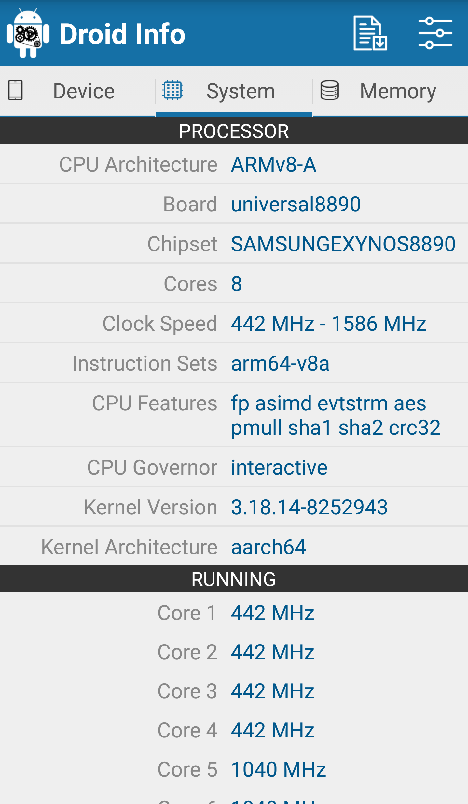{: width="180" .normal }
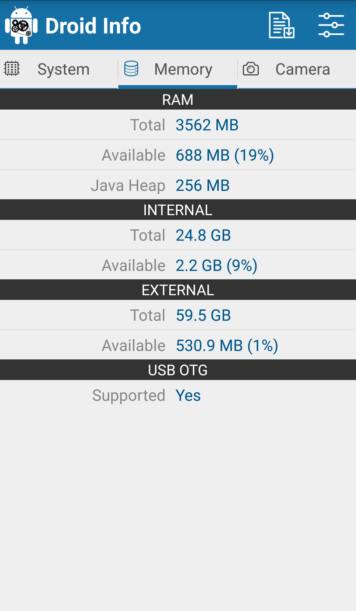{: width="180" .normal }
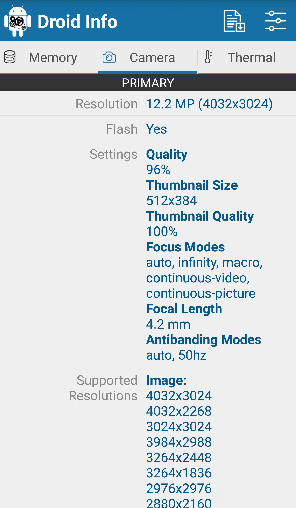{: width="180" .normal }

Droid Hardware Info is a **lightweight spec viewer** that shows system, CPU, GPU, memory, camera and sensor details in a simple list.

**Strengths**
- **Fast, simple spec list** — no setup required.
- Covers CPU, GPU, RAM, storage, camera and sensors.
- Very small and free.
- Good for quick lookups and sharing specs.
- No account or ads clutter.

**Weaknesses**
- Android only; no iOS version.
- No live monitoring, widgets or floating window.
- Less depth than DevCheck or AIDA64.

**Best for:** anyone who just wants a quick, clean device spec readout.

**Download Droid Hardware Info**
- [Google Play](https://play.google.com/store/apps/details?id=com.inkwired.droidinfo)

---

### 6. System Monitor — best all-in-one monitor + cleaner

System Monitor is an **all-in-one Android tool**: CPU monitor, storage cleaner, RAM booster and battery doctor, keeping your phone fast, cool and optimized.

**Strengths**
- **CPU temperature and frequency** with history and multicore monitoring.
- **Storage cleaner** for junk/cache and a RAM analyzer with one-tap boost.
- **Battery monitor** with health, voltage and temperature curves.
- **Overheating alarm and protection** plus floating window and widgets.
- Multi-theme and free core.

**Weaknesses**
- Android only.
- Cleaning is lighter than dedicated cleaners (focus is monitoring).
- Some features sit behind the Pro upgrade.

**Best for:** users who want monitoring plus light cleanup in one app.

**Download System Monitor**
- [Google Play](https://play.google.com/store/apps/details?id=com.glgjing.marvel)

---

## Core-capability comparison

The core-capability comparison puts six CPU-Z alternatives side by side on live temperature, frequency, RAM, battery health, sensors, floating windows, widgets and overheat alarms. Only CPU Monitor and System Monitor read live CPU temperature and draw a floating window; AIDA64 and DevCheck show sensors but no overlay, while Device Info HW and Droid Hardware Info stay read-only spec viewers. Widgets appear on three picks, overheat alarms on two, and none of the six requires root. Choose by whether you want to watch heat live or just read what is inside the phone.

| Capability | CPU Monitor | DevCheck | AIDA64 | Device Info HW | Droid Hardware Info | System Monitor |
|---|---|---|---|---|---|---|
| **Platforms** | Android | Android, iOS | Android, iOS | Android | Android | Android |
| **Live CPU temperature** | Yes | Partial | Sensors | No | No | Yes |
| **CPU frequency / multicore** | Yes | Yes | Yes | No | No | Yes |
| **RAM monitoring** | Yes | Yes | Yes | Partial | Partial | Yes (boost) |
| **Battery health / temp** | Yes | Yes | Yes | Yes | No | Yes |
| **Sensors list** | Partial | Yes | Yes | Yes | Yes | Partial |
| **Floating window** | Yes | No | No | No | No | Yes |
| **Widgets** | Yes | Yes | No | No | No | Yes |
| **Overheat alarm** | Yes | No | No | No | No | Yes |
| **One-tap boost / cleaner** | Yes (boost) | No | No | No | No | Yes (boost + clean) |
| **Deep spec report** | Partial | Strong | Strong | Strong | Basic | Partial |
| **Free tier / ads** | Free core | Free + Pro | Free (no ads) | Free + Pro | Free | Free core |
| **Root required** | No | No | No | No | No | No |

---

## Which CPU-Z alternative fits each kind of user

Six CPU-Z alternatives are grouped below by what you actually wanted from a hardware app — a live dashboard, the deepest report, a full toolkit, clean graphs, battery health or a tiny always-on-top readout — rather than by feature count. The table ranks features; here the same six are grouped by *what you actually wanted from a hardware app*. That framing separates CPU Monitor's per-core frequency and floating window from DevCheck and AIDA64's SoC and sensor detail, and keeps small searches like a CPU Float or Cooler Master alternative outside this six-app field.

- **A live dashboard, not a spec sheet** — a **best CPU-Z alternative android** shortlist starts with CPU Monitor: real-time temperature, per-core frequency, a floating window and an overheat alarm.
- **The deepest hardware report** — a **DevCheck alternative** or **AIDA64 alternative** still wins on SoC, GPU, display and sensor detail. Device Info HW goes component by component; Droid Hardware Info is the quick free readout.
- **A full system toolkit** — a **3C Toolbox alternative** is the heavier option with monitoring, battery statistics and tuning in one install.
- **Clean, read-only graphs** — a **Simple System Monitor alternative** gives CPU, RAM and network curves without performance claims.
- **Battery health rather than CPU heat** — an **AccuBattery alternative** is the right pairing if charging temperature and charge cycles are the concern.

Two more searches land here but point outside this six-app field: a **CPU Float alternative** is usually a request for a tiny always-on-top CPU readout rather than a full dashboard, and a **Cooler Master alternative** is about PC hardware or cooling accessories, not an Android monitoring app. Neither is a substitute for a live thermal sensor reading.

Whatever the label, check two things before switching: does the app read real thermal sensors without root, and does the free tier keep the floating window or widget you actually use?

## How to choose

Six pick-by-need rules cut through the CPU-Z alternative field in 2026: choose CPU Monitor for live temperature, a floating window and an overheat alarm, DevCheck or AIDA64 for a detailed hardware and sensor report, Device Info HW for component-level camera and GPU specs, Droid Hardware Info for a quick free readout, and System Monitor for monitoring plus cleaner and booster in one. Each rule follows one use case, so the six apps do not compete on the same axis. Match the rule to what you check while the phone is in your hand.

- Want **live temperature + floating window + overheat alarm** → **CPU Monitor**
- Want the **most detailed hardware and sensor report** → **DevCheck** or **AIDA64**
- Want **component-level specs (camera/GPU)** → **Device Info HW**
- Want a **quick free spec readout** → **Droid Hardware Info**
- Want **monitoring + cleaner + booster in one** → **System Monitor**

## How to migrate away from CPU-Z

CPU-Z migration takes five steps in 2026, from deciding what you actually check to freeing memory when the phone slows. Decide first whether you read specs once or watch temperature while gaming, then install CPU Monitor or System Monitor and grant the overlay permission for the floating window. Add a home-screen widget for at-a-glance CPU, RAM and battery, and switch on the overheat alarm if you game or charge heavily. Use one-tap boost or cleaner only when the phone feels slow. Five steps move you from a static spec sheet to live readings.

1. **Decide what you actually check** — specs once, or live temperature while gaming.
2. **Install a monitor** (CPU Monitor or System Monitor) and grant the overlay permission for the floating window.
3. **Add a widget** to your home screen for at-a-glance CPU/RAM/battery.
4. **Turn on the overheat alarm** if you game or charge heavily, so you get warned before throttling.
5. **Use one-tap boost or cleaner** (CPU Monitor boost, System Monitor cleaner) to free memory when the phone feels slow.

## FAQ

**Is CPU Monitor the best CPU-Z alternative?**
{:.faq-q}

For live monitoring, yes. CPU Monitor is the closest match if you want real-time CPU/battery temperature, a floating window, widgets and an overheat alarm — the things CPU-Z doesn't do.

**Which CPU-Z alternative shows live temperature over time?**
{:.faq-q}

CPU Monitor and System Monitor both chart temperature as curves; DevCheck and AIDA64 show live sensor values but not a continuous history.

**Which CPU-Z alternative has the deepest spec report?**
{:.faq-q}

DevCheck and AIDA64 are the strongest spec reporters; Device Info HW adds component-level detail like exact camera/GPU models.

**Is CPU Monitor free?**
{:.faq-q}

Yes. The core monitor — live temperature, floating window, widgets and overheat alarm — is free; an optional unlock adds deeper themes and history.

[CPU Monitor app page](/apps/cpu-monitor/) — available on Android.

## Related terms

- [What Is a CPU Temperature Monitor?](/glossary/what-is-a-cpu-temperature-monitor/)
- [What Is a System Monitor?](/glossary/what-is-a-system-monitor/)
