Retroflip is a free, good-looking retro **[flip clock](/glossary/what-is-a-flip-clock/)** for Android — but it mostly stops at the clock face. There is **no white noise for focus or sleep, no floating clock overlay, no widgets, and no iPhone version**. If you want a flip clock that also plays ambient sound, sits on top of other apps, or runs on iOS, the category has matured fast.

Below we compare six strong **alternatives to Retroflip** — from a cute, feature-rich fullscreen clock to playful, Pomodoro-friendly flip clocks — across price, platforms and the everyday capabilities that actually matter. Most readers arrive with one blocker — ads, a missing widget, or no iOS version — so each pick is framed around that reason.

## Why look beyond Retroflip

Six Retroflip alternatives in 2026 address the same gaps in a basic Android flip clock: no white noise for focus or sleep, no floating overlay, no home-screen widgets, no iPhone version and limited themes. Retroflip draws a clean retro face but stops at the clock, while dedicated tools now add ambient sound, soundscapes and adjustable widgets across Android and iOS. Readers usually arrive with one blocker — ads, a missing widget or no iOS build — so each pick below is framed around that reason rather than raw looks.

- **No ambient sound** — there is no white noise, so it can't help you focus or fall asleep.
- **No floating clock** — the time only lives inside the app, not over your other apps.
- **No home-screen widgets** — you can't glance at the time from your launcher.
- **Android-only** — iPhone and iPad users are left out.
- **Limited themes** — customization is lighter than dedicated flip-clock apps.

## The best Retroflip alternatives at a glance

Six Retroflip alternatives are compared below on 2026 price, platforms and best use, so a free Android-only clock is weighed against features that carry across devices. Only Clock is the full-featured pick with themes, white noise, a floating clock and widgets on both Android and iOS; FliTik adds Pomodoro and countdowns; Flip Clock: World Clock brings weather and a widget on Android; and three iOS options cover minimal fullscreen focus, desk widgets and lightweight themed faces. Only one of the six runs on both platforms.

| App | Price (2026) | Platforms | Best for |
|---|---|---|---|
| **Only Clock** | Free core + unlock | Android, iOS | Themes, white noise, floating clock, widgets |
| **FliTik** | Free + IAP | iOS (and desktop/Android) | Pomodoro, countdown and ambient flip clock |
| **Flip Clock: World Clock** | Free + IAP | Android | Weather, widget and world-clock flip face |
| **Fullscreen Clock** | Free + IAP | iOS | Minimal fullscreen flip & focus |
| **Flip Clock: Digital Desk Widget** | Free + IAP | iOS | Desk widget + screensaver flip clock |
| **Flip Clock — Digital Clock** | Free + IAP | iOS | Lightweight themed flip clock |

---

### 1. Only Clock — best full-featured flip clock

{: width="180" .normal }
{: width="180" .normal }
{: width="180" .normal }
{: width="180" .normal }
{: width="180" .normal }

Only Clock is a **fullscreen flip clock** for Android and iOS with a beautiful flip animation, many themes, white noise for focus, a floating clock, and widgets. It is the closest all-round upgrade to Retroflip and fixes almost every gap above.

**Strengths**
- **Fullscreen flip animation** with many beautiful themes you can switch freely.
- **White noise built in** — rain, forest, fireplace and more to help you focus or sleep.
- **Floating clock** overlay so you can see the time above other apps.
- **Clock widgets** for the home screen, plus 12/24-hour and date display.
- **Runs on Android and iOS**, and works great on a spare phone or iPad as a desk clock.
- No account required — open it and the clock just works.

**Weaknesses**
- The richest themes and sounds sit behind a small one-time or subscription unlock.
- Widget styling is more limited on iOS than on Android.
- No world-clock / multiple-timezone view.

**Best for:** people who want one flip clock that also plays sound, floats over apps, and works on both Android and iPhone.

**Download Only Clock**
- [Google Play](https://play.google.com/store/apps/details?id=com.glgjing.only.flip.clock)
- [App Store](https://apps.apple.com/us/app/only-clock-flip-clock/id1566706513)

---

### 2. FliTik — best for Pomodoro and countdown

{: width="180" .normal }
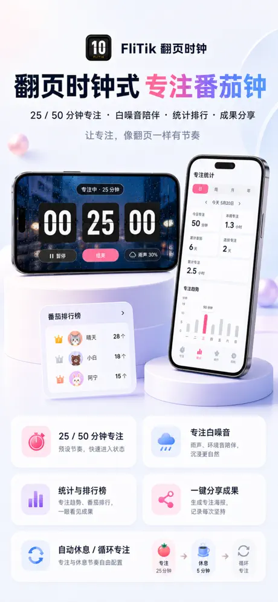{: width="180" .normal }
{: width="180" .normal }
{: width="180" .normal }

FliTik is a cross-platform **flip clock** that leans into ritual: stunning flip animations, a Pomodoro timer, count-up/count-down modes, and ambient sound so every second feels intentional. It's popular as a study and work-focus companion.

**Strengths**
- **Pomodoro timer** plus count-up and count-down modes for study and work sprints.
- **Beautiful, atmospheric flip displays** that look great as a desk or nightstand clock.
- **Ambient sound** mixed with the clock for focus and relaxation.
- **Cross-platform** (iOS, desktop and Android), so your setup follows you.
- Clear, large digits that stay readable from across the room.

**Weaknesses**
- Some themes and timer features are behind in-app purchases.
- Lighter on raw customization (colors/positions) than a pure clock widget app.
- Android availability is via sideload/store mirrors rather than a single flagship listing.

**Best for:** students and focus workers who want a flip clock that also runs Pomodoro sessions and countdowns.

**Download FliTik**
- [App Store](https://apps.apple.com/us/app/flitik-flip-clock-pomodoro/id6448849784)

---

### 3. Flip Clock: World Clock — best Android flip clock with weather

{: width="180" .normal }
{: width="180" .normal }
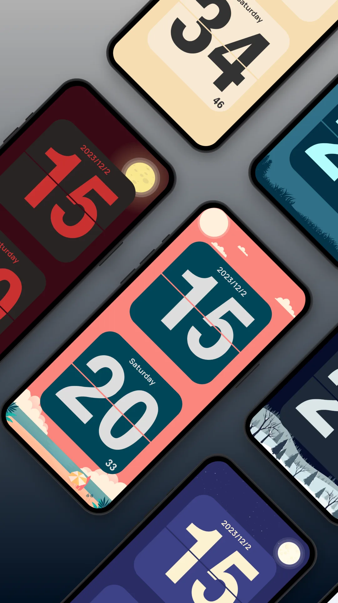{: width="180" .normal }
{: width="180" .normal }
{: width="180" .normal }

Flip Clock: World Clock is a free Android **flip clock** that adds weather, a home-screen widget, a Pomodoro timer and a floating clock on top of the classic flip face.

**Strengths**
- **Flip clock with weather** for your current location, handy as a desk clock.
- **Home-screen widget** so the time shows on your launcher.
- **Pomodoro timer and floating clock** for focus sessions.
- Free to start, with optional in-app upgrades.
- Lightweight and easy to set up.

**Weaknesses**
- Ad-supported in the free tier, which can interrupt the calm look.
- Weather and some widgets sit behind IAP.
- No iOS version.

**Best for:** Android users who want a flip clock with weather and a widget without paying upfront.

**Download Flip Clock: World Clock**
- [Google Play](https://play.google.com/store/apps/details?id=com.wssc.simpleclock)

---

### 4. Fullscreen Clock — best minimal fullscreen focus

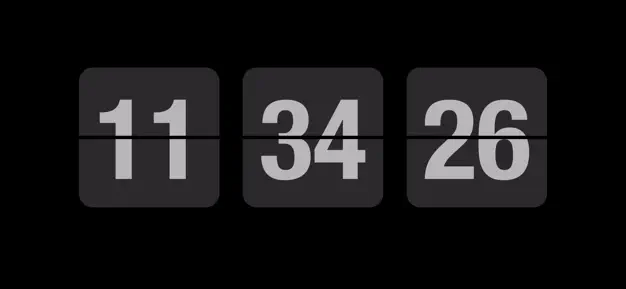{: width="360" .normal }
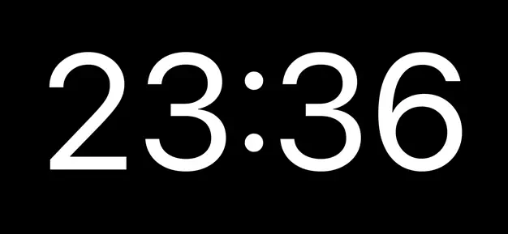{: width="360" .normal }

Fullscreen Clock: Flip & Focus turns your iPhone or iPad into a clean, always-on **flip clock** with thirteen faces, night dimming, landscape support, and a built-in Pomodoro.

**Strengths**
- **Thirteen clock faces** including flip and focus styles.
- **Screen stays awake** and supports night dimming for bedside use.
- **Built-in Pomodoro** for focused work sessions.
- Landscape and portrait support; very clean, minimal UI.
- No account required.

**Weaknesses**
- iOS-only — no Android app.
- Most face packs and features are behind IAP.
- No ambient sound of its own.

**Best for:** iPhone/iPad owners who want a beautiful, minimal fullscreen clock with a Pomodoro.

**Download Fullscreen Clock**
- [App Store](https://apps.apple.com/us/app/fullscreen-clock-flip-focus/id1403700342)

---

### 5. Flip Clock: Digital Desk Widget — best desk widget + screensaver

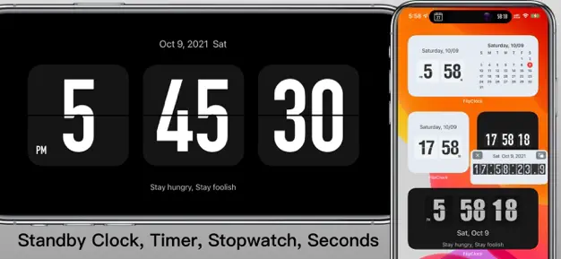{: width="360" .normal }
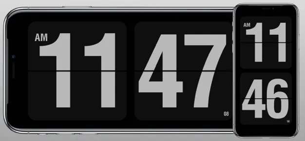{: width="360" .normal }

Flip Clock: Digital Desk Widget is an iOS app focused on **desktop-style flip clocks**, interactive standby widgets, and a screensaver-like mode for desk and nightstand use.

**Strengths**
- **StandBy and interactive widgets** that show a live flip clock.
- **Screensaver mode** for charging/desk setups.
- Shows seconds, date and calendar, with 12/24-hour formats.
- Black-and-white and themed styles.
- Clean, Apple-friendly design.

**Weaknesses**
- iOS-only.
- Best features require the paid version.
- No white noise or floating overlay.

**Best for:** iPhone users who want a flip clock they can pin as a widget or screensaver.

**Download Flip Clock: Digital Desk Widget**
- [App Store](https://apps.apple.com/us/app/flip-clock-digital-desk-widget/id1181028777)

---

### 6. Flip Clock — Digital Clock — best lightweight themed clock

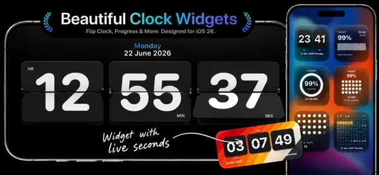{: width="180" .normal }
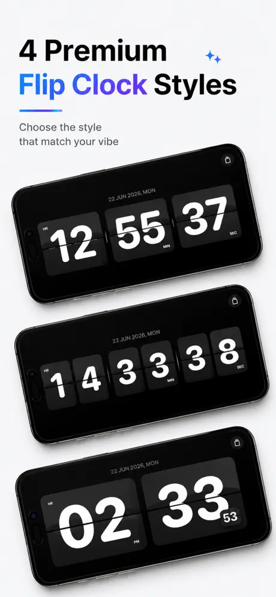{: width="180" .normal }
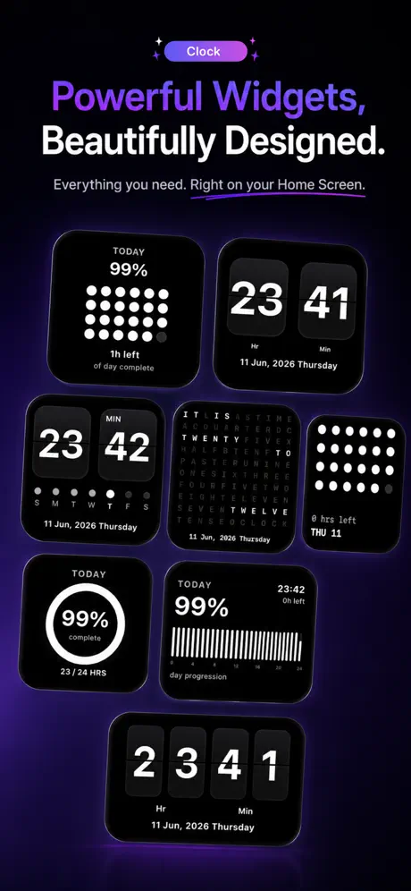{: width="180" .normal }
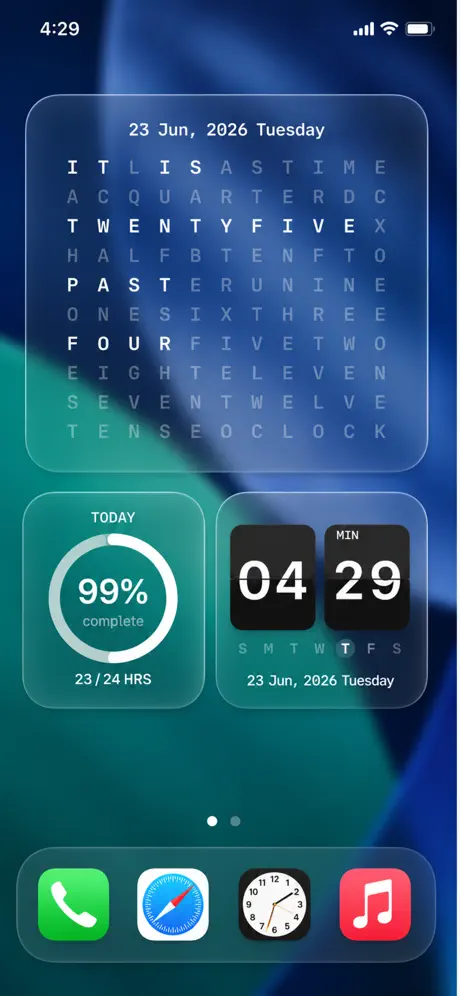{: width="180" .normal }
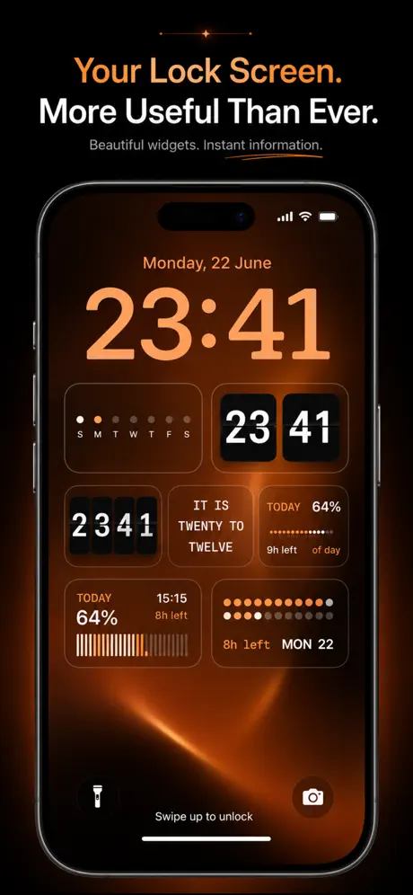{: width="180" .normal }

Flip Clock — Digital Clock is a simple, elegant iOS **flip clock** with themes, a standby widget, seconds/date display, and 12/24-hour support — a no-frills alternative to Retroflip.

**Strengths**
- **Elegant flip animation** with multiple themes beyond black-and-white.
- **Standby and interactive widget** support.
- Shows seconds, date and calendar.
- Lightweight and fast to launch.
- Free to try with optional upgrades.

**Weaknesses**
- iOS-only.
- No sound, floating clock or Pomodoro.
- Themes are the main paid extra.

**Best for:** iPhone users who want a clean, themed flip clock without extra features.

**Download Flip Clock — Digital Clock**
- [App Store](https://apps.apple.com/us/app/flip-clock-digital-clock/id1479450824)

---

## Core-capability comparison

The core-capability comparison sets six flip-clock apps side by side on animation, themes, sound, floating overlay, widgets, Pomodoro and 12/24-hour display. Only Clock is the sole entry combining white noise, a floating clock and widgets on Android and iOS; FliTik and Flip Clock: World Clock add timers, while Fullscreen Clock brings thirteen clock faces to iPhone and iPad. Every app shows 12/24-hour time with date, and every one has a free tier. Ads appear in only one free build — Flip Clock: World Clock.

| Capability | Only Clock | FliTik | Flip Clock: World Clock | Fullscreen Clock | Flip Clock: Digital Desk Widget | Flip Clock — Digital Clock |
|---|---|---|---|---|---|---|
| **Platforms** | Android, iOS | iOS (+desktop/Android) | Android | iOS | iOS | iOS |
| **Fullscreen flip animation** | Yes | Yes | Yes | Yes (flip & more) | Yes | Yes |
| **Themes / customization** | Many | Atmospheric | Basic | 13 faces | Themed | Themed |
| **White noise / focus sound** | Yes | Yes | No | No | No | No |
| **Floating clock overlay** | Yes | No | Yes | No | No | No |
| **Widgets** | Yes | No | Yes | No | StandBy + interactive | StandBy + interactive |
| **Weather** | No | No | Yes | No | No | No |
| **Pomodoro / timer** | No | Yes | Yes | Yes | No | No |
| **Countdown / count-up** | No | Yes | No | No | No | No |
| **12/24h + date** | Yes | Yes | Yes | Yes | Yes | Yes |
| **Free tier** | Generous | Free + IAP | Free + IAP | Free + IAP | Free + IAP | Free + IAP |
| **Ads** | No | No | Yes (free) | No | No | No |

---

## Which Retroflip alternative fits each kind of user

Six Retroflip alternatives are grouped below by what you wanted the clock to do beyond showing the time — play sound, run a focus timer, sit on the desktop, show weather, or stay ad-free overnight — rather than by feature count. The table ranks features; here the same six are grouped by *what you wanted the clock to do beyond showing the time*. That framing separates a quiet Nightdream-style face from Only Clock's white noise and floating mode, and flags the two checks before migrating: can the display dim without burning an OLED screen, and does the free tier keep the widget you use?

- **A themed clock that also plays sound** — a **Flip Clock (Soosu) alternative** or **Nightdream alternative** is usually about a quiet, always-on face; Only Clock adds white noise, a focus timer and a floating mode to that idea.
- **A desktop or browser flip clock** — a **Fliqlo alternative** fits the computer; FliTik and Flip Clock: Digital Desk Widget cover the desk-widget look on phones.
- **Widgets and world clocks** — a **ClockLab alternative** or **Digital Clock Widget alternative** points to small home-screen faces; Flip Clock: World Clock is the weather-and-timezones version.
- **Replacing the stock alarm app** — a **Google Clock alternative** is a different job: alarms and timers, not a decorative full-screen display.
- **Keeping it ad-free overnight** — a **Retroflip Clock alternative** shortlist should be filtered on ads and dimming first, because the phone stays lit for hours.

Whatever the label, ask two questions before migrating: can the display stay dim without burning an OLED screen, and does the free tier still include the widget you actually use?

## How to choose

Six pick-by-need rules cut through the Retroflip alternative field in 2026: choose Only Clock for themes, white noise, a floating clock and widgets on both platforms, FliTik for Pomodoro and countdowns, Flip Clock: World Clock for a free Android clock with weather and a widget, Fullscreen Clock for a minimal iOS focus clock, Flip Clock: Digital Desk Widget for an iPhone widget or screensaver, and Flip Clock — Digital Clock for a lightweight themed iOS face. Each rule follows one setup, so the six apps do not compete on the same axis.

- Want **themes + white noise + floating clock + widgets on both platforms** → **Only Clock**
- Want **Pomodoro, countdown and ambient flip clock** → **FliTik**
- Want a **free Android flip clock with weather and a widget** → **Flip Clock: World Clock**
- Want a **minimal iOS fullscreen clock with Pomodoro** → **Fullscreen Clock**
- Want a **desk widget / screensaver flip clock on iPhone** → **Flip Clock: Digital Desk Widget**
- Want a **lightweight themed iOS clock** → **Flip Clock — Digital Clock**

## How to migrate away from Retroflip

Retroflip migration takes five steps in 2026, from picking a replacement by platform to turning on sound or a timer so the clock does more than tell time. Choose from the six-app table based on whether you need sound, widgets or a floating overlay, then install the app and grant display-over-other-apps for floating mode and battery-optimization exceptions for always-on use. Match the 12/24-hour and date settings you had in Retroflip, add a widget to your home or lock screen, and switch on white noise or Pomodoro if that is why you are moving.

1. **Pick a replacement** using the table above based on your platform and whether you want sound, widgets, or a floating clock.
2. **Install it and grant the needed permissions** (display over other apps for floating clocks, battery optimization off for always-on).
3. **Set 12/24-hour and date display** to match what you used in Retroflip.
4. **Add a widget** (Only Clock, Flip Clock: World Clock, or the iOS widget apps) to your home or lock screen for at-a-glance time.
5. **If you want focus or sleep help**, turn on white noise (Only Clock, FliTik) or a Pomodoro timer (FliTik, Fullscreen Clock, Flip Clock: World Clock) so the clock does more than tell time.

## FAQ

**Is Only Clock the best Retroflip alternative?**
{:.faq-q}

For most people, yes. Only Clock is the closest all-round upgrade — it adds white noise, a floating clock, widgets and iOS support while keeping the flip-clock look Retroflip users love.

**Which Retroflip alternative has white noise?**
{:.faq-q}

Only Clock and FliTik both include ambient sound; the other four iOS options are silent clocks.

**Which Retroflip alternative works on Android and iOS?**
{:.faq-q}

Only Clock runs on both platforms; Flip Clock: World Clock covers Android only, and the rest are iOS-only.

**Is Only Clock free?**
{:.faq-q}

Yes. The core clock, themes and white noise work free; a one-time or subscription unlock opens the richest themes and sounds.

[Only Clock app page](/apps/only-clock/) — available on Android and iOS.

## Related terms

- [What Is a Flip Clock?](/glossary/what-is-a-flip-clock/)
- [What Is a Nightstand Clock?](/glossary/what-is-a-nightstand-clock/)
