Streaks turned habit tracking into a daily ritual for millions of iPhone users — a clean, Apple-Design-Award-winning app that nudges you to keep a chain alive. But it has real limits: it's **iPhone and iPad only, it's a paid-upfront app with no free tier, sync is iCloud-locked, and its customization lives inside Apple's ecosystem**. If you want Android support, cross-platform sync, deeper statistics, a free option, or a more playful interface, the field has matured fast.

Below we compare six strong **alternatives to Streaks** — from a cute, privacy-first tracker to gamified RPG systems and science-backed coaching — across price, platforms, core features, and the everyday capabilities that actually matter. Most readers arrive with one concrete blocker — no Android app, no free tier, or no way to export their history — so each pick is framed around the reason people actually switch.

## Why look beyond Streaks

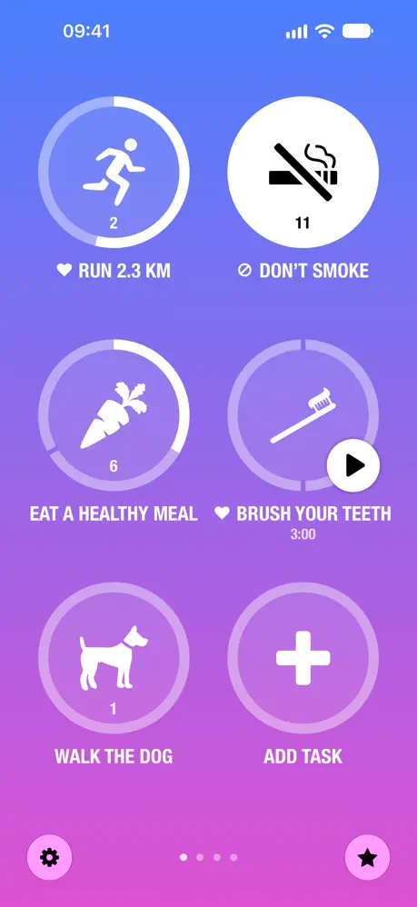{: width="180" .normal }
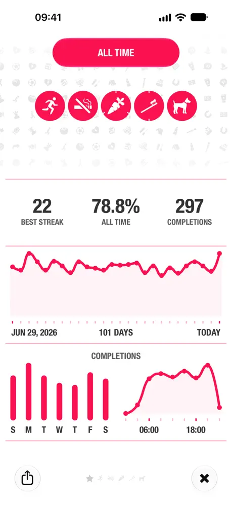{: width="180" .normal }
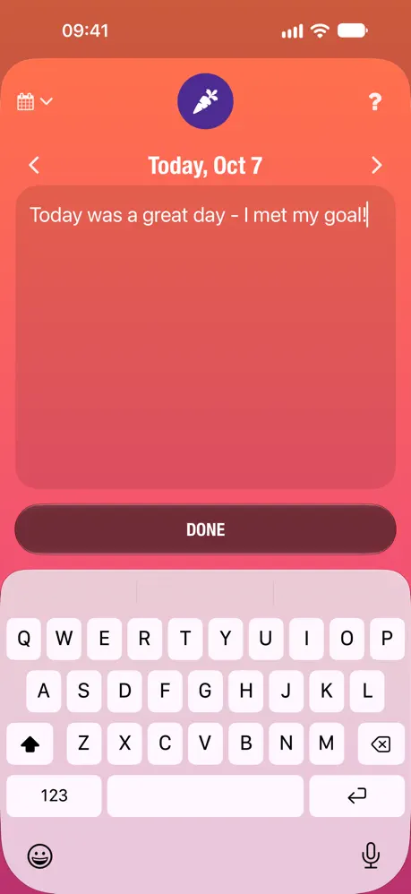{: width="180" .normal }
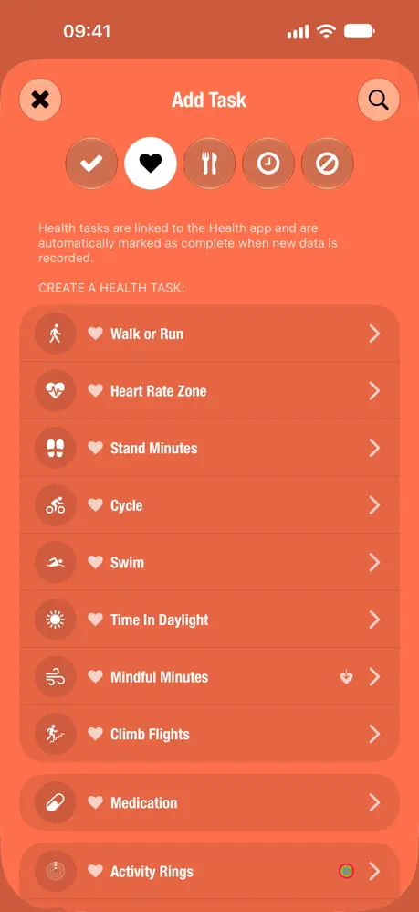{: width="180" .normal }
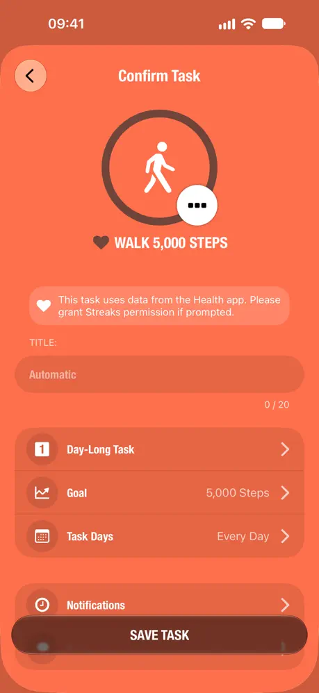{: width="180" .normal }

- **iPhone/iPad only** — there is no Android app and only limited desktop access, so mixed-device households are out.
- **Paid upfront (~$5.99)** with no free tier to try before buying.
- **iCloud-only sync** — there is no standalone account, so moving to Android or Windows is clumsy.
- **Build-focused analytics** — the stats are clean but lighter than dedicated statistics apps.
- **Minimal social layer** — accountability is mostly manual (sharing tasks), with no community or coaching.

## The best Streaks alternatives at a glance

| App | Price (2026) | Platforms | Build + Break | Best for |
|---|---|---|---|---|
| **Meow Habits** | Free core + VIP (~$9.99/yr) | Android, iOS | **Yes** | Cute UI, 500+ icons, private, no account |
| **Habitica** | Free + sub (~$4.99/mo) | Android, iOS, web | Yes | Gamified RPG accountability |
| **Loop Habit Tracker** | Free, open-source | Android | Yes | Plain stats, privacy, no account |
| **Fabulous** | Free + sub (~$12/mo) | Android, iOS | Routines + coaching | Science-based coaching |
| **Productive** | Free + Pro (~$2.50/mo) | iOS | Yes | Polished iOS widgets |
| **Habitify** | Free + sub | iOS, Android, web | Yes | Cross-platform, time-of-day tracking |

---

### 1. Meow Habits — best for a cute, private, no-account tracker

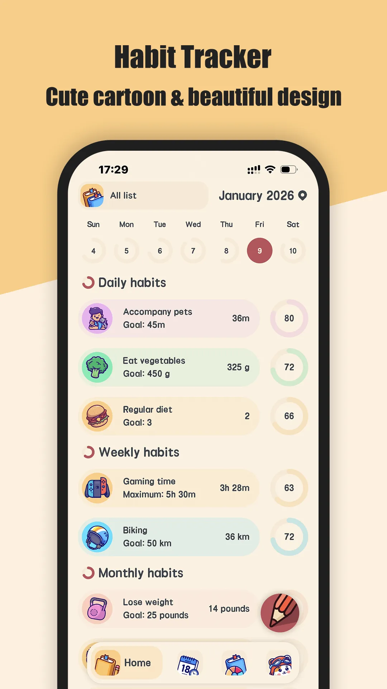{: width="180" .normal }
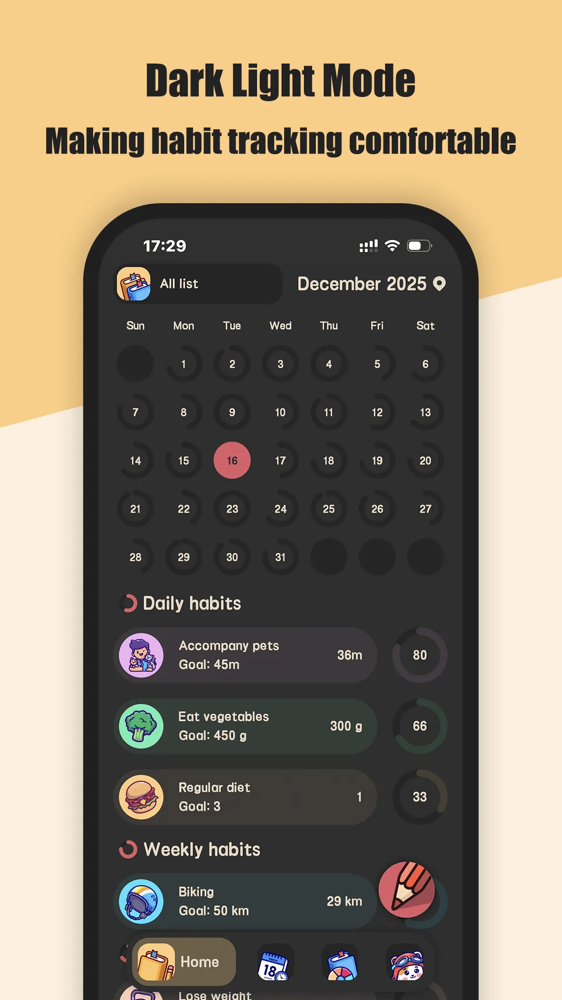{: width="180" .normal }
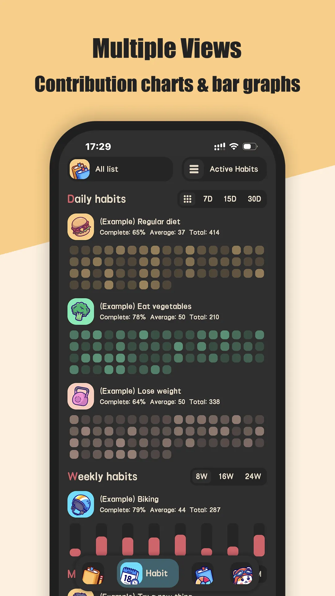{: width="180" .normal }
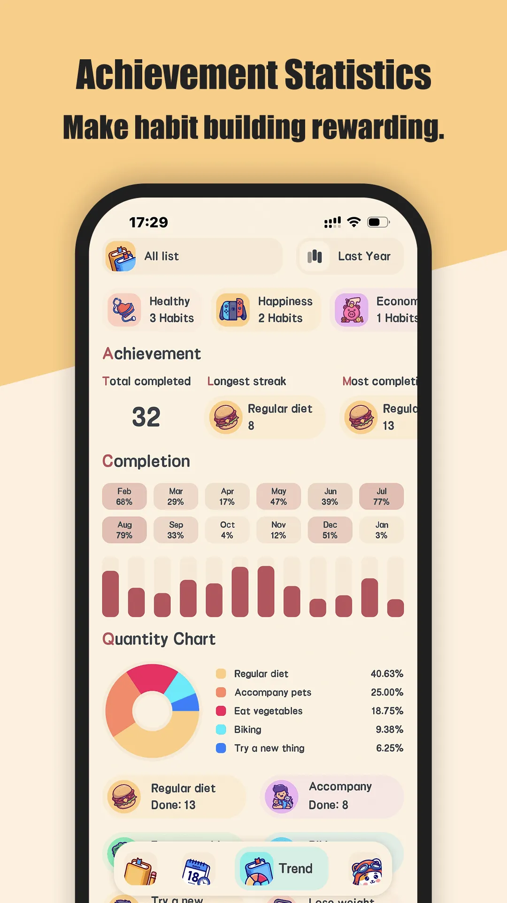{: width="180" .normal }
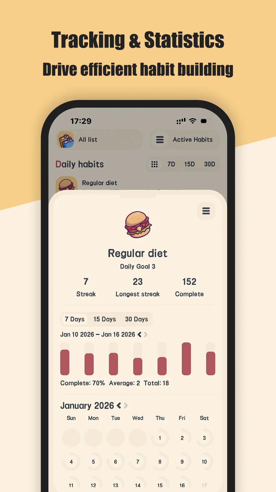{: width="180" .normal }

Meow Habits is a cat-themed **[habit tracker](/glossary/what-is-a-habit-tracker/)** for Android and iOS. Its standout trait is the **interface**: a cute, cartoon-style design with **500+ rich category icons** that make daily check-ins feel light rather than like a productivity chore. Beyond looks, it covers the practical habit basics — and it does so without forcing you into a cloud account.

**Strengths**
- **Beautiful, cartoon UI with 500+ custom icons** — the clearest differentiator; logging a habit is visually rewarding.
- **Build and break modes** — track positive routines or quit bad ones in the same app.
- **Habit lists, streaks, and a calendar / heatmap view** (daily / weekly / monthly) so you can see momentum at a glance.
- **CSV export** (all habits or a date range) for Excel, plus **Google Drive / WebDav backup** — your data leaves your control only when you choose.
- **No account required** — habits stay on your device with an optional fingerprint lock, which is rare among mainstream habit apps.
- Reminders, dark/light mode, and habit charts (completion %, contribution graph).

**Weaknesses**
- **No automatic cross-platform cloud sync** — sync is Google Drive (Android) or WebDav, not a dedicated account, so moving between an Android phone and iPhone is less seamless than account-based apps.
- **Advanced features** (e.g., richer charts / extra habits) sit behind a low-cost VIP (~$0.99/mo or $9.99/yr); the free core covers everyday tracking.
- No gamification or social/community layer, and a smaller ecosystem than the big players.

**Best for:** people who want clear, private habit tracking without a cloud account, who value a friendly interface, and who don't mind light manual setup.

**Download Meow Habits**
- [Google Play](https://play.google.com/store/apps/details?id=com.glgjing.meow.habit.goal)
- [App Store](https://apps.apple.com/us/app/meow-habits-habit-tracker/id6758230559)

---

### 2. Habitica — best for gamified accountability

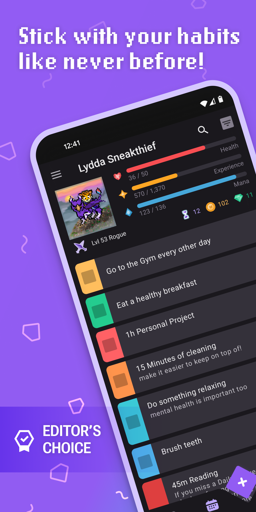{: width="180" .normal }
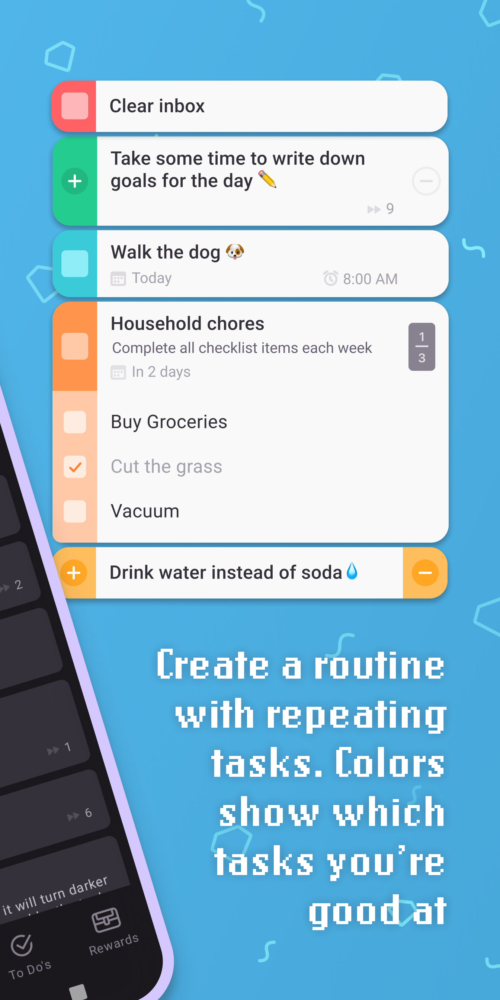{: width="180" .normal }
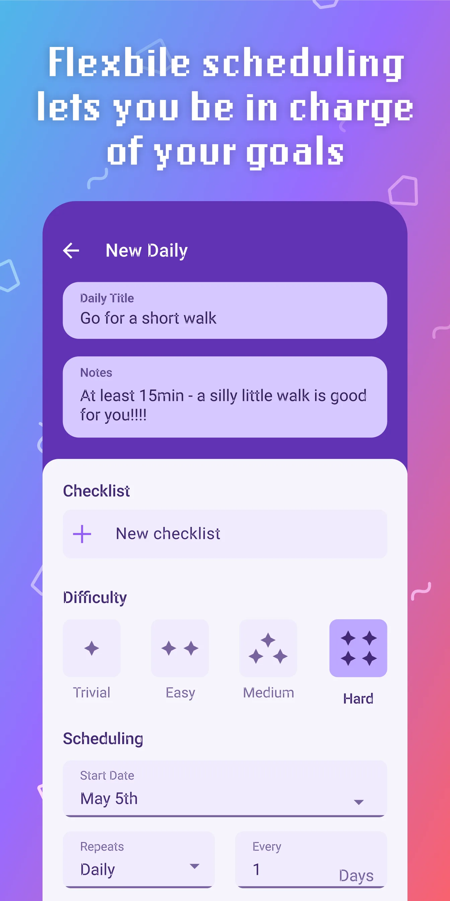{: width="180" .normal }
{: width="180" .normal }
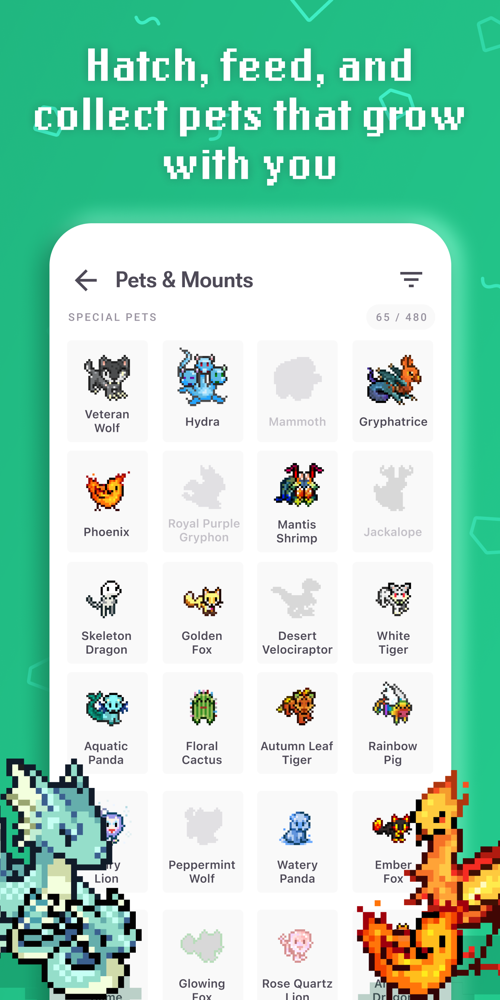{: width="180" .normal }

Habitica turns your habits, dailies, and to-dos into an **RPG**. You build an avatar, earn XP and gold for completing tasks, and lose health when you slip. It's cross-platform with an account, and parties, guilds, and challenges add a genuine social layer that Streaks lacks.

**Strengths**
- **Gamified RPG system** (avatar, pets, gear, quests) makes consistency feel like a game rather than a chore.
- **Strong cross-platform account sync** across Android, iOS, and web.
- **Parties, guilds, and challenges** add real social accountability and friendly competition.
- **Generous free tier** and fully open-source.
- Integrations with **Apple Health / Google Fit**; reminders and home-screen widgets.

**Weaknesses**
- **Game mechanics can feel cluttered or childish** for users who just want plain productivity.
- You get the most value only if you **engage with the RPG systems**; casual users may find the UI busy.
- **Habit analytics are lighter** than stats-focused apps like Loop — trend charts and heatmaps are shallower.
- Some cosmetics and convenience features sit behind a subscription, though the app is fully usable free.

**Best for:** people who stay motivated by games, levels, pets, and party accountability.

**Download Habitica**
- [Google Play](https://play.google.com/store/apps/details?id=com.habitrpg.android.habitica)
- [App Store](https://apps.apple.com/us/app/habitica-gamified-taskmanager/id994882113)

---

### 3. Loop Habit Tracker — best for free, open-source, privacy-first stats

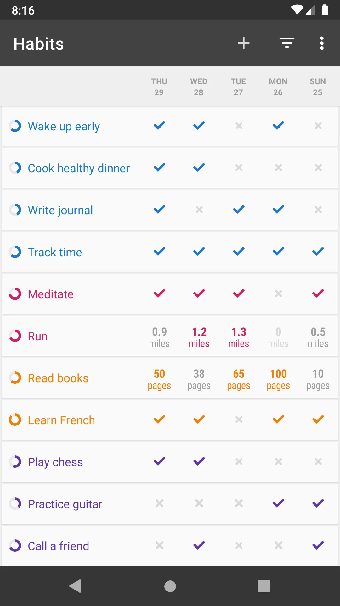{: width="180" .normal }
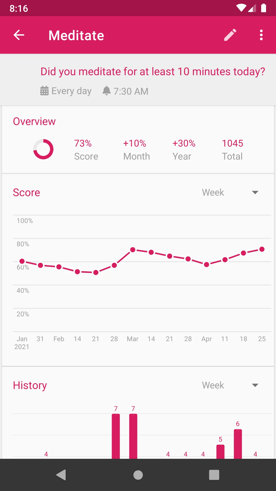{: width="180" .normal }
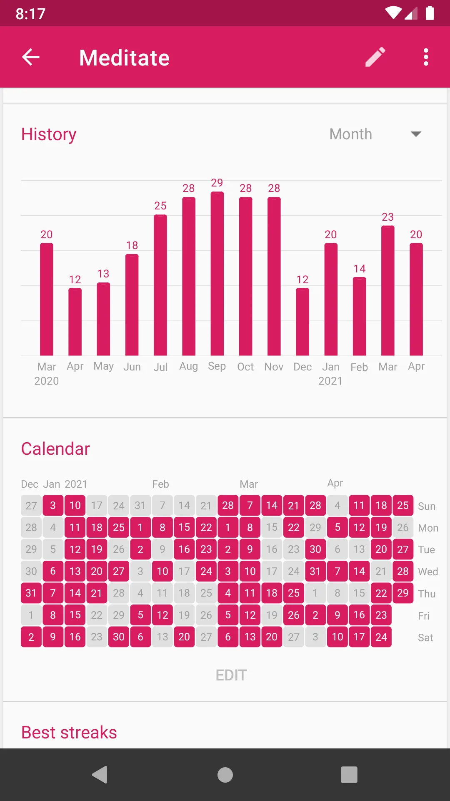{: width="180" .normal }
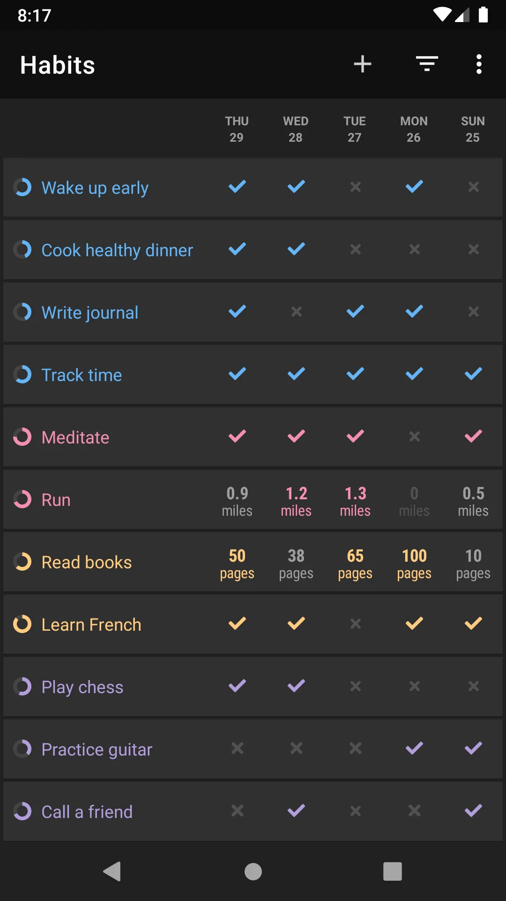{: width="180" .normal }
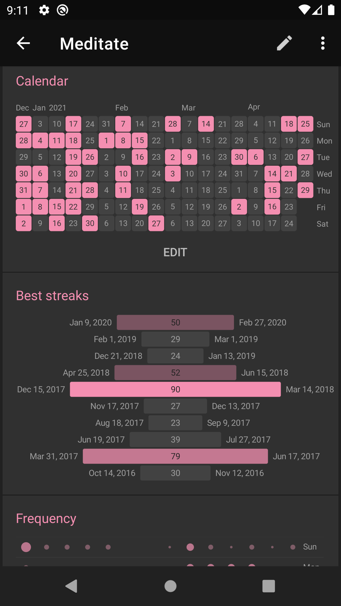{: width="180" .normal }

Loop is a **free, open-source, ad-free** habit tracker for Android. It strips everything down to solid statistics — habit score, streaks, frequency — and never asks you to sign up. There is no iOS version, but for Android purists it's hard to beat.

**Strengths**
- **Completely free, open-source, no ads, and no account required.**
- **Detailed statistics**: habit score, current/best streak, frequency, and a clean heatmap.
- **Targets and reminders**; supports both build and break habits.
- **Respects privacy** and is very lightweight and fast.
- Home-screen widgets for at-a-glance checking.

**Weaknesses**
- **Android only** — no iOS, no web, no desktop client.
- **No cloud sync or cross-device**; data lives locally with manual export/import only.
- **No gamification, no social, no coaching** — purely a tracker.
- Plainer UI with less hand-holding for beginners.

**Best for:** Android users who want a free, private, statistics-focused tracker with no strings attached.

**Download Loop Habit Tracker**
- [Google Play](https://play.google.com/store/apps/details?id=org.isoron.uhabits)

---

### 4. Fabulous — best for science-based coaching

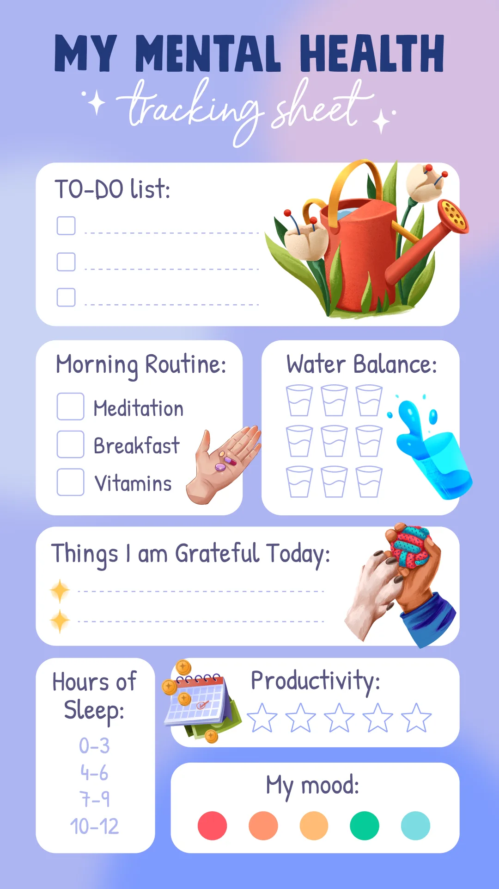{: width="180" .normal }
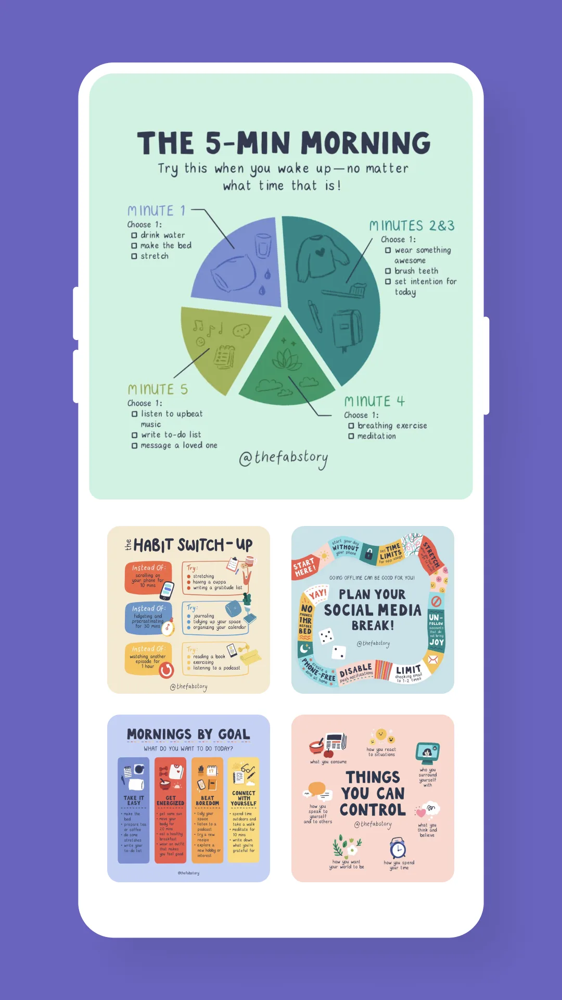{: width="180" .normal }
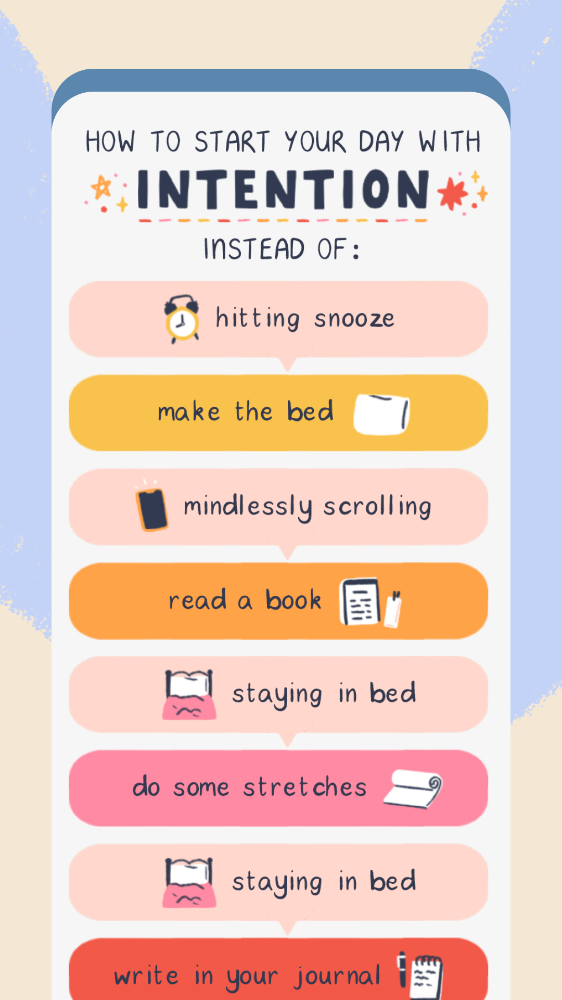{: width="180" .normal }
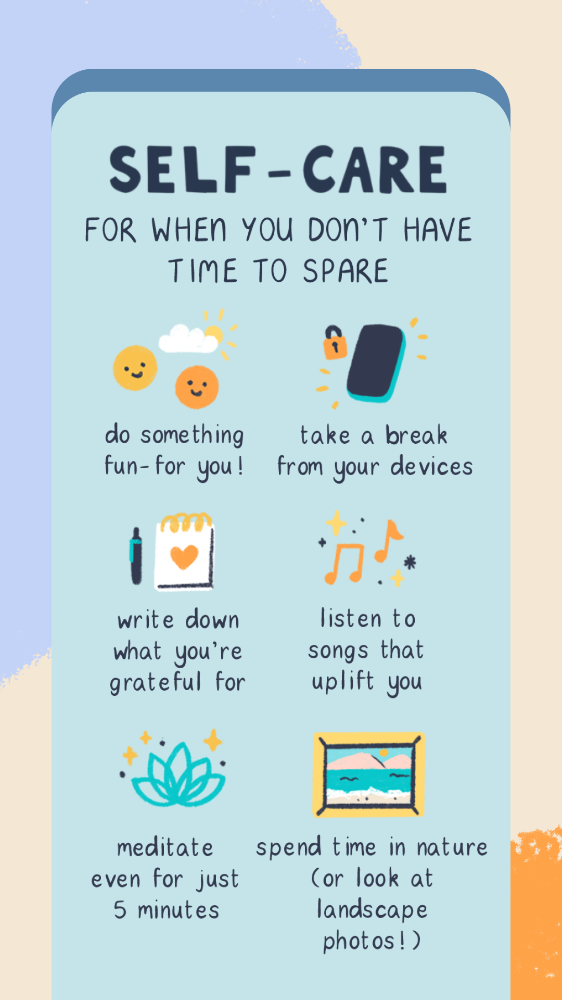{: width="180" .normal }
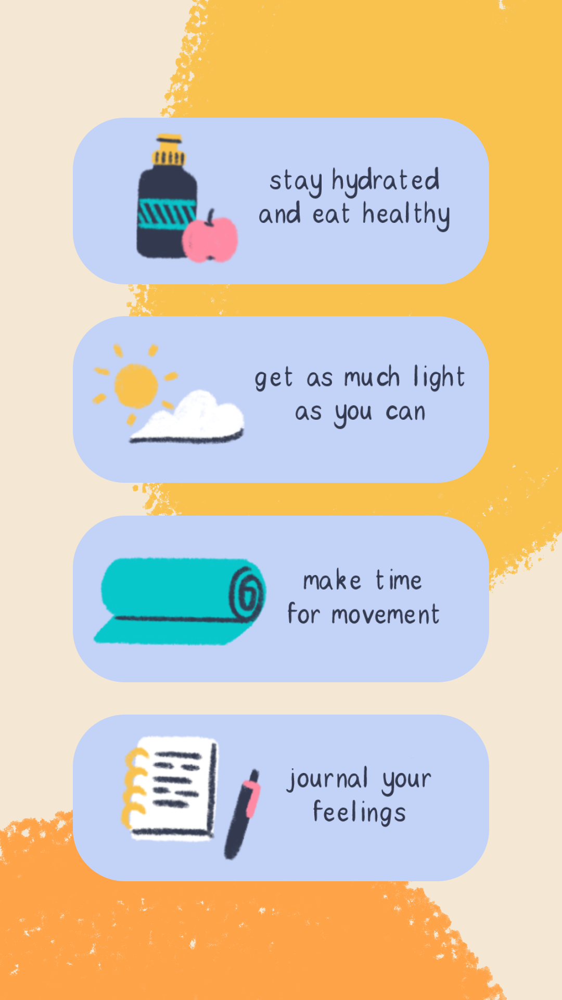{: width="180" .normal }

Fabulous began as a **Duke University behavioral-economics research project** and frames habit building as guided journeys — morning routines, meditation, sleep, fitness, and mindful eating — with coaching rather than bare checkboxes.

**Strengths**
- **Science-backed coaching and structured journeys**, not just to-do ticks.
- **Guided routines** for mornings, focus, sleep, fitness, and nutrition.
- **Cross-platform** (Android + iOS) with account sync.
- Polished, calming design that personalizes over time.
- Integrates with Health apps for steps and sleep.

**Weaknesses**
- **Subscription-heavy** — most journeys are behind Fabulous Premium (can run ~$12/mo).
- The coaching approach can feel **like too much** for users who want a simple tracker.
- **Less about raw habit statistics**; more about programs and streaks within a journey.
- Pricey relative to simpler trackers, and some users find the prompts pushy.

**Best for:** people who want a coach-led program to build real routines, not just a checklist.

**Download Fabulous**
- [Google Play](https://play.google.com/store/apps/details?id=co.thefabulous.app)
- [App Store](https://apps.apple.com/us/app/fabulous-daily-habit-tracker/id1203637303)

---

### 5. Productive — best for a polished iOS experience

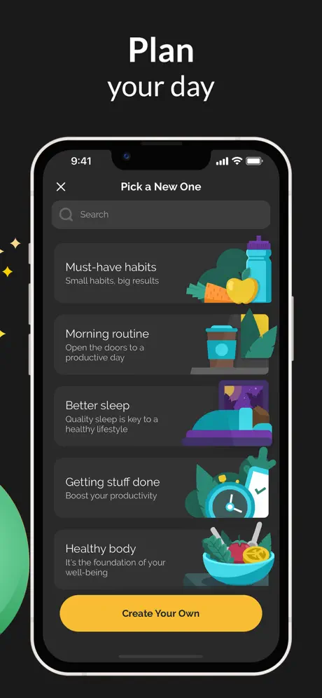{: width="180" .normal }
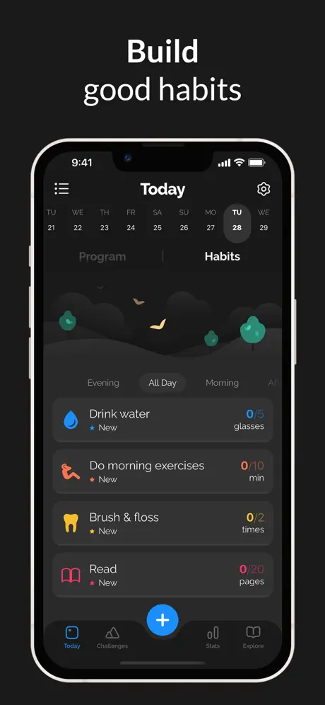{: width="180" .normal }
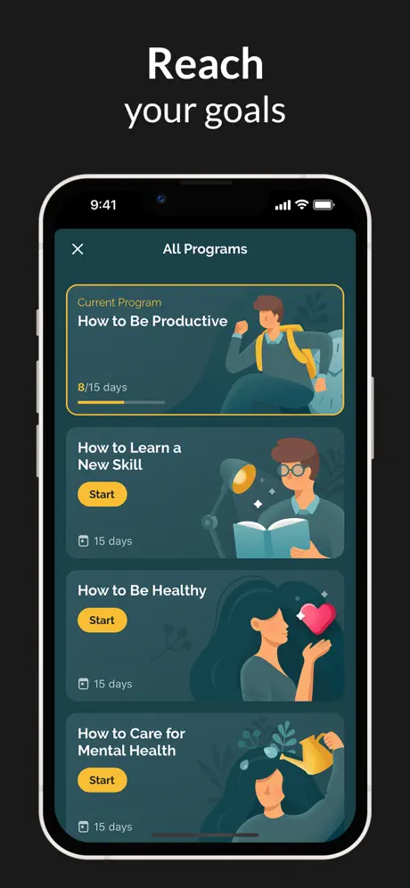{: width="180" .normal }
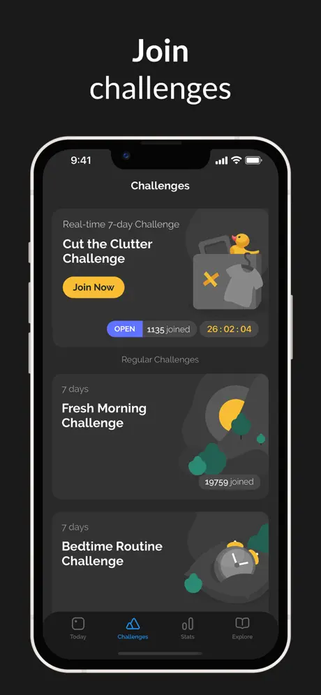{: width="180" .normal }
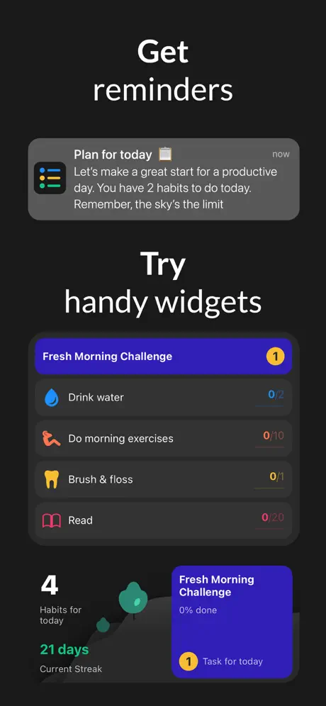{: width="180" .normal }

Productive is one of the **most popular iOS habit trackers**, known for a clean, beautiful interface and excellent widgets. It's iPhone/iPad-first and leans into Apple's design language, making it the closest spiritual sibling to Streaks for Apple users.

**Strengths**
- **Polished, beautiful iOS UI** with excellent home-screen and lock-screen widgets.
- **Build and break habits**, categories, reminders, and challenges.
- Good daily-planner flow and clean statistics.
- Apple Watch support and Siri shortcuts.

**Weaknesses**
- **iOS-focused** — there is no real Android app, so it's not an option for Android users.
- Many features sit behind **Productive Pro** (subscription).
- **Less powerful for complex or data-heavy habits**, and it isn't cross-platform with friends.

**Best for:** iPhone users who want the slickest, most widget-friendly habit tracker.

**Download Productive**
- [App Store](https://apps.apple.com/us/app/productive-habit-tracker/id983826477)

---

### 6. Habitify — best for cross-platform, time-based tracking

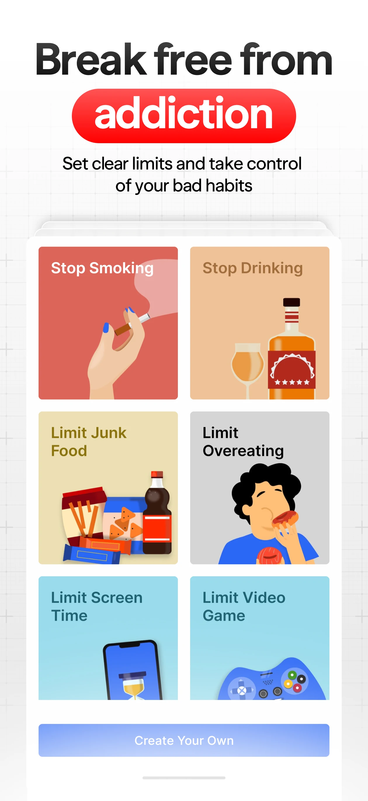{: width="180" .normal }
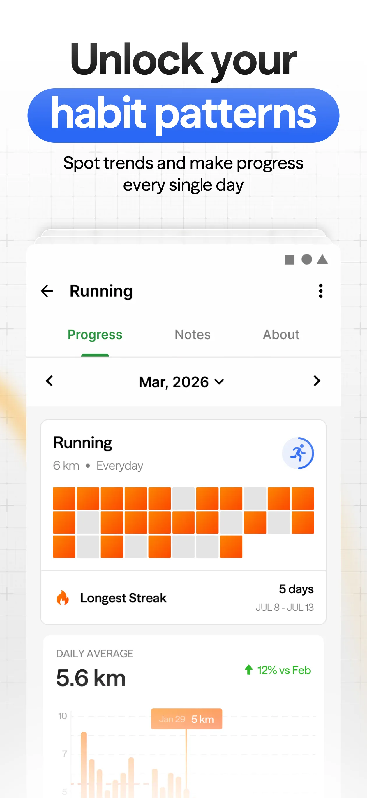{: width="180" .normal }
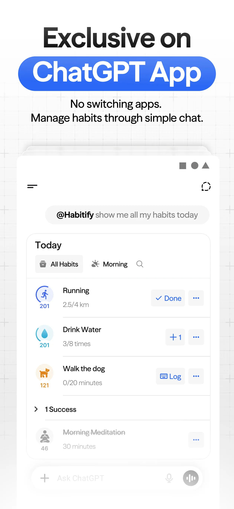{: width="180" .normal }
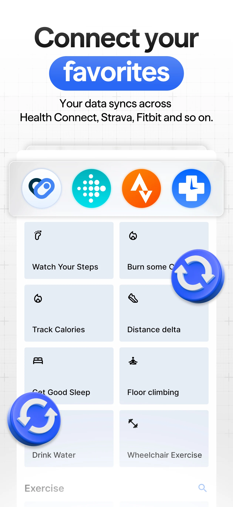{: width="180" .normal }

Habitify is a **cross-platform habit tracker** (iOS, Android, web, Wear OS) that organizes habits by **time of day — morning, afternoon, evening** — and syncs in real time. It's a strong pick if you live across several devices and like habits slotted into your schedule.

**Strengths**
- **Truly cross-platform** with real-time sync across Android, iOS, web, and watches.
- **Organizes habits by time of day**, which fits daily routines naturally.
- Clean analytics, reminders, and a focused productivity feel.
- Apple-featured "App of the Day"; 3M+ users; free tier available.

**Weaknesses**
- Some features (unlimited habits, smart reminders, custom areas) sit behind **Habitify Plus / Pro**.
- Less whimsical than Meow Habits; the Android version has historically lagged the iOS experience.
- No gamified RPG layer like Habitica.

**Best for:** people who live across multiple devices and want habits slotted into their day.

**Download Habitify**
- [Google Play](https://play.google.com/store/apps/details?id=co.unstatic.habitify)
- [App Store](https://apps.apple.com/us/app/habitify-habit-tracker/id1111447047)

---

## Core-capability comparison

| Capability | Meow Habits | Habitica | Loop | Fabulous | Productive | Habitify |
|---|---|---|---|---|---|---|
| **Platforms** | Android, iOS | Android, iOS, web | Android only | Android, iOS | iOS | iOS, Android, web |
| **Build + break habits** | Yes | Yes | Yes | Routines + habits | Yes | Yes |
| **Reminders** | Yes | Yes | Yes | Yes (smart) | Yes | Yes |
| **Streaks & statistics** | Yes (charts, heatmap) | Light (XP-based) | Strong (score, heatmap) | Program-based | Yes | Yes (analytics) |
| **Widgets** | Yes | Yes | Yes | Limited | Strong | Yes |
| **Cloud sync / cross-device** | Partial (Drive / WebDav) | Yes (account) | No (local) | Yes (account) | iCloud | Yes (real-time) |
| **Gamification / social** | No | Strong (RPG + parties) | No | Coaching | Challenges | Light |
| **Offline / privacy (no account)** | Strong (on-device) | Account-based | Strong (no account) | Account-based | Account (iCloud) | Account-based |
| **Free tier** | Generous core | Generous | Full (free) | Limited | Limited | Generous |
| **Pricing** | Free + VIP ~$9.99/yr | Free + ~$4.99/mo | Free (open-source) | Free + ~$12/mo | Free + ~$2.50/mo | Free + subscription |
| **Theming / icons** | 500+ cartoon icons | Pixel RPG style | Minimal | Calm themes | Polished themes | Clean themes |
| **Health integration** | Partial | Apple Health / Google Fit | No | Yes (Health) | Apple Health | Partial |

---

## Which Streaks alternative fits each kind of user

The table above ranks features; here the same six are grouped by *what you are actually replacing*.

- **Switching because of platform** — Meow Habits is the only pick that keeps Android and iOS in one habit tracker, and it works as a **habit tracker offline no account** straight after install. On a **best free habit tracker Android** shortlist it also avoids the **free habit tracker app no subscription** trap: the free core has no trial clock.
- **Switching because the chain stopped motivating you** — a **Habitica alternative** search usually means rewards and party accountability should do the job the streak used to do.
- **Switching because of your data** — a **Loop Habit Tracker alternative** is for open-source, on-device statistics with no sign-up; Meow Habits keeps that idea and adds CSV export plus WebDav backup.
- **Switching because of structure** — a **Habitify alternative** fits habits tied to morning, afternoon and evening across devices, while a **Fabulous alternative** fits a guided coaching program. Both need an account, which is the trade-off against local-only tools.
- **Still iPhone-only** — Productive is the closest in feel to Streaks, but it inherits the same iOS-only limit.

If the real question is which **habit tracker app** to keep for years, start with the two things that do not change with trends: can you export your history, and does it work without an account?

## How to choose

- Want a **cute, private, no-account tracker with 500+ icons** → **Meow Habits**
- Want **games, levels, and party accountability** → **Habitica**
- Want **free, open-source Android stats with no account** → **Loop**
- Want a **coach-led program** (sleep, focus, fitness) → **Fabulous**
- Want the **slickest iOS widgets** → **Productive**
- Want **true cross-device sync slotted by time of day** → **Habitify**

## How to migrate away from Streaks

1. **List your current Streaks tasks** and their schedules (daily, every-other-day, weekly).
2. **Pick a replacement** using the table above based on your platform and whether you want build, break, or both.
3. **Recreate habits** — choose build or break mode where supported, and copy each task's frequency.
4. **Set reminders** for the same times you used in Streaks so the new chain survives the switch.
5. **Enable backup** (Meow Habits: Google Drive / WebDav; Habitica / Habitify / Fabulous: account sync) so you're never locked in.

## FAQ

**Is Meow Habits a good free Streaks alternative?**
Yes. It runs on Android and iOS (Streaks is iOS-only), is free at the core with no account, supports build *and* break modes, and keeps your data on-device behind a fingerprint lock.

**Does Meow Habits work on Android?**
Yes — Android is fully supported, with Google Drive backup and a home-screen widget for one-tap check-ins.

**Which Streaks alternative is best for privacy?**
Meow Habits — no account required, on-device storage with an optional fingerprint lock, and backups only to your own Google Drive or WebDav when you enable them.

**Can I move my habits out of Streaks?**
Streaks has no CSV export, so you'll recreate habits manually; Meow Habits itself exports CSV, so your data stays portable afterward.

[Meow Habits app page](/apps/meow-habits/) — download for Android and iOS.

## Related terms

- [What Is a Habit Tracker?](/glossary/what-is-a-habit-tracker/)
