If you are shopping for **alternatives to Todoist**, you probably want lower cost, more privacy, or a simpler interface. Here are the **[best to-do list app](/glossary/what-is-a-to-do-list/)** alternatives worth a look in 2026 — seven apps picked either for high market share or for a distinct strength — with detailed pros and cons, a core-capability comparison, and direct download links.

## Why people look beyond Todoist

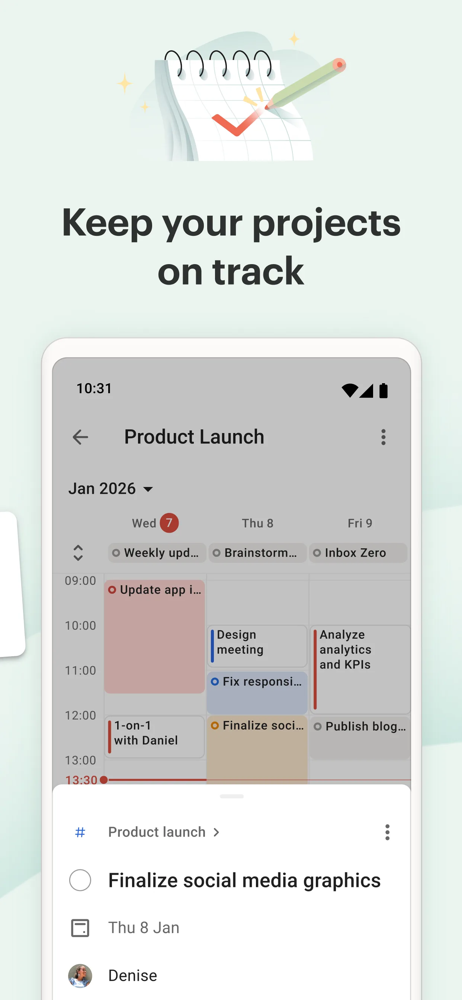{: width="180" .normal }
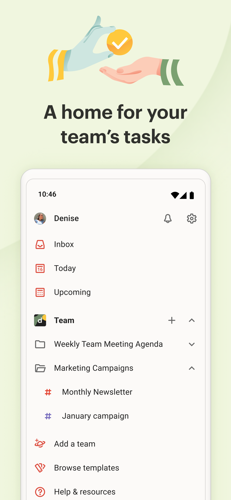{: width="180" .normal }
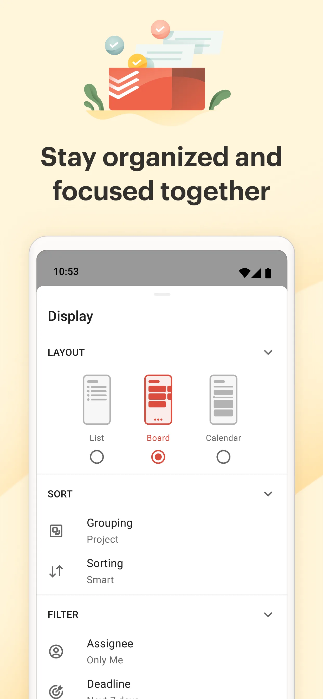{: width="180" .normal }
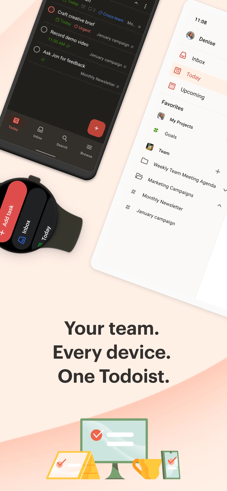{: width="180" .normal }
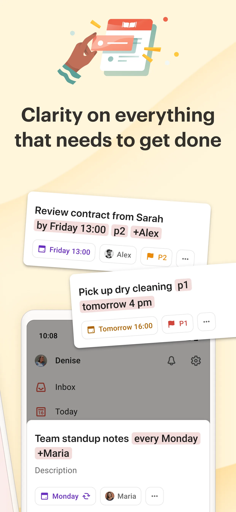{: width="180" .normal }

- The free **Beginner** tier caps you at ~5 active projects with limited reminders.
- **Calendar integration** and many automations sit behind the **Pro** plan (~$60/year).
- Some users simply prefer a calmer, less "gamified" interface, or want their data off a vendor cloud.

## The best Todoist alternatives at a glance

| App | Price | Free tier | Best for |
|---|---|---|---|
| **Microsoft To Do** | Free | Full (MS account) | Microsoft 365 / Outlook users |
| **Meow Todo** | Free core + VIP (~$9.99/yr) | Generous core | Privacy, cute UI, CSV export |
| **TickTick** | Free + Premium $35.99/yr | Limited lists | All-rounder: calendar + pomodoro |
| **Google Tasks** | Free | Full (Google account) | Gmail / Calendar users |
| **Things 3** | Paid, per platform | None | Best-designed Apple-only app |
| **Notion** | Free + paid tiers | Generous | Flexible all-in-one workspace |
| **Any.do** | Free + Premium ~$36/yr | Limited | Combined calendar + tasks |

### 1. Microsoft To Do — best for the Microsoft ecosystem

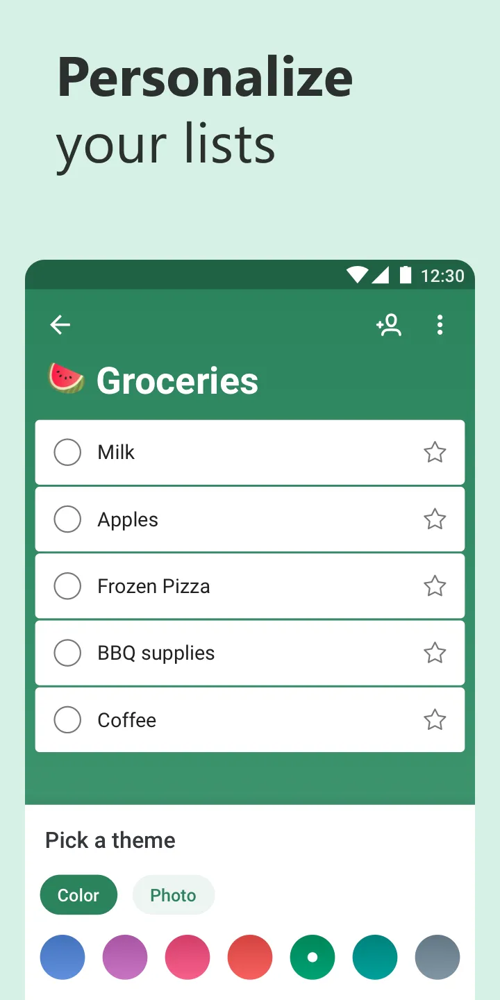{: width="180" .normal }
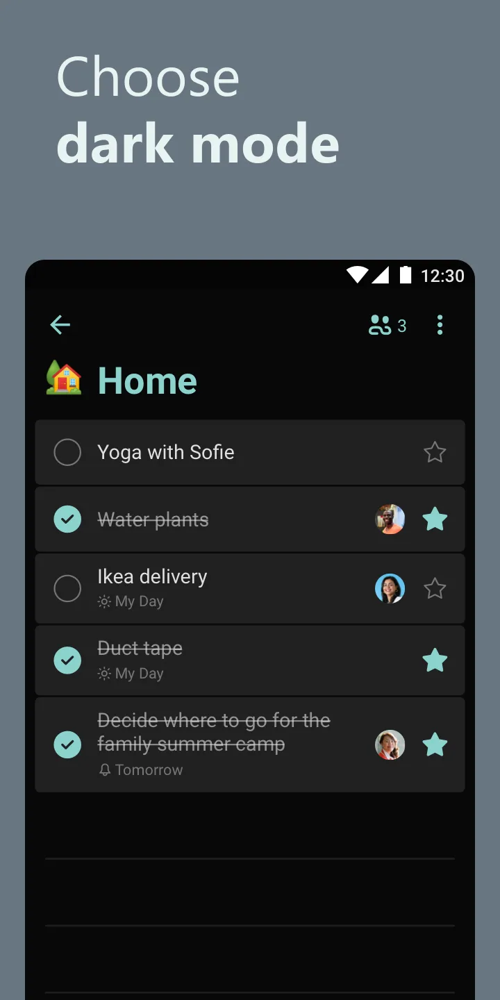{: width="180" .normal }
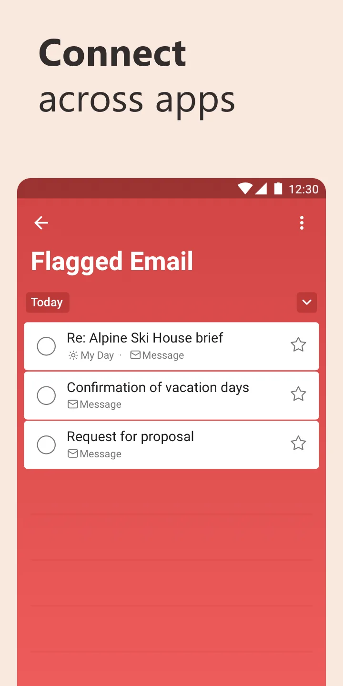{: width="180" .normal }
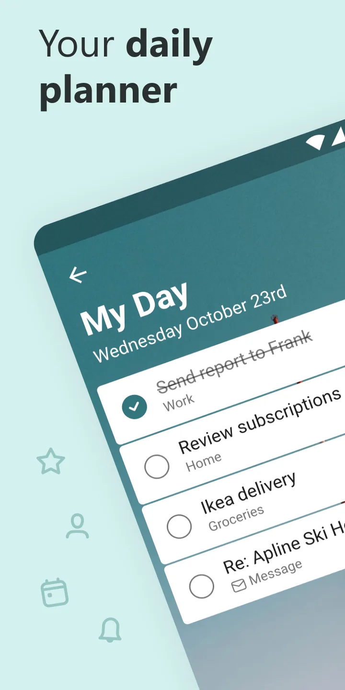{: width="180" .normal }
{: width="180" .normal }

Microsoft To Do (built by the former Wunderlist team Microsoft acquired in 2015) is **completely free** and deeply tied to Outlook and Windows. It shines for anyone already in Microsoft 365.

**Strengths**
- **Fully free** across iOS, Android, Windows, macOS, and web, with 34-language support.
- **Deep Outlook / Microsoft 365 integration** — flagged emails become tasks, and it shares the same engine as Outlook tasks.
- Clean **My Day** planning, shared lists, subtasks, file attachments, and due-date reminders.
- Backed by Microsoft, so sync and reliability are solid.

**Weaknesses**
- **Basic feature set** — no built-in calendar view, no pomodoro or habit tracking, and natural-language date entry is limited versus TickTick or Things.
- Tightly coupled to a Microsoft account; less compelling if you're outside that ecosystem.
- No collaboration beyond shared lists, and no advanced project or GTD structures.

**Best for:** Microsoft 365 / Outlook users who want a free, dependable daily task list without learning a new system.

**Download Microsoft To Do**
- [Google Play](https://play.google.com/store/apps/details?id=com.microsoft.todos)
- [App Store](https://apps.apple.com/app/microsoft-to-do/id1212616790)

### 2. Meow Todo — best for privacy, a delightful interface, and a free core

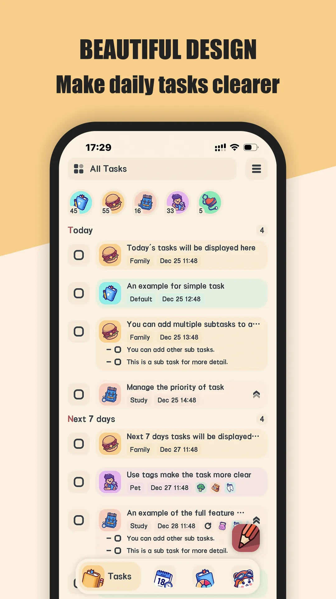{: width="180" .normal }
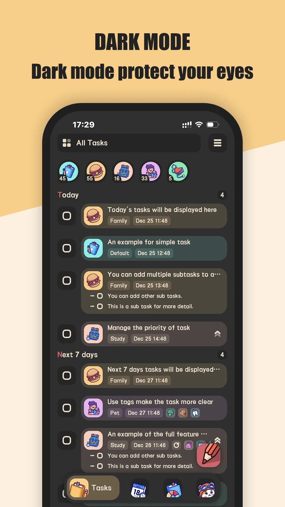{: width="180" .normal }
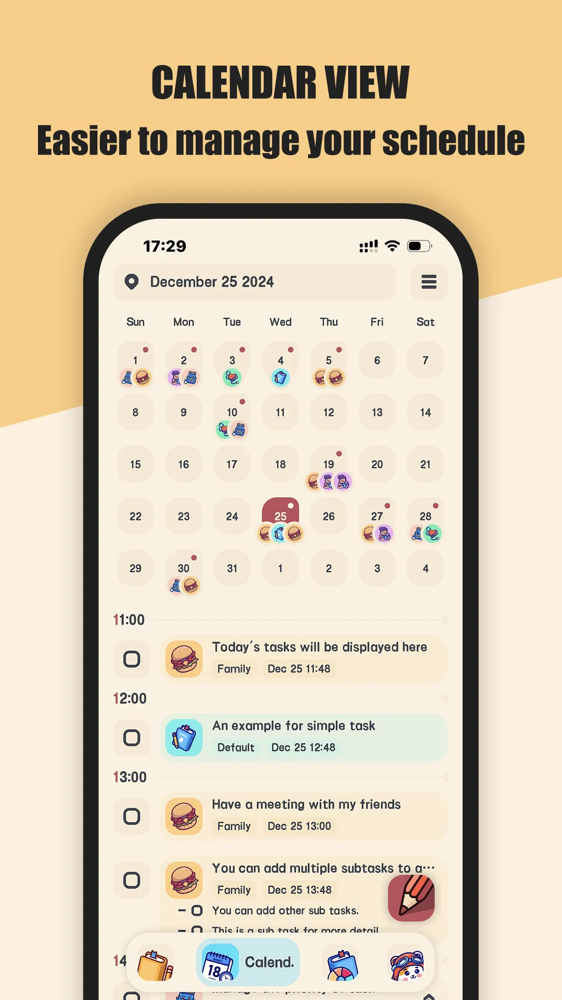{: width="180" .normal }
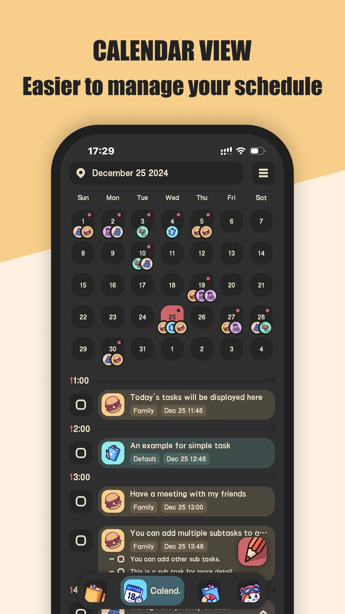{: width="180" .normal }
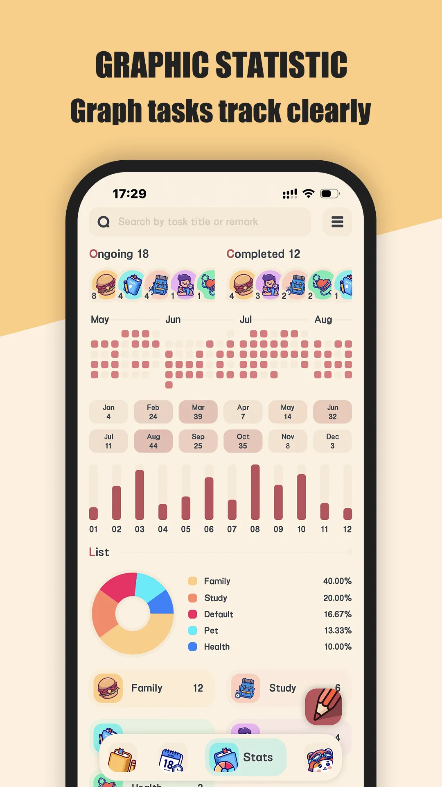{: width="180" .normal }

Meow Todo List is a cat-themed **[task manager](/glossary/what-is-a-to-do-list/)** for Android and iOS. Its standout trait is the **interface**: a cute, cartoon-style design with **400+ rich category icons** that make daily planning feel light rather than like office work. Beyond looks, it covers the practical to-do basics.

**Strengths**
- **Beautiful, cartoon UI with 400+ custom icons** — the clearest differentiator; logging tasks is visually rewarding.
- **Lists, subtasks, and a calendar view** (daily / weekly / monthly) so you can see upcoming work at a glance.
- **CSV export** (all tasks or a date range) for Excel, plus **iCloud / WebDav backup** — your data leaves your control only when you choose.
- **No account required** — tasks stay on your device with an optional fingerprint lock, which is rare among mainstream to-do apps.
- Recurring tasks, due-date reminders, dark/light mode, and task charts (pie + contribution graph).

**Weaknesses**
- **No automatic cross-platform cloud sync** — sync is iCloud (Apple) or WebDav, not a dedicated account, so moving between an Android phone and iPhone is less seamless than account-based apps.
- **Advanced features** (e.g., unlimited lists / richer charts) sit behind a low-cost VIP (~$0.99/mo or $9.99/yr); the free core covers everyday tracking.
- No collaboration or shared-list support, and a smaller ecosystem than the big players.

**Best for:** people who want clear, private task tracking without a cloud account, who value a friendly interface, and who don't mind light manual setup.

**Download Meow Todo List**
- [Google Play](https://play.google.com/store/apps/details?id=com.glgjing.money.task.todo.list.meow)
- [App Store](https://apps.apple.com/app/meow-todo-list-task/id6742345495)

### 3. TickTick — best all-rounder

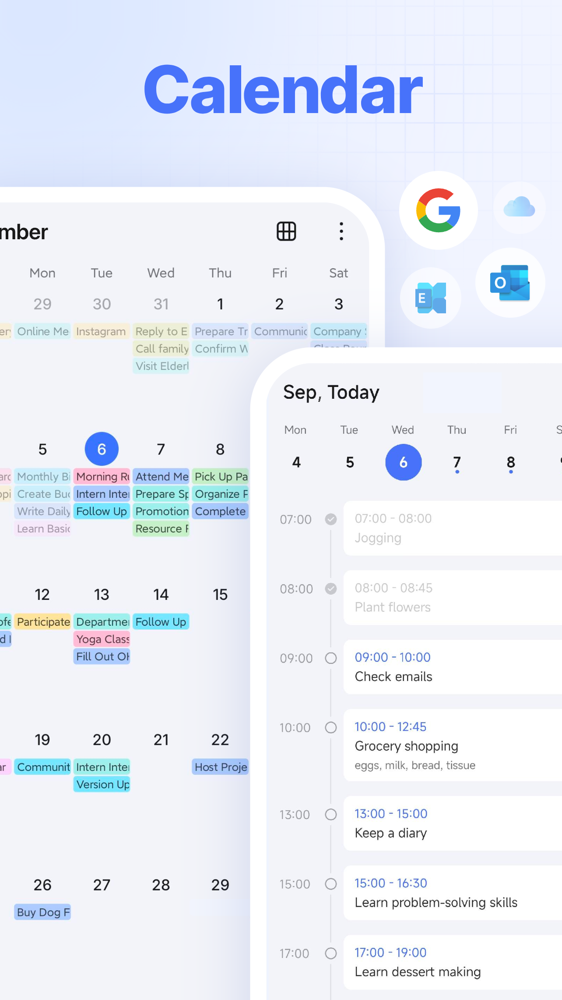{: width="180" .normal }
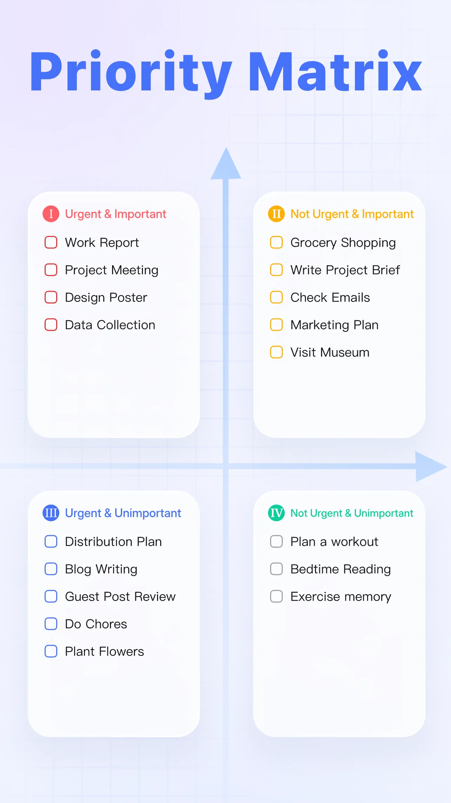{: width="180" .normal }
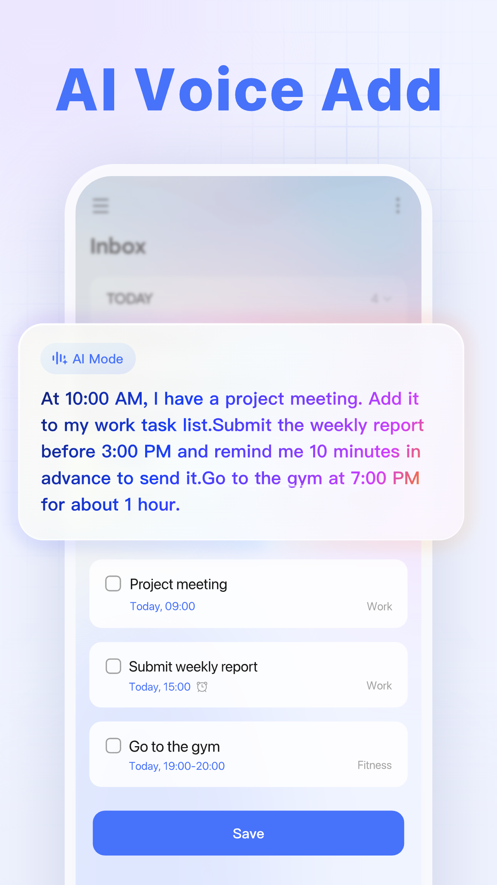{: width="180" .normal }
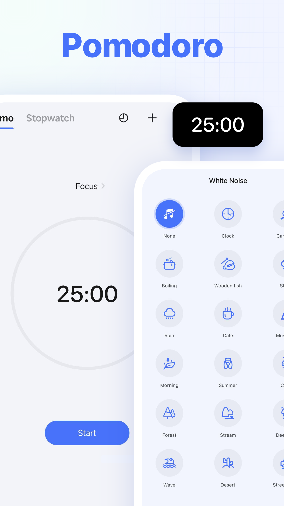{: width="180" .normal }
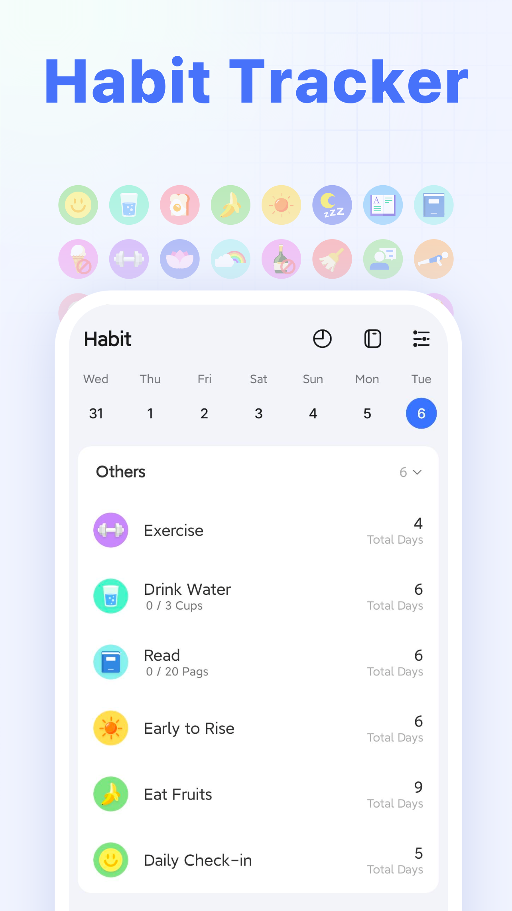{: width="180" .normal }

TickTick is a strong **[task manager](/glossary/what-is-a-to-do-list/)** with a built-in calendar, pomodoro timer, and habit tracker. It packs more features than most alternatives and undercuts Todoist Pro on price.

**Strengths**
- **Built-in calendar + pomodoro + habit tracking** in one app — less need to bolt on extras.
- **Smart date recognition** (natural-language "every mon 9am") and voice input make capture fast.
- Rich views: list, calendar grid, timeline (premium), tags, priority, and location-based reminders.
- **Cheaper Premium** ($35.99/yr) than Todoist Pro, with sync across web, iOS, Android, Windows, and Mac.

**Weaknesses**
- **Free tier is limited** — a capped number of lists/tasks and only one calendar view; history and some reminders need Premium.
- The breadth of features can make the UI feel busy for users who want something minimal.
- Collaboration is lighter than Notion's; shared lists exist but no deep team workflows.

**Best for:** users who want power features (calendar + pomodoro + habits) without paying Todoist-level prices.

**Download TickTick**
- [Google Play](https://play.google.com/store/apps/details?id=com.ticktick.task)
- [App Store](https://apps.apple.com/app/ticktick-to-do-list-calendar/id626144601)

### 4. Google Tasks — best for Gmail and Calendar users

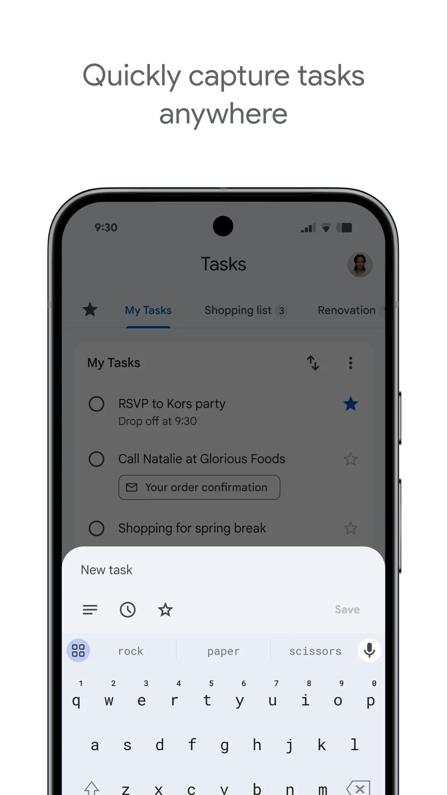{: width="180" .normal }
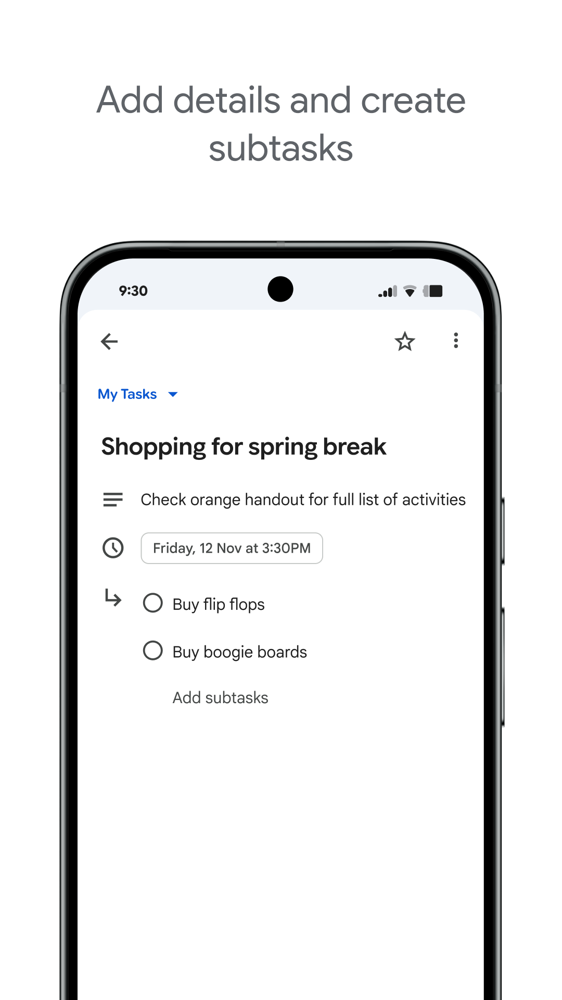{: width="180" .normal }
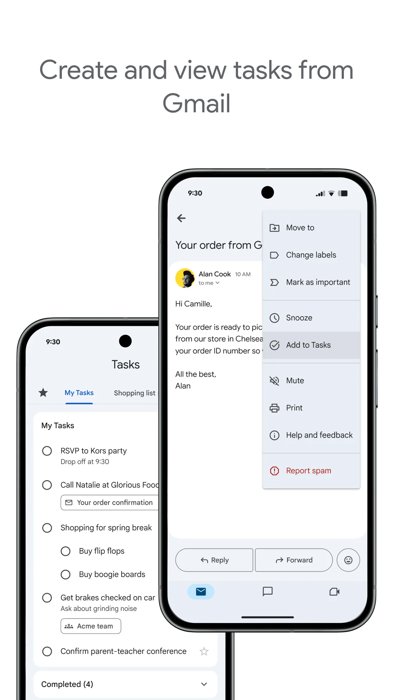{: width="180" .normal }
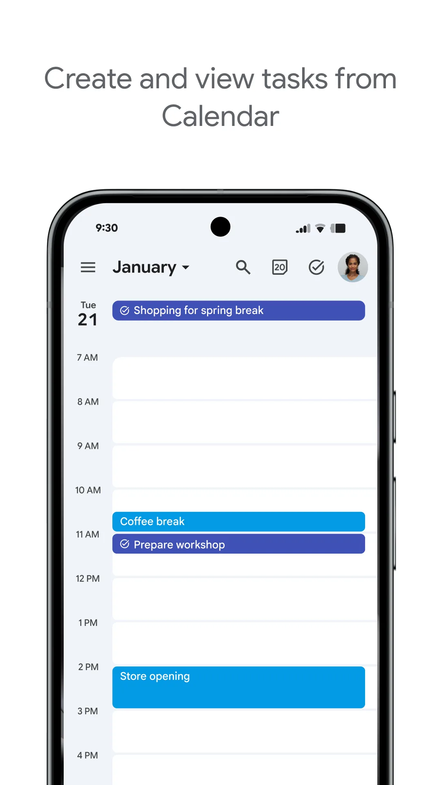{: width="180" .normal }
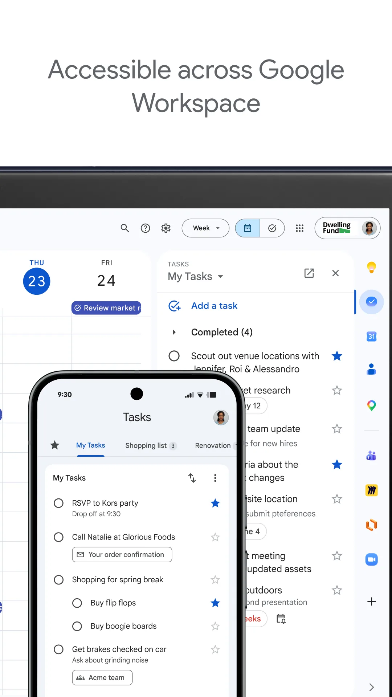{: width="180" .normal }

Google Tasks is the lightweight task tool baked into Gmail and Google Calendar. It's minimal by design and free with any Google account.

**Strengths**
- **Free and instantly available** — already in Gmail, Calendar, Drive, and the dedicated apps (Android, iOS, web).
- **Tight Google Calendar sync** — tasks with due dates appear on your calendar automatically.
- Simple, fast capture; multiple lists; one level of subtasks; basic reminders.

**Weaknesses**
- **Very minimal** — only one level of subtasks, no rich views, no natural-language parsing, no pomodoro or habits.
- Reminders are basic (due-date based); no location-based or voice capture.
- No real offline-first mode and limited collaboration (only Google-shared lists); weak for complex projects.

**Best for:** Gmail / Google Calendar users who want a no-friction task list and nothing more.

**Download Google Tasks**
- [Google Play](https://play.google.com/store/apps/details?id=com.google.android.apps.tasks)
- [App Store](https://apps.apple.com/app/google-tasks-get-things-done/id1353634006)

### 5. Things 3 — best-designed, Apple-only

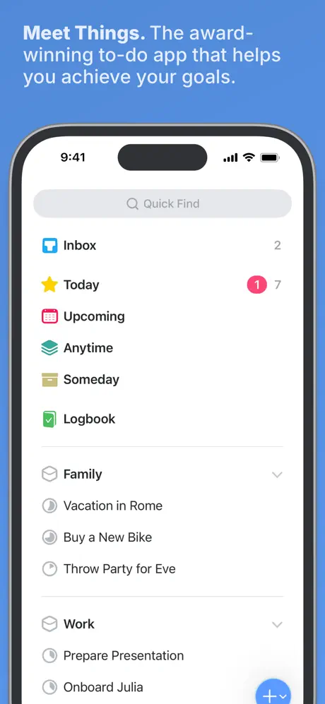{: width="180" .normal }
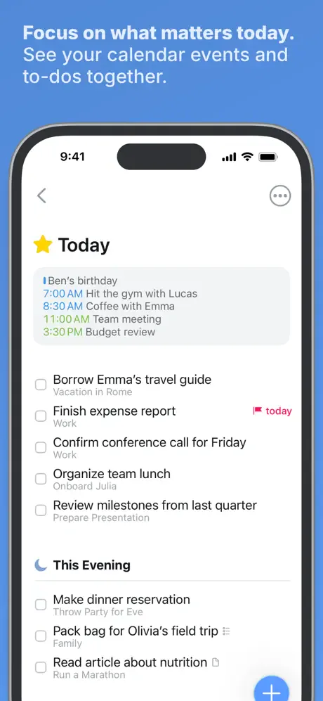{: width="180" .normal }
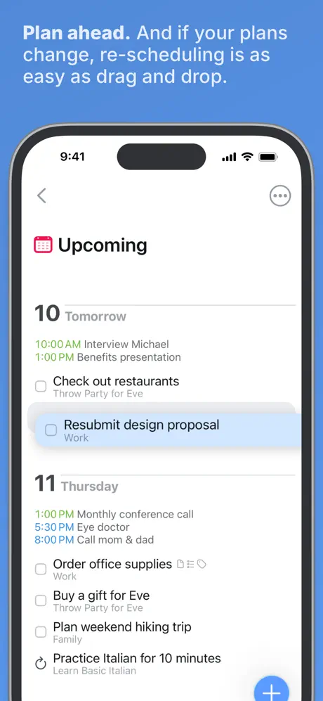{: width="180" .normal }
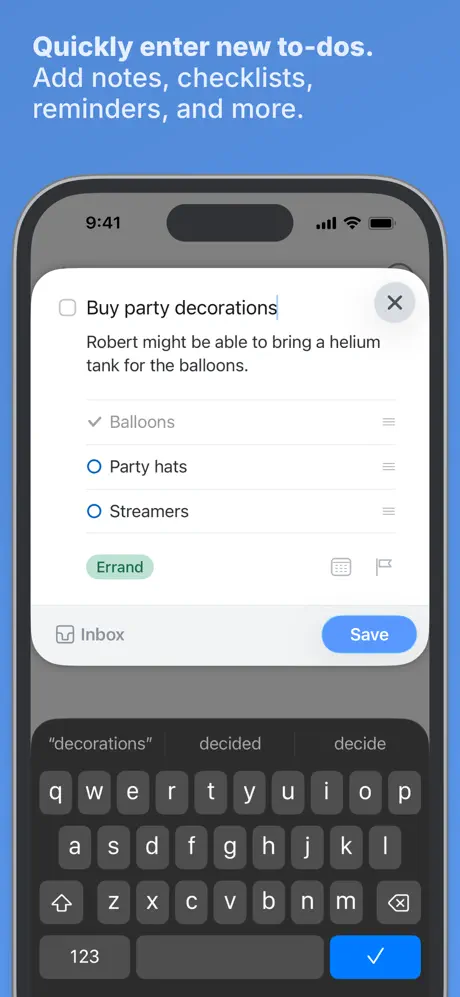{: width="180" .normal }
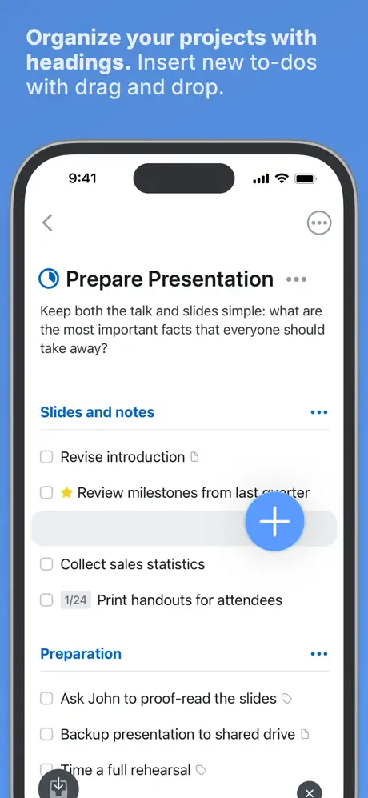{: width="180" .normal }

Things 3 (by Cultured Code) is widely praised as the **best-looking to-do app**, with a GTD-friendly model (Inbox, Today, Upcoming, Anytime, Someday, Projects, Areas, tags). It runs only on Apple devices.

**Strengths**
- **Best-in-class design and UX** — fast, calm, and intuitive; quick entry and natural-language scheduling.
- **Powerful GTD structure** — projects, areas, repeating tasks (with early-complete and reschedule), deadlines, and links to notes/URLs.
- **One-time purchase, no subscription**, with deep Apple integration (Siri, Reminders import, Handoff).
- Sync via iCloud across iPhone, iPad, and Mac.

**Weaknesses**
- **Apple-only** — no Android, no web/Windows client, which rules it out for mixed-device households.
- **No collaboration or shared lists**, and no built-in pomodoro or habit features.
- Paid upfront per platform (iPhone / iPad / Mac sold separately), and no free tier to try before buying.

**Best for:** Apple-only users who want the most polished, distraction-free task manager and prefer a one-time purchase.

**Download Things 3**
- [App Store](https://apps.apple.com/app/things-3/id904237743)

### 6. Notion — best flexible all-in-one workspace

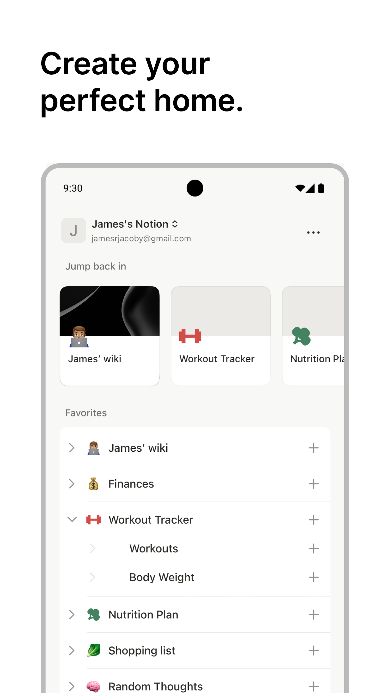{: width="180" .normal }
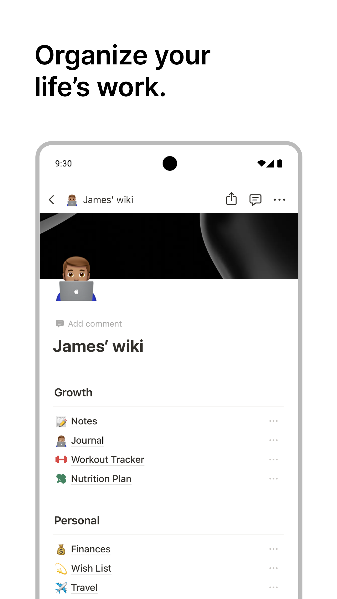{: width="180" .normal }
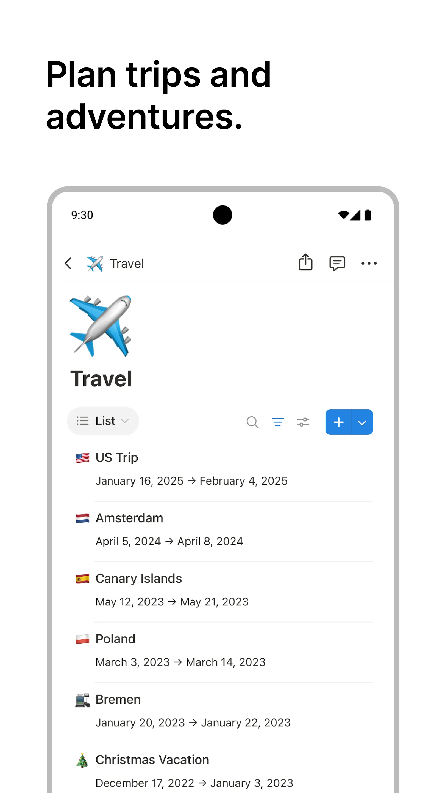{: width="180" .normal }
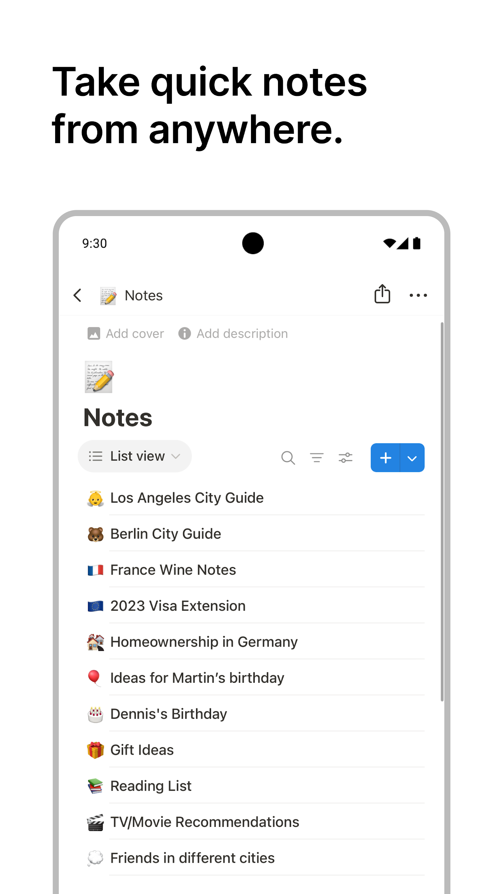{: width="180" .normal }
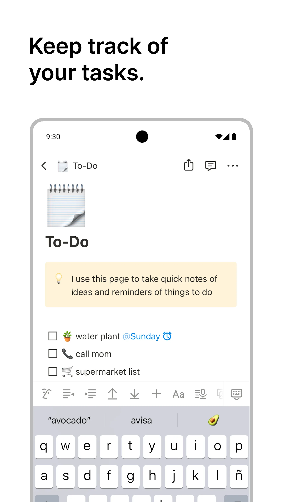{: width="180" .normal }

Notion is a notes/docs/database workspace that can also run your tasks via databases, board (Kanban) and calendar views, and reminders. It's the most flexible option here — and the heaviest.

**Strengths**
- **Extremely flexible** — tasks are just database rows you can view as list, board, calendar, or timeline, with relations, templates, and rich docs.
- **Strong collaboration** — real-time sharing, comments, and team workflows far beyond any dedicated to-do app.
- Cross-platform (web, iOS, Android, Windows, Mac) with a **generous free tier**.

**Weaknesses**
- **Heavy for simple to-dos** — quick capture is slower than dedicated apps, and there's a real learning curve.
- **Reminders and recurring tasks are weaker** — tied to dates on database items, lacking the reliable native push reminders, location, or voice capture of purpose-built apps.
- Cloud-dependent; offline use is limited to a cache, so it's not ideal if you want data fully on-device.

**Best for:** users who already live in Notion (or want docs + tasks + project management in one place) and can tolerate a heavier tool.

**Download Notion**
- [Google Play](https://play.google.com/store/apps/details?id=notion.id)
- [App Store](https://apps.apple.com/app/notion-notes-tasks-ai/id1232780281)

### 7. Any.do — best combined calendar and tasks

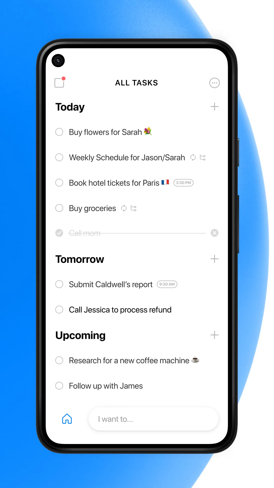{: width="180" .normal }
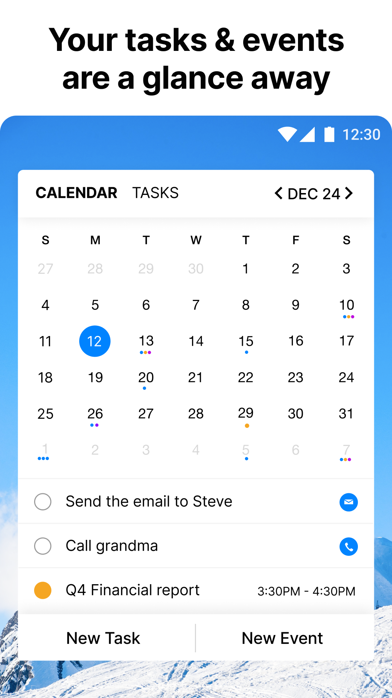{: width="180" .normal }
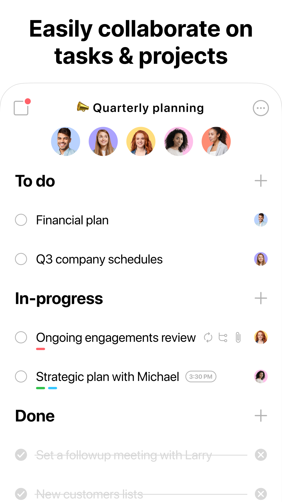{: width="180" .normal }
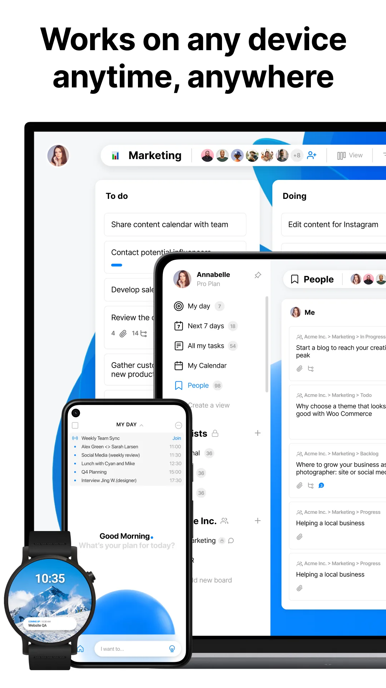{: width="180" .normal }

Any.do bundles a to-do list, calendar, and planner with reminders, used by tens of millions across mobile, desktop, and web.

**Strengths**
- **Tasks + calendar in one view**, with voice, WhatsApp, and location-based reminders — flexible capture.
- **Cross-platform** (mobile, desktop, web, tablet) and a usable free tier.
- Recurring tasks, shared lists, and calendar integration for a single planning surface.

**Weaknesses**
- **Free tier is limited** and several conveniences (advanced recurring, some reminders, premium themes) need the ~$36/yr Premium.
- The combined view and premium upsells can feel cluttered, and reminder reliability has been a common complaint.
- Not built for complex project management or deep team collaboration.

**Best for:** users who want tasks and their calendar unified with flexible (voice/location) reminders.

**Download Any.do**
- [Google Play](https://play.google.com/store/apps/details?id=com.anydo)
- [App Store](https://apps.apple.com/app/any-do-to-do-list-planner/id497328576)

## Core-capability comparison

The table below shows, as objectively as possible, which capabilities each app supports. "Partial" means the feature exists but with limits.

| Capability | Microsoft To Do | Meow Todo | TickTick | Google Tasks | Things 3 | Notion | Any.do |
|---|---|---|---|---|---|---|---|
| **Cloud sync / multi-device** | Yes (MS account) | Partial (iCloud / WebDav) | Yes | Yes (Google) | Yes (iCloud) | Yes (account) | Yes |
| **Reminders** | Due-date + recurring | Due-date | Rich (incl. location) | Due-date | Due-date + Siri | Partial (date-based) | Voice / location / WhatsApp |
| **Calendar view** | Partial (Outlook) | Yes (day/week/month) | Yes (built-in) | Partial (Google Cal) | Partial (Today/Upcoming) | Partial (DB calendar) | Yes (combined) |
| **Subtasks** | Yes (1 level) | Yes (1 level) | Multi-level | 1 level only | Checklists | Nested blocks | Yes |
| **Recurring tasks** | Yes | Yes | Yes | Yes | Yes (smart repeat) | Partial | Yes |
| **Natural-language input** | Partial | Partial | Strong | No | Yes (quick entry) | Partial | Yes (voice) |
| **Habits / Pomodoro** | No | No | Yes (both) | No | No | No | No |
| **Collaboration / sharing** | Yes (shared lists) | No | Yes (shared) | Partial (Google) | No | Strong (real-time) | Yes (shared) |
| **Offline / privacy** | Account-based | Strong (on-device, no account) | Account-based | Account-based | iCloud | Cloud-dependent | Account-based |
| **Platforms** | All | Android + iOS | All | Android + iOS + web | Apple only | All | All |
| **Free tier** | Full | Generous core | Limited | Full | None (paid) | Generous | Limited |
| **Pricing** | Free | Free + VIP ~$9.99/yr | Free + $35.99/yr | Free | Paid per platform | Free + paid tiers | Free + ~$36/yr |

## Which Todoist alternative fits you?

- Already on **Microsoft 365 / Outlook** → **Microsoft To Do**
- Want **free, private, no account, with CSV export and a cute UI** → **Meow Todo**
- Want **power features** (calendar + pomodoro + habits) cheaply → **TickTick**
- Live in **Gmail / Google Calendar** → **Google Tasks**
- Use only **Apple devices** and want the most polished app → **Things 3**
- Want **docs + tasks + projects in one flexible workspace** → **Notion**
- Want **tasks and calendar unified with voice/location reminders** → **Any.do**

## Which Todoist alternative fits each kind of user

Read each option as a **Todoist alternative** with a specific job: the **Microsoft To Do alternative** is the free Outlook-native list, the **Google Tasks alternative** is the lightest Gmail sidebar, and the **TickTick alternative** packs a calendar and pomodoro timer into one app. Things 3 and Any.do lean on polished design, Notion on databases, while Meow Todo is the **best free to-do list app** here for a **simple offline task manager** with a **task manager with subtasks free** in its core. If your real reason for leaving is cost, start with a **free task management app** rather than trading one subscription for another.

## How to migrate away from Todoist

1. **Export** your projects from Todoist (Settings → Backups, or copy tasks out while you still have access).
2. **Pick a replacement** using the tables above based on ecosystem, privacy, and feature depth.
3. **Recreate your structure** — lists (To Do, Meow) or projects (Todoist) map cleanly to each other; in Notion, build a task database.
4. **Re-add recurring tasks** and due dates; set daily reminders and, where supported, location or voice reminders.
5. **Keep a CSV backup** (Meow Todo and most apps export one) so you're never locked in again.

## FAQ

**Is Meow Todo List a good free Todoist alternative?**
{:.faq-q}

Yes — its core (lists, subtasks, calendar view, reminders, CSV export) is free, with no account required and on-device privacy via an optional fingerprint lock; only a few advanced extras sit behind a one-time VIP.

**Does Meow Todo work offline?**
{:.faq-q}

Yes. You can add and check off tasks with no internet; data stays on your device and syncs to iCloud or WebDav only when you choose.

**Which Todoist alternative is best for privacy?**
{:.faq-q}

Meow Todo — it needs no account, keeps tasks on-device behind a fingerprint lock, and only backs up to iCloud or WebDav when you enable it, so your list never sits in a vendor cloud by default.

**Can I move my tasks out of Todoist?**
{:.faq-q}

Yes — export a CSV from Todoist, then recreate your lists; Meow Todo also exports CSV, so you can move your data to Excel or another app anytime.

[Meow Todo List app page](/apps/meow-todo-list/) — download for Android and iOS.

## Related terms

- [What Is a To-Do List?](/glossary/what-is-a-to-do-list/)
- [What Is a Subtask?](/glossary/what-is-a-subtask/)
