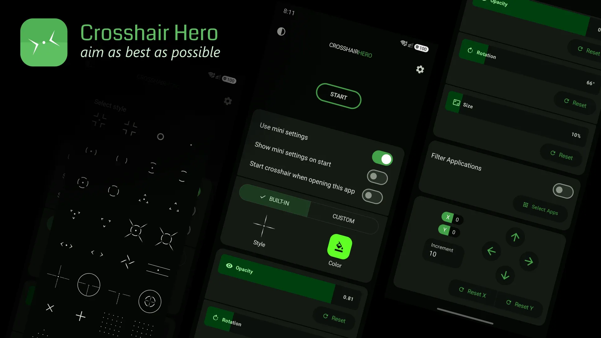

Beyond shooters, a **[custom crosshair overlay](/glossary/what-is-a-crosshair/)** is handy for aim trainers, emulators, and any app where a fixed reference point helps. The **best crosshair overlay** lets you import your own image, set transparency, and remember positions per app. **Crosshair Aim** is a **custom crosshair app** for Android with PNG import and a floating adjuster. Below we compare it with **Crosshair Hero** for general overlay use.

## What a custom overlay needs

- **Any-app overlay** — not just games.
- **Custom PNG / image** — your own reticle art.
- **Transparency and blend** — sit cleanly over any background.
- **Per-position memory** — where you left it, it stays.
- **No root** — standard overlay permission.

## The contenders at a glance

| App | Price (2026) | Custom PNG | Any app | Transparency | Best for |
|---|---|---|---|---|---|
| **Crosshair Aim** | Free core + VIP | ✅ (VIP) | ✅ | ✅ | Full custom control |
| **Crosshair Hero** | Free + IAP | ✅ | ✅ | ✅ | Preset + custom |
| **Crosshair X** | Free + sub | ✅ | ✅ | ✅ | iOS only |

## Crosshair Aim, in depth

{: width="180" .normal }
{: width="180" .normal }
{: width="180" .normal }
{: width="180" .normal }

Crosshair Aim is a **custom crosshair overlay** for Android with a large style set and a live floating adjuster.

**Strengths as an overlay**
- **Works over any app** — games, trainers, emulators.
- **Custom PNG import** (VIP) — drop in your own reticle design.
- **Transparency and size** — blend it over any screen.
- **Live adjuster** — drag and resize on top of whatever is open.
- **No root** — overlay permission only.

**Weaknesses as an overlay**
- **PNG import is VIP** — free users use built-in styles.
- **Permission prompt** — one-time overlay grant.

**Best for:** users who want a reticle they fully control across apps.

- [Google Play — Crosshair Aim](https://play.google.com/store/apps/details?id=com.glgjing.crosshair.aim.fps.game)

## Crosshair Hero, in depth

{: width="720" .normal }

Crosshair Hero (package `me.okitastudio.crosshairherofps`) offers preset styles plus custom PNG, with color/size/position tweaks.

**Strengths as an overlay**
- **Custom PNG** — import your own image as the reticle.
- **30+ presets** — quick starting points.
- **Color, size, position** — basic tuning in the app.
- **Free to start** — IAP for style packs.

**Weaknesses as an overlay**
- **Smaller library** — 30+ vs 80+ styles.
- **App-side tuning** — less live control than a floating adjuster.
- **IAP / ads** — style packs and ads vary.

**Best for:** users who want presets plus the option to import art.

- [Google Play — Crosshair Hero](https://play.google.com/store/apps/details?id=me.okitastudio.crosshairherofps)

## Which should you pick?

- Want **80+ styles + live adjuster + PNG import** → **Crosshair Aim**.
- Want **presets + custom PNG, quick** → **Crosshair Hero**.

[Get Crosshair Aim](/apps/cross-hair/) — available on Android.

## Typical scenarios

- **Aim trainers and emulators** — keep a fixed reference point over any window, not just games.
- **Your own reticle art** — import a PNG (VIP) so the crosshair matches your style exactly.
- **Per-app positioning** — leave the reticle where you want it; it stays put across apps.
- **Low-contrast backgrounds** — set transparency and size so it reads cleanly over any screen.
- **No root** — only the standard overlay permission is needed.

## FAQ

**Is Crosshair Aim free?**
Yes. The basic style set is free; a VIP unlock opens PNG import and the full 80+ library.

**Crosshair Aim or Crosshair Hero — which should I pick?**
Want 80+ styles, a live floating adjuster and PNG import → Crosshair Aim; want quick presets plus custom PNG → Crosshair Hero.

**Does Crosshair Aim work on iOS?**
No. Crosshair Aim is Android-only.

**Is it safe / will it get me banned?**
It's a visual-only overlay that doesn't modify game data or memory, so it doesn't trigger anti-cheat. Use it within each game's fair-play rules.

## Related terms

- [What Is a Crosshair?](/glossary/what-is-a-crosshair/)
