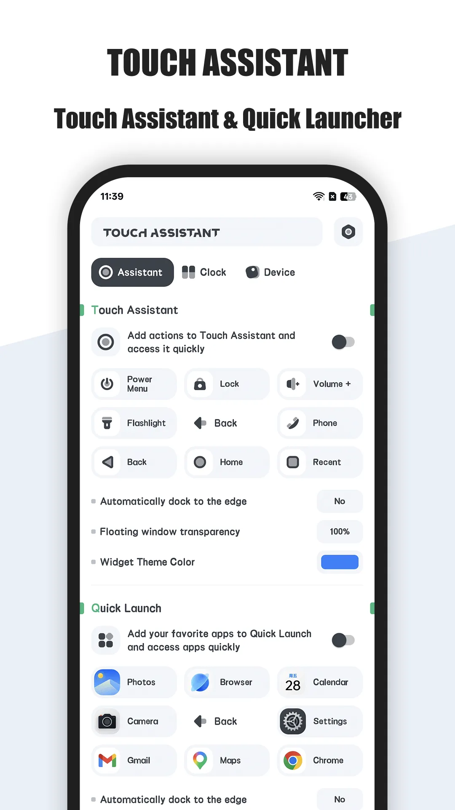

Big phones are hard to use one-handed, and some users simply can't reach physical buttons reliably. An **[accessibility floating button](/glossary/what-is-a-floating-window/)** puts the controls you need within a thumb's reach. **Floating Assistant** is an **edge floating-ball app for Android** built for exactly this. Below we compare it with **Assistive Touch** for accessible, one-handed control. Readers searching for **edge floating ball with gestures** or **floating button for one hand** are asking the same reachability question.

## What an accessibility tool needs

An accessibility floating button in 2026 needs five things: virtual back, home, recent and lock keys, edge reach within a thumb's range, large clear targets that need little precision, remappable shortcuts for daily actions, and no reliance on hardware buttons. Floating Assistant covers all five with an edge-docked ball and gestures; the three contenders below are weighed on reach, target size and clarity of permissions.

- **Virtual keys** — back, home, recent, lock without physical buttons.
- **Edge reach** — the control sits where a thumb already is.
- **Large, clear targets** — easy to hit, low precision needed.
- **Custom common actions** — your daily moves in one tap.
- **No reliance on hardware** — works when buttons are awkward or unavailable.

## What accessibility actually needs from the ball

Four practical details decide what accessibility needs from a floating ball in 2026: large virtual keys that never miss, edge reach with gestures for left- and right-handed use, remappable shortcuts that put the most-needed action on the first tap, and clear minimal permissions with no account or root. An accessibility tool is judged on the day a hardware button fails, not on a feature list. Four practical details: Floating Assistant covers all four with an edge-docked ball; Assistive Touch keeps a smaller fixed menu.

- **Virtual keys that never miss** — back, home, recent and lock must be large, clearly separated targets. A **floating assistant back home recent button** row is the core of this, not an extra.
- **Edge reach with gestures** — an **edge floating ball with gestures** lets a swipe do what a precise tap cannot; the ball should dock to either side so left-handed use is not an afterthought.
- **Remappable shortcuts** — a **floating ball with custom shortcuts** means putting the one action a person needs most on the first tap, whether that is a contact, a toggle or the screenshot key.
- **Clear, minimal permissions** — the overlay and accessibility service should be explained in plain language, with no account and no root requirement. Anything beyond that deserves scrutiny.

Floating Assistant covers all four with an edge-docked ball; Assistive Touch keeps a smaller fixed menu. Neither replaces the system's own accessibility settings — they are a shortcut to them.

## The contenders at a glance

Three accessibility options are compared below on 2026 price, virtual keys, edge reach and gestures, so a flexible gesture-rich ball is weighed against simple virtual keys and built-in OS settings. Floating Assistant is a free core plus VIP with virtual keys, edge docking and gestures; Assistive Touch is free with IAP and a fixed menu; system accessibility is free but limited. Only one entry pairs an edge-docked ball with remappable gestures and no account.

| App | Price (2026) | Virtual keys | Edge reach | Gestures | Best for |
|---|---|---|---|---|---|
| **Floating Assistant** | Free core + VIP | ✅ | ✅ | ✅ | Flexible access |
| **Assistive Touch** | Free + IAP | ✅ | ✅ | ✅ | Simple virtual keys |
| **System accessibility** | Free (OS) | ⚠️ limited | ❌ | ⚠️ | Built-in only |

## Floating Assistant, in depth

Floating Assistant is an edge floating-ball app for Android with virtual keys and gestures, built for one-handed control on big phones and for users who cannot reliably reach hardware buttons. It docks where the thumb already is, maps back, home, recent and lock to large on-screen targets, and keeps the core on-device with no account. VIP adds deeper gestures, and a one-time overlay permission is required. Multi-window support handles split-screen without hunting for recents.

{: width="180" .normal }
{: width="180" .normal }
{: width="180" .normal }
{: width="180" .normal }
{: width="180" .normal }

Floating Assistant is an **edge floating-ball app** for Android with virtual keys and gestures.

**Strengths for accessibility**
- **Virtual keys on screen** — back, home, recent, and lock without reaching the hardware.
- **Edge ball within thumb reach** — stays where your hand already is.
- **Custom actions and gestures** — put the few things you use most in one tap.
- **Lightweight and local** — on-device, no account.
- **Multi-window** — split-screen without hunting for recents.

**Weaknesses for accessibility**
- **VIP for more** — deeper gestures behind the upgrade.
- **Overlay permission** — a one-time grant.

**Best for:** big-phone users and anyone who needs reliable one-handed control.

- [Google Play — Floating Assistant](https://play.google.com/store/apps/details?id=com.glgjing.floating.apps.assistive.touch.pro)

## Assistive Touch, in depth

Assistive Touch (package `mtr.assistivetouch.easytools`) offers on-screen virtual keys and a floating ball for replacing back, home, recent and lock with taps, including brightness and volume controls. It is free to start with in-app purchases, and suits users who want a simple, familiar virtual-key replacement. Its customization is lighter than Floating Assistant's — fewer gesture remaps — and ads or promotional content vary.

{: width="180" .normal }
{: width="180" .normal }
{: width="180" .normal }
{: width="180" .normal }
{: width="180" .normal }

Assistive Touch (package `mtr.assistivetouch.easytools`) offers on-screen virtual keys and a floating ball.

**Strengths for accessibility**
- **Virtual keys** — replace back/home/recent/lock with taps.
- **Floating ball** — thumb-reachable on any screen.
- **Brightness/volume on screen** — no physical keys needed.
- **Free to start** — basic use with IAP.

**Weaknesses for accessibility**
- **Lighter customization** — fewer gesture remaps than Floating Assistant.
- **Ads / IAP** — promotional content varies.

**Best for:** users who want a simple, free virtual-key replacement.

- [Google Play — Assistive Touch](https://play.google.com/store/apps/details?id=mtr.assistivetouch.easytools)

## Which should you pick?

Two pick-by-need rules settle the accessibility floating button choice in 2026: choose Floating Assistant for flexible, gesture-rich one-handed control with an edge-docked ball, or Assistive Touch for simple free virtual keys. The first puts remappable actions under the thumb and keeps everything local; the second covers the basic key replacement with a smaller menu. Neither replaces the system's own accessibility settings — both are shortcuts to them.

- Want **flexible, gesture-rich one-handed control** → **Floating Assistant**.
- Want **simple free virtual keys** → **Assistive Touch**.

[Get Floating Assistant](/apps/floating-assistant/) — available on Android.

## Typical scenarios

Five typical scenarios show where an accessibility floating button matters in 2026: big-phone one-hand use, worn or unreachable hardware buttons, motor or reach limits, bedtime one-hand control, and an ad-free core. Floating Assistant handles all five with large thumb-placed targets, an edge ball, on-screen lock and screenshot, and a free core with an optional unlock. Assistive Touch covers the simpler virtual-key cases.

- **Big phone, one hand** — the edge ball brings back/home/recent and the lock under your thumb, no stretching.
- **Hardware buttons worn or unreachable** — lock, screenshot and recents become on-screen taps, so a failing power key isn't a blocker.
- **Motor or reach limits** — large, thumb-placed targets need less precision than the tiny side keys.
- **Bedtime one-hand** — check or close apps with the ball while lying down, no two-handed juggle.
- **Ads-free core** — the core ball is free with an optional unlock, so you skip the ad walls of other balls.

## FAQ

**Is Floating Assistant free?**
{:.faq-q}

Yes. The core edge floating ball, virtual keys and gestures are free; an optional VIP unlock adds deeper themes and options.

**Floating Assistant or Assistive Touch for accessibility?**
{:.faq-q}

Want flexible, gesture-rich one-handed control → Floating Assistant; want simple, free virtual keys → Assistive Touch.

**Does Floating Assistant need root?**
{:.faq-q}

No. It runs as an accessibility/overlay service, no root required.

**Does Floating Assistant work on iOS?**
{:.faq-q}

No. Android-only; iOS has a built-in AssistiveTouch in accessibility settings.

## Related terms

- [What Is Assistive Touch?](/glossary/what-is-assistive-touch/)
- [What Is a Floating Window?](/glossary/what-is-a-floating-window/)
