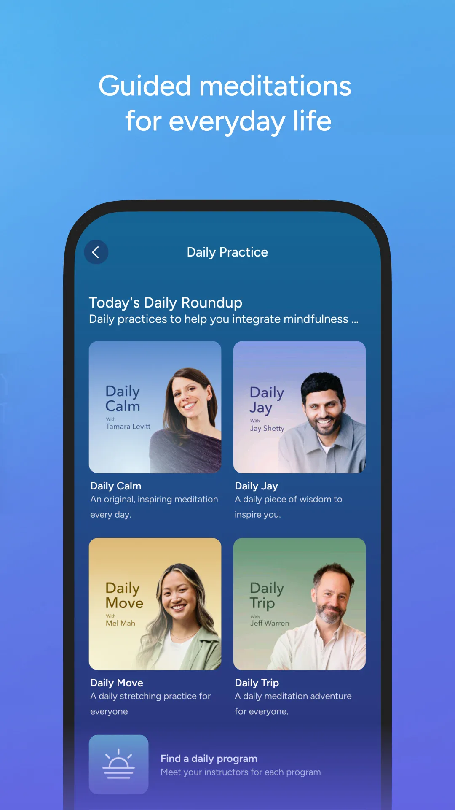

An open-plan office, a chatty coffee shop, a roommate on a call — the enemy of focus is usually **sudden human sound**, not overall noise. A steady **[white noise](/glossary/what-is-white-noise/) app** smooths those spikes into a constant hush so your brain stops monitoring the room. **Meow FM** is a **free white noise player** for Android and iOS with soundscapes for both sleep and concentration. Here's how it compares for deep work, and what actually helps you stay on task. The comparison below is aimed at **focus sounds** rather than meditation content, which is why a free, uninterrupted noise player is the baseline.

## Why noise helps you focus

White noise helps focus in 2026 because it masks the sudden human sounds — speech, footsteps, a door slam — that pull attention away, rather than simply adding volume. A steady loop smooths those spikes into a constant bed so the brain stops monitoring the room, anchors a work ritual the way a song can, and blends construction or notifications into the background. Meow FM is a free white noise player for Android and iOS that supplies that steady bed with nature loops and a self-stopping timer.

- **It masks speech** — a flat noise floor hides the words of nearby conversations that would otherwise hijack attention.
- **It anchors a routine** — the same loop signals "work mode" the way a song can.
- **It reduces environment churn** — construction, notifications, and footsteps blend into one bed instead of pinging your awareness.

## What a focus sound app needs

A focus sound app in 2026 needs six things: steady white, pink or brown loops that do not seam, long playback that does not reset every three minutes, a timer that matches a pomodoro block, offline playback for planes and dead Wi-Fi, a free core without a subscription, and no ads interrupting the session. Meow FM covers all six with local sound files and a self-stopping timer; the five contenders below are weighed on uninterrupted playback and price.

- **Steady noise** — white, pink, or brown loops that don't audibly seam.
- **Long, seamless playback** — a loop shouldn't reset every three minutes.
- **A timer** — pair sound with a pomodoro block.
- **Offline playback** — works on a plane or a dead Wi-Fi cafe.
- **Free core** — focus shouldn't cost a subscription.
- **No interruptions** — no ads or pop-ups mid-session.

## What focus actually needs from the sound

Three details decide whether white noise for focus survives a real two-hour block in 2026: a loop with no audible seam, a timer you set once that stops on its own, and playback that keeps running with the screen locked. The checklist above is about features; a work session is about time. Three details decide whether **white noise for focus** survives a real two-hour block: a seamless loop, a set-once timer and background playback. Meow FM handles those with local sound files, so white noise offline works on a train or in a library with no signal.

- **A loop with no seam** — a three-minute file that restarts audibly pulls attention back every time it ends. White, pink and brown noise need to run continuously, with the option to layer rain underneath if a flat hiss feels too clinical.
- **A timer you set once** — pairing sound with a pomodoro block means the app should stop on its own, so you are not breaking concentration to switch it off.
- **Playback that survives a locked screen** — a **focus music** playlist that pauses when the phone sleeps is worse than no sound at all; the noise has to keep running in the background with the screen off.

Meow FM handles those with local sound files, so **white noise offline** works on a train or in a library with no signal, and a **best free white noise app** shortlist should not require a subscription just to keep the timer.

## The contenders at a glance

Five focus sound apps are compared below on 2026 price, offline playback and timers, so a free uninterrupted player is weighed against subscription and meditation-first options. Meow FM is free-core with offline nature loops and a self-stopping timer; Calm costs ~$69.99/yr after a 14-day trial and lacks a plain noise timer; Noisli, Brain.fm and myNoise all support offline playback and timers but charge for deeper features. Only one pick keeps the timer and offline library free with no account.

| App | Price (2026) | Offline | Timer | Sound style | Best for |
|---|---|---|---|---|---|
| **Meow FM** | Free core + optional VIP | ✅ | ✅ | Nature loops (rain, sea, fireplace) | Free, simple focus |
| **Calm** | ~$69.99/yr (14-day trial) | ⚠️ partial | ❌ | Meditations + focus music | Meditation-style focus |
| **Noisli** | Free + subscription | ✅ | ✅ | White/pink noise + environments | Mix-your-own |
| **Brain.fm** | Subscription | ✅ | ✅ | Functional music (AI-composed) | Scientifically framed focus |
| **myNoise** | Free + IAP | ✅ | ✅ | Generative, tunable | Sound tinkerers |

## Meow FM, in depth

Meow FM is a cat-themed white noise and focus player for Android and iOS with a free core of rain, sea and fireplace loops plus a timer that stops playback on its own, built for a 25-minute block without a subscription. The sounds download for true offline use, the interface opens and plays in one tap with no account, and layered mixing builds a bed for your space. Its library is smaller than Noisli or myNoise, and it plays ambience rather than engineered focus music.

{: width="180" .normal }
{: width="180" .normal }
{: width="180" .normal }
{: width="180" .normal }
{: width="180" .normal }

Meow FM is a **cat-themed white noise and focus player** for Android and iOS. The core is free: natural loops like rain, sea, and fireplace, plus a timer that stops playback so it isn't running all day.

**Strengths for focus**
- **Free core soundscapes** — rain, sea, and fireplace loops with no paywall on listening.
- **Self-stopping timer** — run sound for a 25-minute block and it ends on its own.
- **True offline playback** — downloaded sounds work with no signal.
- **Simple, cute interface** — open, tap, work; no accounts or setup.
- **Layered mixing** — blend scenes for a bed that fits your space.

**Weaknesses for focus**
- **Not functional music** — it's ambience, not Brain.fm-style focus tracks engineered for attention.
- **Smaller library** — fewer scenes than Noisli or myNoise.
- **No analytics** — it plays sound; it doesn't measure sessions.

**Best for:** people who want a **free white noise app** for focus with a real timer and no subscription.

- [Google Play — Meow FM](https://play.google.com/store/apps/details?id=com.glgjing.whitenoise.relax.night.sleep.meow)
- [App Store — Meow FM](https://apps.apple.com/app/id1606715188)

## Calm, in depth

Calm is a meditation and sleep app with 50M+ downloads and a 4.3-star rating, offering focus playlists, a daily 10-minute session and breathing exercises alongside its sleep content. It suits people who concentrate through guided calm music rather than plain noise, but the focus tools come with a ~$69.99/year subscription after a 14-day trial. There is no simple loop-brown-noise-for-50-minutes mode, and some users report the app crashing on first open each day.

{: width="180" .normal }
{: width="180" .normal }
{: width="180" .normal }
{: width="180" .normal }

Calm is the best-known **meditation and sleep app** on Google Play (50M+ downloads, 4.3 stars). Beyond sleep, it offers focus music, breathing, and a daily 10-minute session aimed at concentration.

**Strengths for focus**
- **Focus playlists** — curated calm music for work and study.
- **Daily Calm** — a short daily session to reset attention.
- **Brand trust** — the most recognized name in the category.

**Weaknesses for focus**
- **Paid subscription** — around $69.99/year after a 14-day trial; free content is limited.
- **Not pure noise** — it's meditation-first, so there's no simple "loop brown noise for 50 minutes."
- **Mixed reliability** — some users report the app crashing on first open each day.

**Best for:** people who focus through meditation and calm music, and will pay a subscription.

- [Google Play — Calm](https://play.google.com/store/apps/details?id=com.calm.android)

## How the others compare

Noisli, Brain.fm and myNoise are the other three focus options in 2026. Noisli mixes white and pink noise with environmental sounds, free with a subscription for more; Brain.fm sells AI-composed functional music framed around focus on a paid subscription; myNoise generates tunable noise free with extras via IAP. All three beat Meow FM on library depth or custom control, but none matches its free core with a timer, offline playback and no account.

- **Noisli** mixes white/pink noise with environmental sounds (coffee shop, wind) and is free with a subscription for more — good if you like building your own blend.
- **Brain.fm** sells AI-composed functional music framed around focus and relaxation; effective for some, but it's a paid subscription.
- **myNoise** generates noise you can tune to a room; free with extras via IAP, the deepest tool for sound nerds.

## Which should you pick?

Four pick-by-need rules cut through the focus sound field in 2026: choose Meow FM for a free player with a real timer and offline loops, Calm for calm music and meditation if you accept a subscription, Noisli for a custom blend, and Brain.fm for engineered focus tracks. Each rule follows one reason people put on sound — masking, ritual, mixing or structure. Decide what actually keeps you on task, then pick.

- Want **free + a real timer + offline** → **Meow FM**.
- Want **calm music and meditation** and accept a subscription → **Calm**.
- Want **a custom blend** → **Noisli**.
- Want **engineered focus tracks** → **Brain.fm**.

[Get Meow FM](/apps/meow-fm/) — available on Android and iOS.

## Typical scenarios

Four typical scenarios show where a focus sound app pays off in 2026: an open-plan office, a coffee shop, a deep-work flight, and a no-subscription setup. Meow FM covers all four with rain or sea loops, a 25-minute timer that stops on its own, and downloaded scenes that keep playing on patchy Wi-Fi or with no signal. Open the app, tap a scene, and work — nothing stands between you and focus.

- **Open-plan office** — rain or sea loops with a 25-minute timer turn a chatty floor into a steady hush; the sound stops on its own when the block ends.
- **Coffee-shop focus** — mask the clatter and nearby calls with fireplace or brown-noise; offline playback keeps it running on patchy cafe Wi-Fi.
- **Deep-work flight** — downloaded scenes play with no signal, so a long haul becomes a noise-free workspace.
- **No subscription, no account** — open the app, tap a scene, and work; nothing stands between you and focus.

## FAQ

**Is Meow FM free for focus?**
{:.faq-q}

Yes. The core focus soundscapes — rain, sea, fireplace and more — are free with no paywall on listening; a one-time VIP unlocks extra scenes, not the timer or offline playback.

**Does Meow FM work offline?**
{:.faq-q}

Yes. Downloaded scenes play with no internet, so you can focus on a plane, subway, or dead Wi-Fi cafe.

**Does Meow FM have a timer for pomodoro?**
{:.faq-q}

Yes. Set 15/30/60 minutes or a custom duration and the audio auto-stops, which fits a 25-minute pomodoro block.

**Meow FM or Brain.fm for focus?**
{:.faq-q}

Want free, offline, no-account ambient noise with a real timer → Meow FM; want AI-composed functional music engineered for attention → Brain.fm (paid subscription).

## Related terms

- [What Is White Noise?](/glossary/what-is-white-noise/)
