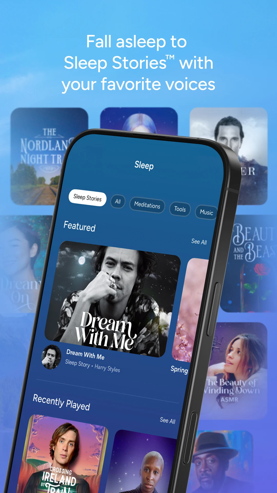

A **sleep sounds app** earns its place on your phone by doing one job quietly: helping your brain stop noticing the world. Traffic outside, a partner's snore, a hotel room's hum — steady ambient sound masks those sudden spikes so you can drift off. **Meow FM** is a **free [white noise](/glossary/what-is-white-noise/) app** for sleep with natural soundscapes and a timer that stops on its own. Here's how it compares with other bedtime options, and which sounds actually help. The comparison weighs the bedtime loop — play, fade out, sleep — over meditation libraries.

## Why sound helps you fall asleep

Sound helps you fall asleep in 2026 by masking the sudden noises — a door slam, a passing car, a snore — that jolt the brain awake, rather than by adding more audio. A constant rain loop hides those spikes, the same sound each night builds a wind-down ritual, and a timer that auto-stops saves battery instead of running until morning. Meow FM is a free white noise app for sleep with natural soundscapes and a timer that switches itself off.

- **Steady noise masks sudden noise** — a constant rain loop hides the slam of a door or a passing car.
- **It builds a wind-down ritual** — the same sound each night signals "sleep time" to your brain.
- **A timer saves battery** — playback that auto-stops means it isn't running until morning.

## What a sleep sounds app needs

A sleep sounds app in 2026 needs six things: natural rain, sea, wind or fireplace loops that do not seam, a sleep timer that auto-stops after 30/60/90 minutes, offline playback for planes and tents, layer mixing for a personalized bed, a free core, and no ad interruptions in the middle of the night. Meow FM covers all six; the five contenders below are weighed on the bedtime loop — play, fade out, sleep.

- **Natural soundscapes** — rain, sea, wind, fireplace — loops that don't audibly seam.
- **A sleep timer** — auto-stop after 30/60/90 minutes.
- **Offline playback** — no Wi-Fi in a tent or on a plane shouldn't kill the sound.
- **Layer mixing** — combine rain + wind for a personalized bed.
- **Free core** — you shouldn't pay to fall asleep.
- **No ad interruptions** — a mid-night notification ruins the point.

## What a bedtime sound has to get right

Four things decide whether a sleep sounds app stays installed in 2026: it stops on its own after 30/60/90 minutes, works with no signal, mixes rain or brown noise without fiddly sliders, and keeps the core loop free without a trial clock. A **sleep sounds app** is judged at 2 a.m., not in a feature table. Four things decide whether it stays installed: on-device files, a self-stopping timer, easy mixing and a free core. Meow FM ships its sound files on-device with a self-stopping timer, which is why it appears on both the sleep and focus lists.

- **It stops on its own** — **white noise with timer** means the sound fades out after you are asleep instead of draining the battery till morning. A **white noise app no subscription** should not put that timer behind a paywall.
- **It works with no signal** — a **white noise offline** library matters in a hotel, on a plane, or anywhere the Wi-Fi drops at bedtime.
- **It mixes without fuss** — rain plus a low fan, or a **brown noise app**'s low rumble under a storm, set once and left alone; fiddling with sliders is the opposite of winding down.
- **It stays free for the core loop** — a **best free white noise app** lets you press play and set a timer every night without a trial clock.

Meow FM ships its sound files on-device with a self-stopping timer, which is the short version of why it appears on both the sleep and the focus lists here.

## The contenders at a glance

Five bedtime sound options are compared below on 2026 price, offline playback and sleep timers, so a free self-stopping player is weighed against stories, rain-only libraries and large catalogs. Meow FM is free-core with offline nature loops and a timer; Calm costs ~$69.99/yr after a 14-day trial and offers stories rather than a plain noise timer; Rain Rain is free rain-only; White Noise (TMSOFT) is ~$2.99 one-time for a large library; myNoise is free with IAP. Only one keeps the timer free with no account.

| App | Price (2026) | Offline | Sleep timer | Sound type | Best for |
|---|---|---|---|---|---|
| **Meow FM** | Free core + optional VIP | ✅ | ✅ self-stopping | Nature loops (rain, sea, fireplace) | Free, simple, timer |
| **Calm** | ~$69.99/yr (14-day trial) | ⚠️ partial | ❌ (meditation) | Meditations + Sleep Stories | Stories + meditation |
| **Rain Rain** | Free (rain) | ✅ | ✅ | Rain-only library | Pure rain lovers |
| **White Noise (TMSOFT)** | ~$2.99 one-time | ✅ | ✅ | Large recorded library | Big sound catalog |
| **myNoise** | Free + IAP | ✅ | ✅ | Generative, customizable | Sound tinkerers |

## Meow FM, in depth

Meow FM is a cat-themed white noise and sleep sounds app for Android and iOS with a free core of rain, sea and fireplace loops plus a timer that switches playback off after 30/60/90 minutes, built to save battery overnight. The sounds download for fully offline use, the interface opens and plays with no account, and layered mixing builds a bed for your room. Its library is smaller than myNoise or White Noise (TMSOFT), and it offers no Sleep Stories or sleep tracking.

{: width="180" .normal }
{: width="180" .normal }
{: width="180" .normal }
{: width="180" .normal }
{: width="180" .normal }

Meow FM is a **cat-themed white noise and sleep sounds app** for Android and iOS. The core is free: natural loops like rain, sea, and fireplace, plus a sleep timer that switches playback off so it isn't running all night.

**Strengths for sleep**
- **Free core soundscapes** — rain, sea, and fireplace loops with no paywall on listening.
- **Self-stopping timer** — set 30/60/90 minutes and it ends on its own, saving battery.
- **True offline playback** — downloaded sounds work with no signal.
- **Simple, cute interface** — open, tap, sleep; no accounts or setup.
- **Layered mixing** — blend a couple of scenes for a bed that fits your room.

**Weaknesses for sleep**
- **Smaller library** — fewer scenes than myNoise or White Noise (TMSOFT).
- **No guided meditation or Sleep Stories** — it's pure ambience, not a wind-down narrative.
- **No sleep tracking** — it plays sound; it doesn't log your night.

**Best for:** people who want a **free sleep sounds app** with a real timer and no subscription.

- [Google Play — Meow FM](https://play.google.com/store/apps/details?id=com.glgjing.whitenoise.relax.night.sleep.meow)
- [App Store — Meow FM](https://apps.apple.com/app/id1606715188)

## Calm, in depth

Calm is a meditation and sleep app with 50M+ downloads and a 4.3-star rating, built around guided meditations, Sleep Stories, breathing exercises and a daily 10-minute session. It suits people who drift off through narratives and guidance rather than plain noise, but the content sits behind a ~$69.99/year subscription after a 14-day trial. There is no simple loop-rain-for-60-minutes-and-stop mode, and some users report the app crashing on first open each day.

{: width="180" .normal }
{: width="180" .normal }
{: width="180" .normal }
{: width="180" .normal }

Calm is the best-known **meditation and sleep app** on Google Play (50M+ downloads, 4.3 stars), built around guided meditations, **Sleep Stories** (narrated bedtime tales), breathing exercises, and a daily 10-minute session.

**Strengths for sleep**
- **Sleep Stories** — adult bedtime stories explicitly designed to lull you under.
- **Large content library** — meditations, soundscapes, and Calm Kids.
- **Brand trust** — the most recognized name in the category.

**Weaknesses for sleep**
- **Paid subscription** — around $69.99/year after a 14-day trial; free content is limited.
- **Not a white-noise timer** — it's meditation-first, so there's no simple "loop rain for 60 minutes and stop."
- **Mixed reliability** — some users report the app crashing on first open each day, which fights the goal of effortless sleep.

**Best for:** people who want stories and meditation, and will pay a subscription.

- [Google Play — Calm](https://play.google.com/store/apps/details?id=com.calm.android)

## How the others compare

Rain Rain, White Noise (TMSOFT) and myNoise are the other three bedtime options in 2026. Rain Rain does one job — free, offline rain with a timer; White Noise (TMSOFT) costs a low ~$2.99 one-time for a large recorded library with solid mixing; myNoise generates tunable noise free with extras via IAP. Each goes deeper than Meow FM on a single dimension, but only Meow FM pairs a self-stopping timer, offline scenes and a free core with no account.

- **Rain Rain** does one thing perfectly: free, offline rain with a timer. Great if you only ever want rain.
- **White Noise (TMSOFT)** is a low one-time cost for a large recorded library and solid mixing — a favorite of long-time noise users.
- **myNoise** generates noise you can tune (brown, pink, shaped to a room); free with extras via IAP, the deepest tool for sound nerds.

## Which should you pick?

Four pick-by-need rules cut through the sleep sound field in 2026: choose Meow FM for a free player with a real timer and offline loops, Calm for Sleep Stories and meditation if you accept a subscription, Rain Rain if you only ever want rain, and White Noise (TMSOFT) or myNoise for a huge tweakable library. Each rule follows one bedtime habit. Decide whether you want masking, stories or depth, then pick.

- Want **free + a real sleep timer + offline** → **Meow FM**.
- Want **Sleep Stories and meditation** and accept a subscription → **Calm**.
- Want **just rain** → **Rain Rain**.
- Want **a huge, tweakable library** → **White Noise (TMSOFT)** or **myNoise**.

[Get Meow FM](/apps/meow-fm/) — available on Android and iOS.

## Typical scenarios

Four typical scenarios show where a sleep sounds app earns its place in 2026: a noisy apartment or hotel, camping or a dead-Wi-Fi room, a wind-down ritual, and a no-subscription setup. Meow FM covers all four with rain or storm loops, a 60-minute timer that switches off so you are not woken at 3 a.m., and scenes that play fully offline. Press play and it works — nothing depends on a server you don't control.

- **Noisy apartment or hotel** — rain or storm loops plus a 60-minute timer mask a snoring partner or thin walls, then switch themselves off so you're not woken at 3 a.m.
- **Camping or a dead-Wi-Fi room** — every scene plays fully offline, so a tent or patchy hotel connection never breaks the wind-down.
- **Build a wind-down ritual** — the same fireplace loop each night signals 'sleep time' to your brain faster than scrolling.
- **No subscription, no account** — press play and it works; nothing depends on a server you don't control.

## FAQ

**Is Meow FM free for sleep?**
{:.faq-q}

Yes. The core sleep soundscapes — rain, sea, fireplace and more — are free with no paywall on listening; a one-time VIP unlocks extra scenes, not the timer or offline playback.

**Does Meow FM work offline?**
{:.faq-q}

Yes. Downloaded scenes play with no internet, so you can fall asleep on a plane, in a tent, or anywhere the Wi-Fi drops.

**Does Meow FM have a sleep timer?**
{:.faq-q}

Yes. Set 30/60/90 minutes or a custom duration and the audio auto-stops, saving battery and never running till morning.

**Meow FM or Calm for sleep?**
{:.faq-q}

Want free, offline, no-account ambient sounds with a self-stopping timer → Meow FM; want Sleep Stories and guided meditation and accept a ~$69.99/yr subscription → Calm.

## Related terms

- [What Is White Noise?](/glossary/what-is-white-noise/)
