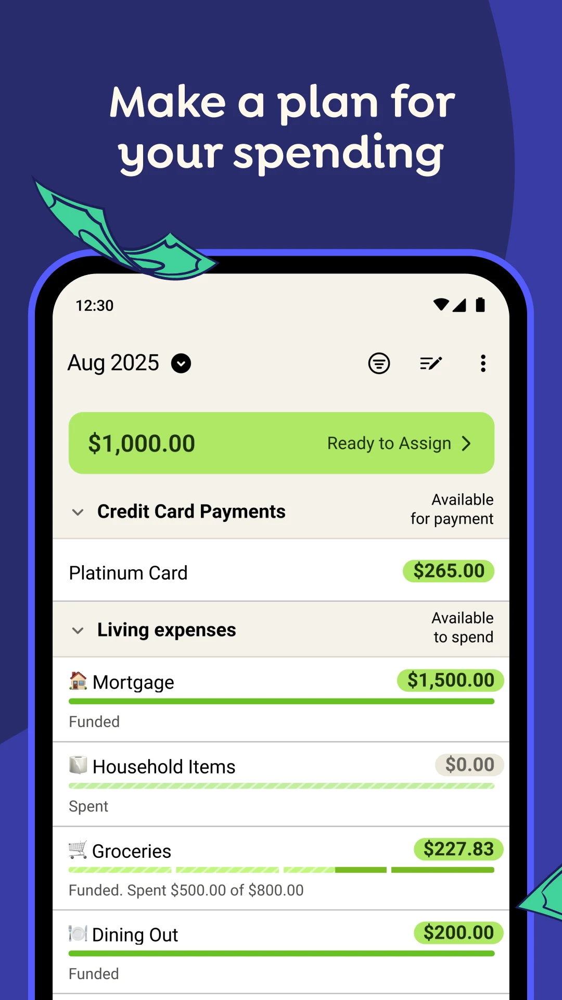

On Android, picking a **[budget app](/glossary/what-is-an-expense-tracker/)** is a slightly different decision than on iOS. You're handing an app a window into your financial life, and Android's open ecosystem makes the trade-offs around **privacy** and **local storage** feel more immediate. Some people want a coaching system that syncs their bank automatically; others just want to log spending in ten seconds without creating yet another cloud account tied to their Google ID.

Below we compare the apps Android users actually install — **Meow Money Manager, YNAB, PocketGuard and EveryDollar** — through the lens of an Android phone: offline entry, multi-currency travel, home-screen widgets, and what you actually pay.

## What an Android budget app should do

An Android budget app in 2026 should do six things: offline-first entry for subways and planes, local storage behind a fingerprint rather than a mandatory cloud, multi-currency support for travel and freelance, home-screen widgets for one-tap quick add, CSV export plus WebDav or chosen-cloud backup, and a fair price for the core. The features that matter most when you live inside the Google ecosystem: offline entry, a local lock, 50+ currencies, a quick-add widget, export and backup, and no paywall on basic tracking. Meow Money Manager is built around that local-first model.

- **Offline-first entry** — log an expense on the subway or a plane, with no signal.
- **Local storage + lock** — keep data on your device behind a fingerprint, not in a mandatory cloud.
- **Multi-currency** — essential if you travel, freelance, or split costs across borders.
- **Home-screen widgets & quick add** — Android's real strength is reaching an action in one tap.
- **Export & backup** — CSV for taxes or reimbursement, plus WebDav or the cloud you choose.
- **Fair price** — core tracking shouldn't hide behind a paywall.

## The contenders at a glance

Four Android budget apps are compared below on 2026 price, account requirements, privacy and widgets, so a local-only tracker is weighed against cloud coaching tools. Meow Money Manager is free-core with no account, on-device storage and 50+ currencies; YNAB costs $14.99/mo or $109/yr after a 34-day trial and requires cloud; PocketGuard needs Plus at ~$74.99/yr for sync; EveryDollar charges ~$79.99/yr for Premium. Only one needs no account at all.

| App | Price (2026) | Account | Local/private | Multi-currency | Android widget | Best for |
|---|---|---|---|---|---|---|
| **Meow Money Manager** | Free core + optional VIP | **No** (on-device + fingerprint) | ✅ local | ✅ 50+ currencies | ✅ quick-add | Private, multi-currency, cute |
| **YNAB** | $14.99/mo or $109/yr (34-day trial) | Yes (cloud) | ❌ cloud sync | Limited (mostly USD) | ⚠️ basic | Zero-based coaching + bank sync |
| **PocketGuard** | Free + Plus ~$74.99/yr | Yes (for sync) | ❌ cloud | Partial | ⚠️ basic | "Safe to spend" simplicity |
| **EveryDollar** | Free (manual) + Premium ~$79.99/yr | Optional | ❌ cloud | No | ⚠️ basic | Ramsey zero-based method |

## Meow Money Manager, in depth

Meow Money Manager is a cat-themed expense tracker and budget app for Android and iOS that stores everything on your device behind a fingerprint, with no sign-up or bank login and no upload unless you back up to Google Drive or WebDav. It ships 50+ currency symbols, 400+ category icons, a quick-add widget, recurring transactions, reimbursement tracking and CSV export, with a UI in Chinese, English, Indonesian, Thai and Portuguese. There is no automatic bank feed, and advanced tools sit behind VIP.

{: width="180" .normal }
{: width="180" .normal }
{: width="180" .normal }
{: width="180" .normal }
{: width="180" .normal }

Meow Money Manager is a **[cat-themed expense tracker](/glossary/what-is-an-expense-tracker/)** and **[budget app](/glossary/what-is-budget-management/)** for Android and iOS that stores everything **on your device** behind a fingerprint lock — no sign-up, no bank login, with data never leaving your phone unless you back up to Google Drive or WebDav. It also ships a multi-language UI — Chinese, English, Indonesian, Thai, and Portuguese — friendly to both domestic and overseas users.

**Strengths for Android users**
- **No account required** — open the app and start logging; nothing is uploaded to a server.
- **True offline mode** — entry works with no signal, which fits commutes, flights, and patchy travel coverage.
- **Multi-currency symbols** — 50+ currency symbols, choose a currency per transaction, with separate ledgers for home, travel, and business.
- **Quick-add widget** — drop an expense from the home screen in under ten seconds, no app open needed.
- **Recurring transactions** — rent, salary, and subscriptions auto-generate so you're not re-typing them.
- **Reimbursement tracking** — mark expenses reimbursable (full or partial), handy for work trips.
- **Asset management** — cash, cards, funds, and net worth live in one place.
- **CSV export** plus Google Drive / WebDav backup, and **400+ cute icons** with dark mode.

**Weaknesses for Android users**
- **No automatic bank sync** — you enter transactions manually. A win for privacy, a drag if you want hands-off tracking.
- **Lighter coaching** — heavy automation and "give every dollar a job" style reports are shallower than YNAB's.
- **VIP gating** — unlimited ledgers, CSV export, and app lock sit behind the optional upgrade.

**Typical scenarios:** log an expense in ten seconds from the home-screen widget on the subway or a plane with no signal — data stays local, nothing uploaded; on a work trip, use **reimbursement tracking** to flag taxi and meal expenses as reimbursable, then export a CSV and reconcile with the office in one tap; studying abroad or freelancing, use 50+ currency symbols within one ledger to track home and foreign-currency spending. Because it **needs no account and stores data only on your device**, it suits privacy-conscious Android users who don't want their bills handed to a cloud account.

**Best for:** privacy-first Android users, multi-currency households, travelers, and anyone who wants a **free budget app** with no account to fear.

- [Google Play — Meow Money Manager](https://play.google.com/store/apps/details?id=com.glgjing.money.manager.bookkeeping.meow)
- [App Store — Meow Money Manager](https://apps.apple.com/app/id1528852284)

## YNAB, in depth

YNAB (You Need A Budget) is a zero-based budgeting app that assigns every dollar a job and imports bank transactions through Plaid, with a solid Android client but a web-first core. It suits users who want a proven method and automated sync and accept a cloud account: $14.99/month or $109/year after a 34-day trial, with no free tier. Multi-currency is weak around USD, reimbursement is missing, and the richest planning still happens on desktop.

{: width="180" .normal }
{: width="180" .normal }
{: width="180" .normal }
{: width="180" .normal }
{: width="180" .normal }

YNAB (You Need A Budget) is the well-known **zero-based budgeting** app: you assign every dollar a job, connect your bank through Plaid, and let it import transactions. On Android it's a solid client, but the product is **web-first** — the deepest planning still happens on the desktop.

**Strengths for Android users**
- **Bank sync** — Plaid pulls transactions automatically, so daily entry is near-zero effort.
- **Methodology** — the four-rule system genuinely reshapes habits for disciplined users.
- **Strong reports** — age of money, spending by category, and goal tracking.
- **Cross-platform** — Android, iOS, and web stay in sync.
- **Student deal** — eligible students get a full year free.

**Weaknesses for Android users**
- **Paid only** — $14.99/month or $109/year after a 34-day trial; there is no free tier.
- **Cloud account required** — your financial data lives on YNAB's servers.
- **Learning curve** — the method takes weeks to fully click.
- **Weaker multi-currency** — it's built around USD; juggling several currencies is awkward.
- **No reimbursement tracking** — a real gap for business travelers.
- **Mobile is secondary** — the richest features still sit behind the web app.

**Best for:** users who want bank sync and a proven method and accept a subscription plus a cloud account.

- [Google Play — YNAB](https://play.google.com/store/apps/details?id=com.youneedabudget.evergreen.app)
- [App Store — YNAB](https://apps.apple.com/app/id1010865877)

## How the others compare

PocketGuard and EveryDollar are the other two Android options in 2026. PocketGuard answers "how much is safe to spend?" by pulling in accounts and subtracting bills; manual tracking is free but sync needs Plus at ~$74.99/yr. EveryDollar mirrors Dave Ramsey's zero-based method, free for manual entry with Premium at ~$79.99/yr for bank sync. Both are cloud-based and thin on multi-currency; only Meow Money Manager keeps everything local with 50+ currencies.

- **PocketGuard** answers one question — "how much is safe to spend?" — by pulling in your accounts and subtracting bills. Free gets you manual tracking; full sync needs Plus (~$74.99/yr). Great for simplicity, light on detailed categories.
- **EveryDollar** mirrors Dave Ramsey's zero-based method. The free tier is manual entry only; Premium (~$79.99/yr) adds bank sync. Clean and approachable, but thin on multi-currency and reporting.

## Which should an Android user pick?

Four pick-by-need rules settle the Android budget app choice in 2026: choose Meow Money Manager for free, private, multi-currency offline tracking with a one-tap widget, YNAB for bank sync and a proven method if you accept a subscription and cloud, PocketGuard for dead-simple safe-to-spend, and EveryDollar for Ramsey's zero-based plan on a tight budget. Each rule follows one priority — privacy, automation or simplicity.

- Want **free + private + multi-currency + offline** → **Meow Money Manager**. The on-device model and quick-add widget match Android's one-tap habits, and there's no account to worry about.
- Want **bank sync + a method** and accept a subscription/cloud → **YNAB**.
- Want **dead-simple safe-to-spend** → **PocketGuard**.
- Want **Ramsey's zero-based plan** on a tight budget → **EveryDollar**.

[Get Meow Money Manager](/apps/meow-money-manager/) — available on Android and iOS.

## FAQ

**Do I need internet to use Meow Money Manager on Android?**
{:.faq-q}

No. It's local-first — you can log expenses with no signal, and your data stays on your device by default, leaving your phone only when you manually back up to Google Drive or WebDav.

**Is it free?**
{:.faq-q}

Core tracking, budgeting, and multi-currency symbols are completely free; CSV export, unlimited ledgers, and app lock sit behind an optional one-time VIP.

**Does it support multiple currencies?**
{:.faq-q}

Yes — it ships **50+ currency symbols** and lets you set up separate ledgers for home, travel, and work, which fits cross-border life and foreign-currency spending.

**How do I choose between Meow Money Manager and YNAB?**
{:.faq-q}

Want free, private, offline, multi-currency tracking with no account → Meow Money Manager; want automatic bank sync and a proven zero-based method and will pay a subscription → YNAB.

**Which is the best budget app 2026 for someone who wants a budget app Android widget?**
{:.faq-q}

Meow Money Manager puts a home-screen widget on Android so you can log a coffee in two taps; YNAB has no equivalent one-tap widget. Both handle category budgets, but only one is built for the lock-screen habit.

**Is there an offline budget app that is also a multi-currency budget app?**
{:.faq-q}

Yes — Meow Money Manager works as an offline expense tracker Android users can run with no network at all, and it still ships 50+ currency symbols with separate ledgers for travel and work.

## Related terms

- [What Is an Expense Tracker?](/glossary/what-is-an-expense-tracker/)
- [What Is Budget Management?](/glossary/what-is-budget-management/)
- [What Is Reimbursement Management?](/glossary/what-is-reimbursement-management/)
