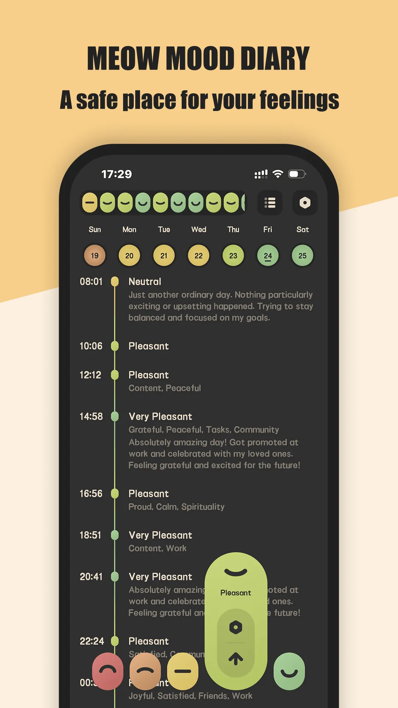
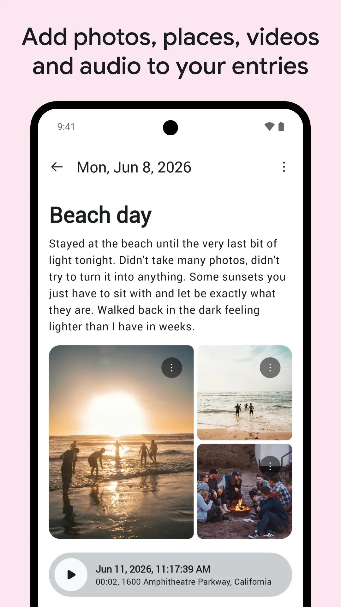

If privacy matters more than cloud features, you need a **private diary app** that never ships your thoughts to a server. **Meow Mood** is an **[offline mood diary](/glossary/what-is-a-mood-tracker/)** built around that promise: entries stay on your device, and the only backup is the Google Drive you choose. Here's how it compares with other privacy-minded options, and what to check before you commit. That is a different requirement from a **mood tracker no subscription** — one is about where data lives, the other about how you pay — and this page checks both.

## What a private journal needs

A private journal in 2026 needs five things: no uploads by default so entries stay on-device, a real fingerprint or passcode lock rather than just the phone lock, a clear PDF or text export path, offline writing with no signal, and optional sync you control through your own Drive. Meow Mood is built around that promise with no account required; the five contenders below are weighed on where data lives and how you leave.

- **No uploads by default** — entries live on your device, not a vendor's cloud.
- **A real lock** — fingerprint or passcode, not just a phone lock.
- **A clear export path** — PDF or text so you're never locked in.
- **Offline use** — write on a plane or with no signal.
- **Optional sync you control** — your own Drive, not a mandated account.

## What "private" actually costs you

Private mood tracking in 2026 means two things: a mood tracker private no account keeps a vendor from holding your identity, and a mood tracker offline keeps entries usable on a plane, in a basement, or after the servers shut down. A **mood tracker private no account** and a **mood tracker offline** solve the same problem from two sides. Meow Mood does both — logging needs no sign-up and no signal — and the trade-off is that cross-device sync is something you set up yourself with your own Google Drive or WebDav. Two checks matter before committing: does the free tier keep the lock private, and can you leave with your history? Meow Mood does both — logging needs no sign-up and no signal — and the trade-off is that cross-device sync is something you set up yourself with your own Google Drive or WebDav.

Two things are worth checking before you commit to any **mood diary app** here:

- **Does the free tier stay private?** A **mood tracker no subscription** should not put the app lock or the calendar behind a paywall; otherwise privacy becomes a paid feature.
- **Can you leave with your history?** A **mood tracker with export** lets you take your history out as a file, so a pricing change doesn't strand years of entries. A cloud-only journal usually offers a PDF, which is harder to re-import.

If you also track routines, pairing a **mood and habit tracker** — Meow Mood Diary alongside Meow Habits — keeps both logs on-device instead of splitting them across two accounts.

## The contenders at a glance

Five private diary apps are compared below on 2026 privacy model, lock, export and platforms, so a fully on-device tracker is weighed against encrypted cloud journals. Meow Mood stores locally with no upload and a fingerprint lock; Day One offers encrypted sync across four platforms with app lock; Daylio is local-first with icon logs; Apple Journal stays on-device on iPhone only; Penzu is a passcode-locked encrypted cloud. Only one keeps entries local by default on both Android and iOS.

| App | Privacy model | Lock | Export | Platforms | Best for |
|---|---|---|---|---|---|
| **Meow Mood** | Local, no upload | ✅ fingerprint | PDF | Android + iOS | Fully on-device |
| **Day One** | Cloud sync (encrypted) | ✅ app lock | Multiple | Android+iOS+Mac+Web | Full-feature, cloud |
| **Daylio** | Local-first | ✅ | Limited | Android + iOS | Icon mood logs |
| **Apple Journal** | On-device (iOS) | Device | iCloud optional | iOS only | iPhone-only local |
| **Penzu** | Encrypted cloud | ✅ passcode | Multiple | iOS + Web | Encrypted cloud |

## Meow Mood, in depth

Meow Mood is a cat-themed mood and diary app for Android and iOS with privacy as the default rather than a setting you hunt for, keeping entries on-device with no upload and a fingerprint or passcode lock. It works fully offline, exports PDF for a clean exit, and sends backups only to the Google Drive you choose with CSV as a VIP extra. One-tap mood logging keeps the habit low-friction; the trade-off is no managed multi-device sync without your own Drive.

{: width="180" .normal }
{: width="180" .normal }
{: width="180" .normal }
{: width="180" .normal }
{: width="180" .normal }

Meow Mood is a **cat-themed mood and diary app** for Android and iOS with privacy as the default, not a setting you hunt for.

**Strengths for privacy**
- **No upload by default** — entries never leave your device unless you back up.
- **Your Drive, your choice** — backups go to your own Google Drive, not a mandated account.
- **Fingerprint or passcode lock** — only you open it.
- **Offline everywhere** — write with no signal.
- **PDF export** — get entries out cleanly whenever you want.
- **Lightweight** — one-tap mood logging keeps the habit low-friction.

**Weaknesses for privacy**
- **CSV export is VIP** — free users export PDF.
- **No rich cloud features** — if you want multi-device sync without your own Drive, this isn't it.

**Best for:** people who want a **private diary app** that never touches a server they don't control.

- [Google Play — Meow Mood Diary](https://play.google.com/store/apps/details?id=com.glgjing.meow.mood.diary)
- [App Store — Meow Mood Diary](https://apps.apple.com/app/id6767560237)

## Day One, in depth

Day One is the most-awarded journal app, with encrypted sync across Android, iOS, Mac and web plus a passcode app lock and a full feature set of photos, audio, location and templates. It suits users who want a polished journal and accept encrypted cloud storage, but the cloud-by-design model means privacy depends on trusting the vendor, the free tier caps devices and photos, and Silver or Gold is needed for full use.

{: width="180" .normal }
{: width="180" .normal }
{: width="180" .normal }
{: width="180" .normal }
{: width="180" .normal }

Day One is the most-awarded journal app, with encrypted sync across Android, iOS, Mac, and web.

**Strengths for privacy**
- **Encrypted sync** — strong transport and at-rest encryption.
- **App lock** — a passcode guards the app itself.
- **Full feature set** — photos, audio, location, templates.

**Weaknesses for privacy**
- **Cloud by design** — entries are stored on Day One's servers; privacy means trusting the vendor.
- **Free tier limited** — devices and photos are capped; Silver/Gold unlocks full use.
- **Subscription cost** — ongoing payment for the premium tiers.

**Best for:** people who want a polished journal and accept encrypted cloud storage.

- [Google Play — Day One](https://play.google.com/store/apps/details?id=com.dayoneapp.dayone)
- [App Store — Day One](https://apps.apple.com/app/id1044867788)

## How the others compare

Daylio, Apple Journal and Penzu are the other three privacy-minded options in 2026. Daylio is local-first with icon-based mood logs, solid if you only need micro notes; Apple Journal keeps entries on-device on iPhone with optional iCloud, excellent for privacy but Android-excluded; Penzu offers a passcode-locked encrypted cloud journal — private, but still server-stored. Each covers one niche; only Meow Mood defaults to local, no-account logging on both platforms.

- **Daylio** is local-first and logs mood as icons; a solid private option if you only need micro mood notes.
- **Apple Journal** keeps entries on-device on iPhone with optional iCloud; excellent for privacy, but Android users are excluded.
- **Penzu** offers a passcode-locked, encrypted cloud journal — private, but still server-stored.

## Which should you pick?

Four pick-by-need rules settle the private diary choice in 2026: choose Meow Mood for entries that never leave your device, Day One for encrypted sync you don't manage, Apple Journal for iPhone-only on-device writing, and Penzu for encrypted cloud with a passcode. Each rule follows one privacy posture — local, managed cloud or hybrid. Decide where you want your entries to live, then pick.

- Want **entries that never leave your device** → **Meow Mood**.
- Want **encrypted sync you don't manage** → **Day One**.
- Want **iPhone-only on-device** → **Apple Journal**.
- Want **encrypted cloud with a passcode** → **Penzu**.

[Get Meow Mood](/apps/meow-mood-diary/) — available on Android and iOS.

## Typical scenarios

Four typical scenarios show where a private diary matters in 2026: a shared family phone, no signal on a flight or subway, leaving a vendor with your history intact, and backing up only to your own Drive. Meow Mood covers all four with a fingerprint or passcode lock, offline capture, clean PDF export and optional Google Drive backup. Day One suits the managed encrypted-cloud cases.

- **Shared family phone** — on a device others can pick up, a fingerprint or passcode lock keeps your entries yours; nothing uploads unless you back up.
- **No signal, no problem** — log a feeling on a flight or in a subway dead zone; the diary never needs the cloud to capture the moment.
- **Leave any time** — PDF export pulls every entry out cleanly, so you're never locked into a vendor.
- **Your Drive, your rules** — optional backup goes only to your own Google Drive, never a mandated account.

## FAQ

**Is Meow Mood really private?**
{:.faq-q}

Yes. Entries never upload to our servers by default; the only backup is the Google Drive you choose, and a fingerprint or passcode lock keeps the diary to yourself.

**Does Meow Mood work offline?**
{:.faq-q}

Yes. You can write and read entries with no internet; everything is stored on your device.

**Can I export my diary?**
{:.faq-q}

Yes — free users export PDF; CSV export (VIP) lets you take the data into a spreadsheet.

**Meow Mood or Day One for privacy?**
{:.faq-q}

Want entries that never leave your device and no account → Meow Mood; want encrypted sync across every device and accept a subscription → Day One.

## Related terms

- [What Is a Mood Tracker?](/glossary/what-is-a-mood-tracker/)
