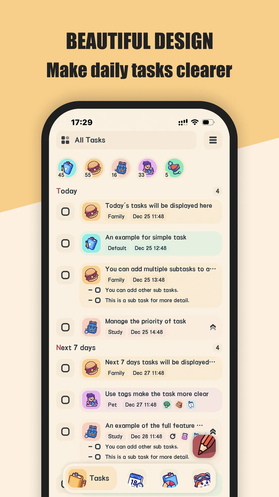
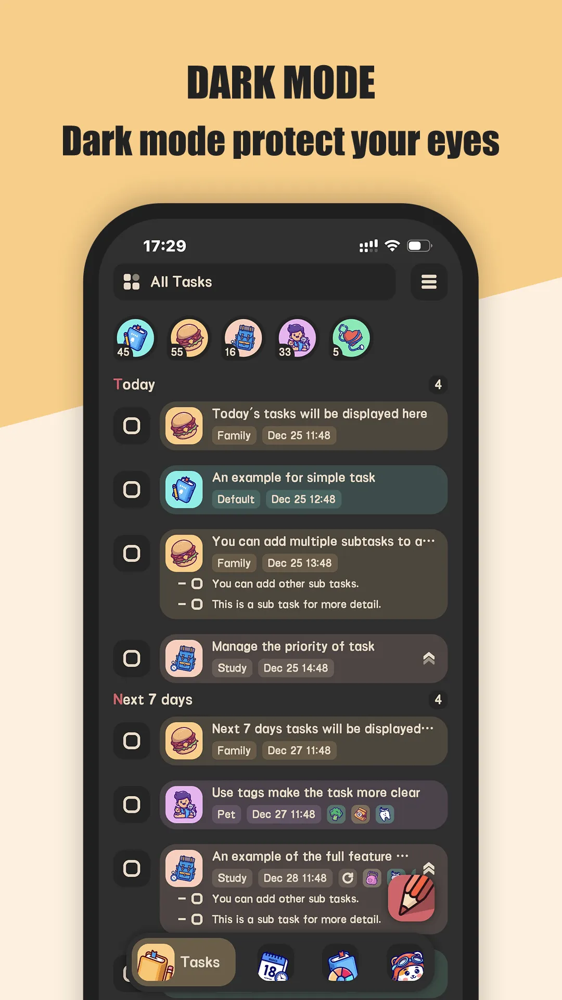

On Android, a **[to-do list app](/glossary/what-is-a-to-do-list/)** is something you open dozens of times a day, so where your tasks live matters. Some people want cloud sync across every device; others would rather keep tasks on the phone behind a fingerprint than in yet another account. **Meow Todo** is a **[free to-do list](/glossary/what-is-a-to-do-list/) for Android and iOS** that stores tasks locally with a lock. Below we compare the apps Android users actually install — **Meow Todo, Todoist, Microsoft To Do, and Google Tasks** — across privacy, widgets, sync, and price.

## What an Android to-do app should do

An Android to-do app in 2026 should do six things: offer a local-first mode with a lock rather than a mandatory cloud, home-screen widgets to tick tasks without opening the app, reminders that actually fire, a calendar view of the week, subtasks for breaking work into steps, and a fair price for the core. Meow Todo covers all six with on-device storage and no account; the four contenders below are weighed on privacy, widgets, sync and price.

- **Local-first option** — keep tasks on-device with a lock, not a mandatory cloud.
- **Home-screen widgets** — tick a task without opening the app.
- **Reliable reminders** — notifications that actually fire.
- **Calendar view** — the week at a glance.
- **Subtasks** — break work into steps.
- **Fair price** — core tracking shouldn't hide behind a paywall.

## How we picked the best task manager Android has to offer

Four things decide whether a task manager survives a week of real use in 2026: where the data lives, daily friction from widgets and subtasks, a free core that works without a subscription, and no forced account. A **simple to-do app** is easy to find; a dependable one is harder. We judged each candidate on four things that show up after a week of real use, not in a feature list: an offline to-do list app android users can trust with a fingerprint lock, low-friction widgets and subtasks, a free task management app core, and no login on day one. Meow Todo is the local-first pick here.

- **Where the data lives** — an **offline to-do list app android** users can trust keeps tasks on the phone with a **to-do app with fingerprint lock**, while still offering **to-do app google drive sync** as a manual backup.
- **Daily friction** — a **to-do app with subtasks** and a **to-do app with reminders** should not need a tutorial, and a **to-do app with calendar** should show the whole week at a glance.
- **Free core** — the **best free to-do list app** for most people is one where lists, tasks and reminders work without a subscription; that is also what a **free task management app** should mean.
- **No forced account** — you should be able to start on the bus with no signal and no login.

## The contenders at a glance

Four Android task managers are compared below on 2026 price, local storage, widgets and sync, so a private on-device list is weighed against live cloud options. Meow Todo is free-core with on-device storage, a lock and manual Drive/WebDav backup; Todoist costs ~$48/yr for Pro with live sync; Microsoft To Do and Google Tasks are free but cloud-based inside their ecosystems. Only one keeps tasks on the phone by default with no account.

| App | Price (2026) | Local/private | Widget | Sync | Best for |
|---|---|---|---|---|---|
| **Meow Todo** | Free core + optional VIP | ✅ on-device + lock | ✅ | Manual (Drive/WebDav) | Private, local |
| **Todoist** | Free + Pro ~$48/yr | ❌ cloud | ✅ | ✅ live | Cross-platform power |
| **Microsoft To Do** | Free | ❌ cloud (MS) | ✅ | ✅ | MS ecosystem |
| **Google Tasks** | Free | ❌ cloud (Google) | ✅ | ✅ | Lightweight Gmail |

## Meow Todo, in depth

Meow Todo is a cat-themed to-do list for Android and iOS with a free core of lists, tasks, reminders and a calendar view, built for users who want tasks to stay on the phone behind a fingerprint. Home-screen widgets tick items in one tap, subtasks and reminders schedule the work, and backup goes to Google Drive or WebDav only when enabled. VIP adds unlimited lists, tags, subtasks and CSV export; there is no live multi-device sync.

{: width="180" .normal }
{: width="180" .normal }
{: width="180" .normal }
{: width="180" .normal }
{: width="180" .normal }

Meow Todo is a **cat-themed to-do list** for Android and iOS. The core — lists, tasks, reminders, and a calendar view — is free; VIP adds unlimited lists, tags, subtasks, CSV export, and app lock.

**Strengths for Android users**
- **On-device storage** — tasks stay on your phone behind a fingerprint lock.
- **No account required** — open and start; nothing uploads by default.
- **Widgets** — check tasks from the home screen in one tap.
- **Subtasks and reminders** — split and schedule work with daily notifications.
- **Backup you control** — Google Drive or WebDav, only when you enable it.
- **CSV export** — move your data out anytime.

**Weaknesses for Android users**
- **VIP for power features** — unlimited lists, tags, and CSV export sit behind the upgrade.
- **No live multi-device sync** — it's manual backup, not a real-time account.

**Best for:** Android users who want a **free to-do app** that stays on the device.

- [Google Play — Meow Todo List](https://play.google.com/store/apps/details?id=com.glgjing.money.task.todo.list.meow)
- [App Store — Meow Todo List](https://apps.apple.com/app/id6742345495)

## Todoist, in depth

Todoist is the most-installed task manager, with natural-language input like "pay rent on the 1st" and deep cross-platform sync that makes tasks appear on every device instantly. It suits people who want projects, labels, priorities and sharing, with polished widgets and quick-add from the notification shade. The trade-offs are a cloud requirement, a capped free tier, and Pro at ~$48/yr for unlimited projects, comments and labels.

{: width="180" .normal }
{: width="180" .normal }
{: width="180" .normal }
{: width="180" .normal }
{: width="180" .normal }

Todoist is the most-installed task manager, with natural-language input and deep cross-platform sync.

**Strengths for Android users**
- **Natural language** — "pay rent on the 1st" sets the date automatically.
- **Live sync** — tasks appear on every device instantly.
- **Rich organization** — projects, subtasks, labels, priorities, and sharing.
- **Mature app** — polished widgets and quick-add from the notification shade.

**Weaknesses for Android users**
- **Cloud required** — your tasks live on Todoist's servers.
- **Free tier capped** — Pro (~$48/yr) for unlimited projects, comments, and labels.
- **Subscription cost** — recurring payment for full use.

**Best for:** people who want real-time sync across phone, tablet, and desktop.

- [Google Play — Todoist](https://play.google.com/store/apps/details?id=com.todoist)
- [App Store — Todoist](https://apps.apple.com/app/id572688855)

## How the others compare

Microsoft To Do and Google Tasks are the other two Android options in 2026. Microsoft To Do is free inside Microsoft 365 with shared lists and Outlook integration; Google Tasks is the lightest option tied to Gmail and Google Calendar, fine for simple lists but thin on subtasks and export. Both keep data in a vendor cloud; only Meow Todo stores tasks locally by default with no account.

- **Microsoft To Do** is free inside Microsoft 365, with shared lists and Outlook integration.
- **Google Tasks** is the lightest option, tied to your Google account and Gmail — fine for simple lists, thin on subtasks and export.

## Which should an Android user pick?

Four pick-by-need rules settle the Android task manager choice in 2026: choose Meow Todo for a local, private, no-account list, Todoist for live cross-device sync and power features, Microsoft To Do if you live in Microsoft 365, and Google Tasks for the lightest Gmail-tied list. Each rule follows one priority — privacy, sync or ecosystem. Decide where your tasks should live, then pick.

- Want **local, private, no account** → **Meow Todo**.
- Want **live cross-device sync + power features** → **Todoist**.
- Live in **Microsoft 365** → **Microsoft To Do**.
- Want **the lightest Gmail-tied list** → **Google Tasks**.

[Get Meow Todo](/apps/meow-todo-list/) — available on Android and iOS.

## Typical scenarios

Four typical scenarios show where an Android to-do app earns its place in 2026: private capture with no signal, splitting work and life with tags and icons, semester planning with reminders and subtasks, and offline-first travel with manual backup. Meow Todo covers all four with on-device storage behind a fingerprint, 400+ category icons, due reminders and Google Drive or WebDav sync when you are back online.

- **Private daily capture** — on the subway or a plane with no signal, add tasks instantly; they stay on your device behind a fingerprint lock, so nothing is uploaded to yet another cloud account.
- **Work + life split** — use tags and 400+ cute category icons to separate "Work", "Home", and "Trip", so a glance shows only what matters now.
- **Student semester planning** — drop classes and assignment due dates into one list and let daily reminders nudge you before each deadline; subtasks keep a big project from feeling like a wall of text.
- **Offline-first travel** — build a trip checklist before you fly; tick items offline and sync to Google Drive or WebDav only when you're back online.

## FAQ

**Is Meow Todo List free?**
{:.faq-q}

Yes for core use — lists, tasks, reminders, and the calendar view are free; unlimited lists, tags, subtasks, CSV export, and app lock sit behind an optional one-time VIP.

**Does Meow Todo work offline?**
{:.faq-q}

Yes. You can add and check off tasks with no internet; your data stays on your device and only syncs to Google Drive or WebDav when you enable backup.

**Do I need an account to use Meow Todo?**
{:.faq-q}

No. You can start immediately with no sign-up; tasks stay local behind a fingerprint lock.

**Meow Todo or Todoist — which should I pick?**
{:.faq-q}

Want a free, private, offline-friendly, no-account to-do list → Meow Todo; want natural-language input and real-time sync across every device → Todoist (paid Pro).

## Related terms

- [What Is a To-Do List?](/glossary/what-is-a-to-do-list/)
- [What Is a Subtask?](/glossary/what-is-a-subtask/)
