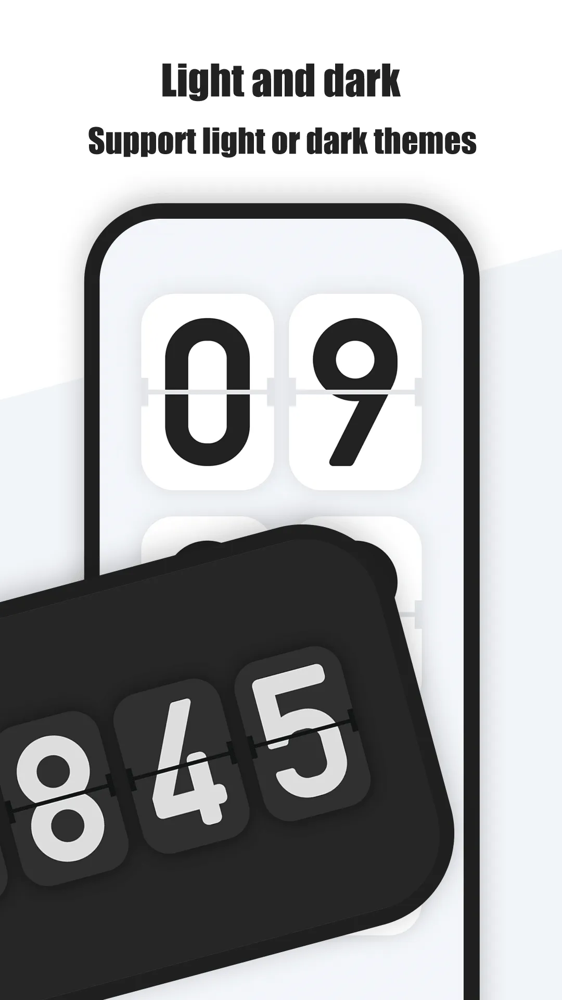

A spare phone or tablet makes a perfect **[nightstand clock](/glossary/what-is-a-nightstand-clock/)**. The **best nightstand clock app** should be dim, readable, and calm — and ideally play sound that masks a partner's snore. **Only Clock** is a **fullscreen flip clock** that fits the bedside. Here's how it compares with the free **Flip Clock** for nightstand use, plus setup and burn-in tips. People also arrive here from **use old phone as clock** or **bedside clock app** searches — both are the same setup question.

## What a nightstand clock needs

Only Clock is a full-screen flip clock for Android and iOS that turns a spare phone into a nightstand clock, with dark dimmable themes, white noise and anti-burn-in clock-shift options in one install. A bedside clock app should stay readable at 2 a.m. with dim dark themes, keep the screen lit while plugged in, mask sudden sound with white noise, guard OLED panels against ghosting, and run unattended on old hardware. Only Clock bundles all five; the free Flip Clock keeps the display plain.

- **Dim, dark themes** — easy on sleepy eyes.
- **Always-on friendly** — stays lit while plugged in.
- **White noise** — masks sudden environmental sound.
- **Burn-in guard** — OLED screens need a shift or dim to avoid ghosting.
- **Plug-and-forget** — a spare device doing one job.

## What a bedside setup actually needs

A nightstand clock app is judged at 2 a.m., so four practical details decide whether a spare phone stays on the bedside: no ads or interruptions, a dim or shifting display that protects an always-on OLED, white noise in the same app to mask a partner's snore or street noise, and compatibility with older Android versions so old hardware can be reused. Only Clock covers those four in one install with dark themes, sound and a timer; Flip Clock keeps the display simple and free.

- **No interruptions** — **nightstand clock no ads** is the first filter; a full-screen ad at bedtime defeats the whole idea. Dim, dark themes matter as much as the digits themselves.
- **Screen safety** — an always-on OLED needs a dim or shifting display. A **bedside clock app** that only offers one bright white face is a poor overnight companion.
- **Sound without a second app** — **flip clock with white noise** masks a partner's snore or street noise, while a **flip clock with focus timer** is more useful on the same device during the day.
- **A second life for old hardware** — **use old phone as clock** is the cheapest desk or **flip clock for desk** upgrade there is; check that the app still runs on an older Android version before you dedicate the device.

Only Clock covers the dim themes, sound and timer in one install; Flip Clock keeps the display plain and free.

## The contenders at a glance

Three bedside clock options are compared for 2026: Only Clock (free core plus VIP, dim themes, white noise, burn-in guard via shift/dim), Flip Clock (free with no ads, basic dim themes, no sound or burn-in guard) and minimal clock widgets (free, home-screen glance only). Only Clock suits an all-in-one bedside setup on a spare phone, while Flip Clock works as a bare clock on non-OLED screens or carefully managed displays.

| App | Price (2026) | Dim themes | White noise | Burn-in guard | Best for bedside |
|---|---|---|---|---|---|
| **Only Clock** | Free core + VIP | ✅ | ✅ | ✅ (shift/dim) | All-in-one bedside |
| **Flip Clock** | Free (no ads) | ⚠️ basic | ❌ | ❌ | Bare clock |
| **Minimal clock widgets** | Free | ❌ | ❌ | ❌ | Home-screen glance |

## Only Clock, in depth

Only Clock is a full-screen flip clock for Android and iOS whose dark, dimmable cat and retro themes stay soft at night and whose white noise — rain, fireplace and more — masks environmental sound. Anti-burn-in clock-shift and dim options protect OLED panels during always-on use, and widgets put a clock on the lock or home screen too. Premium noise packs and themes sit behind a one-time VIP, and the animation draws a little more power than a static clock while plugged in.

{: width="180" .normal }
{: width="180" .normal }
{: width="180" .normal }
{: width="180" .normal }
{: width="180" .normal }

Only Clock is a **fullscreen flip-clock** for Android and iOS with dark themes, white noise, and anti-burn-in options.

**Strengths for the bedside**
- **Dark, dimmable themes** — cat and retro looks that stay soft at night.
- **White noise** — rain, fireplace, and more for sleep.
- **Burn-in safety** — clock-shift / dim options protect OLED panels.
- **Always-on while charging** — a spare phone becomes a permanent clock.
- **Widgets** — a clock on the lock or home screen too.

**Weaknesses for the bedside**
- **VIP for best sounds/themes** — premium noise and themes are behind an unlock.
- **Animation uses more power** than a static clock (fine while plugged in).

**Best for:** a spare device that should do more than tell time.

- [Google Play — Only Clock](https://play.google.com/store/apps/details?id=com.glgjing.only.flip.clock)
- [App Store — Only Clock](https://apps.apple.com/app/id1566706513)

## Flip Clock, in depth

Flip Clock (package `com.wssc.simpleclock`) is a free, ad-free flip-clock app with brightness and always-on controls that suit a simple bedside display. It offers a classic retro flip face with no cost and no ads, but adds no white noise, no burn-in shift for OLED panels and no theme choices. It best fits a bare, free bedside clock on a non-OLED or carefully managed setup.

{: width="180" .normal }
{: width="180" .normal }
{: width="180" .normal }
{: width="180" .normal }
{: width="180" .normal }

Flip Clock (package `com.wssc.simpleclock`) is a free, ad-free **flip-clock app** with brightness and always-on controls.

**Strengths for the bedside**
- **Free and clean** — a simple retro flip face, no cost, no ads.
- **Brightness + always-on** — easy to dim and keep lit.

**Weaknesses for the bedside**
- **No white noise** — you'll need a separate sleep-sound app.
- **No burn-in shift** — a static OLED face risks ghosting over nights.
- **No themes** — just the classic look.

**Best for:** a bare, free bedside clock on a non-OLED or carefully managed setup.

- [Google Play — Flip Clock](https://play.google.com/store/apps/details?id=com.wssc.simpleclock)

## Setup and burn-in tips

Three habits keep a spare phone safe and useful as a nightstand clock: leave it plugged in with brightness low, switch on any anti-burn-in or clock-shift option the app provides, and use white noise to mask environmental sound. Only Clock bundles the clock-shift and dim controls with its white noise, so the bedside setup needs no second app or manual temperature checks.

- Keep the phone **plugged in** and **brightness low**.
- Enable any **anti-burn-in / clock-shift** option the app offers.
- Use **white noise** to mask environmental sound.

## Which should you pick?

Choose Only Clock for a calm bedside companion that pairs dim themes, white noise and OLED burn-in protection in one install with a free core and one-time VIP; choose Flip Clock for a free bare clock when you will manage brightness yourself on a non-OLED screen. The difference is sound and screen safety versus simplicity and no cost.

- Want a **calm, sound-equipped bedside companion** → **Only Clock**.
- Want a **free bare clock** and will manage brightness yourself → **Flip Clock**.

[Get Only Clock](/apps/only-clock/) — available on Android and iOS.

## Typical scenarios

Only Clock covers four nightstand scenarios on a spare phone: an always-on bedside clock that stays dim, a partner's snore masked by built-in rain or fireplace noise, an OLED panel kept safe overnight by clock-shift and dim, and a cheap guest- or kid-room clock with no account. Each uses the same full-screen flip display with one-time VIP themes available.

- **Spare phone as a bedside clock** — plug an old phone in by the bed, open Only Clock, and the dim flip face shows the time without lighting up the room.
- **Mask a snoring partner** — pair the flip clock with built-in white noise (rain, fireplace) so you fall asleep despite the noise.
- **OLED without ghosting** — the anti-burn-in shift/dim keeps an OLED panel safe through the night.
- **Kid or guest room** — a cheap spare device becomes a calm, always-on clock with no account and no fuss.

## FAQ

**Is Only Clock free for nightstand use?**
{:.faq-q}

Yes. The core clock, dim themes and white noise work free; a one-time VIP unlocks the richest themes and sound packs.

**Does Only Clock protect OLED from burn-in?**
{:.faq-q}

Yes. It offers anti-burn-in clock-shift and dim options so an OLED panel doesn't ghost when left always-on overnight.

**Only Clock or Flip Clock for the bedside?**
{:.faq-q}

Want a dim, sound-equipped bedside clock with burn-in safety → Only Clock; want a free bare clock and will manage brightness yourself → Flip Clock.

## Related terms

- [What Is a Flip Clock?](/glossary/what-is-a-flip-clock/)
- [What Is a Nightstand Clock?](/glossary/what-is-a-nightstand-clock/)
