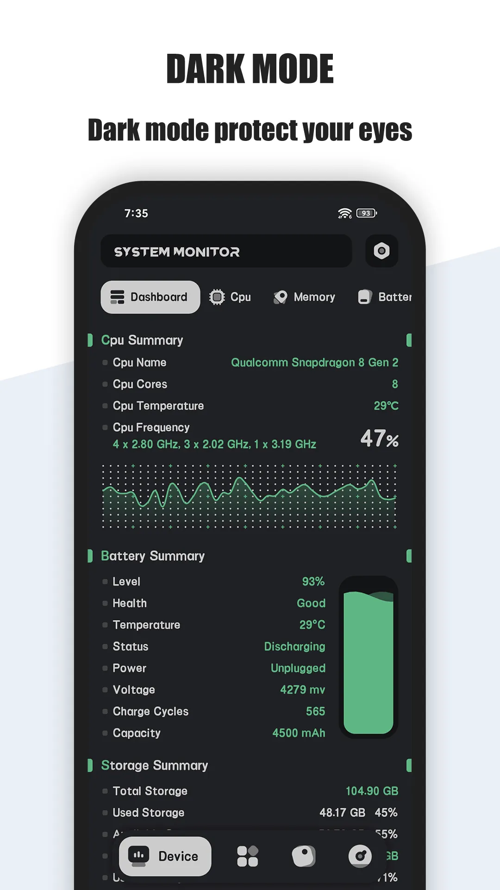
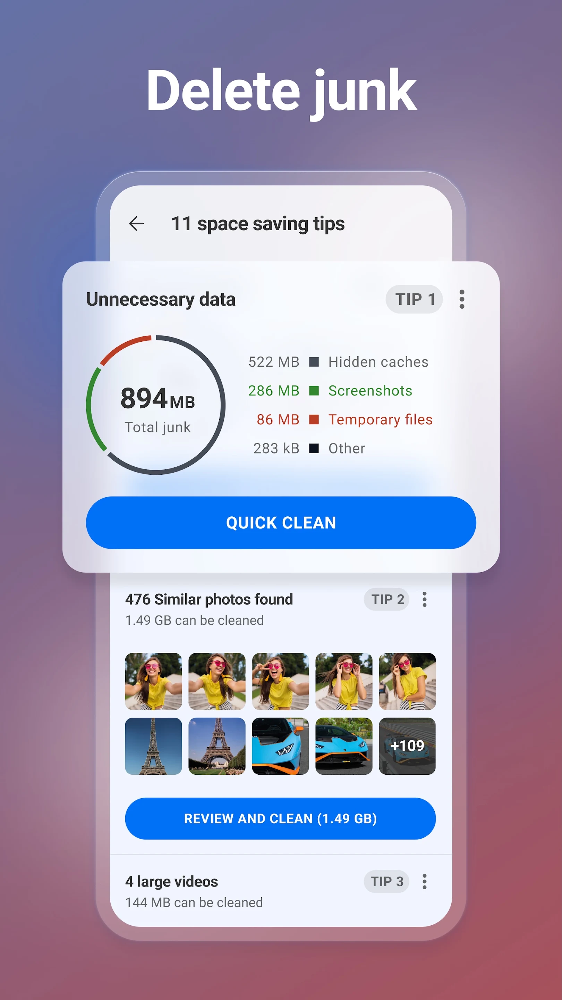

When your phone feels slow, you want to know **why** — which core is pinned, how much RAM is left, what's eating storage. A **[system monitor](/glossary/what-is-a-system-monitor/)** shows live device stats without trying to "fix" anything. **System Monitor** is a **paid device-info app for Android** that detects CPU, memory, storage, and battery details in depth. Below we compare it with **CCleaner**, the cleanup brand, for understanding your phone. The same shortlist is often searched as **best phone cleaner app for android** or **android system monitor with cleaner and booster** — two jobs this page keeps separate.

## What a system monitor needs

System Monitor is a paid, read-only device-info app for Android that reports CPU, memory, storage and battery in depth without cleaning or boosting anything. A system monitor should show live CPU, memory and storage numbers, battery health and temperature, a process list of what is running, and private on-device reads with no account or upload. System Monitor covers those needs with a one-time purchase; CCleaner focuses on deleting files instead.

- **Live CPU, memory, storage** — the numbers that explain slowness.
- **Battery and temperature** — health and heat at a glance.
- **Process list** — see what's running and using resources.
- **Lightweight** — monitoring shouldn't add load.
- **Private** — local reads, no account, no upload.

## How we picked the best system monitor app

System Monitor and CCleaner answer two different jobs — reporting what the phone is doing and changing what is stored on it — so we used four checks: whether the numbers are real sensor and system readings rather than estimates, whether CPU, RAM, storage and battery appear on one screen, whether a floating-window overlay stays light while gaming, and whether the app avoids fake one-tap speed claims. System Monitor wins on the first three; CCleaner wins when the task is freeing space.

1. **Read-only accuracy** — an **android cleaner app** deletes files; a **system monitor cpu ram battery cleaner** shortlist should first prove the numbers are real sensor and system readings, not estimates.
2. **One screen, all the numbers** — an **android system monitor with cleaner and booster** search usually means someone wants CPU, RAM, storage and battery together. System Monitor covers the reporting half; CCleaner covers the cleanup half, and neither honestly does both.
3. **An overlay that stays light** — a **system monitor with floating window** or **floating window system monitor android** readout is useful only if it does not itself add load while you game.
4. **No fake speed claims** — an **all in one tool android** that promises a one-tap fix is making a claim a read-only monitor should not make. Killing background apps on modern Android often costs more battery than it saves.

System Monitor wins on 1–3 for understanding the phone; CCleaner wins if the actual task is freeing space.

## The contenders at a glance

Three Android tools are compared for 2026: System Monitor (one-time paid, live CPU/RAM/storage/battery, process list, info only), CCleaner (free plus Pro subscription, partial live stats, cleanup actions) and DevCheck (free with IAP, deep specs, info only). System Monitor suits understanding what the phone is doing, CCleaner suits freeing space, and DevCheck suits spec deep-dives.

| App | Price (2026) | Live stats | Process list | Action (clean/boost) | Best for |
|---|---|---|---|---|---|
| **System Monitor** | Paid (one-time) | ✅ CPU/RAM/storage/battery | ✅ | ❌ info only | Seeing what's happening |
| **CCleaner** | Free + Pro subscription | ⚠️ partial | ⚠️ limited | ✅ | Cleaning & optimizing |
| **DevCheck** | Free + IAP | ✅ deep | ✅ | ❌ | Spec deep-dive |

## System Monitor, in depth

System Monitor is a paid Android device-info tool that, for a one-time download price, reports detailed hardware and live stats — CPU model and per-core frequency, memory usage, storage breakdown, and battery health and temperature. It runs read-only on-device with no account or cloud and includes a process list of running apps and their resource use. It reports facts only: it never frees memory, clears files or kills tasks, and there is no free tier to try first.

{: width="180" .normal }
{: width="180" .normal }
{: width="180" .normal }
{: width="180" .normal }
{: width="180" .normal }

System Monitor is a **paid Android device-info tool**. For a one-time download price it reports detailed hardware and live stats: CPU model and per-core frequency, memory usage, storage breakdown, and battery health/temperature — read-only detection, not optimization.

**Strengths for monitoring**
- **Detailed hardware detection** — CPU model/architecture, per-core frequency, memory totals and usage, storage breakdown, sensor readings.
- **Live CPU/RAM/storage/battery** — a clear dashboard of what's happening now.
- **Process list** — see running apps and their resource use.
- **Temperature readouts** — catch heat alongside load.
- **Lightweight and local** — runs on-device, no account, no cloud.
- **Paid, no upsell** — full feature set for the one-time price; no VIP wall.

**Weaknesses for monitoring**
- **Info only** — it reports specs and stats; it does not free memory, clean files, or kill tasks.
- **Overlaps OS tools** — Android's own settings already show some of this.
- **Paid up front** — no free tier to try before buying.

**Best for:** people who want a deep, read-only hardware and live-stats view of their phone.

- [Google Play — System Monitor](https://play.google.com/store/apps/details?id=com.glgjing.marvel)

## CCleaner, in depth

CCleaner (package `com.piriform.ccleaner`, by Gen Digital) carries its PC-cleanup brand to Android with junk and cache cleaning, a duplicate-file finder and privacy cleaning. It is built to free storage rather than monitor hardware, so its live stats are limited and its process view is thin. Pro features need a subscription, and modern Android already manages memory and caches automatically, so the gains are modest.

{: width="180" .normal }
{: width="180" .normal }
{: width="180" .normal }
{: width="180" .normal }
{: width="180" .normal }

CCleaner (package `com.piriform.ccleaner`, by Gen Digital) is best known for PC cleanup and carries that brand to Android with junk cleaning and performance tools.

**Strengths for monitoring/cleanup**
- **Junk & cache cleaning** — frees storage from temp files.
- **Duplicate-file finder** — reclaims space from repeats.
- **Privacy cleaning** — clears browsing traces.
- **Cross-platform brand** — familiar from desktop.

**Weaknesses for monitoring**
- **Weak live stats** — it cleans more than it monitors; there's no rich real-time dashboard.
- **Limited on Android** — modern Android already manages memory and caches automatically, so gains are modest.
- **Subscription** — Pro features need a paid plan.
- **Privacy history** — the brand has faced past scrutiny over data practices.

**Best for:** users who want a one-tap cleaner and accept a subscription.

- [Google Play — CCleaner](https://play.google.com/store/apps/details?id=com.piriform.ccleaner)

## How the others compare

DevCheck is the one monitoring peer in this shortlist, offering the deepest spec readout and a process list for free with in-app purchases. Like System Monitor it reports rather than cleans, which makes it a read-only alternative rather than a cleaner; the difference is that System Monitor pairs its hardware detail with live CPU, RAM, storage and battery dashboards.

- **DevCheck** offers the deepest spec readout and a process list for free with IAP; a monitoring peer to System Monitor rather than a cleaner.

## Which should you pick?

Pick System Monitor for a deep, read-only view of CPU, memory, storage and battery with a one-time payment and no subscription; pick CCleaner when the actual job is a one-tap cache or storage clean and you accept a Pro subscription. System Monitor reports the facts so you can decide whether a cleanup is even needed.

- Want **deep, read-only hardware and live-stats info** → **System Monitor**.
- Want **a one-tap cache/storage cleaner** → **CCleaner**.

[Get System Monitor](/apps/system-monitor/) — available on Android.

## Typical scenarios

System Monitor covers five read-only scenarios: finding what pins a CPU core or eats RAM and storage, tracking battery wear through health and temperature curves, watching which app hogs resources in the process list, keeping all reads local with no account or cloud upload, and deciding from facts whether a cleanup is needed at all. The app reports these numbers without changing or cleaning anything.

- **Find the slowdown cause** — open the dashboard to see which core is pinned, how much RAM is left and what's eating storage, instead of guessing.
- **Track battery wear** — check temperature, health and voltage curves to catch capacity loss early.
- **Watch processes** — the process list shows which app is hogging CPU or memory right now.
- **Privacy-first peek** — all reads are local, no account and no cloud upload, so your device data stays on-device.
- **No cleaner surprises** — read-only facts let you decide whether a cleanup is even needed.

## FAQ

**Is System Monitor free?**
{:.faq-q}

No. It's a one-time paid download — no subscription and no upgrade wall.

**System Monitor or CCleaner — which should I pick?**
{:.faq-q}

Want a deep, read-only view of CPU, memory, storage and battery → System Monitor; want a one-tap cache/storage cleaner and accept a subscription → CCleaner.

**Does System Monitor show a process list?**
{:.faq-q}

Yes. It lists running apps and their resource use, so you can see what's consuming CPU or memory.

**Does System Monitor clean junk or free RAM?**
{:.faq-q}

No. System Monitor is read-only; it reports facts and never clears caches or frees memory. For cleaning, see the [CCleaner alternatives](/posts/alternatives-to-ccleaner/) guide.

## Related terms

- [What Is a CPU Temperature Monitor?](/glossary/what-is-a-cpu-temperature-monitor/)
- [What Is a System Monitor?](/glossary/what-is-a-system-monitor/)
- [What Is a RAM Booster?](/glossary/what-is-a-ram-booster/)
