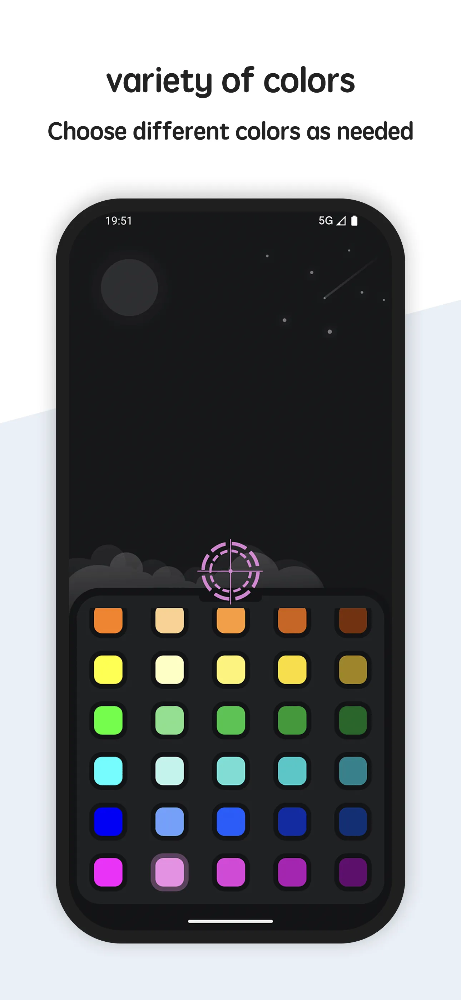

Mobile FPS games don't always give you a crosshair you like — or any at all. A [crosshair overlay](/glossary/what-is-a-crosshair/) fixes that, and this 2026 guide covers what to look for and how Crosshair Aim compares to the alternatives. If you want the **best crosshair app for Android**, you're choosing a **custom crosshair Android** tool for **fps crosshair** use — a **crosshair for PUBG Mobile**, COD Mobile and other shooters — with **no root** required.

## Why crosshair overlay app matters on Android

On Android a crosshair overlay sits above the game without root, giving FPS players a precise aim point in any shooter — useful on touchscreens where there is no mouse. Crosshair Aim ships 80+ styles with size, color and position controls, and performance matters most: the overlay must stay on top without dropping frame rate or triggering anti-cheat checks. That is why this 2026 guide focuses on lightweight, visual-only reticles.

## What people call it

The same overlay goes by several names in 2026, and each points at the same job: a screen crosshair, an android crosshair, a crosshair for games, or simply a crosshair app is a reticle you control, drawn on top of any game without root. Searches like best crosshair app for android 2026 or crosshair for shooting games android free describe the same tool. Crosshair Aim covers them with 80+ ready styles for PUBG Mobile, COD Mobile and other shooters.

## What to look for in a crosshair overlay app

Crosshair Aim is an Android crosshair overlay with 80+ styles — dots, circles, ticks and dynamic shapes — that sits above any FPS game without root. A good crosshair app should offer multiple reticle styles, control over size, color, thickness and position, support across popular shooters, a lightweight overlay that does not tank frame rate or trigger anti-cheat, per-game or per-weapon presets, and a clear free-versus-Pro split. Crosshair Aim meets those checks with a free basic set and a Pro unlock.

- **Crosshair styles** — dots, circles, ticks and dynamic shapes, not just one static reticle.
- **Customization** — size, color, thickness and position to fit your controls and weapon.
- **Game support** — works across popular shooters, not just one title.
- **Overlay performance** — stays on top without lag or triggering anti-cheat issues.
- **Per-weapon presets** — save crosshairs per game so you're not re-tuning each session.
- **Free vs pro** — how many styles are free and what the pro unlock adds.

## The field at a glance

Three crosshair apps are compared for Android in 2026: Crosshair Aim (free core plus Pro unlock, 80+ customizable styles, all shooters), Crosshair Hero (free plus Pro, a large library and editor, the closest rival) and Crosshair X (free plus Pro, iOS only). Crosshair Aim is the ready-made Android pick, Crosshair Hero suits tinkerers who want a deep editor, and Crosshair X has no Android build.

| App | Price (2026) | Platform | Best for / notes |
|---|---|---|---|
| **Crosshair Aim** | Free download, core free + Pro unlock | Android only | 80+ styles, customizable overlay, all shooters |
| **Crosshair Hero** | Free + Pro | Android only | Large crosshair library and editor, the closest direct competitor |
| **Crosshair X** | Free + Pro | iOS | iOS crosshair overlay; no Android version |

## Crosshair Aim, in depth

Crosshair Aim Pro adds a custom crosshair overlay to FPS shooter games on Android with 80+ designs — dots, circles, ticks and more — applied as a live, lightweight layer. Size, color and position are fully adjustable, per-game presets switch instantly, and the overlay works even for weapons that ship without a reticle. Basic styles are free, Pro unlocks the full library, and the visual-only layer does not touch game memory or data.

{: width="180" .normal }
{: width="180" .normal }
{: width="180" .normal }
{: width="180" .normal }

Crosshair Aim Pro adds a custom crosshair overlay to FPS shooter games on Android, with 80+ styles to improve your aim in any shooting game.

- **80+ crosshair designs** — dots, circles, ticks and more, applied as a live overlay.
- **Fully customizable** — size, color and position to fit your controls and playstyle.
- **All shooters supported** — generate a crosshair even for weapons that ship without one.
- **Per-game presets** — save a crosshair for each title and switch instantly.
- **Lightweight overlay** — stays on top without hurting performance.
- **Free to start** — basic styles included; Pro unlocks the full library.

**Best for:** mobile FPS players who want a precise, customizable crosshair.

Go deeper:
- [Best crosshair for FPS games](/posts/best-cross-hair-fps/)
- [Best crosshair overlay app](/posts/best-cross-hair-overlay/)
- [Crosshair Aim app page](/apps/cross-hair/)
- [Crosshair Aim Official User Guide](/posts/tutorial-cross-hair/)

## How Crosshair Aim compares to the competition

Crosshair Aim matches Crosshair Hero, the closest direct rival, on style count while leaning on a simpler setup with 80+ ready designs instead of a deep editor. Crosshair X is the iOS option with no Android build, so it is off the table here. Full breakdowns are linked below for both rivals.

- **vs Crosshair Hero** — Crosshair Hero is the closest direct rival with a big library and its own editor; Crosshair Aim matches it on styles and leans on a simpler, faster setup with 80+ ready designs. Full breakdown in [Crosshair Aim vs Crosshair Hero](/posts/vs-crosshair-and-crosshair-master/).
- **vs Crosshair X** — Crosshair X is the iOS option and has no Android build, so it's off the table for this audience; Crosshair Aim is the Android-native pick.
- **More options** — see [Best Crosshair Hero Alternatives in 2026](/posts/alternatives-to-crosshair-master/) for the full field.

## Which should you pick?

Quick picks depend on the platform and how much tinkering you want: Crosshair Aim suits Android players who want a precise 80+ style overlay instantly, Crosshair Hero (Pro) suits those who want a deep editor, Crosshair X is the iOS-only choice, and Crosshair Aim's free styles cover anyone who just needs a basic center dot.

- Want a precise overlay in any Android shooter → Crosshair Aim.
- Want a deep editor and don't mind tinkering → Crosshair Hero (Pro).
- On iOS → Crosshair X.
- Just need a basic center dot fast → Crosshair Aim's free styles.

## Typical scenarios

Crosshair Aim covers five FPS scenarios with 80+ styles: adding a reticle to weapons or modes that ship without one, switching per-game or per-weapon presets in one tap, choosing high-contrast colors for low-visibility maps, keeping frame rate intact with a lightweight overlay, and staying clear of anti-cheat because the layer is visual-only and never touches game memory.

- **No native crosshair** — some weapons or modes ship without a reticle; drop a custom one so you always have an aim point.
- **Different guns, different needs** — save a per-game or per-weapon preset and switch in one tap instead of re-tuning.
- **Low visibility maps** — pick a high-contrast color and thickness so the reticle stays visible in dark or bright scenes.
- **Keep frame rate** — the overlay is lightweight and stays on top without tanking FPS, so aiming help doesn't cost performance.
- **Safe by design** — it's a visual-only overlay that doesn't touch game memory or data, so it stays clear of anti-cheat.

## FAQ

**Is Crosshair Aim free?**
{:.faq-q}

Yes. The basic style set is free; a Pro unlock opens the full 80+ library and deeper customization.

**Crosshair Aim or Crosshair Hero — which should I pick?**
{:.faq-q}

Want 80+ ready designs with a quick, lightweight setup → Crosshair Aim; want a deep editor and don't mind tweaking → Crosshair Hero (Pro).

**Does Crosshair Aim work on iOS?**
{:.faq-q}

No. Crosshair Aim is Android-only; iOS users can look at Crosshair X, which has no Android build.

**Is it safe / will it get me banned?**
{:.faq-q}

It's a visual-only overlay that doesn't modify game data or memory, so it doesn't trigger anti-cheat. Use it within each game's fair-play rules.

## Conclusion

For mobile FPS players who want a precise, customizable crosshair, Crosshair Aim is the most flexible pick — and the basic set is free.

- [Google Play — Crosshair Aim](https://play.google.com/store/apps/details?id=com.glgjing.crosshair.aim.fps.game)

Or read the [Best crosshair for FPS games](/posts/best-cross-hair-fps/) for the full breakdown.

## Related terms

- [Crosshair for FPS: Types, Overlays and Best Apps](/glossary/what-is-a-crosshair/)
