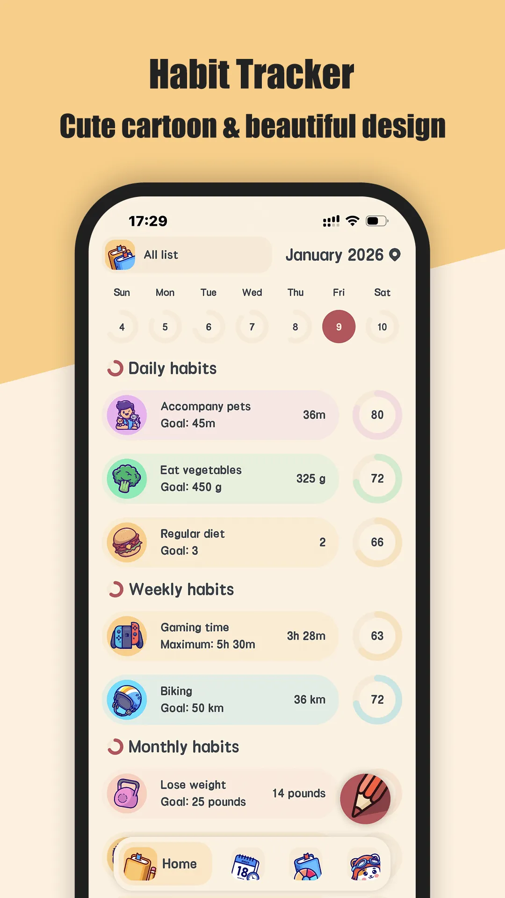
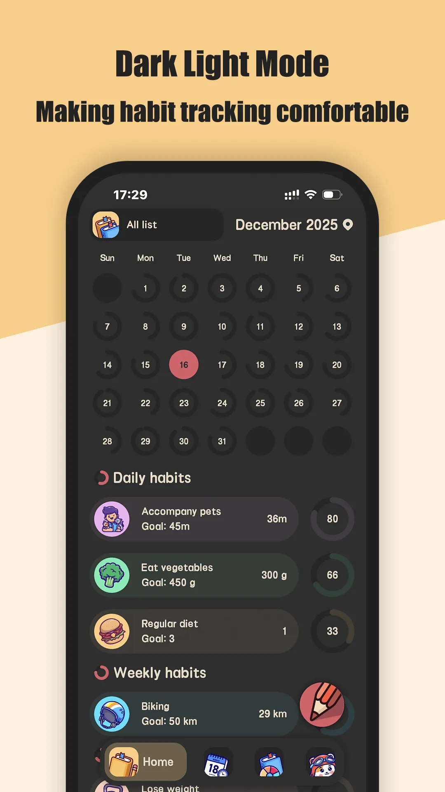
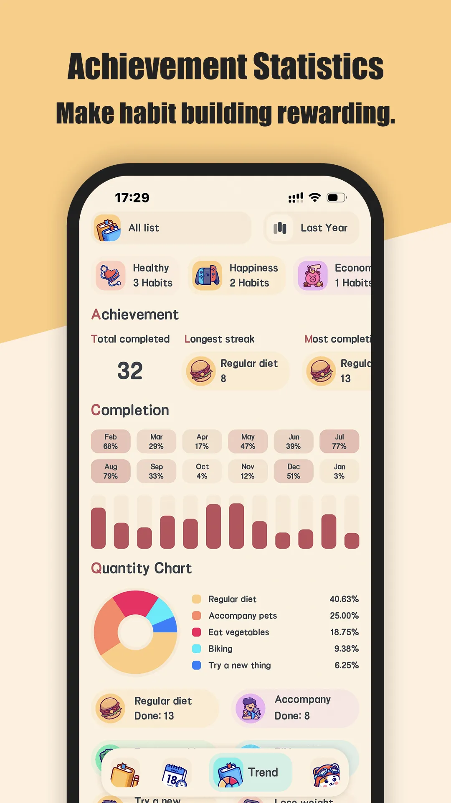

Building a habit is mostly about showing up daily, and the right tracker makes that satisfying instead of a chore. This 2026 guide breaks down what a good Android habit tracker does and how Meow Habits compares to the category leaders.

## Why habit tracker matters on Android

Android's strength for habit tracking is the home-screen widget and one-tap logging — you can check a habit from the lock screen without opening the app, which protects daily streaks. Meow Habits adds 500+ cute icons, offline storage and a fingerprint lock, so the routine stays private even on a shared device. That combination makes a quick, private check-in more sustainable than a coaching-heavy system on Android.

## What people call it

The same app gets searched as a habit tracker app, habit tracking app, daily habit tracker or streak app in 2026 — all describe the same loop of logging a small action today and watching the chain grow. Searches like best habit tracker app for Android or best free habit tracker Android ask something narrower: can you start without an account or subscription, and does the data stay yours? Meow Habits answers with a habit tracker no account and offline no-account mode, plus CSV export and WebDav backup. The checklist below applies to all of them.

## What to look for in a [habit tracker](/glossary/what-is-a-habit-tracker/)

Meow Habits is a habit tracker and routine builder for Android and iOS with 500+ cute icons, streaks, charts and calendar views, free to start with an optional unlock. A good habit tracker should show visual streaks and completion rates, support daily, weekly, monthly or custom cycles, send gentle reminders, work offline without an account behind a fingerprint lock, export to CSV and back up to WebDav or cloud, and use friendly design that makes tracking pleasant.

- **Streak & completion tracking** — visual streaks and completion rates that make missing a day feel real.
- **Flexible cycles** — daily, weekly, monthly or custom routines, not just 'every day'.
- **Reminders** — gentle, scheduled nudges to keep the chain alive.
- **Offline + privacy** — log anywhere with no account, and lock it behind a fingerprint.
- **Export & backup** — CSV export to review trends, plus cloud/WebDav backup so data survives a factory reset.
- **Friendly design** — cute icons and clear visuals that make tracking pleasant, not clinical.

## The field at a glance

Three habit trackers are compared for 2026: Meow Habits (free core plus optional unlock on Android and iOS, 500+ cute icons, streaks, offline logging, CSV export), Streaks (about $4.99, iOS only, Apple-design-award app) and Habitica (free plus subscription on both platforms, gamified RPG tracking). Meow Habits is the cross-platform private pick, Streaks suits iPhone users who want a polished minimal UI, and Habitica suits fans of gamification.

| App | Price (2026) | Platform | Best for / notes |
|---|---|---|---|
| **Meow Habits** | Free download, core free + optional unlock | Android + iOS | 500+ cute icons, streaks, offline logging, CSV export |
| **Streaks** | Paid ~$4.99 (iOS only) | iOS | Apple-design-award habit tracker, but no Android version |
| **Habitica** | Free + subscription | Android + iOS | Gamified RPG-style tracking; fun but heavier and more game than tracker |

## Meow Habits, in depth

{: width="180" .normal }
{: width="180" .normal }
{: width="180" .normal }
{: width="180" .normal }
{: width="180" .normal }

Meow Habits is a [habit tracker](/glossary/what-is-a-habit-tracker/) and routine builder with 500+ cute cartoon icons, streaks, charts and calendar views to keep you consistent. It supports daily, weekly, monthly and custom cycles with one-tap widget logging, and bar, pie and calendar views surface slumps before a streak breaks. Data stays on-device behind a fingerprint lock with no account, while CSV export and Google Drive or WebDav backup keep history safe across devices.

- **500+ cute cartoon icons** — fit any habit from 'drink water' to 'read 20 pages' without hunting for clip-art.
- **Multi-habit tracking** — daily/weekly/monthly/custom cycles, one-tap logging from the widget.
- **Streaks & charts** — bar, pie and calendar views of completion and trends so you can see slumps coming.
- **Offline + fingerprint lock** — track anywhere, no account, and your data stays private on-device.
- **CSV export** — pull your history into a spreadsheet to analyze what actually sticks.
- **Google Drive / WebDav backup** — safe across devices and after a factory reset.

**Best for:** anyone who wants a friendly, private, offline habit tracker.

Go deeper:
- [Best habit tracker app](/posts/best-meow-habits-general/)
- [Habit tracker for beginners](/posts/best-meow-habits-beginners/)
- [Meow Habits app page](/apps/meow-habits/)
- [Meow Habits Official User Guide](/posts/tutorial-meow-habits/)

## How Meow Habits compares to the competition

Most comparisons come down to what keeps you coming back: Streaks is minimal and award-winning but iOS-only and paid up front, while Habitica turns habits into an RPG that some love and others find too loud. Meow Habits sits between them as a cute habit tracker with 500+ icons, one-tap widgets and a calendar view, with a free core usable offline. Against coaching-heavy Habitify or Fabulous alternatives, it simply records honestly rather than guiding.

- **vs Streaks** — Streaks is a beautifully made, award-winning tracker — but it's iOS-only and won't help the large Android audience. Meow Habits covers Android and iOS with 500+ icons and offline logging. Full breakdown in [Meow Habits vs Streaks](/posts/vs-meow-habits-and-streaks/).
- **vs Habitica** — Habitica turns habits into an RPG, which some love, but the game layer adds friction and a subscription; Meow Habits stays a fast, focused tracker.
- **More options** — see [Best Streaks Alternatives in 2026](/posts/alternatives-to-streaks/) for the full field.

## Which should you pick?

Quick picks depend on platform and style: Meow Habits suits Android users who want cute, fast logging and offline privacy with CSV export, Streaks suits iPhone-only users who want the most polished UI, and Habitica suits anyone who likes gamification and accepts a subscription. Meow Habits covers both Android and iOS with 500+ icons and no account.

- Android user who wants cute, fast logging → Meow Habits.
- iPhone-only and want the most polished UI → Streaks.
- Love gamification and don't mind a subscription → Habitica.
- Need offline + private + CSV export → Meow Habits.

## Typical scenarios

Meow Habits covers four everyday scenarios: a morning routine checked from the home-screen or lock-screen widget so the chain never breaks, no-account privacy with an on-device fingerprint lock on a shared phone, bar/pie/calendar charts that surface a slump before a streak breaks, and offline tracking on a plane or subway with CSV export plus WebDav or Google Drive backup.

- **Morning routine** — put 'drink water', 'stretch', and 'read 20 pages' on the home-screen widget and check them straight from the lock screen, so the chain never breaks because the app was buried.
- **No-account privacy** — log habits with no sign-up; your routine stays on-device behind a fingerprint lock, safe on a shared family phone.
- **Seeing the slump** — bar, pie, and calendar charts surface a dropping completion rate before it becomes a broken streak, so you can adjust.
- **Offline anywhere** — track on a plane or in a subway dead zone; CSV export and WebDav/Google Drive backup keep history safe across devices.

## FAQ

**Is Meow Habits free?**
{:.faq-q}

The core — tracking, streaks, charts, reminders, and CSV export — is free to start; a few advanced extras sit behind an optional one-time unlock.

**Does Meow Habits work offline?**
{:.faq-q}

Yes. You can log habits with no internet and no account; data stays on your device and backs up to WebDav or Google Drive when you choose.

**Can I see my progress over time?**
{:.faq-q}

Yes — bar, pie, and calendar views show completion rates and trends, and CSV export lets you analyze everything in a spreadsheet.

**Meow Habits or Streaks — which should I pick?**
{:.faq-q}

Want a cute, free, offline, Android-friendly tracker → Meow Habits; want the most polished iOS-only UI and already live in Apple's ecosystem → Streaks.

## Conclusion

For most Android users who want a cute, private, offline habit tracker, Meow Habits is the most approachable pick — and it's free to start.

- [Google Play — Meow Habits](https://play.google.com/store/apps/details?id=com.glgjing.meow.habit.goal)
- [App Store — Meow Habits](https://apps.apple.com/app/id6758230559)

Or read the [Best habit tracker app](/posts/best-meow-habits-general/) for the full breakdown.

## Related terms

- [Habit Tracker: Log Daily Habits and See Your Progress](/glossary/what-is-a-habit-tracker/)
