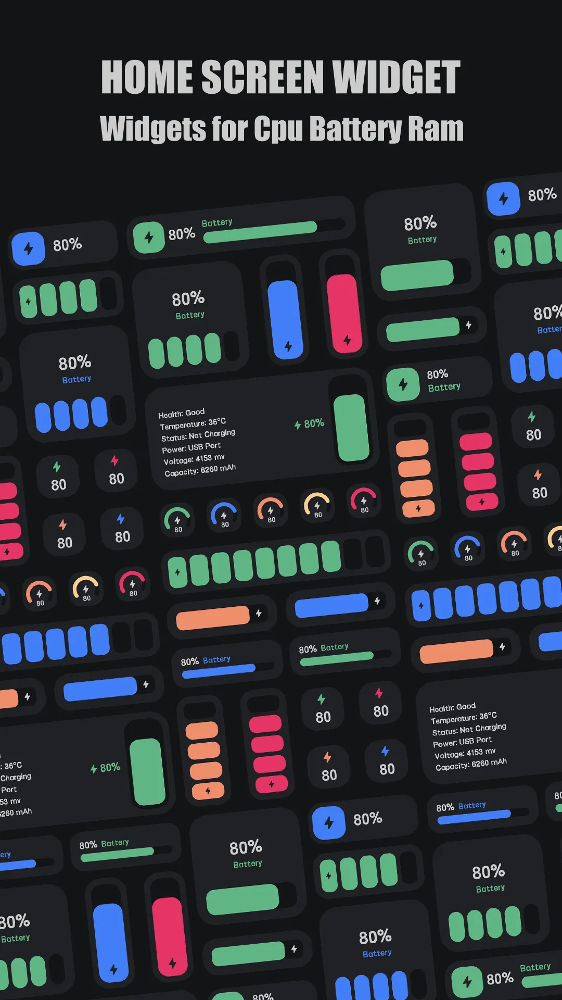

Some Android tools try to 'clean' and 'boost'; others just show you what's happening inside your phone. If you want honest, read-only [device information](/glossary/what-is-a-system-monitor/), this 2026 guide is for you — and it covers how System Monitor compares to the cleaners. The same category gets searched as **android cleaner**, **ram booster** or **android optimizer** — three labels for tools that promise to change the phone rather than just report on it.

## What people call it

People arrive at this category from two directions in 2026, and the words describe different promises: a system monitor or android system monitor reports read-only facts — live CPU, RAM, storage, battery and temperature — which is what System Monitor does; a phone cleaner deletes caches and junk; a ram booster claims to speed the phone by killing processes; and an all in one tool android asks for monitoring, cleaning and battery care together. System Monitor covers the monitoring and battery-health half without cleanup claims.

- **System monitor** / **android system monitor** / **system monitor app** — read-only facts: live CPU, RAM, storage, battery and temperature. This is what System Monitor does.
- **Phone cleaner** / **android cleaner** / **storage cleaner** — tools that delete caches and junk files. A **best phone cleaner for android** shortlist is about freeing space, not about reporting it.
- **Ram booster** / **best ram booster android** / **android optimizer** — tools that claim to speed the phone up by killing processes. On modern Android, closing apps this way often costs more battery than it saves.
- **All in one tool android** — a request for monitoring, cleaning and battery care in one install; System Monitor covers the monitoring and battery-health half, without the cleanup claims.

The useful dividing line is simple: a **battery monitor** or system monitor reports numbers you can verify, while a cleaner changes files. This guide ranks the first kind and compares it honestly against the second.

## Why system monitor app matters on Android

On Android, a floating window and home-screen widgets show live CPU, memory and battery stats at a glance, and an overheat alarm helps you act before heat causes damage. System Monitor is read-only — it reports hardware facts and never changes files or memory — and the key word matters because cleaners promise changes they cannot honestly deliver. That is why this 2026 guide ranks the reporting kind.

## What to look for in a system monitor app

System Monitor is a one-time paid Android tool that reports CPU, storage, memory and battery facts read-only, with temperature, health, a floating window, widgets and an overheat alarm. A good system monitor should detect hardware without changing anything, show CPU and battery temperature plus health and voltage, avoid fake boost or junk-cleaning claims, keep live stats in a floating window and widgets, warn on heat, and charge once rather than subscribe.

- **Read-only detection** — see CPU, storage, memory and battery facts without the app changing anything.
- **Temperature & health** — CPU and battery temperature, plus battery health and voltage.
- **No false 'boost'** — monitoring, not memory acceleration or junk cleaning.
- **Floating window & widgets** — live stats at a glance, above any app.
- **Overheat protection** — an alarm when things run hot, so you can cool down.
- **One-time paid** — no subscription, no 'free + nag' upgrade wall.

## The field at a glance

Three Android tools are compared for 2026: System Monitor (one-time paid, read-only CPU/storage/RAM/battery info, temperature and overheat alarm), CCleaner (free plus Pro subscription, junk cleaning and RAM boosting — a different job) and Device Info HW (free, detailed hardware detection but lighter live alerts). System Monitor suits honest monitoring, CCleaner suits freeing space, and Device Info HW suits a free spec sheet.

| App | Price (2026) | Platform | Best for / notes |
|---|---|---|---|
| **System Monitor** | Paid app (one-time download) | Android only | Read-only CPU/storage/RAM/battery info, temp, overheat alarm |
| **CCleaner** | Free + Pro subscription | Android | Junk cleaning and RAM boosting — different job from monitoring |
| **Device Info HW** | Free | Android | Detailed hardware detection, lighter on live alerts |

> **Note:** Monitoring is not the same as cleaning. If you only need to know your CPU temp and battery health, a read-only tool like System Monitor is safer than an app that 'boosts' memory it can't really control.

## System Monitor, in depth

{: width="180" .normal }
{: width="180" .normal }
{: width="180" .normal }
{: width="180" .normal }
{: width="180" .normal }

System Monitor is a paid Android tool for hardware info detection: real-time CPU temperature and frequency, storage and memory usage, and battery health monitoring — read-only, with no cleaning or boosting. It charts battery temperature, health, voltage and level over time, adds an overheat alarm and per-core monitoring, and keeps CPU, battery and RAM stats in a floating window and home-screen widgets. Payment is one-time, with no subscription or RAM-boost gimmicks.

- **Hardware info detection** — CPU temperature/frequency, storage usage and memory usage, all read-only.
- **Battery health** — temperature, health, voltage and level with curves, so you can see wear.
- **Overheat alarm & protection** — warns when CPU or battery runs hot so you can act early.
- **Floating window & widgets** — CPU, battery and RAM widgets live on screen above any app.
- **Multicore monitoring** — per-core usage and frequency in real time.
- **Paid, one-time** — download once; no subscription and no RAM-boost gimmicks.

**Best for:** Android users who want honest, read-only device monitoring (not cleaners or boosters).

Go deeper:
- [Best system monitor app](/posts/best-system-monitor-monitor/)
- [See exactly what your RAM is doing](/posts/best-system-monitor-ram/)
- [System Monitor app page](/apps/system-monitor/)
- [System Monitor Official User Guide](/posts/tutorial-system-monitor/)

## How System Monitor compares to the competition

CCleaner is a cleaner and RAM booster that changes your phone by clearing caches and freeing memory, while System Monitor does the opposite — it only reports hardware facts and never touches files or memory. Device Info HW is a solid free hardware detector but lighter on live overheat alarms and the floating-window experience. Pick by intent: monitor, clean, or read specs.

- **vs CCleaner** — CCleaner is a cleaner and RAM booster — it changes your phone (clears caches, frees memory). System Monitor is the opposite: it only reports hardware facts and never touches your files or memory. Pick by intent — monitor vs clean. Full breakdown in [System Monitor vs CCleaner](/posts/vs-system-monitor-and-ccleaner/).
- **vs Device Info HW** — Device Info HW is a solid free hardware detector, but it's lighter on live overheat alarms and the floating-window experience that System Monitor centers on.
- **More options** — see [Best CCleaner Alternatives in 2026](/posts/alternatives-to-ccleaner/) for the full field.

## Which should you pick?

Quick picks depend on intent: System Monitor suits anyone who wants to see what is happening inside the phone without changing it, plus overheat alarms and widgets, CCleaner suits clearing caches and freeing memory as a different job, and Device Info HW suits a free spec sheet. System Monitor is a one-time paid download with no subscription.

- Want to see what's happening inside, not change it → System Monitor.
- Want to clear caches and free memory → CCleaner (different job).
- Want a free spec sheet → Device Info HW.
- Want overheat alarms + widgets → System Monitor.

## Typical scenarios

System Monitor covers five read-only scenarios: keeping the floating window over a game with an overheat alarm, watching battery temperature, health and voltage curves for wear, checking per-core frequency and load instead of an average, glancing at home-screen CPU/RAM/battery widgets without launching the app, and reading the facts before deciding whether a cleaner is needed at all.

- **Catch heat before it bites** — keep the floating window over a game or video; the overheat alarm tells you to pause before CPU or battery damage.
- **Watch the battery wear** — open the battery curves to see temperature, health and voltage trend, so you know when capacity is slipping.
- **Multicore peek** — check per-core frequency and load to see which core is pinned, not just an average.
- **One glance, no opening** — home-screen CPU/RAM/battery widgets show live stats without launching the app.
- **Know before you clean** — read-only facts first; decide whether a cleaner is even needed.

## FAQ

**Is System Monitor free?**
{:.faq-q}

No. System Monitor is a one-time paid download — no subscription and no 'free + upgrade nag'. You buy it once.

**Does System Monitor clean or boost my phone?**
{:.faq-q}

No. System Monitor is read-only: it reports CPU, storage, memory and battery facts and never clears caches, frees memory or changes files. For cleaning, see the [CCleaner alternatives](/posts/alternatives-to-ccleaner/) guide.

**Does System Monitor show battery health?**
{:.faq-q}

Yes. It charts battery temperature, health, voltage and level over time, so you can watch wear develop.

**Does System Monitor work on iOS?**
{:.faq-q}

No. System Monitor is Android-only.

## Conclusion

For Android users who want honest, read-only device monitoring rather than cleaners or boosters, System Monitor is the right pick — a one-time paid download.

- [Google Play — System Monitor](https://play.google.com/store/apps/details?id=com.glgjing.marvel)

Or read the [Best system monitor app](/posts/best-system-monitor-monitor/) for the full breakdown.

## Related terms

- [CPU Temperature Monitor: Check Android Heat and Alerts](/glossary/what-is-a-cpu-temperature-monitor/)
- [System Monitor: Check CPU, RAM and Storage on Android](/glossary/what-is-a-system-monitor/)
- [RAM Booster: How It Works and When It Helps](/glossary/what-is-a-ram-booster/)
