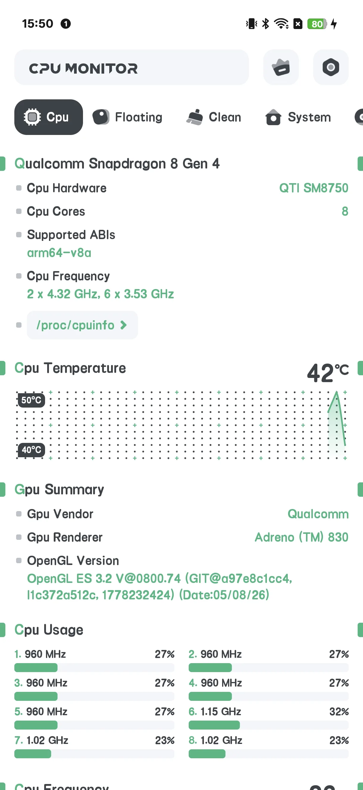
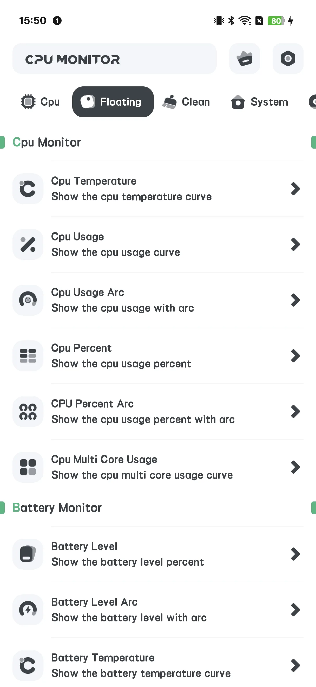
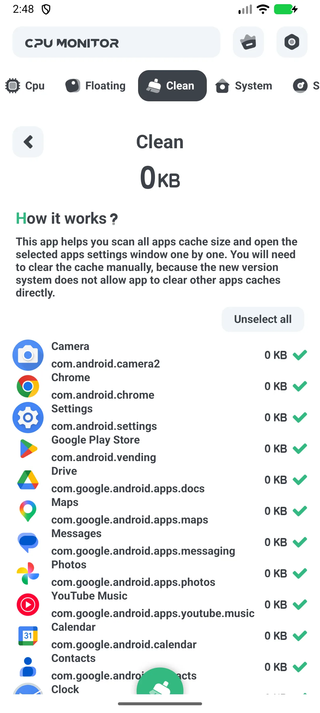
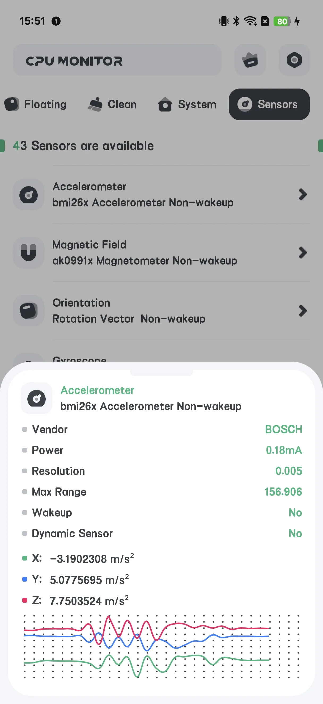
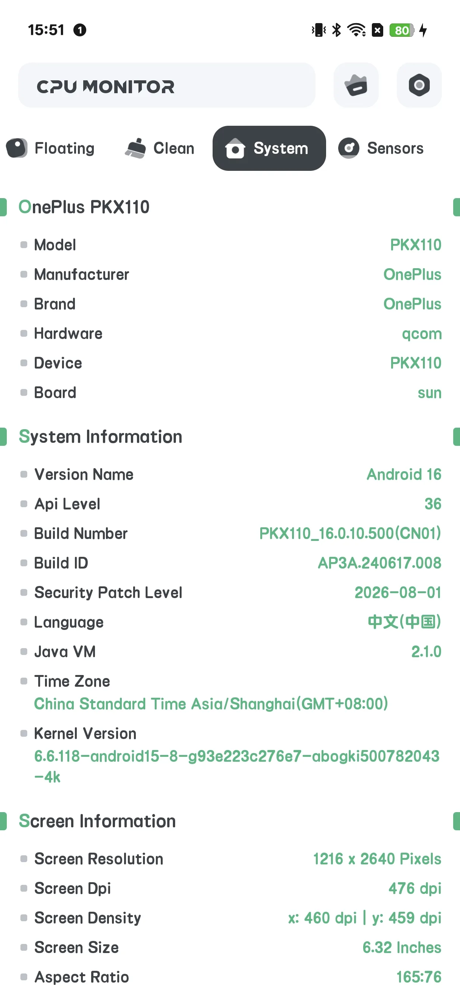

## Table of Contents

- [App Introduction](#app-introduction)
- [First-time Use](#first-time-use)
- [Real-time CPU](#real-time-cpu)
- [Floating Window](#floating-window)
- [Home-screen Widgets](#home-screen-widgets)
- [Overheat Alarm](#overheat-alarm)
- [History Curves](#history-curves)
- [Upgrade to Pro](#upgrade-to-pro)
- [Settings](#settings)
- [Typical scenarios](#typical-scenarios)
- [FAQ](#faq)

## App Introduction

CPU Monitor shows real-time [CPU temperature](/glossary/what-is-a-cpu-temperature-monitor/) and frequency, RAM, battery and storage on Android, with a floating window, widgets, an overheat alarm and history curves across four tabs — CPU, SYSTEM, FLOATING and SENSOR. It is a read-only tool that reads thermal sensors and system counters without root, plus a CLEAN screen for app cache, and it never changes game data or system settings. This guide walks from the first launch through the floating window, overheat alarm thresholds, history curves, the home-screen widget layout and the cache-clean screen — explaining what the numbers mean rather than promising a temperature drop.

**📈 Live Monitoring**
- CPU temperature & frequency, per-core usage
- RAM, battery and storage stats in one place

**🧹 Clean**
- A **CLEAN** screen lists app cache/junk and lets you clear it

**🌡 Overheat Alarm**
- Warns before heat damages performance or battery

**📉 History**
- Temperature / frequency curves to spot what spikes your heat

**💲 Free + Pro**
- The free version is **ad-supported**
- **Pro** removes ads and unlocks the "Powerful System Monitor" toolset

## First-time Use

The home screen has four tabs — CPU, SYSTEM, FLOATING and SENSOR — with an Upgrade button at the top. CPU Monitor opens on the live CPU readout, and each tab groups one job: live numbers, device stats, the floating overlay and raw sensors. The free version is ad-supported, so a banner may appear while you read the CPU tab.

{: width="180" .normal }
{: width="180" .normal }
{: width="180" .normal }
{: width="180" .normal }
{: width="180" .normal }

## Real-time CPU

CPU Monitor's CPU tab shows live CPU temperature, frequency and per-core load on Android, reading thermal sensors and system counters without root. Open the tab to see the numbers update in place; the free version displays a banner ad there. These read-only figures explain throttling and heat without changing any system setting.

1. Open the **CPU** tab
2. Read live CPU temperature, frequency and per-core load
3. The free version shows a banner ad here

## Floating Window

CPU Monitor's FLOATING tab turns live CPU temperature, usage, battery, FPS, RAM and System Monitor readings into an overlay above any app, after you grant the overlay permission. Toggle the monitors you want in the floating window and they stay visible while gaming or navigating, so heat and load are visible without leaving the app.

1. Open the **FLOATING** tab
2. Toggle monitors (CPU temp/usage/arc, battery, FPS, RAM, System Monitor)
3. Grant the overlay permission when prompted
4. Live stats float above any app

## Home-screen Widgets

CPU Monitor's Widget gallery in Settings offers a CPU-only set of home-screen widgets, including CPU temperature and usage, for at-a-glance monitoring without opening the app. Open Settings, pick a widget from the gallery and place it on the home screen; the readings update in place from the same read-only sensors.

1. Open **Settings → Widget gallery** (CPU-only set)
2. Place a CPU temp / usage widget on your home screen

## Overheat Alarm

CPU Monitor's overheat alarm in Settings lets you toggle CPU and battery alarms separately and set your own thresholds, warning you before heat damages performance or the battery. Open Settings, choose Overheat alarm, enable the alerts you need and set the limits; the warning fires while you game or charge.

1. Open **Settings → Overheat alarm**
2. Toggle CPU and/or battery alarms and set thresholds
3. You'll be warned before things get damaging

## History Curves

In the floating and history views, CPU Monitor plots temperature and frequency curves over time, so you can find which game or app spikes your heat. The curves use the same read-only sensor data as the live tabs and help separate a short gaming spike from a sustained charging problem.

## Upgrade to Pro

CPU Monitor's Upgrade button opens the Pro screen, where the Powerful System Monitor toolset removes all ads and unlocks all features. The free version is ad-supported and covers the core readings; Pro extends the same read-only monitoring without the banners.

## Settings

CPU Monitor's Settings cover Upgrade, theme, overheat alarm, temperature unit, refresh rate and the widget gallery. Those controls let you tune how the read-only numbers are displayed — switching units, changing refresh rate, setting alarm thresholds or placing a home-screen widget — without changing what the app measures.

## Typical scenarios

CPU Monitor covers five everyday scenarios: watching CPU and battery temperature float above a game before throttling, catching a charging hotspot with a home-screen widget and overheat alarm, finding the culprit in history curves after a hot session, clearing app cache from the CLEAN screen when the phone feels sluggish, and tapping Upgrade to remove ads and unlock the full Powerful System Monitor toolset.

- **Watch the heat while gaming** — open the FLOATING tab, grant overlay, and CPU temp/battery float above the game so you pause before throttling.
- **Catch a charging hotspot** — drop a home-screen CPU widget and set an overheat alarm, then you're warned if the battery cooks.
- **Find the culprit** — open the history curves after a hot session to see which app spiked the temperature.
- **Quick clean** — use the CLEAN screen to clear app cache/junk when the phone feels sluggish.
- **Silence the ads** — tap Upgrade to remove ads and unlock the full Powerful System Monitor toolset.

## FAQ

### Is CPU Monitor the same as System Monitor?
{:.faq-q}
They share code, but CPU Monitor adds a **CLEAN** (cache) screen and a Pro upgrade; System Monitor is read-only with no cleaning.

### Why am I seeing ads?
{:.faq-q}
The free version is ad-supported. Upgrade to Pro to remove them.

## Summary

CPU Monitor is a practical live-monitoring toolkit — real-time temps, an overheat alarm, floating stats, widgets and history curves — with a cache cleaner thrown in.

## Related terms

- [What Is a CPU Temperature Monitor?](/glossary/what-is-a-cpu-temperature-monitor/)
- [What Is a System Monitor?](/glossary/what-is-a-system-monitor/)
