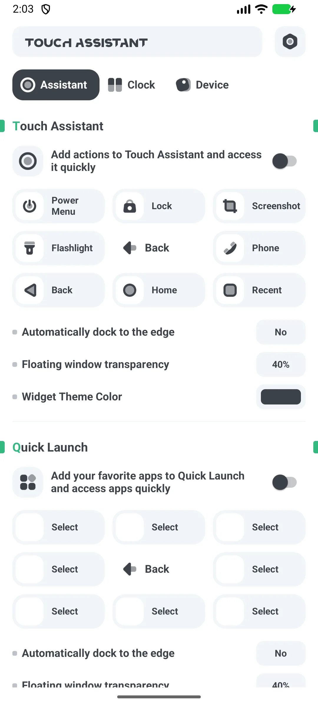
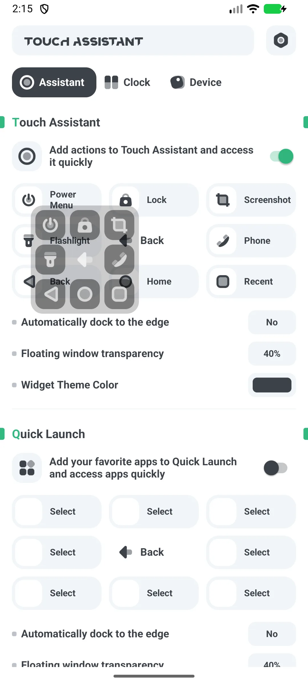
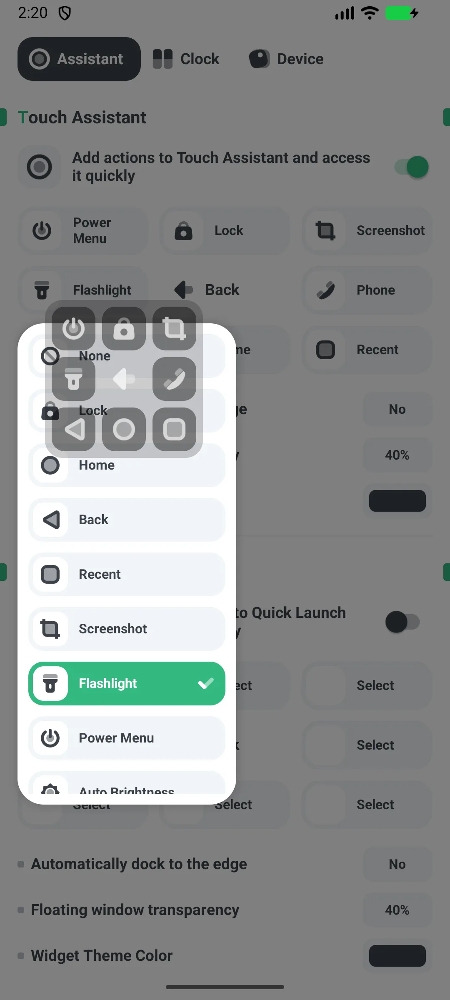

## Table of Contents

- [App Introduction](#app-introduction)
- [First-time Use](#first-time-use)
- [Grant Overlay & Accessibility](#grant-overlay--accessibility)
- [Enable and Move the Ball](#enable-and-move-the-ball)
- [Ball Actions](#ball-actions)
- [App Shortcuts](#app-shortcuts)
- [System Toggle Widgets](#system-toggle-widgets)
- [Resize, Color, Dock](#resize-color-dock)
- [One-handed Use](#one-handed-use)
- [Free vs Pro](#free-vs-pro)
- [Typical scenarios](#typical-scenarios)
- [FAQ](#faq)

## App Introduction

Floating Assistant adds a [floating ball](/glossary/what-is-a-floating-window/) to Android for quick app launches, system toggles and one-handed control of a large phone, with 8 action slots drawn from 15 possible actions and 11 home-screen toggle widgets. The ball docks to either edge, every slot can be remapped, and shortcuts cover apps and the dialer — there is no contacts shortcut. This guide walks from the first launch through overlay and Accessibility permissions, moving and resizing the ball, mapping actions and the free/Pro split, with a plain explanation of what those permissions allow.

**🔵 Floating Ball**
- A draggable ball that stays above any app (no root)
- Replaces hardware keys via an Accessibility service

**⚡ 8 Action Slots**
- 15 possible actions: power menu, lock, screenshot, flashlight, phone, back, home, recent, auto-brightness, auto-rotate, volume +/−/mute, and more

**�� App Shortcuts**
- 8 slots launching your installed apps (the phone/dialer action is available; there is **no contacts shortcut**)

**🔧 System Toggle Widgets**
- 11 home-screen widgets: Bluetooth, mobile data, Wi-Fi, torch, rotate, airplane, hotspot, DND, location, vibrate, dark mode

**💲 Free + Pro**
- Free shows ads; **Pro** is a separate ad-free app

## First-time Use

Open the app to the home screen, where an upgrade promo sits above a Home entry switch that shows or hides the ball. Floating Assistant starts with 8 action slots and 11 system toggle widgets available, and the settings gear opens language, rate, share and upgrade. Turning on Home entry is the first step before granting the two permissions.

- Turn on **Home entry** to show the ball
- The settings gear opens language, rate, share and upgrade

{: width="180" .normal }

## Grant Overlay & Accessibility

Floating Assistant needs two permissions: Draw over other apps lets the ball sit above other apps, and Accessibility lets it perform global actions like home, back, recent, lock and screenshot. Toggle Home entry on, grant the overlay permission when prompted, accept Accessibility for the button actions, and allow ignoring battery optimization so the ball is not killed. No root is required.

1. Toggle **Home entry** on
2. Grant **"Draw over other apps"** when prompted (system Settings)
3. Accept **Accessibility** when prompted — the ball's button actions (home/back/recent/lock/screenshot) need it
4. Allow **ignoring battery optimization** so the ball is not killed

The overlay permission lets the ball draw above apps; Accessibility lets it perform global actions.

## Enable and Move the Ball

Floating Assistant's ball appears once Home entry is enabled and can be dragged anywhere on screen, auto-snapping to the left or right edge with its position saved as a screen percentage. Enable Home entry, drag the ball to reposition it, and it stays above every app. The dock control later lets you turn that edge snapping on or off.

1. Enable **Home entry**
2. The ball appears; **drag** it to reposition — it auto-snaps to the left/right edge
3. Its position is saved as a screen percentage

{: width="180" .normal }

## Ball Actions

Tapping Floating Assistant's ball expands it into 8 slots, each mapped to one of 15 actions — power menu, lock, screenshot, flashlight, phone, back, home, recent, auto-brightness, auto-rotate and volume controls among them. Defaults are 1=power menu, 2=lock, 3=screenshot, 4=flashlight, 6=phone, 7=back, 8=home and 9=recent. Tap the ball again to collapse it.

1. Tap the ball to **expand** it into 8 slots
2. Each slot triggers its mapped action (power menu, lock, screenshot, flashlight, phone, back, home, recent, …)
3. Tap the ball again to collapse

Defaults: 1=power menu, 2=lock, 3=screenshot, 4=flashlight, 6=phone, 7=back, 8=home, 9=recent.

## App Shortcuts

Floating Assistant can fill up to 8 app-launcher slots with your installed apps, giving one-tap launches from the ball without returning to the home screen. Configure the app-launcher ball or widget, pick an app for each slot, and tap to launch it — or Google Play if the app is missing. The dialer action is available, but there is no contacts shortcut.

1. Configure the **app-launcher** ball/widget with up to 8 slots
2. In each slot, pick an installed app
3. Tap to launch it (or Google Play if missing)

## System Toggle Widgets

Floating Assistant ships 11 home-screen toggle widgets — Bluetooth, mobile data, Wi-Fi, torch, rotate, airplane, hotspot, DND, location, vibrate and dark mode — for one-tap control. Add a toggle widget from the picker, note that Torch switches the flashlight while Wi-Fi, Bluetooth and DND open system settings, and use the Combine widget to group several toggles.

1. Add a **toggle widget** from the widget picker (11 types)
2. Examples:
   - **Torch** actually switches the flashlight
   - **Wi-Fi / Bluetooth / DND** open their system settings screens
   - **Rotate** writes the auto-rotate setting
3. Use the **Combine** widget to group several toggles

{: width="180" .normal }

## Resize, Color, Dock

Floating Assistant offers 5 ball sizes from S to XXL, adjustable alpha with a default near 40%, six colors — black, white, green, blue, yellow and purple — with black as default, and a dock switch for edge auto-snapping. Those controls let you fit the ball to a large screen without covering content, and the chosen position is saved as a screen percentage.

- **Size**: 5 steps S/M/L/XL/XXL
- **Alpha**: adjustable (default ~40%)
- **Color**: black / white / green / blue / yellow / purple (default black)
- **Dock**: on/off controls edge auto-snapping

## One-handed Use

With the ball you can trigger HOME, BACK, RECENTS, POWER-DIALOG, LOCK and SCREENSHOT through the Accessibility service, plus on-ball flashlight, volume and rotation controls — eight action slots mapped to 15 possible actions. That lets you control a large phone with your thumb without reaching for physical buttons or stretching across the screen.

## Free vs Pro

Floating Assistant's free version shows banner and interstitial ads, while Pro is a separate ad-free app that the in-app upgrade link opens on Google Play. The floating ball, 8 action slots and 11 toggle widgets work in both; the only split is ads versus the standalone ad-free Pro app.

- **Free** shows ads (banner + interstitial)
- **Pro** is a separate app with **no ads**; the in-app upgrade just opens Google Play for it

## Typical scenarios

Floating Assistant covers five everyday cases: a one-time setup of Home entry plus overlay and Accessibility permissions, one-handed reach by docking the ball at the bottom edge, locking the screen without the power key, filling the 8 app slots with daily apps, and dropping the 11 system toggle widgets on the home screen for one-tap control.

- **First-time setup** — turn on Home entry, grant Draw-over-other-apps and Accessibility once, then the ball stays above every app.
- **One-handed on a big phone** — drag the ball to the bottom edge so back/home/recent and a screenshot land under your thumb.
- **Lock without the power key** — map a slot to lock the screen and spare the hardware button.
- **Quick app jumps** — fill the 8 app slots with your daily apps so you skip the home-screen hunt.
- **Toggle without digging** — drop the 11 system toggle widgets (Wi-Fi, torch, DND…) on the home screen for one-tap control.

## FAQ

### Are there contacts shortcuts?
{:.faq-q}
No. The only people-related action is the **phone/dialer** shortcut. There is no contacts shortcut.

### Can I swipe the ball?
{:.faq-q}
Gestures are **tap-to-expand, tap-a-slot, and drag-to-move/dock** only. There is no swipe-left/right mapping.

### Why Accessibility?
{:.faq-q}
The global button actions (home/back/recent/lock/screenshot) are performed through Android's Accessibility service.

## Summary

Floating Assistant makes a big phone usable one-handed: a floating ball for launches and system actions, plus toggle widgets — free to start, with an ad-free Pro app.

## Related terms

- [What Is Assistive Touch?](/glossary/what-is-assistive-touch/)
- [What Is a Floating Window?](/glossary/what-is-a-floating-window/)
