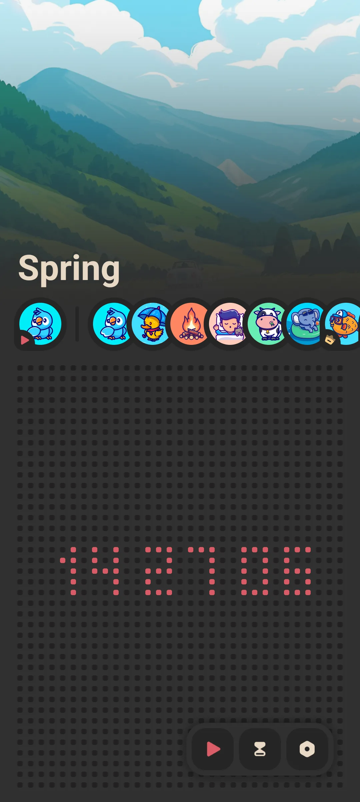
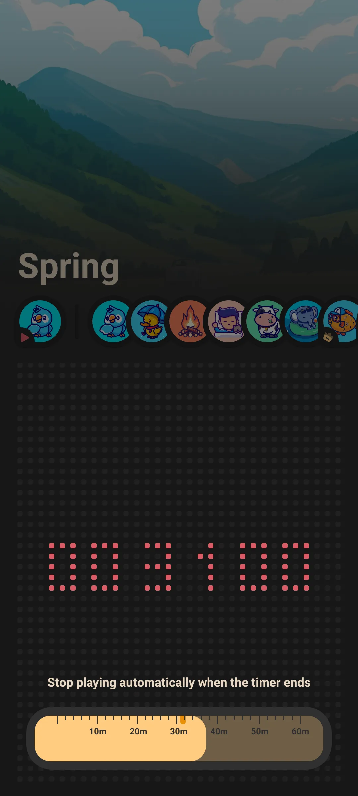
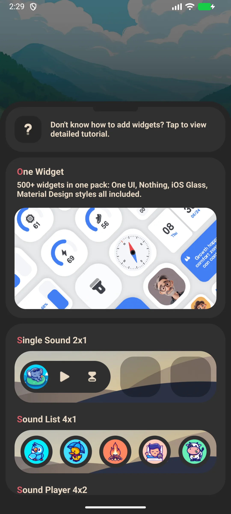

## Table of Contents

- [App Introduction](#app-introduction)
- [First-time Use](#first-time-use)
- [Play an Ambient Sound](#play-an-ambient-sound)
- [Sleep Timer](#sleep-timer)
- [Background & Off-screen Playback](#background--off-screen-playback)
- [Theme](#theme)
- [Home-screen Widgets](#home-screen-widgets)
- [Free vs Premium Sounds](#free-vs-premium-sounds)
- [Settings](#settings)
- [Typical scenarios](#typical-scenarios)
- [FAQ](#faq)

## App Introduction

Meow FM is a cat-themed [white-noise](/glossary/what-is-white-noise/) app for sleep, relaxation and focus. Play calming ambient sounds to fall asleep faster, focus longer, or quiet a noisy room. It is a **white noise offline** player: the sound library lives on the device, so **white noise to block noise** still works on a plane or with the screen locked. This guide walks from your first loop through **white noise with timer**, layering a **rain sounds app**-style track under the low rumble of a **brown noise app**, and the home-screen widget — all from a **cat white noise app** that needs no account.

**🌧 Ambient Sounds**
- A library of **15+ sounds**: rain, thunderstorm, forest, fireplace, wind, seaside, summer night, and more
- Browse the horizontal sound list and tap to play

**⏲ Sleep Timer**
- A timer slider from **0 to 60 minutes**; playback auto-stops when it ends so it never runs till morning

**🔇 Offline**
- Every sound plays with no network connection — great on planes, commutes and patchy hotel Wi-Fi

**🎨 Simple**
- Light / dark theme
- Free to start; a one-time unlock opens the premium sound scenes

> Note: Meow FM plays **one sound at a time** (there is no layer/mixer to combine multiple sounds). Pick the scene that fits the moment.

## First-time Use

The home screen is a single page: a selected-sound chip plus a scrollable list of all sounds.

- Tap a sound to play it
- Tap again to stop
- Use the timer slider to schedule auto-stop

{: width="180" .normal }

## Play an Ambient Sound

1. On the home screen, scroll the sound list
2. Tap a sound (e.g. **Rain** or **Thunderstorm**)
3. It starts playing immediately and the chip updates
4. Tap the same sound again to stop, or tap another to switch

Playback continues while you use other apps or lock the screen.

## Sleep Timer

1. Drag the **timer slider** from 0 to 60 minutes
2. Playback automatically stops when the timer reaches zero
3. Set it before you doze off so the sound does not run all night

{: width="180" .normal }

## Background & Off-screen Playback

Meow FM uses a foreground playback service, so the sound keeps running with the screen off and does not depend on a server. This is the key feature for sleep and focus.

## Theme

Open **Settings** and switch between **light** and **dark** mode (dark mode is on by default).

## Home-screen Widgets

Meow FM provides three widget types you can place on your home screen:

- **Single Sound** — one-tap play of a chosen sound
- **Sound List** — quick access to several sounds
- **Sound Player / cover** — a player widget

Add them from the widget picker, then configure the sound(s) in the widget config.

{: width="180" .normal }

## Free vs Premium Sounds

- A set of sounds is **free** to play
- Additional **premium scenes** unlock via a **one-time purchase** (no subscription)

## Settings

Settings include theme (light/dark), the Meow family cross-promo, and billing / restore options.

## Typical scenarios

- **Sleep on a noisy night** — tap a rain or storm scene, set the timer to 60 minutes, and the sound masks a snoring partner before switching itself off.
- **Focus at the desk** — play fireplace or seaside and keep the screen off; the foreground service runs through a full work block.
- **Travel without signal** — every sound is bundled, so a plane or patchy hotel Wi-Fi never interrupts the wind-down.
- **One-tap from the widget** — place the Single Sound widget on your home screen and start a scene without even opening the app.

## FAQ

### Can I mix rain + thunder together?
Not in the current app — it plays one sound at a time. Choose the single scene that works best (e.g. Thunderstorm already combines rain and thunder).

### Does it need internet?
No. All sounds are bundled and play fully offline.

### How do I stop it automatically?
Use the sleep timer (0–60 min); playback stops at zero.

## Summary

Meow FM is the simplest way to add calming ambient sound to sleep or focus — free to start, fully offline, with a sleep timer that turns itself off.

[Meow FM app page](/apps/meow-fm/) — available on Android and iOS.

## Related terms

- [What Is White Noise?](/glossary/what-is-white-noise/)
