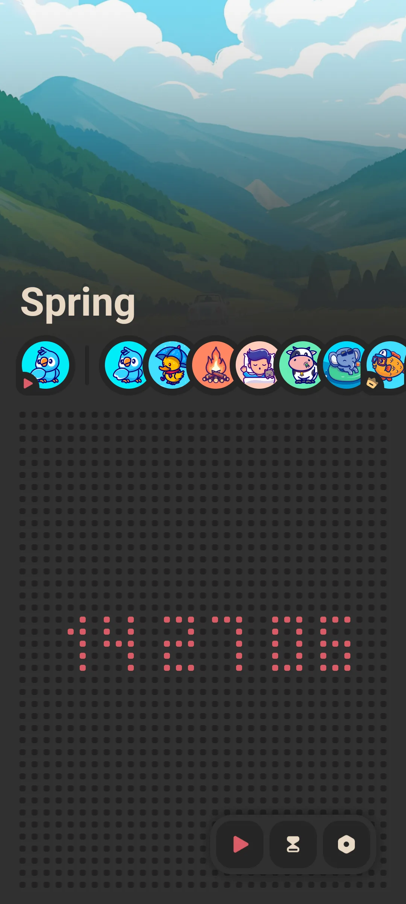
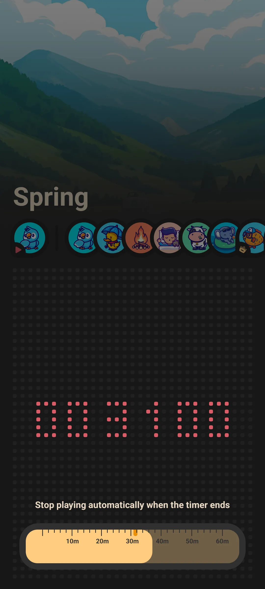
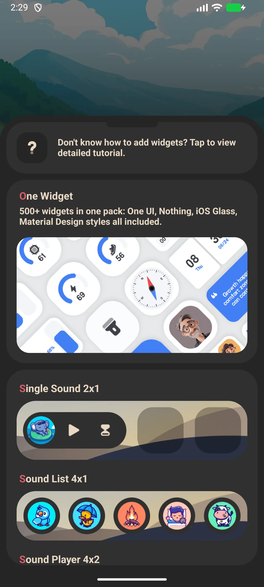

## Table of Contents

- [App Introduction](#app-introduction)
- [First-time Use](#first-time-use)
- [Play an Ambient Sound](#play-an-ambient-sound)
- [Sleep Timer](#sleep-timer)
- [Background & Off-screen Playback](#background--off-screen-playback)
- [Theme](#theme)
- [Home-screen Widgets](#home-screen-widgets)
- [Free vs Premium Sounds](#free-vs-premium-sounds)
- [Settings](#settings)
- [Typical scenarios](#typical-scenarios)
- [FAQ](#faq)

## App Introduction

Meow FM is a cat-themed [white-noise](/glossary/what-is-white-noise/) app for sleep, relaxation and focus with 15+ offline ambient sounds and a timer slider from 0 to 60 minutes that auto-stops playback. The sound library lives on the device, so it works on a plane or with the screen locked, and no account is needed. This guide walks from your first loop through setting the timer, playing sounds in the background, switching themes, placing home-screen widgets and unlocking premium scenes.

**🌧 Ambient Sounds**
- A library of **15+ sounds**: rain, thunderstorm, forest, fireplace, wind, seaside, summer night, and more
- Browse the horizontal sound list and tap to play

**⏲ Sleep Timer**
- A timer slider from **0 to 60 minutes**; playback auto-stops when it ends so it never runs till morning

**🔇 Offline**
- Every sound plays with no network connection — great on planes, commutes and patchy hotel Wi-Fi

**🎨 Simple**
- Light / dark theme
- Free to start; a one-time unlock opens the premium sound scenes

> Note: Meow FM plays **one sound at a time** (there is no layer/mixer to combine multiple sounds). Pick the scene that fits the moment.

## First-time Use

The home screen is a single page with a selected-sound chip and a scrollable list of all sounds. Meow FM ships 15+ ambient sounds and a timer slider from 0 to 60 minutes: tap a sound to play, tap again to stop, and drag the slider to schedule auto-stop. No account or setup wizard stands between you and the first sound.

- Tap a sound to play it
- Tap again to stop
- Use the timer slider to schedule auto-stop

{: width="180" .normal }

## Play an Ambient Sound

Meow FM plays one ambient sound at a time from a library of 15+ scenes — rain, thunderstorm, forest, fireplace, wind, seaside and summer night among them. Scroll the home-screen list, tap a sound to start it immediately, tap the same sound to stop or another to switch, and playback continues while you use other apps or lock the screen.

1. On the home screen, scroll the sound list
2. Tap a sound (e.g. **Rain** or **Thunderstorm**)
3. It starts playing immediately and the chip updates
4. Tap the same sound again to stop, or tap another to switch

Playback continues while you use other apps or lock the screen.

## Sleep Timer

Meow FM's sleep timer runs from 0 to 60 minutes and automatically stops playback when it reaches zero, so the sound does not run until morning. Drag the timer slider to your chosen duration before you doze off. It applies to whichever of the 15+ scenes is playing.

1. Drag the **timer slider** from 0 to 60 minutes
2. Playback automatically stops when the timer reaches zero
3. Set it before you doze off so the sound does not run all night

{: width="180" .normal }

## Background & Off-screen Playback

Meow FM uses a foreground playback service, so the sound keeps running with the screen off and does not depend on a server — the key feature for sleep and focus. All 15+ sounds are bundled on the device, so offline playback works on a plane or in a dead zone, and the 0–60 minute timer still stops audio on schedule.

## Theme

Meow FM's Theme setting in Settings switches between light and dark mode, with dark mode on by default. That keeps the cat-themed player calm at night without changing how any of the 15+ sounds or the 0–60 minute timer behave.

## Home-screen Widgets

Meow FM provides three home-screen widget types — Single Sound for one-tap playback, Sound List for quick access to several sounds, and Sound Player/cover as a player widget. Add them from the widget picker and configure the sound or sounds in the widget config, so the 15+ library is reachable without opening the app.

- **Single Sound** — one-tap play of a chosen sound
- **Sound List** — quick access to several sounds
- **Sound Player / cover** — a player widget

Add them from the widget picker, then configure the sound(s) in the widget config.

{: width="180" .normal }

## Free vs Premium Sounds

Meow FM offers a set of sounds free to play and unlocks additional premium scenes through a one-time purchase, with no subscription. Both free and premium sounds use the same 0–60 minute timer, offline playback and three widget types, so paying only expands the scene library.

- A set of sounds is **free** to play
- Additional **premium scenes** unlock via a **one-time purchase** (no subscription)

## Settings

Meow FM's Settings cover theme (light/dark), the Meow family cross-promo, and billing or restore options. Those controls let you restore purchased premium scenes or switch the player theme without affecting the 15+ bundled sounds, offline playback or the sleep timer.

## Typical scenarios

Meow FM covers four scenarios: sleeping on a noisy night with rain or storm and a 60-minute timer, focusing at the desk with fireplace or seaside while the screen stays off, traveling without signal with every sound bundled, and starting a scene from the Single Sound widget without opening the app.

- **Sleep on a noisy night** — tap a rain or storm scene, set the timer to 60 minutes, and the sound masks a snoring partner before switching itself off.
- **Focus at the desk** — play fireplace or seaside and keep the screen off; the foreground service runs through a full work block.
- **Travel without signal** — every sound is bundled, so a plane or patchy hotel Wi-Fi never interrupts the wind-down.
- **One-tap from the widget** — place the Single Sound widget on your home screen and start a scene without even opening the app.

## FAQ

### Can I mix rain + thunder together?
{:.faq-q}
Not in the current app — it plays one sound at a time. Choose the single scene that works best (e.g. Thunderstorm already combines rain and thunder).

### Does it need internet?
{:.faq-q}
No. All sounds are bundled and play fully offline.

### How do I stop it automatically?
{:.faq-q}
Use the sleep timer (0–60 min); playback stops at zero.

## Summary

Meow FM is the simplest way to add calming ambient sound to sleep or focus — free to start, fully offline, with a sleep timer that turns itself off.

[Meow FM app page](/apps/meow-fm/) — available on Android and iOS.

## Related terms

- [What Is White Noise?](/glossary/what-is-white-noise/)
