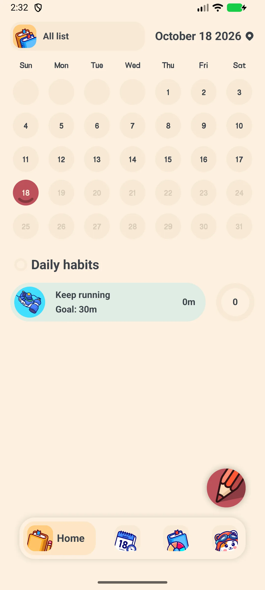
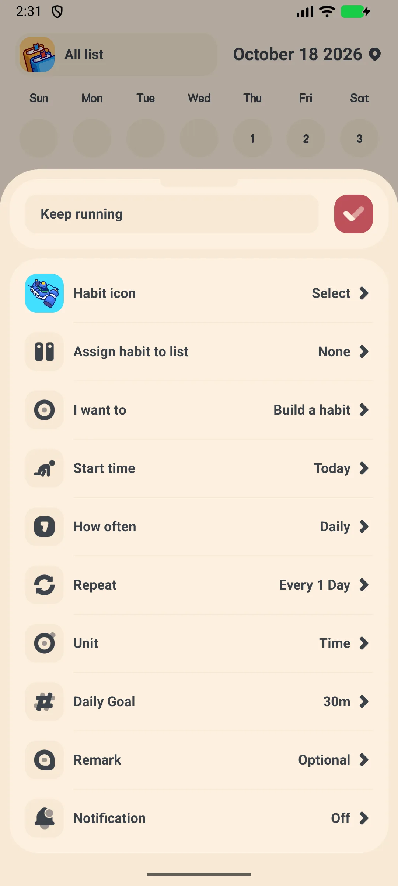
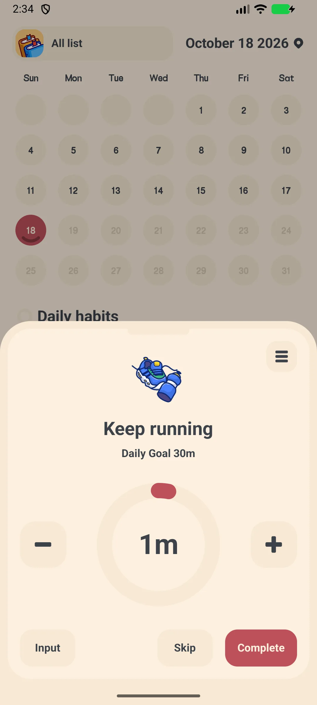
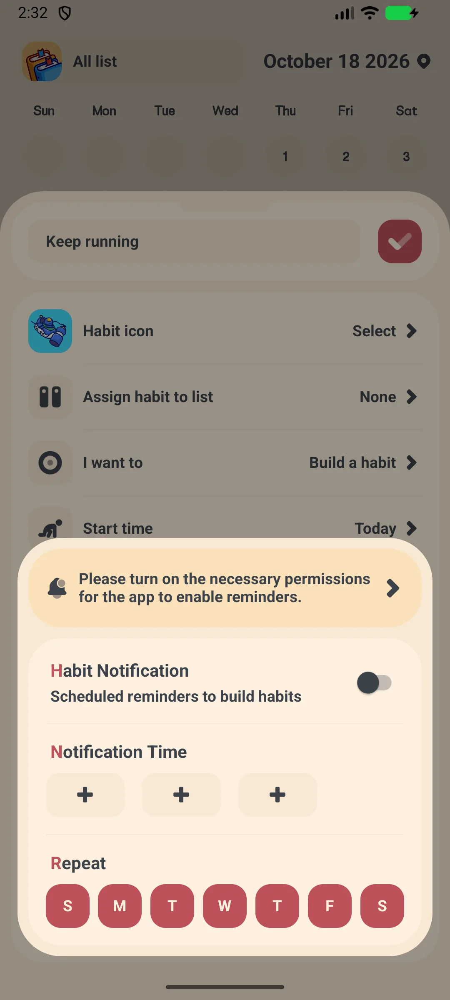
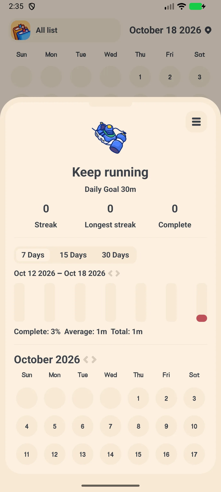

## Table of Contents

- [App Introduction](#app-introduction)
- [First-time Use](#first-time-use)
- [Add a Habit](#add-a-habit)
- [Daily Check-in](#daily-check-in)
- [Reminders](#reminders)
- [Streaks and Trends](#streaks-and-trends)
- [Edit, Archive or Delete](#edit-archive-or-delete)
- [Backup and Export](#backup-and-export)
- [Settings](#settings)
- [Typical scenarios](#typical-scenarios)
- [FAQ](#faq)

## App Introduction

Meow Habits is a cute [habit tracker](/glossary/what-is-a-habit-tracker/) and routine builder for Android and iOS with roughly 590 icons across 14 categories, streaks, charts and a calendar heatmap. It works with no account and offline, while CSV export and WebDav or Google Drive backup keep the history yours. This guide walks from the first launch through adding habits with daily, weekly, monthly or custom cycles, daily check-ins, reminders and reading your own trends.

**🐱 500+ Cute Icons**
- An icon picker with roughly **590 icons** across **14 categories**
- Pick an icon and color for each habit

**🔥 Streaks & Charts**
- Per-habit streak and completion rate
- Bar, pie and calendar (heatmap) views of your progress

**🔁 Flexible Cycles**
- Daily, Weekly, Monthly, or Weekday (e.g. Mon/Wed/Fri)
- "Every N days/weeks" custom rules

**☁️ Private**
- Offline by default; optional Google Drive / WebDav backup
- CSV export (VIP)

## First-time Use

The app opens on the Home tab showing today's habits plus a month calendar, with four bottom tabs — Home, Habit, Trend and Setting. Meow Habits allows up to 5 habits on the free tier, with VIP unlocking unlimited habits, and tapping + adds your first one. That is the whole setup: no account and no signal required.

- Bottom tabs: **Home**, **Habit**, **Trend**, **Setting**
- Tap **+** to add your first habit (the free tier allows up to **5 habits**; VIP unlocks unlimited)

{: width="180" .normal }

## Add a Habit

Adding a habit in Meow Habits opens a nine-step form where you name it, pick one of roughly 590 icons across 14 categories, set a goal and choose a cycle. Cycles cover Daily, Weekly, Monthly, Weekday such as Mon/Wed/Fri, or an "Every N days/weeks" rule, and you finish by setting a start date and confirming. The free tier allows up to 5 habits.

1. Tap **+** on the Home tab
2. Pick a **template** or start blank → opens **Habit Add**
3. Enter a **name**
4. Tap the **icon** to open the icon picker (≈590 icons, 14 categories)
5. Choose a **Book (list)** and a **type**
6. Set a **goal** (e.g. count or duration)
7. Set the **cycle**: Daily / Weekly / Monthly / Weekday, plus an "Every N" interval if needed
8. Set a **start date**
9. Tap **Confirm**

{: width="180" .normal }

## Daily Check-in

Meow Habits' check-in screen shows a big progress ring for today's goal, with +/− buttons to adjust count, an Input field to type a value, Skip and Complete. Open a habit from the Home or Habit tab, then use the 3-dot menu for Trend, Notification, Note, Edit, Archive or Delete. Each check-in keeps the streak and completion rate current.

1. On the Home or Habit tab, tap a habit to open the **check-in** screen
2. A big progress ring shows today's goal
3. Use **+ / −** to adjust count, **Input** to type a value, **Skip** to skip, or **Complete** to finish
4. The 3-dot menu gives Trend / Notification / Note / Edit / Archive / Delete

{: width="180" .normal }

## Reminders

Meow Habits' reminder setting lets you enable a daily nudge and pick from 3 time chips with specific weekdays from Sunday to Saturday. Open a habit, tap the bell option, toggle the daily reminder on and choose your days and time. The notification then prompts you to check in so the streak stays alive.

1. Open a habit and tap the reminder (bell) option
2. Toggle the daily reminder on
3. Pick one of the **3 time chips** and choose which weekdays (Sun–Sat) apply
4. The app notifies you to check in

{: width="180" .normal }

## Streaks and Trends

Meow Habits tracks a per-habit streak and completion rate, with bar, pie and calendar heatmap views of progress. Open a habit's Detail screen to see streak numbers, history bars and the heatmap, then switch to the Trend tab for charts and achievements. Those views surface a slump before it becomes a broken streak.

1. Open a habit → **Detail** to see streak numbers, history bars and a calendar heatmap
2. Switch to the **Trend** tab for charts and achievements

{: width="180" .normal }

## Edit, Archive or Delete

From the check-in 3-dot menu, Meow Habits lets you Edit a habit, Archive it to keep history while hiding it, or Delete it outright. Those three actions cover the full lifecycle of a habit after setup, and archiving preserves the streak record without cluttering the Home tab.

## Backup and Export

Meow Habits stores data on-device by default and adds optional Google Drive or WebDav backup plus CSV export for taking history elsewhere. In Settings, use Google Drive or WebDav to back up and restore, or Export to pick habits, choose a date range and share a CSV. CSV export is a VIP feature.

- **Settings → Google Drive / WebDav** to back up and restore
- **Settings → Export** lets you pick habits, choose a date range, and share a **CSV**

## Settings

Meow Habits' Settings cover a VIP banner, dark mode, language, week start, app lock (VIP), sound, notifications, widgets, Lists, Habits, Export (VIP), Google Drive, WebDav and the Meow family section. Those controls tune how the roughly 590 icons, streaks and charts are displayed and how data leaves the device, without changing what gets logged.

## Typical scenarios

Meow Habits covers four everyday cases: a morning routine pinned to a home-screen widget so the streak never breaks, breaking a bad habit with a daily reminder and a visible calendar heatmap, reviewing the month through Trend charts and a VIP CSV export, and staying private offline with backup only when you choose Google Drive or WebDav.

- **Morning routine** — after setup, pin 'Drink water' and 'Stretch' to the home-screen widget and check in from the lock screen so the streak never breaks.
- **Break a bad habit** — create a 'Stop scrolling' habit with a daily reminder; the calendar heatmap makes a slip visible before it becomes a broken streak.
- **Review your month** — open the Trend tab to see completion rates and achievements, then use Settings → Export (VIP) to pull a CSV for deeper analysis.
- **Stay private offline** — everything works with no account; enable Google Drive or WebDav only when you want cross-device backup.

## FAQ

### What breaks a streak?
{:.faq-q}
A streak continues while you check in on the scheduled days. Missing a scheduled day resets the current streak for that habit.

### Is there a free limit?
{:.faq-q}
Yes — the free tier allows up to **5 habits**. VIP unlocks unlimited habits, unlimited lists, dark mode, app lock, and CSV export.

### Where is my data stored?
{:.faq-q}
On your device by default. Use Google Drive or WebDav backup to move it between devices.

## Summary

Meow Habits turns habit-building into a calm daily ritual with cute icons, streaks, and clear trends — and it works fully offline.

[Meow Habits app page](/apps/meow-habits/) — available on Android and iOS.

## Related terms

- [What Is a Habit Tracker?](/glossary/what-is-a-habit-tracker/)
