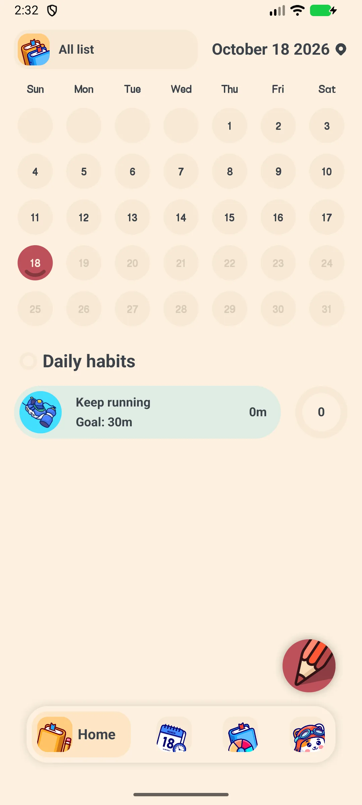
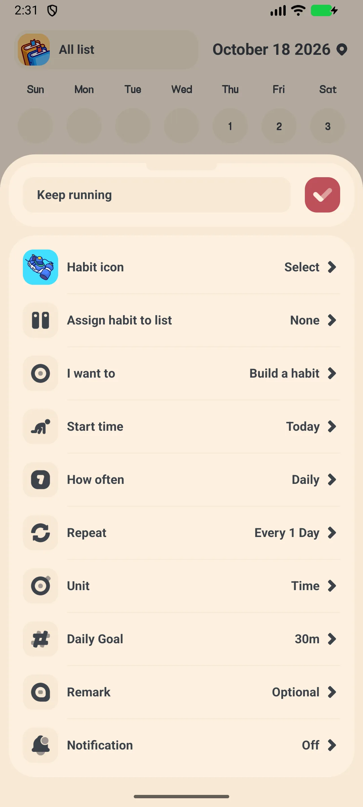
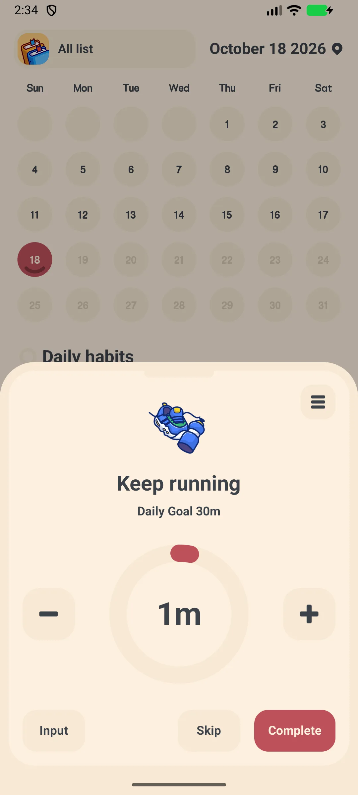
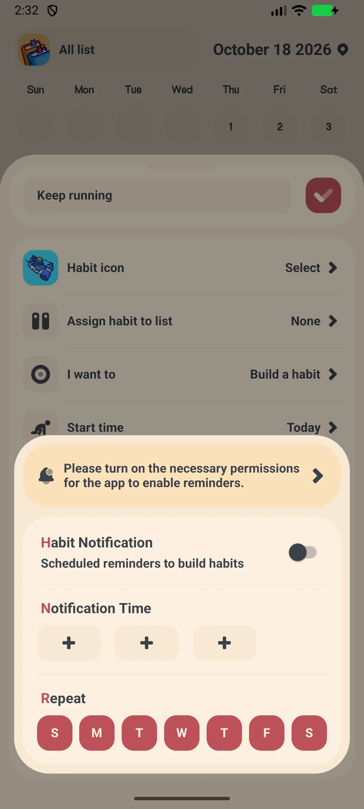
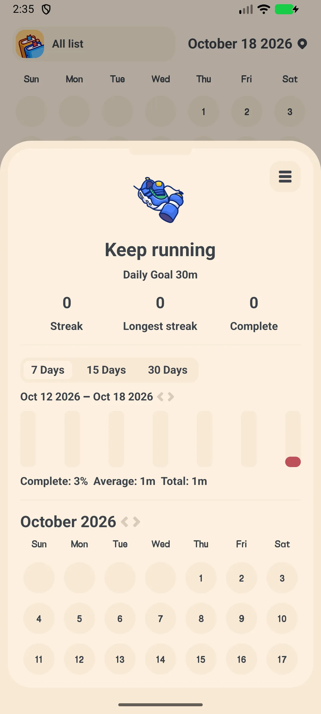

## Table of Contents

- [App Introduction](#app-introduction)
- [First-time Use](#first-time-use)
- [Add a Habit](#add-a-habit)
- [Daily Check-in](#daily-check-in)
- [Reminders](#reminders)
- [Streaks and Trends](#streaks-and-trends)
- [Edit, Archive or Delete](#edit-archive-or-delete)
- [Backup and Export](#backup-and-export)
- [Settings](#settings)
- [Typical scenarios](#typical-scenarios)
- [FAQ](#faq)

## App Introduction

Meow Habits is a cute **[habit tracker](/glossary/what-is-a-habit-tracker/)** and routine builder for Android and iOS. Build good habits and break bad ones with streaks, charts, and a calendar heatmap. It works as a **habit tracker no account** and an **offline habit tracker**: logging needs no sign-up and no signal, and a **habit tracker with csv export** plus **habit tracker with webdav backup** keeps the history yours. This guide walks from first launch through **habit tracker with widgets** and **habit tracker with reminders** to reading your own trends.

**🐱 500+ Cute Icons**
- An icon picker with roughly **590 icons** across **14 categories**
- Pick an icon and color for each habit

**🔥 Streaks & Charts**
- Per-habit streak and completion rate
- Bar, pie and calendar (heatmap) views of your progress

**🔁 Flexible Cycles**
- Daily, Weekly, Monthly, or Weekday (e.g. Mon/Wed/Fri)
- "Every N days/weeks" custom rules

**☁️ Private**
- Offline by default; optional Google Drive / WebDav backup
- CSV export (VIP)

## First-time Use

The app opens on the **Home** tab showing today's habits plus a month calendar.

- Bottom tabs: **Home**, **Habit**, **Trend**, **Setting**
- Tap **+** to add your first habit (the free tier allows up to **5 habits**; VIP unlocks unlimited)

{: width="180" .normal }

## Add a Habit

1. Tap **+** on the Home tab
2. Pick a **template** or start blank → opens **Habit Add**
3. Enter a **name**
4. Tap the **icon** to open the icon picker (≈590 icons, 14 categories)
5. Choose a **Book (list)** and a **type**
6. Set a **goal** (e.g. count or duration)
7. Set the **cycle**: Daily / Weekly / Monthly / Weekday, plus an "Every N" interval if needed
8. Set a **start date**
9. Tap **Confirm**

{: width="180" .normal }

## Daily Check-in

1. On the Home or Habit tab, tap a habit to open the **check-in** screen
2. A big progress ring shows today's goal
3. Use **+ / −** to adjust count, **Input** to type a value, **Skip** to skip, or **Complete** to finish
4. The 3-dot menu gives Trend / Notification / Note / Edit / Archive / Delete

{: width="180" .normal }

## Reminders

1. Open a habit and tap the reminder (bell) option
2. Toggle the daily reminder on
3. Pick one of the **3 time chips** and choose which weekdays (Sun–Sat) apply
4. The app notifies you to check in

{: width="180" .normal }

## Streaks and Trends

1. Open a habit → **Detail** to see streak numbers, history bars and a calendar heatmap
2. Switch to the **Trend** tab for charts and achievements

{: width="180" .normal }

## Edit, Archive or Delete

From the check-in 3-dot menu you can **Edit**, **Archive** (keep history but hide), or **Delete** a habit.

## Backup and Export

- **Settings → Google Drive / WebDav** to back up and restore
- **Settings → Export** lets you pick habits, choose a date range, and share a **CSV**

## Settings

Settings include a VIP banner, **dark mode**, **language**, **week start**, **app lock** (VIP), sound, notifications, **widgets**, Lists, Habits, **Export** (VIP), Google Drive, WebDav, and the Meow family section.

## Typical scenarios

- **Morning routine** — after setup, pin 'Drink water' and 'Stretch' to the home-screen widget and check in from the lock screen so the streak never breaks.
- **Break a bad habit** — create a 'Stop scrolling' habit with a daily reminder; the calendar heatmap makes a slip visible before it becomes a broken streak.
- **Review your month** — open the Trend tab to see completion rates and achievements, then use Settings → Export (VIP) to pull a CSV for deeper analysis.
- **Stay private offline** — everything works with no account; enable Google Drive or WebDav only when you want cross-device backup.

## FAQ

### What breaks a streak?
{:.faq-q}
A streak continues while you check in on the scheduled days. Missing a scheduled day resets the current streak for that habit.

### Is there a free limit?
{:.faq-q}
Yes — the free tier allows up to **5 habits**. VIP unlocks unlimited habits, unlimited lists, dark mode, app lock, and CSV export.

### Where is my data stored?
{:.faq-q}
On your device by default. Use Google Drive or WebDav backup to move it between devices.

## Summary

Meow Habits turns habit-building into a calm daily ritual with cute icons, streaks, and clear trends — and it works fully offline.

[Meow Habits app page](/apps/meow-habits/) — available on Android and iOS.

## Related terms

- [What Is a Habit Tracker?](/glossary/what-is-a-habit-tracker/)
