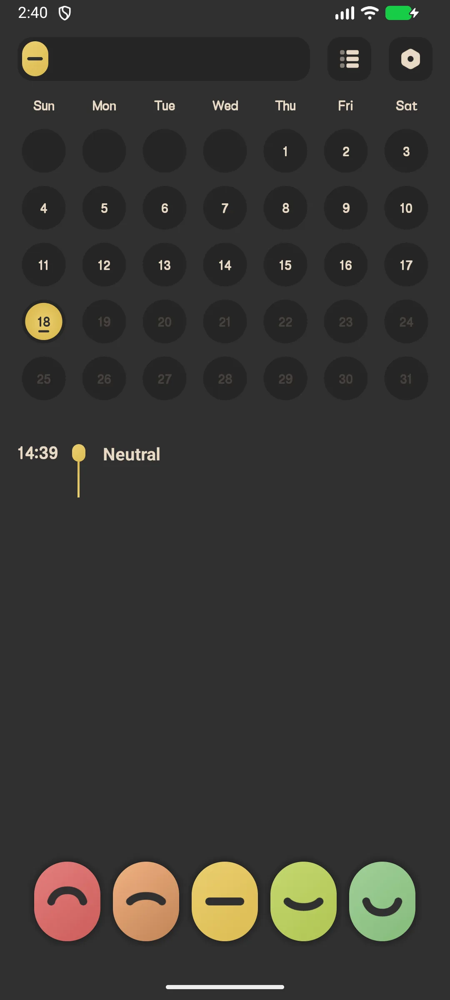
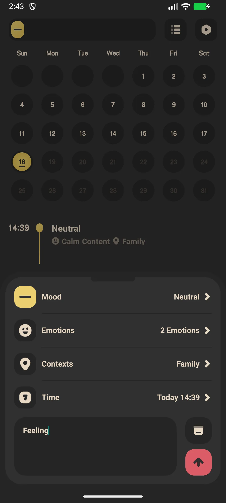
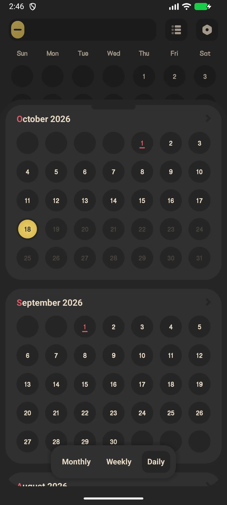
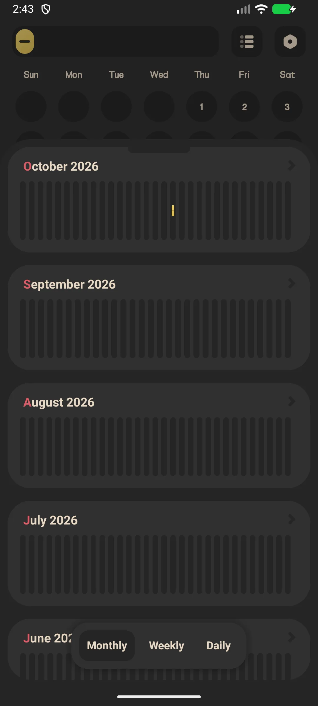

## Table of Contents

- [App Introduction](#app-introduction)
- [First-time Use](#first-time-use)
- [Log a Mood (One-tap)](#log-a-mood-one-tap)
- [Full Mood Entry](#full-mood-entry)
- [History Calendar](#history-calendar)
- [Statistics & Trends](#statistics--trends)
- [Daily Reminder](#daily-reminder)
- [App Lock (VIP)](#app-lock-vip)
- [Backup](#backup)
- [Settings](#settings)
- [Typical scenarios](#typical-scenarios)
- [FAQ](#faq)

## App Introduction

Meow Mood Diary is a safe, private [mood diary](/glossary/what-is-a-mood-tracker/) and journaling app with a calming cat-themed interface.

**😺 One-tap Logging**
- Five mood-level "capsules" on the home screen
- Tap a capsule to log instantly, or open it for a fuller entry

**📊 Insights**
- A month calendar painted with mood colors
- Statistics: level distribution (pie), monthly histogram, emotion frequency, context frequency

**🔒 Private by Default**
- Data is stored **locally only** — nothing is uploaded to a server
- Optional Google Drive / WebDav backup (you control the cloud)
- App lock (fingerprint / passcode) is a **VIP** feature

**🎨 Rich Options**
- **48 default emotions** (24 unpleasant + 6 neutral + 18 pleasant) grouped into 5 mood levels
- **18 context tags** (where / with whom)
- Free vs VIP: more icons, more theme colors, app lock, and PDF export

## First-time Use

The home screen shows five mood capsules, a month calendar, and today's mood list.

- Tap **menu stats** (top) for statistics
- Tap **menu setting** (top) for settings

{: width="180" .normal }

## Log a Mood (One-tap)

1. On the home screen, tap a **mood capsule** (e.g. "Happy")
2. It expands — tap **confirm** to save instantly, or tap the **settings (gear)** icon to add details

A one-tap log saves the mood level with no note or tags.

## Full Mood Entry

1. Tap the gear on a capsule → **Add Mood**
2. Pick a **mood level** (1–5)
3. Select **emotion tags** (multi-select from 48 emotions)
4. Select **context tags** (multi-select from 18 contexts)
5. Set the **time** (cannot be in the future)
6. Write an optional **note**
7. Tap **Save**

{: width="180" .normal }

## History Calendar

- Swipe the home calendar month by month
- Each day is a colored arc whose color reflects the **average mood level** for that day (future days appear greyed)
- Tap a day to see that day's entries

{: width="180" .normal }

## Statistics & Trends

1. Tap the stats icon (top-right)
2. Switch **Month / Week / Day** tabs
3. Review:
   - **Level distribution** pie chart
   - **Monthly histogram**
   - **Emotion frequency** and **context frequency**

{: width="180" .normal }

## Daily Reminder

1. Settings → **Reminder**
2. Enable the daily reminder and set a time
3. You'll get a gentle "How are you feeling?" / "Time to log your mood!" notification

## App Lock (VIP)

1. Settings → **App lock**
2. If you are not VIP, you'll be prompted to upgrade
3. VIP users can enable fingerprint or passcode lock

## Backup

Settings → **Google Drive** (sign in, backup / restore / auto) and **WebDav**. Your entries stay on-device unless you back them up.

## Settings

Settings include language, week start, app lock (VIP), widgets, mood icons (VIP), theme color (VIP), emotion/context tags, export (VIP), reminder, and Google Drive / WebDav.

## Typical scenarios

- **A bad-day quick log** — on a rough evening, tap one emotion and a couple of tags; no paragraphs required, so the diary survives the days you'd otherwise skip.
- **Private by default** — entries stay on-device behind a (VIP) fingerprint lock; on a shared family phone your thoughts never sync to a vendor cloud unless you choose Google Drive.
- **Spotting the pattern** — calendar and charts surface a 'Sunday blues' or a post-coffee spike, turning vague feelings into something you can act on.
- **Offline anywhere** — log on a plane or in a subway dead zone; nothing needs Wi-Fi to capture the moment.

## FAQ

### Is my diary uploaded to a server?
No. All entries are stored in a local database on your device. Only you can back them up to your own Google Drive or WebDav.

### How is the calendar color decided?
Each day's color is the mood level averaged from that day's entries, mapped to the active theme's 5-color palette. Days with no entry are left plain.

### Can I export my diary?
Yes — PDF export is a VIP feature.

## Summary

Meow Mood Diary makes daily mood tracking effortless and private, with a clear calendar and trend charts to help you understand your emotions over time.

[Meow Mood Diary app page](/apps/meow-mood-diary/) — available on Android and iOS.

## Related terms

- [What Is a Mood Tracker?](/glossary/what-is-a-mood-tracker/)
