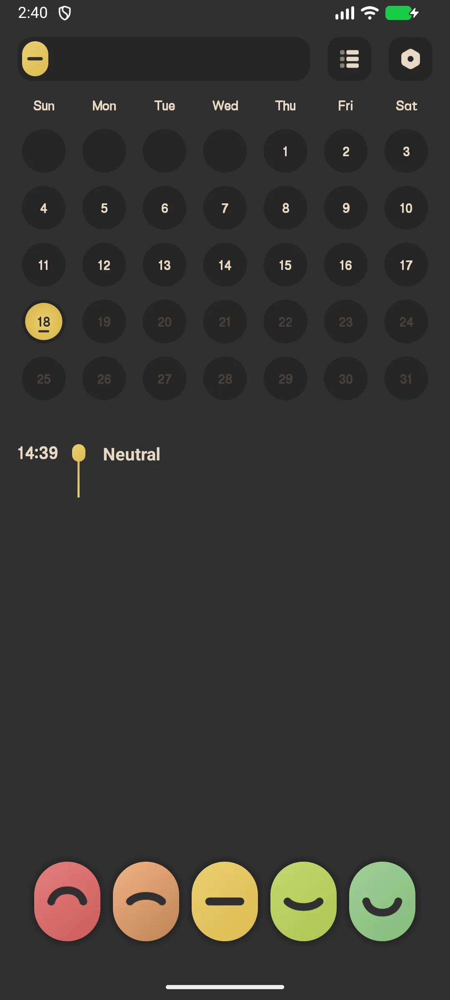
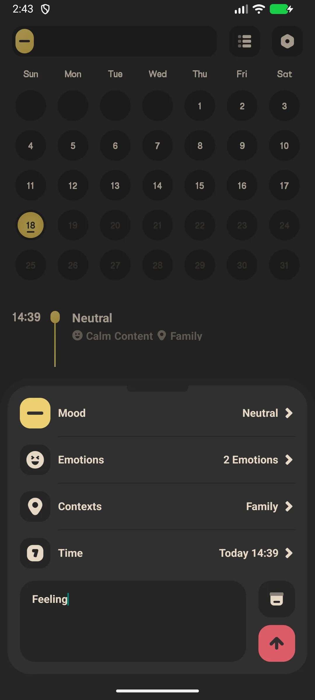
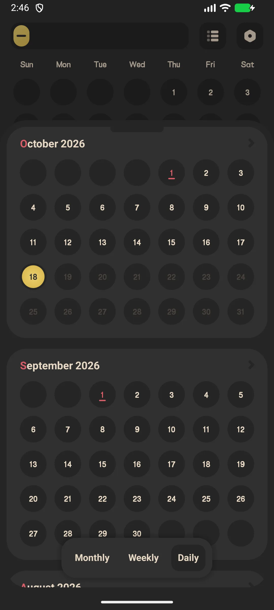
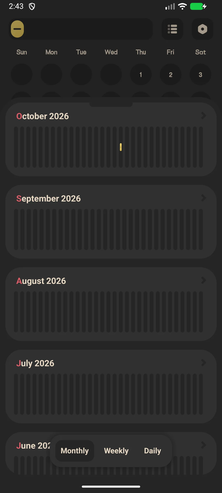

## Table of Contents

- [App Introduction](#app-introduction)
- [First-time Use](#first-time-use)
- [Log a Mood (One-tap)](#log-a-mood-one-tap)
- [Full Mood Entry](#full-mood-entry)
- [History Calendar](#history-calendar)
- [Statistics & Trends](#statistics--trends)
- [Daily Reminder](#daily-reminder)
- [App Lock (VIP)](#app-lock-vip)
- [Backup](#backup)
- [Settings](#settings)
- [Typical scenarios](#typical-scenarios)
- [FAQ](#faq)

## App Introduction

Meow Mood Diary is a private, offline [mood diary](/glossary/what-is-a-mood-tracker/) and journaling app for Android and iOS with 48 default emotions across 5 mood levels, 18 context tags and a month calendar painted with mood colors. One tap logs a mood, a second adds activities and a note, and nothing uploads to a server unless you choose Google Drive or WebDav backup. This guide walks from the first launch through one-tap and full entries, the history calendar, statistics, reminders, the VIP app lock and export.

**😺 One-tap Logging**
- Five mood-level "capsules" on the home screen
- Tap a capsule to log instantly, or open it for a fuller entry

**📊 Insights**
- A month calendar painted with mood colors
- Statistics: level distribution (pie), monthly histogram, emotion frequency, context frequency

**🔒 Private by Default**
- Data is stored **locally only** — nothing is uploaded to a server
- Optional Google Drive / WebDav backup (you control the cloud)
- App lock (fingerprint / passcode) is a **VIP** feature

**🎨 Rich Options**
- **48 default emotions** (24 unpleasant + 6 neutral + 18 pleasant) grouped into 5 mood levels
- **18 context tags** (where / with whom)
- Free vs VIP: more icons, more theme colors, app lock, and PDF export

## First-time Use

The home screen shows five mood capsules, a month calendar and today's mood list, with stats and setting menus at the top. Meow Mood Diary groups 48 default emotions — 24 unpleasant, 6 neutral and 18 pleasant — into 5 mood levels, and offers 18 context tags. No account is needed before the first one-tap check-in.

- Tap **menu stats** (top) for statistics
- Tap **menu setting** (top) for settings

{: width="180" .normal }

## Log a Mood (One-tap)

Meow Mood Diary's one-tap logging saves a mood level from five capsules on the home screen without a note or tags. Tap a capsule such as Happy to expand it, then tap confirm to save instantly or the gear icon to add details. That keeps a daily check-in to seconds on days when writing feels like too much.

1. On the home screen, tap a **mood capsule** (e.g. "Happy")
2. It expands — tap **confirm** to save instantly, or tap the **settings (gear)** icon to add details

A one-tap log saves the mood level with no note or tags.

## Full Mood Entry

A full entry in Meow Mood Diary records a mood level from 1 to 5, multi-select tags from 48 emotions and 18 contexts, a time that cannot be in the future, and an optional note. Tap the gear on a capsule to open Add Mood, choose your level and tags, set the time, write the note and save. The result appears on the calendar and in statistics.

1. Tap the gear on a capsule → **Add Mood**
2. Pick a **mood level** (1–5)
3. Select **emotion tags** (multi-select from 48 emotions)
4. Select **context tags** (multi-select from 18 contexts)
5. Set the **time** (cannot be in the future)
6. Write an optional **note**
7. Tap **Save**

{: width="180" .normal }

## History Calendar

Meow Mood Diary's history calendar paints each day as a colored arc reflecting the average mood level of that day's entries, with future days greyed out. Swipe the home calendar month by month and tap a day to see its entries. The heatmap makes patterns like a Sunday slump visible at a glance.

- Swipe the home calendar month by month
- Each day is a colored arc whose color reflects the **average mood level** for that day (future days appear greyed)
- Tap a day to see that day's entries

{: width="180" .normal }

## Statistics & Trends

Meow Mood Diary's statistics view offers a level-distribution pie chart, a monthly histogram, emotion frequency and context frequency, switchable across Month, Week and Day tabs. Tap the stats icon at the top right, choose a tab and review the four views. Each is built from the same local entries, with no upload required.

1. Tap the stats icon (top-right)
2. Switch **Month / Week / Day** tabs
3. Review:
   - **Level distribution** pie chart
   - **Monthly histogram**
   - **Emotion frequency** and **context frequency**

{: width="180" .normal }

## Daily Reminder

Meow Mood Diary's daily reminder sends a gentle "How are you feeling?" / "Time to log your mood!" notification at a time you set. Open Settings, go to Reminder, enable the daily reminder and choose the time. It builds the check-in habit without a cloud account.

1. Settings → **Reminder**
2. Enable the daily reminder and set a time
3. You'll get a gentle "How are you feeling?" / "Time to log your mood!" notification

## App Lock (VIP)

Meow Mood Diary's app lock is a VIP feature that adds a fingerprint or passcode gate to the diary on a shared device. Open Settings, choose App lock and upgrade if you are not VIP, then enable fingerprint or passcode. Entries stay on-device either way — the lock only controls who can open the app.

1. Settings → **App lock**
2. If you are not VIP, you'll be prompted to upgrade
3. VIP users can enable fingerprint or passcode lock

## Backup

Meow Mood Diary keeps entries on-device unless you back them up, with Google Drive sign-in for backup, restore and auto backup plus WebDav support. Both live under Settings. That means the diary stays private by default and only moves to a cloud you choose.

## Settings

Meow Mood Diary's Settings include language, week start, app lock (VIP), widgets, mood icons (VIP), theme color (VIP), emotion and context tags, export (VIP), reminder, and Google Drive or WebDav. Those controls tune the 48 emotions and 18 context tags, the 5-color calendar palette and which VIP extras you enable, without changing where entries are stored.

## Typical scenarios

Meow Mood Diary covers four scenarios: a bad-day quick log with one emotion and a couple of tags, a private on-device diary behind an optional VIP fingerprint lock, calendar and charts surfacing a Sunday-blues or post-coffee pattern, and offline logging on a plane or subway with no Wi-Fi needed.

- **A bad-day quick log** — on a rough evening, tap one emotion and a couple of tags; no paragraphs required, so the diary survives the days you'd otherwise skip.
- **Private by default** — entries stay on-device behind a (VIP) fingerprint lock; on a shared family phone your thoughts never sync to a vendor cloud unless you choose Google Drive.
- **Spotting the pattern** — calendar and charts surface a 'Sunday blues' or a post-coffee spike, turning vague feelings into something you can act on.
- **Offline anywhere** — log on a plane or in a subway dead zone; nothing needs Wi-Fi to capture the moment.

## FAQ

### Is my diary uploaded to a server?
{:.faq-q}
No. All entries are stored in a local database on your device. Only you can back them up to your own Google Drive or WebDav.

### How is the calendar color decided?
{:.faq-q}
Each day's color is the mood level averaged from that day's entries, mapped to the active theme's 5-color palette. Days with no entry are left plain.

### Can I export my diary?
{:.faq-q}
Yes — PDF export is a VIP feature.

## Summary

Meow Mood Diary makes daily mood tracking effortless and private, with a clear calendar and trend charts to help you understand your emotions over time.

[Meow Mood Diary app page](/apps/meow-mood-diary/) — available on Android and iOS.

## Related terms

- [What Is a Mood Tracker?](/glossary/what-is-a-mood-tracker/)
