## Table of Contents

- [App Introduction](#app-introduction)
- [First-time Use](#first-time-use)
- [Add a Task](#add-a-task)
- [Subtasks](#subtasks)
- [Reminders](#reminders)
- [Calendar View](#calendar-view)
- [Statistics](#statistics)
- [Lists and Tags](#lists-and-tags)
- [Backup and Sync](#backup-and-sync)
- [CSV Export (VIP)](#csv-export-vip)
- [Settings](#settings)
- [FAQ](#faq)

## App Introduction

Meow Todo List is a cartoon-style task manager and [to-do list](/glossary/what-is-a-to-do-list/) for Android and iOS with four bottom tabs — Tasks, Calendar, Statistics and Settings — and a floating + button for quick capture anywhere. Tasks live on the phone with no account, free limits are 10 Books, 10 Tags and 15 subtasks per task, and the core includes reminders, a calendar view and Google Drive/WebDAV sync. This guide walks every screen from first launch to CSV export.

**📝 Quick Capture**

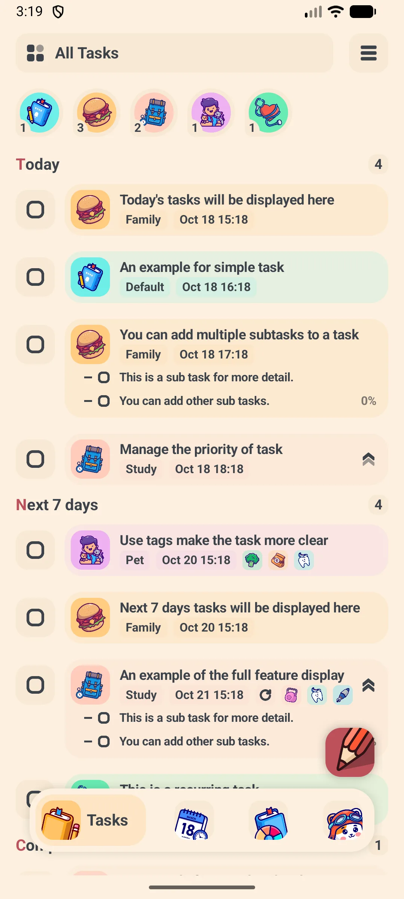{: width="180" .normal }
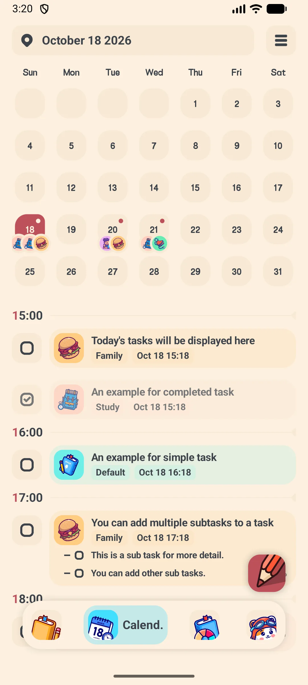{: width="180" .normal }
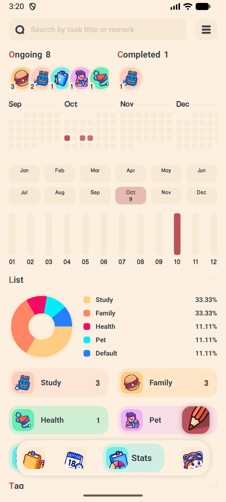{: width="180" .normal }
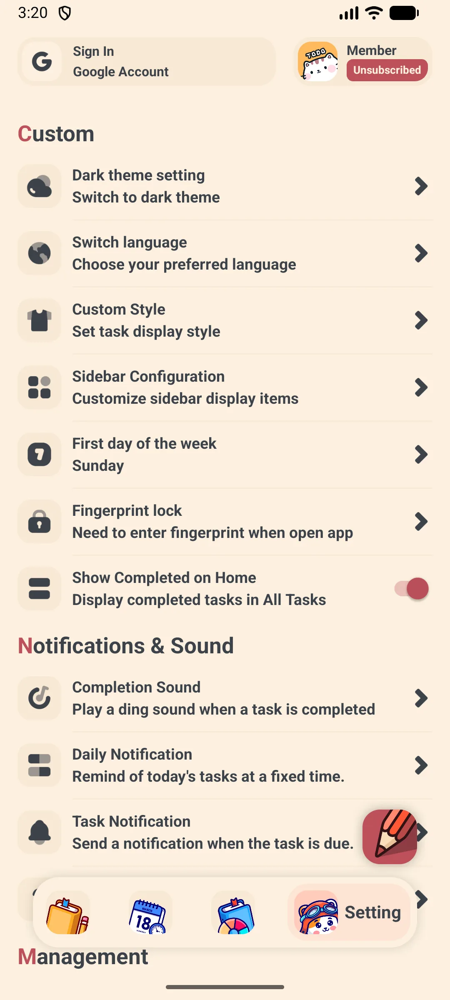{: width="180" .normal }

- Four bottom tabs: **Tasks**, **Calendar**, **Statistics**, **Settings**
- A floating **+** button adds a task from anywhere
- Side drawer filters: All / Today / Tomorrow / 7 days / Completed, plus your Books (lists) and Tags

**🗓 Planning**
- Set a date **and time** on every task
- Repeat tasks: daily, weekly, monthly, yearly, or a custom "every N days/weeks" rule
- Calendar view with Day / Week / Month switching

**📊 Insights**
- Contribution heatmap and pie charts grouped by Book/Tag
- Weekly / monthly / yearly overview

**☁️ Safe & Private**
- Local storage (Room database); optional Google Drive / WebDAV backup
- VIP unlocks dark mode, app lock, CSV export, and higher limits

## First-time Use

When you first open Meow Todo List you land on the Tasks tab, with a + button at the bottom right to create a task and a left drawer for Today, Tomorrow, 7 days, Completed and your custom Books and Tags. The bottom bar moves between Tasks, Calendar, Statistics and Settings. Four tabs cover the whole app, and no account stands between you and the first task.

- The **+** button (bottom-right) creates a task
- The left **drawer** switches between Today / Tomorrow / 7 days / Completed and your custom Books & Tags
- The bottom bar moves between Tasks / Calendar / Statistics / Settings

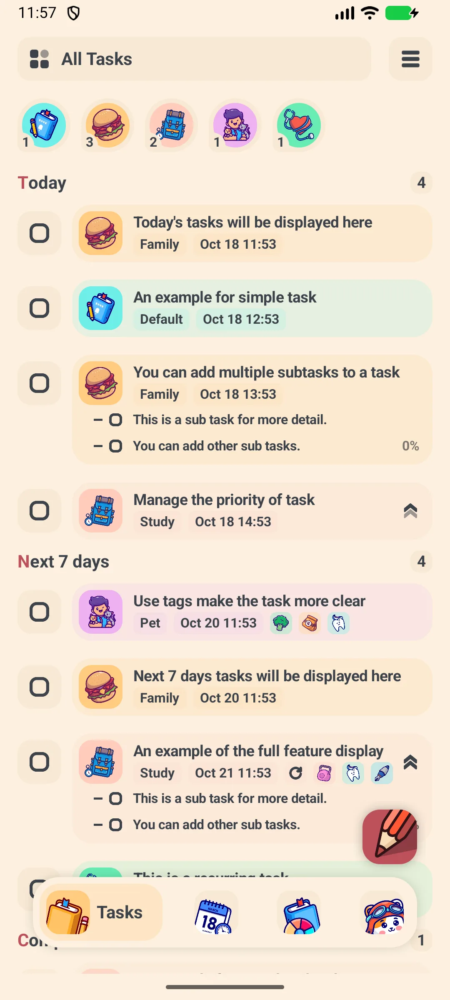{: width="180" .normal }

## Add a Task

Adding a task in Meow Todo List takes a title, an optional date and time, a Book (list), one or more Tags and a priority. Tap the + button, type the title, toggle the hour on for a specific time or clear it for all-day, choose a Book and Tags, then confirm. Repeats can be daily, weekly, monthly, yearly or a custom every-N rule.

1. Tap the **+** button
2. Type the task **title**
3. Tap the **date** row to open the calendar pop-up; toggle **hour** on to set a specific time, or clear it for an all-day task
4. Choose a **Book** (list) — e.g. Work, Life, Study
5. Pick one or more **Tags** for filtering
6. Set a **priority** if you like
7. Tap **Confirm** to save

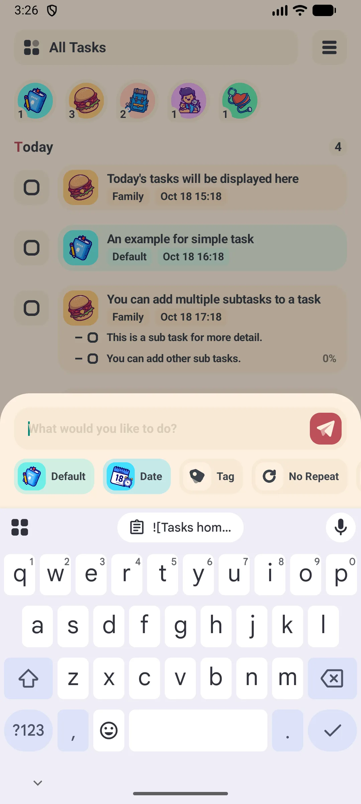{: width="180" .normal }
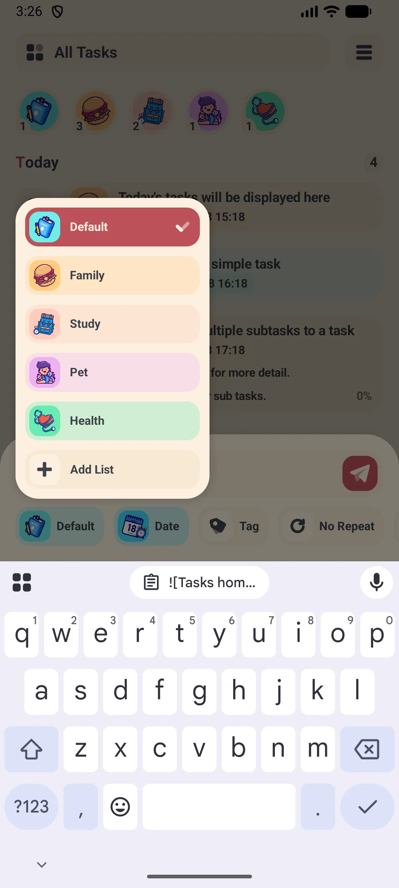{: width="180" .normal }
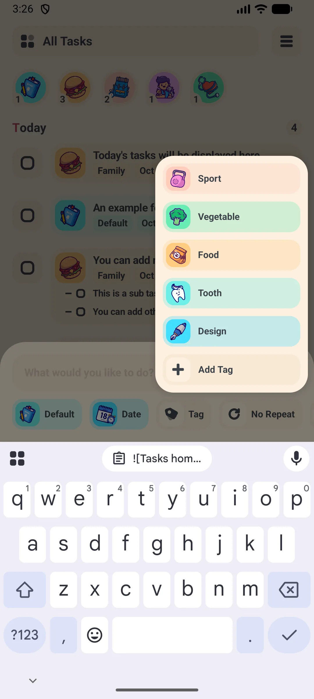{: width="180" .normal }
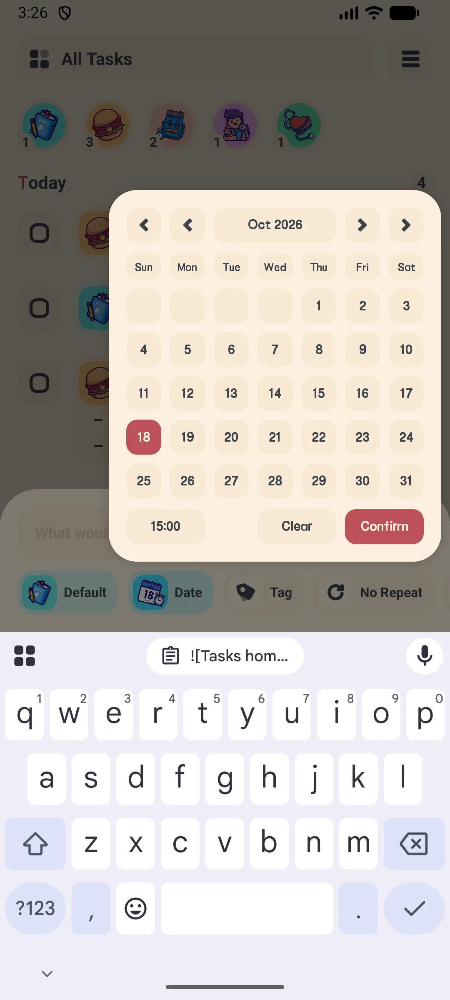{: width="180" .normal }
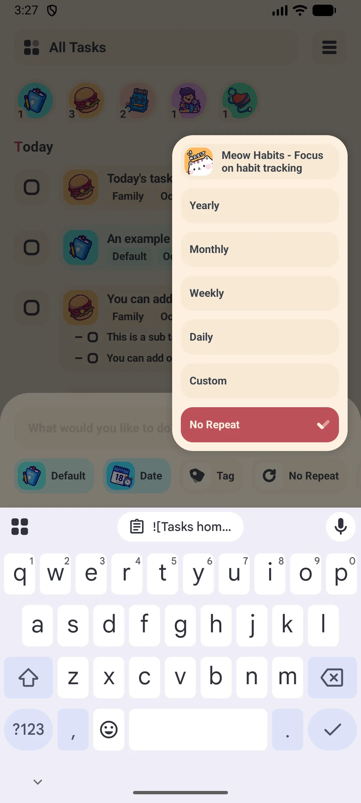{: width="180" .normal }

## Subtasks

Open a task, then use the Add subtask field at the bottom of the detail page to break it down. Free accounts can add up to 15 subtasks per task, with VIP removing the cap, and you check items off as you complete them. That keeps a big project manageable without a separate list.

- Type a subtask and it is added to the list
- Free accounts can add up to **15 subtasks** per task; VIP removes the cap
- Check items off as you complete them

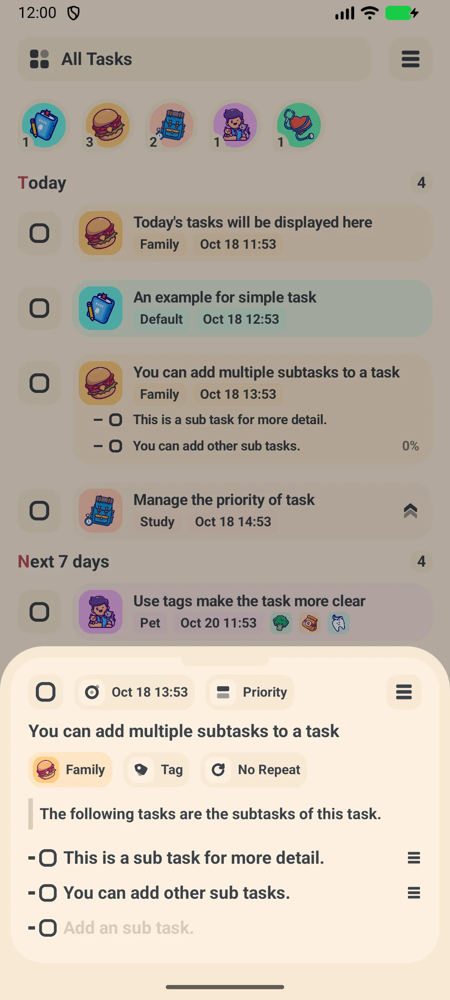{: width="180" .normal }
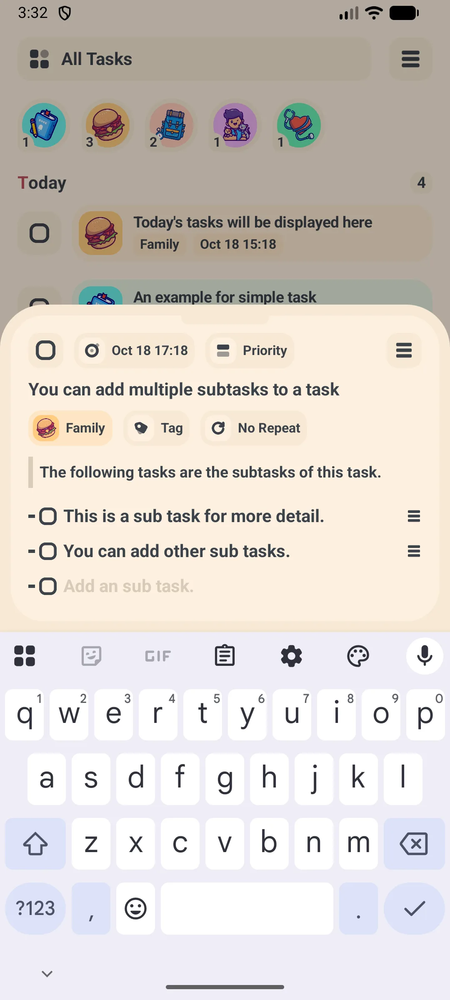{: width="180" .normal }

## Reminders

Meow Todo List schedules reminders with WorkManager, so they fire even if you do not open the app, using the date and time set on each task. While editing a task, set a future date/time and allow notifications; the app reschedules automatically when you edit. If a reminder is missing, confirm the task has a future time and allow notifications in system settings.

1. While editing a task, set a date/time (the reminder uses that time)
2. Make sure notifications are allowed for the app
3. The app reschedules the reminder automatically when you edit the task

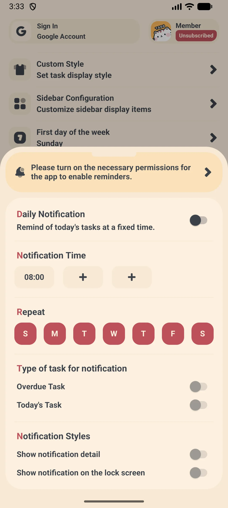{: width="180" .normal }
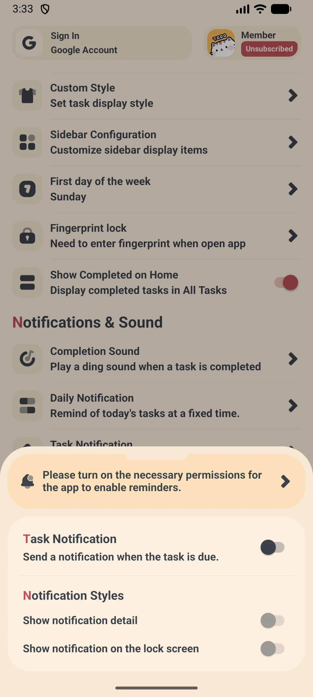{: width="180" .normal }
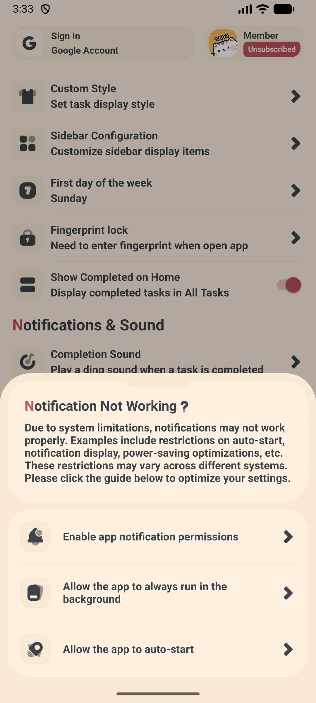{: width="180" .normal }

If you do not see a reminder, open the task and confirm it has a future date/time, then allow notifications in system settings.

## Calendar View

Meow Todo List's Calendar tab switches between Day, Week and Month views, with a small dot on days that have tasks. Switch to the Calendar tab, use the top-right switch and tap a day to see its tasks. Each task's date and time carry through from the editor.

1. Switch to the **Calendar** tab
2. Use the **Day / Week / Month** switch at the top-right
3. Days that have tasks show a small dot
4. Tap a day to see that day's tasks

{: width="180" .normal }
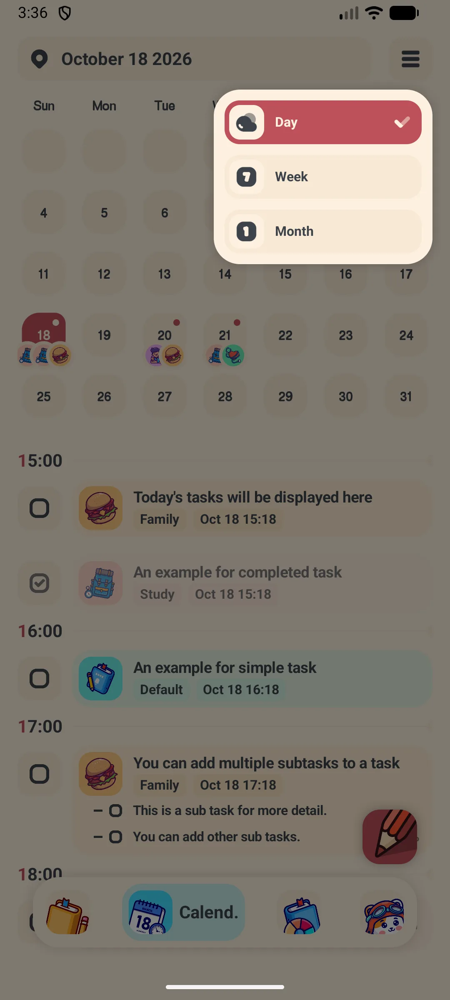{: width="180" .normal }
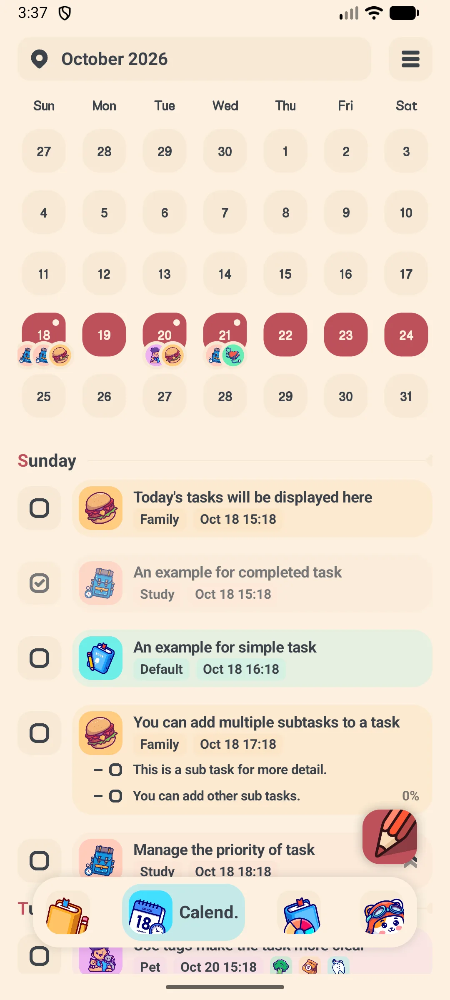{: width="180" .normal }
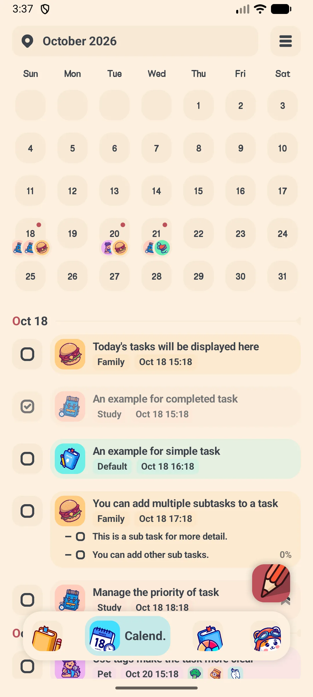{: width="180" .normal }

## Statistics

Meow Todo List's Statistics tab shows a contribution heatmap and pie charts grouped by Book and Tag, with week, month and year ranges. Open the tab, view the heatmap and charts, then switch the range to see trends. Those insights come from local task data, with no account upload.

1. Open the **Statistics** tab
2. View the contribution heatmap and pie charts
3. Switch the range (week / month / year) to see trends by Book and Tag

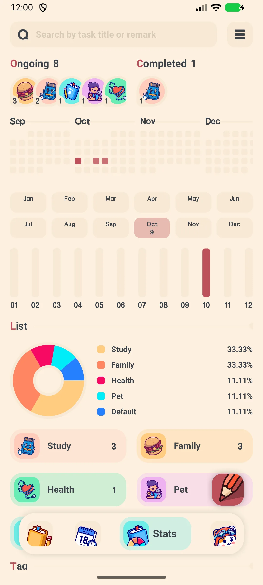{: width="180" .normal }
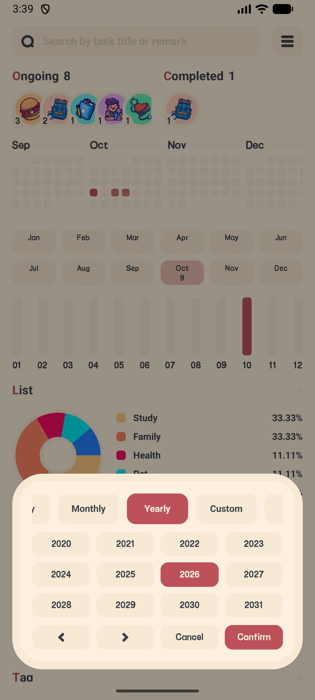{: width="180" .normal }

## Lists and Tags

Meow Todo List uses Books (lists) to group tasks and Tags to filter across them, with free accounts limited to 10 Books and 10 Tags. Create them from the drawer or Settings → Management, assign tasks to a Book and one or more Tags, and use the drawer filters to find what matters now.

- **Books (lists)** group tasks — e.g. Work, Travel. Free accounts can create up to **10 Books**
- **Tags** let you filter across lists — free accounts can create up to **10 Tags**
- Create them from the drawer or the Settings → Management screen

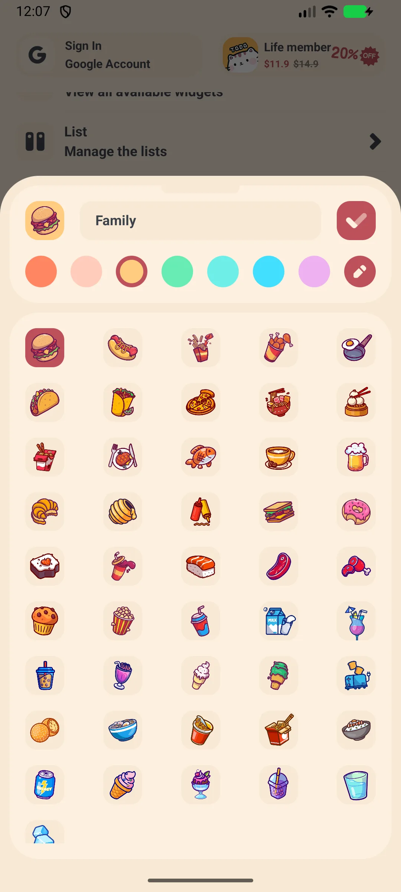{: width="180" .normal }

## Backup and Sync

Meow Todo List stores tasks locally in a Room database and optionally backs them up to Google Drive or WebDAV. Open Settings → Management → Google Drive or WebDAV, sign in or enter your server details, tap Backup to upload or Restore to download, and turn on Auto backup for periodic copies. That keeps lists safe across device changes.

1. Open **Settings → Management → Google Drive** (or **WebDAV**)
2. Sign in / fill in your server, account and password
3. Tap **Backup** to upload, **Restore** to download
4. Turn on **Auto backup** to back up periodically

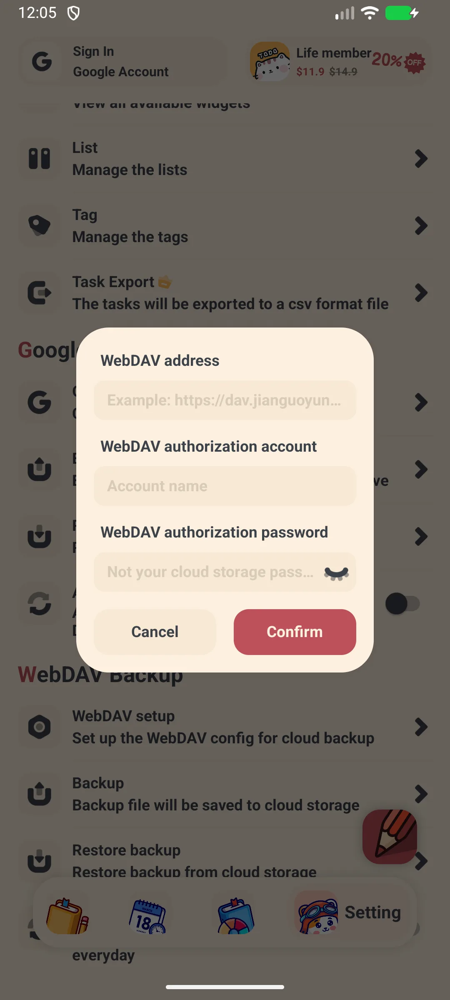{: width="180" .normal }

## CSV Export (VIP)

Meow Todo List's CSV export is a VIP feature that filters tasks by Book, Tag, priority or date range and writes a .csv file for Excel or Sheets. Open Settings → Management → Export, set your filters, tap Export and share the file. It is the exit path for taking your task history with you.

1. Open **Settings → Management → Export**
2. Filter by Book / Tag / priority / date range
3. Tap **Export**, then share the `.csv` file (open in Excel or Sheets)

CSV export is a **VIP** feature.

## Settings

Meow Todo List's Settings include dark mode (VIP), app lock by fingerprint or password (VIP), week start day, language, completed-tasks display — the last 10 by default with a show-all option — plus Google Drive/WebDAV and widgets. Those controls tune the display and backup behavior without changing how tasks are captured or repeated.

- **Dark mode** (VIP)
- **App lock** — fingerprint or password (VIP)
- **Week start day** and **language**
- **Completed tasks** display (shows the last 10 by default, with "show all")
- **Google Drive / WebDAV** and **Widgets**

## Typical scenarios

Meow Todo List covers four everyday cases: exam-season planning with calendar view and daily reminders, a group project with a Book per project and Tags per member plus subtasks and a CSV export, offline capture on a commute that syncs later, and privacy-first local Room storage with an optional fingerprint lock.

- **Exam season** — use the calendar view and daily reminders to keep every course deadline visible, so nothing slips between weeks.
- **Group project** — create a Book (list) per project and Tags per member, then split work into subtasks and export a CSV to share the plan.
- **Offline capture** — on a commute with no signal, add tasks instantly; they stay on your device and sync to Google Drive or WebDav only when you're back online.
- **Privacy-first** — local Room storage plus an optional fingerprint app lock keeps your lists on your phone, not in another cloud account.

## FAQ

### How do I edit or delete a task?
{:.faq-q}
Open the task, change the fields, and tap confirm to save. Use the 3-dot menu (or long-press) to delete.

### How do repeat tasks work?
{:.faq-q}
When you complete a repeating task, the app creates the next occurrence automatically (day +1, week +7, month +1, year +1, or your custom interval) and stops the original.

### Are there limits on the free version?
{:.faq-q}
Total tasks have no hard cap, but Books are limited to 10, Tags to 10, and subtasks to 15 on the free tier. The free version also shows ads.

## Summary

Meow Todo List is a friendly, cute task manager that covers quick capture, repeating tasks, a calendar view, and statistics — with Drive/WebDav backup to keep your lists safe.

## Related terms

- [What Is a To-Do List?](/glossary/what-is-a-to-do-list/)
- [What Is a Subtask?](/glossary/what-is-a-subtask/)
