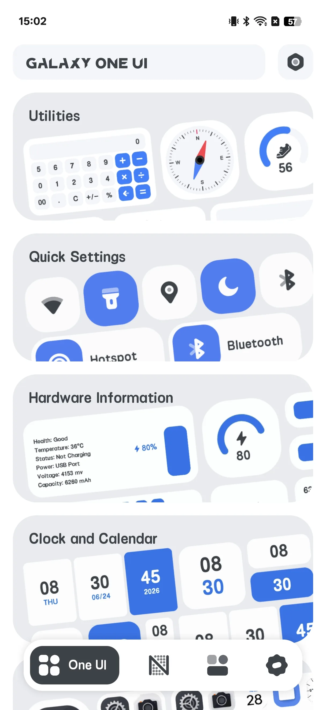
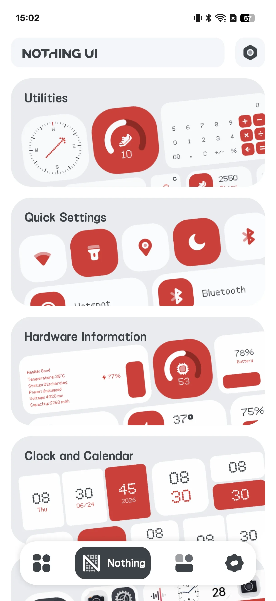
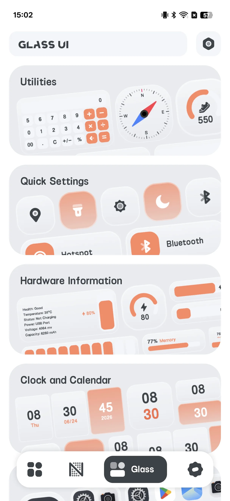
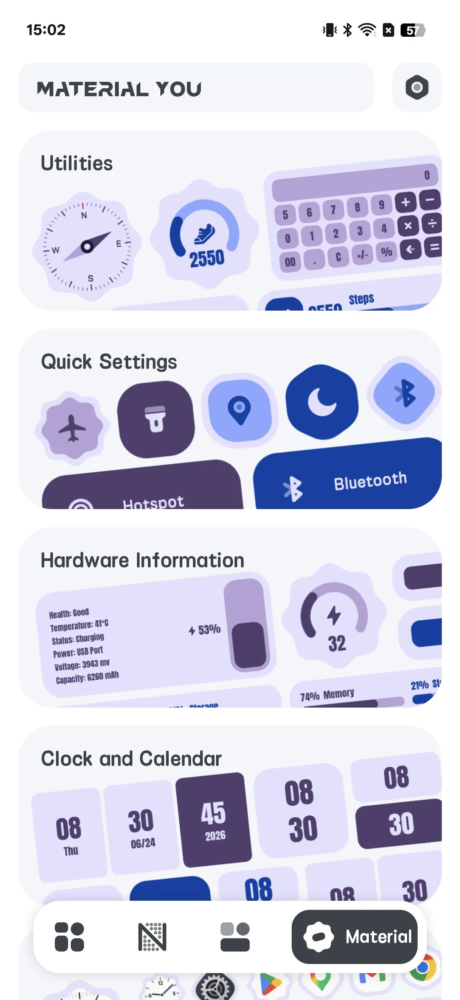
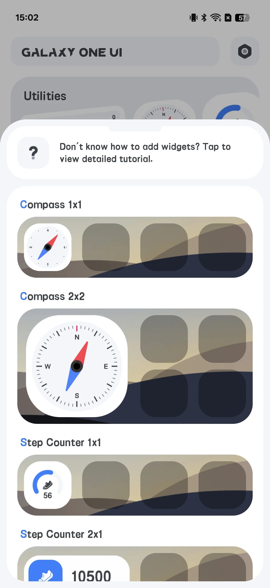
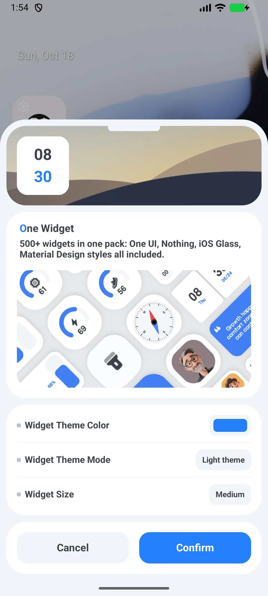

## Table of Contents

- [App Introduction](#app-introduction)
- [First-time Use](#first-time-use)
- [Browse the 4 Styles](#browse-the-4-styles)
- [Add a Widget](#add-a-widget)
- [Configure a Widget](#configure-a-widget)
- [Quick Toggles](#quick-toggles)
- [App Shortcuts](#app-shortcuts)
- [Live Info Widgets](#live-info-widgets)
- [Settings](#settings)
- [Typical scenarios](#typical-scenarios)
- [FAQ](#faq)

## App Introduction

One Widget packs 500+ customizable Android [home-screen widgets](/glossary/what-is-a-home-screen-widget/) in four styles — One UI, Nothing, Glass and Material You — plus 11 quick toggles and app shortcuts, with no account needed. It ships as two apps: a free lite build with only One UI and a paid full build with all four styles, installed from Google Play rather than an in-app purchase. This guide walks from the four-tab gallery through adding, configuring and placing widgets, toggles and live clock, calendar and battery info.

**🎨 Four Styles**
- **One UI** (default; the only style included in the free "lite" app)
- **Nothing**
- **Glass**
- **Material You**

> "Material You" here is a *style name* using fixed blue/purple day-night palettes — it is not Android 12 wallpaper-based dynamic color.

**⚡ Quick Toggles**
- 11 toggles: Bluetooth, mobile data, Wi-Fi, torch, rotate, airplane, hotspot, do-not-disturb, location, vibrate, dark mode

**�� App Shortcuts & Contacts**
- One-tap launchers for your apps and the phone/dialer

**📊 Live Info**
- Clock, calendar, battery and RAM widgets that update in place

**💲 Two Apps, Not One**
- A **free "lite" app** (only the One UI style) and a **paid "full" app** (all four styles). There is no in-app purchase — install the full app from Google Play to unlock everything.

## First-time Use

Open One Widget to a 4-tab gallery — One UI, Nothing, Glass and Material You — with each style page listing categories such as Tools, Entry, Hardware, Clock, Launcher, Combo, Note and Contact. Tap a category to see widget previews; One UI is the only style in the free lite app, and the other three need the paid full app. With 500+ presets, the first widget is a few taps away.

- Each style page lists categories: Tools, Entry, Hardware, Clock, Launcher, Combo, Note, Contact
- Tap a category to see the widget previews

{: width="180" .normal }
{: width="180" .normal }
{: width="180" .normal }
{: width="180" .normal }

## Browse the 4 Styles

One Widget's top tabs preview all four styles: One UI is the default and ships in the free lite app, while Nothing, Glass and Material You require the paid full app. Switch tabs to compare the dot-matrix, translucent and color-matched looks against the stock One UI presets. Note that the Material You style here uses fixed blue/purple day-night palettes, not Android 12 wallpaper-based dynamic color.

## Add a Widget

Adding a One Widget preset starts from the Android home screen rather than inside the app: long-press, open Widgets, find One Widget and pick a variant, then set options on the configure screen and confirm. The 500+ presets cover sizes from 1x1 up to 6x2. Once placed, the widget can be resized and recolored from its configuration.

1. Long-press your home screen → **Widgets**
2. Find **One Widget** in the list and pick a variant
3. The system opens the One Widget **configure** screen
4. Set your options and tap **Confirm** to place it

{: width="180" .normal }

## Configure a Widget

Most One Widget presets share a common set of options: a theme-color palette, dark or light mode, a circle or rounded-rectangle shape, and grid sizes from 1x1, 2x1 and 4x1 up to 6x2. Icon background color and corner radius are derived from the shape — circle uses half the size, rounded uses a third — so a widget blends with the launcher in a few taps rather than a geometry editor.

- **Theme color** (pop-up palette)
- **Dark / light** mode
- **Shape** — circle or rounded rectangle
- **Size** — grid options such as 1x1, 2x1, 4x1, 5x1, 6x1, 2x2, 4x2, 5x2, 6x2 (up to **6x2**)

Icon background color and corner radius are derived from the shape (circle = size/2, rounded = size/3).

{: width="180" .normal }

## Quick Toggles

One Widget offers 11 quick toggles — Bluetooth, mobile data, Wi-Fi, torch, rotate, airplane, hotspot, DND, location, vibrate and dark mode — that can be placed singly or combined up to 5 in a Combine 4x1 bar. Pick a toggle type, place it, and tap to act: Torch switches the flashlight through the camera API, while Wi-Fi, Bluetooth and DND open system settings and Rotate writes the auto-rotate setting.

1. From a toggle widget, choose the toggle type (Wi-Fi, Bluetooth, torch, rotate, DND, …)
2. Place single toggles, or use the **Combine 4x1** widget to put up to 5 toggles in one bar (defaults: Bluetooth / Wi-Fi / mobile data / torch / rotate)
3. Tap a toggle to act:
   - **Torch** actually switches the flashlight (`CameraManager`)
   - **Wi-Fi / Bluetooth / DND** open the relevant system settings screen
   - **Rotate** writes the system auto-rotate setting

## App Shortcuts

One Widget's app-shortcut widget gives one-tap launches from the home screen: configure the widget, pick an installed app for each slot from the launcher list, then tap to launch it — or Google Play if it is not installed. Combined with the 11 toggles and 500+ presets, it keeps daily actions off the app drawer.

1. Configure an **App shortcut** widget
2. In each slot, pick an installed app from the launcher list
3. Tap the widget to launch that app (or Google Play if it is not installed)

## Live Info Widgets

One Widget's live info widgets show clock, calendar, battery and RAM data that updates in place without opening an app. Clock widgets redraw on the system widget-update cycle every 30 minutes and on size change, battery and RAM widgets poll roughly every 60 seconds, and battery also refreshes instantly from the battery-changed broadcast. Calendar and note widgets stay static or refresh on the 30-minute cycle.

- **Clock** widgets redraw on the system widget-update cycle (every 30 min) and on size change
- **Battery / RAM** widgets poll device stats roughly every **60 seconds**; battery also updates instantly from the battery-changed broadcast
- Calendar / note widgets are static or refresh on the 30-minute cycle

## Settings

One Widget's Settings cover dark mode, language, temperature unit, rate, share, feedback, privacy and version. Those controls tune the display and app behavior around the four style libraries and 500+ presets, without changing how widgets are placed or how the toggles act.

## Typical scenarios

One Widget covers five everyday cases: a fresh themed home screen in 5 minutes from the 4-tab gallery, wallpaper-matching through theme color and shape, one-tap Wi-Fi/Bluetooth/torch in a 4x1 bar, app and contact shortcuts, and coverage across Galaxy, Pixel and Nothing. The free lite app covers One UI; the full app unlocks all four styles.

- **A fresh home screen in 5 minutes** — open the 4-tab gallery, tap a style, pick a clock or weather widget, and place it; no editor, no Kode.
- **Match the wallpaper** — set theme color and dark/light, pick a circle or rounded shape, and the widget blends with your launcher.
- **One-tap quick toggles** — put Wi-Fi, Bluetooth and torch in a 4x1 bar so you stop digging into settings.
- **App & contact shortcuts** — launch Chrome, Maps or a frequent contact from a single widget.
- **All Android devices** — Galaxy, Pixel and Nothing all supported; the free lite app covers the One UI style, the full app unlocks all four.

## FAQ

### Why can't I use Nothing / Glass / Material You in the free app?
{:.faq-q}
The free app is a "lite" build that includes only the One UI style. Install the paid full app to unlock the other three styles.

### Is "Material You" real dynamic theming?
{:.faq-q}
It is a style that uses fixed blue/purple day-night palettes. It is not wallpaper-based dynamic color.

### Do toggles need root?
{:.faq-q}
No. They use standard system APIs and settings; torch uses the camera flashlight API.

## Summary

One Widget is the fastest way to give your Android home screen a stylish, all-in-one widget toolkit — hundreds of widgets across four looks, with quick toggles and app shortcuts.

## Related terms

- [What Is a Home Screen Widget?](/glossary/what-is-a-home-screen-widget/)
- [What Is Material You?](/glossary/what-is-material-you/)
- [What Is Nothing UI?](/glossary/what-is-nothing-ui/)
- [What Is Galaxy One UI?](/glossary/what-is-galaxy-one-ui/)
- [What Is iOS Glass?](/glossary/what-is-ios-glass/)
