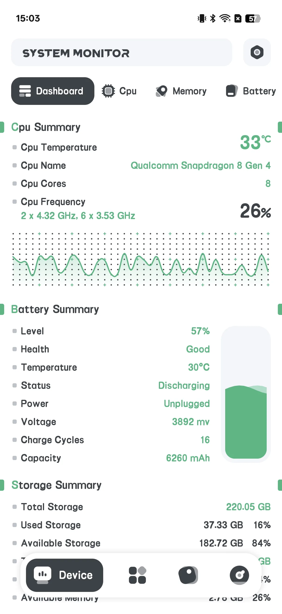
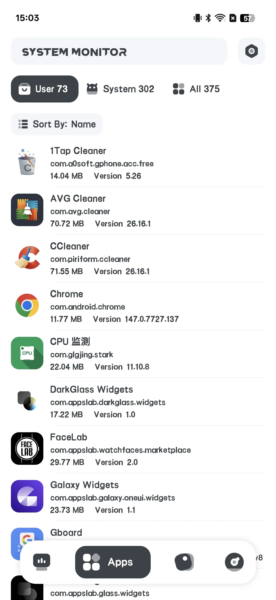
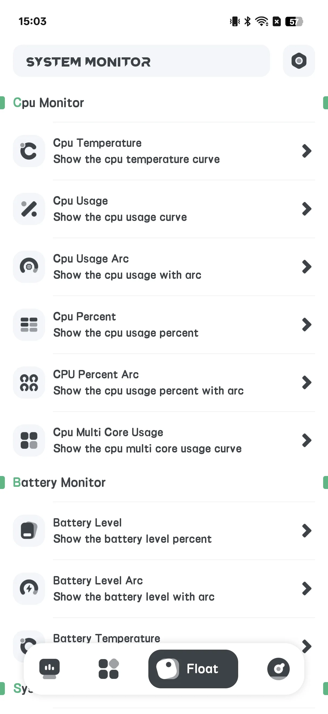
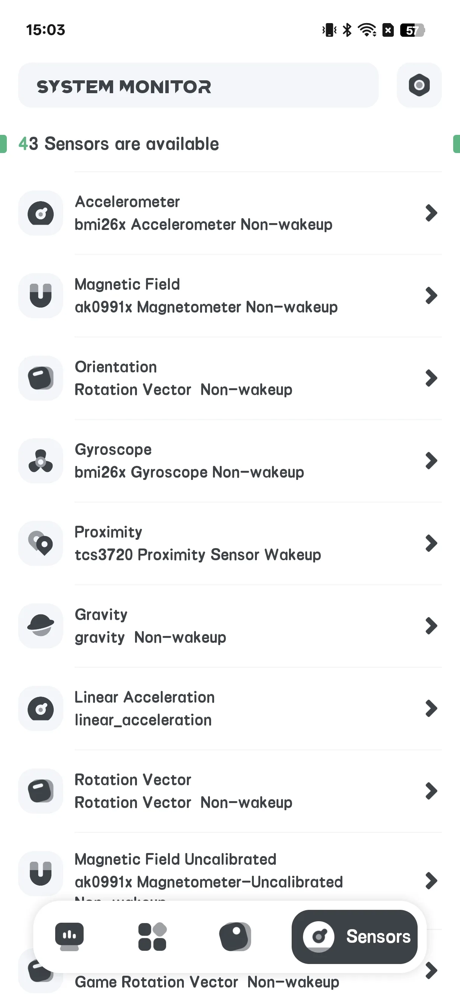
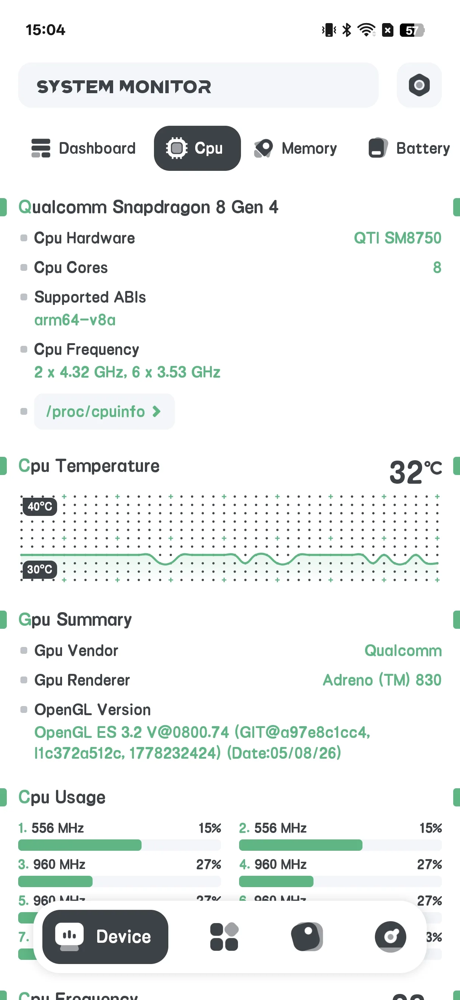
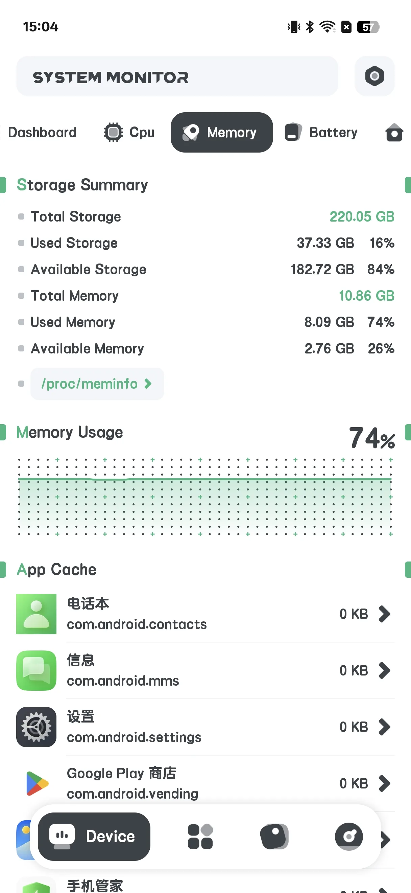
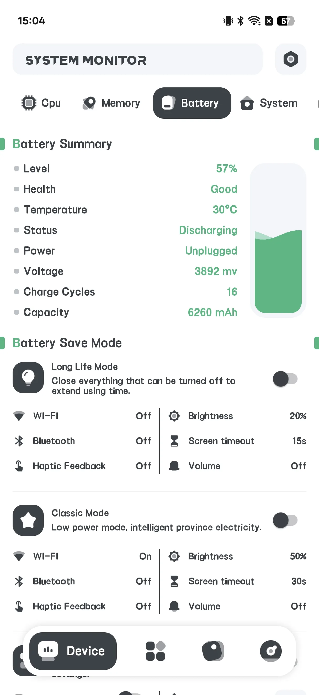
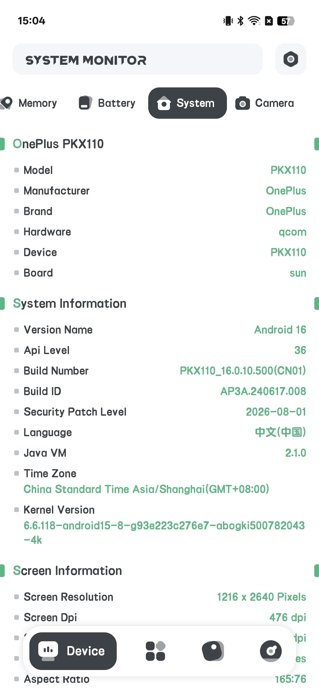
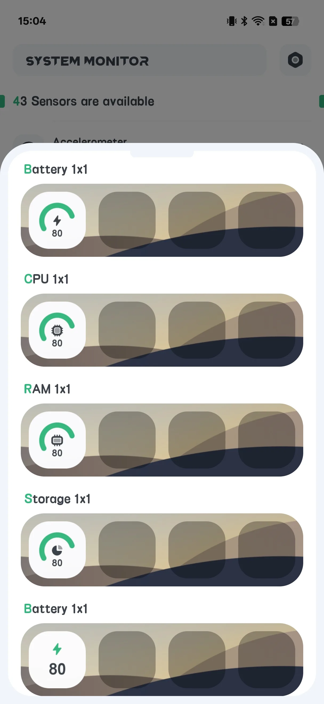

## Table of Contents

- [App Introduction](#app-introduction)
- [First-time Use](#first-time-use)
- [View Hardware Info](#view-hardware-info)
- [Battery Health](#battery-health)
- [Overheat Alarm](#overheat-alarm)
- [Floating Window](#floating-window)
- [Home-screen Widgets](#home-screen-widgets)
- [Settings](#settings)
- [Typical scenarios](#typical-scenarios)
- [FAQ](#faq)

## App Introduction

System Monitor is a **paid, one-time** Android tool for **[read-only hardware info detection](/glossary/what-is-a-system-monitor/)**. It reports what is happening inside your phone — it does **not** clean junk or boost RAM. Because it only reads system counters, the **android system monitor with cleaner and booster** searches that lead here usually want two things: trustworthy numbers and a way to keep them visible. This guide walks from first launch through hardware info, battery health, the overheat alarm, the **system monitor with floating window** overlay and home-screen widgets — all read-only, with no account and no junk-cleaning claims.

**🔍 What It Reads (read-only)**
- **CPU** temperature and frequency, per-core usage
- **Storage** usage
- **Memory (RAM)** usage
- **Battery** health: temperature, health status, voltage and level
- **Camera** capabilities

**🌡 Overheat Protection**
- An alarm that warns when CPU or battery runs hot

**🪟 Floating Window & Widgets**
- A floating overlay showing live stats
- Home-screen widgets: CPU / Battery / RAM / ROM / Combine

> Important: System Monitor has **no app lock / fingerprint lock** and performs **no cleaning or boosting**. The "Fingerprint: supported?" line you may see is only a device-capability readout, not a lock feature.

## First-time Use

The home screen has four tabs: **Hardware**, **App**, **Floating**, **Sensor**.

- **Hardware** is the main info screen
- **Floating** configures the overlay
- **Sensor** lists device sensors

{: width="180" .normal }
{: width="180" .normal }
{: width="180" .normal }
{: width="180" .normal }

## View Hardware Info

1. Open the **Hardware** tab
2. Switch sub-tabs: **Dashboard / CPU / RAM / BAT / SYSTEM / CAMERA**
3. Read live values:
   - **CPU**: temperature, frequency, per-core load
   - **RAM**: used / total memory
   - **BAT**: battery temperature, health, voltage, level
   - **SYSTEM**: storage and device info

{: width="180" .normal }
{: width="180" .normal }
{: width="180" .normal }
{: width="180" .normal }

## Battery Health

On the **BAT** sub-tab you can see battery **temperature, health status, voltage and level** with curves — useful to watch wear over time.

{: width="180" .normal }

## Overheat Alarm

1. Open **Settings → Overheat alarm** (or **Temperature Alert**)
2. Toggle the **CPU** and/or **Battery** alarm on
3. Set a **threshold** temperature
4. The app warns you when the value is exceeded so you can cool the phone down

## Floating Window

1. Open the **Floating** tab
2. Toggle the monitors you want (CPU temp/usage/curve, battery, RAM, System Monitor, FPS)
3. Grant the **"Draw over other apps"** permission when prompted
4. The floating stats appear above any app

{: width="180" .normal }

## Home-screen Widgets

1. Open **Settings → Widget gallery**
2. Choose a widget: CPU / Battery / RAM / ROM / Combine
3. Place it from the widget picker

{: width="180" .normal }

## Settings

Settings include theme, overheat alarm, temperature unit, refresh rate, widget gallery, and floating auto-restore.

## Typical scenarios

- **Read CPU temp while gaming** — open the Hardware tab (CPU sub-tab) and keep an eye on temperature and per-core load to catch throttling before it drops frames.
- **Protect the battery** — check the BAT sub-tab's temperature, health, voltage and level curves to watch wear develop over months.
- **Glance without opening** — enable the Floating overlay or drop a Combine widget on your home screen for live CPU/battery/RAM at a look.
- **Set a heat guard** — turn on the overheat alarm with a threshold so you're warned before the phone gets damagingly hot.
- **Know what it isn't** — remember it's read-only: it won't clean junk or free RAM, so close heavy apps yourself.

## FAQ

### Does it clean memory or storage?
No. System Monitor is strictly read-only — it reports facts and never deletes files or "boosts" RAM.

### Does it have an app lock?
No. There is no fingerprint or password lock in this app.

### Where does the data come from?
From standard Android APIs (e.g. BatteryManager and system files). Nothing is changed.

## Summary

System Monitor is the honest choice when you just want to *see* your phone's internals — CPU temp, battery health and live stats — without cleaners or boosters. A one-time paid download.

## Related terms

- [What Is a CPU Temperature Monitor?](/glossary/what-is-a-cpu-temperature-monitor/)
- [What Is a System Monitor?](/glossary/what-is-a-system-monitor/)
- [What Is a RAM Booster?](/glossary/what-is-a-ram-booster/)
