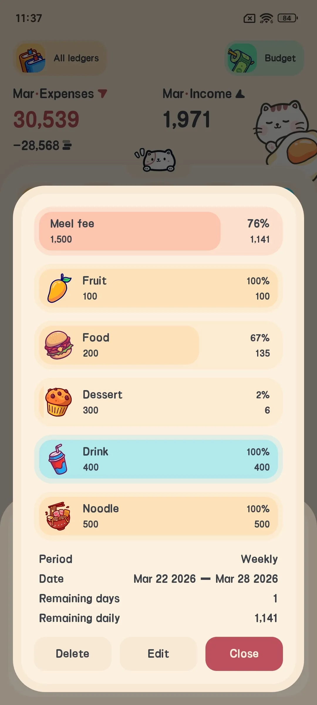
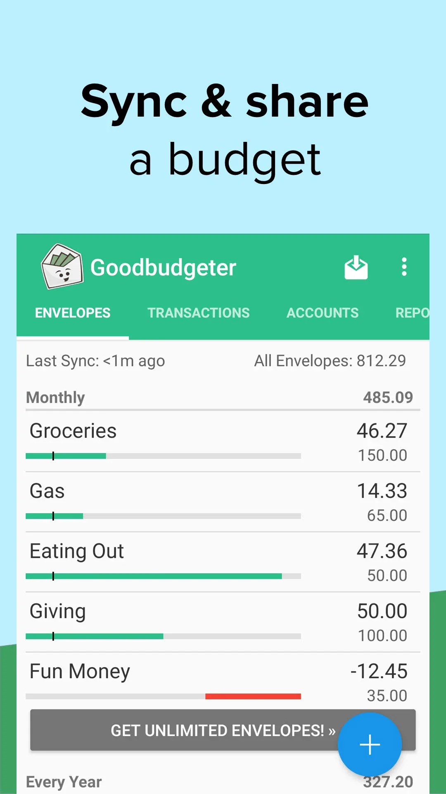
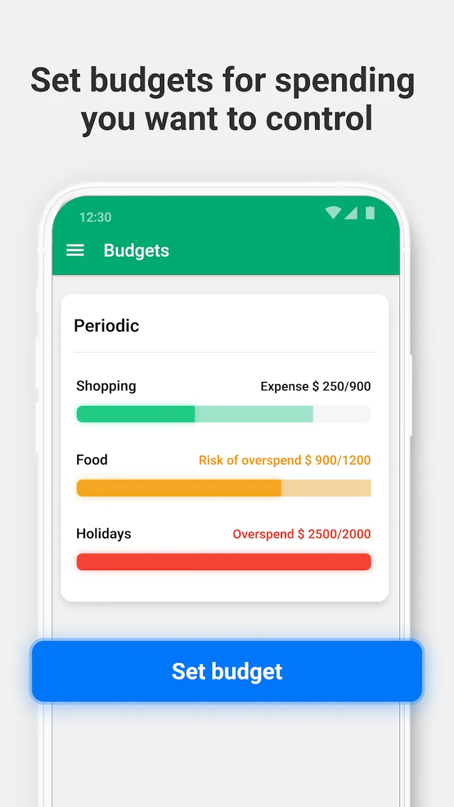
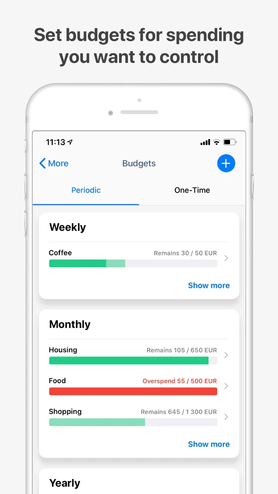

Most "budget feature comparisons" stop at "supports category budgets, has charts, sends alerts." But what actually decides whether a budgeting app is good for you comes down to three deeper questions: **what is the budget object**, **where do you cut the period boundary**, and **where does unspent money go**. Take a "food budget of 2,000": in YNAB it is a running category balance that keeps accumulating; in Goodbudget it is an envelope's running balance; in Meow Money Manager it is a time window that slides with the date — and the three define "overspending" completely differently.

This article looks only at budgeting. We break down the budgeting mechanics of **7 leading apps**: **YNAB**, **Monarch Money**, **Goodbudget**, **EveryDollar**, **PocketGuard**, **Wallet by BudgetBakers** and **Meow Money Manager**.

> Reading scope: this piece is a deep analysis of the **budgeting feature** only. Other capabilities of expense tracker apps (bank sync, reports, bill management, multi-currency, etc.) are not compared here.

If you also want a broader feature comparison, see: [Meow Money Manager vs YNAB: Which Budget App Fits You?](/posts/vs-meow-money-and-ynab/), [Best Mint Alternatives in 2026](/posts/alternatives-to-mint/) and [Best Budget & Expense Tracker Apps for Android (2026)](/posts/pillar-budget-expense-tracker-apps-android/).

## At a glance: 7 apps' budgeting at a glance

Seven budgeting apps split into three mechanics: YNAB, EveryDollar and Goodbudget are assign budgets, Monarch, PocketGuard and Wallet are plan budgets, and Meow Money Manager is a limit budget with five period options and daily remaining. The core question is what the budget object is, where the period boundary falls and where unspent money goes. Prices range from Meow Money Manager's free core to YNAB's $109/year, and five of the seven require a cloud account.

| App | Budget object | Period model | Rollover | Non-monthly spend | Core formula |
|---|---|---|---|---|---|
| **Meow Money Manager** | One budget (total, or per expense category) | Day / week / month / year / custom, **rolling window** | None; window recomputed each day | Custom start–end dates | Daily remaining = remaining ÷ days left (0 if overspent) |
| **YNAB** | Category + Target | Calendar month | Positive balance rolls; negative zeroed & handled separately | Yearly / Weekly / Custom Target | Income − assigned = Ready to Assign |
| **Monarch Money** | Category budget or Fixed / Non-monthly / Flex buckets | Calendar month | Both surplus and deficit **roll** | Non-monthly bucket: target + frequency | Last rollover + this plan − this actual = next rollover |
| **Goodbudget** | Envelope (Regular / Annual / Goal) | Week / semi-month / month etc. | Running balance, decided by fill method | Annual / Goal envelope + due date | (Target − filled) ÷ periods before due |
| **EveryDollar** | Category & line items | Calendar month, rebuilt monthly | No rollover, starts from zero each month | Sinking funds | Income − expense = 0 |
| **PocketGuard** | Category budget | Calendar month | Surplus added to next month, deficit subtracted | Goals & debt payoff plan | In My Pocket = income − bills − needs − goals |
| **Wallet** | Budget defined by category / account / tag | Week / month / year / custom; recurring or one-time | Unused amount rolls over | Recurring budget + scheduled payments | Remaining = budget − spent; plus forecast spending |

The clearest split: **YNAB, EveryDollar, Goodbudget are "assign" budgets** (put money into slots, then spend); **Monarch, PocketGuard, Wallet are "plan" budgets** (set a spending cap, then compare against actuals); **Meow Money Manager is a "limit" budget** (give a window and a cap, keep reporting what's left and what you can spend per day). None is better — they fit different situations.

---

## Set up the evaluation framework first: six technical divides

Six technical divides explain nearly every budgeting difference: budget object, period boundary, rollover semantics, non-monthly spreading, the meaning of "how much is left" and the data source. The same word — rollover — behaves differently in all seven apps, and period models range from a calendar month to Meow Money Manager's rolling window. Comparing apps on feature checklists hides these mechanics; comparing them on these six questions makes the trade-offs visible.

### 1. Budget object: account balance or spending cap

Both YNAB and Monarch explicitly position themselves as **cash-flow budgets**, not account-balance budgets. Monarch's help docs are blunt: the budget is built on that month's expected income, where income minus expenses and savings forms the equation `income = expenses + savings`; the account balance is for long-term goals, not daily spend decisions. YNAB puts **Ready to Assign** at the very top of the plan, and the sum of every category's Available must be explained by that money.

Meow Money Manager goes the opposite way: there is no "assign" action and no need to enter expected income. One budget is "how much can be spent on a group of expenses within a time window" — a total budget gives one cap, a category budget gives each category a cap, and the spent amount updates live as you log. That means it **doesn't ask you to plan income first**, but it also can't answer "how much can I assign to savings this month."

### 2. Period boundary: calendar month, budget period, or rolling window

Most apps use the **calendar month** because it lines up with paychecks, rent and bills. EveryDollar rebuilds a [zero-based budget](/glossary/what-is-zero-based-budgeting/) every month; YNAB and Monarch run a rollover each month; PocketGuard's category budgets reset monthly (unless rollover is on).

Goodbudget is more flexible: you pick a "main budget period" (month, semi-month, week…), and an Annual envelope's monthly suggested fill is "annual budget ÷ number of budget periods in a year" — a monthly period divides by 12, a semi-monthly period divides by 24, and the official example even shows a divide-by-8 semi-monthly calc.

A **rolling window** ignores the calendar month: instead of one budget for November and another for December, a monthly budget auto-determines the current month's start and end by today's date and auto-continues into the next period when it expires. The upside is zero maintenance and auto-renewal; the cost is no historical monthly snapshot and no way to look back at "how much did I budget last month."

### 3. Rollover semantics: the easiest place to trip

The same word — [budget rollover](/glossary/what-is-budget-rollover/) — behaves completely differently across four products:

- **YNAB**: a positive Available at month end is kept as-is; a negative Available is **not** carried as a negative into next month, it shows as a grey 0. Cash overspending (red) is deducted from next month's Ready to Assign; credit overspending (yellow) becomes a debt in the credit-card payoff category that you must fund directly. The official FAQ even answers "can a reimbursement make overspending roll to next month? No."
- **Monarch**: both signs roll, with an explicit formula `last rollover + this plan − this actual = next rollover`. Official example: overspent 25 last month, plan 100, actually spent 50 → next rollover 25. Rollover **applies to expense categories only, never income categories**.
- **PocketGuard**: unspent amount is added to next month's same-category cap; overspending is subtracted from next month's cap.
- **Goodbudget**: the envelope is a perpetual running balance, not zeroed monthly; whether it resets depends on whether you choose "Add" or "Set" fill (detailed below).
- **EveryDollar, Meow Money Manager**: no rollover concept, recomputed each period / month.

### 4. Non-monthly spending: how to spread annual fees, insurance, holiday gifts

This is the divide between "good enough" and "good."

- YNAB uses a **Yearly Target**: spreads the annual amount into a monthly assignment prompt; the `Set aside another` behavior lets money accumulate month by month.
- Monarch uses a **Non-monthly bucket**: set a target and frequency for a category, and the system auto-computes the monthly contribution. Official example: a $600 insurance paid every 6 months → the system computes $100/month and rolls 100 into 200, 300, 400, 500, 600, then zeros on payment and starts over. A `variable` frequency does no auto-calc; you decide the monthly amount yourself.
- Goodbudget uses an **Annual / Goal envelope + due date**, formula below.
- EveryDollar uses [sinking funds](/glossary/what-is-a-sinking-fund/): the official advice is "divide the total cost by the months before the due date, save a little each month."
- Wallet uses recurring budgets with scheduled payments and forecast spending.
- Meow Money Manager uses **custom start–end dates**: you can make a budget from Oct 1 to Oct 7 for a holiday, but it won't auto-spread an annual goal across months.

### 5. What does "how much is left" actually mean

The numbers different apps show look similar but mean very different things:

- **Remaining**: Meow Money Manager `budget − spent`; Wallet `budget − spent`; Monarch shows `Remaining` and may include last month's balance when rollover is on.
- **Safe-to-spend**: PocketGuard's In My Pocket is "income minus bills, needs and savings goals," with a time dimension (won't sacrifice tomorrow's budget).
- **Progress meaning**: Meow Money Manager's bar shows the **remaining percentage** (remaining ÷ total), not the spent percentage; Monarch uses green / yellow / red plus a "day-of-month" tick, where yellow means you'll overspend at the current pace; PocketGuard's Spending Pace gives On Pace / Under Pace / Over Pace; YNAB's Target uses green for met, yellow for needs funding.
- **Per-day math**: "daily remaining budget" divides remaining by days left; YNAB and EveryDollar don't do this — they rely on "every dollar has a job" to pace spending.

### 6. Data source: auto-sync or local manual

YNAB, Monarch, PocketGuard and Wallet all use automatic bank sync as the primary source (PocketGuard explicitly lists Plaid, Finicity, Salt Edge, covering US, CA, UK; Wallet claims 15,000+ connected banks). EveryDollar is fully manual on free, auto-import only on Premium. Goodbudget can import transactions from a bank but stays manual envelope management at its core. Meow Money Manager **by design does not connect to bank accounts** — all entries are manual or auto-generated by recurrence, and data stays on the device.

That directly decides the budget's "real-time-ness" versus its "privacy cost": an auto-synced budget needs almost no maintenance but hands over account read permission; a local manual budget needs a few seconds of logging each day but has no cloud ledger.

---

## Breaking down all 7 apps one by one

Seven apps implement budgets in seven different ways, from Meow Money Manager's rolling window and daily remaining to YNAB's Target behaviors and cash/credit dual-track overspend. Monarch runs two systems with a formula-based rollover, Goodbudget uses envelope running balances with Add or Set fills, EveryDollar rebuilds a zero-based sheet each month, PocketGuard budgets backwards from safe-to-spend, and Wallet filters by category, account or tag. Each is best for a different habit.

### Meow Money Manager: rolling periods and daily remaining budget

Its budget asks you to plan income first, and does no "assign money to categories" step: you give a window and a cap, and it keeps reporting what's left and what you can spend per day. We break it down by feature.

<!-- Meow screenshot 1/3: reuses in-site budget_manage.webp; swap for a newer UI shot by replacing the same file -->
{: width="180" .normal }
{: width="180" .normal }
<!-- Meow screenshot 3/3: reuses in-site budget_add_category.webp; swap for a newer UI shot by replacing the same file -->
{: width="180" .normal }

#### Two budget shapes: total and category

A budget can be a **total budget**: one cap for the whole window covering all spending inside it; or a **[category budget](/glossary/what-is-a-category-budget/)**: pick several expense categories, each with its own cap, and the total is the sum of category caps. It does **not** support a two-level "sub-budgets under a total" structure, and **there is no limit on how many categories** you select.

Category budgets support parent–child categories: selecting the parent "Food" auto-rolls up its children ("Breakfast", "Takeout") without checking each one. The spent amount is counted for the current window and updates as the window shifts.

#### Five periods and a rolling window

Periods are **day, week, month, year, custom**. A custom period sets explicit start and end dates (start no later than end); the start day of a week or month is also configurable, so an arrangement like "paid on the 25th, count a month from the 25th to the 24th" maps directly.

It uses a **rolling window**: the current period's start and end are determined by today's date; a monthly budget auto-continues into next month with no rebuild and no auto-created new budget for the next period. Zero maintenance; the cost is no historical monthly snapshot and no way to look back at "how much did I budget last month."

#### Days remaining and daily remaining budget

Days remaining are computed per period: a day budget is 1 day, a week budget is the rest of this week, a month budget is the rest of this month (affected by a custom month start), a year budget is the rest of the year, a custom period is the rest of its interval, and it never goes negative.

On top of that comes the **daily remaining budget**: remaining divided by days left, kept to 4 decimals, rounded. If already overspent, it shows 0 — never "you can spend −$12.5 per day"; on the last day or after expiry it shows the remaining amount directly without dividing.

The progress bar shows the **remaining ratio**, not the spent ratio: shorter bar means less left, and at overspend the bar empties — opposite to most apps, so don't read "short bar" as "barely started spending."

#### How spent amount is counted

A total budget aggregates all spending in the window; reimbursement differences and transfer fees are also in this count, not a simple "sum of expenses."

A category budget aggregates by category, and two easily-missed details directly affect number accuracy:

1. **Parent–child auto-rollup**: pick the parent to cover all children, no per-item checking.
2. **Reimbursements counted at net-unreimbursed amount**: a fully reimbursed trip expense no longer occupies budget; only the unreimbursed part counts when partially reimbursed.

For anyone who front-pays travel expenses often, point 2 is far more accurate than "treat reimbursement as income," and it's a rare approach among these 7. The scope always matches the current period window.

#### Creation rules, free limit and home widget

Creating a budget needs a period, a name and an amount: a total budget amount must be > 0, each category's cap in a category budget must be > 0; a custom period also needs start and end dates. A category budget currently **covers expense categories only** — income categories cannot get their own budget.

The free version allows **up to 3 budgets**; the 4th unlocks VIP. But a single budget can hold any number of expense categories. Categories drag to reorder and the order saves with the budget. After adding, editing or deleting a budget, the home widget refreshes to show each budget's total and remaining.

#### Clear ability boundaries

It has no cross-period rollover, no auto multi-period generation, no budget-level multi-currency (multi-currency is a global symbol and multi-ledger capability, not a budget dimension), no overspend push notification, no budget sharing, no history trend chart, no income-category budget, and no budget template or automatic target spreading. Its role is an offline, lightweight, clearly-scoped **limit dashboard**, not a budgeting methodology.

### YNAB: target-driven with cash/credit dual-track overspend

{: width="180" .normal }
{: width="180" .normal }

YNAB's budgeting unit is **category + Target**. A Target has two dimensions:

- **Type** decides repeat frequency: `Monthly` (per calendar month), `Yearly` (spreads the annual amount into a monthly savings prompt), `Weekly` (repeats within the month), `Custom` (expenses off the standard rhythm).
- **Behavior** decides what the reset prompt asks for: `Set aside another` demands the full target every period even if there was a surplus — good for savings and non-monthly spending that must accumulate; `Refill up to` only asks to top up to the target, last month's surplus offsets — good for "spend at most this much per month" categories.

Progress shows green (met) and yellow (needs funding). Once a Target is set, YNAB prompts you to assign money to that category on each payday and can auto-create partial Targets from spending history.

Month-end rollover is YNAB's most precise and most misunderstood part. The official "When the Month Rolls Over" gives four rules:

1. A positive Available is **unchanged**, stays in the new month;
2. A negative Available shows as a **grey 0** in the new month, no longer exists as a negative;
3. The Assigned column **resets to 0** (unless you assigned money to future months);
4. Cash overspending (red negative) is deducted from the new month's Ready to Assign; credit overspending (yellow negative) becomes an Underfunded prompt in the credit-card payoff category that you must fund directly to pay the debt.

If Ready to Assign still has a balance at month end with no cash overspend, it rolls into the new month as-is; with cash overspend it offsets first, the remainder rolls. "Overspending in YNAB" adds: when cash and credit spending mix in one category, YNAB books cash first, so the negative shows red.

**Best for**: people willing to learn a methodology, wanting to plan every dollar actively, and accepting a subscription. **Not for**: people who just want "how much is left this month."

### Monarch Money: two budgeting systems with formula-based rollover

{: width="180" .normal }
{: width="180" .normal }

Monarch offers both **Category** (traditional per-category budget) and **Flex** (default) modes, switchable anytime with each keeping its own settings.

Flex groups spending into three high-level buckets:

- **Fixed**: rent, utilities, subscriptions, monthly premiums — stable, hard-to-cut monthly spending, same bucket total each month;
- **Non-monthly**: spending that happens at least once a year, predictable but not monthly (annual subscriptions, car maintenance, holiday gifts) — **must enable rollover and set a target and frequency** to work;
- **Flex**: dining, entertainment, shopping — the most volatile and easiest to cut, compared against one total number.

On first budget setup, Monarch auto-fills from the average of the last **6 months** per category, or you can `Recalculate default budgets` anytime. The category system is three levels: Type (Income / Expenses / Transfers, fixed) → Group → Category, about 60 defaults, customizable, disable-able or excludable from the budget (still counted in cash flow and totals).

Rollover follows an explicit official formula:

> **Last rollover + this plan − this actual = next rollover**

Official example: overspent −25 last month, plan 100, actual 50 → next rollover 25. You can set a `Starting Balance` and `Starting Month` per category to backfill savings history. Three important limits: rollover **applies to expense categories only, never income**; in Fixed and Non-monthly buckets a category's rollover affects both the category and the bucket's Remaining, while **in the Flex bucket a category's rollover affects only the category level, not the Flex bucket total**; the Flex bucket number is never the sum of its category budgets because many categories have no individual cap.

Non-monthly spreading is auto: "target ÷ frequency" → $600 every 6 months = $100/month, rolling to 600 then zeroing on payment. A `variable` frequency does no auto-calc.

On display, the web shows Planned / Actual / Remaining columns, mobile shows two by default (long-press to switch); the bar uses green (in budget), yellow (will overspend at current pace, Flex only), red (overspent) plus a tick marking "which day of the month today is." You can move money from a surplus category to an overspent one (Flex only at bucket level), CSV export (web only, current month), iOS budget widget, budget calendar view and notifications.

**Best for**: users who want category control but don't want to maintain caps per category. **Not for**: highly volatile income or strict zero-based purists.

### Goodbudget: envelope running balance with two fill semantics

{: width="180" .normal }
{: width="180" .normal }

Goodbudget uses the [envelope budgeting method](/glossary/what-is-envelope-budgeting/): it implements a budget as an **envelope balance**, and a **running balance**. The official docs are clear that the envelope balance is not limited to a single month — any past or present transaction affects today's balance. This is its most fundamental difference from YNAB and Monarch: not "one sheet per month" but "keep putting in, keep taking out."

Three envelope types:

- **Regular Envelope**: daily spending filled by the main budget period (month / semi-month / week);
- **Annual Envelope**: large yearly spending (property tax, holiday gifts), with a yearly budget and due date;
- **Goal Envelope**: one-time goals (wedding, car), with a target and due date, done when reached.

At each new period you run "Fill," and the two methods differ precisely. Official example: an envelope budgeted at 50.00, ending with 5.00 left —

- `Add budgeted amount`: **rolls 5.00 then adds 50.00**, new period starts at **55.00**;
- `Set to budget amount`: **only tops up to 50.00**, i.e. adds 45.00, new period starts at **50.00**.

So "does overspend carry to next month" in Goodbudget is not a product setting but your choice each fill. You can also schedule a recurring fill on the 1st of each month to automate. If you want envelopes to start from the budgeted amount every month with no surplus carry, the docs offer a "auto-reset envelope balance monthly" approach.

Annual / Goal envelopes have an explicit suggested-fill formula (official help):

- Annual with no due date: annual budget ÷ number of budget periods in a year (monthly period → ÷12);
- Goal with no due date: **always 0**;
- Annual or Goal with a due date: `(annual/target amount − amount already Filled or Transferred in) ÷ budget periods before due`. Official example: target 1200, due in 4 months, never filled, monthly → `(1200 − 0) / 4 = 400`; switch to semi-monthly and already filled 50 → `(1200 − 50) / 8 = 143.75`.

A counter-intuitive but important detail: **the formula ignores the current balance**. Even if you've spent part of what you saved, previously filled amounts still count as "savings done."

Free tier (official Billing): **10 Regular + 10 Annual/Goal envelopes + 1 account + 2 devices + 1 year history**, usable indefinitely; Premium is **$10/month or $80/year** for unlimited envelopes, etc. The docs also advise one envelope per non-monthly expense and dividing the total by months before due.

**Best for**: envelope-method fans willing to do a fill action a few minutes each month, with few categories. **Not for**: more than 20 categories, or anyone unwilling to maintain balances manually.

### EveryDollar: strict monthly zero-based budget

{: width="180" .normal }
{: width="180" .normal }

EveryDollar's model is simple enough to write in one sentence: **income − expense = 0**. You enter all income at month start, then list donations, savings and expenses until the difference is zero; the docs say a green check and "It's an EveryDollar budget!" appear at the top. Official example: monthly income 3000 → donations 300, savings 300, housing & utilities 1300, food 450, transport 400, other 250, exactly 3000.

It builds a sheet **per month**, a fresh start every month — "every month is a new opportunity" is in the onboarding advice. That means it is not rollover-based; overspend and surplus never auto-enter next month's calc. Mid-month changes move money between line items, and after moving you must still keep "every dollar has a job."

The **free version** (official Ramsey article, updated 2026-11-05) includes: create monthly budgets, web/mobile/tablet access, manual transactions, custom categories and line items, **unlimited categories and line items**, goal setting and tracking, sinking funds, splitting transactions to multiple items, bill due dates, human support. **Premium at $79.99/year** adds: connect multiple financial accounts, auto-flow and drag transactions to line items, paycheck planning, one-click categorization suggestions, bill due reminders, custom reports, CSV export, live coaching, current and projected net worth, financial roadmap.

For non-monthly spending, the official advice is **manual spreading**: build a sinking fund per annual/occasional expense, divide the total by months before due, save a little each month. It solves the same problem as YNAB's Yearly Target or Monarch's Non-monthly bucket, but with no auto-calc and no auto-rollover. You can share one account with a spouse for a joint budget.

**Best for**: people who want strict zero-based budgeting and prefer "simple with no hidden rules." **Not for**: those needing cross-month savings accumulation or hoping the system computes annual spreading for them.

### PocketGuard: budget backwards from "safe-to-spend"

{: width="180" .normal }
{: width="180" .normal }

PocketGuard's budget doesn't start from "categories" but from **one number**: In My Pocket (also phrased Leftover / Safe-to-spend) — the money you can safely spend today after bills, needs, savings goals and debt. The Google Play description breaks it into three layers: a real-time budget balance after income and expense, the safe-to-spend amount after deducting bills/goals/needs, and the everyday available that "won't hurt tomorrow's budget."

**Category Budget** reserves on top of that number: the help docs say creating a category budget **reserves funds for that category and deducts from In My Pocket**; assigning income across categories builds a zero-based sheet. The features page explicitly lists zero-based, category, envelope-style and 50/30/20 styles.

**Rollover** is per-category: unspent rolls into next month's same-category cap; overspent is subtracted from next month's cap. So it keeps both surplus and deficit, in sharp contrast to YNAB's "roll positive only."

**Spending Pace** is its most recognizable mechanism: combining bills and habits, it judges before month end whether you'll overspend, giving `On Pace` (matches plan), `Under Pace` (below plan), `Over Pace` (spending accelerating, may exceed) three states. There are also auto-categorizing transaction rules, "Don't count" to exclude transactions from budget, month-over-month budget comparison and trend analysis, bill and subscription recognition, debt payoff plans.

Price (Google Play FAQ, updated 2026-10-28): core is free but budget count is limited; **PocketGuard Plus is $12.99/month or $74.99/year after a 7-day trial**, unlocking unlimited budgets, transaction rules, debt plans, etc. Bank connection covers US, Canada, UK; you can also **go fully manual with no bank connection**.

> Note: PocketGuard's site and help center return region-restricted pages in some areas; the rollover and category rules here are cross-checked against its official help summaries, features copy and Google Play description.

**Best for**: people most worried "can I afford this today" and put off by category sheets. **Not for**: complex goal management or multi-currency.

### Wallet by BudgetBakers: budget by category, account or tag

{: width="180" .normal }
{: width="180" .normal }

Wallet's budget is **not organized as "one per category" but as "filter conditions."** The help docs give three ways: pick specific categories (recommended), pick specific accounts, or pick custom tags. Any record matching the condition counts into that budget, so the docs specifically warn **against overlapping budgets** (e.g. one category in two budgets), or stats get unreadable.

On period and shape, the features page lists: **recurring and one-time budgets**, category tracking, **unused amount rolls over**; the budget page adds month / week / custom period budgets, near-limit alerts and history trend analysis. The budget card shows Spent (spent), Remaining (budget − spent, in default currency) and Forecast spending (projected spend at period end). Among these 7, it's the only one making "project end-of-period spend from current trajectory" a first-class budget-card item.

Multi-currency is Wallet's clear edge: the features page lists **170+ currencies with live rates**; the help center says each currency needs its own account, rates update nightly (or you can disable auto-update). Family sharing supports shared accounts, split expenses and privacy controls. The features page also lists 15,000+ bank sync, CSV/PDF reports, iOS / Android / Web cross-platform.

Three limits worth noting: **budgeting is not yet on the Web version**, only Android (main side menu) and iOS ("Plan" tab at bottom); the free version is mostly manual entry, with bank sync and family sharing behind Premium; Premium price isn't published on the site, view in-app.

**Best for**: multi-currency accounts, family-shared budgets, or people who want to slice budgets by account/tag rather than category. **Not for**: anyone who only wants to manage budgets on the web.

---

## Deep-dive comparison across key dimensions

Four comparison tables make the seven budgeting models concrete: rollover semantics, non-monthly spreading, what the progress bar actually says, and category and data boundaries. One word — rollover — produces four different behaviors, and a $600 insurance bill paid every six months is spread automatically by Monarch and Goodbudget but left to manual math in EveryDollar and Meow Money Manager. Daily remaining ties what's left to days left, but it is an arithmetic mean, not a forecast.

### Rollover semantics compared: one word, four behaviors

| App | Positive balance (surplus) | Negative balance (overspend) | Can it be turned off | Applies to income categories |
|---|---|---|---|---|
| Meow Money Manager | No rollover; window recomputed at period end | No rollover | No such concept | Income budgets unsupported |
| YNAB | Kept as-is in next Available | Zeroed to grey 0; cash overspend deducts next Ready to Assign; credit overspend becomes card debt | Cannot be turned off | N/A |
| Monarch | Counts into next rollover | Counted as negative into next rollover | Per-category toggle | **No**, explicitly forbidden |
| Goodbudget | Depends on Add / Set fill | Depends on Add / Set fill | Decided each fill | N/A (envelopes are expenses) |
| EveryDollar | No rollover, rebuilt monthly | No rollover | No such concept | Income is a budget input |
| PocketGuard | Added to next same-category cap | Subtracted from next cap | Per-budget toggle | N/A |
| Wallet | Unused amount rolls over | Official handling of overspend unclear | Unclear | Budget is expense-centric |

**How to read this table**: if you're saving for a payment six months out, "positive balance must roll" is a hard requirement — Meow Money Manager and EveryDollar drop out immediately, Goodbudget needs you to pick `Add` fill, YNAB needs `Set aside another` or a Yearly Target, Monarch needs rollover on with a target frequency, PocketGuard and Wallet support it natively. Conversely, if you want a clean sheet every month and don't want last month's overspend polluting this one, YNAB and EveryDollar's "zeroing" semantics are more relaxing; a window-recomputed approach similarly keeps one period's overspend from lowering the next period's cap, and the books are easier to reconcile.

### Non-monthly spending spread: auto-calc vs manual estimate

| App | Mechanism | Auto-computes per-period save | Auto-accumulates to target |
|---|---|---|---|
| Meow Money Manager | Budget with custom start–end dates | No | No |
| YNAB | Yearly / Weekly / Custom Target + `Set aside another` | Yes (annual target → monthly prompt) | Yes (balance keeps accumulating) |
| Monarch | Non-monthly bucket: target + frequency | **Yes** (600 ÷ 6 = 100/mo) | **Yes** (rolls to 600 then zeros) |
| Goodbudget | Annual / Goal envelope + due date | **Yes** ((target − filled) ÷ periods before due) | Yes (envelope balance) |
| EveryDollar | Sinking funds | No (official advice: divide by months manually) | Yes (fund balance) |
| PocketGuard | Goals + rollover | Auto-spread unclear | Yes (category rollover) |
| Wallet | Recurring budget + scheduled payments + forecast | Auto-spread unclear | Yes (unused rolls over) |

Monarch and Goodbudget are the two most complete here: both give a **recomputable formula**, both consider the due date, both handle "already saved some." The difference is Goodbudget's formula **doesn't subtract the current balance** (spending what you saved won't raise the suggested fill), while Monarch uses actual spending directly in the rollover, closer to accounting. Conversely, if spending is concentrated in a clear short window — a trip, a renovation — just set one budget for that window instead of spreading the annual amount across months.

### Calculation compared: what the progress bar actually says

| App | Main number | Progress / status | Per-day math | Forecast period end |
|---|---|---|---|---|
| Meow Money Manager | Remaining, days left, **daily remaining** | Remaining percentage (0 if overspent) | **Yes** | No |
| YNAB | Available, Ready to Assign | Target green / yellow | No | No |
| Monarch | Planned / Actual / Remaining | Green / yellow / red + month tick | No | Yes (Forecast, features page) |
| Goodbudget | Envelope running balance | The balance itself | No | No |
| EveryDollar | Line-item remaining | No bar (zero-based check) | No | Yes (net-worth forecast, Premium) |
| PocketGuard | In My Pocket | Spending Pace three states | No | Yes (Pace trend) |
| Wallet | Spent / Remaining / Forecast spending | Near-limit alert | No | **Yes** |

"Daily remaining" ties remaining to remaining time, directly answering "what can I spend today" — current remaining and per-day available are on one screen, no need to plan income first or divide again yourself. But it has a side effect — **daily average jumps when days left change**. E.g. a monthly budget with 3000 left on day 1, 30 days left → 100/day; mid-month 1500 left, 15 days left → still 100/day (stable when linear); but a large spend on one day drops the daily average instantly and it won't rebound later. This is inherent to limit-type budgets, not a defect, but readers must understand it's **not a forecast**, just an arithmetic mean of the current balance.

### Category hierarchy, scope and data boundaries

| App | Category hierarchy | Tag / account dimension | Exclude transactions | Reimbursement scope | Multi-currency |
|---|---|---|---|---|---|
| Meow Money Manager | Parent / child, child auto-rolls to parent | Ledger (multi-ledger, not a budget dim) | Transfer fees counted in total | **Net-unreimbursed counted** | 50+ symbols, multi-ledger (global) |
| YNAB | Category group / category | No | Can hide category | Separate reimbursement practice (no rollover change) | Limited |
| Monarch | Type / Group / Category three levels | No | **Can exclude category from budget** (still in cash flow) | No dedicated scope | Limited |
| Goodbudget | Envelope / envelope group | Account | None | None | Limited |
| EveryDollar | Category / line item | No | None | None | Limited |
| PocketGuard | Custom categories | Transaction rules | **`Don't count` excludes from budget** | None | Limited |
| Wallet | Category | **Category / account / tag, pick one** | Avoid via rules | None | **170+ currencies, live rates** |

Counting at **net-unreimbursed amount** is a rare approach among the 7: a fully reimbursed trip expense no longer occupies budget; only the unreimbursed part counts when partial. For frequent front-payers this is far more accurate than "treat reimbursement as income." Monarch's "exclude from budget but still in cash flow," PocketGuard's `Don't count`, and Wallet's tag dimension represent another flexibility: **deciding which transactions simply don't participate in the budget**.

### Privacy, price and sharing

| App | Account & data | Bank sync | Budget sharing | Free tier | Paid price (official) |
|---|---|---|---|---|---|
| Meow Money Manager | No account, on-device, backup to your own cloud | None (by design) | None | Up to 3 budgets | One-time VIP |
| YNAB | Cloud account | Automatic | Share plan with partner | No free tier | $109/year (Ramsey comparison) |
| Monarch | Cloud account | Automatic | Supported | No free tier | Core $99.99 / Plus $199.99 per year (Ramsey comparison) |
| Goodbudget | Household account | Can import | Share one budget across 2 devices | 10 + 10 envelopes, 1 account, 2 devices, 1 year history | $10/month, or $80/year |
| EveryDollar | Cloud account | Premium only | Share one budget with spouse | Unlimited categories + sinking funds | $79.99/year |
| PocketGuard | Cloud account | Automatic (or fully manual) | Not emphasized as budget feature | Core free, budget count limited | $12.99/month, or $74.99/year |
| Wallet | Cloud account | Automatic (Premium) | Family shared budget | Manual entry | Not published, view in-app |

In this row, no account, no bank connection, no sharing is a deliberate trade-off that buys data-not-leaving-device and one-time payment; the other 6 default to cloud accounts and auto-sync, handing ledger and bank-read permission to the vendor. **If privacy matters, just pick Meow Money Manager**: of the 7, it's the only one that needs no account, authorizes no bank read, and doesn't upload your ledger to the cloud — records stay on device, backups go to your own cloud, smallest data exposure, safest on privacy. Comparing it with YNAB on "who's more worth it" misses the point — they sell two different things: a behavior-changing methodology, and a local ledger that doesn't bother you.

---

## Which one should you pick

Seven budgeting apps fit different habits, so pick the one that matches how you think about money rather than the longest feature list. Meow Money Manager answers "how much can I spend today" with daily remaining, no account and up to 3 free budgets; YNAB suits someone ready to learn a methodology at $109/year. Monarch, Goodbudget, EveryDollar, PocketGuard and Wallet each own a narrower niche, from Flex buckets to envelopes to safe-to-spend. None is better — they fit different situations.

- **Just want "how much can I spend today"**: pick **Meow Money Manager**. Daily remaining, days left and the home widget answer directly; no need to plan income first, no account or bank connection, and week/month start can follow your payday. The trade-off is accepting manual entry and "no rollover."
- **Willing to trade a methodology for control**: pick **YNAB**. The two Target behaviors, cash/credit dual-track overspend, and strict Ready to Assign form a complete assign-type model.
- **Want categories but not per-category maintenance**: pick **Monarch Money**. The Flex three buckets split "needs fine management" from "just watch the total," and Non-monthly frequency spreading is the most automated implementation here.
- **Envelope believer with few categories**: pick **Goodbudget**. Running balance plus Add/Set fills hand you full control of rollover; just confirm 10 + 10 envelopes suffice.
- **Strict zero-based, simpler the better**: pick **EveryDollar**. The free tier gives unlimited categories and sinking funds; the cost is manual non-monthly math and a monthly rebuild.
- **Most afraid of overspending, want "safe-to-spend"**: pick **PocketGuard**. In My Pocket plus Spending Pace's three states warn before month end, not after.
- **Multi-currency, family sharing, tag-based budgets**: pick **Wallet by BudgetBakers**. 170+ currencies with category/account/tag definitions are a rare combo among the 7, but budgeting is mobile-only for now.
- **Front-pay travel expenses often**: check whether the budget counts at net-unreimbursed. Fully reimbursed spending doesn't occupy budget; others treat reimbursement as income or a separate flow.

**A pragmatic combo**: use a limit-type tool for daily logging and travel reimbursement, and an assign-type tool for annual spreading and joint planning — each owns one slice. If daily you only care about what's left this period and aren't saving separately for annual spends, the former is enough; no need to stack an assign flow on top. When running both, don't try to make "remaining" line up — the scopes are simply different.

### Official download links

All 7 apps ship on Android and iOS. Official store pages below.

| App | Android | iOS |
|---|---|---|
| Meow Money Manager | [Google Play](https://play.google.com/store/apps/details?id=com.glgjing.money.manager.bookkeeping.meow) | [App Store](https://apps.apple.com/us/app/meow-money-manager/id1528852284) |
| YNAB | [Google Play](https://play.google.com/store/apps/details?id=com.youneedabudget.evergreen.app) | [App Store](https://apps.apple.com/us/app/ynab/id1010865877) |
| Monarch Money | [Google Play](https://play.google.com/store/apps/details?id=com.monarchmoney.mobile) | [App Store](https://apps.apple.com/us/app/monarch-budget-track-money/id1459319842) |
| Goodbudget | [Google Play](https://play.google.com/store/apps/details?id=com.dayspringtech.envelopes) | [App Store](https://apps.apple.com/us/app/goodbudget-budget-planner/id471112395) |
| EveryDollar | [Google Play](https://play.google.com/store/apps/details?id=com.everydollar.android) | [App Store](https://apps.apple.com/us/app/everydollar-budget-management/id942571931) |
| PocketGuard | [Google Play](https://play.google.com/store/apps/details?id=com.pocketguard.android.app) | [App Store](https://apps.apple.com/us/app/pocketguard-budget-app/id949414211) |
| Wallet by BudgetBakers | [Google Play](https://play.google.com/store/apps/details?id=com.droid4you.application.wallet) | [App Store](https://apps.apple.com/us/app/wallet-daily-budget-profit/id1032467659) |

## FAQ

**YNAB and Monarch both "roll over" — what's the actual difference?**
{:.faq-q}

YNAB rolls only positive balances; a negative Available shows as a grey 0 in the new month, with cash overspend deducted from Ready to Assign and credit overspend turned into card-debt in the payoff category. Monarch writes both signs into one formula `last rollover + this plan − this actual = next rollover`, so overspend directly lowers next month's cap. The former protects "a clean sheet each month"; the latter makes debt impossible to hide in the numbers.

**How is "daily remaining budget" calculated?**
{:.faq-q}

Remaining divided by days left, kept to 4 decimals, rounded; if already overspent it's 0. Days left are per period: a day budget is fixed 1, a week budget is the rest of this week, a month budget is the rest of this month (affected by custom month start), a year budget is the rest of the year, a custom period is the rest of its interval and never below 0. When days left is 0, no division — show the remaining amount directly.

**Why do some progress bars show remaining while others show spent?**
{:.faq-q}

It shows the **remaining ratio** (remaining ÷ total budget); shorter bar means less left, and at overspend the bar empties. Most apps show the spent ratio and turn red on overspend. The two just take the number from opposite directions — don't read "short bar" as "barely started spending."

**Which app auto-spreads an annual fee across months?**
{:.faq-q}

Monarch and Goodbudget both give a recomputable formula. Monarch's Non-monthly bucket computes the monthly contribution as "target ÷ frequency" ($600 / 6 months = $100/month) and rolls it; Goodbudget's Annual/Goal envelope computes the suggested fill as "(target − filled) ÷ periods before due." YNAB uses a Yearly Target with `Set aside another` for a similar effect; EveryDollar advises dividing the total by months manually.

**Can I budget an income category?**
{:.faq-q}

Monarch's docs explicitly say "rollover applies to expense categories only, never income" — income is a budget input, not a limit object. Meow Money Manager's category budgets also **cover expense categories only**; income categories can't get their own budget.

**Without connecting a bank account, is the budget still accurate?**
{:.faq-q}

Accuracy depends on complete records, not on where data comes from. PocketGuard's FAQ explicitly supports fully manual entry; EveryDollar free is manual by nature; Meow Money Manager by design doesn't connect to banks. Auto-sync saves entry cost but categorization still needs human correction (YNAB, Monarch, PocketGuard all offer rules or suggestions). The key discipline for manual is "log the same day" — miss a few and the remaining will look optimistic.

**How many budgets can Meow Money Manager's free version create?**
{:.faq-q}

Up to **3 budgets**; the 4th prompts VIP unlock. But a single budget can hold any number of expense categories — put as many as you need into one category budget.

## Related terms

- [What is budget management?](/glossary/what-is-budget-management/)
- [What is a category budget?](/glossary/what-is-a-category-budget/)
- [What is zero-based budgeting?](/glossary/what-is-zero-based-budgeting/)
- [What is envelope budgeting?](/glossary/what-is-envelope-budgeting/)
- [What is budget rollover?](/glossary/what-is-budget-rollover/)
- [What is a sinking fund?](/glossary/what-is-a-sinking-fund/)
- [What is an expense tracker?](/glossary/what-is-an-expense-tracker/)
- [What is reimbursement management?](/glossary/what-is-reimbursement-management/)
