Most habit app comparisons stop at check-ins, charts and reminders. But what actually decides whether an app works for you comes down to three deeper questions: **what one record represents**, **where the period boundary falls**, and **what happens to the numbers after a missed day**. Take exercise three times a week: one app makes you name Monday, Wednesday and Friday, another accepts any three days in a week, and a third simply treats it as every two days. Miss one check-in and one app resets the streak to zero, another only lets a long-term score decay slowly, and a third drains the character's health.

This article first explains **what a habit app is and what it is actually good for**, then breaks down 7 leading products against six technical divides you can check one by one: **Meow Habits**, **Streaks**, **Habitica**, **Loop Habit Tracker**, **Habitify**, **Productive** and **Fabulous**.

> Reading scope: this is a deep analysis of **habit tracking mechanics** only. Expense tracking, task management, health data platforms and community features are mentioned only where they change how a record is defined. Features, quotas and pricing follow the official pages and store listings checked in November 2026; after an update, trust what the app itself shows.

If you care more about which one fits you than how they count, see [Best Habit Tracker Apps for Android (2026)](/posts/pillar-habit-tracker-apps-android/), [Meow Habits vs Streaks: Which One Is Easier to Stick With?](/posts/vs-meow-habits-and-streaks/), [Meow Habits for Beginners](/posts/best-meow-habits-beginners/) and [The Complete Meow Habits Tutorial](/posts/tutorial-meow-habits/).

## At a glance: how 7 apps model habits

| App | What one record means | Period model | After a missed day | Main metrics | Where data lives |
|---|---|---|---|---|---|
| **Meow Habits** | One cumulative record per period: `+1` / `-1` / enter a value / done / skipped | Daily, weekly, monthly, named weekdays, every N days, with target and unit | Streak counted back over valid periods; a skipped period does not break it | Current streak, best streak, completions, completion rate, month calendar and 365-day heatmap | On-device, no account; CSV export, Google Drive / WebDAV backup |
| **Streaks** | One tick per task; plus timed tasks and negative do-not tasks | Every day, named weekdays, N days a week, with rest days | Missing a due day resets the streak; rest days do not break it | Current / best streak, completion rate, calendar and trends | Apple ecosystem, synced via iCloud, not through third-party servers |
| **Habitica** | Three separate types: Habits (instant plus/minus), Dailies (scheduled) and To-Dos (one-off) | Dailies can be every day, three times a week, four times a month | An unfinished Daily costs health; at zero health the character levels down and loses gold | Level, XP, gold, character growth and task history | Account + cloud, open-source clients, plus a web app |
| **Loop Habit Tracker** | One tick; numeric habits can log an amount | Daily, 3 times a week, every other day, every other week | No reset-on-break rule: a habit score grows with completions and decays with misses | Habit score, streak, completion rate, check-in matrix and charts | Offline on-device, no account, open source, CSV or full database export |
| **Habitify** | One tick, habits grouped into morning / afternoon / evening | Daily or named weekdays and similar repeat rules | Shown as a calendar and completion rate; missed-day penalties are not a core mechanic | Completion rate, streak, calendar and trends | Account + real-time cross-platform sync; free plan caps 3 habits |
| **Productive** | One tick, habits attached to a time block and a plan | Repeat days and multiple times a day, with a template library | The calendar shows done vs not done | Completion rate, milestones, trends and progress rings | Account + sync, with challenges and reminders |
| **Fabulous** | Each small step in a routine completed one by one | Organised by journey stages and morning / afternoon / evening routines | Streaks are not stressed; progress is measured in stages | Stage progress, routine completion and coaching content | Account + subscription content library |

The split is obvious at a glance: **Meow Habits, Streaks, Loop, Habitify and Productive are record-first** (log the behaviour, then talk about motivation); **Habitica is game-first** (the record itself is converted into XP, gold and penalties); **Fabulous is course-first** (records serve a staged behaviour-change programme). None is better — each makes a different assumption about what sticking with something means.

---

## First: what does a habit app actually record

Before comparing products, it helps to pull apart a few concepts that keep showing up but are rarely explained. These are not word games — every number you see in an app is determined by them.

### One habit = goal + period + one record

The smallest unit of habit tracking is not I exercised today, but three things stacked together:

- **Goal**: the behaviour, and whether it has a measurable standard. Read every day has no target; read for 30 minutes does.
- **Period**: the time window in which that goal is settled. A day, a week, a month, or every Monday, Wednesday and Friday.
- **Record**: what you did about the goal inside that window — completed it, accumulated an amount, or explicitly marked it skipped.

Once you see this, a lot of confusion dissolves: why is my streak 0 today when I checked in yesterday? Because yesterday belongs to the previous period and today's period has no record yet. Why did the history chart change after I deleted a habit? Because statistics are aggregated per period, not summed up as a stream of individual entries.

### Building and breaking: the same progress ring, in opposite directions

Most apps split habits into two kinds: **build habits** (do more — water, reading, exercise) and **break habits** (do less — no sugary drinks, no late nights). Both usually look like the same progress ring, but the test runs in opposite directions: a build habit counts as done when it reaches the target, a break habit when it stays under the limit.

Meow Habits puts that choice in the very first step of creating a habit (pick build or break under I want to), and only then asks for a unit and target. Streaks has dedicated negative tasks that build a streak by not doing something. Choose the wrong direction and the ring will honestly tell you that doing more today made things worse.

### Boolean and numeric goals

The simplest record has just two states: **not done / done** (boolean). But many behaviours come with a quantity: 8 glasses of water, 30 minutes of reading, 3 kilometres of running. A **numeric goal** needs a unit and a threshold, and the logging action changes from a single tick to plus, minus, enter a value, or mark done.

That difference carries all the way into the statistics: a boolean habit can only be 0% or 100% complete, while a numeric one can show 60% complete today. Meow Habits offers all five actions in its check-in panel — `+1`, `-1`, enter a value, done and skipped; Loop's check-in matrix also shows habits logged in miles or pages; Streaks' main screen is mostly one-tick, with timed tasks covering how long something lasted.

### Periods: calendar days, N times a week, named weekdays, every N days

Every day is the simplest period, but real habits are rarely that tidy. Four common definitions exist:

1. **Calendar day**: once per day; crossing midnight moves you to the next cell.
2. **Named weekdays**: required only on Monday, Wednesday and Friday; other days create no pending item.
3. **N times a week**: any 3 completions within the week count, with no specific days attached.
4. **Every N days / weeks / months**: a rolling fixed interval rather than a calendar month.

Loop's official store listing explicitly names flexible schedules such as 3 times a week, once every other week and every other day; Habitica Dailies can be set to three times a week or four times a month; Meow Habits splits frequency, repeat interval and named weekdays into separate options and lets each habit carry a unit and target. Pick the wrong period and the most direct consequence is I did it, but the app says I missed today.

### Current streak, best streak and completion rate

A **streak** is the number of consecutively completed periods counted back from the most recent valid one; the **best streak** is the historical peak; **completions** is the total number of periods completed. They are often used interchangeably, but they answer different questions: is it still going, what was the high point, and how much was done in total.

The definition of **completion rate** deserves even more attention. In Meow Habits, a build habit is computed as completed value ÷ target value and capped at 100%, while a break habit has only two outcomes; the trends page then averages over a period. That means reading for 90 minutes will not push today's rate to 300%, though it does show up in totals and averages. Other apps may compute completed days ÷ due days, so the numbers are not directly comparable.

### Skips, backfilling and grace

People miss days. How an app treats the missing day matters more than how many digits it can display:

- **Backfill**: go back to a past date and add the record. Meow Habits lets you flip back through the month calendar to backfill, but never lets you check in a future date; when a habit is created, valid periods between its start date and today are also pre-created so there is no blank stretch.
- **Skip**: explicitly say this period was never meant to be done. It neither breaks the streak nor counts as a completion. It is a different thing from a missed log.
- **Grace / decay**: treat one omission as no disaster, letting it slowly affect a long-term score. Loop officially calls this the habit score — each completion strengthens the habit, each miss weakens it; after a long run, a few missed days will not wipe out all progress.
- **Penalty**: in Habitica, an unfinished Daily costs health, and hitting zero levels the character down and clears its gold.

### Reminders, widgets and one-tap logging

A big reason habits fail is that by the time you remember, it is no longer the right moment to do the thing. Reminders are therefore not an extra — they are the entry point of the logging chain: a push at the right time, a tick straight from the notification, or one tap on a home-screen widget compresses open app → find habit → check in into a single action.

Meow Habits supports several reminder times per habit with chosen weekdays, a daily summary reminder and a range of home-screen widgets; Loop's official description stresses that you can complete, ignore or snooze from the notification without opening the app; Streaks can also connect to Apple Health so steps or mindful minutes mark a task complete automatically.

### Data ownership: accounts, export and backup

One last thing is easy to overlook: **after a year of records, whose hands are they in?** There are roughly three models:

- **Purely local, no account**: Meow Habits and Loop both work this way; data stays on the device and no sign-up is needed. The trade-off is that switching devices means exporting or restoring a backup file.
- **Account + cloud sync**: Habitify, Productive, Fabulous and Habitica take this route — convenient across devices, but the records go to a server.
- **Sync inside an ecosystem**: Streaks uses iCloud across Apple devices and states that data does not pass through its own servers.

Export matters just as much. Meow Habits can export records as CSV and back up the whole database to Google Drive or your own WebDAV endpoint; Loop exports CSV or the database file. Whether there is a way to get your data out decides whether you can still change tools a few years from now.

---

## What habit apps are actually good for

Mechanics aside, back to the practical question: what do you get for tapping once a day?

### Turning vague intentions into checkable facts

I want to read more is a wish; 19 of the last 30 days, 22 minutes on average is a fact. The most basic value of a habit app is **turning an intention into an observable record**, so I think I have been fairly consistent becomes a claim you can check. In behaviour science this is called **self-monitoring**: Lally et al. (2010, *European Journal of Social Psychology*) asked volunteers to pick a new behaviour and log it daily, and estimated a median of about 66 days before automaticity plateaued, with a range of 18 to 254 days — a spread that by itself shows how unreliable a gut feeling is.

One caveat: a 2011 systematic review of self-monitoring interventions by Burke et al. found that although self-monitoring correlates with better outcomes, the strength of evidence in the included studies was rated weak. **A record is a tool, not a guaranteed outcome.**

### Cutting the startup cost down to one tap

The enemy of a habit is often not laziness but friction: unlock, find the app, scroll to the habit, tap done. What reminders and widgets really optimise is that path. Putting check-in in the notification shade or on the home screen moves the decision to the moment the behaviour happens instead of waiting for a recap at night. That is why Android home-screen widgets and Apple Lock Screen widgets keep coming up in habit apps.

### The feedback loop: visible progress

Progress rings, month calendars, heatmaps and streak counts are all **feedback**. They shrink the gap between did it and saw that I did it to almost zero. Products differ greatly in how they deliver it: Streaks uses a ring of tasks and a day counter, Meow Habits a monthly heat calendar and a 365-day dot matrix, Loop a habit-score curve that rises and falls over time, and Habitica levels, gold and equipment.

### Review: finding the day that actually blocked you

More useful than how many days I managed is why it broke. Once records are arranged by period on a calendar, patterns surface on their own: missing only Wednesday for three weeks means Wednesday's schedule is the problem; a high rate early in the month collapsing at the end means the target was set too high. What should change then is the schedule or the target, not your self-criticism. Numeric habits help most here — they show that it was not zero, it was one third of the plan.

### Limits: when a tracker gets in the way

The same mechanics can have side effects, and they are worth thinking about before choosing an app:

- **Streak anxiety**. If the streak is the only score, one omission can make a person give up entirely. Interestingly, Lally et al. found that **missing a single opportunity did not significantly change the overall habit-formation curve**; what matters is long-term repetition, not an unbroken chain. Loop's decaying score, Meow Habits' skipped marker and Streaks' rest days all leave room for that.
- **Punitive design is not for everyone**. Habitica's health loss is great motivation for people who enjoy gamification, but a source of pressure for anyone prone to guilt over mistakes.
- **The number can replace the goal**. Once a 100-day streak becomes the point, the check-in itself gets optimised and the behaviour you wanted to build disappears.
- **Some cases need no app**. Behaviours already triggered automatically by a fixed cue (brushing your teeth, a commute route) do not need logging; problems that call for professional support should not be handled by check-ins either.

In one line: a habit app makes behaviour visible, reduces friction and gives review a basis — it does not build the habit for you.

---

## Evaluation framework: six technical divides

The six questions below are a framework you can apply to any two habit apps. The product-by-product breakdowns and comparison tables that follow all use them.

### 1. Record unit: a tick box vs a numeric target

Tick-only apps are lighter and faster, but they lose the how much layer. Apps with numeric targets express degree at the cost of one more input. The test is not which has more features, but whether the behaviour naturally carries a quantity: going to bed early is boolean, drinking 8 glasses is numeric.

### 2. Period model: calendar days, N per week, named weekdays, every N days

Real life rarely runs on a tidy calendar. Whether an app can express three times a week, on any days, weekdays only or every other day decides whether it will mark you as failed on a day you were supposed to rest.

### 3. Missed-day semantics: reset / decay / skip-to-protect / health loss

This is where the products differ most, and the point least often written into a feature list:

| Semantics | Representative apps | After a missed day | Good for |
|---|---|---|---|
| Reset | Streaks | Streak starts again from zero | People who want a clear rule and treat the streak as the goal |
| Decay | Loop | Habit score drops slowly; long-term progress is not wiped out by one miss | People focused on the long trend who are easily discouraged by a broken chain |
| Skip to protect | Meow Habits | A period marked skipped does not break the streak | People with irregular schedules who need to declare rest in advance |
| Health loss / level down | Habitica | An unfinished Daily costs health; zero means a level down | People who like external rewards and penalties with game feedback |
| No penalty | Habitify / Productive / Fabulous | Shown as calendar or stage progress | People who only want completion, not a number chasing them |

### 4. Completion rules and metric definitions

Three things to ask: does done mean ticked or accumulated to the target; is completion rate computed per day or per amount, and is it capped at 100%; is a blank calendar cell a miss or a day that was never due? The same 75% completion rate can mean three days out of four in one app, or 6 of 8 glasses in another.

### 5. Reminders and the one-tap path

Can one habit have several reminder times, can weekdays be specified, can you complete straight from the notification, is there a home-screen widget, can health data complete a task automatically — the shorter this chain, the more likely a record gets made in the moment.

### 6. Data ownership and portability

Is sign-up mandatory, is data on the device or in the cloud, can it be exported in a common format, is backup a vendor cloud or something you can self-host. A year later, when you change phones or apps, this suddenly becomes the most important item.

---

## All 7 apps, one by one

### Meow Habits (Android)

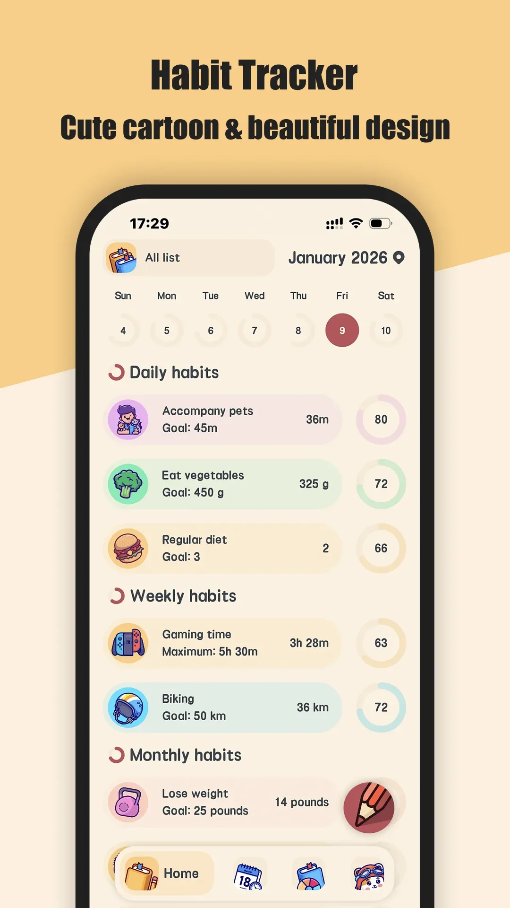{: width="180" .normal }
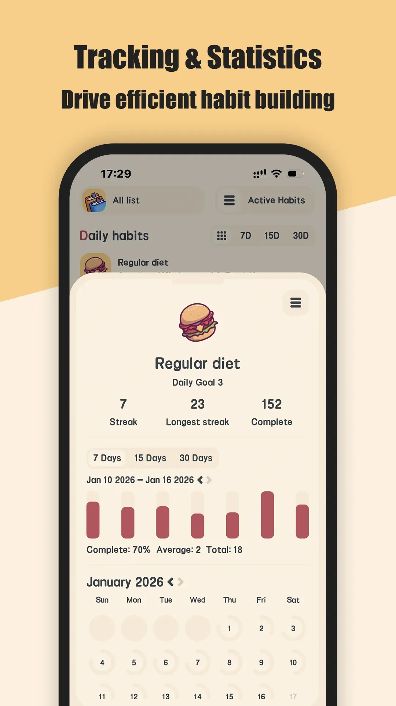{: width="180" .normal }
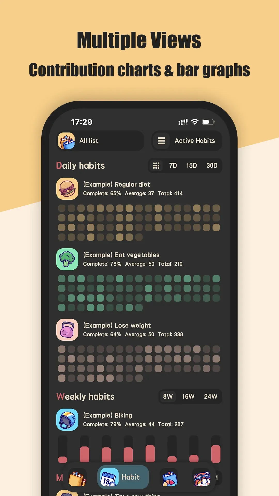{: width="180" .normal }

Meow Habits is a habit check-in app built on **on-device records and no account**, with an interface organised around a month calendar. Its design priority is clear: work out exactly how much of this habit was completed in this period, then show the result from four entry points — the calendar, the detail page, the trends page and widgets.

#### One record: five check-in actions

Tapping a habit opens a check-in panel with `+1`, `-1`, direct value entry, one-tap done, and skip. A period keeps just one cumulative record, which can carry a note; a sound plays on completion. So 2 glasses of water in the morning and 3 in the afternoon are not two separate entries — they accumulate to 5 for the day, then get compared against a target of 8.

#### Goals and periods: build, break and custom units

Creating a habit lets you set an icon, a list, build or break, a start date, frequency (daily / weekly / monthly / named weekdays), a repeat interval, a unit (count, time or custom), a target, notes and notifications. Built-in lists cover health, exercise, study, productivity, saving money and happiness, and a set of preset habit templates helps anyone who does not know where to start.

One thing to note: **period, target and start date cannot be changed after creation**; the editable parts are the icon, list, note and reminders. Deciding three times a week versus Monday/Wednesday/Friday at creation saves more effort than trying to fix it later.

#### Streaks and completion rate: three numbers plus a heatmap

The top of the detail page shows current streak, best streak and completions; below it you can switch between the last 7 / 15 / 30 days for per-day bars and completion rate / average / total, then a full-month calendar heatmap. For a build habit, a single-period completion rate is completed value ÷ target value, capped at 100%; for a break habit it is simply whether the limit held. The home calendar shows each due habit as a progress ring, so it is obvious which ones are still short.

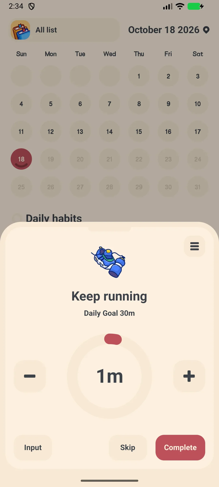{: width="180" .normal }
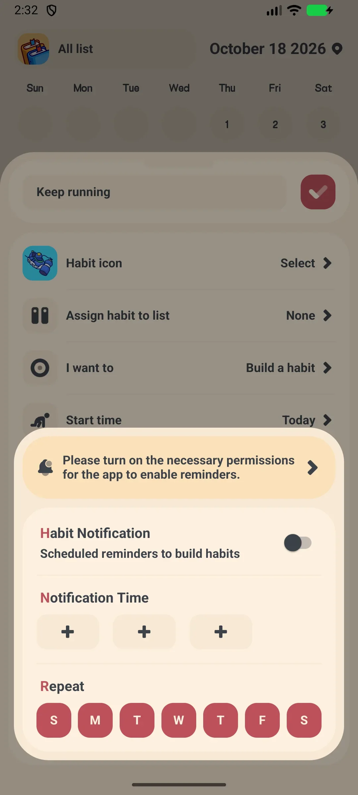{: width="180" .normal }

#### Reminders, widgets and one-tap check-in

Each habit can have several reminder times with the weekdays they apply to, plus a once-a-day summary listing what is still due. System-level guidance covers notification permission and battery optimisation so reminders are not silently blocked. On the home screen there are several widgets — habit list, single habit, weekly / monthly / yearly stats, pie chart and month heatmap — and the single-habit widget can check in directly without opening the app.

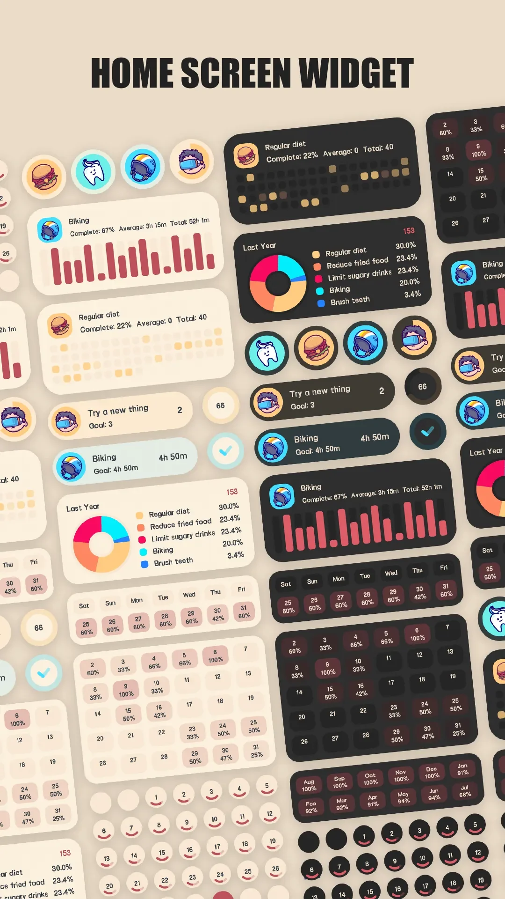{: width="180" .normal }

#### Data: local storage, CSV export and self-hosted backup

Records stay on the device: no account, no real-time multi-device sync. To migrate, export a CSV for a chosen date range and a chosen subset of habits, back up the whole database to Google Drive, or point it at your own WebDAV address and restore by overwriting. Automatic backup can run at most once a day. That combination suits anyone who does not want to hand daily data to a server but still fears losing it when changing phones.

#### Limits and pricing

The free plan caps the number of habits and lists; more habits plus dark theme, app lock and CSV export require unlocking the premium features. It deliberately **does not** do automatic health-data sync, social leaderboards, AI suggestions, account cloud sync or CSV import; custom colours, end dates, future-date check-ins and multi-level sub-habits are also out of scope. If you want step counts read automatically from a band, or a streak competition with friends, you need another tool.

| Good for | Not for |
|---|---|
| Long-term offline, account-free logging; numeric targets and custom units; one-tap widget check-in; export or self-hosted backup | Real-time cross-device sync; automatic health-data integration; social or leaderboard motivation; many habits without a free-plan cap |

Beyond the home and detail screens, three more views are worth a look: how lists and preset templates group habits, global achievement statistics, and the privacy protection around local records.

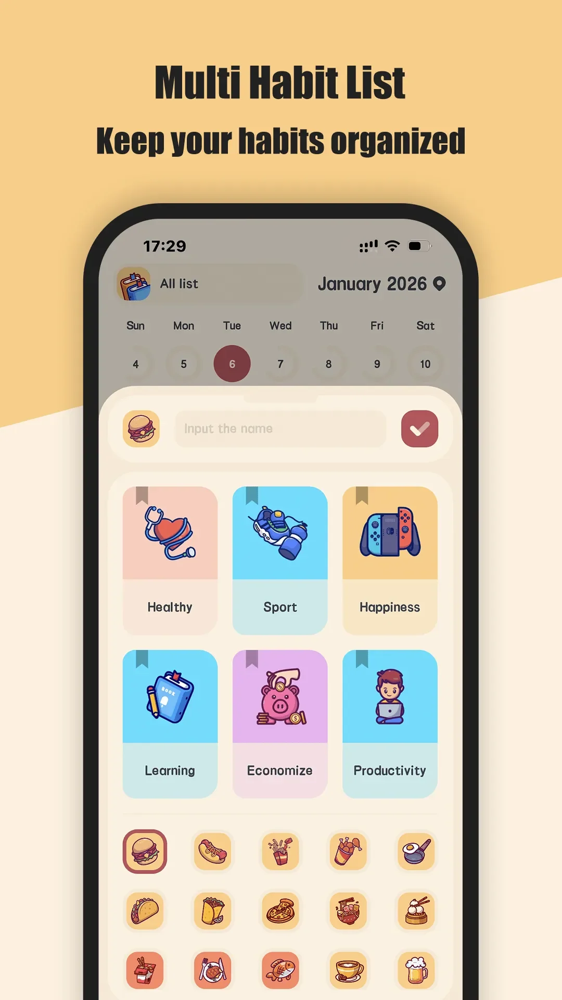{: width="180" .normal }
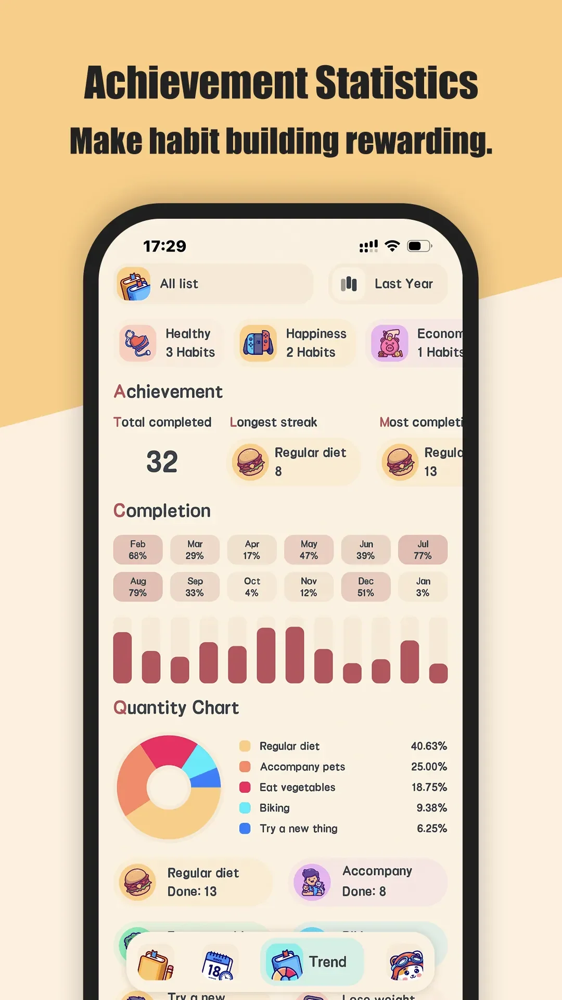{: width="180" .normal }
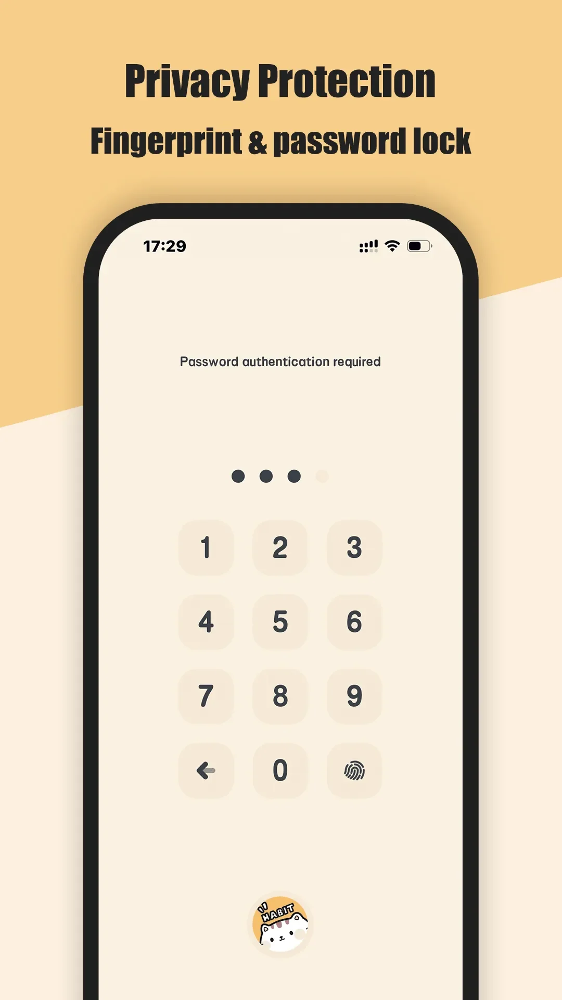{: width="180" .normal }

<!-- The screenshot set has no settings screen for CSV export / WebDAV backup yet; that capability is described in the text above -->

### Streaks (Apple ecosystem)

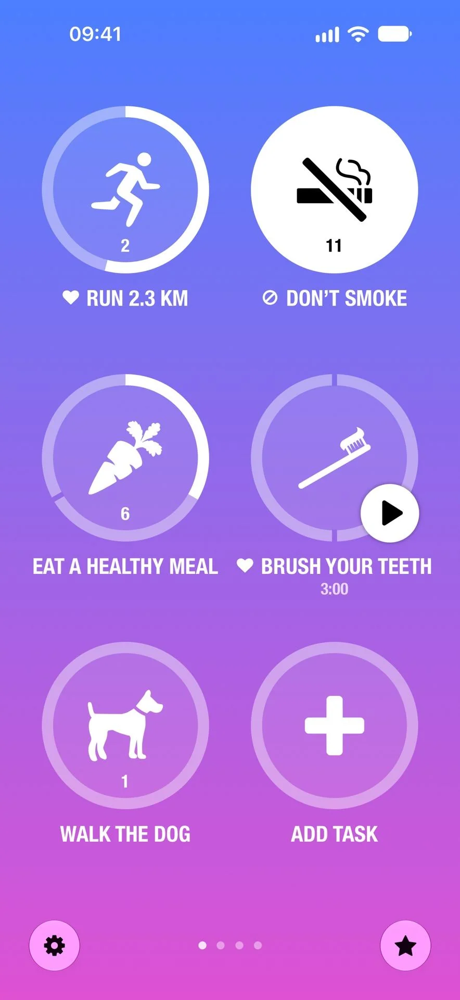{: width="180" .normal }
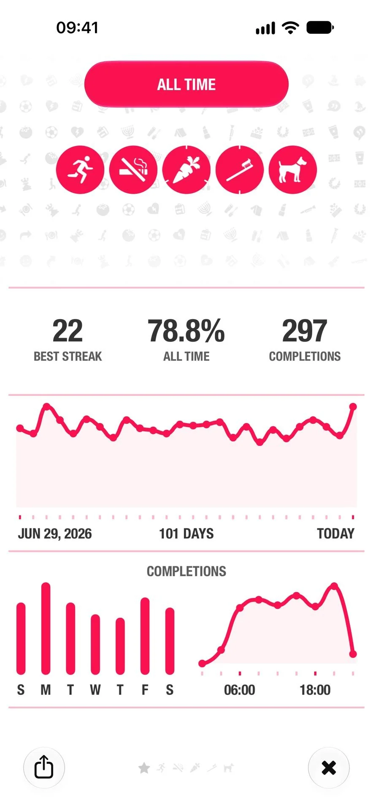{: width="180" .normal }

Streaks puts don't break the chain in its very name. The official site currently states **up to 24 tasks** (older sources often say 12 — a version difference; trust the app). Tasks can be every day, on named weekdays or N days a week, and rest days can be marked so they do not break a streak. Alongside one-tick tasks there are timed tasks (meditate for 10 minutes) and negative do-not tasks.

Its mechanical focus is **periods and automatic completion**: Apple Health can turn steps, mindful minutes or Activity rings directly into a completion, cutting manual logging. Statistics cover current and best streaks, completion rate, calendar and trends; the interface offers many icons and colour themes, plus widgets, Siri Shortcuts and Lock Screen timers.

Data syncs via iCloud across iPhone, iPad, Apple Watch and Mac, and the developer states it does not pass through its own servers; it is a one-time purchase with no subscription and no ads. The trade-off is equally direct: Apple ecosystem only, so Android users are out; and missing a due day restarts the streak from zero — clean if you like clear rules, tense if a broken chain gets to you.

### Habitica

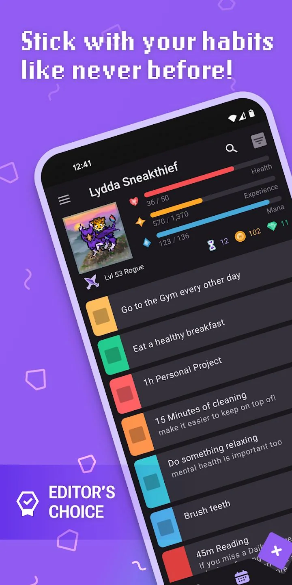{: width="180" .normal }
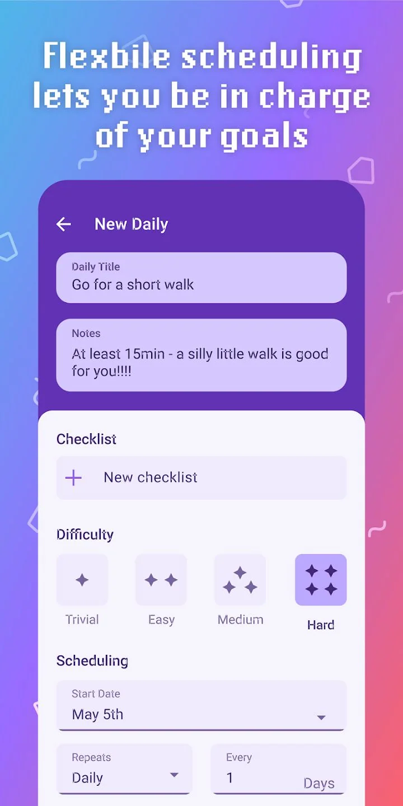{: width="180" .normal }

Habitica simply turns habit tracking into a role-playing game. Behaviour is split into four types: **Habits** (tap `+` / `-` any time, set as positive, negative or both), **Dailies** (repeat on a schedule and cost health when due and unfinished), **To-Dos** (one-off, optionally with a due date, no health loss) and **Rewards** (buy yourself something with gold). Positive Habits grant XP and gold, negative ones cost health; a Daily's repeat schedule can be every day, three times a week or four times a month, and higher difficulty pays more.

That design makes a missed day an explicit cost: at zero health, gold is cleared, the character drops a level and equipment may be lost. Parties, quests, classes and stat growth are also there, turning consistency from a private log into a cooperative game. Tasks, parties and quests are free; paid parts are mostly cosmetic gems and an optional subscription (monthly gems, drop bonuses); clients are open source, and there is a web version for iOS, Android and Web.

If experience bars and equipment hold no interest for you, all that conversion is just overhead; but for someone who cannot keep going without external feedback, it is the only one of the 7 that turns rewards and penalties into a full system.

### Loop Habit Tracker

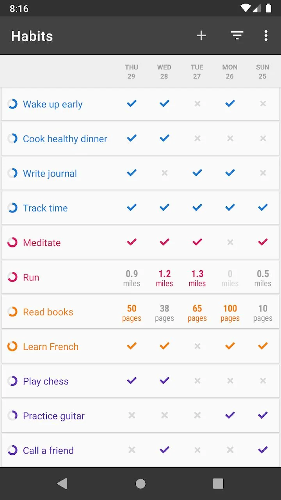{: width="180" .normal }
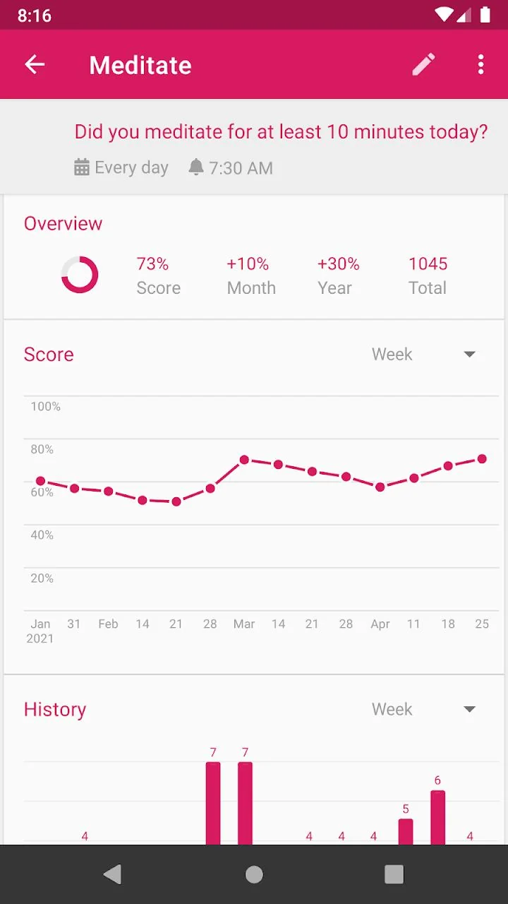{: width="180" .normal }

The most interesting thing about Loop is not its interface but that it **refuses to reset on a broken chain**. Its official store description says the product uses an advanced formula to compute a habit score: each repetition makes the habit stronger, each miss weaker; after a long run, a few skipped days will not destroy all progress. That answers the streak anxiety above directly — a long-term trend is closer to the real curve of habit formation than a chain that must never break.

For periods it supports daily, 3 times a week, once every other week, every other day and other flexible schedules; the check-in matrix also shows numeric habits logged in miles or pages. Reminders can be set per habit, and you can complete, ignore or snooze straight from the notification without opening the app, including on a watch. Statistics include detailed charts and full history.

Data stays entirely on the device, with no account and no upload, and can be exported as CSV or a database file; the app has no ads and is open source. It is the most thorough implementation of pure local + portable, but it is Android-only and its interface leans towards a tool rather than a motivator.

### Habitify

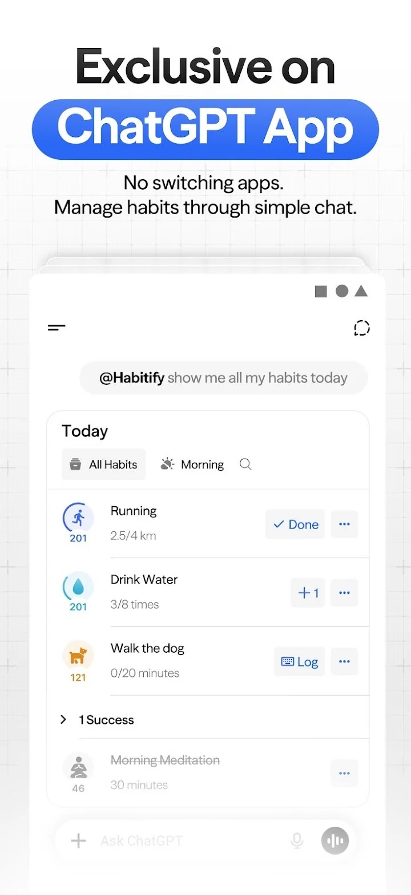{: width="180" .normal }
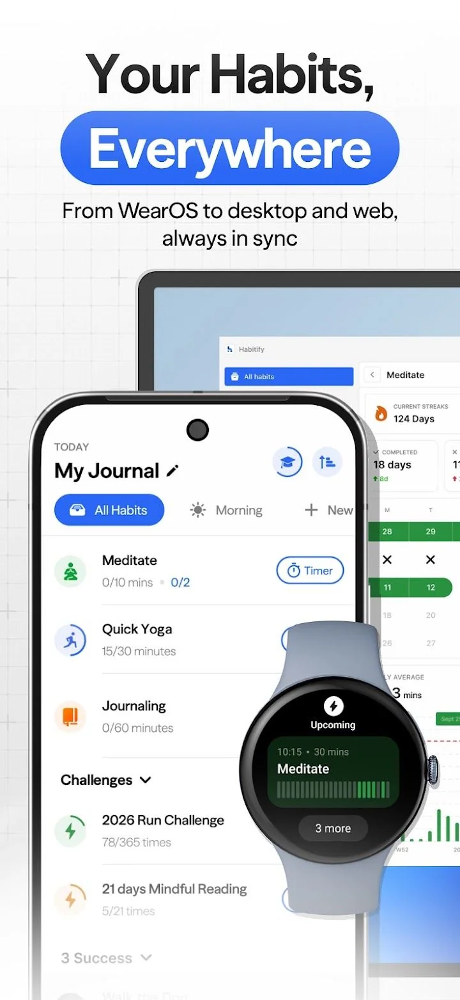{: width="180" .normal }
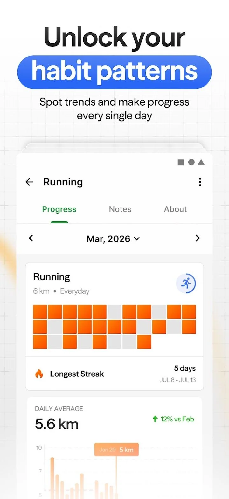{: width="180" .normal }

Habitify's idea is **to put habits on a day's timeline**: morning, afternoon and evening each get a group, so opening the app shows what to do right now. The official site stresses coverage of iPhone, Android, Mac, Web and watch with real-time sync, plus calendar integration, health-data integration, an API and automation connections, notes, mood logging, a built-in timer and a privacy lock. Statistics lay completions out as a heatmap and give cumulative totals.

Its positioning is the opposite of a pure local tool: the account, sync and multi-device experience are the main selling points. The official pricing page states the free plan allows 3 habits (with cross-platform sync and reminders), while unlimited habits belong to the paid plan; friend challenges and community features are also available. If you only check in on one Android phone and do not want to register, most of that goes unused; but if you move between phone, computer and web, it saves the trouble of records scattered across devices.

### Productive

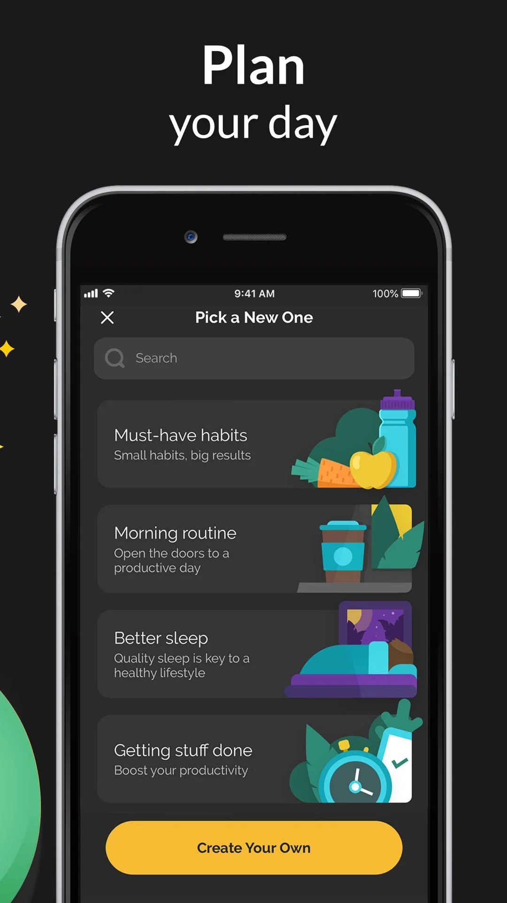{: width="180" .normal }
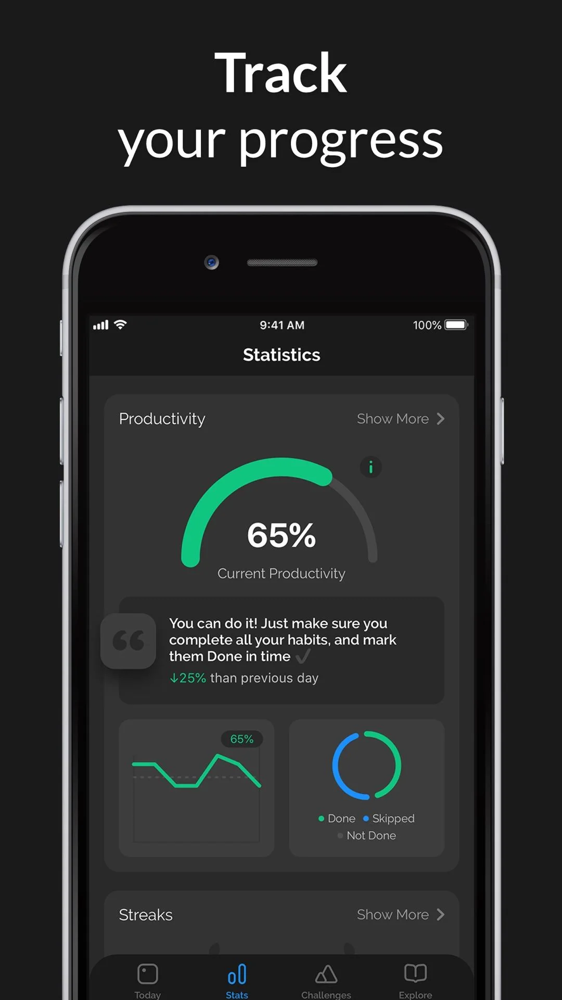{: width="180" .normal }
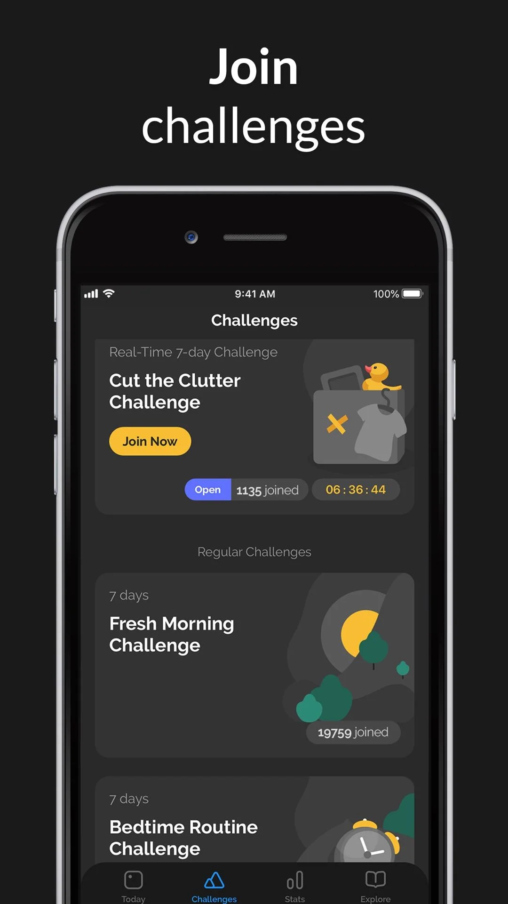{: width="180" .normal }

Productive treats habits as **a day's schedule**: pick a habit from a template library, place it in the morning, afternoon or evening, set repeat days and reminders, then tick it off day by day in the calendar. The official site mentions the template library, statistics and milestones, smart reminders conditioned on location and time, and challenges you can join with other people; the challenges screen is a separate column from the daily plan.

It belongs to the same time-block + account sync family as Habitify, but with more emphasis on planning and light social features: what you see is not an isolated habit but the whole day's arrangement. It uses a subscription with a short free trial that converts automatically, which is worth noting at sign-up. The feature set leans towards help me plan rather than help me compute the data precisely, so completion rates and milestones dominate and streak definitions are not explored in depth.

### Fabulous

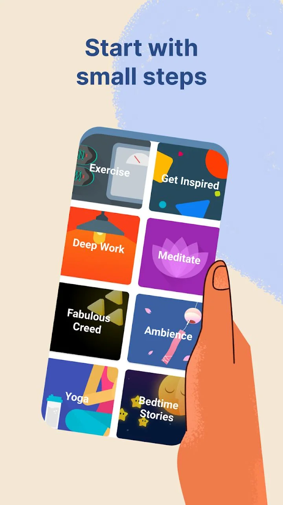{: width="180" .normal }
{: width="180" .normal }
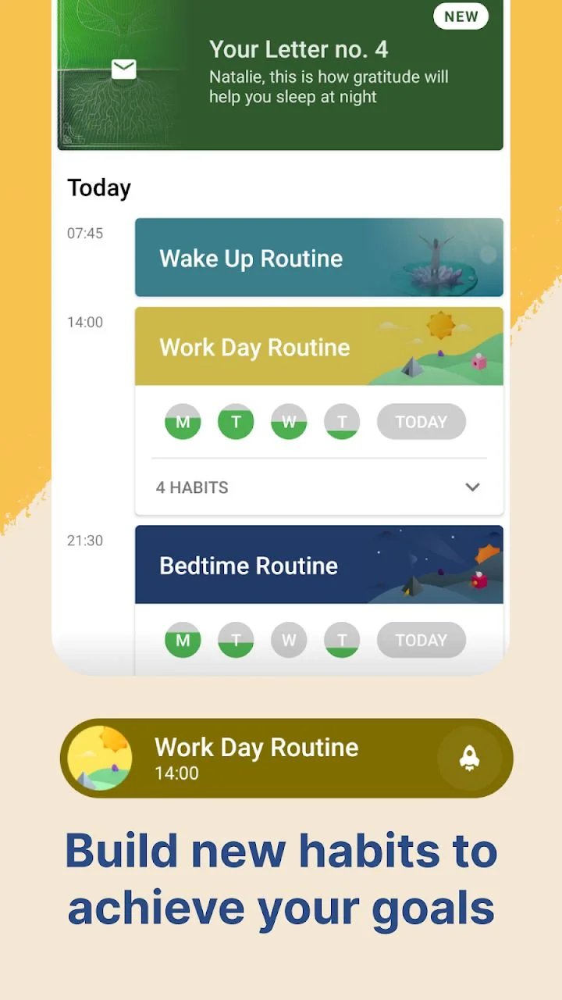{: width="180" .normal }

Fabulous is less a check-in tool than a **staged behaviour-change course**. It grew out of behavioural economics research at Duke University's Center for Advanced Hindsight and argues for breaking big goals into tiny behaviours, then chaining them with habit stacking into morning, afternoon and evening routines: stabilise drink a glass of water first, then add the next step, rather than listing ten to-dos at once. The daily routine screen lists the day's small steps to cross off one by one.

The product runs as a journey, with coaching content, routines, deep-work sessions, a community and bookable human coaches; statistics do not foreground streaks but stage completion. The cost is a subscription content library whose free trial converts automatically, and what you mainly buy is a programme and content, not a freely configurable recording system. Anyone who wants to define periods, targets and exports will find it restrictive.

---

## Deep comparison across the key dimensions

### Semantics of missed days and gaps

| App | Missed day | Explicit skip | Backfill history | Future dates |
|---|---|---|---|---|
| Meow Habits | Streak counted back over valid periods | Supported; marking a skip does not break it | Supported via the month calendar | Not allowed |
| Streaks | Streak resets to zero | Rest days can be set | Per the in-app calendar | Not applicable |
| Habitica | Daily costs health; zero means a level down | Damage can be paused | Per task history | Not applicable |
| Loop | Habit score decays, no reset | Avoided via flexible schedules | The check-in matrix can be revisited | Not applicable |
| Habitify / Productive | Calendar shows not completed | Avoided via repeat rules | Per the in-app calendar | Not applicable |
| Fabulous | Progress by stages, no streak emphasis | No chain-break mechanic | Not applicable | Not applicable |

### Periods, targets and completion rules

| App | Period expression | Numeric targets | Completion-rate definition |
|---|---|---|---|
| Meow Habits | Day / week / month / named weekdays / every N days | Supported, units are customisable | Completed value ÷ target, capped at 100%; break habits judged against the limit |
| Streaks | Every day / named weekdays / N days a week + rest days | Timed tasks cover duration | Completed days and completion rate |
| Habitica | Dailies can be daily / 3 a week / 4 a month | Mostly ticks; numeric via custom rewards | Level / XP / gold, not a percentage |
| Loop | Daily / 3 a week / every other day / every other week | Supported | Habit score + completion rate |
| Habitify | Daily / named weekdays, grouped by time block | Mostly ticks | Completion rate and calendar |
| Productive | Repeat days + time block + multiple times a day | Mostly ticks | Completion rate and milestones |
| Fabulous | Journey stages + routines | Not applicable | Stage progress |

### Reminders, entry points and data

| App | Reminders | One-tap logging | Data location | Export / backup | Account |
|---|---|---|---|---|---|
| Meow Habits | Multiple times per habit + weekdays + daily summary | Home-screen widgets | On device | CSV export, Google Drive / WebDAV backup | Not needed |
| Streaks | Per-task reminders | Widgets, Siri, Apple Health auto-completion | iCloud (Apple ecosystem) | Relies on ecosystem sync | Not needed |
| Habitica | Daily reminders | In-app plus / minus | Cloud | Inside the account system | Required |
| Loop | Per-habit reminders; complete / ignore / snooze in the notification | Notification, widgets, watch | On device | CSV / database export | Not needed |
| Habitify | Advanced reminders, time-block reminders | Widgets, multiple platforms | Real-time cloud sync | Cloud + calendar / health integration | Required |
| Productive | Smart reminders based on time / location | In-app tick | Cloud | Inside the account system | Required |
| Fabulous | Routine reminders | In-app step ticks | Cloud | Inside the account system | Required |

### Platforms and pricing (per official pages)

| App | Main platforms | Pricing | Commonly omitted capabilities |
|---|---|---|---|
| Meow Habits | Android (the store also lists an iOS entry) | Free plan caps habits / lists; some features are unlockable | Automatic health sync, social leaderboards, account cloud sync |
| Streaks | iPhone / iPad / Apple Watch / Mac / Vision Pro | One-time purchase, no subscription or ads | Android / Windows; task count is capped |
| Habitica | Web / iOS / Android | Core tasks free; cosmetics and optional subscription paid | Not a purely local tool; records need an account |
| Loop | Android | Free, open source, no ads | iOS; account sync; gamified motivation |
| Habitify | iOS / Android / Mac / Web / Watch | Free for 3 habits; unlimited is paid | Fully offline use |
| Productive | Mainly iOS, with a web entry | Subscription + short free trial | Offline account-free use, free data export |
| Fabulous | iOS / Android | Subscription content library + free trial | Custom period definitions, open data export |

---

## Which one should you pick

Apply the six-point framework to your own situation and the choice gets much clearer:

- **First ask whether the record needs a quantity**. For 8 glasses / 30 minutes / 3 kilometres, Meow Habits and Loop have the most complete definitions; if a single tick is enough, Streaks, Habitify and Productive have a shorter path.
- **Then ask whether the schedule is regular**. Only Monday/Wednesday/Friday, or any three days a week, means looking at named weekdays and flexible schedules — Meow Habits, Streaks, Loop and Habitica all offer explicit options.
- **Then ask whether a reset after one missed day is acceptable**. If a reset discourages you, look at Loop's decaying score or Meow Habits' skip; for a clear rule, Streaks is the most direct; for external rewards and penalties, Habitica is the strongest.
- **Then ask where the data goes**. No registration plus your own backups points to Meow Habits and Loop; moving between devices points to sync in Habitify / Productive / Fabulous; all-Apple points to Streaks via iCloud.
- **Finally ask whether you want a tool or a programme**. To define habits, periods and charts yourself, choose a record-first app; to be guided through a change process, Fabulous' course-first model fits better.

Still undecided? Start by narrowing the field with the [habit tracker overview](/posts/pillar-habit-tracker-apps-android/), then read the [point-by-point Meow Habits vs Streaks comparison](/posts/vs-meow-habits-and-streaks/). If a Chinese interface, offline use and home-screen widgets matter most, the [Android habit check-in app](/apps/meow-habits/) is worth a separate look.

### Official download links

| App | Android | iOS / other |
|---|---|---|
| Meow Habits | [Google Play](https://play.google.com/store/apps/details?id=com.glgjing.meow.habit.goal) | [App Store](https://apps.apple.com/app/id6758230559) |
| Streaks | — | [App Store](https://apps.apple.com/app/id963034692) · [Official site](https://streaksapp.com/) |
| Habitica | [Google Play](https://play.google.com/store/apps/details?id=com.habitrpg.android.habitica) | [Official site / web](https://habitica.com/) |
| Loop Habit Tracker | [Google Play](https://play.google.com/store/apps/details?id=org.isoron.uhabits) | [Official site](https://loophabits.org/) |
| Habitify | [Google Play](https://play.google.com/store/apps/details?id=co.unstatic.habitify) | [Official site](https://www.habitify.me/) |
| Productive | — | [Official site](https://productiveapp.io/) |
| Fabulous | [Google Play](https://play.google.com/store/apps/details?id=co.thefabulous.app) | [Official site](https://www.thefabulous.co/) |

---

## Frequently asked questions (FAQ)

**What problem does a habit app actually solve?**
{:.faq-q}

It turns a vague intention into a checkable record and reduces the friction between remembering and logging. It does not build the habit for you, but it makes behaviour visible, gives progress feedback and gives review a basis. Behavioural research suggests new behaviours often take weeks to months to become automatic (Lally et al., 2010, estimated a median of about 66 days with wide individual variation), and a record is one of the easiest external cues to maintain through that stretch.

**If a streak breaks after one day, is it all for nothing?**
{:.faq-q}

No. Lally et al. found that missing a single opportunity did not significantly change the overall habit-formation curve. Products handle it differently too: Streaks resets, Loop lets the habit score decay slowly, Meow Habits lets you mark a period as skipped, and Habitify / Productive / Fabulous do not centre streaks at all. Choosing a definition that matches your mindset matters more than defending a chain.

**What is the difference between three times a week and Monday/Wednesday/Friday?**
{:.faq-q}

The first counts any three days in the week, which suits an irregular schedule; the second only creates pending items on the named days, and other days are not misses. Loop explicitly supports flexible schedules such as 3 times a week, Habitica Dailies can also be three times a week, and Meow Habits configures frequency, repeat interval and named weekdays separately. Check which one an app uses before creating the habit.

**Numeric target or a simple tick — which should I choose?**
{:.faq-q}

It depends on whether the behaviour has a degree. Water, reading and running suit numeric targets: you can see whether today was 60% or 100%, which gives far more to review; going to bed early or skipping sugary drinks suits a tick. Meow Habits and Loop both support numeric targets with units, and Meow Habits' check-in panel offers plus, minus, direct entry, one-tap done and skip together.

**Is a skip the same as a missed log?**
{:.faq-q}

No. A missed log means it was due but not recorded, and usually affects the streak; a skip is an explicit statement that this period was never meant to be done, so it neither breaks the streak nor counts as a completion. Marking a business trip or a sick day as skipped, in advance or afterwards, stops the calendar from reading genuine rest as failure.

**Can I use it without an account? What about changing phones?**
{:.faq-q}

Meow Habits and Loop need no account and keep data on the device; Streaks syncs across Apple devices via iCloud without registering with the vendor. Before switching devices, export or back up: Meow Habits can export CSV for a date range, or back up the whole database to Google Drive / your own WebDAV; Loop exports CSV or the database file. Habitify, Productive, Fabulous and Habitica use account sync, which makes switching easier but sends records through a server.

**Will a habit app sync a fitness band or health data automatically?**
{:.faq-q}

It depends on the product. Streaks can use Apple Health to mark steps or mindful minutes as complete automatically; Habitify offers calendar and health-data integration. Meow Habits **does not** offer automatic health-data sync and logging is mostly manual — which is precisely what keeps it purely local and account-free. When you see automatic logging in a pitch, check which platform it actually connects to.

**What do free plans usually limit?**
{:.faq-q}

Usually the number of habits or the feature tier. Habitify officially states 3 habits on the free plan; Meow Habits' free plan caps habits and lists, with dark theme, app lock and CSV export as unlockables; Loop is free, open source and ad-free; Streaks is a one-time purchase; Productive and Fabulous use subscriptions with short trials. Trials on subscription products convert automatically, so check the cancellation date before signing up.

---

## Related terms

- [What is a habit tracker?](/glossary/what-is-a-habit-tracker/)
- [What is a habit streak?](/glossary/what-is-a-habit-streak/)
