Jika Anda ingin navigasi di layar tanpa tombol keras, [alternatif Assistive Touch](/id/glossary/what-is-a-floating-window/) ini mulai dari bola melayang sederhana hingga overlay penuh dan kendali gestur. (Pengguna iPhone: **AssistiveTouch sudah tertanam di iOS** — Setelan > Aksesibilitas > Sentuhan > AssistiveTouch — jadi tak perlu aplikasi.)

Di bawah ini kami membandingkan enam alat Android menurut harga, kemampuan, dan hal yang benar-benar penting, agar Anda memilih yang tepat. Sebagian besar pembaca datang dengan satu kendala — terlalu banyak iklan, fitur terbatas, atau izin terlalu luas — jadi tiap pilihan dibingkai menurut alasan itu.

## Mengapa melihat di luar aplikasi Assistive Touch dasar

- **Aplikasi gratis sarat iklan** yang mengganggu pengalaman overlay tenang.
- **Terbatas pada tombol virtual** — tanpa jam, tanpa monitor, tanpa ekstra.
- **Izin aksesibilitas luas** dengan praktik data tak jelas di sebagian klon.
- Anda mungkin menginginkan **gestur atau pemetaan ulang tombol keras** alih-alih bola melayang.
- Alternatif baik menggabungkan **alat melayang berguna lebih banyak** dalam satu tempat.

## Alternatif Assistive Touch terbaik sekilas

{: width="180" .normal }
{: width="180" .normal }
{: width="180" .normal }
{: width="180" .normal }
{: width="180" .normal }

| App | Harga (2026) | Inti | Ekstra |
|---|---|---|---|
| **Floating Assistant** | Inti gratis + buka kunci | Assistive touch | Jam melayang + monitor langsung |
| **Easy Touch** | Gratis (iklan) | Bola gaya iOS | Tombol virtual, gestur |
| **Assistive Touch, Easy Tools** | Gratis (iklan) | Bilah navigasi | Pengalih cepat, tangkapan layar |
| **Button Mapper** | Gratis + Pro | Pemetaan ulang keras | Aksi tombol kustom |
| **All in One Gestures** | Gratis + Pro | Kendali gestur | Sembunyikan tombol lunak |
| **Assistive Touch** | Gratis (iklan) | Sentuhan melayang | Tombol virtual, setelan cepat |

---

### 1. Floating Assistant — terbaik all-in-one

{: width="180" .normal }
{: width="180" .normal }
{: width="180" .normal }
{: width="180" .normal }
{: width="180" .normal }

Floating Assistant menghadirkan **assistive touch, jam melayang, dan monitor sistem melayang** ke layar Android Anda, membiarkan Anda mengontrol ponsel dari satu overlay praktis.

**Keunggulan**
- **Bola assistive touch** dengan tombol virtual home, back, recent, dan volume, boost satu ketuk, kunci layar, tangkapan layar, senter, dan akses aplikasi cepat.
- **Jam melayang dan hitung mundur** di atas aplikasi lain — praktis saat layar penuh.
- **Monitor melayang** menampilkan suhu CPU, penggunaan, RAM, dan baterai langsung, dengan boost satu ketuk — ideal saat gaming.
- **Hanya menggunakan layanan Aksesibilitas untuk kontrol terdaftar** dan tak mengumpulkan data pribadi atau sensitif.
- Melindungi tombol fisik dan bekerja baik di ponsel layar lebar.
- Inti gratis dengan buka kunci untuk kustomisasi ekstra.

**Kelemahan**
- Hanya Android — tak ada aplikasi iOS.
- Sebagian tema dan ekstra monitor di balik buka kunci.
- Lapisan melayang memakan sedikit ruang layar.

**Terbaik untuk:** pengguna yang ingin satu overlay berisi tombol, jam, dan pemantauan.

**Unduh Floating Assistant**
- [Google Play](https://play.google.com/store/apps/details?id=com.glgjing.floating.apps.assistive.touch.pro)

---

### 2. Easy Touch — terbaik bola gaya iOS

Easy Touch adalah **bola assistive gaya iOS** populer untuk Android, dengan navigasi virtual, pengalih cepat, gestur, dan tema yang meniru AssistiveTouch iPhone.

**Keunggulan**
- **Bola melayang** dengan kontrol home, back, recent, dan volume.
- **Pengalih cepat** untuk Wi-Fi, Bluetooth, senter, kecerahan layar, dan mode suara.
- **Gestur** (ketuk dua kali, tahan lama) untuk memicu aksi.
- **Tema** diperbarui rutin untuk mempersonalisasi bola.
- Gratis digunakan.

**Kelemahan**
- **Didukung iklan**, yang bisa mengganggu.
- Tanpa jam melayang atau monitor sistem.
- Kustomisasi dalam lebih ringan dari Floating Assistant.

**Terbaik untuk:** pengguna yang khusus ingin bola melayang bergaya iPhone.

**Unduh Easy Touch**
- [Google Play](https://play.google.com/store/apps/details?id=com.easytouch.assistivetouch)

---

### 3. Assistive Touch, Easy Tools — terbaik pengalih cepat

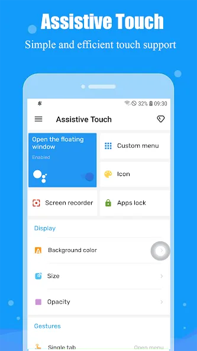{: width="180" .normal }
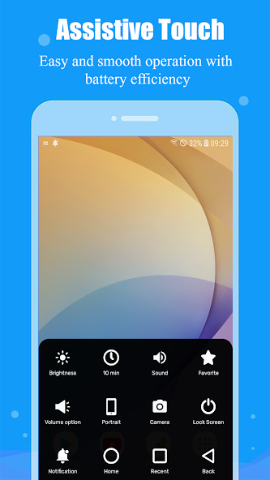{: width="180" .normal }
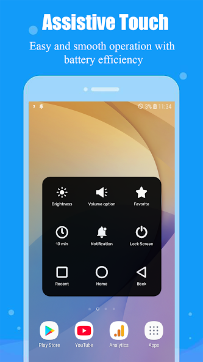{: width="180" .normal }
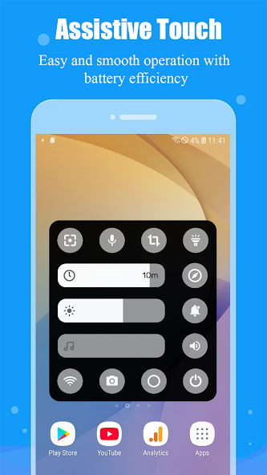{: width="180" .normal }

Assistive Touch, Easy Tools menambahkan **overlay bilah navigasi** dengan recent/home/back plus rangkaian pengalih cepat, tangkapan layar, dan perekaman layar.

**Keunggulan**
- **Kontrol navigasi** (recent, home, back) tanpa tombol keras.
- **Pengalih cepat** untuk Wi-Fi, Bluetooth, senter, daya, mode pesawat, lokasi.
- Penyesuaian **kecerahan/volume** dan peluncur aplikasi favorit.
- Pintasan **tangkapan layar dan perekaman layar**.
- Gratis dengan iklan.

**Kelemahan**
- Tier gratis didukung iklan.
- Tanpa jam melayang atau monitor.
- Overlay bisa terasa padat dengan banyak pengalih.

**Terbaik untuk:** pengguna yang ingin pengaturan cepat terbanyak dalam satu panel.

**Unduh Assistive Touch, Easy Tools**
- [Google Play](https://play.google.com/store/apps/details?id=mtr.assistivetouch.easytools)

---

### 4. Button Mapper — terbaik pemetaan ulang tombol keras

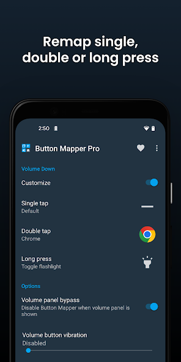{: width="180" .normal }
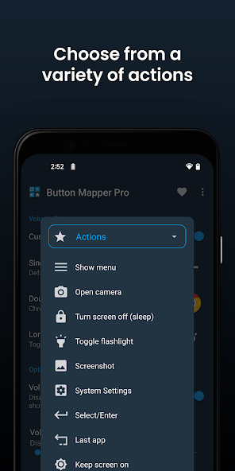{: width="180" .normal }
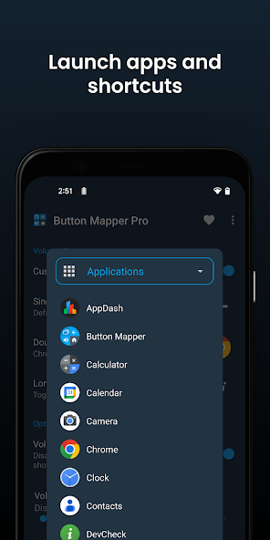{: width="180" .normal }
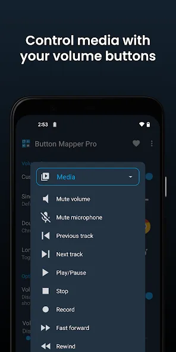{: width="180" .normal }
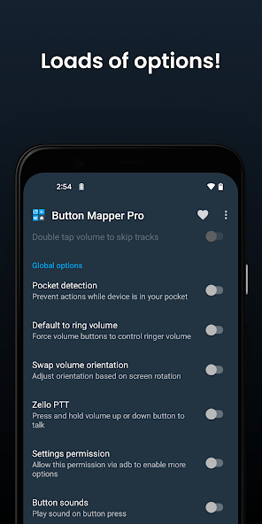{: width="180" .normal }

Button Mapper **memetakan ulang tombol fisik Anda** (volume, Bixby, dan lainnya) ke aksi kustom — pendekatan berbeda untuk "kontrol aksesibilitas" yang sama sekali tak butuh bola melayang.

**Keunggulan**
- **Petakan ulang tombol keras** untuk meluncurkan aplikasi, mengalihkan senter, tangkapan layar, kontrol media, dan lainnya.
- **Berfungsi tanpa overlay**, jadi tak ada yang melayang di layar Anda.
- Bagus untuk **tombol rusak atau canggung** dan kebutuhan aksesibilitas.
- Pengembang terpercaya (sama dengan DevCheck), gratis dengan upgrade Pro.
- Tanpa iklan di pengalaman inti.

**Kelemahan**
- Bukan bola assistive melayang — paradigma berbeda.
- Sebagian tombol dan aksi butuh versi Pro.
- Penyiapan lebih teknis dari sekadar bola sederhana.

**Terbaik untuk:** pengguna yang lebih suka memanfaatkan tombol nyata daripada ikon melayang.

**Unduh Button Mapper**
- [Google Play](https://play.google.com/store/apps/details?id=flar2.homebutton)

---

### 5. All in One Gestures — terbaik kendali gestur

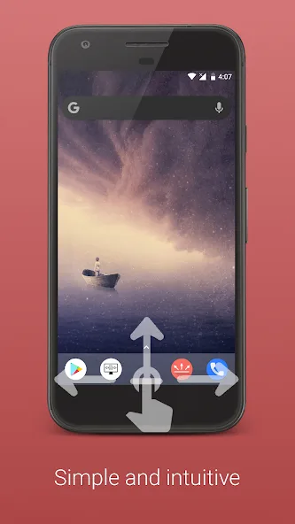{: width="180" .normal }
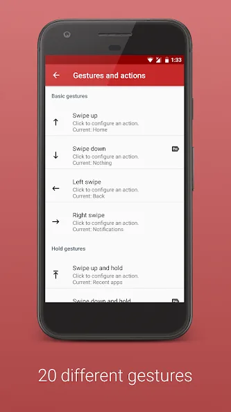{: width="180" .normal }
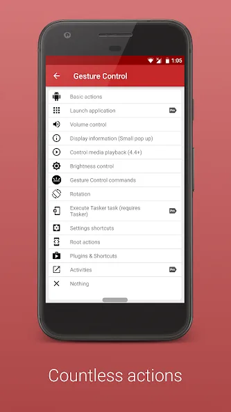{: width="180" .normal }
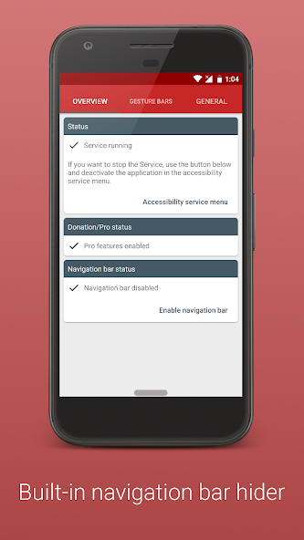{: width="180" .normal }
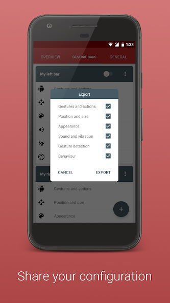{: width="180" .normal }

All in One Gestures membiarkan Anda **menyembunyikan tombol lunak dan mengontrol perangkat dengan gestur** — sapuan, cubit, dan lainnya — untuk pengalaman bersih tanpa tombol.

**Keunggulan**
- **Kendali gestur** (sapu, cubit, tahan lama) untuk memicu aksi.
- **Sembunyikan bilah navigasi** untuk kesan layar penuh, imersif.
- Pemetaan gestur-ke-aksi yang dapat disesuaikan.
- Ringan dan stabil.
- Gratis dengan upgrade Pro.

**Kelemahan**
- Kurva belajar gestur bagi pengguna baru.
- Tanpa jam melayang atau monitor.
- Kurang "assistive" bagi yang ingin tombol terlihat.

**Terbaik untuk:** pengguna yang lebih suka gestur daripada bola melayang.

**Unduh All in One Gestures**
- [Google Play](https://play.google.com/store/apps/details?id=com.conena.navigation.gesture.control)

---

### 6. Assistive Touch — terbaik sentuhan melayang sederhana

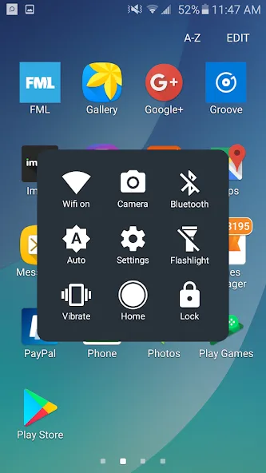{: width="180" .normal }
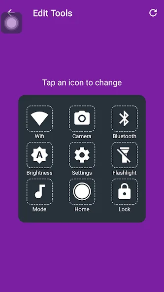{: width="180" .normal }
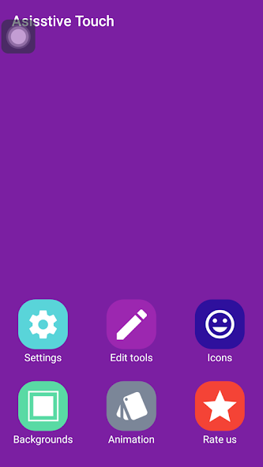{: width="180" .normal }

Assistive Touch (smarttool) adalah **aplikasi sentuhan melayang lugas** dengan tombol virtual dan setelan cepat, dekat dengan pengalaman AssistiveTouch klasik.

**Keunggulan**
- **Tombol sentuhan melayang** dengan home/back/recent dan volume.
- Pintasan **setelan cepat** untuk pengalih umum.
- Tata letak sederhana, familier.
- Gratis digunakan.
- Mudah diaktifkan dan disembunyikan.

**Kelemahan**
- Didukung iklan.
- Ekstra lebih sedikit (tanpa jam/monitor) daripada Floating Assistant.
- UI gaya klon dengan tema terbatas.

**Terbaik untuk:** pengguna yang ingin perilaku sentuhan melayang klasik, tidak lebih.

**Unduh Assistive Touch**
- [Google Play](https://play.google.com/store/apps/details?id=com.wanata.assistive.touch)

---

## Perbandingan kemampuan inti

| Kemampuan | Floating Assistant | Easy Touch | Assistive Touch, Easy Tools | Button Mapper | All in One Gestures | Assistive Touch |
|---|---|---|---|---|---|---|
| **Platform** | Android | Android | Android | Android | Android | Android |
| **Bola assistive melayang** | Ya | Ya | Ya (bilah nav) | Tidak (keras) | Tidak (gestur) | Ya |
| **Virtual home/back/recent** | Ya | Ya | Ya | Via tombol | Via gestur | Ya |
| **Volume / pengalih cepat** | Ya | Ya | Ya | Ya (dipetakan) | Ya (dipetakan) | Ya |
| **Boost satu ketuk / cleaner** | Ya | Tidak | Tidak | Tidak | Tidak | Tidak |
| **Tangkapan layar / senter** | Ya | Ya | Ya | Dapat dipetakan | Dapat dipetakan | Sebagian |
| **Jam melayang** | Ya | Tidak | Tidak | Tidak | Tidak | Tidak |
| **Monitor sistem melayang** | Ya (CPU/RAM/baterai) | Tidak | Tidak | Tidak | Tidak | Tidak |
| **Gestur** | Sebagian | Ya | Sebagian | Tidak | Ya (kuat) | Sebagian |
| **Pintasan/app kustom** | Ya | Ya | Ya | Ya (tombol) | Ya (gestur) | Ya |
| **Postur privasi** | Kuat (tanpa data) | Waspada (iklan) | Waspada (iklan) | Kuat | Kuat | Waspada (iklan) |
| **Iklan / IAP** | Inti gratis | Iklan | Iklan | Gratis + Pro (tanpa iklan) | Gratis + Pro | Iklan |
| **Tier gratis** | Murah hati | Ya | Ya | Ya | Ya | Ya |

---

## Cara memilih

- Ingin **tombol + jam + monitor langsung dalam satu overlay** → **Floating Assistant**
- Ingin **bola melayang bergaya iPhone** → **Easy Touch**
- Ingin **pengalih cepat terbanyak dalam panel** → **Assistive Touch, Easy Tools**
- Lebih suka **memanfaatkan tombol nyata** → **Button Mapper**
- Lebih suka **gestur daripada bola** → **All in One Gestures**
- Ingin **sentuhan melayang klasik sederhana** → **Assistive Touch**

## Alternatif Assistive Touch mana yang cocok untuk tiap jenis pengguna

Tabel perbandingan memeringkat kemampuan; bagian ini mulai dari pengaturan yang Anda tinggalkan.

| Jika Anda berasal dari... | Pilih | Mengapa cocok |
|---|---|---|
| Bola melayang gaya iOS di ponsel jangkung | **Floating Assistant** | Bola melayang tepi tetap dalam jangkauan ibu jari, dan overlay sama menambah jam melayang serta bacaan CPU/RAM/baterai langsung. |
| Pemetaan ulang tombol keras | **Button Mapper** | Tombol volume tetap bekerja nyata tanpa apa pun digambar di atas aplikasi Anda. |
| Navigasi gestur dan tanpa bola sama sekali | **All in One Gestures** | Sapuan tepi menggantikan bilah navigasi, sehingga layar tetap bersih. |
| Klon sarat iklan dengan izin samar | **Floating Assistant** atau **Button Mapper** | Inti gratis tak mengumpulkan data pribadi, dan layanan Aksesibilitas hanya dipakai untuk aksi yang Anda aktifkan. |
| AssistiveTouch di iPhone | Tak perlu pasang | AssistiveTouch sudah tertanam di iOS, jadi tak ada yang perlu diganti di platform itu. |

Sebelum menetap di aplikasi tombol melayang apa pun, periksa dua hal: aksi mana yang benar-benar butuh **layanan Aksesibilitas**, dan apakah bola bisa diparkir dalam zona jangkauan ibu jari di layar jangkung. Dua cek itu memisahkan satu-hand-helper yang usable dari overlay yang akhirnya Anda matikan.

## Cara migrasi ke alternatif Assistive Touch yang lebih baik

1. **Tentukan gaya Anda** — bola melayang, pemetaan keras, atau gestur — lalu pilih dari tabel.
2. **Pasang dan berikan izin**: tampilkan-di-atass-aplikasi-lain untuk overlay, dan Aksesibilitas untuk aksi tombol/gestur.
3. **Kustomisasi bola atau gestur** — tambahkan aplikasi, pengalih, dan tangkapan layar yang paling sering dipakai.
4. **Aktifkan ekstra yang akan digunakan** — jam/monitor Floating Assistant, atau pintasan tombol volume Button Mapper.
5. **Tinjau privasi**: utamakan aplikasi yang tak mengumpulkan data (Floating Assistant, Button Mapper, All in One Gestures) daripada klon sarat iklan.

## FAQ

**Apakah Floating Assistant alternatif Assistive Touch terbaik?**
{:.faq-q}

Jika Anda ingin satu overlay berisi assistive touch + jam melayang + pemantauan CPU/RAM/baterai langsung dengan boost satu ketuk, ya — lima lainnya adalah tugas-tunggal (bola, gestur, atau pemetaan keras) tanpa jam atau monitor.

**Alternatif Assistive Touch mana yang punya jam melayang dan monitor?**
{:.faq-q}

Hanya Floating Assistant. Easy Touch, Assistive Touch, dan lainnya menawarkan tombol virtual atau gestur tapi tanpa jam dan tanpa bacaan sistem langsung.

**Alternatif Assistive Touch mana yang menghindari iklan?**
{:.faq-q}

Floating Assistant (inti gratis, buka kunci opsional), Button Mapper, dan All in One Gestures (gratis + Pro, tanpa iklan) adalah pilihan ramah-iklan; klon Easy Touch / Assistive Touch didukung iklan.

**Apakah ada Assistive Touch untuk iPhone?**
{:.faq-q}

Ya — AssistiveTouch sudah tertanam di iOS (Setelan > Aksesibilitas > Sentuhan > AssistiveTouch), jadi tak perlu aplikasi di iPhone.

[Dapatkan Floating Assistant](/id/apps/floating-assistant/) — tersedia di Android.

## Istilah terkait

- [Apa Itu Assistive Touch?](/id/glossary/what-is-assistive-touch/)
- [Apa Itu Jendela Melayang?](/id/glossary/what-is-a-floating-window/)
