Calm populer, tetapi **langganan ~$69,99/tahun**-nya tidak untuk semua orang. Jika yang Anda inginkan terutama adalah **suara ambient untuk tidur dan fokus**, ada alternatif yang lebih sederhana, lebih murah, dan sering tanpa akun.

Di bawah kami membandingkan enam **alternatif Calm** — dari aplikasi [white noise](/id/glossary/what-is-white-noise/) yang imut dan sederhana hingga pustaka suara raksasa dan komunitas meditasi — dari sisi harga, platform, dan kemampuan yang benar-benar penting. Kebanyakan pembaca datang dengan satu penghalang — langganan, akun, atau suara yang berhenti saat layar terkunci — jadi tiap pilihan dibingkai menurut alasan itu.

## Mengapa melihat di luar Calm

{: width="180" .normal }
{: width="180" .normal }
{: width="180" .normal }
{: width="180" .normal }

- **Paid subscription** (~$69.99/year) for a library you may barely use.
- You only want **ambient sound**, not guided lessons or sleep stories.
- You prefer **no account** and one-tap play.
- The app can feel **content-heavy** when you just need rain noise to sleep.
- Many alternatives are **free or one-time** for the same core sounds.

## Alternatif Calm terbaik sekilas

| App | Price (2026) | Platforms | Best for |
|---|---|---|---|
| **Meow FM** | Free core + unlock | Android, iOS | Simple, cute white noise for sleep/focus |
| **Headspace** | Free + sub (~$70/yr) | Android, iOS | Guided meditation + sleep |
| **Insight Timer** | Free + membership | Android, iOS | Huge free meditation library |
| **BetterSleep** | Free + sub | Android, iOS | Sound mixing + sleep stories |
| **White Noise (TMSOFT)** | ~$1.99 one-time | Android, iOS | Massive sound library |
| **Noisli** | Free + sub (~$60/yr) | Android, iOS, web | Work-focus blends |

---

### 1. Meow FM — white noise sederhana terbaik

{: width="180" .normal }
{: width="180" .normal }
{: width="180" .normal }
{: width="180" .normal }
{: width="180" .normal }

Meow FM adalah **aplikasi white noise untuk tidur, relaksasi, dan fokus**, dengan suara ambient seperti hujan, badai petir, hutan, tepi laut, dan perapian, plus sleep timer dan jam desktop agar Anda tetap efisien.

**Keunggulan**
- **Ambient sounds for sleep, relax and focus** — rain, thunderstorm, wind, forest, seaside, fireplace and more.
- **Sleep timer** with auto turn-off so sound stops after you fall asleep.
- **Desktop clock** to stay efficient while you work or study.
- **Dark and light mode** with beautiful, calming covers for each sound.
- **Friendly, cozy Meow-styled design** that feels comforting rather than clinical.
- Free selection of sounds, with premium sounds as a one-time unlock.

**Kelemahan**
- Smaller library than BetterSleep or White Noise.
- No guided meditation or sleep stories.
- Premium sounds require a purchase (no subscription pressure).

**Paling cocok untuk:** orang yang hanya ingin suara ambient cantik dan sederhana untuk tidur atau fokus — tanpa akun, tanpa ribet.

**Unduh Meow FM**
- [Google Play](https://play.google.com/store/apps/details?id=com.glgjing.whitenoise.relax.night.sleep.meow)
- [App Store](https://apps.apple.com/us/app/meow-fm-white-noise/id1606715188)

---

### 2. Headspace — meditasi terpandu terbaik

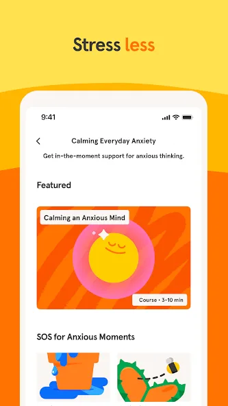{: width="180" .normal }
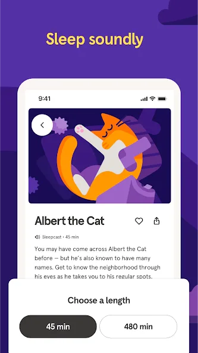{: width="180" .normal }
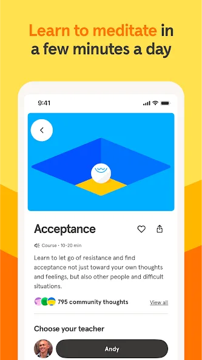{: width="180" .normal }
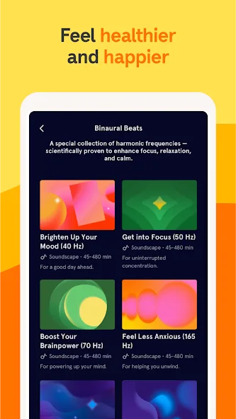{: width="180" .normal }
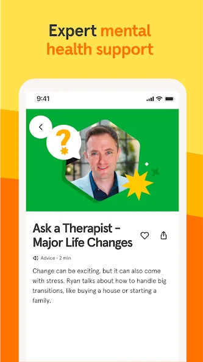{: width="180" .normal }

Headspace memadukan **meditasi terpandu** dengan sleepcasts, musik fokus, dan latihan pernapasan — jalur terstruktur menuju tidur lebih tenang dan stres lebih rendah.

**Keunggulan**
- **Huge library of guided meditations** for sleep, stress, focus and anxiety.
- **Sleepcasts and wind-down** content for bedtime.
- **Breathing and focus exercises** with a friendly, animated style.
- Strong cross-platform app (Android + iOS) and beginner-friendly.
- Free basics course; broad content with subscription.

**Kelemahan**
- **Subscription is pricey** (~$70/year), similar to Calm.
- Less about pure ambient sound mixing.
- Best content is behind the paywall.

**Paling cocok untuk:** pengguna yang ingin struktur terpandu, bukan sekadar noise latar.

**Unduh Headspace**
- [Google Play](https://play.google.com/store/apps/details?id=com.getsomeheadspace.android)
- [App Store](https://apps.apple.com/us/app/headspace-sleep-meditation/id493145008)

---

### 3. Insight Timer — pustaka meditasi gratis terbaik

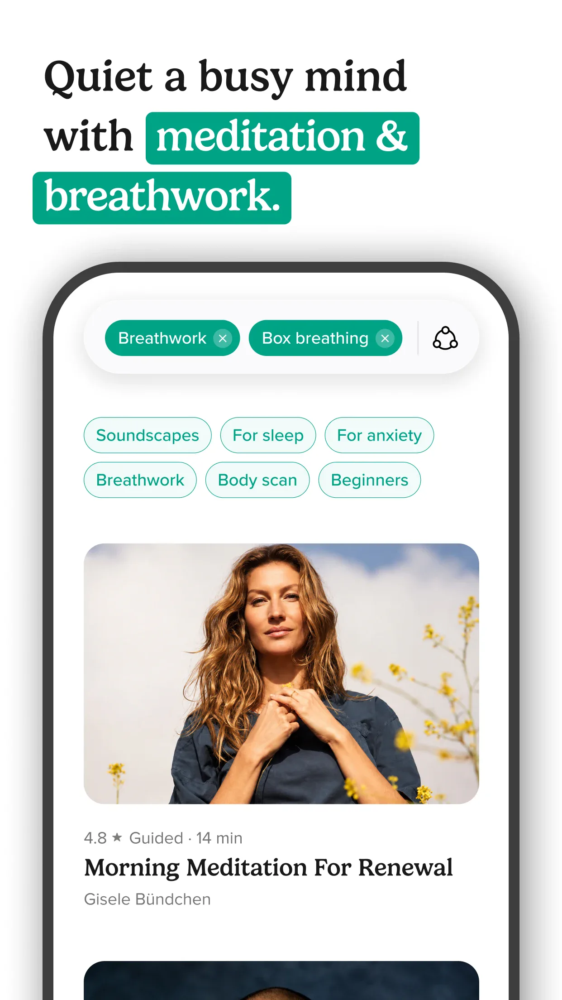{: width="180" .normal }
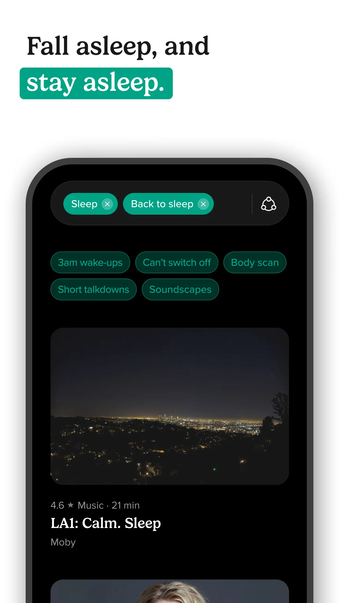{: width="180" .normal }
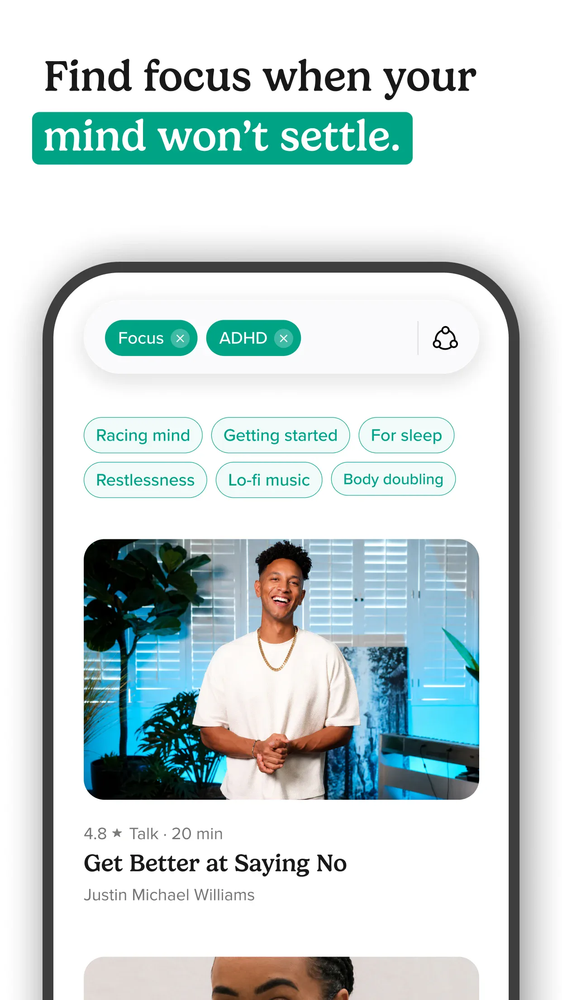{: width="180" .normal }
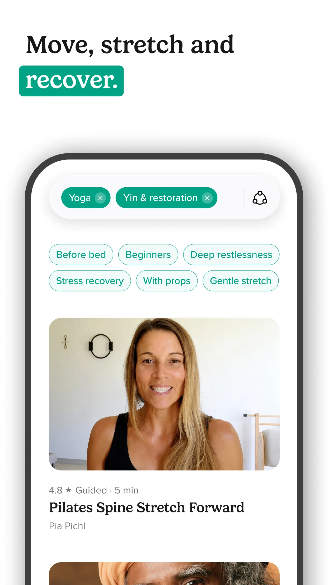{: width="180" .normal }
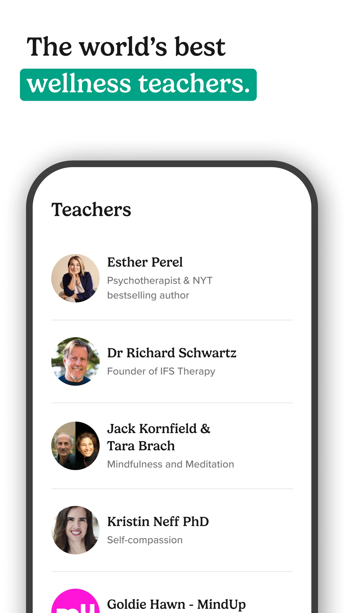{: width="180" .normal }

Insight Timer menawarkan **pustaka meditasi gratis raksasa** (puluhan ribu sesi terpandu), plus musik tidur, talks, dan pengatur waktu yang bisa disesuaikan.

**Keunggulan**
- **Enormous free library** — far more free content than Calm or Headspace.
- **Sleep music and stories**, ambient soundscapes, and teacher-led talks.
- **Customizable meditation timer** with interval bells.
- Active global community and courses.
- Free core; optional membership for premium courses.

**Kelemahan**
- Library size can feel **overwhelming** without curation.
- Some premium courses need the membership.
- Less polished "sleep stories" than Calm.

**Paling cocok untuk:** meditator yang ingin pustaka gratis terbesar dan pengatur waktu.

**Unduh Insight Timer**
- [Google Play](https://play.google.com/store/apps/details?id=com.spotlightsix.zentimerlite2)
- [App Store](https://apps.apple.com/us/app/insight-timer-meditate-sleep/id337472899)

---

### 4. BetterSleep — pencampuran suara terbaik

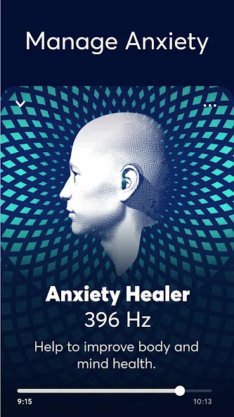{: width="180" .normal }
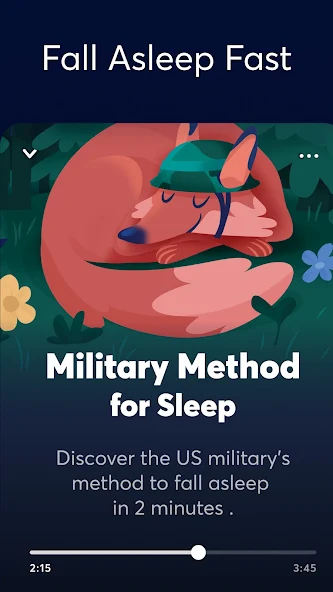{: width="180" .normal }
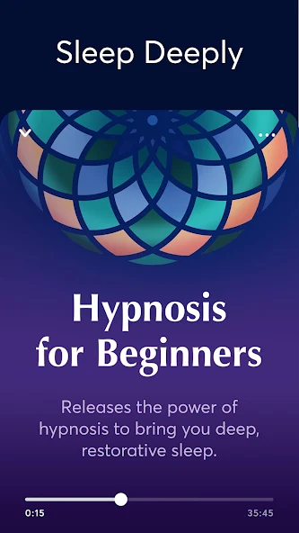{: width="180" .normal }
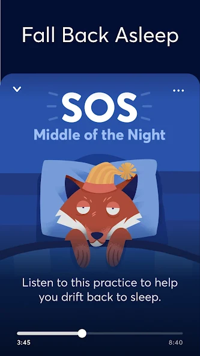{: width="180" .normal }
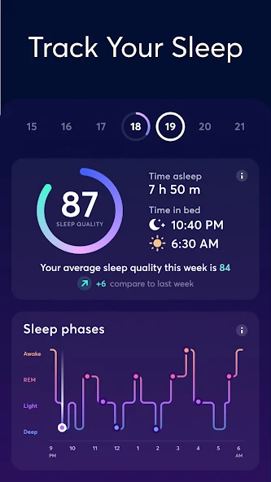{: width="180" .normal }

BetterSleep (dahulu Relax Melodies) dibangun sekitar **mencampur soundscape sendiri** — gabungkan hujan, angin, piano, dan belasan lapisan, plus cerita tidur dan latihan pra-tidur.

**Keunggulan**
- **Deep sound mixing** — build custom blends from a large sound catalog.
- **Sleep stories, meditations and Sleep Moves** bedtime exercises.
- Smart alarms and sleep tracking.
- Polished, calming UI.
- Free tier with a subscription for the full catalog.

**Kelemahan**
- **Subscription required** for most sounds and stories.
- Mixing can be more than casual users want.
- Some find the free tier limited.

**Paling cocok untuk:** pengguna yang suka meracik soundscape sendiri untuk tidur.

**Unduh BetterSleep**
- [Google Play](https://play.google.com/store/apps/details?id=ipnossoft.rma.free)
- [App Store](https://apps.apple.com/us/app/bettersleep-relax-and-sleep/id314498713)

---

### 5. White Noise (TMSOFT) — pustaka suara terbaik

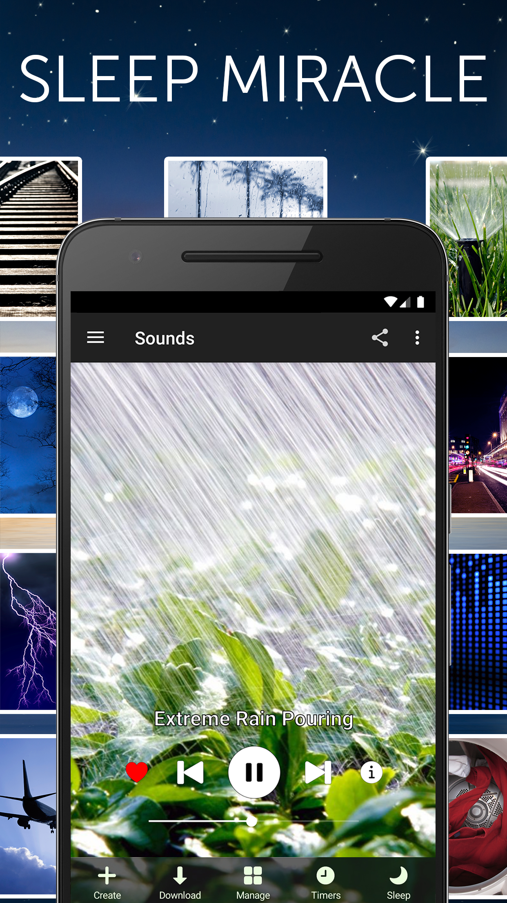{: width="180" .normal }
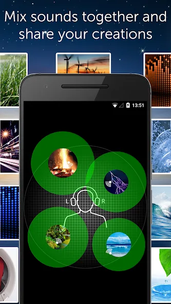{: width="180" .normal }
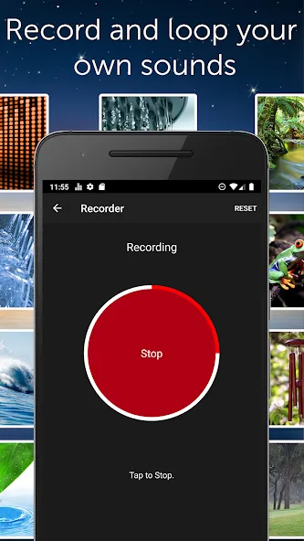{: width="180" .normal }
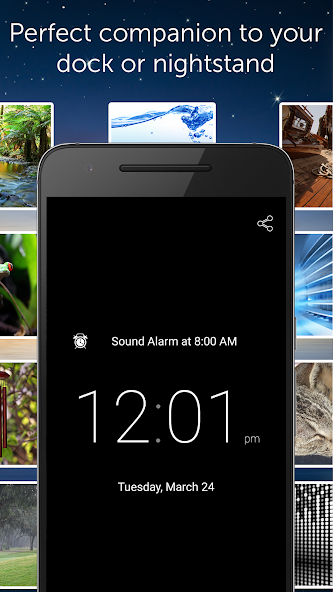{: width="180" .normal }
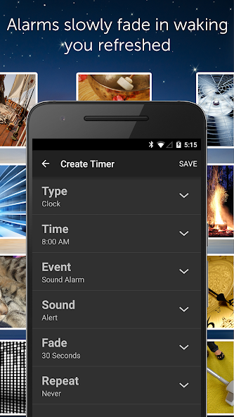{: width="180" .normal }

White Noise by TMSOFT adalah **pustaka suara ambient raksasa** (loop dan campuran) dengan harga sekali bayar — tanpa langganan — plus perekaman dan pencampuran.

**Keunggulan**
- **Very large sound library** of loops and ambient mixes.
- **Mix and record** your own soundscapes; import your own.
- **One-time purchase** (~$1.99) — no subscription.
- Alarm and timer with gradual volume.
- Works offline once downloaded.

**Kelemahan**
- UI is plainer, more utility than lifestyle.
- No guided meditation or stories.
- Discovery is less curated than BetterSleep.

**Paling cocok untuk:** puritan suara yang ingin pustaka besar tanpa langganan.

**Unduh White Noise (TMSOFT)**
- [Google Play](https://play.google.com/store/apps/details?id=com.tmsoft.whitenoise.full)
- [App Store](https://apps.apple.com/us/app/white-noise/id289894882)

---

### 6. Noisli — campuran fokus kerja terbaik

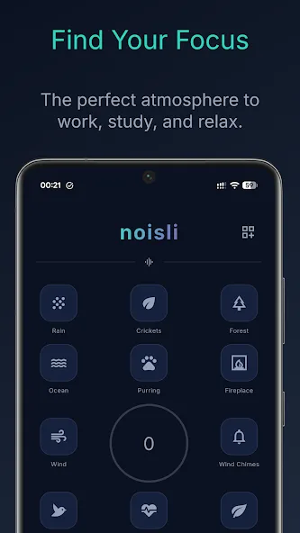{: width="180" .normal }
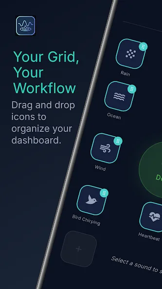{: width="180" .normal }
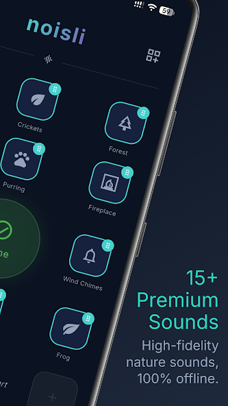{: width="180" .normal }
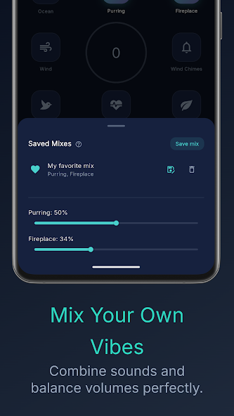{: width="180" .normal }
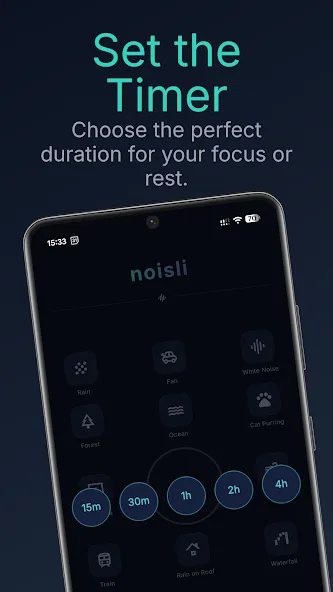{: width="180" .normal }

Noisli adalah **pencampur suara fokus dan relaksasi** untuk kerja, belajar, dan tidur, dengan sinkron web, Android, dan iOS serta pengatur waktu dan fitur produktivitas bawaan.

**Keunggulan**
- **Curated sound mixing** tuned for focus and productivity.
- **Web + mobile sync** so your blends follow you.
- **Timer and productivity modes** for work sprints.
- Clean, minimal interface.
- Free tier with a subscription for full access.

**Kelemahan**
- **Subscription (~$60/yr)** for the full catalog.
- Smaller ambient variety than White Noise.
- Less sleep-story content than Calm/BetterSleep.

**Paling cocok untuk:** pekerja jarak jauh dan pelajar yang mencampur suara untuk fokus.

**Unduh Noisli**
- [Google Play](https://play.google.com/store/apps/details?id=dev.crscaballero.noisli)
- [App Store](https://apps.apple.com/us/app/noisli/id862773459)

---

## Perbandingan kemampuan inti

| Capability | Meow FM | Headspace | Insight Timer | BetterSleep | White Noise (TMSOFT) | Noisli |
|---|---|---|---|---|---|---|
| **Platforms** | Android, iOS | Android, iOS | Android, iOS | Android, iOS | Android, iOS | Android, iOS, web |
| **Free tier** | Generous | Limited | Large | Limited | Paid-once (cheap) | Limited |
| **Sound library** | Curated | Small (meditation) | Medium | Large (mixable) | Very large | Curated |
| **Sound mixing / blends** | No (curated) | No | Timer only | Yes (deep) | Yes | Yes (focus) |
| **Sleep timer** | Yes | Yes | Yes | Yes | Yes | Yes |
| **Guided meditation** | No | Strong | Strong (free) | Some | No | No |
| **Sleep stories** | No | Yes | Some | Yes | No | No |
| **Focus / work modes** | Yes (clock) | Yes | Yes | Partial | Partial | Strong |
| **Offline / download** | Yes | Yes | Yes | Yes | Yes | Yes |
| **No account needed** | Yes | No (account) | Optional | Account | Optional | Account (sync) |
| **Pricing model** | Free + unlock | Sub (~$70/yr) | Free + membership | Free + sub | One-time ~$1.99 | Sub (~$60/yr) |
| **Ads** | No | No | No | No | No | No |

---

## Alternatif Calm mana yang cocok untuk tiap jenis pengguna

Tabel menilai fitur; di sini keenam aplikasi dikelompokkan menurut *apa yang sebenarnya Anda bayar*.

- **Paying for guided content** — a **Headspace alternative** or Insight Timer keeps meditations and sleep stories. If that is the part you use, switching to a pure sound player will feel like losing the product.
- **Paying for sound variety** — a **Noisli alternative** or **myNoise alternative** is about mixable layers and specific frequencies; Meow FM covers the layering with on-device sounds, while White Noise (TMSOFT) is the large-library one-time buy.
- **Paying for a bedtime routine** — a **BetterSleep alternative** keeps sound mixing plus sleep stories and tracking. Meow FM keeps the shorter loop: press play, set a timer, wake up to a phone that stopped on its own.
- **Paying for focus** — a **Brain.fm alternative** is for sound designed around a cognitive state; the checklist here is instead about **white noise offline** playback that survives a locked screen.
- **Not paying at all** — a **white noise app no subscription** should still include the timer and the offline library. Meow FM is the pick that keeps both in the free core.

Sebelum bermigrasi, ajukan dua pertanyaan: bisakah suara berjalan tanpa sinyal, dan apakah pengatur waktu tetap bekerja tanpa tier berbayar?

## Cara memilih

- Want **simple, cute, no-account white noise** → **Meow FM**
- Want **guided meditation + sleep** → **Headspace**
- Want the **largest free meditation library** → **Insight Timer**
- Want to **mix your own sleep soundscape** → **BetterSleep**
- Want a **huge library, one-time price** → **White Noise (TMSOFT)**
- Want **focus blends for work** → **Noisli**

## Cara bermigrasi dari Calm

1. **Catat apa yang benar-benar Anda pakai** — suara ambient, cerita tidur, atau meditasi? Pilih alternatif yang cocok.
2. **Unduh aplikasi suara** (Meow FM atau White Noise untuk suara murni; BetterSleep untuk pencampuran).
3. **Bangun daftar putar pra-tidur** dan atur sleep timer agar suara berhenti otomatis.
4. **Coba tingkat gratis dulu** — Insight Timer dan Meow FM memberi banyak tanpa membayar.
5. **Batalkan Calm hanya setelah** Anda memastikan aplikasi baru menutupi rutinitas malam Anda.

## FAQ

**Apakah Meow FM alternatif Calm gratis yang baik?**
{:.faq-q}

Ya. Jika yang Anda inginkan terutama suara ambient untuk tidur dan fokus, Meow FM gratis di inti, tak butuh akun, diputar sepenuhnya offline, dan punya sleep timer yang berhenti otomatis — tanpa langganan ~$69,99/tahun.

**Apakah Meow FM bekerja offline?**
{:.faq-q}

Ya. Setiap suara diputar tanpa internet, sehingga Anda bisa tidur atau fokus di pesawat, tenda, atau mana pun Wi-Fi putus.

**Alternatif Calm mana yang terbaik untuk mencampur suara?**
{:.faq-q}

BetterSleep dan Noisli adalah pencampur paling dalam; White Noise (TMSOFT) menawarkan pustaka raksasa dengan harga sekali bayar; Meow FM adalah pilihan tanpa akun paling sederhana untuk noise ambient murni.

**Bisakah saya pindah dari Calm dengan mudah?**
{:.faq-q}

Ya. Pilih alternatif yang cocok dengan yang Anda pakai (suara vs cerita vs meditasi), bangun daftar putar pra-tidur dengan pengatur waktu, dan batalkan Calm hanya setelah aplikasi baru menutupi rutinitas malam Anda.

[Halaman aplikasi Meow FM](/id/apps/meow-fm/) — tersedia di Android dan iOS.

## Istilah terkait

- [Apa Itu White Noise?](/id/glossary/what-is-white-noise/)
