CCleaner memang terkenal, tapi di Android modern efeknya terbatas dan sebagian pengguna menginginkan **pembersihan lebih ringan atau pemantauan nyata**. [Alternatif CCleaner](/id/glossary/what-is-a-system-monitor/) ini mencakup keduanya — dan kami akan jujur soal apa yang bisa dan tidak bisa dilakukan pembersih.

Di bawah ini kami membandingkan enam aplikasi soal harga, platform, dan kemampuan yang benar-benar penting, agar Anda memilih alat yang tepat bukan sekadar nama merek. Sebagian besar pembaca datang dengan satu kendala — harga berlangganan, daftar penghapusan tak jelas, atau tanpa bacaan langsung — jadi tiap pilihan dibingkai menurut alasan itu.

## Mengapa melihat di luar CCleaner

- **Efek terbatas di Android modern** — sistem sudah mengelola cache dan tugas latar; "pembersihan" sering menghemat sedikit.
- **Aplikasi pernah ditarik dari beberapa toko** dan tak lagi wajib seperti dulu.
- **Iklan dan ajakan berlangganan** di versi seluler.
- **Kekhawatiran privasi** — sebagian pembersih meminta izin luas.
- Anda mungkin menginginkan **pemantauan nyata** (apa yang memakan CPU/baterai) bukan sekadar pembersihan.

> Realita: di Android modern, kemenangan storage terbesar adalah menghapus file tak terpakai dan media besar — bukan "mengosongkan RAM." Pilih alat untuk *manajemen storage aman*, dan gunakan monitor untuk menemukan apa yang benar-benar menguras sumber daya.

## Alternatif CCleaner terbaik sekilas

| App | Harga (2026) | Platform | Terbaik untuk |
|---|---|---|---|
| **System Monitor** | Inti gratis + buka kunci | Android | Monitor + boost + pembersih ringan |
| **Files by Google** | Gratis | Android | Pembersihan storage aman resmi |
| **SD Maid** | Gratis + Pro | Android | Pembersihan dalam & hati-hati |
| **CCleaner** | Gratis + sub | Android | Merek familier, bersih cepat |
| **Avast Cleanup** | Gratis + sub | Android | Bersih + bersih foto |
| **Norton Clean** | Gratis | Android | Pembersih junk/cache sederhana |

---

### 1. System Monitor — terbaik untuk monitor plus pembersihan

{: width="180" .normal }
{: width="180" .normal }
{: width="180" .normal }
{: width="180" .normal }
{: width="180" .normal }

System Monitor adalah **alat Android all-in-one** dengan monitor CPU, pembersih storage, RAM booster, dan dokter baterai — sehingga Anda dapat wawasan *dan* pembersihan dalam satu tempat.

**Keunggulan**
- **Pemantauan CPU, RAM, dan baterai langsung** dengan perlindungan overheat.
- **Pembersih storage** untuk junk dan cache, plus analisa RAM dengan boost satu ketuk.
- **Dokter baterai** dengan kurva kesehatan, tegangan, dan suhu.
- **Jendela melayang dan widget** untuk visibilitas berkelanjutan.
- Multi-tema dan inti gratis.

**Kelemahan**
- Hanya Android.
- Pembersihan lebih ringan dari pembersih khusus (kekuatannya adalah pemantauan).
- Sebagian fitur di balik buka kunci Pro.

**Terbaik untuk:** pengguna yang ingin *melihat* apa yang salah lalu memperbaikinya, bukan sekadar menyapu cache.

**Unduh System Monitor**
- [Google Play](https://play.google.com/store/apps/details?id=com.glgjing.marvel)

---

### 2. Files by Google — terbaik pembersih aman

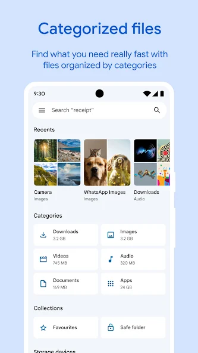{: width="180" .normal }
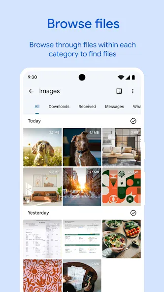{: width="180" .normal }
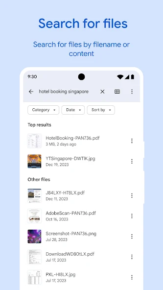{: width="180" .normal }
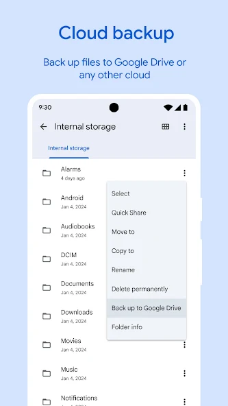{: width="180" .normal }
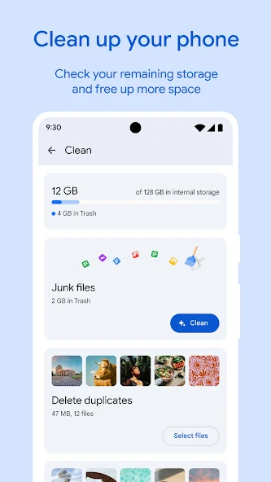{: width="180" .normal }

Files by Google adalah **pengelola storage resmi** Google — mengosongkan file tak terpakai, menemukan duplikat, dan membantu menghemat ruang dengan desain ramah privasi tanpa tugas latar agresif.

**Keunggulan**
- **Resmi dan aman** — buatan Google, izin minimal, tanpa perilaku meragukan.
- **Pembersihan storage cerdas**: file tak terpakai, duplikat, media besar, dan cache aplikasi.
- **Penjelajahan dan berbagi file** offline dengan rekan.
- **Tanpa iklan, tanpa berlangganan** — sepenuhnya gratis.
- UI jelas dan sederhana untuk siapa saja.

**Kelemahan**
- **Tanpa RAM boost atau pemantauan sistem** — hanya storage.
- Tanpa perburuan file "mayat" dalam seperti SD Maid.
- Hanya Android.

**Terbaik untuk:** pengguna yang ingin cara terpercaya dan tanpa ribet untuk mengambil kembali storage.

**Unduh Files by Google**
- [Google Play](https://play.google.com/store/apps/details?id=com.google.android.apps.nbu.files)

---

### 3. SD Maid — terbaik pembersih dalam

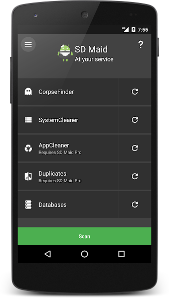{: width="180" .normal }
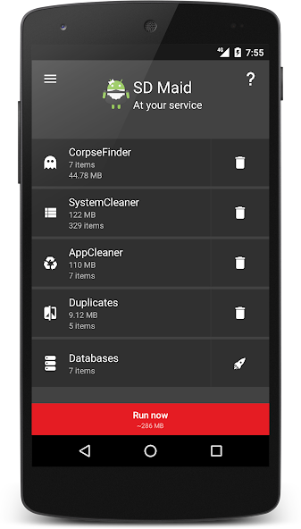{: width="180" .normal }
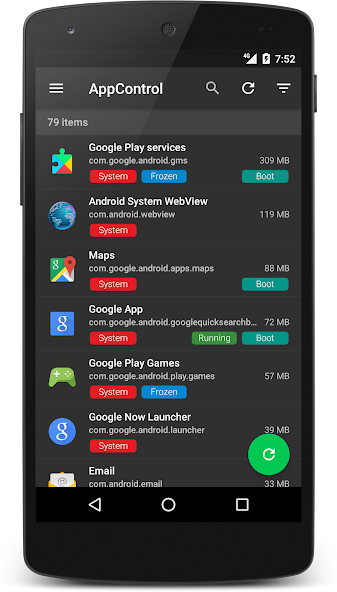{: width="180" .normal }
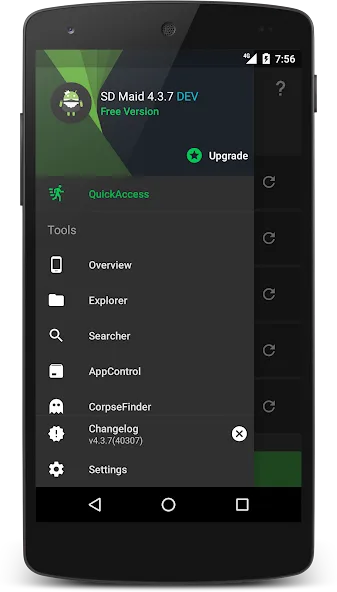{: width="180" .normal }
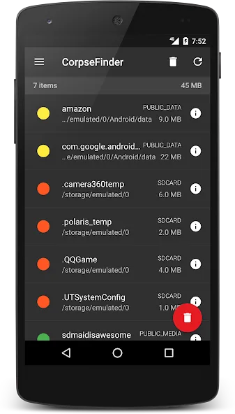{: width="180" .normal }

SD Maid adalah **pembersih dalam yang hati-hati** untuk Android: menemukan file sisa ("mayat") dari aplikasi yang dihapus, duplikat, database untuk optimasi, dan kontrol aplikasi.

**Keunggulan**
- **Pencari mayat** menghapus sisa yang terlewat pembersih lain.
- **Pencarian duplikat dan file** di seluruh storage.
- **Kontrol / pembekuan aplikasi** dan pengoptimal database.
- **Penjadwal** untuk pemeliharaan otomatis.
- Reputasi kuat di kalangan power user; tier gratis berguna.

**Kelemahan**
- Hanya Android.
- Fitur terbaik (pencari mayat, kontrol aplikasi, penjadwal) butuh SD Maid Pro.
- UI lebih padat — kurang ramah pengguna kasual.

**Terbaik untuk:** power user yang ingin pembersihan menyeluruh dan terkendali.

**Unduh SD Maid**
- [Google Play](https://play.google.com/store/apps/details?id=eu.thedarken.sdm)

---

### 4. CCleaner — terbaik bersih cepat familier

{: width="180" .normal }
{: width="180" .normal }
{: width="180" .normal }
{: width="180" .normal }
{: width="180" .normal }

CCleaner seluler adalah **versi ponsel alat PC terkenal** — cara cepat mengosongkan cache, riwayat penjelajahan, dan file tak terpakai, plus pembantu foto dan baterai dasar.

**Keunggulan**
- **Merek dan alur familier** bila Anda pakai CCleaner di desktop.
- **Pembersihan cache/riwayat cepat** dan ikhtisar storage sederhana.
- **Pembantu hibernasi baterai dan aplikasi** di tier premium.
- Pindai satu ketuk mudah.
- Tier gratis tersedia.

**Kelemahan**
- **Dampak nyata terbatas** pada manajemen cache Android modern.
- Iklan dan ajakan berlangganan di versi gratis.
- **Tak lagi tersedia di iOS** — hanya Android kini.

**Terbaik untuk:** pengguna yang hanya ingin nama CCleaner dan pindai cepat.

**Unduh CCleaner**
- [Google Play](https://play.google.com/store/apps/details?id=com.piriform.ccleaner)

---

### 5. Avast Cleanup — terbaik untuk bersih foto

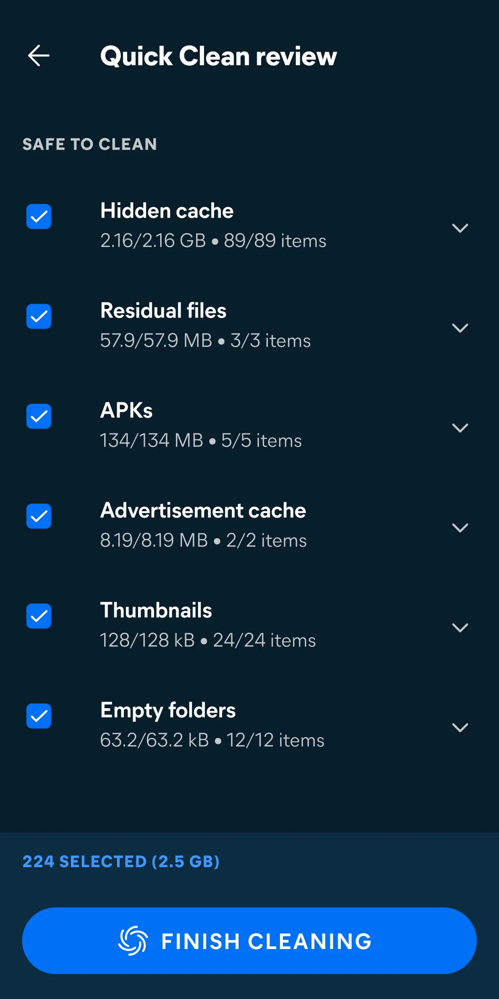{: width="180" .normal }
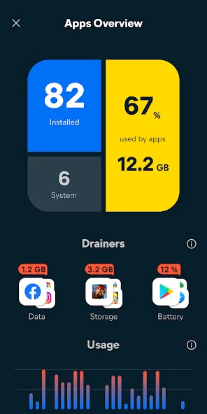{: width="180" .normal }
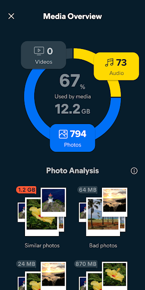{: width="180" .normal }
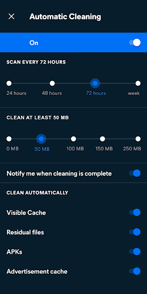{: width="180" .normal }

Avast Cleanup fokus pada **mengosongkan ruang dari foto dan file** — menemukan foto berkualitas rendah, serupa, dan duplikat, plus membersihkan junk dan cache aplikasi.

**Keunggulan**
- **Pembersihan foto** yang menandai foto buram, duplikat, dan serupa untuk dihapus.
- **Penghapusan junk dan cache** dengan ikhtisar storage jelas.
- **Hibernasi aplikasi** untuk mengurangi beban latar.
- Dukungan merek keamanan terkemuka.
- Gratis dengan berlangganan premium.

**Kelemahan**
- Hanya Android.
- Fitur foto terbaik di balik berlangganan.
- Tanpa pemantauan sistem langsung.

**Terbaik untuk:** pengguna yang storage-nya didominasi foto.

**Unduh Avast Cleanup**
- [Google Play](https://play.google.com/store/apps/details?id=com.avast.android.cleaner)

---

### 6. Norton Clean — terbaik pembersih junk sederhana

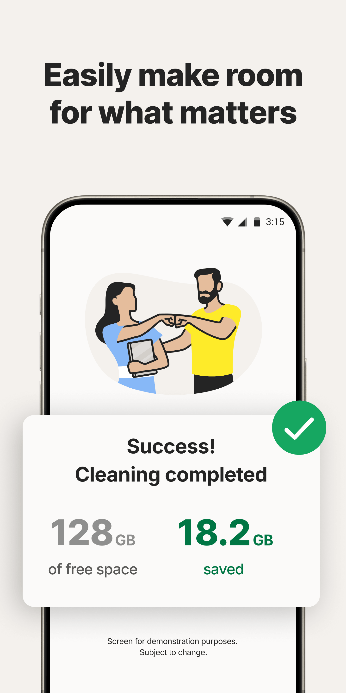{: width="180" .normal }
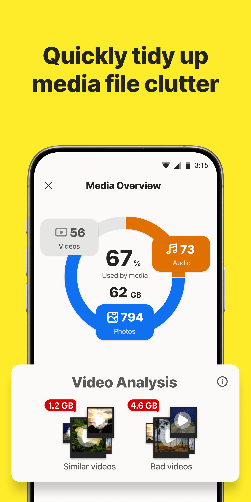{: width="180" .normal }
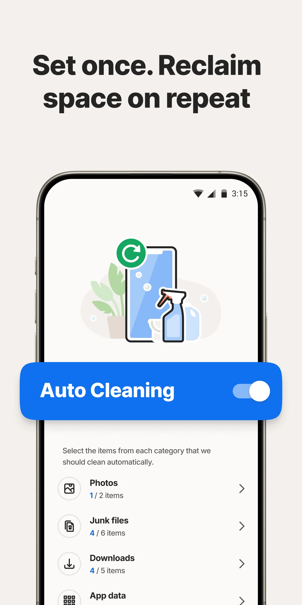{: width="180" .normal }
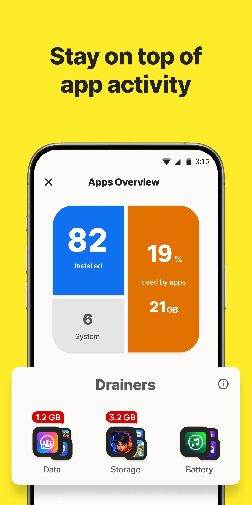{: width="180" .normal }

Norton Clean adalah **pembersih junk dan cache lugas** yang menghapus file sementara, data sisa, dan sisa aplikasi dengan satu ketuk sederhana.

**Keunggulan**
- **Penghapusan junk/cache sederhana** — mudah untuk siapa saja.
- **Pembersihan file sisa** setelah uninstall.
- Didukung merek keamanan Norton.
- Gratis digunakan.
- Ringan dan tidak mengganggu.

**Kelemahan**
- Hanya Android.
- Sedikit fitur tambahan selain pembersihan dasar.
- Tanpa pemantauan, tanpa RAM boost, tanpa alat foto.

**Terbaik untuk:** pengguna yang ingin pembersih satu ketuk minimal dan terpercaya.

**Unduh Norton Clean**
- [Google Play](https://play.google.com/store/apps/details?id=com.symantec.cleaner)

---

## Perbandingan kemampuan inti

| Kemampuan | System Monitor | Files by Google | SD Maid | CCleaner | Avast Cleanup | Norton Clean |
|---|---|---|---|---|---|---|
| **Platform** | Android | Android | Android | Android | Android | Android |
| **Pembersihan junk / cache** | Ya (ringan) | Ya (aman) | Ya (dalam) | Ya | Ya | Ya |
| **Analisis storage** | Ya | Ya | Ya (lanjut) | Dasar | Ya | Dasar |
| **Pencari duplikat / mayat** | Tidak | Duplikat | Ya (mayat) | Tidak | Foto | Tidak |
| **RAM boost** | Ya | Tidak | Sebagian | Tidak | Hibernasi app | Tidak |
| **Penghemat baterai** | Ya (dokter) | Tidak | Tidak | Dasar | Dasar | Tidak |
| **Pemantauan waktu nyata** | Ya (CPU/RAM/baterai) | Tidak | Tidak | Tidak | Tidak | Tidak |
| **Aman / resmi** | Ya | Ya (Google) | Ya (power-user) | Waspada | Ya (merek) | Ya (merek) |
| **Iklan / berlangganan** | Inti gratis | Tanpa iklan | Gratis + Pro | Iklan + sub | Gratis + sub | Gratis |
| **Perlu root** | Tidak | Tidak | Tidak (extra Pro opsional) | Tidak | Tidak | Tidak |
| **Paling hebat di** | Monitor + boost | Storage aman | Bersih dalam | Merek familier | Bersih foto | Bersih sederhana |

---

## Alternatif CCleaner mana yang cocok untuk tiap jenis pengguna

Tabel memeringkat fitur; di sini keenam aplikasi dikelompokkan menurut *apa yang sebenarnya ingin Anda capai*.

- **Memahami slowdown** — sebuah **alternatif CCleaner** yang melaporkan CPU, RAM, baterai, dan suhu (System Monitor) menjawab pertanyaan berbeda dari yang menghapus cache. Bila storage tak terlihat bermasalah, pembersihan tak akan menjelaskan stutter.
- **Pembersihan storage aman resmi** — pencarian **alternatif Files by Google** tentang meninjau file besar dan duplikat sebelum hapus; Norton Clean adalah versi minimal dari pekerjaan itu.
- **Pembersihan sisa berbasis aturan dalam** — **alternatif SD Maid** atau **alternatif AVG Cleaner** cocok bagi yang ingin melihat tepat sisa mana yang dihapus. **Alternatif Clean Master** adalah versi "satu ketuk" lebih tua dan luas dari ide sama.
- **Toolbox lengkap** — **alternatif 3C Toolbox** menggabungkan pemantauan, penyesuaian, dan statistik baterai dalam satu instalasi, dengan biaya kerumitan.
- **Foto dan berlangganan** — Avast Cleanup menarget library foto, dan sebagian besar aplikasi ini menaruh pindai lebih dalam di balik tier berbayar; periksa apa yang benar-benar dihapus inti gratis.

Apapun labelnya, ajukan dua pertanyaan sebelum migrasi: dapatkah Anda meninjau daftar penghapusan dulu, dan apakah aplikasi menjelaskan slowdown selain mengosongkan ruang?

## Cara memilih

- Ingin **pemantauan + boost + pembersihan ringan** → **System Monitor**
- Ingin **pembersihan storage aman resmi tanpa ribet** → **Files by Google**
- Ingin **pembersihan dalam dan hati-hati** → **SD Maid**
- Ingin **nama CCleaner dan pindai cepat** → **CCleaner**
- Storage berisi **foto** → **Avast Cleanup**
- Ingin **pembersih terpercaya minimal** → **Norton Clean**

## Cara migrasi dari CCleaner

1. **Tentukan tujuan nyata Anda** — lebih banyak ruang kosong, atau ponsel lebih cepat? Dua perbaikan berbeda.
2. **Pasang alat storage** (Files by Google atau SD Maid) dan jalankan pembersihan sekali pakai duplikat dan file tak terpakai.
3. **Tambahkan monitor** (System Monitor) untuk menemukan apa yang benar-benar menguras CPU/baterai alih-alih "boost" buta.
4. **Uninstall CCleaner** begitu alat baru mencakup kebutuhan Anda — Android modern butuh pembersihan konstan lebih sedikit.
5. **Tetap sederhana**: hapus media besar dan aplikasi lama secara rutin; biarkan OS mengurus sisanya.

## FAQ

**Apakah System Monitor alternatif CCleaner terbaik?**
{:.faq-q}

Jika Anda ingin pemantauan plus pembersihan, ya. System Monitor adalah satu-satunya aplikasi di sini dengan pemantauan CPU/RAM/baterai langsung, alarm overheat, dan boost satu ketuk — yang lain adalah pembersih atau alat storage tanpa wawasan waktu nyata.

**Alternatif CCleaner mana yang paling aman untuk storage?**
{:.faq-q}

Files by Google adalah pilihan paling aman — resmi, tanpa iklan, tanpa tugas latar agresif. SD Maid adalah pembersih paling dalam untuk power user.

**Alternatif CCleaner mana yang benar-benar mengosongkan RAM?**
{:.faq-q}

System Monitor adalah satu-satunya di sini dengan boost RAM satu ketuk; sisanya mengelola storage dan cache tapi tak memantau atau mengosongkan memori langsung.

**Apakah System Monitor gratis?**
{:.faq-q}

Ya. Monitor inti, widget, jendela melayang, dan alarm overheat gratis; buka kunci opsional menambah tema dan riwayat lebih dalam.

[Halaman aplikasi System Monitor](/id/apps/system-monitor/) — tersedia di Android.

## Istilah terkait

- [Apa Itu Monitor Suhu CPU?](/id/glossary/what-is-a-cpu-temperature-monitor/)
- [Apa Itu System Monitor?](/id/glossary/what-is-a-system-monitor/)
- [Apa Itu RAM Booster?](/id/glossary/what-is-a-ram-booster/)
