CPU-Z bagus untuk lembar spesifikasi cepat, tapi di Android ia **tidak menampilkan [suhu langsung](/id/glossary/what-is-a-cpu-temperature-monitor/)**, tidak punya jendela melayang, dan tidak menyediakan widget atau alarm overheat. Jika Anda ingin pemantauan waktu nyata, kategori ini sudah punya opsi matang.

Di bawah ini kami membandingkan enam **alternatif CPU-Z** — dari pemantau suhu langsung hingga pelapor spesifikasi mendalam — across harga, platform, dan kemampuan yang benar-benar penting. Sebagian besar pembaca datang dengan satu penghalang — tidak ada suhu langsung, tidak ada jendela melayang, atau tidak ada widget — jadi tiap pilihan dibingkai menurut alasan itu.

## Mengapa melihat di luar CPU-Z

{: width="180" .normal }
{: width="180" .normal }
{: width="180" .normal }
{: width="180" .normal }
{: width="180" .normal }

- **Tidak ada suhu CPU langsung** di banyak perangkat Android — ia melaporkan spesifikasi, bukan panas.
- **Tidak ada jendela melayang atau widget** untuk pantau sekilas.
- **Sedikit sensor dan kesehatan baterai** dibanding alat khusus.
- **Versi seluler didukung iklan** dan kurang dalam dari versi PC klasik.
- Anda mungkin menginginkan **alarm overheat atau boost satu ketuk**, yang tidak disediakannya.

## Alternatif CPU-Z terbaik sekilas

| App | Harga (2026) | Platform | Terbaik untuk |
|---|---|---|---|
| **CPU Monitor** | Inti gratis + buka kunci | Android | Suhu langsung, frekuensi, jendela melayang |
| **DevCheck** | Gratis + Pro | Android, iOS | Hardware & sensor detail |
| **AIDA64** | Gratis | Android, iOS | Laporan spesifikasi mendalam |
| **Device Info HW** | Gratis + Pro | Android | Info hardware per komponen |
| **Droid Hardware Info** | Gratis | Android | Spesifikasi perangkat cepat |
| **System Monitor** | Inti gratis + buka kunci | Android | Monitor + cleaner + booster |

---

### 1. CPU Monitor — terbaik untuk suhu langsung

{: width="180" .normal }
{: width="180" .normal }
{: width="180" .normal }
{: width="180" .normal }
{: width="180" .normal }

CPU Monitor menampilkan **suhu dan frekuensi CPU waktu nyata**, RAM, baterai, dan penggunaan multicore, lengkap dengan jendela melayang, widget, boost satu ketuk, dan alarm overheat.

**Keunggulan**
- **Suhu dan frekuensi CPU waktu nyata** dengan analisis riwayat.
- **Pemantauan CPU multicore** dan penggunaan per core.
- **Jendela melayang** (status bar + desktop) dan widget RAM/CPU/baterai.
- **Alarm overheat** yang memperingatkan Anda menutup aplikasi berat dan mendinginkan.
- **Boost satu ketuk** untuk membebaskan RAM dengan cepat.
- Multi-tema, ringan, dan inti gratis.

**Kelemahan**
- Hanya Android — tidak ada aplikasi iOS.
- Riwayat/tema lanjutan berada di balik buka kunci.
- Akurasi suhu bergantung ketersediaan sensor perangkat.

**Terbaik untuk:** pengguna yang ingin benar-benar mengawasi panas dan frekuensi saat gaming atau mengisi daya.

**Unduh CPU Monitor**
- [Google Play](https://play.google.com/store/apps/details?id=com.glgjing.stark)

---

### 2. DevCheck — terbaik untuk sensor detail

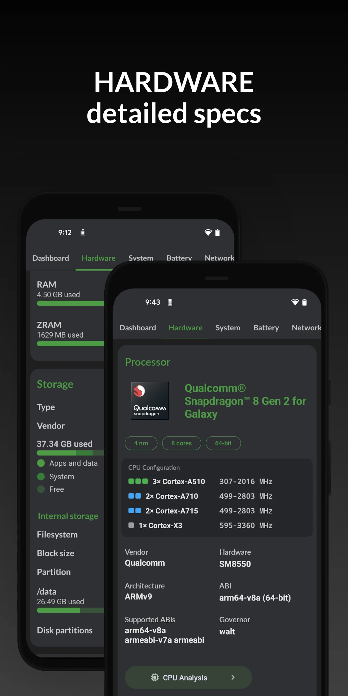{: width="180" .normal }
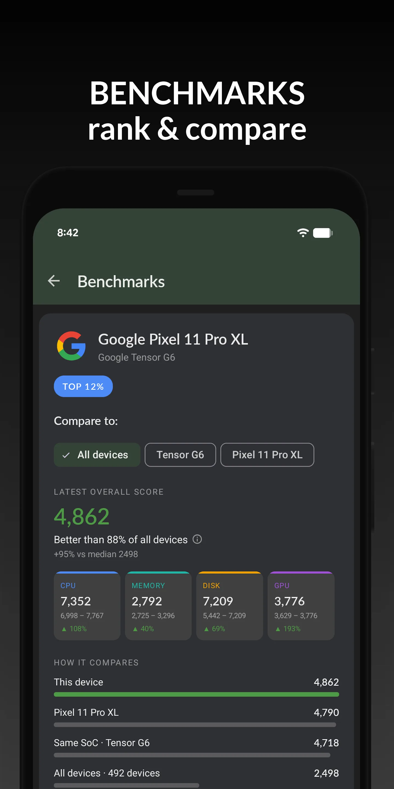{: width="180" .normal }
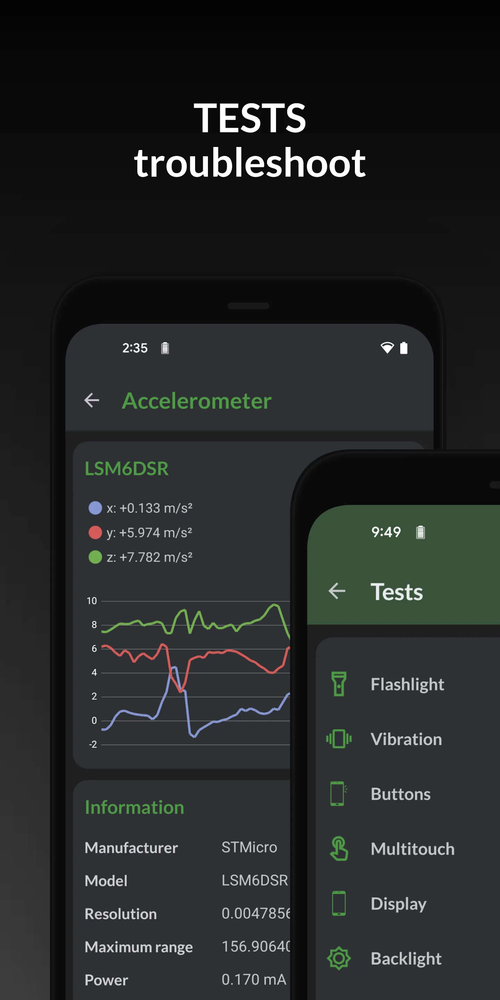{: width="180" .normal }
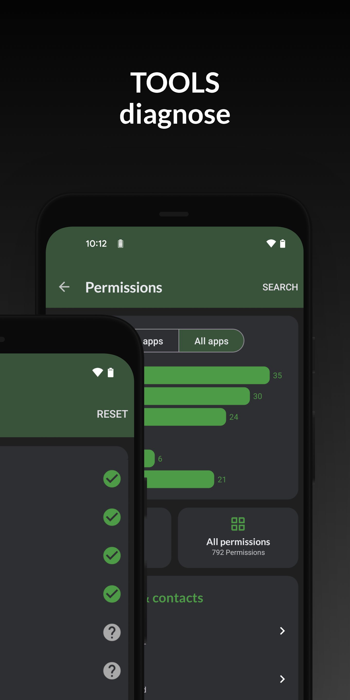{: width="180" .normal }
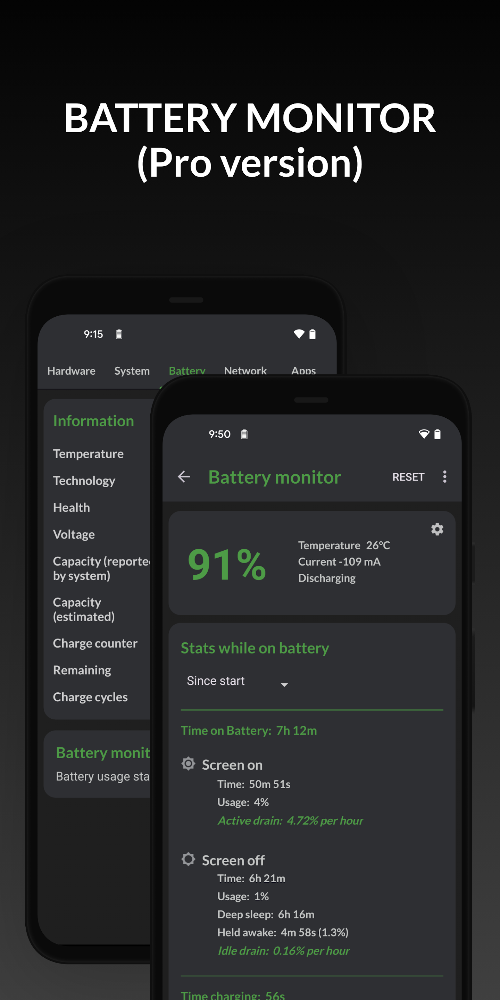{: width="180" .normal }

DevCheck adalah **pelapor hardware dan sensor komprehensif** dengan dasbor bersih: CPU, GPU, baterai, jaringan, sensor, dan lainnya, plus monitor sistem dan widget.

**Keunggulan**
- **Bacaan hardware mendalam** — SoC, GPU, memori, penyimpanan, kamera, sensor.
- **Dasbor langsung** untuk CPU, baterai, dan info thermal.
- **Widget dan monitor sistem** untuk pelacakan berkelanjutan.
- Antarmuka bersih, minim iklan.
- Gratis dengan upgrade Pro untuk dasbor ekstra.

**Kelemahan**
- Tidak ada overlay jendela melayang.
- Alarm overheat dan boost satu ketuk bukan fokusnya.
- Kedalaman terbaik berada di balik DevCheck Pro.

**Terbaik untuk:** penghobi yang ingin inventaris hardware lengkap dan daftar sensor.

**Unduh DevCheck**
- [Google Play](https://play.google.com/store/apps/details?id=flar2.devcheck)
- [App Store](https://apps.apple.com/us/app/devcheck/id1475762785)

---

### 3. AIDA64 — terbaik laporan spesifikasi mendalam

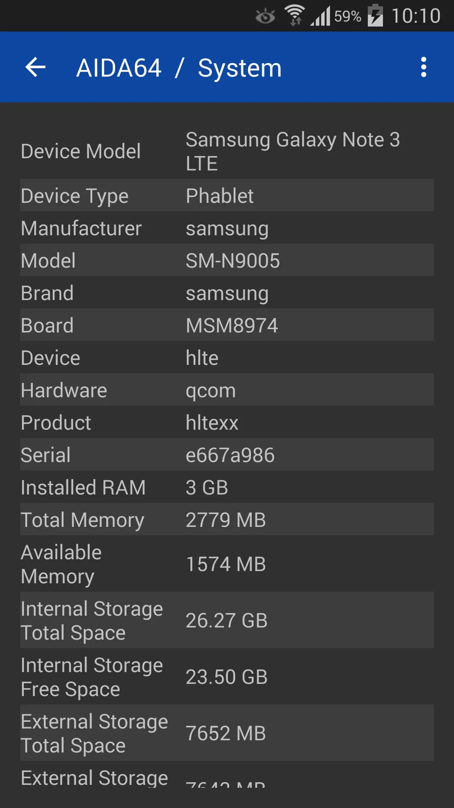{: width="180" .normal }
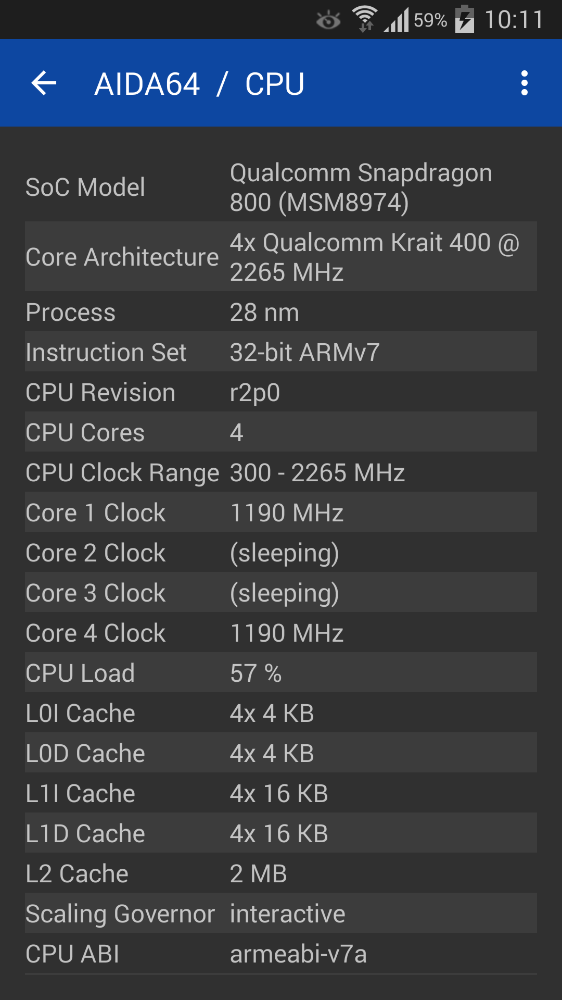{: width="180" .normal }
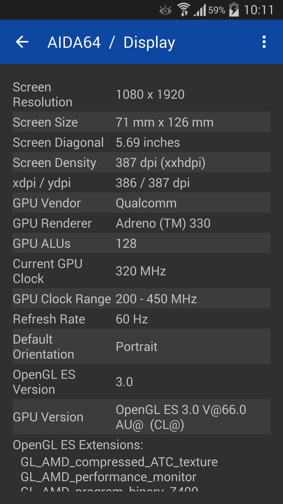{: width="180" .normal }
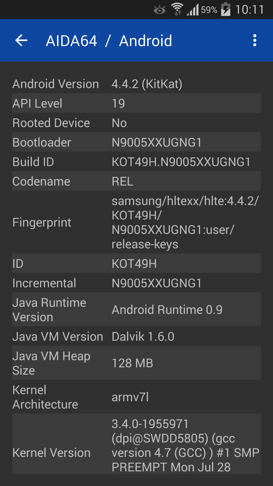{: width="180" .normal }
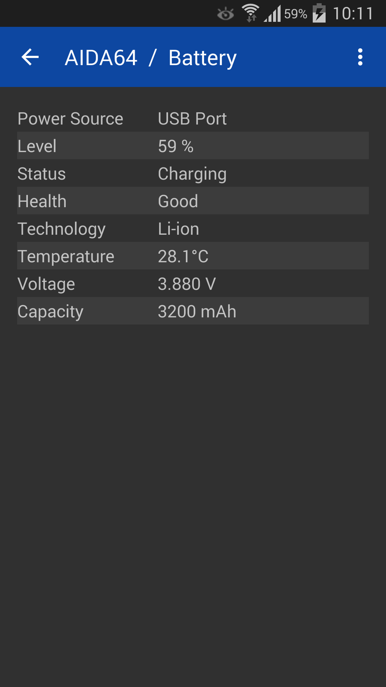{: width="180" .normal }

AIDA64 membawa merek diagnostik PC terkenal ke Android dan iOS, dengan **laporan spesifikasi perangkat** mendalam dan bacaan sensor langsung.

**Keunggulan**
- **Laporan spesifikasi terpercaya dan detail** mencakup CPU, layar, baterai, jaringan, dan lainnya.
- **Halaman sensor langsung** untuk thermal, baterai, dan beban.
- Tersedia di **Android dan iOS**.
- Tanpa iklan di versi gratis.
- Tata letak familiar untuk pengguna AIDA64 desktop.

**Kelemahan**
- Tidak ada jendela melayang atau widget.
- Tidak fokus pada alarm overheat atau boost.
- Lebih sedikit "pemantauan waktu nyata" dibanding monitor khusus.

**Terbaik untuk:** pengguna yang ingin lembar spesifikasi mendalam dan terpercaya di ponsel atau tablet.

**Unduh AIDA64**
- [Google Play](https://play.google.com/store/apps/details?id=com.finalwire.aida64)
- [App Store](https://apps.apple.com/us/app/aida64/id979579523)

---

### 4. Device Info HW — terbaik info per komponen

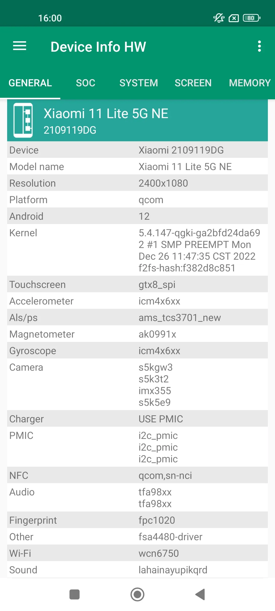{: width="180" .normal style="height:360px;object-fit:cover" }
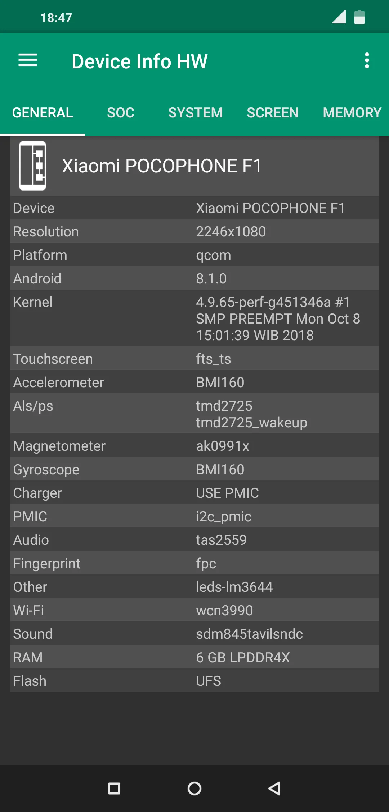{: width="180" .normal style="height:360px;object-fit:cover" }
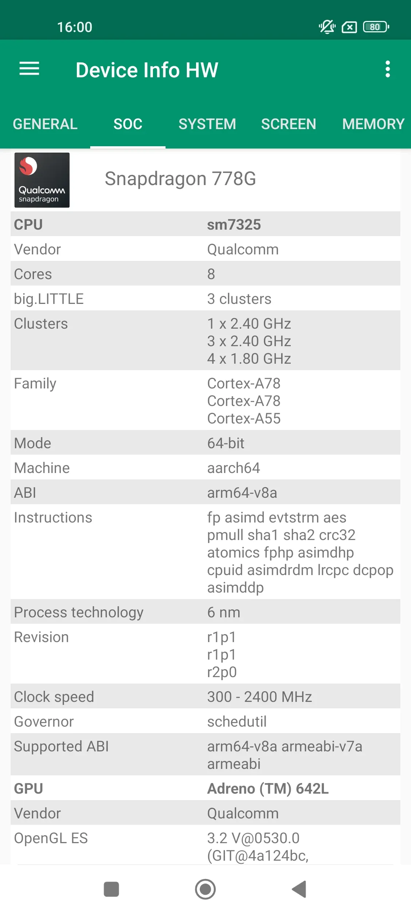{: width="180" .normal style="height:360px;object-fit:cover" }
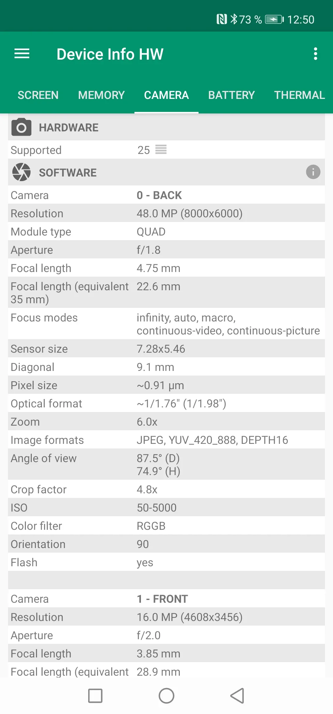{: width="180" .normal style="height:360px;object-fit:cover" }
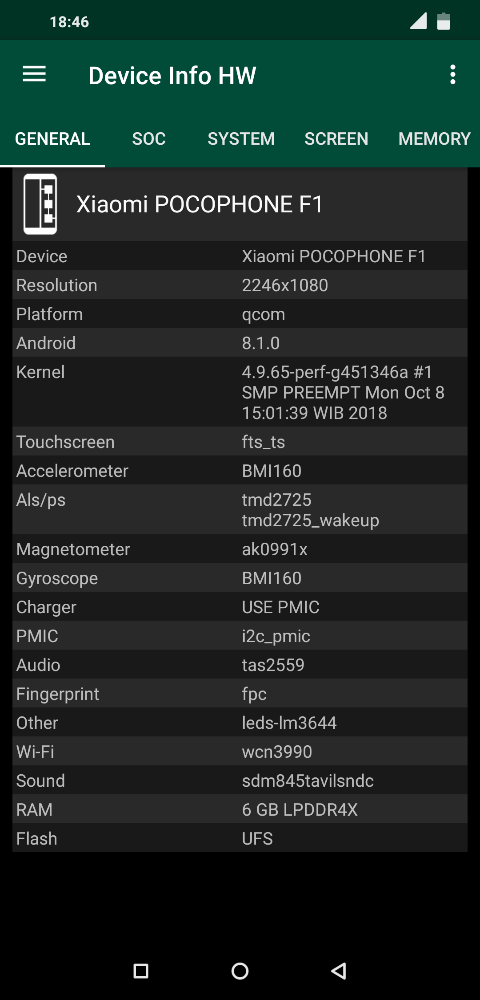{: width="180" .normal style="height:360px;object-fit:cover" }

Device Info HW adalah **aplikasi info hardware** yang memecah tiap komponen — CPU, GPU, baterai, kamera, sensor, penyimpanan — dengan tampilan jelas di level komponen.

**Keunggulan**
- **Detail level komponen** (mis. sensor kamera persis, model GPU).
- **Info baterai** termasuk kesehatan dan detail pengisian.
- **Daftar sensor** dengan nilai langsung.
- Pelaporan bersih dan tata letak ramah ekspor.
- Gratis dengan upgrade Pro.

**Kelemahan**
- Hanya Android.
- Tidak ada jendela melayang langsung atau alarm overheat.
- Bukan monitor performa/thermal secara desain.

**Terbaik untuk:** pengguna yang ingin tahu persis isi perangkatnya.

**Unduh Device Info HW**
- [Google Play](https://play.google.com/store/apps/details?id=ru.andr7e.deviceinfohw)

---

### 5. Droid Hardware Info — terbaik spesifikasi cepat

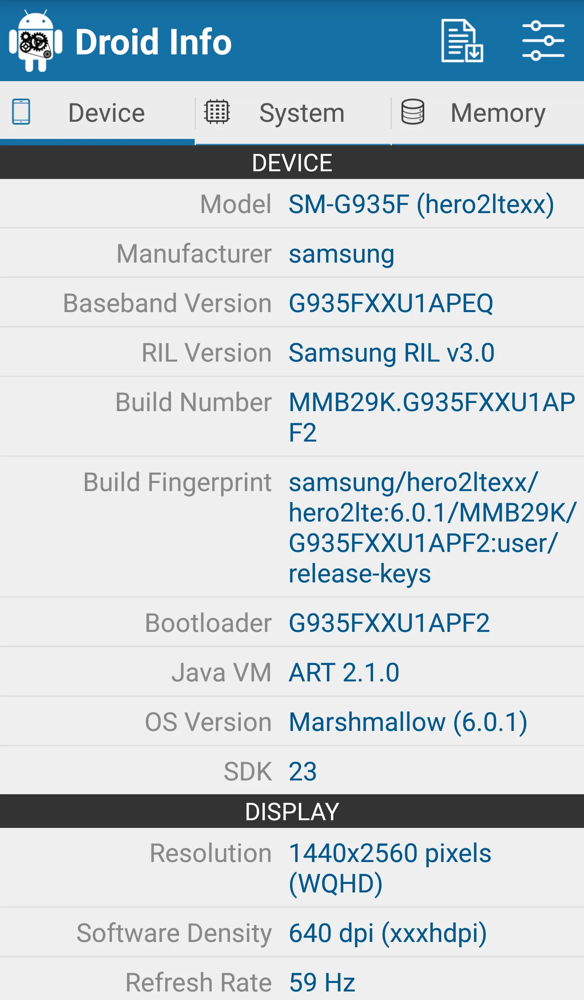{: width="180" .normal }
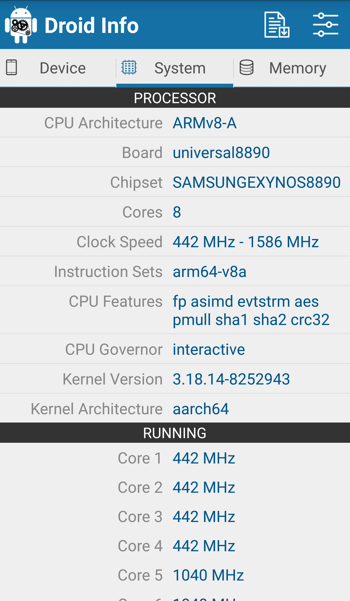{: width="180" .normal }
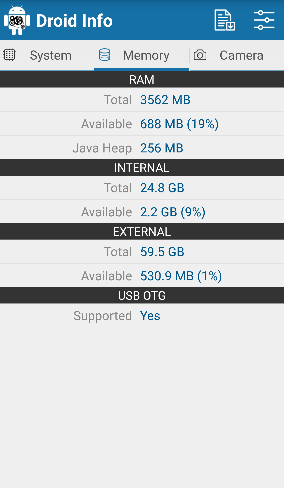{: width="180" .normal }
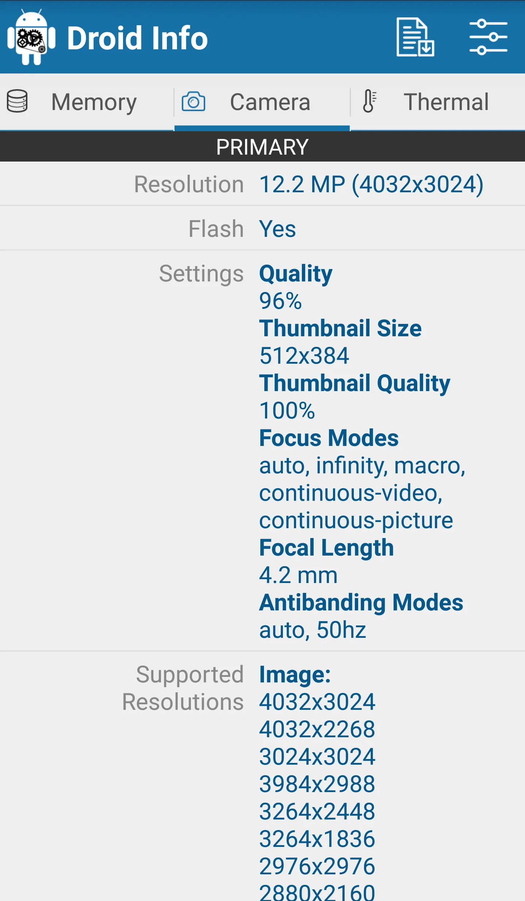{: width="180" .normal }

Droid Hardware Info adalah **penampil spesifikasi ringan** yang menampilkan sistem, CPU, GPU, memori, kamera, dan detail sensor dalam daftar sederhana.

**Keunggulan**
- **Daftar spesifikasi cepat & sederhana** — tanpa pengaturan.
- Mencakup CPU, GPU, RAM, penyimpanan, kamera, dan sensor.
- Sangat kecil dan gratis.
- Cocok untuk cek cepat dan berbagi spesifikasi.
- Tanpa akun atau iklan yang mengganggu.

**Kelemahan**
- Hanya Android; tidak ada versi iOS.
- Tidak ada pemantauan langsung, widget, atau jendela melayang.
- Kedalaman lebih rendah dari DevCheck atau AIDA64.

**Terbaik untuk:** siapa saja yang ingin bacaan spesifikasi perangkat bersih dan cepat.

**Unduh Droid Hardware Info**
- [Google Play](https://play.google.com/store/apps/details?id=com.inkwired.droidinfo)

---

### 6. System Monitor — terbaik alat all-in-one + cleaner

System Monitor adalah **alat Android all-in-one**: monitor CPU, cleaner penyimpanan, RAM booster, dan baterai dokter, menjaga ponsel tetap cepat, dingin, dan optimal.

**Keunggulan**
- **Suhu dan frekuensi CPU** dengan riwayat dan pemantauan multicore.
- **Cleaner penyimpanan** untuk junk/cache dan analisa RAM dengan boost satu ketuk.
- **Monitor baterai** dengan kesehatan, tegangan, dan kurva suhu.
- **Alarm dan perlindungan overheat** plus jendela melayang dan widget.
- Multi-tema dan inti gratis.

**Kelemahan**
- Hanya Android.
- Pembersihan lebih ringan dari cleaner khusus (fokusnya pemantauan).
- Beberapa fitur berada di balik upgrade Pro.

**Terbaik untuk:** pengguna yang ingin pemantauan plus pembersihan ringan dalam satu aplikasi.

**Unduh System Monitor**
- [Google Play](https://play.google.com/store/apps/details?id=com.glgjing.marvel)

---

## Perbandingan kemampuan inti

| Kemampuan | CPU Monitor | DevCheck | AIDA64 | Device Info HW | Droid Hardware Info | System Monitor |
|---|---|---|---|---|---|---|
| **Platform** | Android | Android, iOS | Android, iOS | Android | Android | Android |
| **Suhu CPU langsung** | Ya | Sebagian | Sensor | Tidak | Tidak | Ya |
| **Frekuensi / multicore CPU** | Ya | Ya | Ya | Tidak | Tidak | Ya |
| **Pemantauan RAM** | Ya | Ya | Ya | Sebagian | Sebagian | Ya (boost) |
| **Kesehatan / suhu baterai** | Ya | Ya | Ya | Ya | Tidak | Ya |
| **Daftar sensor** | Sebagian | Ya | Ya | Ya | Ya | Sebagian |
| **Jendela melayang** | Ya | Tidak | Tidak | Tidak | Tidak | Ya |
| **Widget** | Ya | Ya | Tidak | Tidak | Tidak | Ya |
| **Alarm overheat** | Ya | Tidak | Tidak | Tidak | Tidak | Ya |
| **Boost / cleaner satu ketuk** | Ya (boost) | Tidak | Tidak | Tidak | Tidak | Ya (boost + clean) |
| **Laporan spesifikasi mendalam** | Sebagian | Kuat | Kuat | Kuat | Dasar | Sebagian |
| **Tingkat gratis / iklan** | Inti gratis | Gratis + Pro | Gratis (tanpa iklan) | Gratis + Pro | Gratis | Inti gratis |
| **Perlu root** | Tidak | Tidak | Tidak | Tidak | Tidak | Tidak |

---

## Alternatif CPU-Z mana yang cocok untuk tiap jenis pengguna

Tabel memeringkat fitur; di sini keenam aplikasi dikelompokkan menurut *apa yang sebenarnya Anda inginkan dari aplikasi hardware*.

- **Dasbor langsung, bukan lembar spesifikasi** — daftar pendek **alternatif CPU-Z terbaik android** dimulai dari CPU Monitor: suhu waktu nyata, frekuensi per core, jendela melayang, dan alarm overheat.
- **Laporan hardware paling mendalam** — **alternatif DevCheck** atau **alternatif AIDA64** masih unggul soal detail SoC, GPU, layar, dan sensor. Device Info HW melangkah per komponen; Droid Hardware Info adalah bacaan gratis cepat.
- **Toolkit sistem lengkap** — **alternatif 3C Toolbox** adalah opsi lebih berat dengan pemantauan, statistik baterai, dan penyesuaian dalam satu instalasi.
- **Grafik read-only bersih** — **alternatif Simple System Monitor** memberi kurva CPU, RAM, dan jaringan tanpa klaim performa.
- **Kesehatan baterai daripada suhu CPU** — **alternatif AccuBattery** adalah pasangan tepat jika suhu pengisian dan siklus charge jadi perhatian.

Dua pencarian lain mendarat di sini tapi mengarah keluar dari enam aplikasi ini: **alternatif CPU Float** biasanya permintaan untuk bacaan CPU kecil selalu-di-atas, bukan dasbor penuh, dan **alternatif Cooler Master** soal hardware PC atau aksesori pendingin, bukan aplikasi pemantauan Android. Tak satu pun pengganti bacaan sensor thermal langsung.

Apa pun labelnya, periksa dua hal sebelum pindah: apakah aplikasi membaca sensor thermal nyata tanpa root, dan apakah tingkat gratis tetap menyertakan jendela melayang atau widget yang benar-benar Anda pakai?

## Cara memilih

- Ingin **suhu langsung + jendela melayang + alarm overheat** → **CPU Monitor**
- Ingin **laporan hardware & sensor paling detail** → **DevCheck** atau **AIDA64**
- Ingin **spesifikasi level komponen (kamera/GPU)** → **Device Info HW**
- Ingin **bacaan spesifikasi gratis cepat** → **Droid Hardware Info**
- Ingin **pemantauan + cleaner + booster dalam satu** → **System Monitor**

## Cara migrasi dari CPU-Z

1. **Tentukan apa yang benar-benar Anda cek** — spesifikasi sekali, atau suhu langsung saat gaming.
2. **Pasang monitor** (CPU Monitor atau System Monitor) dan berikan izin overlay untuk jendela melayang.
3. **Tambahkan widget** ke layar utama untuk CPU/RAM/baterai sekilas.
4. **Aktifkan alarm overheat** jika Anda gaming atau mengisi daya berat, agar diperingatkan sebelum throttling.
5. **Gunakan boost atau cleaner satu ketuk** (boost CPU Monitor, cleaner System Monitor) untuk membebaskan memori saat ponsel terasa lemot.

## FAQ

**Apakah CPU Monitor alternatif CPU-Z terbaik?**
{:.faq-q}

Untuk pemantauan langsung, ya. CPU Monitor adalah padanan terdekat jika Anda ingin suhu CPU/baterai waktu nyata, jendela melayang, widget, dan alarm overheat — hal-hal yang tidak dilakukan CPU-Z.

**Alternatif CPU-Z mana yang menampilkan suhu langsung dari waktu ke waktu?**
{:.faq-q}

CPU Monitor dan System Monitor sama-sama memetakan suhu sebagai kurva; DevCheck dan AIDA64 menampilkan nilai sensor langsung tapi tidak ada riwayat berkesinambungan.

**Alternatif CPU-Z mana yang punya laporan spesifikasi paling mendalam?**
{:.faq-q}

DevCheck dan AIDA64 adalah pelapor spesifikasi terkuat; Device Info HW menambah detail level komponen seperti model kamera/GPU persis.

**Apakah CPU Monitor gratis?**
{:.faq-q}

Ya. Monitor inti — suhu langsung, jendela melayang, widget, dan alarm overheat — gratis; buka kunci opsional membuka tema dan riwayat lebih dalam.

[Halaman aplikasi CPU Monitor](/id/apps/cpu-monitor/) — tersedia di Android.

## Istilah terkait

- [Apa Itu Monitor Suhu CPU?](/id/glossary/what-is-a-cpu-temperature-monitor/)
- [Apa Itu System Monitor?](/id/glossary/what-is-a-system-monitor/)
