Crosshair Hero menambahkan bidik silang khusus di atas shooter Anda, tetapi **jangkauan gaya, kontrol waktu nyata, dan batas gratisnya** membuat sebagian pemain ingin lebih. Jika Anda ingin kendali lebih halus, lebih banyak preset, atau overlay lebih ringan, kategori ini punya opsi matang.

Di bawah ini kami bandingkan enam **[alternatif Crosshair Hero](/id/glossary/what-is-a-crosshair/)** — semua overlay aman, tanpa root yang menggambar bidik silang di atas game FPS apa pun — dari harga, kustomisasi, hingga fitur yang benar-benar penting.

## Mengapa melihat melampaui Crosshair Hero

- **Jangkauan gaya dan warna terbatas** dibanding aplikasi bidik silang khusus.
- **Sedikit kontrol waktu nyata** — menyesuaikan saat bermain bisa canggung.
- **Iklan atau paywall** pada gaya yang Anda inginkan.
- **Overlay lebih berat** bisa terasa mengganggu saat pertandingan cepat.
- Anda mungkin ingin **profil per game** atau impor gambar yang tidak disediakan.

## Alternatif Crosshair Hero terbaik sekilas

| Aplikasi | Harga (2026) | Gaya | Kustomisasi | Pengatur saat main |
|---|---|---|---|---|
| **Crosshair Aim** | Gratis + buka | 15+ | Ukuran/warna/scale/posisi | Ya |
| **Custom Crosshair** | Gratis + Pro | Banyak + animasi | Ukuran/warna/desain | Ya |
| **Custom Aim** | Gratis + Pro | Preset generator | Penuh (bentuk/warna/ukuran) | Ya |
| **Crosshair Pro** | Gratis + IAP | Dasar/Pro/Presisi | Warna, ukuran, posisi | Ya (waktu nyata) |
| **CrossAim** | Gratis + IAP | 24 gaya | Warna, ukuran | Ya |
| **Crosshair PRO** | Gratis + IAP | Set Pro | Overlay yang bisa dikustom | Ya |

---

### 1. Crosshair Aim — overlay paling bisa dikustom

{: width="180" .normal }
{: width="180" .normal }
{: width="180" .normal }
{: width="180" .normal }

Crosshair Aim adalah **aplikasi bidik silang untuk game FPS** dengan 80+ gaya, kendali penuh ukuran/warna/scale/posisi, overlay transparan (85% bawaan), dan pengatur melayang saat bermain.

**Kelebihan**
- **80+ gaya bidik silang** mencakup titik, silang, lingkaran, dan lainnya.
- **Kustomisasi penuh** — ukuran, warna, scale, dan posisi layar.
- **Pengatur melayang saat bermain** agar bisa menyetel retikel tanpa keluar match.
- **Overlay transparan tanpa root** yang bekerja di hampir semua game tembak-menembak.
- Bisa membuat bidik silang bahkan untuk senjata yang tidak memilikinya.
- Gratis untuk digunakan dengan gaya dasar; gaya lanjutan via Pro.

**Kelemahan**
- Hanya Android — tidak ada versi iOS.
- Nilai terbaik butuh buka Pro untuk gaya premium.
- Tidak ada impor gambar untuk bentuk kustom sepenuhnya.

**Terbaik untuk:** pemain yang ingin banyak gaya dan penyetelan langsung saat bermain.

**Unduh Crosshair Aim**
- [Google Play](https://play.google.com/store/apps/details?id=com.glgjing.crosshair.aim.fps.game)

---

### 2. Custom Crosshair — gaya animasi terbaik

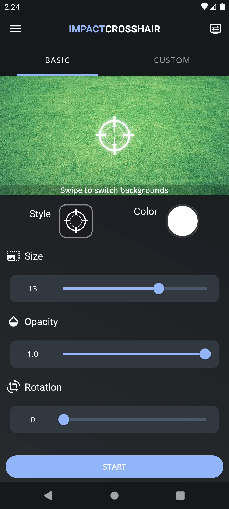{: width="180" .normal }
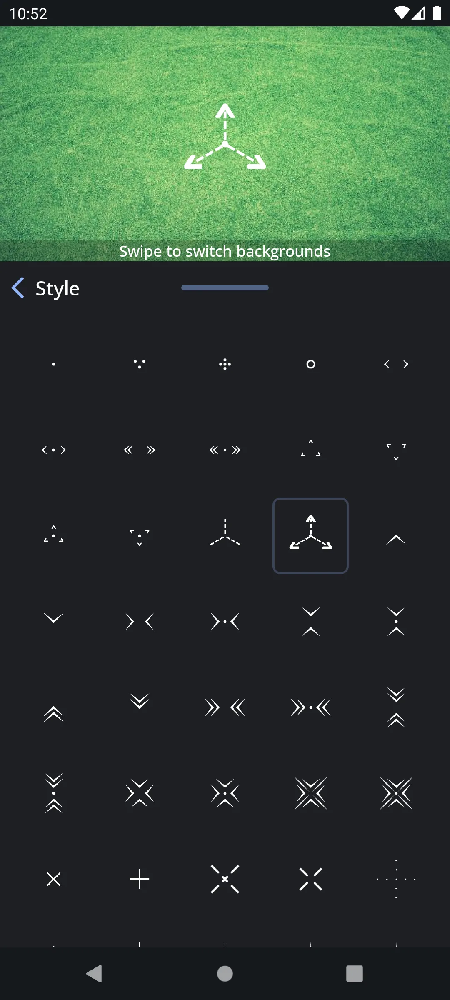{: width="180" .normal }
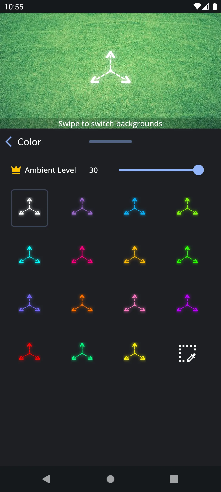{: width="180" .normal }
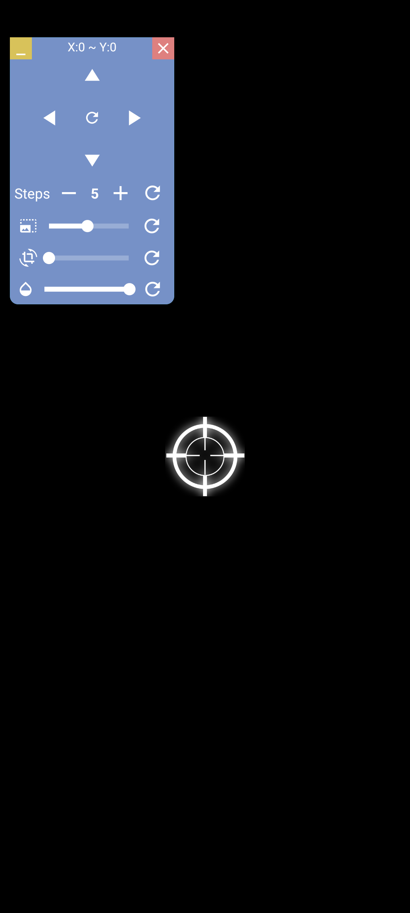{: width="180" .normal }

Custom Crosshair (Impact Crosshair) adalah **alat overlay** populer dengan 500.000+ instal, pembuat bidik silang, overlay waktu nyata, dan retikel animasi untuk game FPS dan TPS.

**Kelebihan**
- **Pembuat bidik silang** dengan ukuran, warna, dan desain yang bisa disesuaikan.
- **Overlay waktu nyata** tampil saat memainkan shooter yang didukung.
- **Animasi bidik silang** untuk tampilan lebih dinamis.
- Basis pengguna besar dan pembaruan rutin.
- Gratis untuk memulai, dengan tier Pro untuk opsi lanjutan.

**Kelemahan**
- Hanya Android.
- Sebagian animasi dan pembuat lanjutan berada di balik Pro.
- UI bisa terasa ramai di samping aplikasi minimalis.

**Terbaik untuk:** pemain yang ingin retikel animasi, ekspresif, dan komunitas besar.

**Unduh Custom Crosshair**
- [Google Play](https://play.google.com/store/apps/details?id=com.devayulabs.crosshair)

---

### 3. Custom Aim — generator bidik silang terbaik

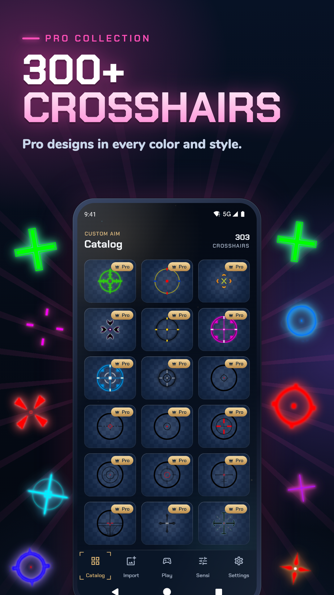{: width="180" .normal }
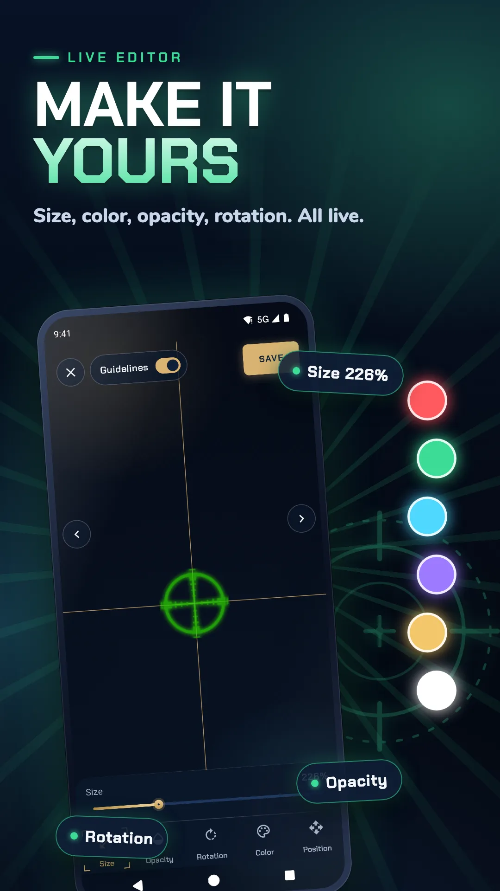{: width="180" .normal }
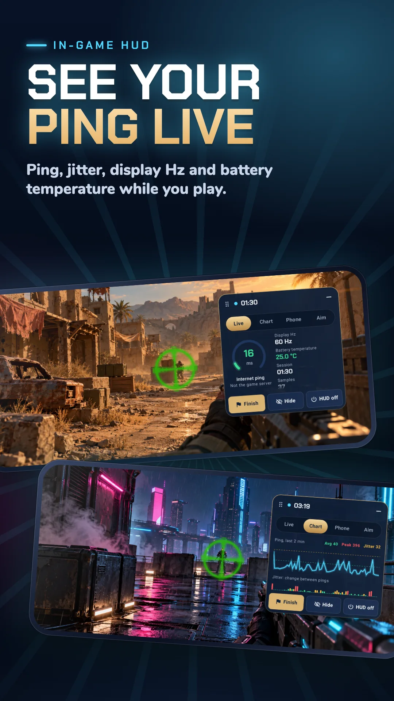{: width="180" .normal }
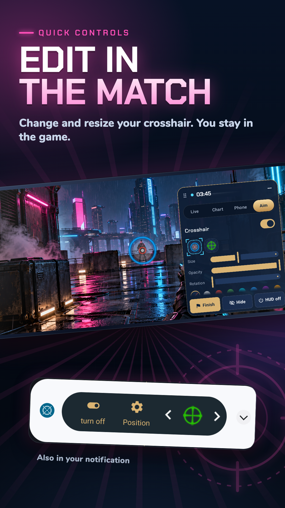{: width="180" .normal }

Custom Aim (Crosshair Generator Pro) memungkinkan Anda **membuat overlay bidik silang kustom** di game FPS tembak-menembak apa pun, dengan preset dan kendali bentuk/warna/ukuran mendalam.

**Kelebihan**
- **Preset bergaya generator** plus kendali manual penuh bentuk, warna, dan ukuran.
- **Overlay bekerja di FPS/TPS apa pun** tanpa mengubah game.
- Ringan dan mudah diaktifkan/nonaktifkan.
- Inti gratis dengan upgrade Pro untuk gaya ekstra.
- Tidak perlu root.

**Kelemahan**
- Hanya Android.
- Panduan lebih sedikit untuk pengguna pemula.
- Tidak ada sinkronisasi profil per game lintas perangkat (tanpa akun).

**Terbaik untuk:** penggiat yang ingin merancang retikel sendiri dari nol.

**Unduh Custom Aim**
- [Google Play](https://play.google.com/store/apps/details?id=com.itdeveapps.customaim)

---

### 4. Crosshair Pro — penempatan waktu nyata terbaik

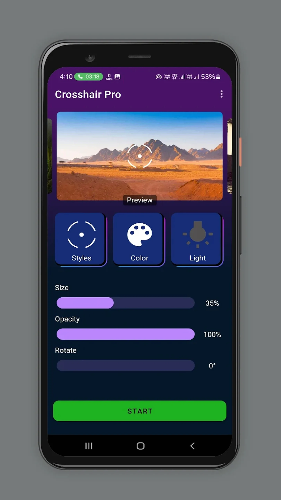{: width="180" .normal }
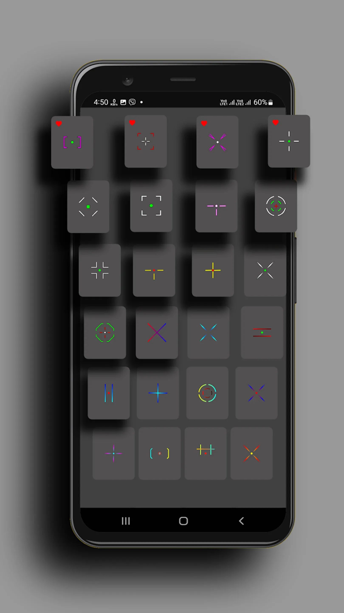{: width="180" .normal }
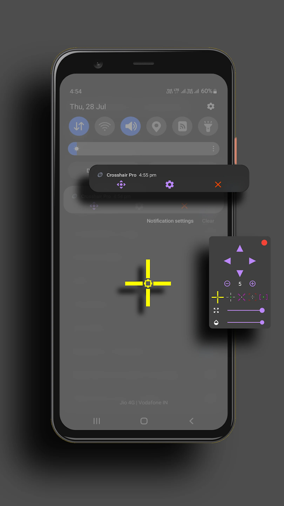{: width="180" .normal }
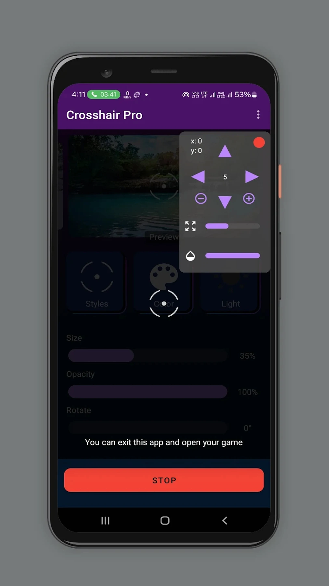{: width="180" .normal }

Crosshair Pro: Custom Scope adalah utilitas seluler yang menempatkan **overlay scope presisi** di mana saja di layar, bisa disesuaikan waktu nyata saat bermain, dengan kompatibilitas FPS luas.

**Kelebihan**
- **Tempatkan bidik silang di mana saja** dan sesuaikan saat bermain secara waktu nyata.
- **Semua game FPS utama** didukung dengan kompatibilitas baik.
- Set klasik dan pro untuk mencocokkan gaya menembak Anda.
- UI sederhana dan fokus.
- Gratis dengan pembelian dalam aplikasi.

**Kelemahan**
- Hanya Android.
- Ragam gaya lebih sempit daripada aplikasi generator.
- Set ber-gate IAP bisa bertambah.

**Terbaik untuk:** pemain yang paling peduli penempatan presisi waktu nyata.

**Unduh Crosshair Pro**
- [Google Play](https://play.google.com/store/apps/details?id=com.customscopecommunity.crosshairpro)

---

### 5. CrossAim — paket gaya sederhana terbaik

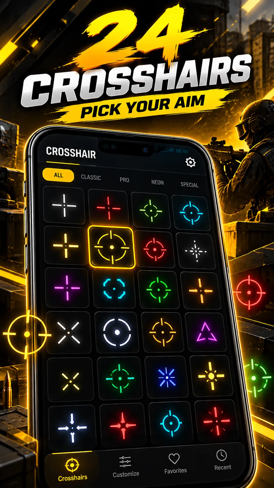{: width="180" .normal }
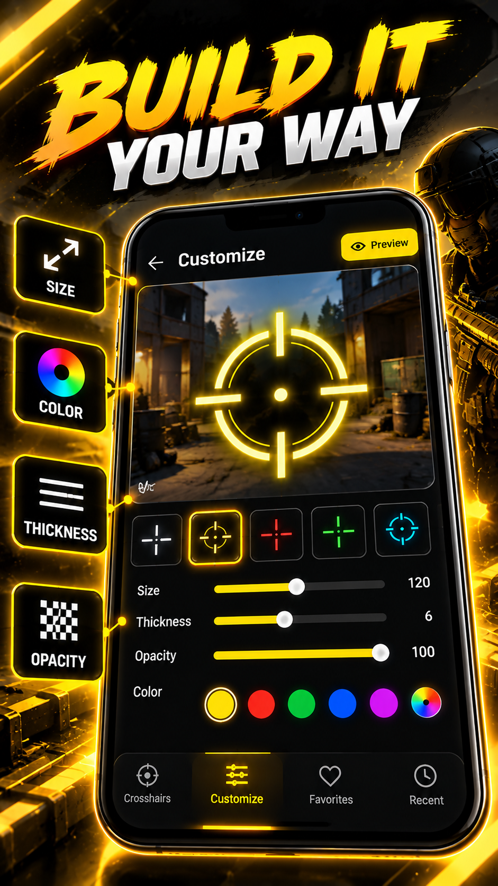{: width="180" .normal }
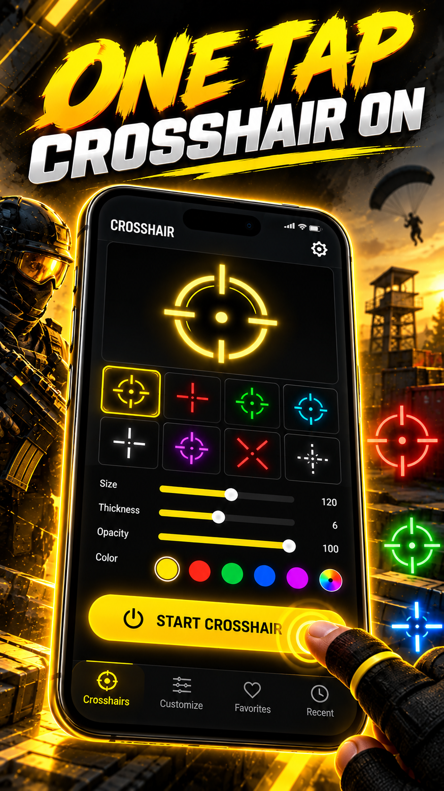{: width="180" .normal }
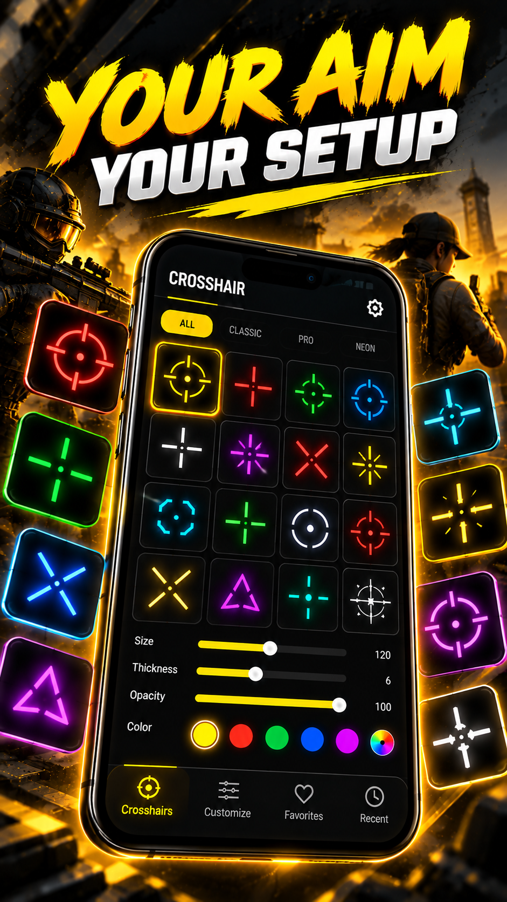{: width="180" .normal }
{: width="180" .normal }

CrossAim: Custom Crosshair menawarkan **24 gaya** dengan warna dan ukuran, alat overlay bersih untuk pergantian retikel cepat.

**Kelebihan**
- **24 gaya siap pakai** mencakup tampilan retikel umum.
- Penyesuaian warna dan ukuran mudah.
- Overlay minimal dan cepat dengan overhead rendah.
- Gratis untuk coba dengan IAP untuk ekstra.
- Tidak perlu root.

**Kelemahan**
- Hanya Android.
- Opsi kustomisasi mendalam lebih sedikit daripada aplikasi generator.
- Set fitur secara keseluruhan lebih kecil.

**Terbaik untuk:** pemain yang ingin retikel cepat dan bersih tanpa kerumitan.

**Unduh CrossAim**
- [Google Play](https://play.google.com/store/apps/details?id=com.crosshair.customcrosshair.aimreticle)

---

### 6. Crosshair PRO — set overlay pro terbaik

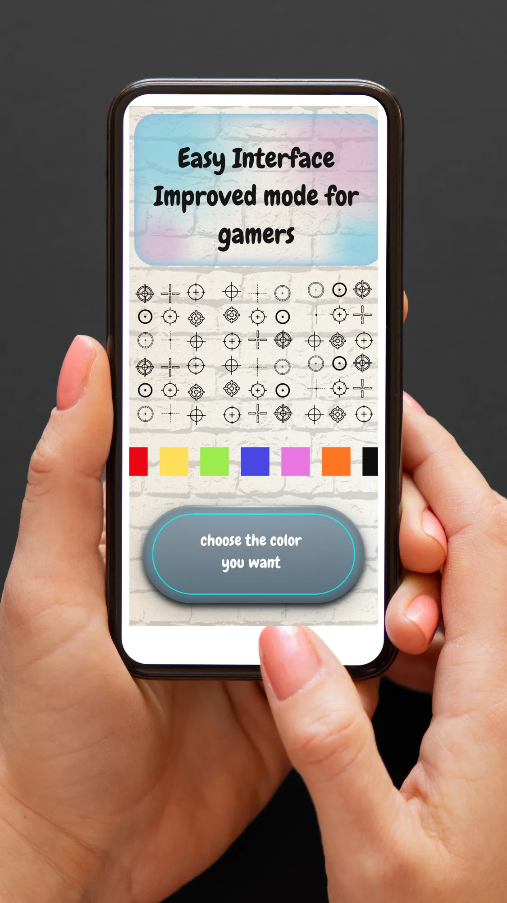{: width="180" .normal }
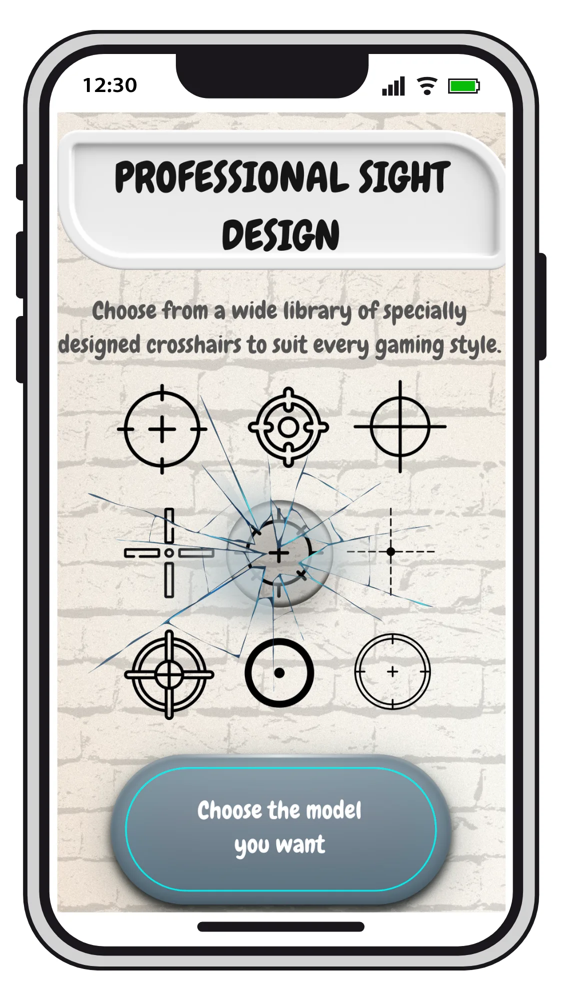{: width="180" .normal }
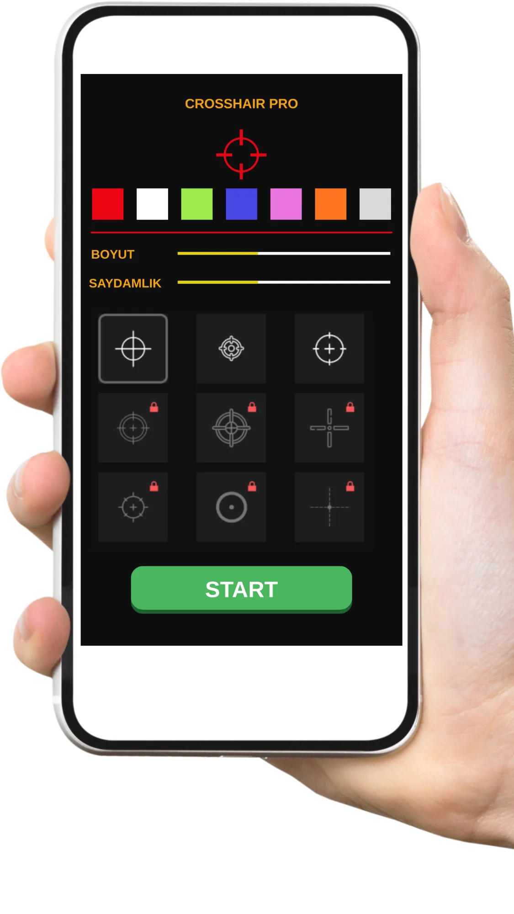{: width="180" .normal }
{: width="180" .normal }

Crosshair PRO (Custom Scope) adalah **alat overlay untuk penggemar FPS dan TPS**, dengan scope yang bisa dikustom dan jejak ringan.

**Kelebihan**
- **Overlay profesional** dirancang untuk meningkatkan aim.
- Gaya, warna, dan ukuran scope yang bisa dikustom.
- Ringan dan stabil saat bermain.
- Gratis dengan pembelian dalam aplikasi.
- Tidak perlu root.

**Kelemahan**
- Hanya Android.
- Tumpang tindih fitur dengan Crosshair Pro bisa membingungkan pilihan.
- Gaya terbaik di balik IAP.

**Terbaik untuk:** pemain yang ingin overlay scope bergaya pro dan fokus.

**Unduh Crosshair PRO**
- [Google Play](https://play.google.com/store/apps/details?id=com.redcliff.customcrosshair)

---

## Perbandingan kapabilitas inti

| Kapabilitas | Crosshair Aim | Custom Crosshair | Custom Aim | Crosshair Pro | CrossAim | Crosshair PRO |
|---|---|---|---|---|---|---|
| **Platform** | Android | Android | Android | Android | Android | Android |
| **Overlay tanpa root** | Ya | Ya | Ya | Ya | Ya | Ya |
| **Jumlah gaya / preset** | 15+ | Banyak + animasi | Generator | Dasar/Pro/Presisi | 24 | Set Pro |
| **Kustomisasi** | Ukuran/warna/scale/pos | Ukuran/warna/desain | Penuh (bentuk/warna/ukuran) | Warna, ukuran, posisi | Warna, ukuran | Bisa dikustom |
| **Pengatur saat main** | Ya | Ya | Ya | Ya (waktu nyata) | Ya | Ya |
| **Impor gambar / bentuk kustom** | Tidak | Tidak | Sebagian | Tidak | Tidak | Tidak |
| **Profil per game** | Tidak | Tidak | Tidak | Tidak | Tidak | Tidak |
| **Animasi** | Tidak | Ya | Tidak | Tidak | Tidak | Tidak |
| **Iklan / IAP** | Buka | Gratis + Pro | Gratis + Pro | Gratis + IAP | Gratis + IAP | Gratis + IAP |
| **Performa (overhead rendah)** | Baik | Baik | Baik | Baik | Ringan | Ringan |
| **Tier gratis** | Murah hati | Ya | Ya | Ya | Ya | Ya |
| **Aman game (tanpa akun/root)** | Ya | Ya | Ya | Ya | Ya | Ya |

---

## Cara memilih

- Ingin **15+ gaya + penyetelan langsung saat main** → **Crosshair Aim**
- Ingin **retikel animasi ekspresif** → **Custom Crosshair**
- Ingin **merancang sendiri dari nol** → **Custom Aim**
- Ingin **penempatan presisi waktu nyata** → **Crosshair Pro**
- Ingin **paket 24 gaya cepat dan bersih** → **CrossAim**
- Ingin **overlay scope pro yang fokus** → **Crosshair PRO**

Melihat masing-masing sebagai **alternatif Crosshair Hero**: **alternatif Custom Crosshair** untuk penggemar retikel animasi, **alternatif Custom Aim** untuk pembangun dari nol, **alternatif CrossAim** untuk paket 24 gaya cepat, **alternatif Crosshair Pro** untuk penempatan waktu nyata, dan **alternatif Crosshair PRO** untuk scope pro. Pengguna iOS mendapat **alternatif Crosshair X** sebagai satu-satunya pilihan lintas platform. Semua adalah overlay **custom crosshair Android** — tanpa root, aman digunakan.

Jika Anda datang ke sini mencari pilihan **alternatif Crosshair Hero android terbaik**, mulai dari Crosshair Aim untuk kendali langsung saat main, atau Custom Crosshair untuk retikel animasi.

## Cara bermigrasi dari Crosshair Hero

1. **Catat game** yang menggunakan bidik silang kustom (mis. PUBG Mobile, Free Fire, CODM).
2. **Pilih pengganti** dari tabel berdasarkan seberapa banyak kustomisasi yang Anda butuhkan.
3. **Beri izin tampilkan-di-atas-aplikasi-lain** agar overlay bisa menggambar di atas game.
4. **Buat ulang retikel Anda** — atur gaya, warna, ukuran, dan posisi agar cocok dengan yang Anda punya.
5. **Uji dalam pertandingan** dan gunakan pengatur saat main untuk menyetel penempatan sebelum bermain kompetitif.

## FAQ

**Apakah Crosshair Aim alternatif Crosshair Hero terbaik?**
{:.faq-q}

Jika Anda ingin 80+ gaya plus pengatur melayang langsung saat main (ukuran, warna, posisi, transparansi) dan retikel untuk senjata yang tidak memilikinya, ya — Crosshair Aim memimpin dalam kendali. Custom Crosshair menang di retikel animasi, Custom Aim di desain dari nol.

**Alternatif mana yang punya bidik silang animasi?**
{:.faq-q}

Custom Crosshair (Impact Crosshair) adalah satu-satunya di sini dengan retikel animasi; Crosshair Aim dan lainnya statis.

**Alternatif mana yang paling mirip Crosshair Hero?**
{:.faq-q}

Crosshair Hero (dibahas di panduan vs) dan CrossAim adalah pilihan preset terdekat; Crosshair Aim adalah opsi lebih dalam dan lebih bisa dikustom.

**Apakah Crosshair Aim gratis?**
{:.faq-q}

Ya. Set gaya dasar gratis dan tanpa iklan; buka Pro membuka pustaka lengkap.

[Halaman aplikasi Crosshair Aim](/id/apps/cross-hair/) — tersedia di Android.

## Istilah terkait

- [Apa Itu Bidik Silang?](/id/glossary/what-is-a-crosshair/)
