Day One adalah jurnal yang mumpuni, tetapi **langganan ~$35/tahun** dan model cloud-nya tidak cocok untuk semua orang. Jika Anda menginginkan yang lebih privat, lebih berfokus pada mood, atau sekadar lebih murah, pilihan jurnal lain cukup kuat.

Di bawah ini kami bandingkan enam **alternatif Day One** — dari [buku harian mood](/id/glossary/what-is-a-mood-tracker/) privat yang imut hingga jurnal lintas platform dan pencatat mood mikro — dari sisi harga, platform, dan kemampuan yang benar-benar menentukan. Kebanyakan pembaca datang dengan satu penghalang tertentu — langganan, akun cloud, atau jurnal yang terlalu lama diisi — jadi tiap pilihan dibingkai menurut alasan itu.

## Mengapa mencari di luar Day One

{: width="180" .normal }
{: width="180" .normal }
{: width="180" .normal }
{: width="180" .normal }
{: width="180" .normal }

- **Langganan tahunan berbayar** (~$35/tahun di 2026) untuk fitur yang paling sering dipakai orang.
- **Sinkron cloud secara bawaan** — sebagian pengguna ingin penyimpanan lokal saja yang mereka kendalikan.
- **Mengutamakan prosa** — kurang pas bila Anda hanya ingin check-in mood cepat.
- **Condong ke iPhone** — aplikasi Android dan web tertinggal dari versi iOS.
- **Terkunci** — pindah berarti mengekspor, dan formatnya tidak selalu portabel.

## Alternatif Day One terbaik sekilas

| Aplikasi | Harga (2026) | Platform | Terbaik untuk |
|---|---|---|---|
| **Meow Mood Diary** | Inti gratis + VIP | Android, iOS | Buku harian mood privat, imut |
| **Journey** | Gratis + langganan Cloud | Android, iOS, web, Win, Mac | Jurnal lintas platform |
| **Diaro** | Gratis + Pro | Android, iOS, Win, Mac | Jurnal teks terorganisir |
| **Daylio** | Gratis + Premium | Android, iOS | Pencatat mood mikro |
| **Grid Diary** | Gratis + Premium | Android, iOS | Jurnal berpanduan pertanyaan |
| **Momento** | Gratis + Premium | iOS | Jurnal linimasa privat |

---

### 1. Meow Mood Diary — terbaik untuk buku harian mood privat yang imut

{: width="180" .normal }
{: width="180" .normal }
{: width="180" .normal }
{: width="180" .normal }
{: width="180" .normal }

Meow Mood Diary adalah **buku harian mood yang aman dan privat** dengan antarmuka bertema kucing yang menenangkan. Ciri paling menonjol adalah **desainnya**: visual kucing kartun yang imut dan beragam ikon mood membuat check-in harian terasa ringan, bukan klinis. Di luar tampilan, ia tidak pernah mengunggah entri ke server dan hanya mencadangkan ke Google Drive milik Anda.

**Keunggulan**
- **Antarmuka kucing kartun yang imut** dengan beragam ikon mood dan tema warna kustom — pembeda paling jelas.
- **Privasi menyeluruh**: entri tidak pernah diunggah ke server kami; cadangan hanya ke Google Drive milik Anda.
- **Catatan mood cepat satu ketuk** — rekam perasaan tanpa menulis entri panjang.
- **Sepenuhnya offline** — catat mood, lihat riwayat, dan edit entri tanpa Wi-Fi.
- **Pengingat, kunci sidik jari/kode sandi**, serta tampilan kalender + grafik tren emosi.
- Entri buku harian rinci dan pengingat harian yang bisa disesuaikan.

**Kelemahan**
- **Tanpa sinkron akun cloud** lintas perangkat — cadangan memakai Google Drive sendiri, jadi lintas perangkat lebih manual daripada Day One.
- Ekosistem lebih kecil dan integrasi pihak ketiga lebih sedikit daripada jurnal besar.
- Kurang cocok untuk jurnal prosa panjang yang terstruktur.

**Paling cocok untuk:** orang yang menginginkan buku harian mood privat dan bersahabat, yang tampil menenangkan dan bekerja sepenuhnya offline.

**Unduh Meow Mood Diary**
- [Google Play](https://play.google.com/store/apps/details?id=com.glgjing.meow.mood.diary)
- [App Store](https://apps.apple.com/us/app/meow-mood-diary/id6767560237)

---

### 2. Journey — terbaik untuk jurnal lintas platform

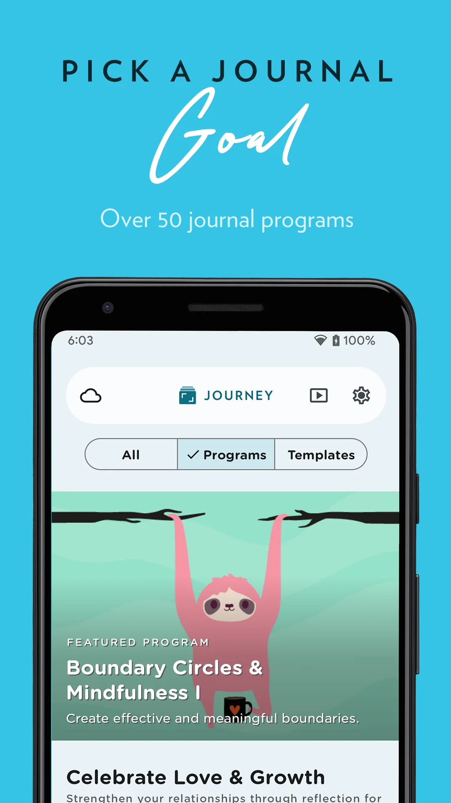{: width="180" .normal }
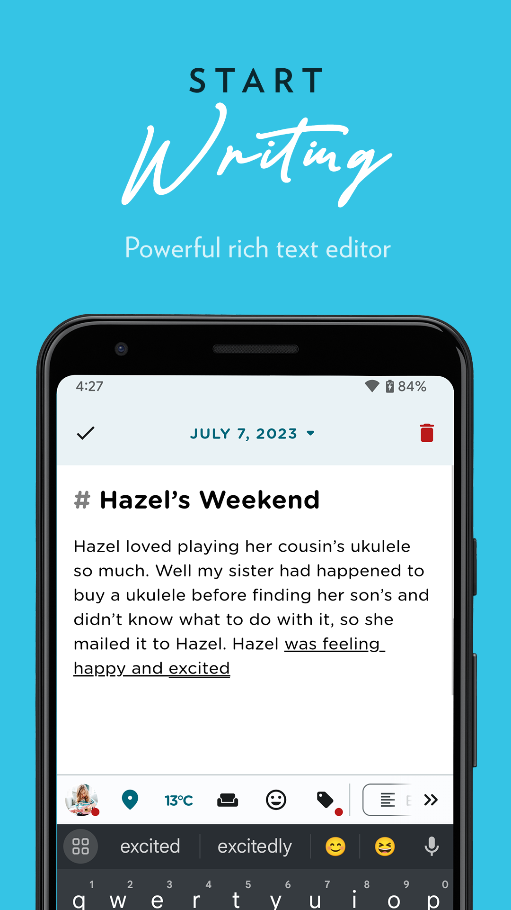{: width="180" .normal }
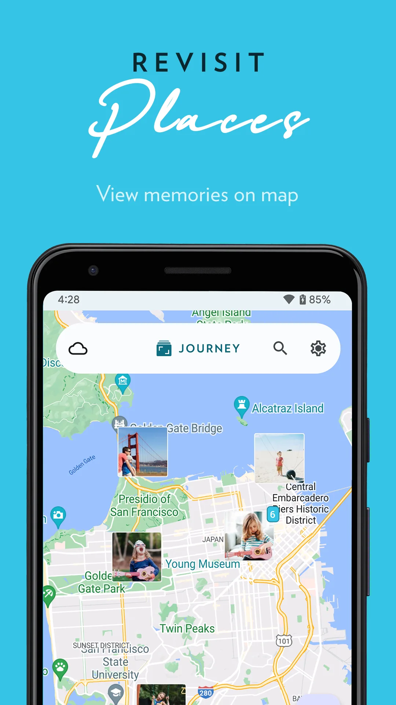{: width="180" .normal }
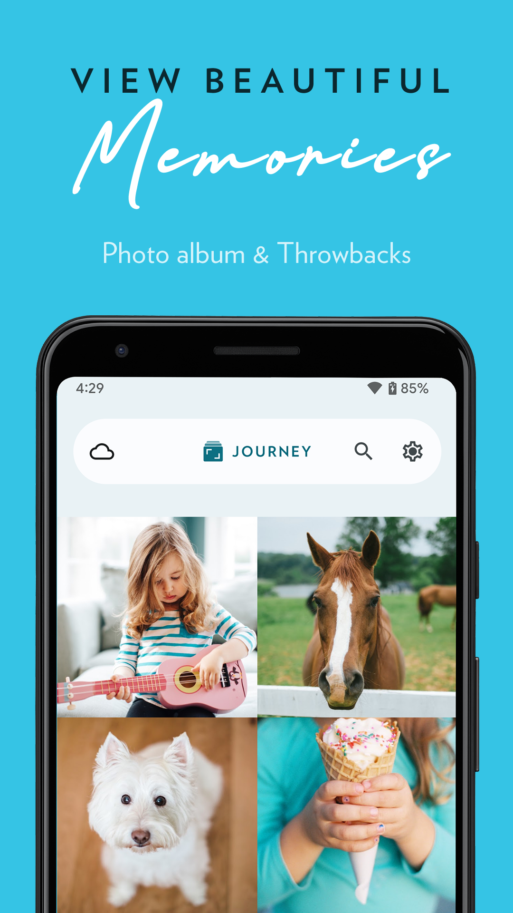{: width="180" .normal }
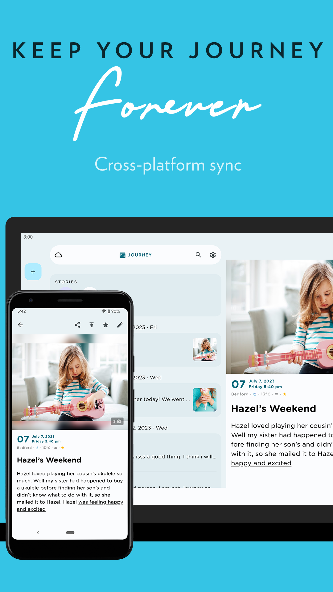{: width="180" .normal }

Journey adalah **jurnal lintas platform** untuk Android, iOS, web, Windows, dan Mac, dengan entri foto, pelacakan mood, serta sinkronisasi Google Drive. Ia pesaing langsung terdekat Day One bagi orang yang menulis di banyak perangkat.

**Keunggulan**
- **Sinkron lintas platform kuat** antar ponsel, tablet, web, dan desktop via Google Drive.
- **Entri kaya**: foto, lokasi, cuaca, dan mood.
- **Prompt terpandu dan statistik** untuk menjaga kebiasaan mencatat.
- Kunci kode sandi dan penulisan offline.
- Tingkat gratis yang lapang untuk jurnal dasar.

**Kelemahan**
- Fitur sinkron dan lanjutan tertentu butuh Journey Cloud (berbayar).
- Antarmukanya fungsional, bukan indah — kurang nuansa "menyenangkan" seperti buku harian imut.
- Lebih berat daripada pencatat mood cepat.

**Paling cocok untuk:** penulis yang menjurnal di ponsel, web, dan desktop serta menginginkan sinkron yang andal.

**Unduh Journey**
- [Google Play](https://play.google.com/store/apps/details?id=com.journey.app)
- [App Store](https://apps.apple.com/us/app/journey-diary-journal/id1300202543)

---

### 3. Diaro — terbaik untuk jurnal teks terorganisir

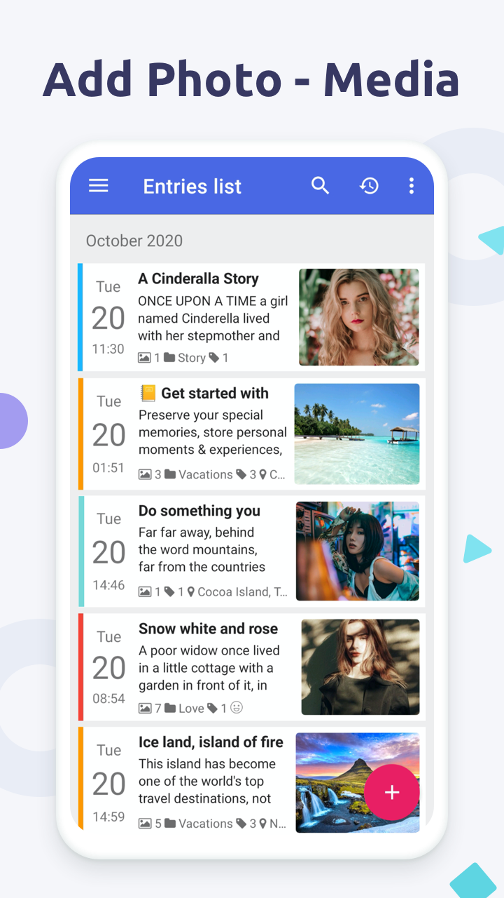{: width="180" .normal }
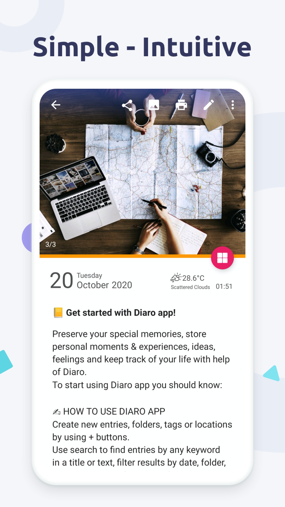{: width="180" .normal }
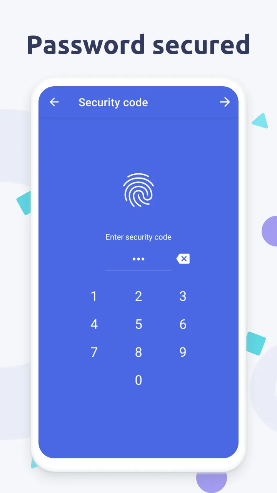{: width="180" .normal }
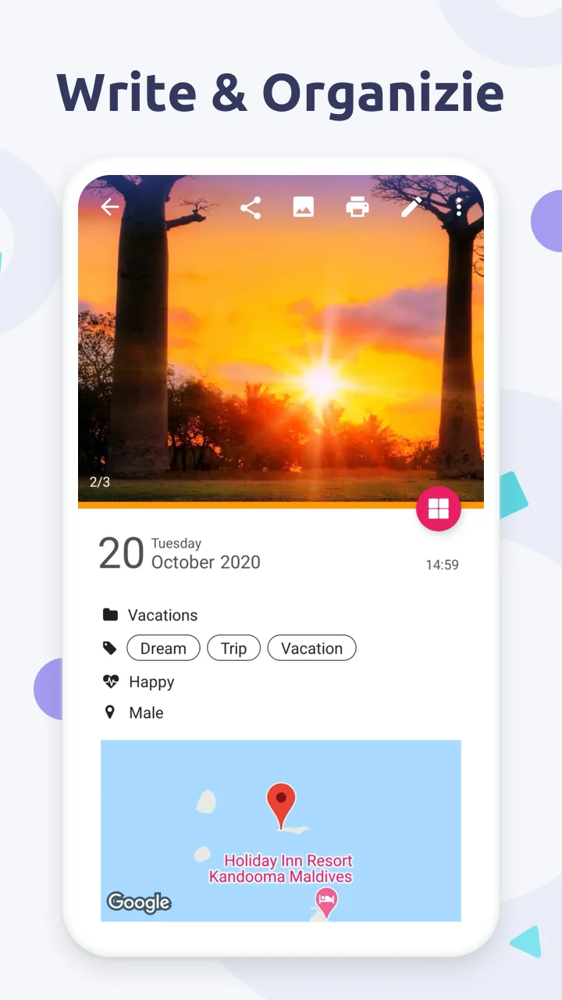{: width="180" .normal }
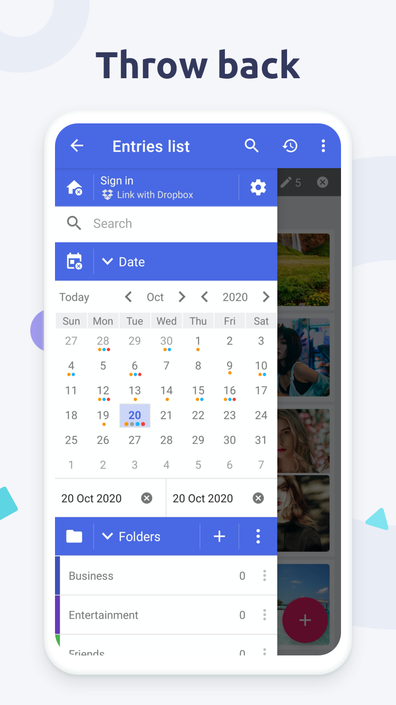{: width="180" .normal }

Diaro adalah **buku harian berbasis teks** dengan folder, tag, pencarian, dan dasbor bersih, tersedia di Android, iOS, Windows, dan Mac dengan cadangan cloud.

**Keunggulan**
- **Folder, tag, dan pencarian tangguh** memudahkan navigasi jurnal panjang.
- **Pelacakan mood dan grafik** berdampingan dengan entri teks.
- **Multi-platform** dengan sinkron cloud dan ekspor ke PDF/XML/TXT.
- Lampiran foto dan pengingat.
- Tingkat gratis mencakup jurnal harian.

**Kelemahan**
- Antarmukanya praktis, bukan lucu — tidak ada tema imut.
- Sebagian fitur (sinkron cloud, ekspor tambahan) berada di balik Diaro Pro.
- Kurang menekankan check-in mood cepat.

**Paling cocok untuk:** penulis terorganisir yang menginginkan folder, tag, dan pencarian lintas perangkat.

**Unduh Diaro**
- [Google Play](https://play.google.com/store/apps/details?id=com.pixelcrater.Diaro)
- [App Store](https://apps.apple.com/us/app/diary-journal-notes-diaro/id882519460)

---

### 4. Daylio — terbaik untuk pencatat mood mikro

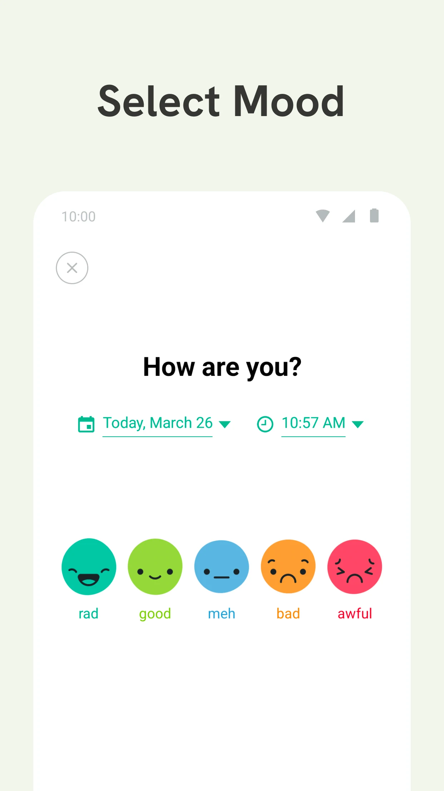{: width="180" .normal }
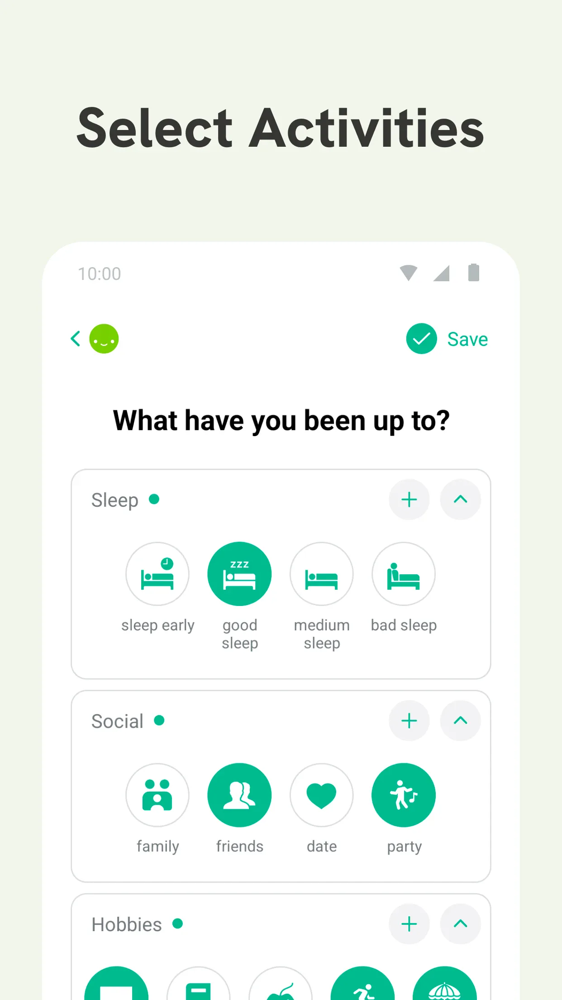{: width="180" .normal }
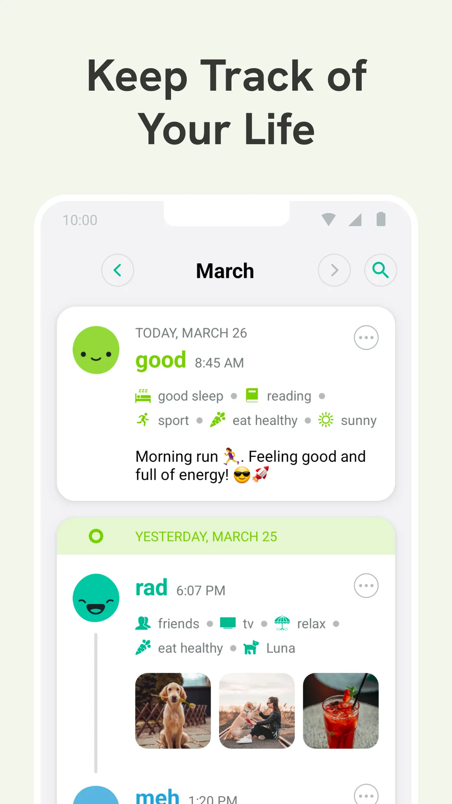{: width="180" .normal }
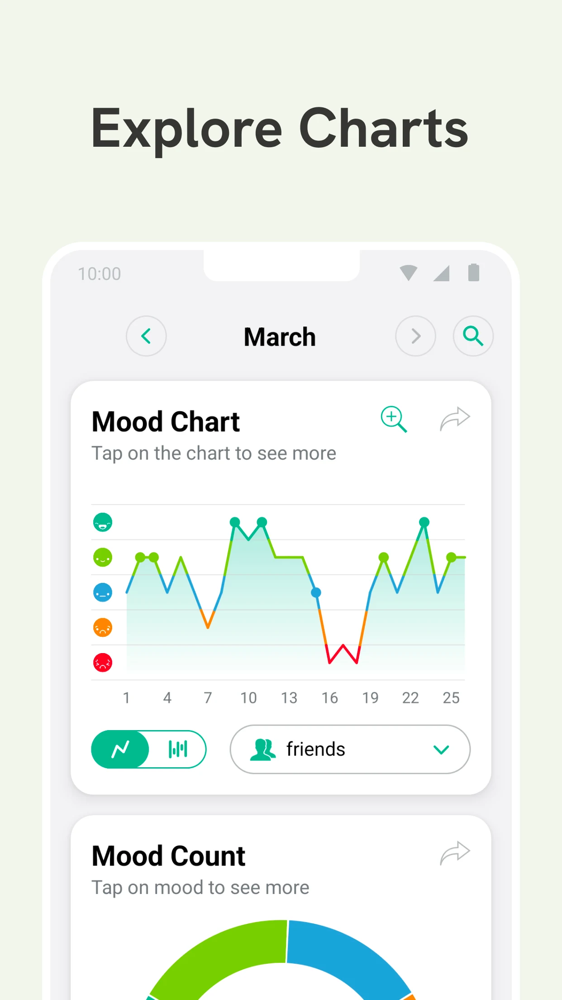{: width="180" .normal }
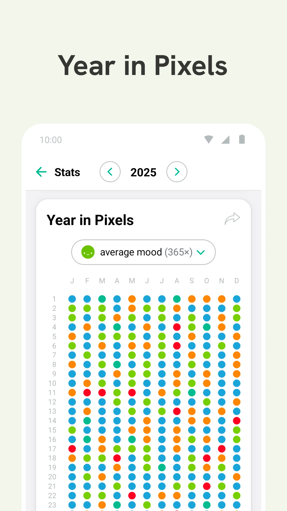{: width="180" .normal }

Daylio adalah **pelacak mood mikro** di mana Anda mengetuk perasaan dan menambah beberapa aktivitas — tanpa perlu menulis. Ia membangun kalender dan grafik berwarna dari pola emosi Anda.

**Keunggulan**
- **Mood + aktivitas satu ketuk** — menjurnal dalam hitungan detik, tanpa prosa.
- **Kalender dan grafik berwarna** yang membongkar pola emosi dari waktu ke waktu.
- **Lintas platform** (Android + iOS) dengan cadangan cloud.
- Pengingat dan target untuk membangun kebiasaan.
- Tingkat gratis cukup lapang.

**Kelemahan**
- Tidak dibangun untuk tulisan panjang — ia mengutamakan mood.
- Statistik mendalam dan riwayat tak terbatas berada di balik Premium.
- Kustomisasi aktivitas terbatas pada versi gratis.

**Paling cocok untuk:** orang yang ingin melacak mood cepat dan melihat pola, bukan menulis esai.

**Unduh Daylio**
- [Google Play](https://play.google.com/store/apps/details?id=net.daylio)
- [App Store](https://apps.apple.com/us/app/daylio-journal-mood-tracker/id1194023242)

---

### 5. Grid Diary — terbaik untuk jurnal berpanduan pertanyaan

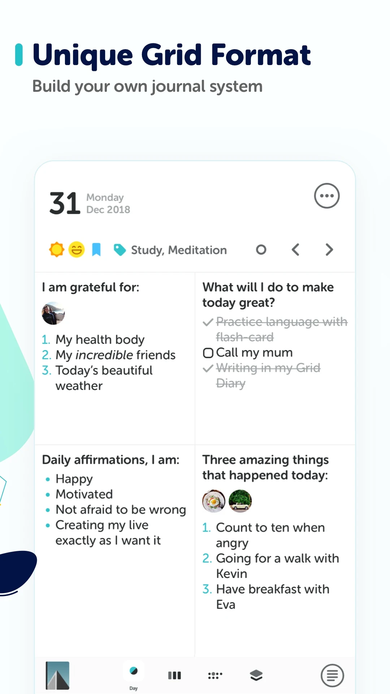{: width="180" .normal }
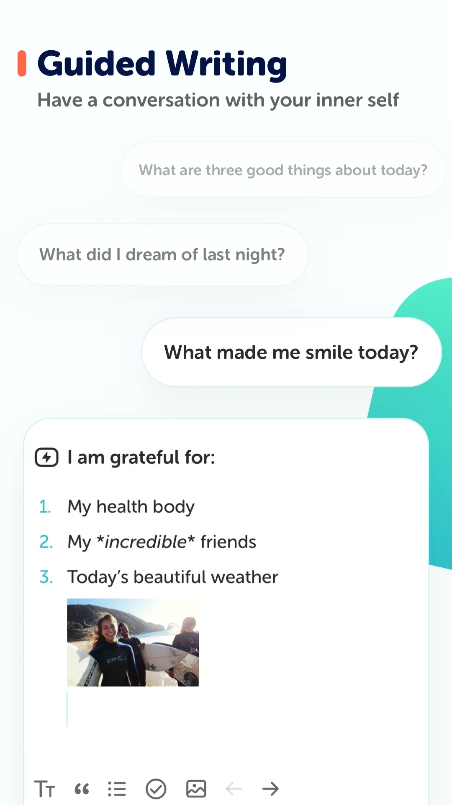{: width="180" .normal }
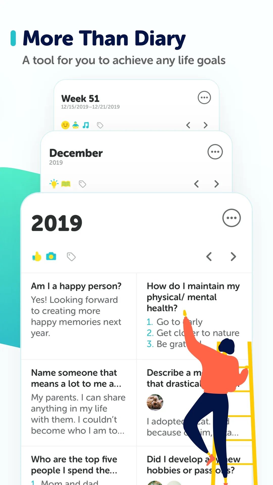{: width="180" .normal }
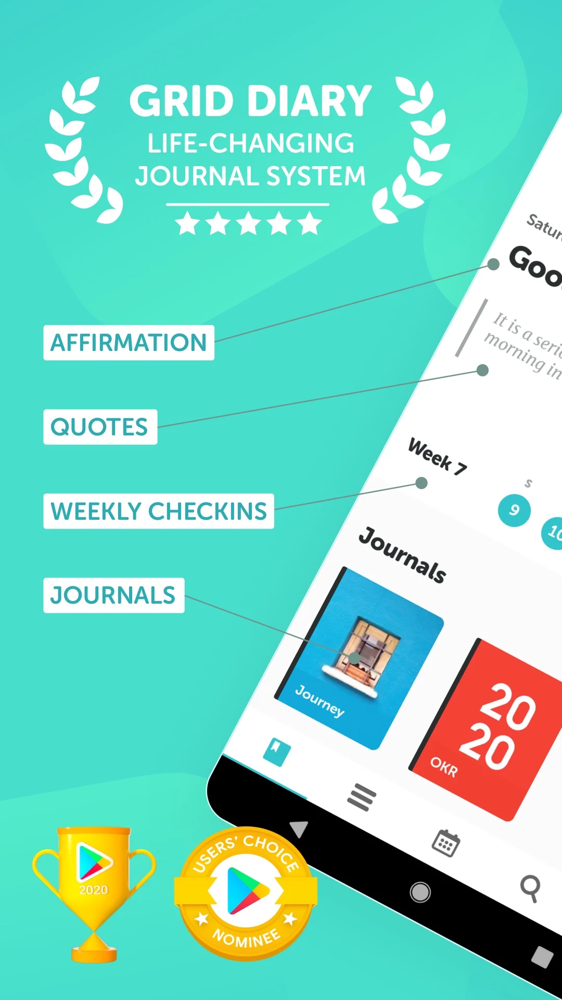{: width="180" .normal }
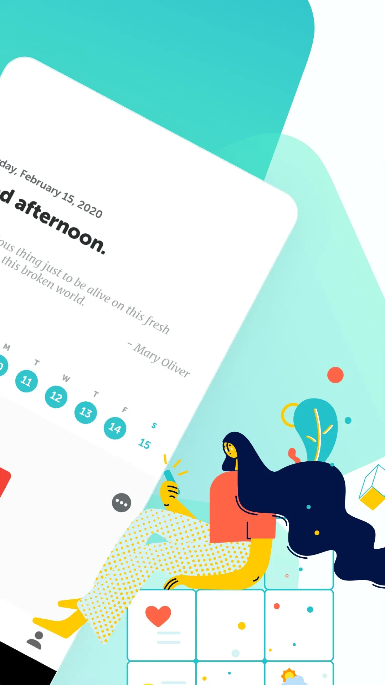{: width="180" .normal }

Grid Diary memakai **kisi berpanduan pertanyaan** untuk menyusun entri, membantu Anda merenung dengan template yang bisa dipakai ulang. Populer untuk jurnal rasa syukur, pertanyaan harian, dan gaya kebiasaan.

**Keunggulan**
- **Kisi berpanduan pertanyaan** mengubah halaman kosong jadi pertanyaan terarah.
- **Template yang bisa dipakai ulang** untuk syukur, tinjauan harian, target, dan lainnya.
- **Lintas platform** (Android + iOS) dengan sinkron cloud.
- Pengalaman menulis yang bersih dan fokus.
- Tingkat gratis mencakup prompt inti.

**Kelemahan**
- Nilai terbaik butuh Grid Diary Premium (lebih banyak template, sinkron).
- Kurang bebas — struktur kisi tidak cocok untuk semua orang.
- Tidak ada estetika imut/kartun.

**Paling cocok untuk:** orang yang menulis lebih baik bila dipandu dan menginginkan struktur.

**Unduh Grid Diary**
- [Google Play](https://play.google.com/store/apps/details?id=io.sumi.griddiary2)
- [App Store](https://apps.apple.com/us/app/grid-diary-journal-planner/id1392523148)

---

### 6. Momento — terbaik untuk jurnal linimasa privat

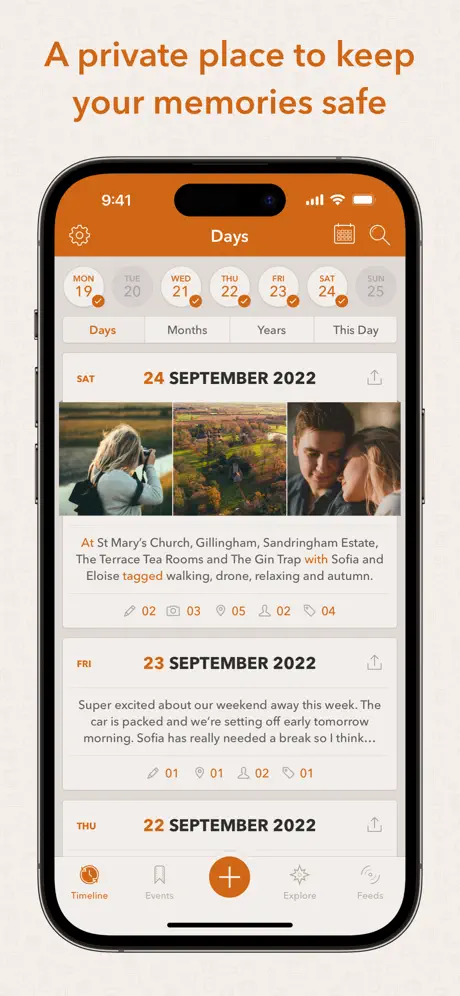{: width="180" .normal }
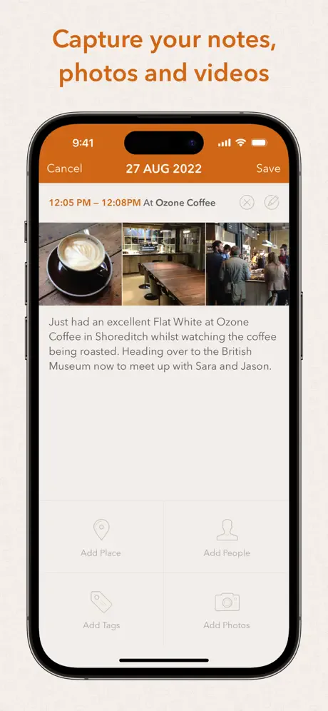{: width="180" .normal }
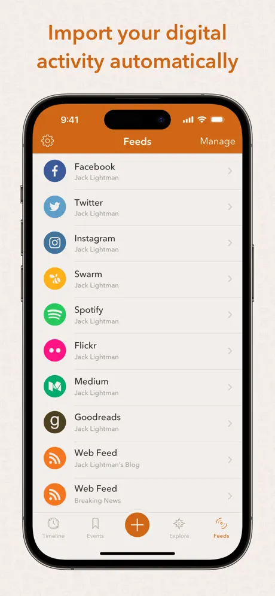{: width="180" .normal }
{: width="180" .normal }
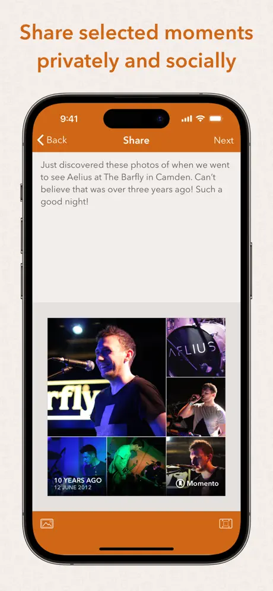{: width="180" .normal }

Momento adalah **jurnal iOS** yang membangun linimasa privat dari entri dan layanan terhubung Anda, berfokus pada ruang pribadi yang tenang untuk merenung.

**Keunggulan**
- **Linimasa privat** yang mengelompokkan entri per hari untuk merenung cepat.
- Desain iOS minimal yang bersih.
- Entri foto dan teks dengan pengingat.
- Postur privasi lokal-utama.
- Tersedia tingkat gratis.

**Kelemahan**
- **Hanya iOS** — tidak ada aplikasi Android atau web.
- Sebagian fitur dan entri tak terbatas butuh langganan Premium.
- Integrasi lebih sedikit dan jangkauan lintas platform lebih sempit daripada Journey.

**Paling cocok untuk:** pengguna iPhone yang menginginkan jurnal linimasa privat dan tenang.

**Unduh Momento**
- [App Store](https://apps.apple.com/us/app/momento-private-journal-diary/id980592846)

---

## Perbandingan kemampuan inti

| Kemampuan | Meow Mood Diary | Journey | Diaro | Daylio | Grid Diary | Momento |
|---|---|---|---|---|---|---|
| **Platform** | Android, iOS | Android, iOS, web, Win, Mac | Android, iOS, Win, Mac | Android, iOS | Android, iOS | iOS |
| **Tingkat gratis** | Lapang | Ya | Ya | Ya | Ya | Ya |
| **Pelacakan mood** | Ya (ikon) | Ya | Ya | Ya (mikro) | Sebagian | Ya |
| **Jurnal teks** | Ya | Kuat | Kuat | Ringan | Terpandu | Ya |
| **Prompt / struktur** | Tidak | Sebagian | Folder/tag | Aktivitas | Kisi prompt | Linimasa |
| **Foto & lampiran** | Ya | Ya | Ya | Tidak | Ya | Ya |
| **Privasi / lokal-utama** | Kuat (tanpa unggah) | Cloud (Drive) | Cloud | Cloud | Cloud | Lokal-utama |
| **Sinkron cloud / lintas perangkat** | Cadangan Drive | Ya (akun) | Ya (akun) | Ya (akun) | Ya (akun) | Terbatas (iOS) |
| **Pengingat** | Ya | Ya | Ya | Ya | Ya | Ya |
| **Tema / kustomisasi** | Tema kucing, warna | Dasar | Dasar | Berwarna | Template | Minimal |
| **Ekspor** | Ya | Ya | PDF/XML/TXT | Ya | Ya | Terbatas |
| **Offline** | Sepenuhnya offline | Ya | Ya | Ya | Ya | Ya |

---

## Alternatif Day One mana yang cocok untuk tiap jenis pengguna

Tabel di atas meranking fitur; di sini keenam pilihan dikelompokkan menurut *apa yang sebenarnya Anda ganti*.

- **Menggantikan langganan** — Meow Mood Diary dan Diaro keduanya punya inti gratis yang bisa dipakai; **pelacak mood tanpa langganan** layak dicek cetak birunya (kunci aplikasi, ekspor, kalender) sebelum memindahkan entri bertahun-tahun.
- **Menggantikan ritual menulis** — **alternatif Journey** atau **alternatif Grid Diary** menjaga prompt, tag, dan penyuntingan lintas platform; bila Anda ingin logging satu ketuk, **alternatif Daylio** adalah jalur lebih pendek, dan Meow Mood Diary menangani itu di perangkat.
- **Menggantikan pelacakan diri terstruktur** — **alternatif MoodKit** atau **alternatif Bearable** untuk catatan pemikiran dan korelasi multi-faktor, yang tak dapat diungkapkan skala mood lima tingkat.
- **Menggantikan cloud** — Meow Mood Diary adalah pilihan bila syaratnya adalah **pelacak mood privat tanpa akun** dengan jalur ekspor; Momento lebih dekat ke linimasa tetapi tetap iOS-utama.
- **Tetap hanya iPhone** — **alternatif Reflectly** cocok untuk jurnal terpandu yang dipimpin desain, tetapi tidak menyelesaikan soal Android atau akun.

Apapun labelnya, ajukan dua pertanyaan sebelum migrasi: bisakah Anda mengeluarkan riwayat sebagai berkas, dan apakah aplikasi tetap bekerja tanpa sinyal?

## Cara memilih

- Ingin **buku harian mood privat yang imut dan bekerja offline** → **Meow Mood Diary**
- Ingin **sinkron lintas platform sejati (ponsel/web/desktop)** → **Journey**
- Ingin **folder, tag, dan pencarian untuk jurnal panjang** → **Diaro**
- Ingin **catatan mood satu ketuk dan pola** → **Daylio**
- Ingin **struktur berpanduan pertanyaan** → **Grid Diary**
- Ingin **linimasa iOS privat yang tenang** → **Momento**

## Cara migrasi dari Day One

1. **Ekspor entri Day One** Anda ke format standar (PDF atau ekspor bawaan) sebelum membatalkan.
2. **Pilih pengganti** dari tabel berdasarkan platform dan apakah Anda ingin pelacakan mood atau tulisan panjang.
3. **Impor atau buat ulang entri** — Journey/Diaro/Grid Diary menerima impor; untuk Meow Mood, mulai baru dengan catatan mood satu ketuk dan tambahkan catatan.
4. **Atur pengingat harian** di aplikasi baru agar kebiasaan bertahan saat pindah.
5. **Aktifkan cadangan** (Meow Mood: Google Drive sendiri; Journey/Diaro: sinkron akun) agar Anda tak pernah terkunci.

## FAQ

**Apakah Meow Mood Diary alternatif Day One gratis yang baik?**
{:.faq-q}

Ya. Gratis di intinya, berjalan di Android dan iOS, tidak pernah mengunggah entri ke server, dan hanya mencadangkan ke Google Drive milik Anda — pilihan kuat bila Anda menginginkan privasi dan logging mood cepat di atas multimedia kaya.

**Apakah Meow Mood Diary bekerja offline?**
{:.faq-q}

Ya. Anda bisa mencatat, melihat, dan mengedit entri tanpa internet dan tanpa akun; data tetap di perangkat Anda.

**Alternatif Day One mana yang terbaik untuk privasi?**
{:.faq-q}

Meow Mood Diary — tanpa akun, penyimpanan di perangkat dengan kunci sidik jari opsional, dan cadangan hanya ke Google Drive milik Anda bila diaktifkan.

**Bisakah saya memindahkan entri dari Day One?**
{:.faq-q}

Day One mengekspor PDF dan format lain; Meow Mood sendiri mengekspor PDF (CSV via VIP), sehingga data Anda tetap portabel.

[Halaman aplikasi Meow Mood Diary](/id/apps/meow-mood-diary/) — tersedia di Android dan iOS.

## Istilah terkait

- [Apa Itu Pelacak Suasana Hati?](/id/glossary/what-is-a-mood-tracker/)
