Intuit **menutup Mint pada Maret 2024** dan menggabungkan fiturnya ke Credit Karma. Jika Anda mencari **alternatif Mint**, Anda tidak sendirian — jutaan mantan pengguna menginginkan **aplikasi anggaran** yang mencatat pengeluaran dengan jelas, tanpa diarahkan ke produk kredit atau dipaksa memakai akun cloud yang tidak dipercaya.

Panduan ini membandingkan **tujuh** aplikasi pada dimensi yang sama. Masing-masing dipilih karena **pangsa pasar yang besar** atau **keunggulan khas** yang membedakannya. Setiap aplikasi di bawah dibahas dengan keunggulan nyata, kelemahan jujur, dan kinerjanya pada kemampuan inti yang benar-benar dipedulikan pengguna — multi-akun, sinkronisasi, reimburse, anggaran, statistik, aset/kekayaan bersih, dan multi mata uang. Tautan unduhan ada di akhir setiap bagian. Bagi pembaca Indonesia, istilah **alternatif DuitKu**, **alternatif DompetKu**, **alternatif MoneyTrack**, **alternatif Caku**, **alternatif Catatku**, **alternatif Celenganku**, **alternatif Monefy**, dan **alternatif Spendee** juga sering dicari; ketujuh aplikasi di bawah tetap menjadi ruang lingkup perbandingan ini.

## Apa yang hilang saat Mint ditutup

- **Impor transaksi otomatis** dari rekening bank dan kartu yang ditautkan.
- **Satu dasbor** untuk kekayaan bersih, tagihan, dan langganan.
- **Anggaran kategori gratis dan sederhana**.

Konsekuensinya, Mint menghasilkan uang lewat rujukan dan akhirnya mengarahkan pengguna ke bisnis kredit Credit Karma. Pengganti di bawah mempertahankan bagian yang baik dan membiarkan Anda menentukan sendiri seberapa banyak otomatisasi dan penyimpanan cloud yang diinginkan.

---

## YNAB (You Need A Budget) — pemimpin metodologi

{: width="180" .normal }
{: width="180" .normal }
{: width="180" .normal }
{: width="180" .normal }
{: width="180" .normal }

YNAB adalah aplikasi **penganggaran zero-based** paling terkenal: setiap dolar "diberi tugas" sebelum dibelanjakan, dibangun di atas empat aturan sederhana. Ia punya komunitas penganggaran khusus terbesar dan materi edukasi terbanyak (lokakarya, panduan, forum).

**Keunggulan**
- **Metode penganggaran terkuat** — alokasi zero-based mengalahkan sekadar pelacakan kategori untuk mengubah kebiasaan.
- **Sinkron bank lewat Plaid** — transaksi diimpor otomatis di web, iOS, dan Android.
- **Laporan dan pelacakan kekayaan bersih yang sangat baik**, plus perencanaan target.
- Matang, dukungan baik, lintas platform.

**Kelemahan**
- **Tanpa paket gratis** — hanya uji coba 34 hari, lalu $14,99/bln atau $109/thn.
- **Kurva belajar curam** — Anda harus aktif menganggarkan; ini sistem, bukan pencatat pasif.
- **Tanpa alur reimburse khusus**, dan **multi mata uang lemah** (berpusat pada USD).
- Laporan bagus tetapi kurang fleksibel daripada spreadsheet untuk analisis ad-hoc.

**Paling cocok untuk:** pengguna yang ingin mengubah perilaku belanja dengan metode teruji dan bersedia meluangkan waktu penyiapan.

**Unduh YNAB**
- [Google Play](https://play.google.com/store/apps/details?id=com.youneedabudget.evergreen.app)
- [App Store](https://apps.apple.com/app/ynab/id1010865877)

---

## Meow Money Manager — pencatat bertema kucing dengan antarmuka menyenangkan

{: width="180" .normal }
{: width="180" .normal }
{: width="180" .normal }
{: width="180" .normal }
{: width="180" .normal }

Meow Money Manager adalah [aplikasi catatan keuangan](/id/glossary/what-is-an-expense-tracker/) dan [aplikasi anggaran](/id/glossary/what-is-budget-management/) bertema kucing untuk **Android dan iOS**. Ciri paling khasnya adalah **antarmuka**: desain kartun lucu dengan **400+ ikon kategori** yang membuat pencatatan harian terasa ringan, bukan pekerjaan kantor. Di luar tampilan, ia menutup dasar-dasar pembukuan praktis, dan hadir dengan UI multi-bahasa — Tionghoa, Inggris, Indonesia, Thai, dan Portugis — yang ramah bagi pengguna Tionghoa dan perantau.

**Keunggulan (dari deskripsi produk)**
- **UI kartun cantik dengan 400+ ikon kustom** — ciri utama; mencatat terasa menyenangkan secara visual.
- **Multi buku kas** — pisahkan buku (pribadi, perjalanan, usaha) dan lihat satu atau semuanya sekaligus.
- **Pelacak anggaran & budget per kategori** — periode harian / bulanan / tahunan, dengan total anggaran dan anggaran tiap kategori dipantau bersamaan.
- **Statistik grafik instan** — laporan pengeluaran harian, bulanan, dan tahunan.
- **Pengelolaan reimburse** — tandai pengeluaran bisa diganti (misalnya perjalanan dinas) dan pantau statusnya kapan saja.
- **Pengelolaan aset** — catat tunai, reksa dana, saham, kartu, utang, dan kekayaan bersih.
- **Transaksi berulang** — otomatis berulang harian / mingguan / bulanan / tahunan.
- **50+ simbol mata uang**, **mode gelap**, dan **kunci sidik jari**.
- **Ekspor CSV** (semua catatan atau rentang tanggal) untuk Excel, plus **backup Google Drive, iCloud, atau WebDav**.
- **Tanpa daftar akun** — **data tersimpan lokal di perangkat**.

**Kelemahan (objektif)**
- **Tanpa sinkron bank otomatis** — entri manual (atau berulang). Ini membantu privasi, tetapi kurang "atur dan lupakan" dibanding Mint.
- **Sinkron cloud berupa Google Drive, iCloud, atau WebDav**, bukan akun lintas platform khusus, jadi berpindah antara ponsel Android dan iPhone kurang mulus daripada aplikasi berbasis akun.
- **Fitur lanjutan** (multi buku kas, ekspor CSV) memerlukan pembelian sekali bayar; fitur inti gratis menutupi pencatatan sehari-hari.
- Ekosistem lebih kecil serta tanpa agregasi investasi atau kekayaan bersih bawaan.

**Skenario umum:** saat perjalanan dinas, pakai **pengelolaan reimburse** untuk menandai biaya kendaraan dan makan sebagai bisa diganti, lalu ekspor CSV dan cocokkan dengan kantor dalam satu ketukan; sehari-hari, 400+ ikon mempercepat kategorisasi, dan buku kas terpisah menjaga pengeluaran pribadi dan perjalanan tidak bercampur. Karena **tidak perlu akun dan menyimpan data hanya di perangkat**, ia cocok untuk pengguna yang menjaga privasi dan tidak ingin tagihannya diserahkan ke akun cloud seperti Mint — perbedaan kunci dari kebanyakan pencatat yang mewajibkan login.

**Paling cocok untuk:** orang yang ingin pencatatan jelas tanpa akun cloud, menghargai antarmuka ramah, dan tidak keberatan dengan entri manual ringan.

**Unduh Meow Money Manager ([halaman aplikasi](/id/apps/meow-money-manager/))**
- [Google Play](https://play.google.com/store/apps/details?id=com.glgjing.money.manager.bookkeeping.meow)
- [App Store](https://apps.apple.com/app/id1528852284)

---

## Monarch Money — penerus Mint paling mirip

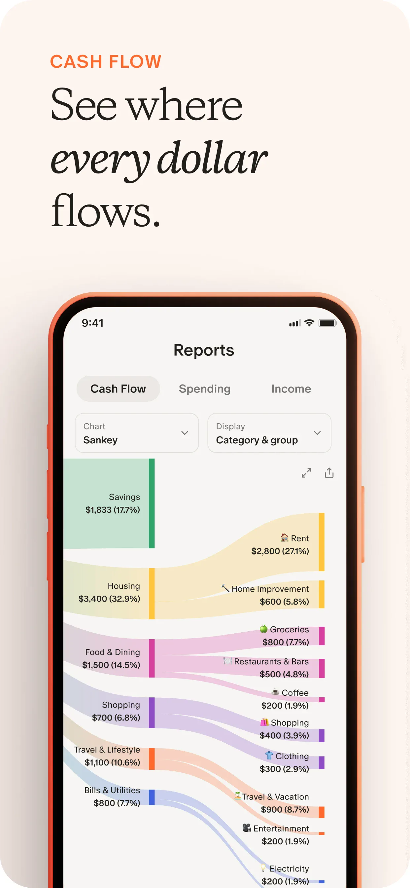{: width="180" .normal }
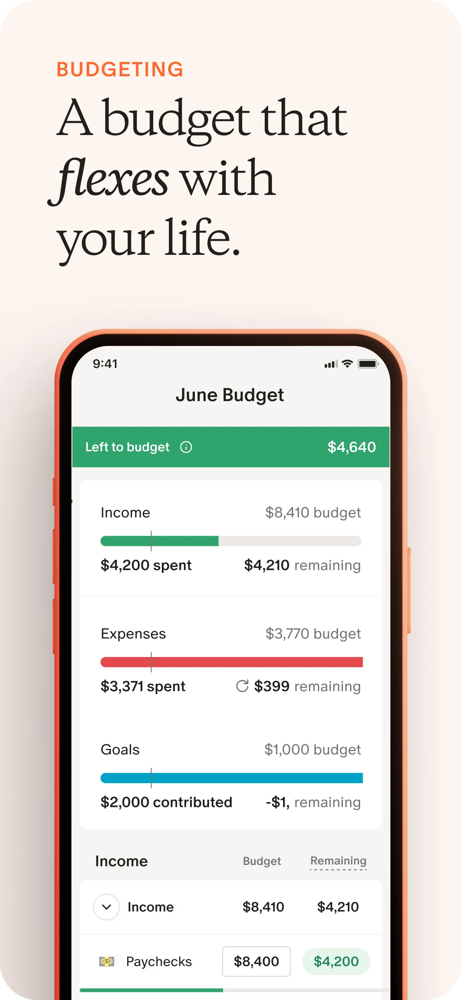{: width="180" .normal }
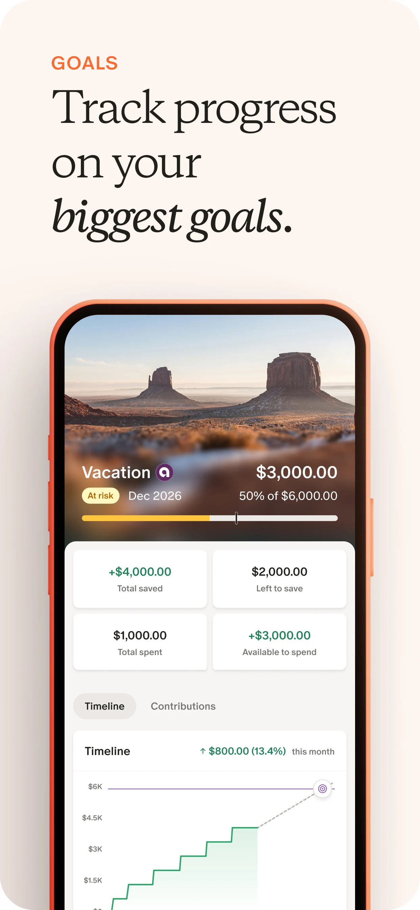{: width="180" .normal }
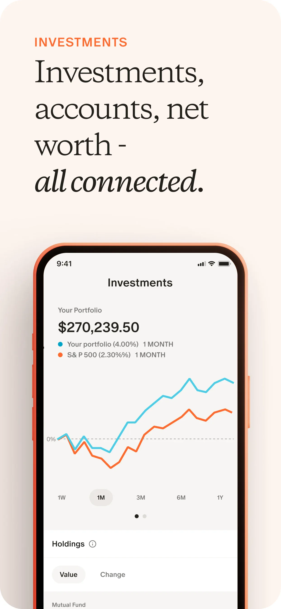{: width="180" .normal }

Monarch adalah aplikasi yang paling sering disebut **pengganti Mint langsung**. Ia menggabungkan bank, kartu, pinjaman, investasi, bahkan kripto dan properti ke dalam satu dasbor, dengan berbagi kolaboratif sehingga pasangan bisa mengedit anggaran yang sama.

**Keunggulan**
- **Paling mirip dasbor Mint** — kekayaan bersih, arus kas, dan langganan dalam satu tampilan.
- **Sinkron otomatis luas** termasuk investasi dan properti (lewat penilaian).
- **Kolaboratif** — bagikan dan edit bersama pasangan; keduanya melihat pembaruan langsung.
- Pengalaman web + seluler yang rapi dan alat target/anggaran yang baik.

**Kelemahan**
- **Tanpa paket gratis** (hanya uji coba), sekitar **$99,99/thn** (atau $14,99/bln).
- **Relatif muda** (berdiri 2021) — komunitas lebih kecil dan panduan pihak ketiga lebih sedikit daripada YNAB.
- Seperti Mint, ia bergantung pada **keandalan agregasi**; koneksi yang putus berarti pembersihan manual.
- **Multi mata uang terbatas** dan berorientasi pada pasar AS.

**Paling cocok untuk:** mantan pengguna Mint yang ingin dasbor all-in-one serupa dan tidak keberatan berlangganan.

**Unduh Monarch Money**
- [Google Play](https://play.google.com/store/apps/details?id=com.monarchmoney.mobile)
- [App Store](https://apps.apple.com/us/app/monarch-budget-track-money/id1459319842)

---

## Rocket Money — terbaik untuk menjinakkan langganan

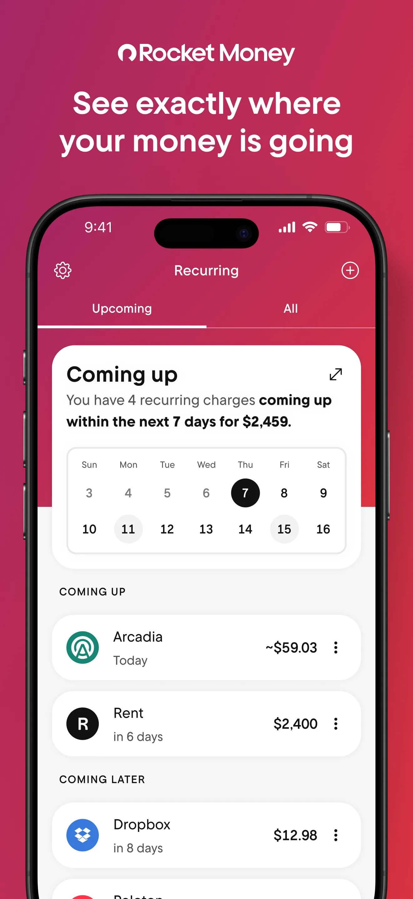{: width="180" .normal }
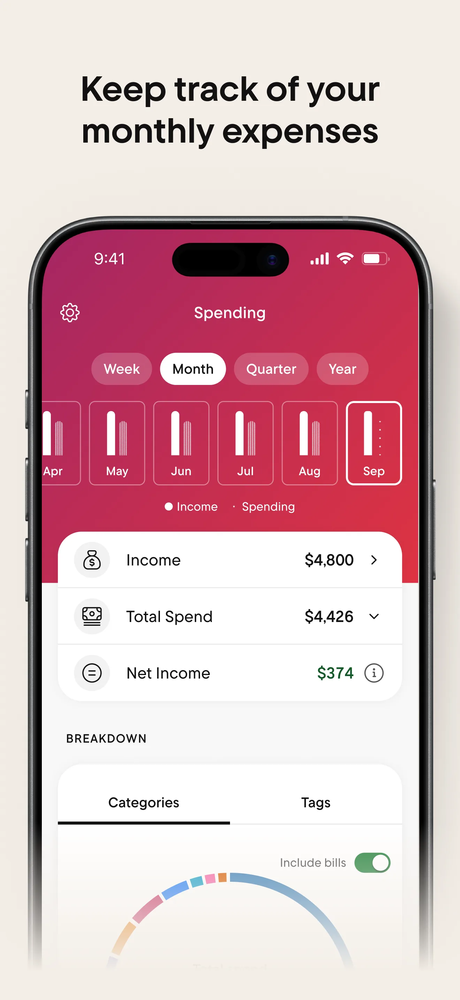{: width="180" .normal }
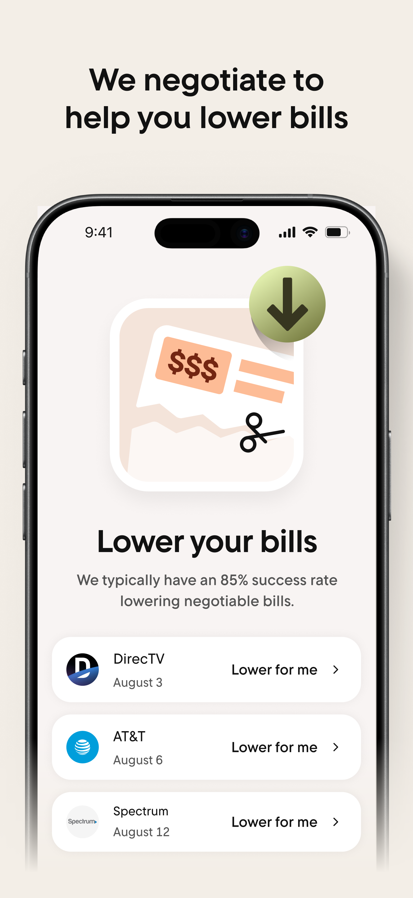{: width="180" .normal }
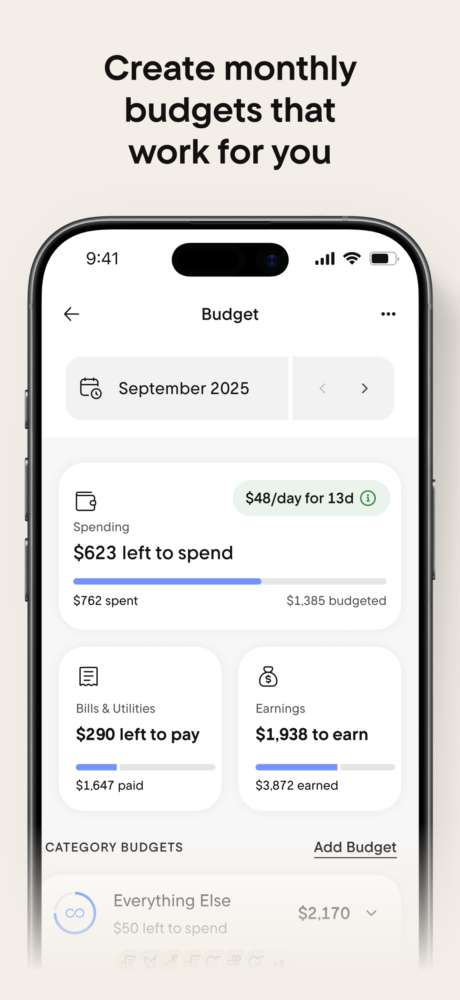{: width="180" .normal }
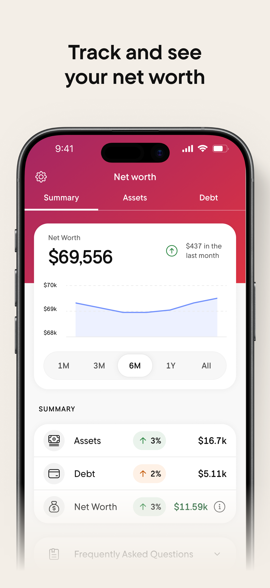{: width="180" .normal }

Rocket Money (dulu Truebill) dibangun untuk **menemukan dan membatalkan langganan yang tidak diinginkan**, menurunkan tagihan lewat negosiasi, dan memberi ringkasan pengeluaran sederhana. Ia pilihan terkuat bila tagihan berulang menjadi masalah utama Anda.

**Keunggulan**
- **Manajemen langganan terbaik di kelasnya** — mendeteksi, melacak, dan membantu membatalkan langganan; bisa menegosiasikan tagihan lebih rendah.
- **Paket gratis** tersedia; pelacakan akun otomatis dan anggaran di atasnya.
- Pemantauan skor kredit dan peringatan perlindungan saldo minus (premium).
- Angka unduhan sangat populer, jadi dukungan dan stabilitas solid.

**Kelemahan**
- **Penganggaran dasar** — tanpa metode zero-based atau amplop; ia mencatat, bukan merencanakan.
- **Kategorisasi otomatis cukup baik tetapi kurang dapat disesuaikan** daripada YNAB atau Monarch.
- Harga premium **bervariasi** (sering ~$6–12/bln, ditagih tahunan; bisa terasa mahal untuk apa yang ditawarkan di luar pembatalan langganan).
- Tanpa alur reimburse, fitur kekayaan bersih/investasi lemah.

**Paling cocok untuk:** orang yang masalah utamanya adalah langganan dan tagihan yang membengkak, bukan penganggaran langsung.

**Unduh Rocket Money**
- [Google Play](https://play.google.com/store/apps/details?id=com.truebill)
- [App Store](https://apps.apple.com/us/app/rocket-money-bills-budgets/id1130616675)

---

## Empower (dulu Personal Capital) — tampilan kekayaan bersih & investasi gratis terbaik

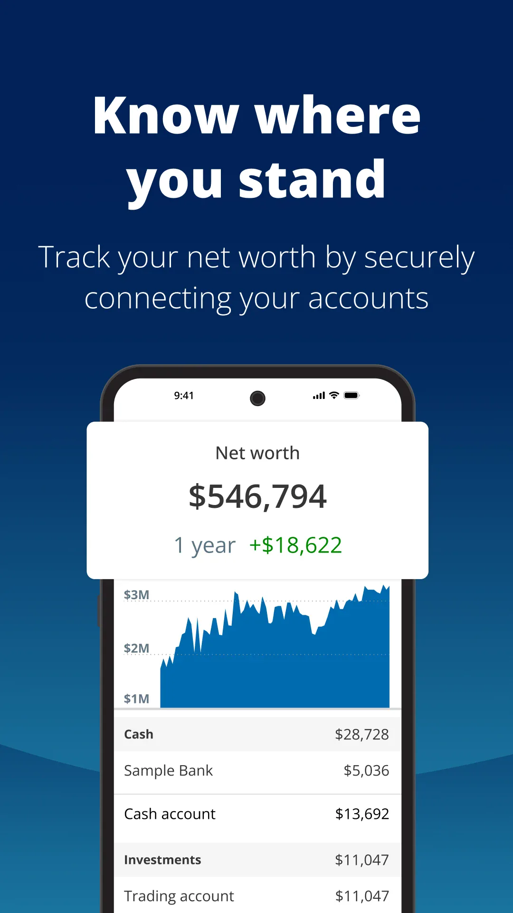{: width="180" .normal }
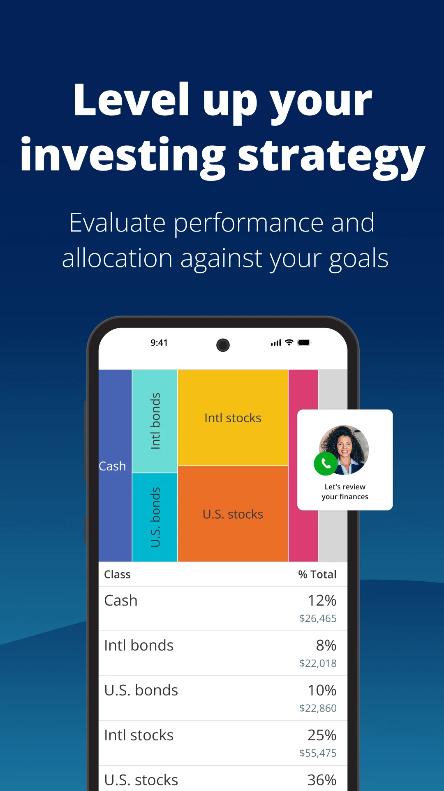{: width="180" .normal }
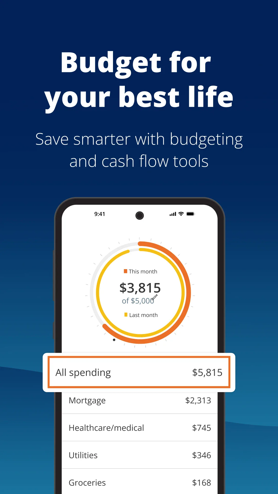{: width="180" .normal }
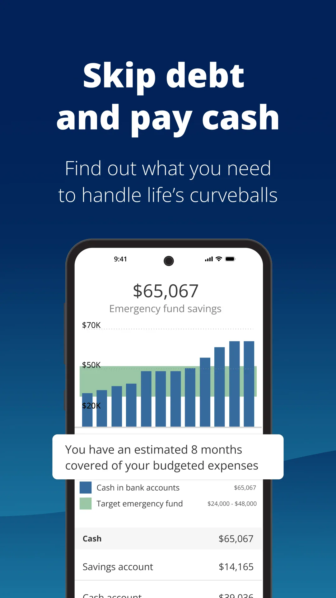{: width="180" .normal }
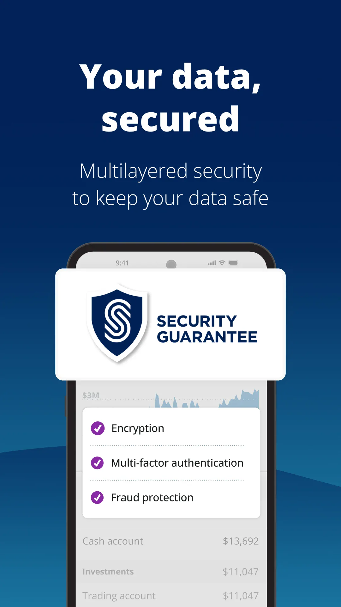{: width="180" .normal }

Empower **gratis** dan berfokus pada **pelacakan kekayaan bersih dan investasi**. Ia menggabungkan data bank, dana pensiun, sekuritas, kripto, bahkan hipotek/properti untuk memberi analisis portofolio, perencana pensiun, dan analisis biaya.

**Keunggulan**
- **Sepenuhnya gratis** untuk dasbor inti.
- **Analisis kekayaan bersih dan investasi terbaik di kelasnya** — alokasi aset, proyeksi pensiun, audit biaya.
- Cakupan akun sangat luas, termasuk investasi dan properti.
- Rekam jejak panjang (beroperasi lebih dari satu dekade dengan nama Personal Capital).

**Kelemahan**
- **Bukan aplikasi penganggaran sejati** — alat arus kas/anggaran dasar dibanding YNAB atau Monarch.
- **Berpusat pada AS**; penggunaan di luar AS terbatas dan multi mata uang lemah.
- **Penawaran penasihat investasi** yang kuat untuk saldo besar.
- Tanpa fitur amplop atau reimburse.

**Paling cocok untuk:** pengguna yang terutama ingin memantau kekayaan bersih dan investasi, tanpa perlu anggaran harian terperinci.

**Unduh Empower**
- [Google Play](https://play.google.com/store/apps/details?id=com.participantmobileapp)
- [App Store](https://apps.apple.com/us/app/empower/id1001257338)

---

## PocketGuard — terbaik untuk "safe to spend"

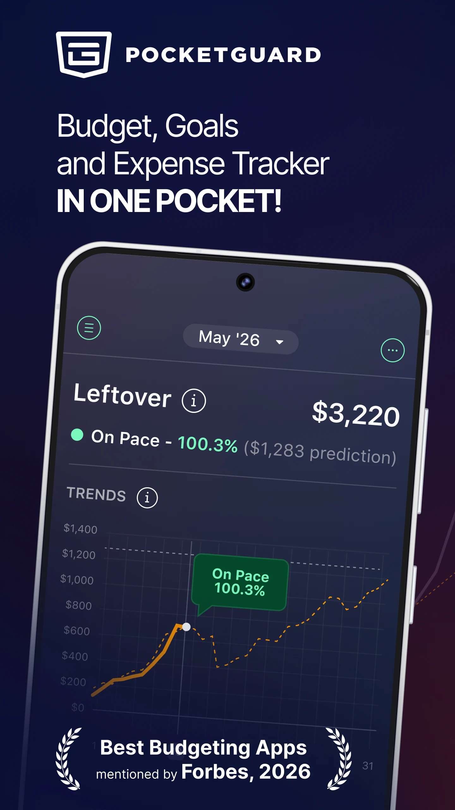{: width="180" .normal }
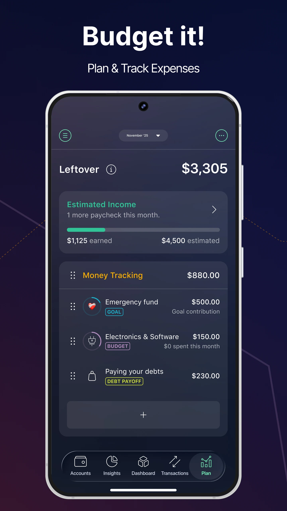{: width="180" .normal }
{: width="180" .normal }
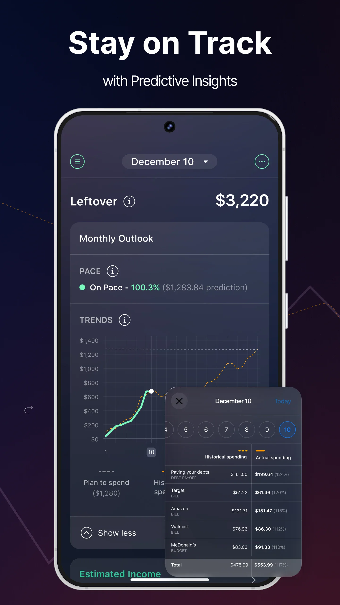{: width="180" .normal }
{: width="180" .normal }

PocketGuard menjaganya tetap sederhana: ia menunjukkan **"In My Pocket"** — berapa banyak yang aman dibelanjakan setelah tagihan, tabungan, dan target terpenuhi. Ini cara paling ringan menghindari pengeluaran berlebih tanpa mempelajari metode.

**Keunggulan**
- **Angka "In My Pocket" yang aman dibelanjakan** intuitif dan langsung berguna.
- Mengkategorikan transaksi otomatis, melacak langganan, dan menawarkan fitur penurunan tagihan.
- **Paket gratis** plus PocketGuard Plus (~$12,99/bln atau ~$74,99/thn) untuk detail lebih banyak.

**Kelemahan**
- **Kedalaman anggaran terbatas** — tanpa pendekatan zero-based atau amplop; kustomisasi tipis.
- **Mengutamakan seluler** dengan pengalaman web terbatas.
- Tanpa reimburse, tanpa pelacakan investasi/kekayaan bersih, multi mata uang lemah.
- Beberapa laporan berguna ada di balik Plus.

**Paling cocok untuk:** orang yang ingin jawaban cepat "mampukah saya membeli ini?" tanpa mengelola anggaran penuh.

**Unduh PocketGuard**
- [Google Play](https://play.google.com/store/apps/details?id=com.pocketguard.android.app)
- [App Store](https://apps.apple.com/us/app/pocketguard-budget-app/id949414211)

---

## Goodbudget — penganggaran amplop terbaik tanpa langganan

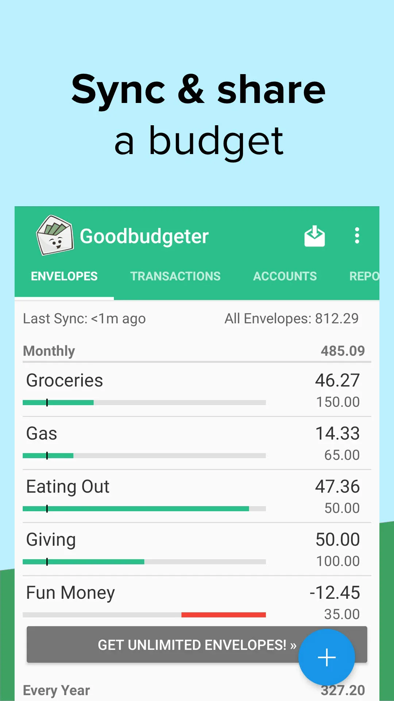{: width="180" .normal }
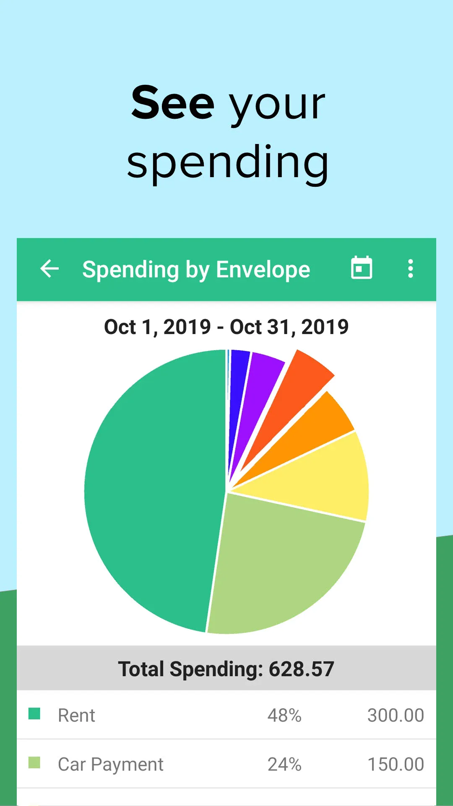{: width="180" .normal }
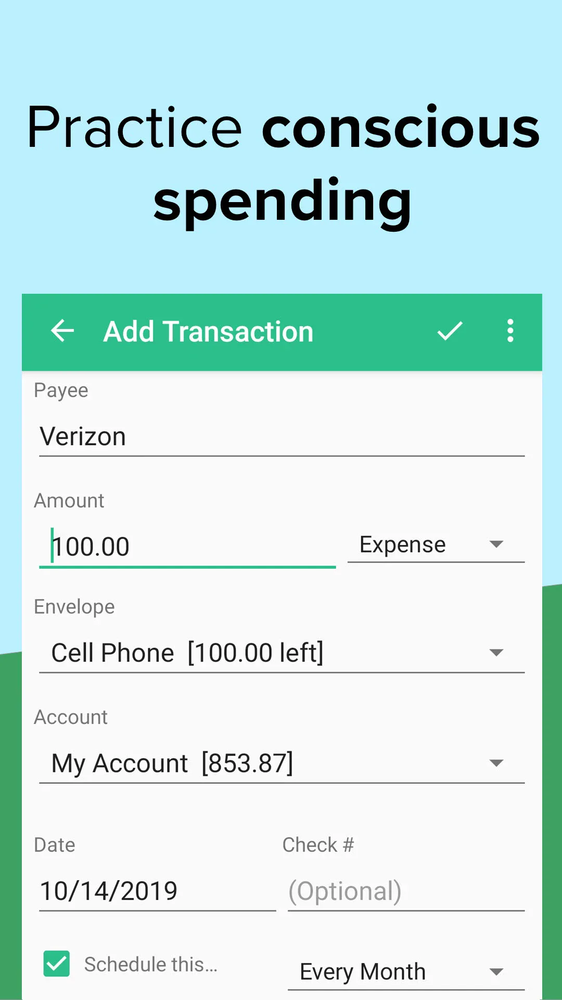{: width="180" .normal }
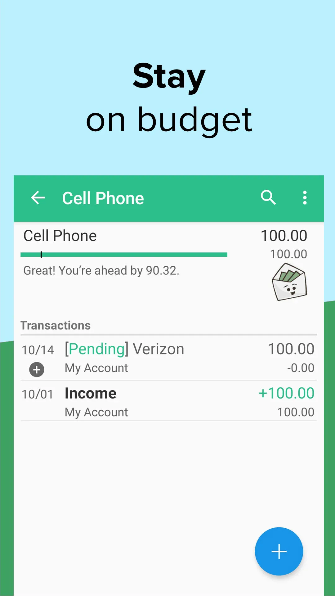{: width="180" .normal }
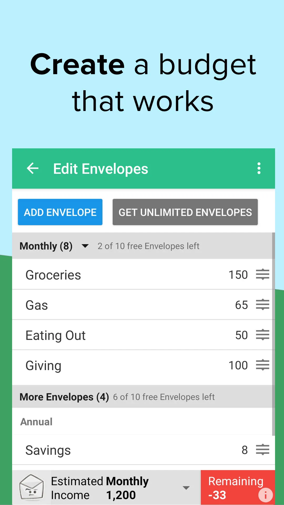{: width="180" .normal }

Goodbudget mendigitalkan **sistem amplop** klasik: Anda mengalokasikan uang ke amplop virtual dan membelanjakannya dari sana. Ia sengaja manual dan bersinar untuk pasangan serta keluarga yang berbagi anggaran.

**Keunggulan**
- **Metode amplop yang dijalankan dengan benar**, dengan sinkron cloud antarperangkat agar rumah tangga tetap selaras.
- **Paket gratis** (20 amplop, 2 perangkat, riwayat 1 tahun); Premium (~$8/bln atau ~$70/thn) membuka amplop tanpa batas, lebih banyak perangkat, riwayat 7 tahun, dan sinkron bank.
- Fleksibel platform: iOS, Android, dan web.

**Kelemahan**
- **Sebagian besar entri manual** — tanpa impor bank otomatis di paket gratis, dan sinkron bank berbayar pun terbatas dibanding YNAB/Monarch.
- **Kategorisasi otomatis minimal**; Anda yang memilah.
- Tanpa pelacakan investasi/kekayaan bersih, tanpa reimburse, multi mata uang lemah.
- Grafik dan laporan lebih polos daripada dasbor otomatis.

**Paling cocok untuk:** penggemar anggaran amplop dan anggaran rumah tangga bersama yang memilih kendali daripada otomatisasi.

**Unduh Goodbudget**
- [Google Play](https://play.google.com/store/apps/details?id=com.dayspringtech.envelopes)
- [App Store](https://apps.apple.com/app/goodbudget/id471112395)

---

## Perbandingan kemampuan inti

Tabel di bawah menunjukkan, seobjektif mungkin, kemampuan yang didukung tiap aplikasi. "Sebagian" berarti fitur ada tetapi dengan batas (misalnya backup manual, bukan sinkron bank).

| Kemampuan | YNAB | Meow Money | Monarch | Rocket Money | Empower | PocketGuard | Goodbudget |
|---|---|---|---|---|---|---|---|
| **Multi-akun / buku kas** | Ya | Ya (multi buku kas) | Ya (luas) | Ya | Ya (luas) | Ya | Ya (amplop) |
| **Sinkron bank otomatis** | Ya (Plaid) | Sebagian (backup Google Drive/iCloud/WebDav, tanpa feed bank) | Ya | Ya | Ya | Ya | Sebagian (manual; sinkron bank berbayar) |
| **Pelacakan reimburse** | Tidak | **Ya** | Tidak | Tidak | Tidak | Tidak | Tidak |
| **Kedalaman anggaran** | **Zero-based (kuat)** | Anggaran kategori + periode | Anggaran kustom | Dasar | Arus kas dasar | "Safe-to-spend" | **Amplop (kuat)** |
| **Statistik / laporan** | Laporan kuat | Grafik harian/bulanan/tahunan | Grafik kuat | Dasar | Kuat (investasi) | Dasar | Polos |
| **Aset / kekayaan bersih** | Ya | Ya (aset/utang) | **Kuat** | Lemah | **Terkuat** | Lemah | Tidak |
| **Multi mata uang** | Lemah (berpusat USD) | **Ya (50+ simbol)** | Lemah | Lemah | Lemah (berpusat AS) | Lemah | Lemah |
| **Manajemen langganan** | Tidak | Tidak | Sebagian | **Terkuat** | Tidak | Ya (pelacakan) | Tidak |
| **Paket gratis** | Tidak (hanya uji coba) | Inti gratis, lanjutan berbayar | Tidak (hanya uji coba) | Ya | **Ya (penuh)** | Ya | Ya (terbatas) |
| **Platform** | Web + iOS + Android | Android + iOS | Web + iOS + Android | iOS + Android | iOS + Android | iOS + Android | iOS + Android + Web |

---

## Cara memilih

- Ingin **metode zero-based teruji** dan bersedia mempelajarinya → **YNAB**.
- Ingin **gratis, privat, tanpa akun, multi mata uang, dengan reimburse** → **[Meow Money Manager](/id/apps/meow-money-manager/)**.
- Ingin **dasbor paling mirip Mint** dengan investasi → **Monarch Money**.
- Ingin **menghentikan langganan dan menurunkan tagihan** → **Rocket Money**.
- Ingin **ringkasan kekayaan bersih / investasi gratis** → **Empower**.
- Ingin jawaban cepat **"bolehkah saya membelanjakan ini?"** → **PocketGuard**.
- Ingin **amplop dan anggaran rumah tangga bersama** → **Goodbudget**.

## Bermigrasi dari Mint

1. **Ekspor data Anda sekarang** bila masih bisa: transaksi (CSV), akun, dan anggaran tersimpan.
2. **Pilih pengganti** dari tabel di atas berdasarkan privasi versus otomatisasi.
3. **Buat ulang kategori** — kebanyakan aplikasi memungkinkan mengganti nama bawaan agar cocok dengan Mint.
4. **Tetapkan anggaran dan item berulang** (kos, gaji, langganan) agar pencatatan selanjutnya lancar.
5. **Tautkan bank atau tetap manual** — bila privasi penting, aplikasi manual menyimpan data di perangkat Anda.

## FAQ

**Bisakah saya masih mengekspor data setelah Mint ditutup?**
{:.faq-q}

Bisa. Mint tetap mengizinkan ekspor transaksi (CSV), akun, dan anggaran tersimpan sebelum penutupan. Ekspor sekarang, lalu impor ke alternatif mana pun di atas untuk melanjutkan pencatatan.

**Alternatif Mint mana yang gratis dan ramah privasi?**
{:.faq-q}

Jika Anda mengutamakan "data tetap di perangkat, tanpa pendaftaran", **Meow Money Manager** termasuk sedikit pencatat yang inti gratis sekaligus lokal saja tanpa akun cloud; backup masuk ke Google Drive, iCloud (iOS), atau WebDav, bukan login cloud paksa.

**Apakah Meow Money Manager mendukung beberapa mata uang?**
{:.faq-q}

Ya — ia menyediakan **50+ simbol mata uang** untuk belanja lintas negara atau valas, serta antarmuka Tionghoa, Inggris, Indonesia, Thai, dan Portugis.

**Saya tidak ingin mempelajari metode penganggaran — cukup pencatatan sederhana. Mana yang dipilih?**
{:.faq-q}

Untuk jawaban instan "berapa sisa uang saya?", pilih **PocketGuard**; untuk antarmuka lucu yang membuat pencatatan harian mudah dijaga, pilih **Meow Money Manager**.

**Apa alternatif Mint terbaik 2026 bila saya juga ingin alternatif YNAB tanpa langganan?**
{:.faq-q}

Untuk pencatatan sekali bayar atau inti gratis, Meow Money Manager menyimpan buku kas di perangkat tanpa koneksi bank; YNAB tetap pilihan bila Anda ingin penganggaran zero-based dengan sinkron bank dan bersedia membayar tahunan.

**Adakah alternatif PocketGuard yang tidak mengunggah transaksi saya?**
{:.faq-q}

Ada. Aplikasi seperti Meow Money Manager dan Goodbudget menyimpan catatan di perangkat atau berkas yang Anda kendalikan. Tampilan safe-to-spend PocketGuard membutuhkan akun tertaut, sementara pencatat lokal memberi gambaran manual tetapi privat atas angka yang sama.

## Istilah terkait

- [Apa Itu Aplikasi Catatan Keuangan?](/id/glossary/what-is-an-expense-tracker/)
- [Apa Itu Pengelolaan Anggaran?](/id/glossary/what-is-budget-management/)
- [Apa Itu Pengelolaan Reimburse?](/id/glossary/what-is-reimbursement-management/)
