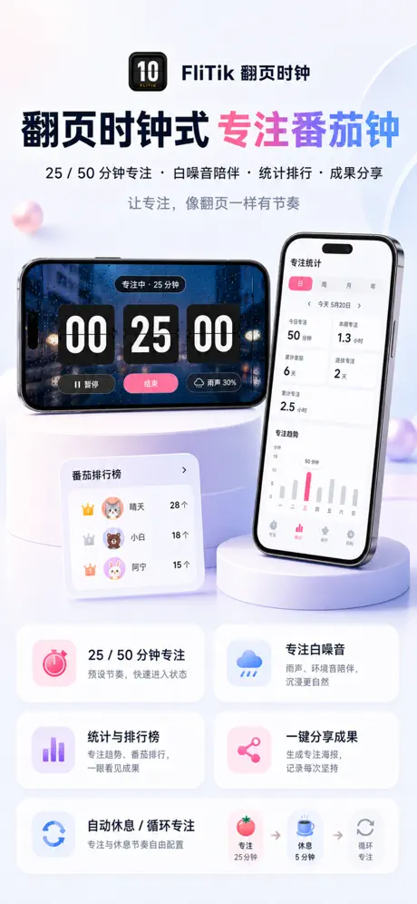
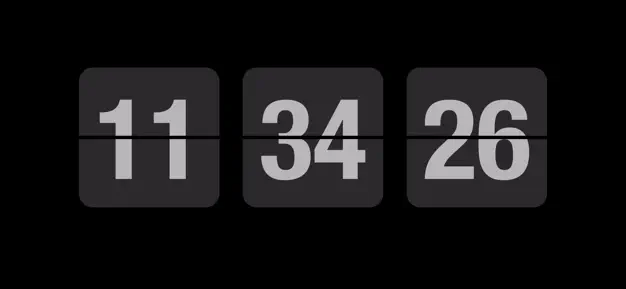
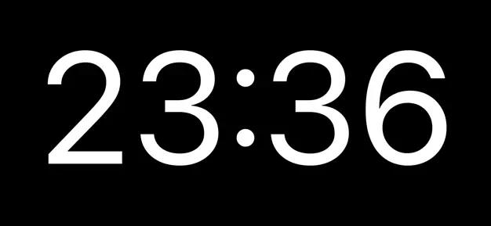
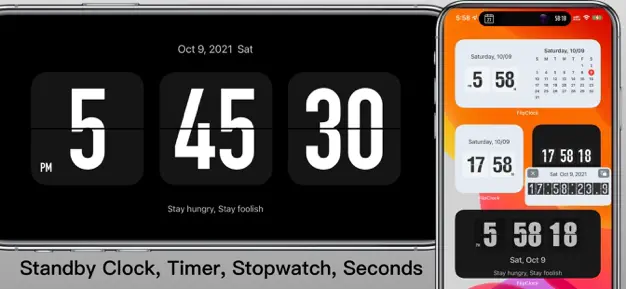
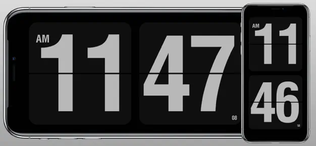
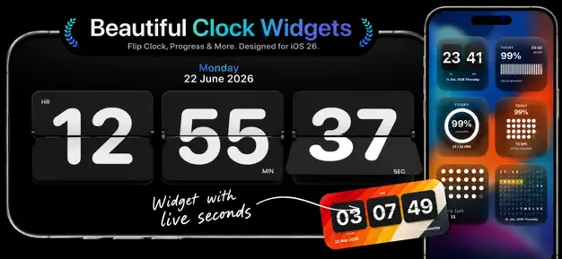
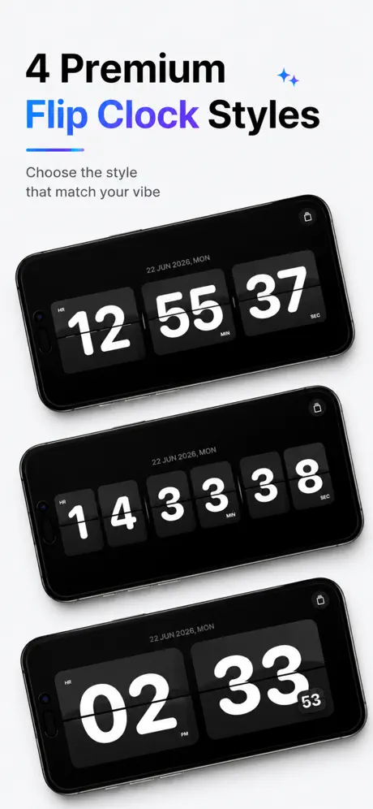
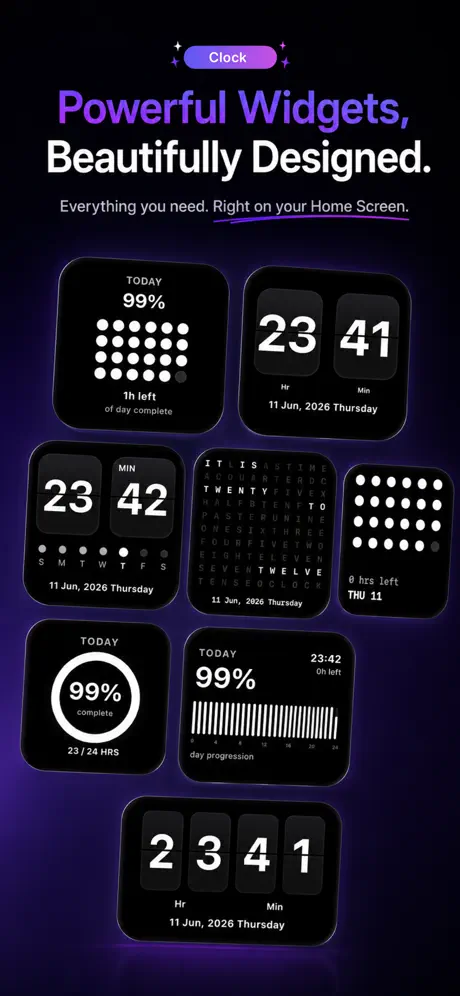
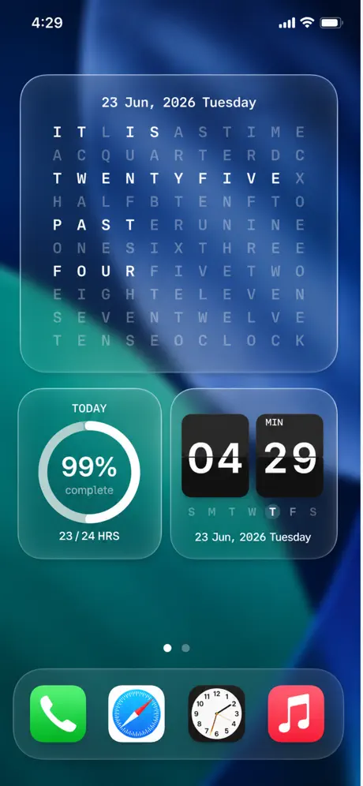
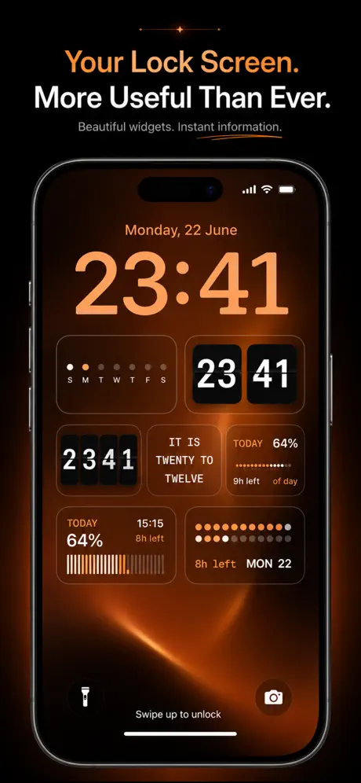

Retroflip adalah **[jam flip](/id/glossary/what-is-a-flip-clock/)** retro gratis dan tampan untuk Android — tapi sebagian besar berhenti di wajah jam. Tidak ada **white noise untuk fokus atau tidur, tidak ada overlay jam melayang, tidak ada widget, dan tidak ada versi iPhone**. Jika Anda ingin jam flip yang juga memutar suara ambient, berada di atas aplikasi lain, atau berjalan di iOS, kategori ini sudah berkembang pesat.

Di bawah ini kami membandingkan enam **alternatif Retroflip** yang kuat — dari jam layar penuh lucu dan kaya fitur hingga jam flip ramah Pomodoro — across harga, platform, dan kemampuan sehari-hari yang benar-benar penting. Sebagian besar pembaca datang dengan satu penghalang — iklan, widget yang hilang, atau tidak ada versi iOS — jadi tiap pilihan dibingkai menurut alasan itu.

## Mengapa melihat di luar Retroflip

- **Tanpa suara ambient** — tidak ada white noise, jadi tidak bisa membantu Anda fokus atau tertidur.
- **Tanpa jam melayang** — waktu hanya ada di dalam aplikasi, bukan di atas aplikasi lain.
- **Tanpa widget layar utama** — Anda tak bisa melihat waktu sekilas dari peluncur.
- **Hanya Android** — pengguna iPhone dan iPad tertinggal.
- **Tema terbatas** — kustomisasi lebih ringan daripada aplikasi jam flip khusus.

## Alternatif Retroflip terbaik sekilas

| App | Harga (2026) | Platform | Terbaik untuk |
|---|---|---|---|
| **Only Clock** | Inti gratis + buka kunci | Android, iOS | Tema, white noise, jam melayang, widget |
| **FliTik** | Gratis + IAP | iOS (dan desktop/Android) | Pomodoro, hitung mundur, jam flip ambient |
| **Flip Clock: World Clock** | Gratis + IAP | Android | Jam flip cuaca, widget, dan world-clock |
| **Fullscreen Clock** | Gratis + IAP | iOS | Fokus layar penuh minimal |
| **Flip Clock: Digital Desk Widget** | Gratis + IAP | iOS | Widget meja + screensaver jam flip |
| **Flip Clock — Digital Clock** | Gratis + IAP | iOS | Jam flip bertema ringan |

---

### 1. Only Clock — jam flip serba fitur terbaik

{: width="180" .normal }
{: width="180" .normal }
{: width="180" .normal }
{: width="180" .normal }
{: width="180" .normal }

Only Clock adalah **jam flip layar penuh** untuk Android dan iOS dengan animasi flip yang indah, banyak tema, white noise untuk fokus, jam melayang, dan widget. Ini peningkatan serba ada terdekat ke Retroflip dan memperbaiki hampir setiap celah di atas.

**Keunggulan**
- **Animasi flip layar penuh** dengan banyak tema indah yang bisa Anda ganti bebas.
- **White noise bawaan** — hujan, hutan, perapian, dan lainnya untuk membantu fokus atau tidur.
- **Jam melayang** overlay agar Anda bisa melihat waktu di atas aplikasi lain.
- **Widget jam** untuk layar utama, plus tampilan 12/24-jam dan tanggal.
- **Berjalan di Android dan iOS**, dan bekerja hebat di ponsel cadangan atau iPad sebagai jam meja.
- Tanpa akun diperlukan — buka saja, jam langsung jalan.

**Kelemahan**
- Tema dan suara terkaya berada di balik buka kunci sekali bayar atau berlangganan kecil.
- Penyesuaian widget lebih terbatas di iOS daripada Android.
- Tanpa tampilan jam dunia / multi-zona waktu.

**Terbaik untuk:** orang yang menginginkan satu jam flip yang juga memutar suara, melayang di atas aplikasi, dan bekerja di Android dan iPhone.

**Unduh Only Clock**
- [Google Play](https://play.google.com/store/apps/details?id=com.glgjing.only.flip.clock)
- [App Store](https://apps.apple.com/us/app/only-clock-flip-clock/id1566706513)

---

### 2. FliTik — terbaik untuk Pomodoro dan hitung mundur

{: width="180" .normal }
{: width="180" .normal }
{: width="180" .normal }
{: width="180" .normal }

FliTik adalah **jam flip** lintas platform yang mengedepankan ritual: animasi flip memukau, pengatur Pomodoro, mode hitung-maju/hitung-mundur, dan suara ambient sehingga setiap detik terasa disengaja. Populer sebagai pendamping fokus belajar dan kerja.

**Keunggulan**
- **Pengatur Pomodoro** plus mode hitung-maju dan hitung-mundur untuk sprint belajar dan kerja.
- **Tampilan flip indah dan atmosferik** yang tampak hebat sebagai jam meja atau samping tempat tidur.
- **Suara ambient** dicampur dengan jam untuk fokus dan relaksasi.
- **Lintas platform** (iOS, desktop, dan Android), sehingga setup Anda mengikuti.
- Angka besar yang jelas tetap terbaca dari seberang ruangan.

**Kelemahan**
- Beberapa tema dan fitur pengatur berada di balik pembelian dalam aplikasi.
- Lebih ringan dalam kustomisasi mentah (warna/posisi) daripada aplikasi widget jam murni.
- Ketersediaan Android via sideload/cermin toko, bukan satu daftar unggulan.

**Terbaik untuk:** pelajar dan pekerja fokus yang menginginkan jam flip yang juga menjalankan sesi Pomodoro dan hitung mundur.

**Unduh FliTik**
- [App Store](https://apps.apple.com/us/app/flitik-flip-clock-pomodoro/id6448849784)

---

### 3. Flip Clock: World Clock — jam flip Android terbaik dengan cuaca

{: width="180" .normal }
{: width="180" .normal }
{: width="180" .normal }
{: width="180" .normal }
{: width="180" .normal }

Flip Clock: World Clock adalah **jam flip** Android gratis yang menambahkan cuaca, widget layar utama, pengatur Pomodoro, dan jam melayang di atas wajah flip klasik.

**Keunggulan**
- **Jam flip dengan cuaca** untuk lokasi Anda, praktis sebagai jam meja.
- **Widget layar utama** agar waktu tampil di peluncur.
- **Pengatur Pomodoro dan jam melayang** untuk sesi fokus.
- Gratis untuk memulai, dengan peningkatan dalam aplikasi opsional.
- Ringan dan mudah disiapkan.

**Kelemahan**
- Didukung iklan di tingkat gratis, yang bisa mengganggu tampilan tenang.
- Cuaca dan beberapa widget berada di balik IAP.
- Tidak ada versi iOS.

**Terbaik untuk:** pengguna Android yang menginginkan jam flip dengan cuaca dan widget tanpa bayar di muka.

**Unduh Flip Clock: World Clock**
- [Google Play](https://play.google.com/store/apps/details?id=com.wssc.simpleclock)

---

### 4. Fullscreen Clock — fokus layar penuh minimal terbaik

{: width="360" .normal }
{: width="360" .normal }

Fullscreen Clock: Flip & Focus mengubah iPhone atau iPad Anda menjadi **jam flip** bersih, selalu-menyala, dengan tiga belas wajah, peredupan malam, dukungan lanskap, dan Pomodoro bawaan.

**Keunggulan**
- **Tiga belas wajah jam** termasuk gaya flip dan fokus.
- **Layar tetap terjaga** dan mendukung peredupan malam untuk pemakaian samping tempat tidur.
- **Pomodoro bawaan** untuk sesi kerja fokus.
- Dukungan lanskap dan potret; UI sangat bersih dan minimal.
- Tanpa akun diperlukan.

**Kelemahan**
- Hanya iOS — tidak ada aplikasi Android.
- Sebagian besar paket wajah dan fitur berada di balik IAP.
- Tanpa suara ambient sendiri.

**Terbaik untuk:** pemilik iPhone/iPad yang menginginkan jam layar penuh minimal indah dengan Pomodoro.

**Unduh Fullscreen Clock**
- [App Store](https://apps.apple.com/us/app/fullscreen-clock-flip-focus/id1403700342)

---

### 5. Flip Clock: Digital Desk Widget — widget meja + screensaver terbaik

{: width="360" .normal }
{: width="360" .normal }

Flip Clock: Digital Desk Widget adalah aplikasi iOS yang berfokus pada **jam flip gaya desktop**, widget standby interaktif, dan mode seperti screensaver untuk meja dan samping tempat tidur.

**Keunggulan**
- **Widget StandBy dan interaktif** yang menampilkan jam flip langsung.
- **Mode screensaver** untuk setup mengisi daya/meja.
- Menampilkan detik, tanggal, dan kalender, dengan format 12/24-jam.
- Gaya hitam-putih dan bertema.
- Desain bersih ramah-Apple.

**Kelemahan**
- Hanya iOS.
- Fitur terbaik membutuhkan versi berbayar.
- Tanpa white noise atau overlay melayang.

**Terbaik untuk:** pengguna iPhone yang ingin jam flip yang bisa disematkan sebagai widget atau screensaver.

**Unduh Flip Clock: Digital Desk Widget**
- [App Store](https://apps.apple.com/us/app/flip-clock-digital-desk-widget/id1181028777)

---

### 6. Flip Clock — Digital Clock — jam bertema ringan terbaik

{: width="180" .normal }
{: width="180" .normal }
{: width="180" .normal }
{: width="180" .normal }
{: width="180" .normal }

Flip Clock — Digital Clock adalah **jam flip** iOS sederhana dan elegan dengan tema, widget standby, tampilan detik/tanggal, dan dukungan 12/24-jam — alternatif tanpa tambahan ke Retroflip.

**Keunggulan**
- **Animasi flip elegan** dengan beberapa tema melampaui hitam-putih.
- **Dukungan widget standby dan interaktif**.
- Menampilkan detik, tanggal, dan kalender.
- Ringan dan cepat diluncurkan.
- Gratis dicoba dengan peningkatan opsional.

**Kelemahan**
- Hanya iOS.
- Tanpa suara, jam melayang, atau Pomodoro.
- Tema adalah ekstra berbayar utama.

**Terbaik untuk:** pengguna iPhone yang menginginkan jam flip bertema bersih tanpa fitur ekstra.

**Unduh Flip Clock — Digital Clock**
- [App Store](https://apps.apple.com/us/app/flip-clock-digital-clock/id1479450824)

---

## Perbandingan kemampuan inti

| Kemampuan | Only Clock | FliTik | Flip Clock: World Clock | Fullscreen Clock | Flip Clock: Digital Desk Widget | Flip Clock — Digital Clock |
|---|---|---|---|---|---|---|
| **Platform** | Android, iOS | iOS (+desktop/Android) | Android | iOS | iOS | iOS |
| **Animasi flip layar penuh** | Ya | Ya | Ya | Ya (flip & lainnya) | Ya | Ya |
| **Tema / kustomisasi** | Banyak | Atmosferik | Dasar | 13 wajah | Bertema | Bertema |
| **White noise / suara fokus** | Ya | Ya | Tidak | Tidak | Tidak | Tidak |
| **Overlay jam melayang** | Ya | Tidak | Ya | Tidak | Tidak | Tidak |
| **Widget** | Ya | Tidak | Ya | Tidak | StandBy + interaktif | StandBy + interaktif |
| **Cuaca** | Tidak | Tidak | Ya | Tidak | Tidak | Tidak |
| **Pomodoro / pengatur** | Tidak | Ya | Ya | Ya | Tidak | Tidak |
| **Hitung mundur / hitung maju** | Tidak | Ya | Tidak | Tidak | Tidak | Tidak |
| **12/24j + tanggal** | Ya | Ya | Ya | Ya | Ya | Ya |
| **Tingkat gratis** | Murah hati | Gratis + IAP | Gratis + IAP | Gratis + IAP | Gratis + IAP | Gratis + IAP |
| **Iklan** | Tidak | Tidak | Ya (gratis) | Tidak | Tidak | Tidak |

---

## Alternatif Retroflip mana yang cocok untuk tiap jenis pengguna

Tabel memeringkat fitur; di sini keenam aplikasi dikelompokkan menurut *apa yang Anda inginkan dari jam selain menampilkan waktu*.

- **Jam bertema yang juga memutar suara** — **alternatif Flip Clock (Soosu)** atau **alternatif Nightdream** biasanya soal wajah tenang selalu-menyala; Only Clock menambahkan white noise, pengatur fokus, dan mode melayang ke ide itu.
- **Jam flip desktop atau browser** — **alternatif Fliqlo** cocok untuk komputer; FliTik dan Flip Clock: Digital Desk Widget mencakup tampilan widget meja di ponsel.
- **Widget dan world clock** — **alternatif ClockLab** atau **alternatif Digital Clock Widget** menunjuk ke wajah layar utama kecil; Flip Clock: World Clock adalah versi cuaca-dan-zona-waktu.
- **Mengganti aplikasi alarm bawaan** — **alternatif Google Clock** adalah tugas berbeda: alarm dan pengatur waktu, bukan tampilan layar penuh dekoratif.
- **Tetap tanpa iklan semalam** — daftar pendek **alternatif Jam Retroflip** sebaiknya disaring dari iklan dan peredupan dulu, karena ponsel tetap menyala berjam-jam.

Apa pun labelnya, ajukan dua pertanyaan sebelum migrasi: bisakah tampilan tetap redup tanpa membakar layar OLED, dan apakah tingkat gratis masih menyertakan widget yang benar-benar Anda pakai?

## Cara memilih

- Ingin **tema + white noise + jam melayang + widget di kedua platform** → **Only Clock**
- Ingin **Pomodoro, hitung mundur, dan jam flip ambient** → **FliTik**
- Ingin **jam flip Android gratis dengan cuaca dan widget** → **Flip Clock: World Clock**
- Ingin **jam layar penuh iOS minimal dengan Pomodoro** → **Fullscreen Clock**
- Ingin **widget meja / screensaver jam flip di iPhone** → **Flip Clock: Digital Desk Widget**
- Ingin **jam bertema iOS ringan** → **Flip Clock — Digital Clock**

## Cara migrasi dari Retroflip

1. **Pilih pengganti** menggunakan tabel di atas berdasarkan platform dan apakah Anda ingin suara, widget, atau jam melayang.
2. **Pasang dan berikan izin yang diperlukan** (tampilan di atas aplikasi lain untuk jam melayang, optimasi baterai mati untuk selalu-menyala).
3. **Atur tampilan 12/24-jam dan tanggal** agar cocok dengan yang Anda pakai di Retroflip.
4. **Tambahkan widget** (Only Clock, Flip Clock: World Clock, atau aplikasi widget iOS) ke layar utama atau layar kunci untuk waktu sekilas.
5. **Jika Anda ingin bantuan fokus atau tidur**, aktifkan white noise (Only Clock, FliTik) atau pengatur Pomodoro (FliTik, Fullscreen Clock, Flip Clock: World Clock) agar jam melakukan lebih dari sekadar menunjukkan waktu.

## FAQ

**Apakah Only Clock alternatif Retroflip terbaik?**
{:.faq-q}

Untuk sebagian besar orang, ya. Only Clock adalah peningkatan serba ada terdekat — ia menambahkan white noise, jam melayang, widget, dan dukungan iOS sambil mempertahankan tampilan jam flip yang disukai pengguna Retroflip.

**Alternatif Retroflip mana yang punya white noise?**
{:.faq-q}

Only Clock dan FliTik keduanya menyertakan suara ambient; empat opsi iOS lainnya adalah jam sunyi.

**Alternatif Retroflip mana yang bekerja di Android dan iOS?**
{:.faq-q}

Only Clock berjalan di kedua platform; Flip Clock: World Clock hanya mencakup Android, dan sisanya hanya iOS.

**Apakah Only Clock gratis?**
{:.faq-q}

Ya. Jam inti, tema, dan white noise berfungsi gratis; buka kunci sekali bayar atau berlangganan membuka tema dan suara terkaya.

[Halaman aplikasi Only Clock](/id/apps/only-clock/) — tersedia di Android dan iOS.

## Istilah terkait

- [Apa Itu Jam Flip?](/id/glossary/what-is-a-flip-clock/)
- [Apa Itu Jam Meja Samping Tempat Tidur?](/id/glossary/what-is-a-nightstand-clock/)
