Streaks menjadikan pelacakan kebiasaan sebagai ritual harian bagi jutaan pengguna iPhone — aplikasi rapi peraih Apple Design Award yang terus menyentil Anda agar rantai tetap hidup. Namun ada batas nyata: **hanya tersedia di iPhone dan iPad, berbayar di awal tanpa paket gratis, sinkronisasi terkunci pada iCloud, dan kustomisasinya berada di dalam ekosistem Apple**. Jika Anda menginginkan dukungan Android, sinkronisasi lintas platform, statistik lebih dalam, opsi gratis, atau antarmuka lebih menyenangkan, pilihan **alternatif Streaks** kini berkembang pesat.

Di bawah kami membandingkan enam **alternatif Streaks** yang tangguh — dari **aplikasi pelacak kebiasaan** lucu yang mengutamakan privasi hingga sistem RPG bergamifikasi dan pembinaan berbasis sains — dari sisi harga, platform, fitur inti, dan kemampuan sehari-hari yang benar-benar berarti. Kebanyakan pembaca datang dengan satu hambatan konkret — tidak ada aplikasi Android, tidak ada paket gratis, atau tidak ada cara mengekspor riwayat — sehingga setiap pilihan dirangkai berdasarkan alasan orang benar-benar berpindah.

## Mengapa mencari alternatif Streaks

{: width="180" .normal }
{: width="180" .normal }
{: width="180" .normal }
{: width="180" .normal }
{: width="180" .normal }

- **Hanya iPhone/iPad** — tidak ada aplikasi Android dan akses desktop terbatas, sehingga rumah tangga dengan perangkat campuran tak terakomodasi.
- **Berbayar di awal (~$5.99)** tanpa paket gratis untuk mencoba sebelum membeli.
- **Sinkronisasi hanya iCloud** — tidak ada akun mandiri, jadi pindah ke Android atau Windows merepotkan.
- **Analitik berfokus pada rantai** — statistiknya rapi tapi lebih ringan dari aplikasi statistik khusus.
- **Lapisan sosial minimal** — akuntabilitas masih serba manual (berbagi tugas), tanpa komunitas atau pembinaan.

## Sekilas alternatif Streaks terbaik

| Aplikasi | Harga (2026) | Platform | Build + Break | Cocok untuk |
|---|---|---|---|---|
| **Meow Habits** | Inti gratis + VIP (~$9.99/thn) | Android, iOS | **Ya** | UI lucu, 500+ ikon, privat, tanpa akun |
| **Habitica** | Gratis + langganan (~$4.99/bln) | Android, iOS, web | Ya | Akuntabilitas RPG bergamifikasi |
| **Loop Habit Tracker** | Gratis, open-source | Android | Ya | Statistik polos, privasi, tanpa akun |
| **Fabulous** | Gratis + langganan (~$12/bln) | Android, iOS | Rutinitas + pembinaan | Pembinaan berbasis sains |
| **Productive** | Gratis + Pro (~$2.50/bln) | iOS | Ya | Widget iOS yang rapi |
| **Habitify** | Gratis + langganan | iOS, Android, web | Ya | Lintas platform, pelacakan berdasarkan waktu |

---

### 1. Meow Habits — terbaik untuk pelacak kebiasaan lucu, privat, tanpa akun

{: width="180" .normal }
{: width="180" .normal }
{: width="180" .normal }
{: width="180" .normal }
{: width="180" .normal }

Meow Habits adalah **[aplikasi habit tracker](/id/glossary/what-is-a-habit-tracker/)** bertema kucing untuk Android dan iOS. Ciri paling menonjol adalah **antarmukanya**: desain kartun lucu dengan **500+ ikon kategori kaya** yang membuat check-in harian terasa ringan, bukan seperti beban produktivitas. Di luar tampilan, aplikasi ini mencakup dasar-dasar praktis kebiasaan — dan melakukannya tanpa memaksa Anda masuk ke akun cloud.

**Kelebihan**
- **UI kartun yang indah dengan 500+ ikon custom** — pembeda paling jelas; mencatat kebiasaan terasa menyenangkan secara visual.
- **Mode build dan break** — lacak rutinitas positif atau berhenti dari kebiasaan buruk dalam satu aplikasi.
- **Daftar kebiasaan, streak harian, dan tampilan kalender / heatmap** (harian / mingguan / bulanan) sehingga momentum terlihat sekilas.
- **Ekspor CSV** (semua kebiasaan atau rentang tanggal) untuk Excel, plus **backup Google Drive / WebDav** — data Anda hanya keluar dari kendali saat Anda memilihnya.
- **Tanpa akun** — kebiasaan tetap di perangkat dengan kunci sidik jari opsional, yang jarang ditemui di aplikasi kebiasaan arus utama.
- Pengingat, mode gelap/terang, dan grafik kebiasaan (persentase penyelesaian, grafik kontribusi).

**Kekurangan**
- **Tanpa sinkronisasi cloud lintas platform otomatis** — sinkronisasi memakai Google Drive (Android) atau WebDav, bukan akun khusus, jadi berpindah antara ponsel Android dan iPhone kurang mulus dibanding aplikasi berbasis akun.
- **Fitur lanjutan** (mis. grafik lebih kaya / kebiasaan ekstra) berada di balik VIP murah (~$0.99/bln atau $9.99/thn); inti gratis sudah cukup untuk **catatan kebiasaan offline** sehari-hari.
- Tanpa gamifikasi atau lapisan sosial/komunitas, serta ekosistem lebih kecil dari pemain besar.

**Cocok untuk:** orang yang ingin **aplikasi pelacak kebiasaan** yang jelas dan privat tanpa akun cloud, menghargai antarmuka bersahabat, dan tidak keberatan dengan pengaturan manual ringan.

**Unduh Meow Habits**
- [Google Play](https://play.google.com/store/apps/details?id=com.glgjing.meow.habit.goal)
- [App Store](https://apps.apple.com/us/app/meow-habits-habit-tracker/id6758230559)

---

### 2. Habitica — terbaik untuk akuntabilitas bergamifikasi

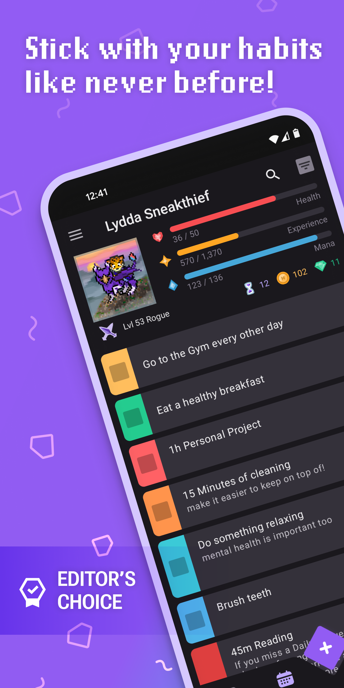{: width="180" .normal }
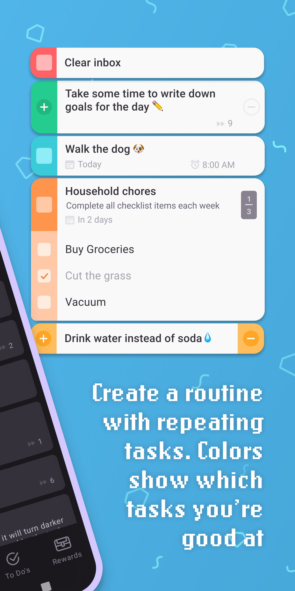{: width="180" .normal }
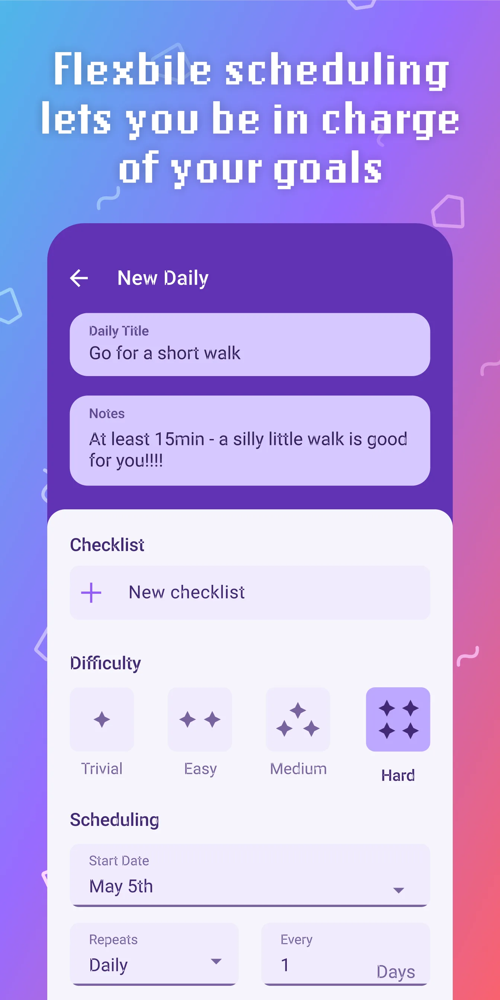{: width="180" .normal }
{: width="180" .normal }
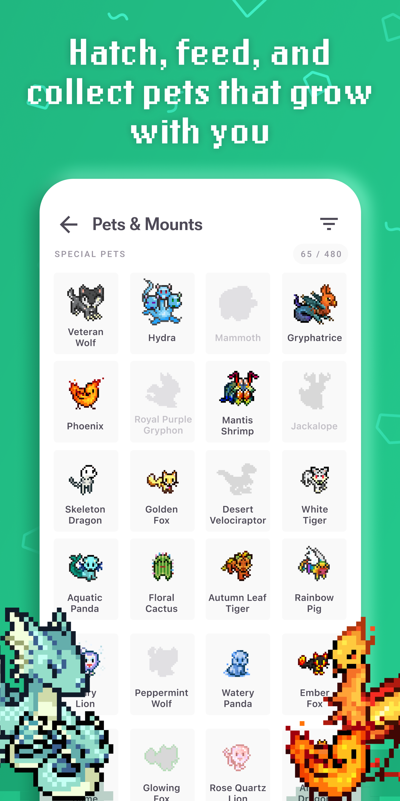{: width="180" .normal }

Habitica mengubah kebiasaan, tugas harian, dan daftar tugas Anda menjadi sebuah **RPG**. Anda membangun avatar, meraih XP dan emas saat menyelesaikan tugas, serta kehilangan health saat terlewat. Aplikasi ini lintas platform dengan akun, dan parties, guild, serta challenges menghadirkan lapisan sosial nyata yang tidak dimiliki Streaks.

**Kelebihan**
- **Sistem RPG bergamifikasi** (avatar, hewan peliharaan, perlengkapan, quest) membuat konsistensi terasa seperti game, bukan beban.
- **Sinkronisasi akun lintas platform yang kuat** di Android, iOS, dan web.
- **Parties, guild, dan challenges** memberi akuntabilitas sosial nyata serta persaingan bersahabat.
- **Paket gratis yang murah hati** dan sepenuhnya open-source.
- Integrasi dengan **Apple Health / Google Fit**; pengingat dan widget layar utama.

**Kekurangan**
- **Mekanika game bisa terasa berantakan atau kekanak-kanakan** bagi pengguna yang hanya ingin produktivitas polos.
- Manfaat terbesar hanya didapat bila Anda **terlibat dengan sistem RPG**; pengguna kasual mungkin merasa UI-nya ramai.
- **Analitik kebiasaan lebih ringan** dibanding aplikasi berfokus statistik seperti Loop — grafik tren dan heatmap lebih dangkal.
- Sebagian kosmetik dan fitur kenyamanan berada di balik langganan, meski aplikasi tetap sepenuhnya terpakai secara gratis.

**Cocok untuk:** orang yang termotivasi oleh game, level, hewan peliharaan, dan akuntabilitas party.

**Unduh Habitica**
- [Google Play](https://play.google.com/store/apps/details?id=com.habitrpg.android.habitica)
- [App Store](https://apps.apple.com/us/app/habitica-gamified-taskmanager/id994882113)

---

### 3. Loop Habit Tracker — terbaik untuk statistik gratis, open-source, dan mengutamakan privasi

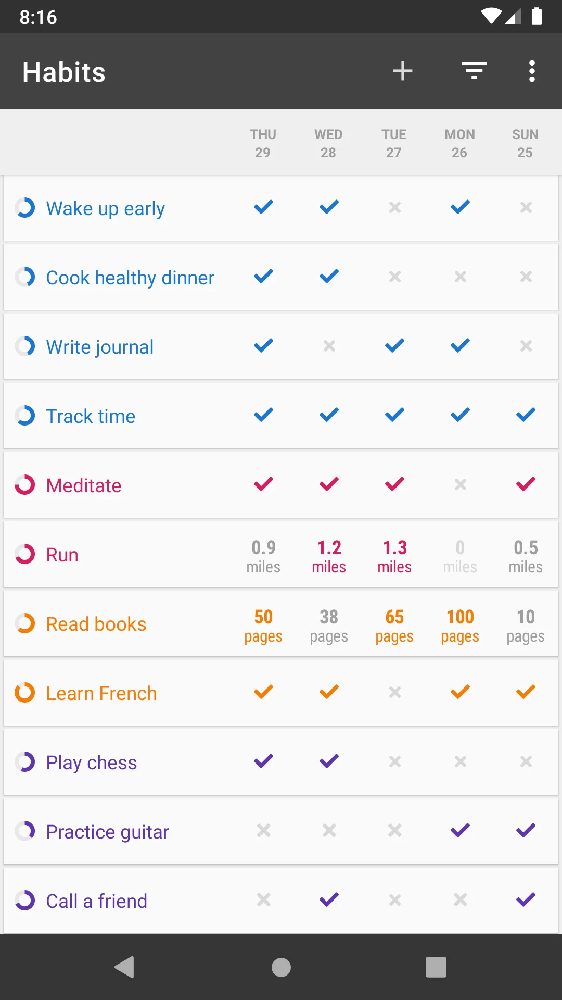{: width="180" .normal }
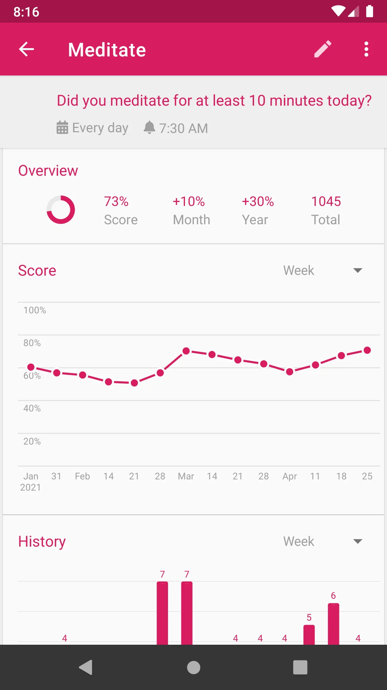{: width="180" .normal }
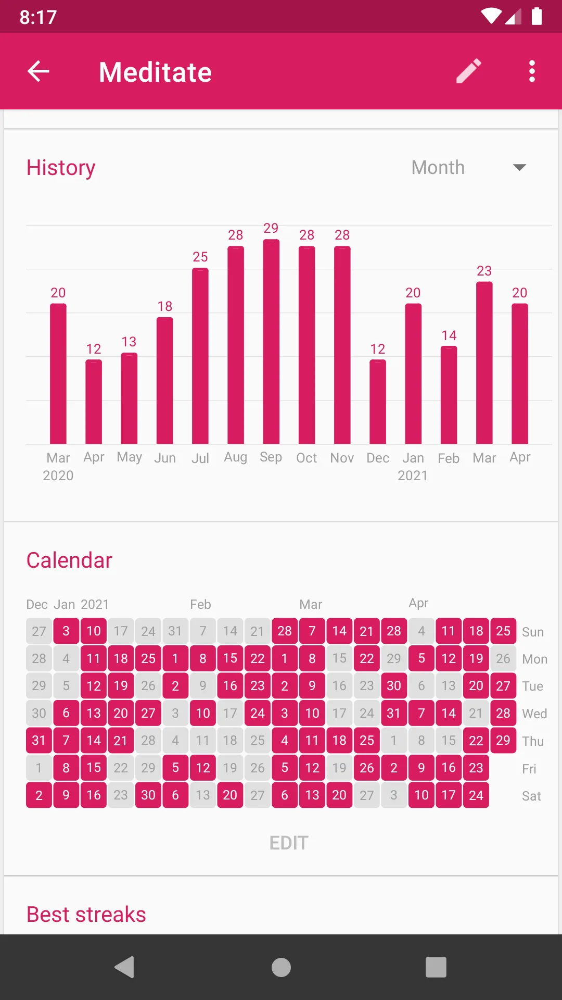{: width="180" .normal }
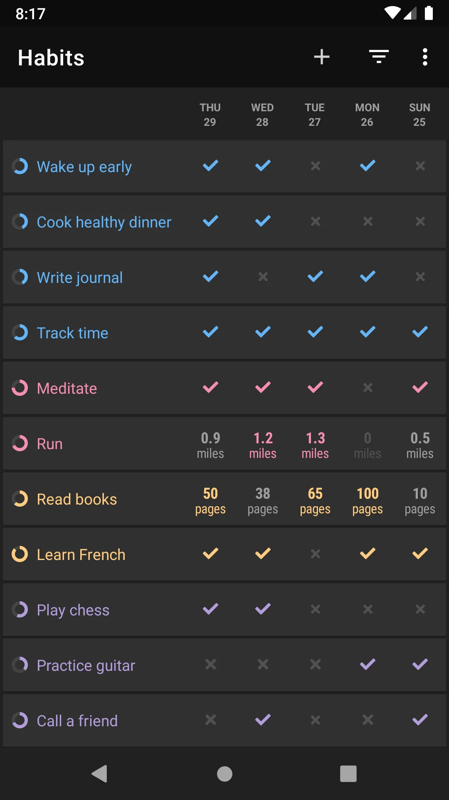{: width="180" .normal }
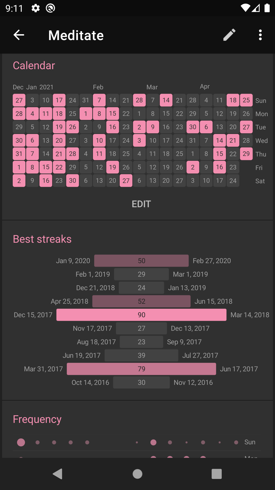{: width="180" .normal }

Loop adalah **aplikasi habit tracker** yang **gratis, open-source, dan bebas iklan** untuk Android. Ia memangkas semuanya sampai ke statistik yang solid — skor kebiasaan, streak harian, frekuensi — dan tidak pernah meminta Anda mendaftar. Tidak ada versi iOS, tetapi bagi puritan Android sulit mengalahkannya.

**Kelebihan**
- **Sepenuhnya gratis, open-source, tanpa iklan, dan tanpa akun.**
- **Statistik terperinci**: skor kebiasaan, streak saat ini/terbaik, frekuensi, dan heatmap yang rapi.
- **Target dan pengingat**; mendukung kebiasaan build maupun break.
- **Menghormati privasi** serta sangat ringan dan cepat.
- Widget layar utama untuk mengecek sekilas.

**Kekurangan**
- **Hanya Android** — tanpa iOS, web, atau klien desktop.
- **Tanpa sinkronisasi cloud atau lintas perangkat**; data tersimpan lokal dengan ekspor/impor manual saja.
- **Tanpa gamifikasi, tanpa sosial, tanpa pembinaan** — murni pelacak kebiasaan.
- UI lebih polos dengan bimbingan lebih sedikit untuk pemula.

**Cocok untuk:** pengguna Android yang ingin **aplikasi kebiasaan gratis** yang privat dan berfokus statistik tanpa syarat tambahan.

**Unduh Loop Habit Tracker**
- [Google Play](https://play.google.com/store/apps/details?id=org.isoron.uhabits)

---

### 4. Fabulous — terbaik untuk pembinaan berbasis sains

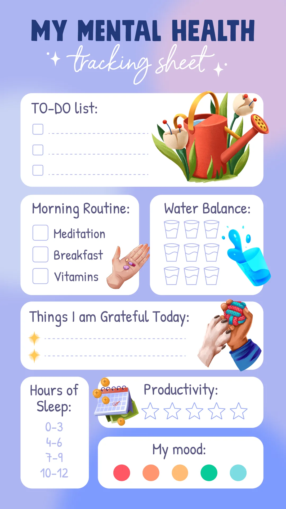{: width="180" .normal }
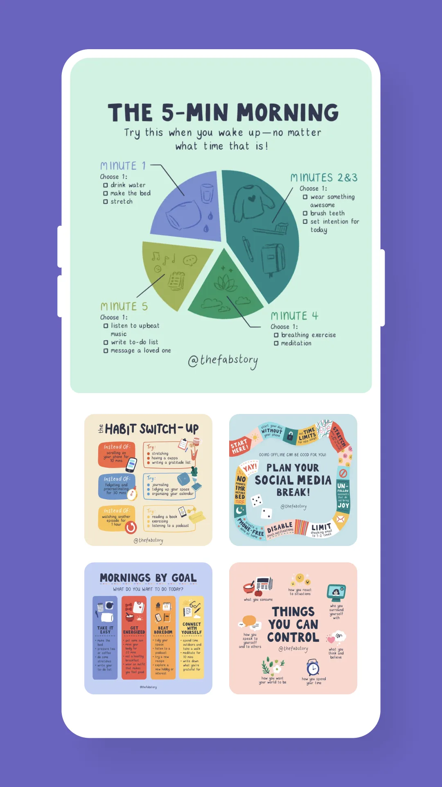{: width="180" .normal }
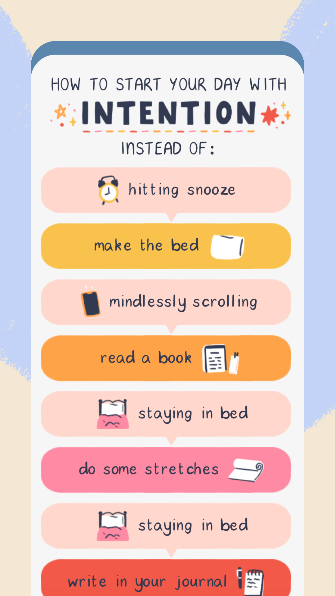{: width="180" .normal }
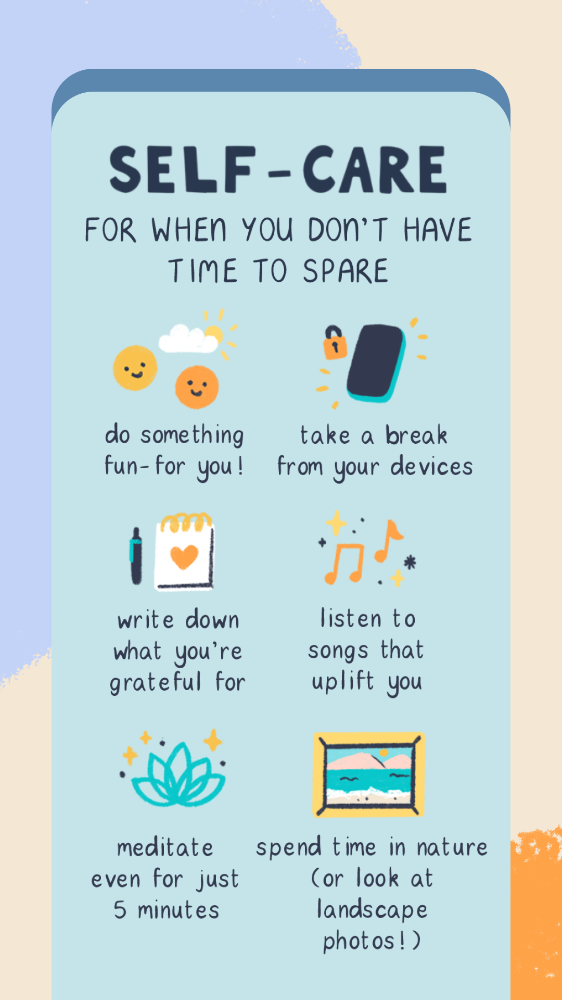{: width="180" .normal }
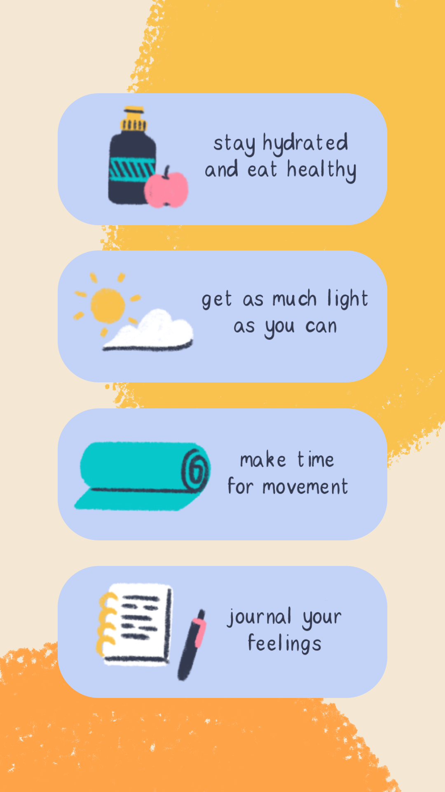{: width="180" .normal }

Fabulous berawal dari **proyek riset ekonomi perilaku Duke University** dan memandang pembentukan kebiasaan sebagai perjalanan terbimbing — rutinitas pagi, meditasi, tidur, kebugaran, dan makan dengan kesadaran — dengan pembinaan, bukan sekadar kotak centang.

**Kelebihan**
- **Pembinaan berbasis sains dan perjalanan terstruktur**, bukan sekadar centang tugas.
- **Rutinitas terbimbing** untuk pagi, fokus, tidur, kebugaran, dan nutrisi.
- **Lintas platform** (Android + iOS) dengan sinkronisasi akun.
- Desain rapi dan menenangkan yang makin personal seiring waktu.
- Terintegrasi dengan aplikasi Health untuk langkah dan tidur.

**Kekurangan**
- **Berat pada langganan** — sebagian besar perjalanan berada di balik Fabulous Premium (bisa ~$12/bln).
- Pendekatan pembinaan bisa terasa **berlebihan** bagi pengguna yang ingin pelacak sederhana.
- **Kurang soal statistik kebiasaan mentah**; lebih soal program dan streak di dalam satu perjalanan.
- Relatif mahal dibanding pelacak yang lebih sederhana, dan sebagian pengguna merasa prompting-nya memaksa.

**Cocok untuk:** orang yang ingin program dipandu coach untuk membangun rutinitas nyata, bukan sekadar checklist.

**Unduh Fabulous**
- [Google Play](https://play.google.com/store/apps/details?id=co.thefabulous.app)
- [App Store](https://apps.apple.com/us/app/fabulous-daily-habit-tracker/id1203637303)

---

### 5. Productive — terbaik untuk pengalaman iOS yang rapi

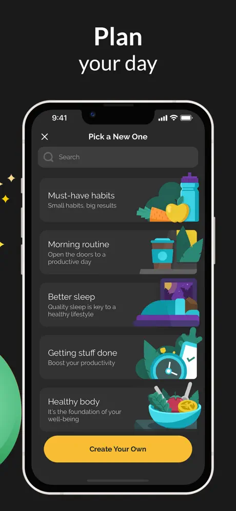{: width="180" .normal }
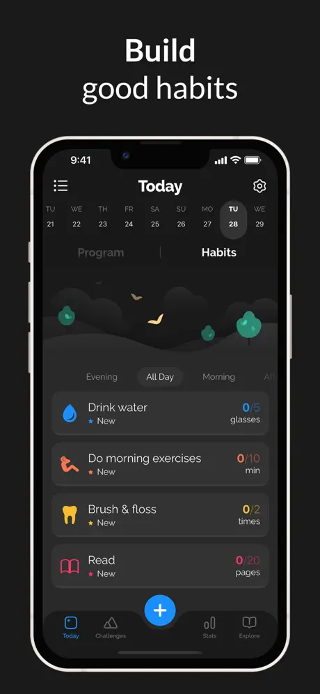{: width="180" .normal }
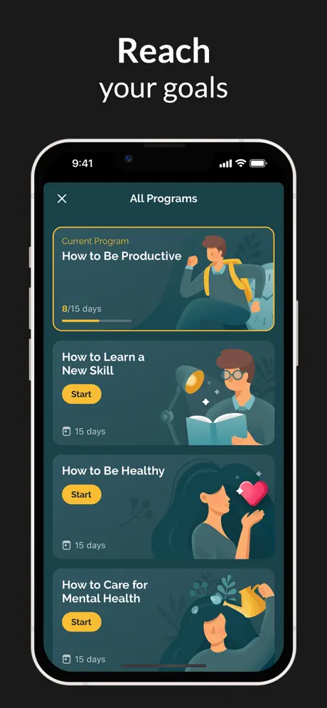{: width="180" .normal }
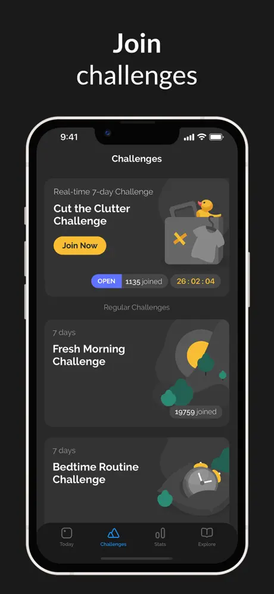{: width="180" .normal }
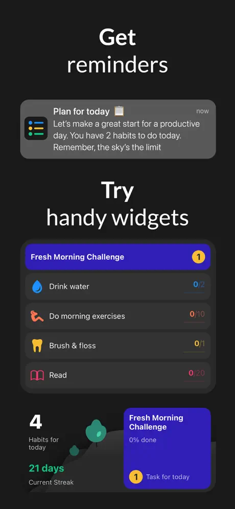{: width="180" .normal }

Productive adalah salah satu **aplikasi habit tracker iOS paling populer**, dikenal karena antarmuka bersih dan indah serta widget yang sangat baik. Aplikasi ini mengutamakan iPhone/iPad dan mengikuti bahasa desain Apple, sehingga menjadi saudara spiritual terdekat Streaks bagi pengguna Apple.

**Kelebihan**
- **UI iOS yang rapi dan indah** dengan widget layar utama serta layar kunci yang luar biasa.
- **Kebiasaan build dan break**, kategori, pengingat, dan tantangan.
- Alur perencana harian yang baik dan statistik yang bersih.
- Dukungan Apple Watch dan pintasan Siri.

**Kekurangan**
- **Berfokus pada iOS** — tidak ada aplikasi Android sungguhan, jadi bukan opsi bagi pengguna Android.
- Banyak fitur berada di balik **Productive Pro** (langganan).
- **Kurang kuat untuk kebiasaan kompleks atau berdata berat**, dan tidak lintas platform dengan teman.

**Cocok untuk:** pengguna iPhone yang ingin **aplikasi pelacak kebiasaan** paling mulus dan ramah widget.

**Unduh Productive**
- [App Store](https://apps.apple.com/us/app/productive-habit-tracker/id983826477)

---

### 6. Habitify — terbaik untuk pelacakan lintas platform berbasis waktu

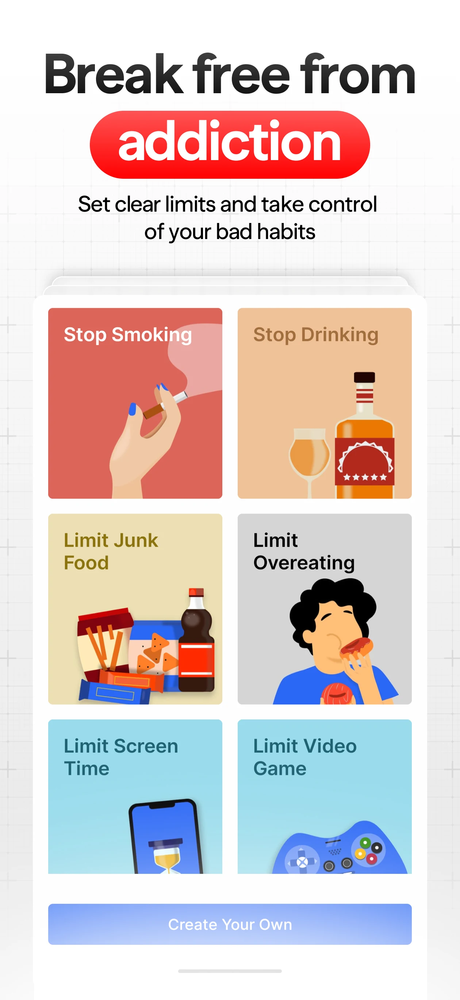{: width="180" .normal }
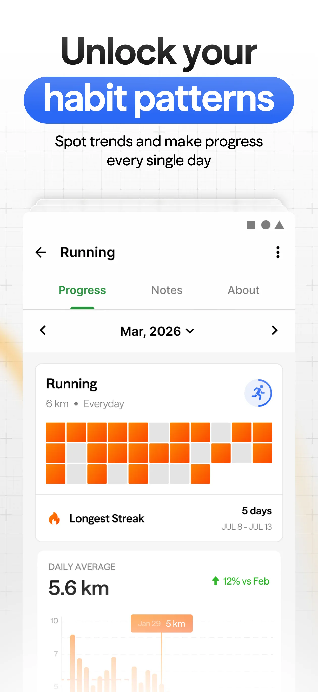{: width="180" .normal }
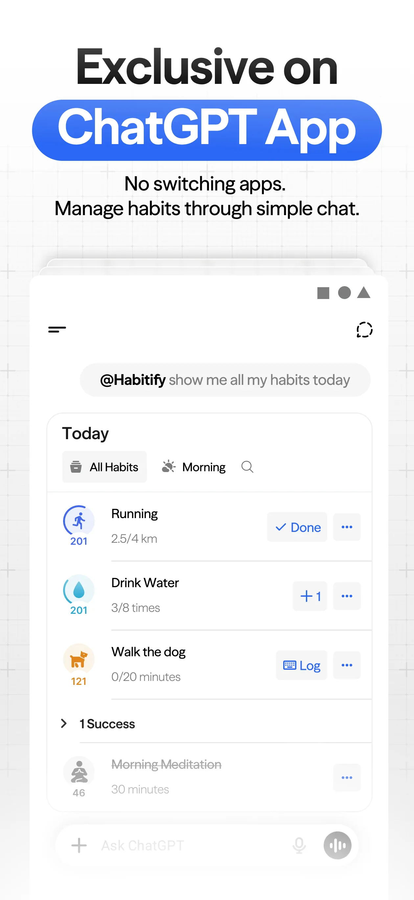{: width="180" .normal }
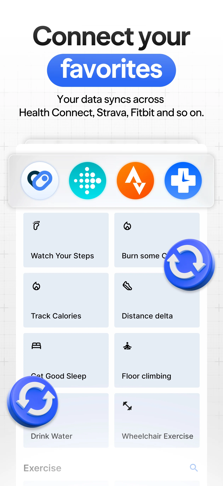{: width="180" .normal }

Habitify adalah **aplikasi habit tracker lintas platform** (iOS, Android, web, Wear OS) yang menyusun kebiasaan berdasarkan **waktu dalam sehari — pagi, siang, malam** — dan menyinkronkannya secara real time. Pilihan kuat bila Anda hidup di beberapa perangkat dan suka kebiasaan yang tersisip rapi ke dalam jadwal.

**Kelebihan**
- **Benar-benar lintas platform** dengan sinkronisasi real time di Android, iOS, web, dan jam tangan.
- **Menyusun kebiasaan berdasarkan waktu sehari**, yang pas dengan rutinitas harian secara alami.
- Analitik bersih, pengingat, dan nuansa produktivitas yang fokus.
- Pernah jadi "App of the Day" pilihan Apple; 3M+ pengguna; tersedia paket gratis.

**Kekurangan**
- Sebagian fitur (kebiasaan tak terbatas, pengingat pintar, area custom) berada di balik **Habitify Plus / Pro**.
- Kurang jenaka dibanding Meow Habits; versi Android secara historis tertinggal dari pengalaman iOS.
- Tanpa lapisan RPG bergamifikasi seperti Habitica.

**Cocok untuk:** orang yang hidup di banyak perangkat dan ingin kebiasaan tersisip ke dalam hari mereka.

**Unduh Habitify**
- [Google Play](https://play.google.com/store/apps/details?id=co.unstatic.habitify)
- [App Store](https://apps.apple.com/us/app/habitify-habit-tracker/id1111447047)

---

## Perbandingan kemampuan inti

| Kemampuan | Meow Habits | Habitica | Loop | Fabulous | Productive | Habitify |
|---|---|---|---|---|---|---|
| **Platform** | Android, iOS | Android, iOS, web | Hanya Android | Android, iOS | iOS | iOS, Android, web |
| **Kebiasaan build + break** | Ya | Ya | Ya | Rutinitas + kebiasaan | Ya | Ya |
| **Pengingat** | Ya | Ya | Ya | Ya (pintar) | Ya | Ya |
| **Streak harian dan statistik** | Ya (grafik, heatmap) | Ringan (berbasis XP) | Kuat (skor, heatmap) | Berbasis program | Ya | Ya (analitik) |
| **Widget** | Ya | Ya | Ya | Terbatas | Kuat | Ya |
| **Sinkronisasi cloud / lintas perangkat** | Sebagian (Drive / WebDav) | Ya (akun) | Tidak (lokal) | Ya (akun) | iCloud | Ya (real-time) |
| **Gamifikasi / sosial** | Tidak | Kuat (RPG + parties) | Tidak | Pembinaan | Tantangan | Ringan |
| **Offline / privasi (tanpa akun)** | Kuat (di perangkat) | Berbasis akun | Kuat (tanpa akun) | Berbasis akun | Akun (iCloud) | Berbasis akun |
| **Paket gratis** | Inti lengkap | Lengkap | Penuh (gratis) | Terbatas | Terbatas | Lengkap |
| **Harga** | Gratis + VIP ~$9.99/thn | Gratis + ~$4.99/bln | Gratis (open-source) | Gratis + ~$12/bln | Gratis + ~$2.50/bln | Gratis + langganan |
| **Tema / ikon** | 500+ ikon kartun | Gaya RPG piksel | Minimal | Tema menenangkan | Tema rapi | Tema bersih |
| **Integrasi Health** | Sebagian | Apple Health / Google Fit | Tidak | Ya (Health) | Apple Health | Sebagian |

---

## Alternatif Streaks mana yang cocok untuk setiap jenis pengguna

Tabel di atas memeringkat fitur; di sini keenam aplikasi yang sama dikelompokkan berdasarkan *apa yang sebenarnya Anda ganti*.

- **Pindah karena platform** — Meow Habits satu-satunya pilihan yang menyatukan Android dan iOS dalam satu aplikasi habit tracker, dan langsung berfungsi sebagai **aplikasi kebiasaan tanpa akun** dengan catatan kebiasaan offline selepas instalasi. Dalam daftar **aplikasi kebiasaan gratis terbaik Android** ia juga menghindari jebakan **aplikasi habit tracker gratis tanpa langganan**: inti gratisnya tidak punya jam uji coba.
- **Pindah karena rantai sudah tak lagi memotivasi** — pencarian **alternatif Habitica** biasanya berarti hadiah dan akuntabilitas party harus menggantikan peran yang dulu dipegang streak harian.
- **Pindah karena data Anda** — **alternatif Loop Habit Tracker** cocok untuk statistik open-source di perangkat tanpa pendaftaran; Meow Habits mempertahankan gagasan itu dan menambah ekspor CSV plus backup WebDav.
- **Pindah karena struktur** — **alternatif Habitify** pas untuk kebiasaan yang terikat pagi, siang, dan malam lintas perangkat, sementara **alternatif Fabulous** pas untuk program pembinaan terbimbing. Keduanya butuh akun, yang menjadi trade-off dibanding alat khusus lokal.
- **Masih khusus iPhone** — Productive paling mirip nuansanya dengan Streaks, tapi mewarisi batasan iOS-only yang sama.

Jika pertanyaan sebenarnya adalah **aplikasi habit tracker** mana yang akan dipakai bertahun-tahun, mulailah dari dua hal yang tidak berubah mengikuti tren: bisakah Anda mengekspor riwayat, dan bisakah ia berjalan tanpa akun?

## Cara memilih

- Ingin **pelacak kebiasaan lucu, privat, tanpa akun dengan 500+ ikon** → **Meow Habits**
- Ingin **game, level, dan akuntabilitas party** → **Habitica**
- Ingin **statistik Android gratis, open-source, tanpa akun** → **Loop**
- Ingin **program dipandu coach** (tidur, fokus, kebugaran) → **Fabulous**
- Ingin **widget iOS paling mulus** → **Productive**
- Ingin **sinkronisasi lintas perangkat sejati yang tersisip berdasarkan waktu sehari** → **Habitify**

## Cara bermigrasi dari Streaks

1. **Catat tugas Streaks Anda saat ini** beserta jadwalnya (harian, selang sehari, mingguan).
2. **Pilih pengganti** memakai tabel di atas berdasarkan platform Anda dan apakah Anda ingin mode build, break, atau keduanya.
3. **Buat ulang kebiasaan** — pilih mode build atau break bila didukung, dan salin frekuensi setiap tugas.
4. **Atur pengingat** pada jam yang sama seperti di Streaks agar rantai baru bertahan selepas perpindahan.
5. **Aktifkan backup** (Meow Habits: Google Drive / WebDav; Habitica / Habitify / Fabulous: sinkronisasi akun) agar Anda tidak pernah terkunci.

## FAQ

**Apakah Meow Habits alternatif Streaks gratis yang bagus?**
{:.faq-q}

Ya. Ia berjalan di Android dan iOS (Streaks khusus iOS), gratis pada intinya tanpa akun, mendukung mode build *dan* break, serta menyimpan data di perangkat di balik kunci sidik jari.

**Apakah Meow Habits bisa dipakai di Android?**
{:.faq-q}

Ya — Android didukung penuh, dengan backup Google Drive dan widget layar utama untuk check-in satu ketukan.

**Alternatif Streaks mana yang terbaik untuk privasi?**
{:.faq-q}

Meow Habits — tanpa akun, penyimpanan di perangkat dengan kunci sidik jari opsional, dan backup hanya ke Google Drive atau WebDav milik Anda sendiri saat Anda mengaktifkannya.

**Bisakah saya memindahkan kebiasaan keluar dari Streaks?**
{:.faq-q}

Streaks tidak punya ekspor CSV, jadi Anda perlu membuat ulang kebiasaan secara manual; Meow Habits sendiri bisa mengekspor CSV, sehingga data Anda tetap mudah dipindahkan setelahnya.

[Halaman aplikasi Meow Habits](/id/apps/meow-habits/) — unduh untuk Android dan iOS.

## Istilah terkait

- [Apa Itu Habit Tracker?](/id/glossary/what-is-a-habit-tracker/)
