Jika Anda sedang mencari **alternatif Todoist**, besar kemungkinan Anda menginginkan biaya lebih rendah, privasi lebih baik, atau antarmuka yang lebih sederhana. Berikut **[aplikasi to-do list terbaik](/id/glossary/what-is-a-to-do-list/)** sebagai alternatif yang layak dilirik pada 2026 — tujuh aplikasi yang dipilih karena pangsa pasar besar atau keunggulan khas — lengkap dengan kelebihan dan kekurangan terperinci, perbandingan kemampuan inti, serta tautan unduhan langsung.

## Mengapa banyak pengguna mencari alternatif Todoist

{: width="180" .normal }
{: width="180" .normal }
{: width="180" .normal }
{: width="180" .normal }
{: width="180" .normal }

- Paket gratis **Beginner** membatasi Anda hingga ~5 proyek aktif dengan pengingat terbatas.
- **Integrasi kalender** dan banyak otomatisasi hanya tersedia di paket **Pro** (~$60/tahun).
- Sebagian pengguna sekadar menginginkan antarmuka lebih tenang dan tidak terlalu "digamifikasi", atau ingin data tersimpan di luar cloud vendor.

## Sekilas alternatif Todoist terbaik

| Aplikasi | Harga | Paket gratis | Cocok untuk |
|---|---|---|---|
| **Microsoft To Do** | Gratis | Lengkap (akun MS) | Pengguna Microsoft 365 / Outlook |
| **Meow Todo** | Inti gratis + VIP (~$9,99/thn) | Inti cukup lengkap | Privasi, UI lucu, ekspor CSV |
| **TickTick** | Gratis + Premium $35,99/thn | Daftar terbatas | Serba bisa: kalender + pomodoro |
| **Google Tasks** | Gratis | Lengkap (akun Google) | Pengguna Gmail / Calendar |
| **Things 3** | Berbayar, per platform | Tidak ada | Aplikasi khusus Apple dengan desain terbaik |
| **Notion** | Gratis + paket berbayar | Cukup lengkap | Ruang kerja all-in-one yang fleksibel |
| **Any.do** | Gratis + Premium ~$36/thn | Terbatas | Kalender dan tugas gabungan |

### 1. Microsoft To Do — terbaik untuk ekosistem Microsoft

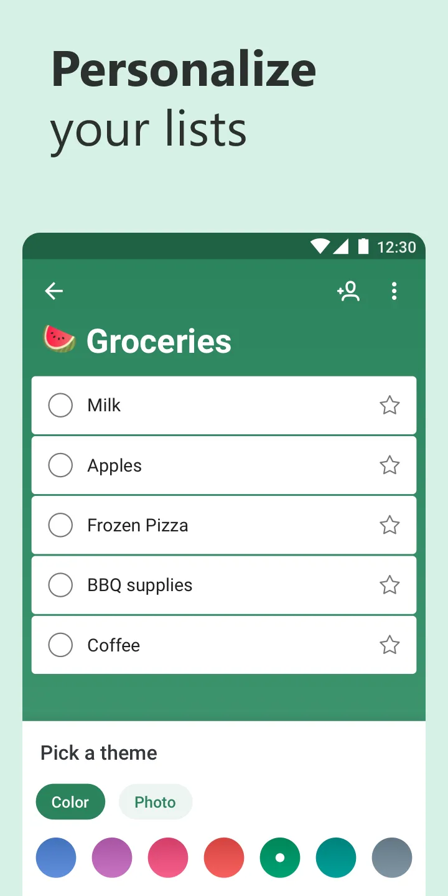{: width="180" .normal }
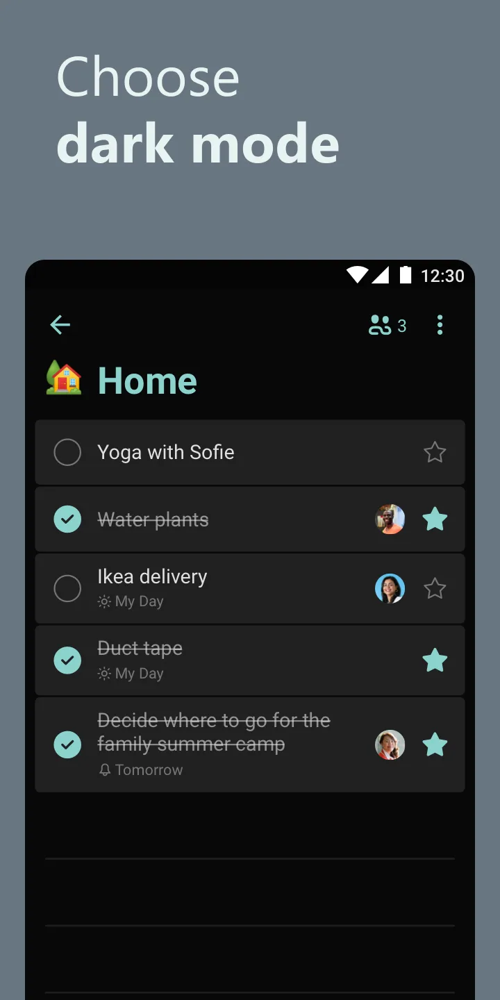{: width="180" .normal }
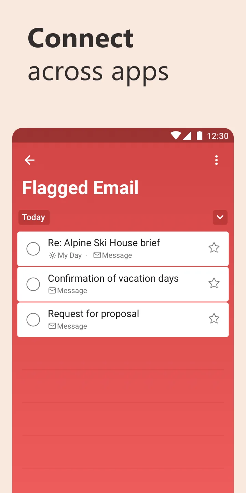{: width="180" .normal }
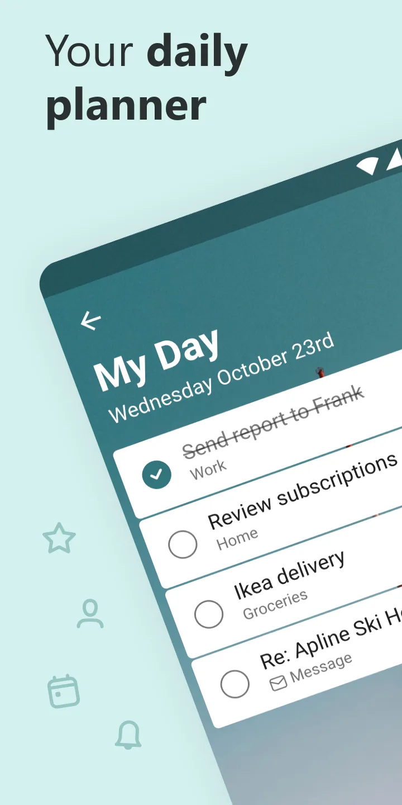{: width="180" .normal }
{: width="180" .normal }

Microsoft To Do (dibangun oleh mantan tim Wunderlist yang diakuisisi Microsoft pada 2015) **sepenuhnya gratis** dan terikat erat dengan Outlook serta Windows. Aplikasi ini paling bersinar bagi siapa pun yang sudah berada di ekosistem Microsoft 365.

**Kelebihan**
- **Sepenuhnya gratis** di iOS, Android, Windows, macOS, dan web, dengan dukungan 34 bahasa.
- **Integrasi mendalam Outlook / Microsoft 365** — email yang ditandai berubah menjadi tugas, dan memakai mesin yang sama dengan tugas Outlook.
- Perencanaan **My Day** yang rapi, daftar bersama, subtugas, lampiran file, dan pengingat tenggat.
- Didukung Microsoft, sehingga sinkronisasi dan keandalannya solid.

**Kekurangan**
- **Fitur masih dasar** — tanpa tampilan kalender bawaan, tanpa pomodoro atau pelacak kebiasaan, dan input tanggal bahasa alami lebih terbatas dibanding TickTick atau Things.
- Sangat terikat pada akun Microsoft; kurang menarik jika Anda berada di luar ekosistem tersebut.
- Tidak ada kolaborasi selain daftar bersama, serta tanpa struktur proyek atau GTD tingkat lanjut.

**Cocok untuk:** pengguna Microsoft 365 / Outlook yang menginginkan daftar tugas harian gratis dan andal tanpa harus mempelajari sistem baru.

**Unduh Microsoft To Do**
- [Google Play](https://play.google.com/store/apps/details?id=com.microsoft.todos)
- [App Store](https://apps.apple.com/app/microsoft-to-do/id1212616790)

### 2. Meow Todo — terbaik untuk privasi, antarmuka menyenangkan, dan inti gratis

{: width="180" .normal }
{: width="180" .normal }
{: width="180" .normal }
{: width="180" .normal }
{: width="180" .normal }

Meow Todo List adalah **[pengelola tugas](/id/glossary/what-is-a-to-do-list/)** bertema kucing untuk Android dan iOS. Ciri paling menonjol adalah **antarmukanya**: desain kartun lucu dengan **400+ ikon kategori kaya** yang membuat perencanaan harian terasa ringan, bukan seperti pekerjaan kantor. Di luar tampilan, aplikasi ini mencakup dasar-dasar praktis daftar tugas.

**Kelebihan**
- **UI kartun cantik dengan 400+ ikon khusus** — pembeda paling jelas; mencatat tugas terasa menyenangkan secara visual.
- **Daftar, subtugas, dan tampilan kalender** (harian / mingguan / bulanan) sehingga pekerjaan mendatang terlihat sekilas.
- **Ekspor CSV** (semua tugas atau rentang tanggal) untuk Excel, plus **cadangan iCloud / WebDav** — data hanya keluar dari kendali Anda saat Anda mengizinkannya.
- **Tanpa perlu akun** — daftar tugas tanpa akun tersimpan di perangkat dengan kunci sidik jari opsional, hal yang langka di aplikasi to-do arus utama.
- Tugas berulang, pengingat tenggat, mode gelap/terang, dan grafik tugas (pie + grafik kontribusi).

**Kekurangan**
- **Tanpa sinkronisasi cloud otomatis lintas platform** — sinkronisasi memakai iCloud (Apple) atau WebDav, bukan akun khusus, sehingga berpindah antara ponsel Android dan iPhone kurang mulus dibanding aplikasi berbasis akun.
- **Fitur lanjutan** (misalnya daftar tanpa batas / grafik lebih kaya) ada di balik VIP murah (~$0,99/bln atau $9,99/thn); inti gratis sudah mencukupi pencatatan sehari-hari.
- Tanpa kolaborasi atau dukungan daftar bersama, serta ekosistem lebih kecil dibanding pemain besar.

**Cocok untuk:** orang yang ingin pencatatan tugas jelas dan privat tanpa akun cloud, menghargai antarmuka ramah, dan tidak keberatan dengan pengaturan manual ringan.

**Unduh Meow Todo List**
- [Google Play](https://play.google.com/store/apps/details?id=com.glgjing.money.task.todo.list.meow)
- [App Store](https://apps.apple.com/app/meow-todo-list-task/id6742345495)

### 3. TickTick — paling serba bisa

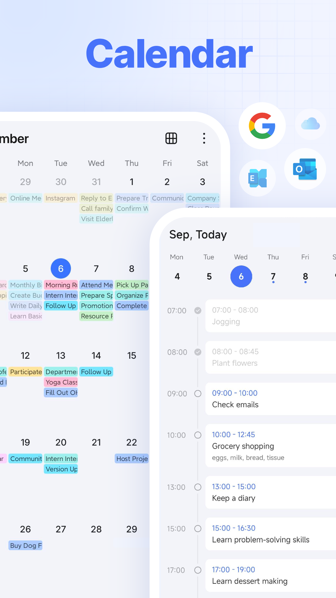{: width="180" .normal }
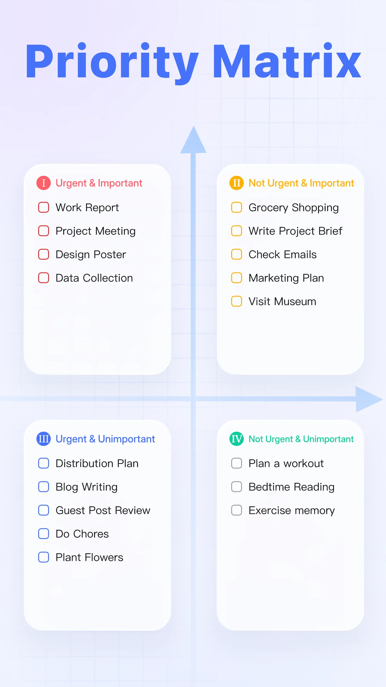{: width="180" .normal }
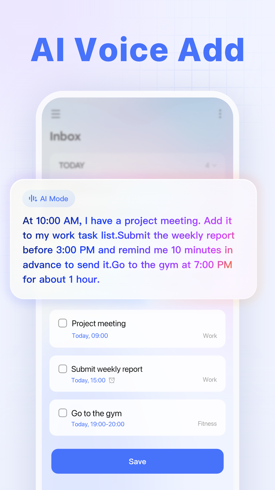{: width="180" .normal }
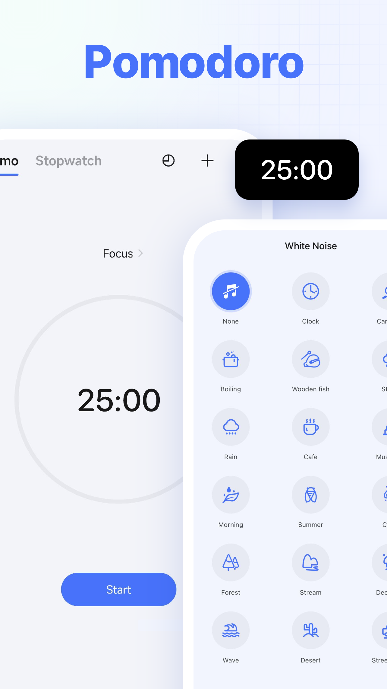{: width="180" .normal }
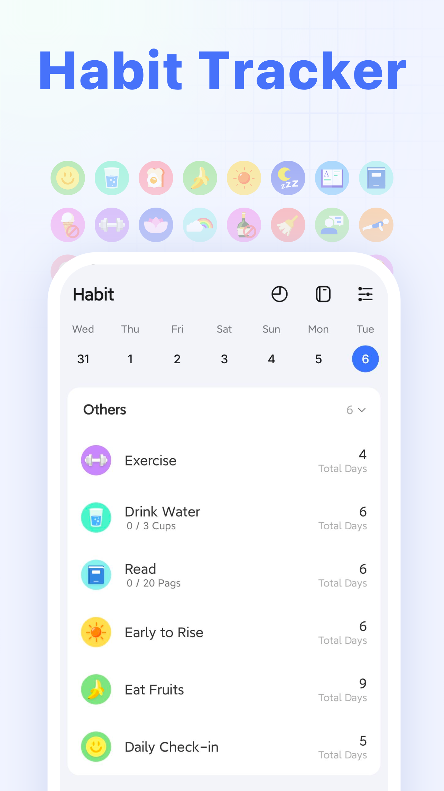{: width="180" .normal }

TickTick adalah **[pengelola tugas](/id/glossary/what-is-a-to-do-list/)** tangguh dengan kalender bawaan, timer pomodoro, dan pelacak kebiasaan. Ia membawa lebih banyak fitur daripada kebanyakan alternatif dan harganya lebih murah dari Todoist Pro.

**Kelebihan**
- **Kalender bawaan + pomodoro + pelacak kebiasaan** dalam satu aplikasi — tidak perlu menambah alat tambahan.
- **Pengenalan tanggal pintar** (bahasa alami "setiap sen 9 pagi") dan input suara membuat pencatatan cepat.
- Tampilan kaya: daftar, grid kalender, linimasa (premium), tag, prioritas, dan pengingat berbasis lokasi.
- **Premium lebih murah** ($35,99/thn) dibanding Todoist Pro, dengan sinkronisasi di web, iOS, Android, Windows, dan Mac.

**Kekurangan**
- **Paket gratis terbatas** — jumlah daftar/tugas dibatasi dan hanya satu tampilan kalender; riwayat serta sebagian pengingat membutuhkan Premium.
- Luasnya fitur bisa membuat UI terasa ramai bagi pengguna yang menginginkan sesuatu yang minimalis.
- Kolaborasi lebih ringan dari Notion; daftar bersama ada, tetapi tanpa alur kerja tim mendalam.

**Cocok untuk:** pengguna yang ingin fitur kuat (kalender + pomodoro + kebiasaan) tanpa membayar harga setara Todoist.

**Unduh TickTick**
- [Google Play](https://play.google.com/store/apps/details?id=com.ticktick.task)
- [App Store](https://apps.apple.com/app/ticktick-to-do-list-calendar/id626144601)

### 4. Google Tasks — terbaik untuk pengguna Gmail dan Calendar

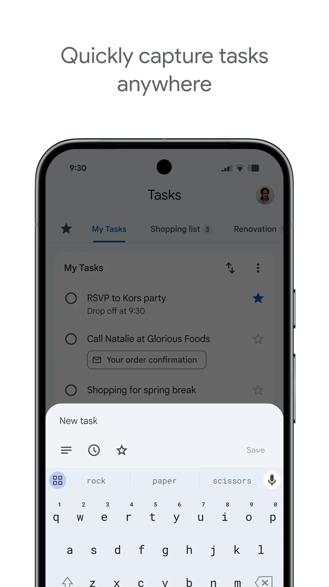{: width="180" .normal }
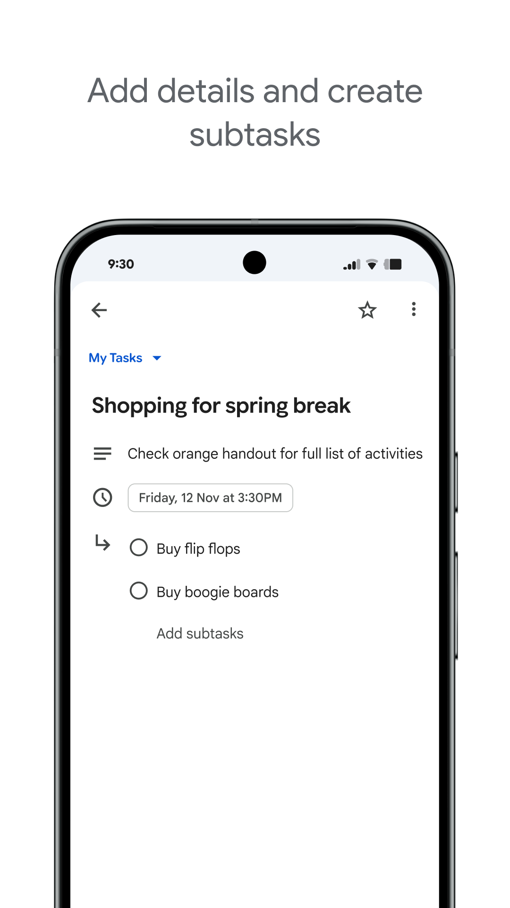{: width="180" .normal }
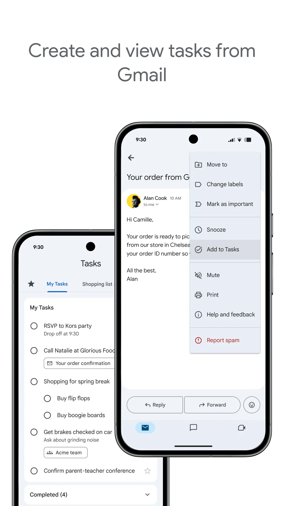{: width="180" .normal }
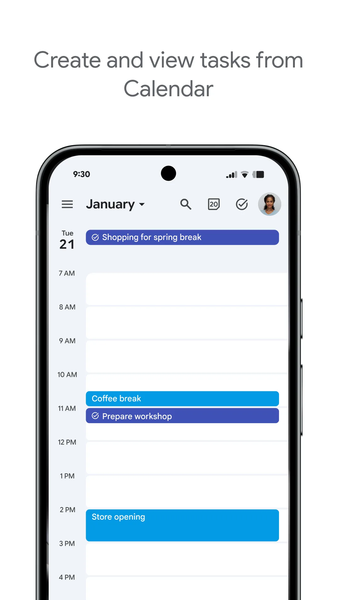{: width="180" .normal }
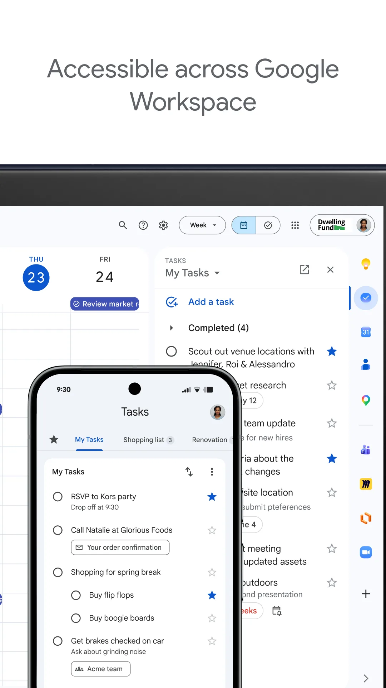{: width="180" .normal }

Google Tasks adalah alat tugas ringan yang tertanam di Gmail dan Google Calendar. Sengaja dibuat minimalis dan gratis untuk akun Google mana pun.

**Kelebihan**
- **Gratis dan langsung tersedia** — sudah ada di Gmail, Calendar, Drive, dan aplikasi khusus (Android, iOS, web).
- **Sinkronisasi erat dengan Google Calendar** — tugas bertenggat muncul otomatis di kalender Anda.
- Pencatatan sederhana dan cepat; beberapa daftar; satu tingkat subtugas; pengingat dasar.

**Kekurangan**
- **Sangat minimalis** — hanya satu tingkat subtugas, tanpa tampilan kaya, tanpa parsing bahasa alami, tanpa pomodoro atau kebiasaan.
- Pengingat masih dasar (berbasis tenggat); tanpa pengingat berbasis lokasi atau perekaman suara.
- Tanpa mode offline-first sejati dan kolaborasi terbatas (hanya daftar yang dibagikan lewat Google); lemah untuk proyek kompleks.

**Cocok untuk:** pengguna Gmail / Google Calendar yang menginginkan daftar tugas tanpa hambatan dan tidak lebih.

**Unduh Google Tasks**
- [Google Play](https://play.google.com/store/apps/details?id=com.google.android.apps.tasks)
- [App Store](https://apps.apple.com/app/google-tasks-get-things-done/id1353634006)

### 5. Things 3 — desain terbaik, khusus Apple

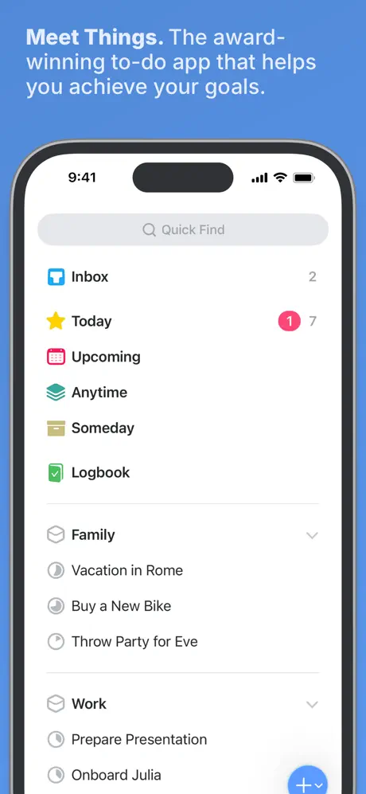{: width="180" .normal }
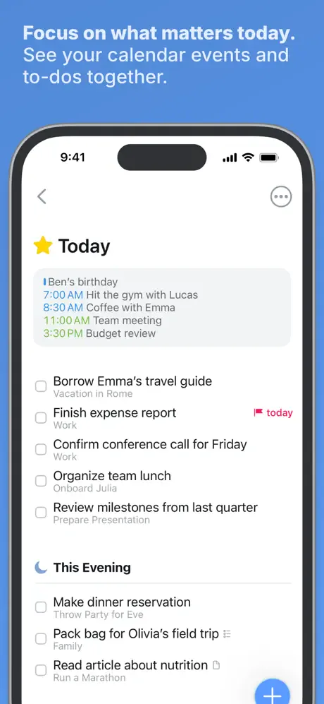{: width="180" .normal }
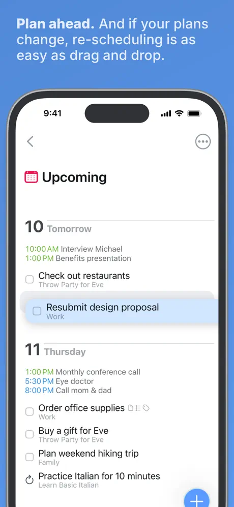{: width="180" .normal }
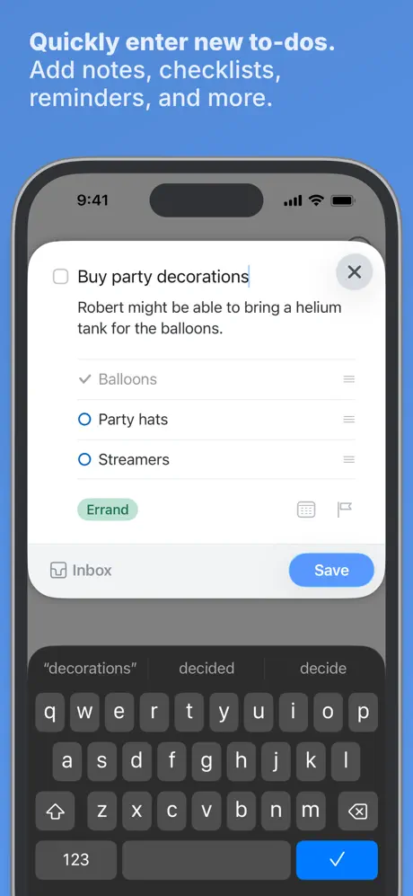{: width="180" .normal }
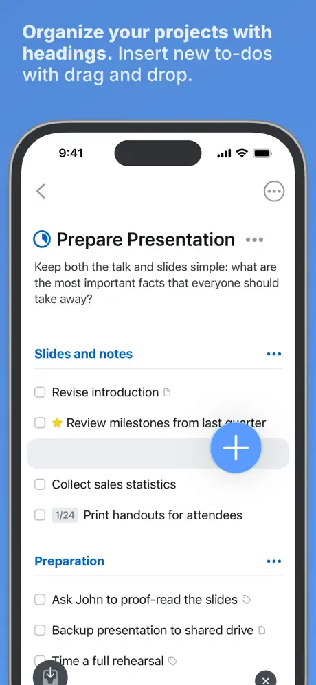{: width="180" .normal }

Things 3 (dari Cultured Code) luas dipuji sebagai **aplikasi to-do dengan tampilan terbaik**, dengan model ramah GTD (Inbox, Today, Upcoming, Anytime, Someday, Projects, Areas, tag). Aplikasi ini hanya berjalan di perangkat Apple.

**Kelebihan**
- **Desain dan UX kelas terbaik** — cepat, tenang, dan intuitif; entri cepat serta penjadwalan bahasa alami.
- **Struktur GTD tangguh** — proyek, area, tugas berulang (dengan selesai lebih awal dan penjadwalan ulang), tenggat, serta tautan ke catatan/URL.
- **Pembelian sekali bayar, tanpa langganan**, dengan integrasi Apple mendalam (Siri, impor Reminders, Handoff).
- Sinkronisasi lewat iCloud di iPhone, iPad, dan Mac.

**Kekurangan**
- **Khusus Apple** — tanpa Android, tanpa klien web/Windows, sehingga tidak cocok untuk rumah tangga dengan perangkat campuran.
- **Tanpa kolaborasi atau daftar bersama**, serta tanpa pomodoro atau fitur kebiasaan bawaan.
- Berbayar di muka per platform (iPhone / iPad / Mac dijual terpisah), dan tanpa paket gratis untuk mencoba sebelum membeli.

**Cocok untuk:** pengguna khusus Apple yang menginginkan pengelola tugas paling rapi dan bebas gangguan, serta memilih pembelian sekali bayar.

**Unduh Things 3**
- [App Store](https://apps.apple.com/app/things-3/id904237743)

### 6. Notion — ruang kerja all-in-one paling fleksibel

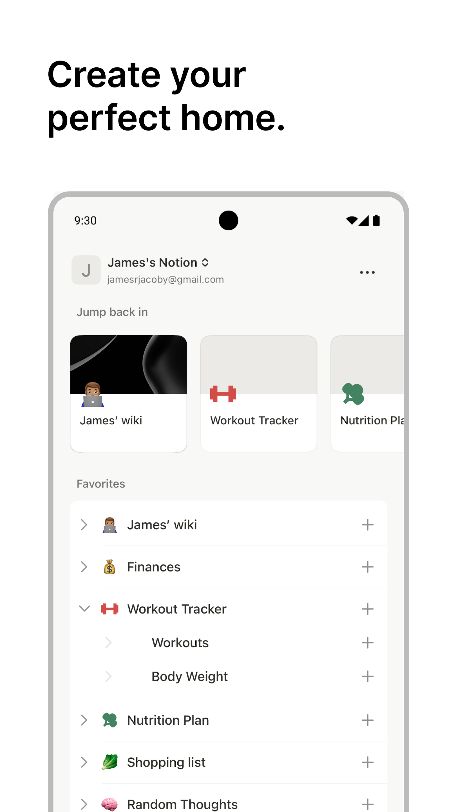{: width="180" .normal }
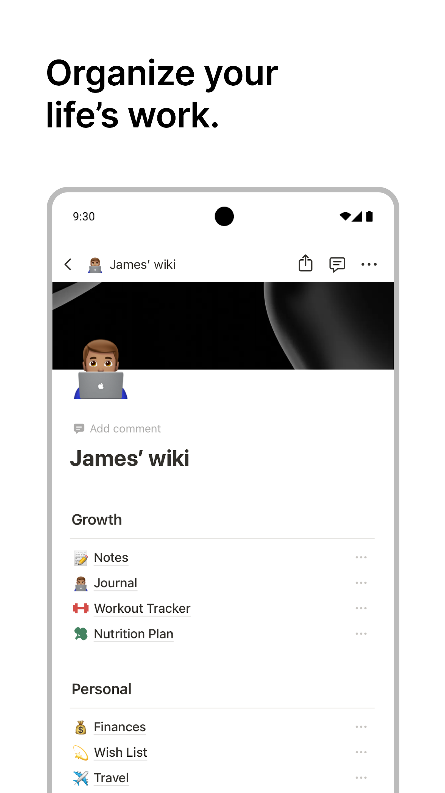{: width="180" .normal }
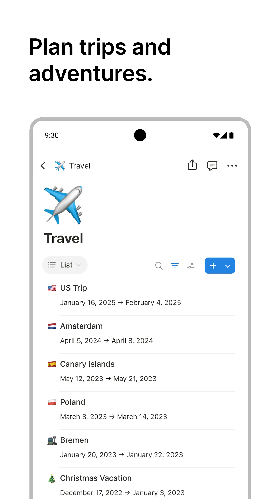{: width="180" .normal }
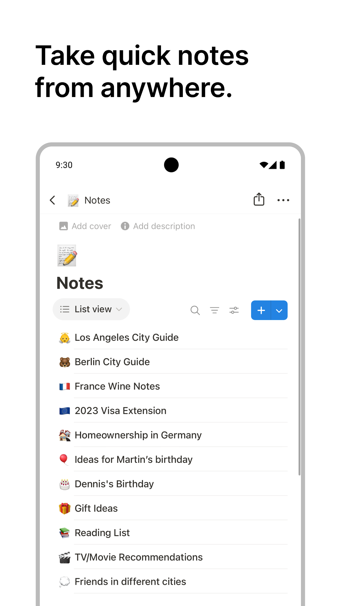{: width="180" .normal }
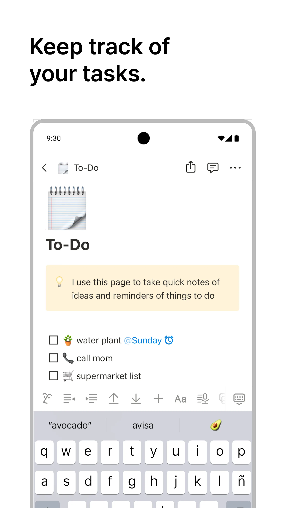{: width="180" .normal }

Notion adalah ruang kerja catatan/docs/database yang juga bisa menjalankan tugas lewat database, tampilan papan (Kanban) dan kalender, serta pengingat. Ini opsi paling fleksibel di sini — sekaligus paling berat.

**Kelebihan**
- **Sangat fleksibel** — tugas hanyalah baris database yang bisa dilihat sebagai daftar, papan, kalender, atau linimasa, dengan relasi, templat, dan dokumen kaya.
- **Kolaborasi kuat** — berbagi real-time, komentar, dan alur kerja tim jauh melampaui aplikasi to-do khusus mana pun.
- Lintas platform (web, iOS, Android, Windows, Mac) dengan **paket gratis yang cukup lengkap**.

**Kekurangan**
- **Berat untuk tugas sederhana** — pencatatan cepat lebih lambat dari aplikasi khusus, dan ada kurva pembelajaran yang nyata.
- **Pengingat dan tugas berulang lebih lemah** — terikat pada tanggal item database, tanpa pengingat push native yang andal, lokasi, atau perekaman suara milik aplikasi yang dibangun khusus.
- Bergantung pada cloud; penggunaan offline terbatas pada cache, sehingga kurang ideal jika Anda ingin data sepenuhnya di perangkat.

**Cocok untuk:** pengguna yang sudah hidup di Notion (atau ingin docs + tugas + manajemen proyek dalam satu tempat) dan bisa menerima alat yang lebih berat.

**Unduh Notion**
- [Google Play](https://play.google.com/store/apps/details?id=notion.id)
- [App Store](https://apps.apple.com/app/notion-notes-tasks-ai/id1232780281)

### 7. Any.do — terbaik untuk kalender dan tugas gabungan

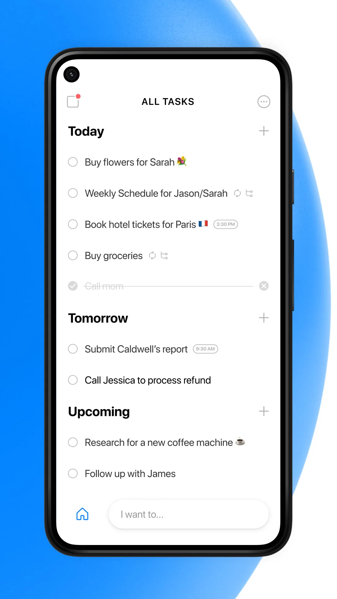{: width="180" .normal }
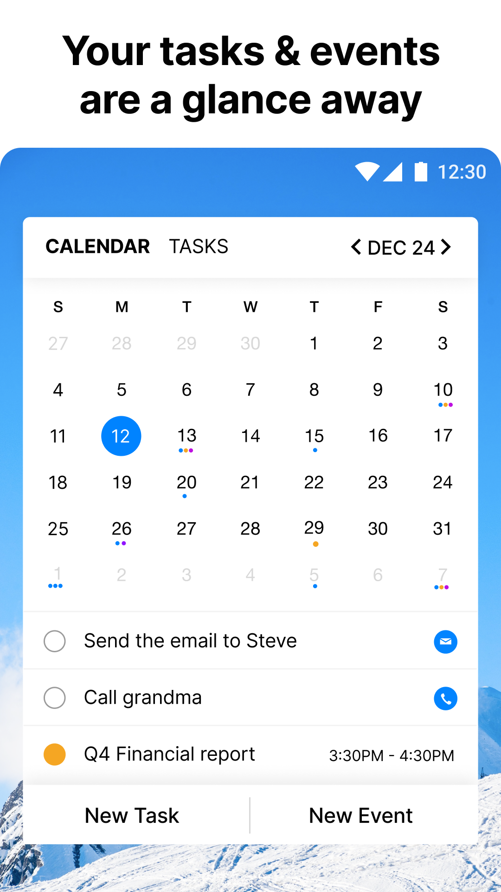{: width="180" .normal }
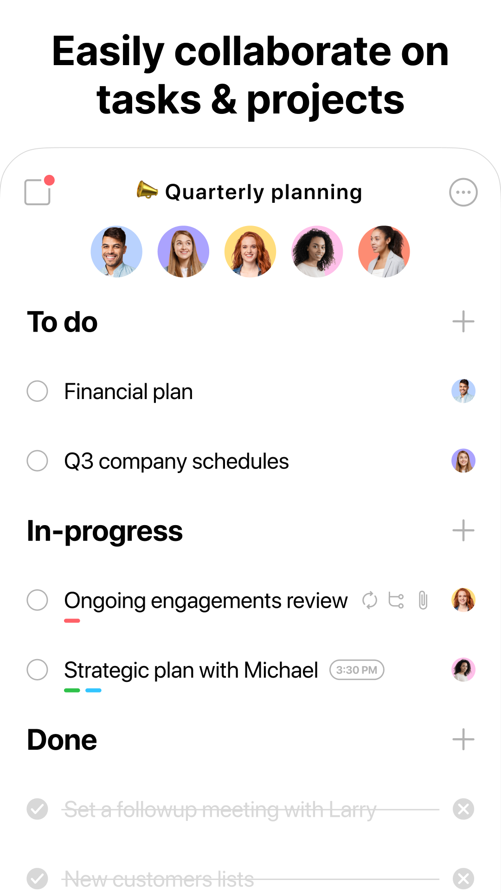{: width="180" .normal }
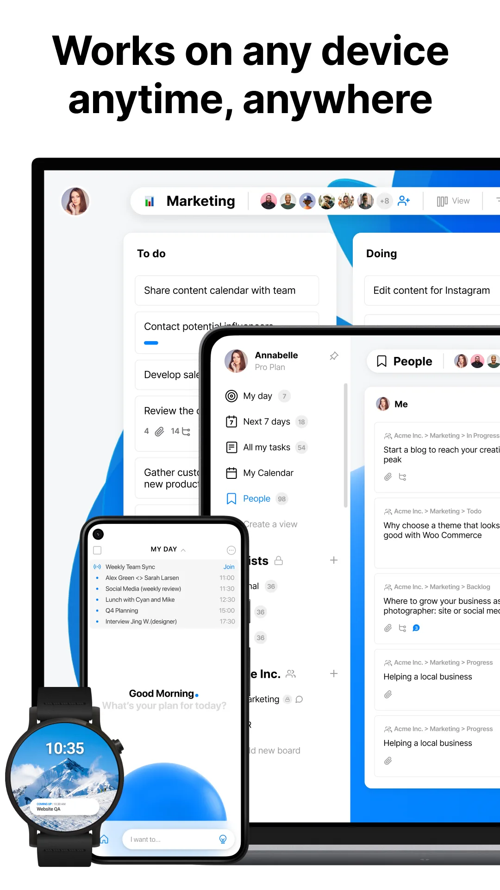{: width="180" .normal }

Any.do menggabungkan daftar tugas, kalender, dan perencana lengkap dengan pengingat, dipakai puluhan juta orang di seluler, desktop, dan web.

**Kelebihan**
- **Tugas + kalender dalam satu tampilan**, dengan pengingat suara, WhatsApp, dan berbasis lokasi — pencatatan fleksibel.
- **Lintas platform** (seluler, desktop, web, tablet) dengan paket gratis yang layak dipakai.
- Tugas berulang, daftar bersama, dan integrasi kalender dalam satu permukaan perencanaan.

**Kekurangan**
- **Paket gratis terbatas** dan beberapa kemudahan (pengulangan lanjutan, sebagian pengingat, tema premium) membutuhkan Premium ~$36/thn.
- Tampilan gabungan dan tawaran upgrade premium bisa terasa berantakan, serta keandalan pengingat kerap menjadi keluhan.
- Tidak dirancang untuk manajemen proyek kompleks atau kolaborasi tim mendalam.

**Cocok untuk:** pengguna yang ingin tugas dan kalender menyatu dengan pengingat fleksibel (suara/lokasi).

**Unduh Any.do**
- [Google Play](https://play.google.com/store/apps/details?id=com.anydo)
- [App Store](https://apps.apple.com/app/any-do-to-do-list-planner/id497328576)

## Perbandingan kemampuan inti

Tabel berikut menunjukkan seobjektif mungkin kemampuan yang didukung setiap aplikasi. "Sebagian" berarti fitur ada, tetapi dengan batasan.

| Kemampuan | Microsoft To Do | Meow Todo | TickTick | Google Tasks | Things 3 | Notion | Any.do |
|---|---|---|---|---|---|---|---|
| **Sinkronisasi cloud / multi-perangkat** | Ya (akun MS) | Sebagian (iCloud / WebDav) | Ya | Ya (Google) | Ya (iCloud) | Ya (akun) | Ya |
| **Pengingat tugas** | Tenggat + berulang | Tenggat | Kaya (termasuk lokasi) | Tenggat | Tenggat + Siri | Sebagian (berbasis tanggal) | Suara / lokasi / WhatsApp |
| **Tampilan kalender** | Sebagian (Outlook) | Ya (hari/minggu/bulan) | Ya (bawaan) | Sebagian (Google Cal) | Sebagian (Today/Upcoming) | Sebagian (kalender DB) | Ya (gabungan) |
| **Subtugas** | Ya (1 tingkat) | Ya (1 tingkat) | Bertingkat | Hanya 1 tingkat | Checklist | Blok bertingkat | Ya |
| **Tugas berulang** | Ya | Ya | Ya | Ya | Ya (pengulangan pintar) | Sebagian | Ya |
| **Input bahasa alami** | Sebagian | Sebagian | Kuat | Tidak | Ya (entri cepat) | Sebagian | Ya (suara) |
| **Kebiasaan / Pomodoro** | Tidak | Tidak | Ya (keduanya) | Tidak | Tidak | Tidak | Tidak |
| **Kolaborasi / berbagi** | Ya (daftar bersama) | Tidak | Ya (bersama) | Sebagian (Google) | Tidak | Kuat (real-time) | Ya (bersama) |
| **Offline / privasi** | Berbasis akun | Kuat (di perangkat, tanpa akun) | Berbasis akun | Berbasis akun | iCloud | Bergantung cloud | Berbasis akun |
| **Platform** | Semua | Android + iOS | Semua | Android + iOS + web | Khusus Apple | Semua | Semua |
| **Paket gratis** | Lengkap | Inti cukup lengkap | Terbatas | Lengkap | Tidak ada (berbayar) | Cukup lengkap | Terbatas |
| **Harga** | Gratis | Gratis + VIP ~$9,99/thn | Gratis + $35,99/thn | Gratis | Berbayar per platform | Gratis + paket berbayar | Gratis + ~$36/thn |

## Alternatif Todoist mana yang cocok untuk Anda?

- Sudah memakai **Microsoft 365 / Outlook** → **Microsoft To Do**
- Ingin **gratis, privat, tanpa akun, dengan ekspor CSV dan UI lucu** → **Meow Todo**
- Ingin **fitur kuat** (kalender + pomodoro + kebiasaan) dengan harga murah → **TickTick**
- Sehari-hari di **Gmail / Google Calendar** → **Google Tasks**
- Hanya memakai **perangkat Apple** dan ingin aplikasi paling rapi → **Things 3**
- Ingin **docs + tugas + proyek dalam satu ruang kerja fleksibel** → **Notion**
- Ingin **tugas dan kalender menyatu dengan pengingat suara/lokasi** → **Any.do**

## Alternatif Todoist untuk setiap jenis pengguna

Baca setiap opsi sebagai **alternatif Todoist** dengan tugas tertentu: **alternatif Microsoft To Do** adalah daftar gratis bawaan Outlook, **alternatif Google Tasks** adalah bilah sisi Gmail paling ringan, dan **alternatif TickTick** memadukan **aplikasi kalender tugas** serta timer pomodoro dalam satu aplikasi. Things 3 dan Any.do mengandalkan desain yang rapi, Notion pada database, sementara Meow Todo adalah **aplikasi to-do list gratis terbaik** di sini untuk **aplikasi to-do offline** sederhana, **aplikasi pengingat tugas**, sekaligus **aplikasi subtask gratis** dengan **daftar tugas tanpa akun** pada intinya. Jika alasan utama Anda pindah adalah biaya, mulailah dari **aplikasi manajemen tugas gratis** daripada menukar satu langganan dengan langganan lain.

## Cara bermigrasi dari Todoist

1. **Ekspor** proyek Anda dari Todoist (Settings → Backups, atau salin tugas keluar selagi akses masih ada).
2. **Pilih pengganti** memakai tabel di atas berdasarkan ekosistem, privasi, dan kedalaman fitur.
3. **Bangun ulang struktur** — daftar (To Do, Meow) atau proyek (Todoist) saling bersesuaian dengan rapi; di Notion, buat database tugas.
4. **Tambahkan kembali tugas berulang** dan tenggat; atur pengingat harian serta, bila didukung, pengingat lokasi atau suara.
5. **Simpan cadangan CSV** (Meow Todo dan kebanyakan aplikasi bisa mengekspornya) agar Anda tidak pernah terkunci lagi.

## FAQ

**Apakah Meow Todo List alternatif Todoist gratis yang bagus?**
{:.faq-q}

Ya — intinya (daftar, subtugas, tampilan kalender, pengingat, ekspor CSV) gratis, tanpa akun yang diwajibkan dan privasi di perangkat lewat kunci sidik jari opsional; hanya beberapa fitur lanjutan tambahan yang berada di balik VIP sekali bayar.

**Apakah Meow Todo bisa dipakai offline?**
{:.faq-q}

Ya. Anda bisa menambah dan menandai tugas selesai tanpa internet; data tetap di perangkat dan hanya disinkronkan ke iCloud atau WebDav saat Anda memilihnya.

**Alternatif Todoist mana yang terbaik untuk privasi?**
{:.faq-q}

Meow Todo — tidak memerlukan akun, menyimpan tugas di perangkat di balik kunci sidik jari, dan hanya mencadangkan ke iCloud atau WebDav saat Anda mengaktifkannya, sehingga daftar tugas Anda tidak pernah berada di cloud vendor secara default.

**Bisakah saya memindahkan tugas keluar dari Todoist?**
{:.faq-q}

Ya — ekspor CSV dari Todoist, lalu bangun ulang daftar Anda; Meow Todo juga mengekspor CSV, sehingga data bisa dipindahkan ke Excel atau aplikasi lain kapan saja.

[Halaman aplikasi Meow Todo List](/id/apps/meow-todo-list/) — unduh untuk Android dan iOS.

## Istilah terkait

- [Apa Itu Daftar Tugas (To-Do List)?](/id/glossary/what-is-a-to-do-list/)
- [Apa Itu Subtugas?](/id/glossary/what-is-a-subtask/)
