WidgetSmith adalah **aplikasi widget iOS** yang paling dikenal, tapi hanya untuk iPhone, dan bahkan di iOS sebagian pengguna ingin gaya berbeda, data perangkat langsung (baterai, RAM), atau pustaka widget jadi yang lebih besar. Panduan ini membandingkan **enam** **[aplikasi widget](/id/glossary/what-is-a-home-screen-widget/)** lintas platform terkemuka, masing-masing dipilih karena keunggulan khas atau jangkauan pasar luas. Setiap aplikasi di bawah dibahas dengan kelebihan nyata, kelemahan nyata, dan kinerjanya pada kemampuan layar utama inti yang benar-benar penting — preset jadi, editor kustom, data sistem langsung, cuaca, kesehatan, foto, interaktivitas, dan dukungan layar kunci. Tautan unduh ada di akhir tiap bagian. Kebanyakan pembaca datang dengan satu penghalang — dukungan iPhone saja, langganan, atau pustaka yang terlalu kecil — jadi tiap pilihan dibingkai menurut alasan itu.

## Mengapa melihat di luar WidgetSmith

- **Tidak ada versi Android** — hanya iPhone, jadi pengguna Android harus memilih alat berbeda sepenuhnya.
- **Telemetri perangkat langsung terbatas** — WidgetSmith berfokus pada foto, tanggal, cuaca, dan kalender; tidak menampilkan statistik perangkat mentah seperti persen baterai, RAM, atau storage seperti yang dilakukan beberapa widget Android.
- **Estetika spesifik** — Anda mungkin menginginkan tampilan One UI, Material You, atau Nothing yang meniru bahasa desain merek lain, atau paket tema lucu/estetik.
- **Jadi vs buat sendiri** — WidgetSmith adalah builder; sebagian orang hanya ingin pustaka besar untuk dipilih.
- **Sensitivitas harga** — premium WidgetSmith membuka beberapa gaya; alternatif berkisar dari pustaka preset gratis, Pro key sekali bayar, hingga langganan.

---

## Alternatif WidgetSmith terbaik sekilas

| App | Harga (2026) | Platform | Terbaik untuk |
|---|---|---|---|
| **One Widget** | Set One UI gratis + buka kunci gaya | Android | 500+ widget jadi lintas 4 bahasa desain |
| **KWGT** | Gratis + Pro key sekali bayar (~$4,99) | Android | Membangun widget dari nol |
| **Widgy** | Gratis + IAP (~$4,99) | iOS (iPhone/iPad/Watch) | Widget iOS kustom mendalam, tanpa kode |
| **Color Widgets** | Gratis + Pro (~$2,50/bln, ditagih tahunan) | iOS (iPhone/iPad/Mac) | Preset & tema estetik cepat |
| **Widgetable** | Gratis + langganan | iOS (juga Android) | Widget sosial & peliharaan untuk pasangan/sahabat |
| **WidgetClub** | Gratis + langganan | iOS + Android | Widget estetik lucu bertema |

---

## 1. One Widget — terbaik untuk widget Android jadi multi-gaya

{: width="180" .normal }
{: width="180" .normal }
{: width="180" .normal }
{: width="180" .normal }
{: width="180" .normal }

One Widget adalah paket widget Android yang dibangun di sekitar **empat bahasa desain lengkap** — **Galaxy One UI, Material You, iOS Glass, dan Nothing UI** — sehingga satu aplikasi bisa membuat ponsel Samsung, Pixel, bergaya iPhone, atau Nothing terlihat kohesif. Ia menyediakan **500+ widget jadi** (jam, tanggal, baterai, RAM, storage, shortcut aplikasi, toggle seperti Wi-Fi/Bluetooth/senter, kalender, penghitung langkah, musik, dan cuaca) dan pengembang **aktif menambah komponen baru**, yang menjaga pustaka tetap segar.

**Keunggulan**
- **Empat sistem gaya berbeda dalam satu aplikasi** — langka; kebanyakan aplikasi widget berkomitmen pada satu tampilan.
- **Komponen kaya siap-taruh**, termasuk telemetri perangkat langsung (baterai %, RAM, storage) yang umumnya tidak bisa ditampilkan widget iOS sekilas.
- **Toggle dan shortcut fungsional** (Wi-Fi, Bluetooth, senter, peluncuran aplikasi) menambah utilitas nyata, bukan sekadar dekorasi.
- **Tanpa keahlian desain** — pilih gaya, taruh widget, selesai.
- **Pembaruan rutin** dengan widget dan tipe komponen baru.

**Kelemahan**
- **Hanya Android** — tidak ada versi iOS.
- **Berbasis preset, bukan editor bebas** — Anda kustomisasi dalam apa yang diekspos template; tidak bisa menyusun tata letak arbitrer atau menulis formula seperti di KWGT.
- **Beberapa gaya/komponen berada di balik buka kunci**, dan pengguna gratis mendapat set One UI.
- Kurang cocok untuk pengguna yang menginginkan widget benar-benar unik daripada preset rapi.

**Terbaik untuk:** pengguna Android yang menginginkan pustaka widget besar dan cantik mencakup banyak estetika ponsel tanpa mempelajari alat desain.

**Unduh One Widget**
- [Google Play](https://play.google.com/store/apps/details?id=com.glgjing.galaxy.nothing.glass.material.widget)

---

## 2. KWGT Kustom Widget Maker — terbaik untuk membangun widget dari nol

{: width="180" .normal }
{: width="180" .normal }
{: width="180" .normal }
{: width="180" .normal }
{: width="180" .normal }

KWGT (by Kustom) adalah **editor widget paling powerful di Android**. Alih-alih memilih preset, Anda menyusun widget dari teks, bentuk, gambar, bilah progres, dan bahasa formula yang bisa menarik baterai, jaringan, cuaca, kalender, dan bahkan data **Health Connect** (langkah, tidur, kalori). Komunitas besar berbagi preset dan paket tema, sehingga Anda bisa mulai dari desain orang lain dan menyesuaikannya.

**Keunggulan**
- **Kendali tingkat piksel berbasis formula** — pada dasarnya widget apa pun yang bisa dibayangkan.
- **Ekosisistem bersama besar** berisi preset, paket, dan tutorial.
- Dukungan **warna dinamis Material You** dan ikatan data langsung mendalam.
- **Pro key sekali bayar** (tanpa langganan) membuka semua fitur.
- **Integrasi Health Connect** untuk langkah/tidur/kalori.

**Kelemahan**
- **Kurva belajar curam** — bahasa formula powerful tapi tidak ramah pengguna kasual.
- **Hanya Android**, tidak ada versi iOS.
- Membangun widget bagus **butuh waktu**; UI utilitarian daripada cantik langsung jadi.
- Interaksi ketuk terbatas dibanding kontrol bawaan aplikasi asli.

**Terbaik untuk:** pengguna power Android yang ingin kendali penuh dan bersedia mempelajari editor.

**Unduh KWGT Kustom Widget Maker**
- [Google Play](https://play.google.com/store/apps/details?id=org.kustom.widget)

---

## 3. Widgy — terbaik untuk widget iOS kustom mendalam

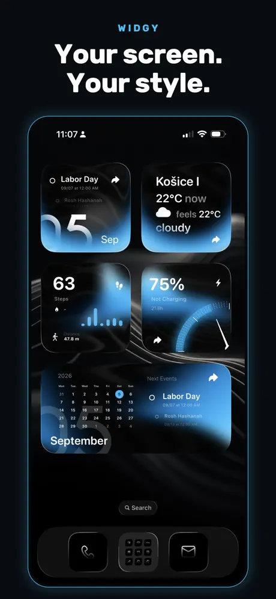{: width="180" .normal }
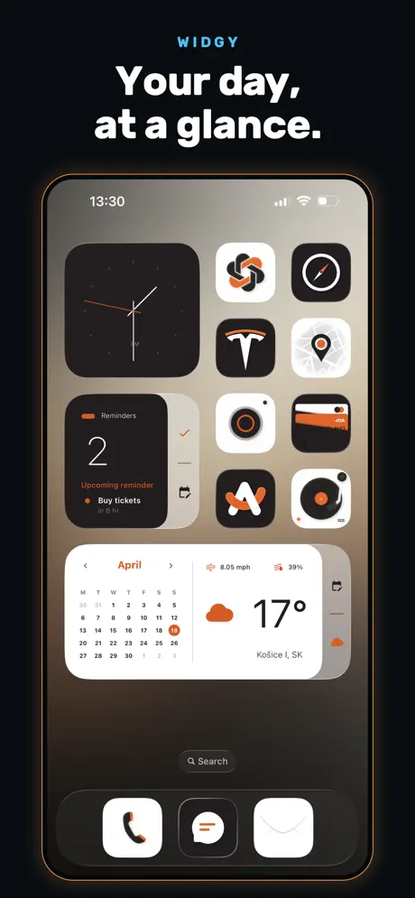{: width="180" .normal }
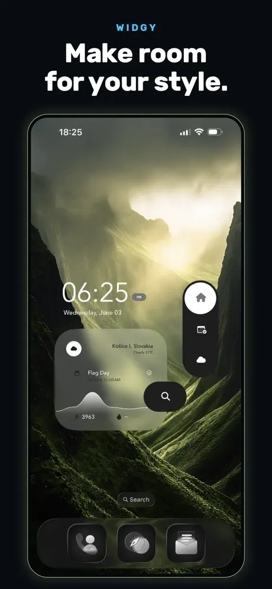{: width="180" .normal }
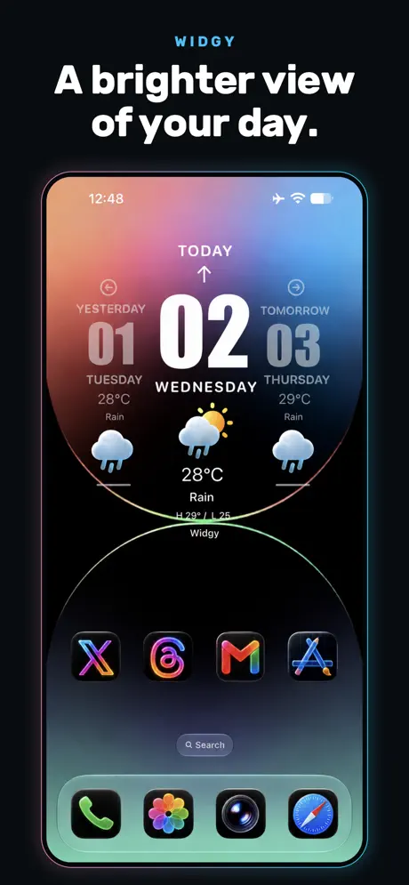{: width="180" .normal }
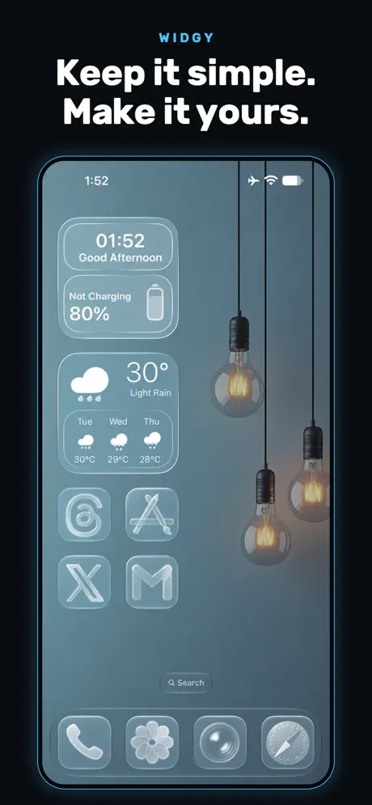{: width="180" .normal }

Widgy adalah setara iOS terdekat dengan KWGT: sebuah **builder visual berbasis layer** (tanpa kode) dengan template dan beragam sumber data — cuaca, Apple Health, kalender, pengingat, dan lainnya. Ia menargetkan iPhone, iPad, Apple Watch, Layar Kunci, dan StandBy, serta mengikuti bahasa desain iOS baru (mis. Liquid Glass).

**Keunggulan**
- **Builder widget kustom paling mumpuni di iOS**, dengan layer, sumber data, dan desain yang bisa diekspor.
- **Tanpa kode diperlukan** — pengeditan visual menurunkan batas dibanding formula KWGT.
- **Data mendalam**, termasuk Apple Health, dan dukungan Layar Kunci, StandBy, serta wajah jam.
- **Diperbarui aktif** untuk tiap rilis iOS baru.

**Kelemahan**
- **Hanya iOS**.
- Tetap ada **kurva belajar** untuk menguasai layer dan ikatan data.
- **Beberapa slot/fitur widget berada di balik IAP** (~$4,99).
- Tunduk pada **batas penyegaran widget iOS** — data bisa lambat beberapa menit.

**Terbaik untuk:** pengguna iPhone/iPad yang ingin widget buatan sendiri tapi lebih suka editor visual daripada kode.

**Unduh Widgy**
- [App Store](https://apps.apple.com/us/app/widgy-widgets-home-lock-watch/id1524540481)

---

## 4. Color Widgets — terbaik untuk preset iOS cepat & estetik

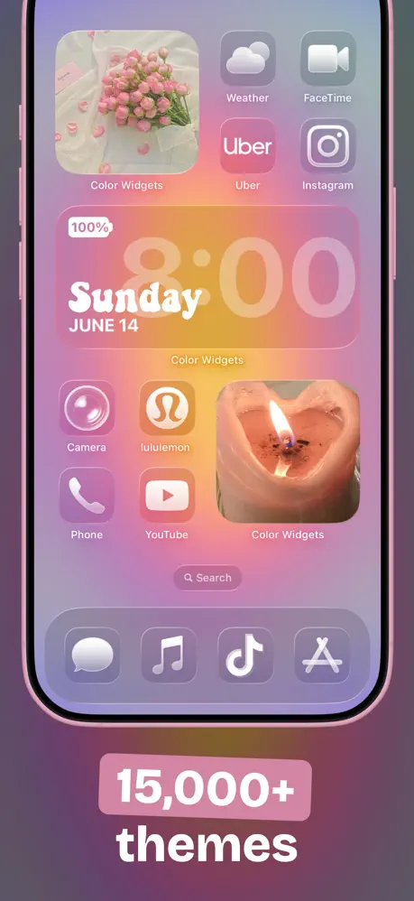{: width="180" .normal }
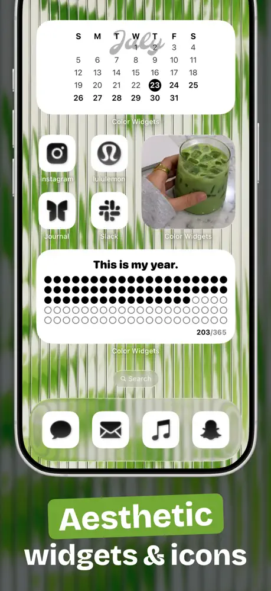{: width="180" .normal }
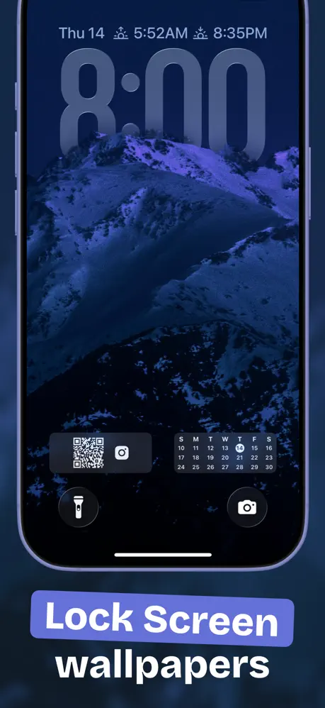{: width="180" .normal }
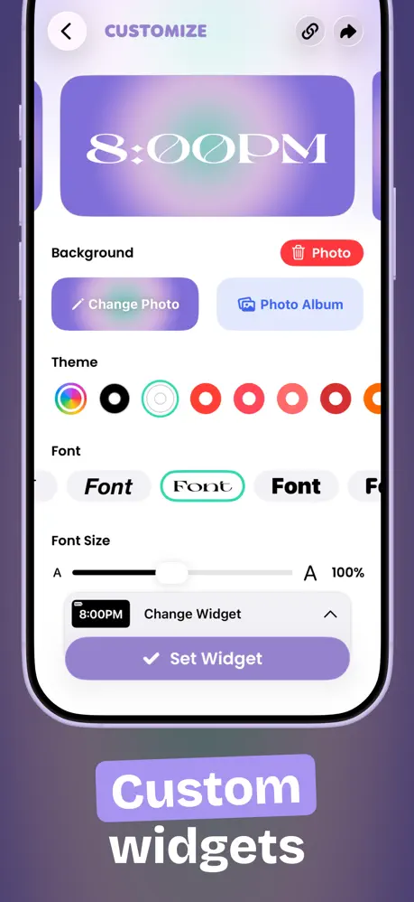{: width="180" .normal }
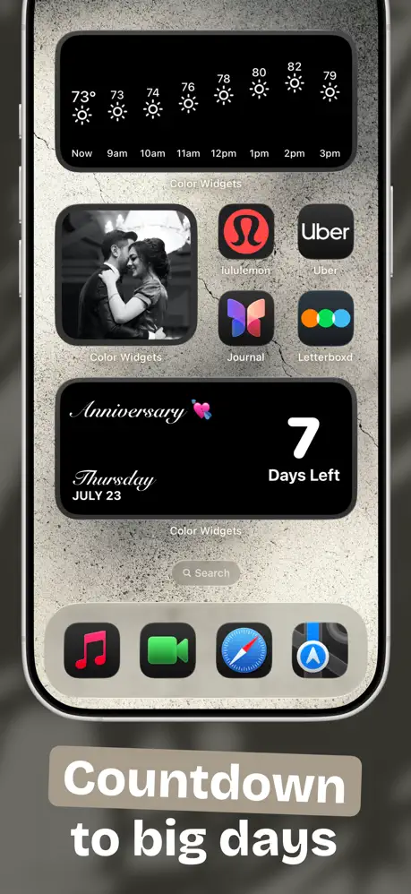{: width="180" .normal }

Color Widgets mengandalkan **ribuan widget yang sudah didesain plus pengustomisasi mudah**, dan memaketkan tema, paket ikon, dan wallpaper sehingga seluruh Layar Utama dan Kunci bisa di-skin ulang dalam beberapa ketukan. Ia mencakup foto, waktu/tanggal, baterai, hitung mundur, cuaca, musik (Apple/Spotify), kalender, kutipan, dan widget aktivitas, dengan integrasi Apple Health untuk langkah.

**Keunggulan**
- **Jalan tercepat ke widget cantik** — pilih preset atau ubah warna/font, tanpa latar desain.
- **Tema semua-dalam-satu** (widget + ikon + wallpaper) untuk tampilan kohesif.
- **Integrasi kesehatan** dan tipe widget luas.
- Posisi **privasi-pertama** dan dukungan Mac.

**Kelemahan**
- Lebih soal **estetika daripada data mendalam**; kurang bebas bentuk daripada Widgy.
- Fitur terbaik berada di balik **Pro subscription** (~$2,50/bln, ditagih tahunan).
- Bisa terasa **berat template**; orisinalitas bergantung pustaka bersama.
- Model langganan daripada buka kunci sekali bayar.

**Terbaik untuk:** pengguna iPhone yang ingin widget menarik dan tema serasi dengan cepat.

**Unduh Color Widgets**
- [App Store](https://apps.apple.com/us/app/color-widgets/id1531594277)

---

## 5. Widgetable — terbaik untuk widget sosial & peliharaan

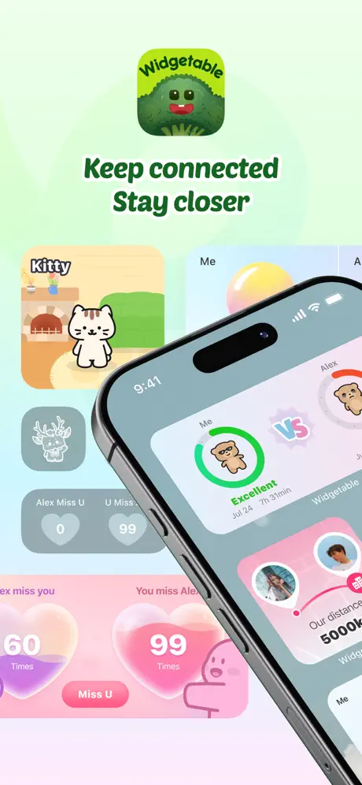{: width="180" .normal }
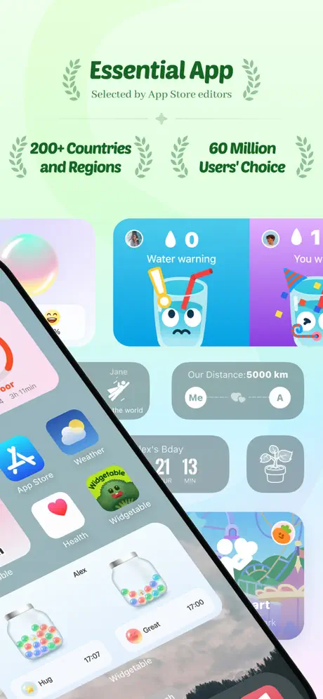{: width="180" .normal }
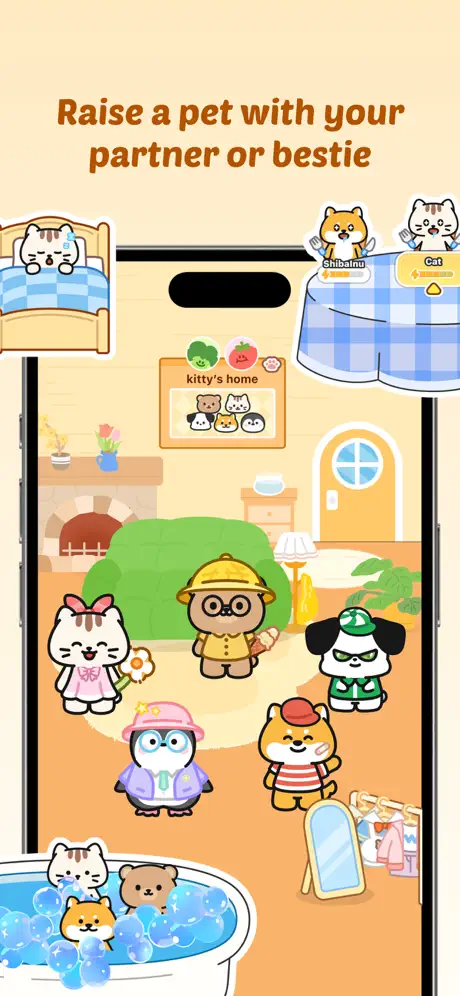{: width="180" .normal }
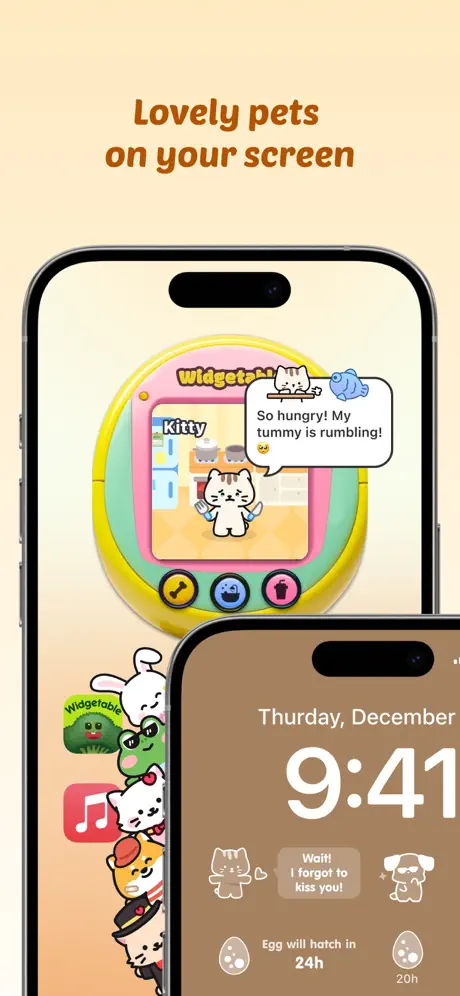{: width="180" .normal }
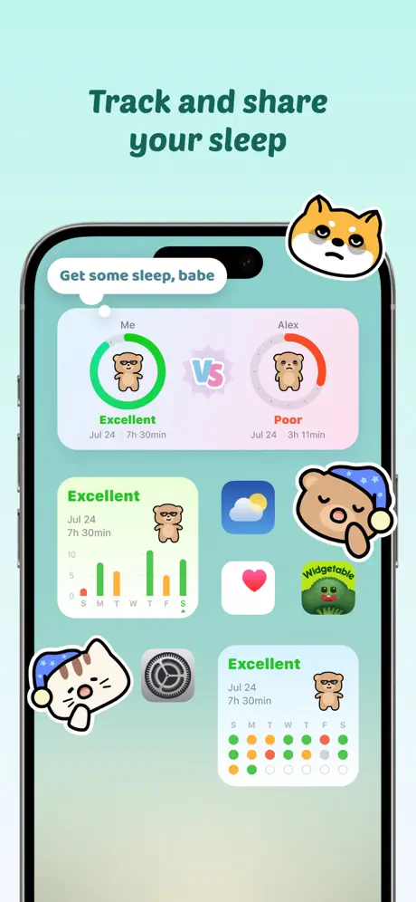{: width="180" .normal }

Widgetable mengambil sudut berbeda: **widget yang dibangun di sekitar relasi**. Anda mengadopsi hewan peliharaan virtual yang Anda rawat bersama teman, berbagi widget tidur, mengirim pembaruan suasana hati, dan menampilkan jarak waktu nyata antara Anda dan sahabat — semua di Layar Kunci atau Utama. Ini populer di kalangan pasangan dan sahabat dekat daripada sebagai toolkit produktivitas umum.

**Keunggulan**
- **Widget sosial/relasi unik** (peliharaan, tidur, suasana hati, jarak, status teman) yang tidak ada di aplikasi widget umum.
- **Konten lucu, menyenangkan, dan sering diperbarui**; peringkat sangat tinggi.
- Berfungsi lintas **iOS dan Android** untuk widget bersama dengan teman di platform mana pun.

**Kelemahan**
- **Niche** — bukan toolkit widget umum; sedikit gunanya jika Anda tidak ingin fitur sosial.
- **Fitur inti berada di balik langganan**.
- Berbagi status pribadi (tidur, suasana hati, jarak lokasi) menimbulkan **pertimbangan privasi**.
- Kurang berguna untuk widget produktivitas/data seperti baterai, RAM, atau kalender.

**Terbaik untuk:** pasangan, sahabat, dan pencinta hewan peliharaan yang ingin layar kunci mereka terasa sosial.

**Unduh Widgetable**
- [App Store](https://apps.apple.com/us/app/widgetable-besties-couples/id1641107226)

---

## 6. WidgetClub — terbaik untuk widget lucu bertema

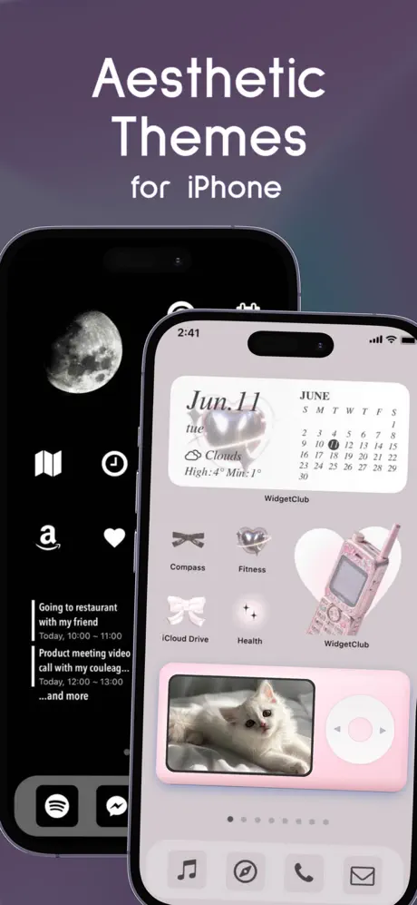{: width="180" .normal }
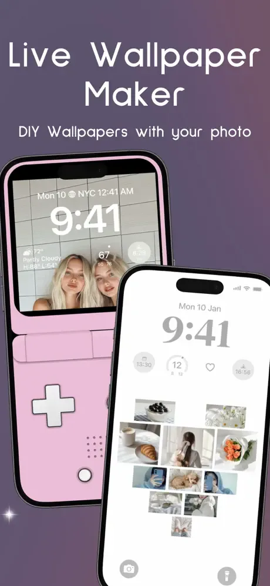{: width="180" .normal }
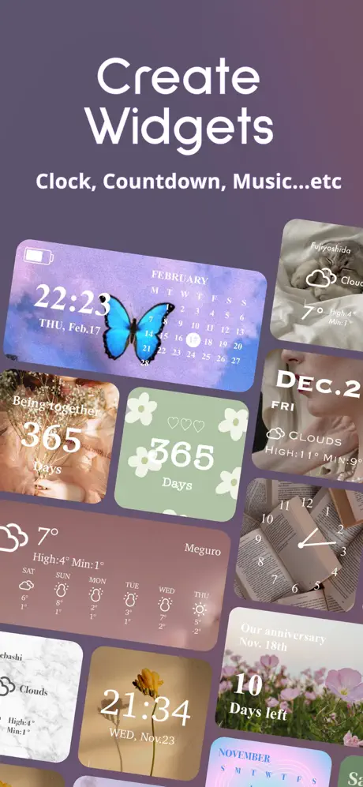{: width="180" .normal }
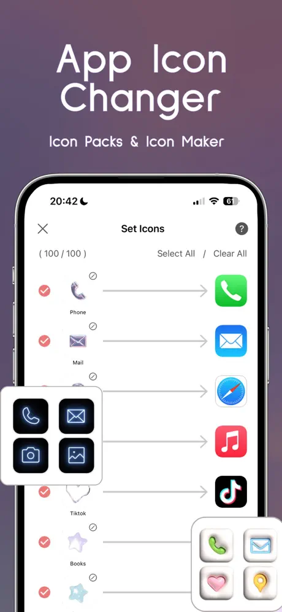{: width="180" .normal }
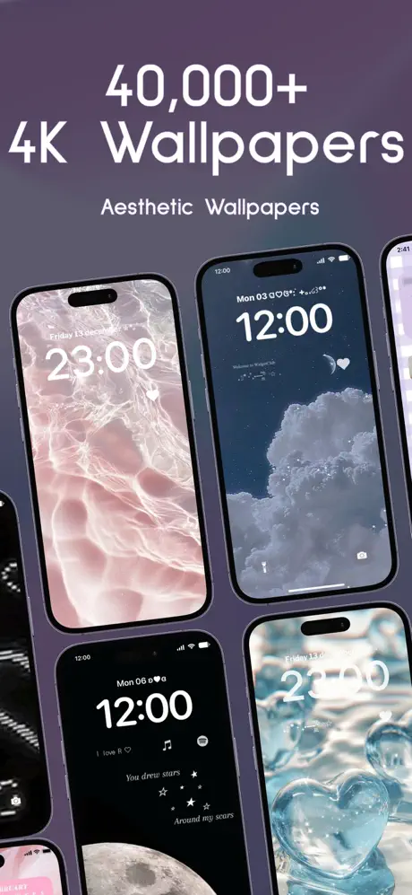{: width="180" .normal }

WidgetClub adalah aplikasi widget, wallpaper, dan ikon estetik dengan katalog besar (puluhan ribu tema) mencakup cuaca, foto, kalender, jam, hitung mundur, baterai, dan widget pengingat. Sebuah maker sederhana membiarkan Anda menaruh foto dan warna; ia berjalan di **iOS dan Android**.

**Keunggulan**
- **Sangat mudah** membuat widget estetik lucu dan kohesif.
- **Pustaka tema besar** dan jangkauan lintas platform (iOS + Android).
- Baik untuk **widget foto dan pengingat** dengan upaya minimal.

**Kelemahan**
- **Estetika di atas kedalaman**; bukan editor dari nol seperti Widgy/KWGT.
- Pustaka lengkap membutuhkan **langganan**.
- **Dukungan Android kurang matang** daripada iOS.
- Widget baterai/pengingat dasar dibanding alat khusus.

**Terbaik untuk:** pengguna yang memprioritaskan layar utama cantik bertema daripada kustomisasi mendalam.

**Unduh WidgetClub**
- [App Store](https://apps.apple.com/us/app/widgetclub-widget-theme-icon/id1580284904)

---

## Perbandingan kemampuan inti

Tabel di bawah menunjukkan, sedapat mungkin secara objektif, kemampuan apa yang didukung tiap aplikasi. "Sebagian" berarti fitur ada tapi terbatas (mis. hanya preset, atau di balik paywall).

| Kemampuan | One Widget | KWGT | Widgy | Color Widgets | Widgetable | WidgetClub |
|---|---|---|---|---|---|---|
| **Platform** | Android | Android | iOS | iOS | iOS (+Android) | iOS + Android |
| **Preset jadi** | **Kuat (500+)** | Sebagian (komunitas) | Ya (template) | **Kuat** | Ya (sosial) | **Kuat (tema)** |
| **Editor dari nol** | Tidak (berbasis preset) | **Ya (powerful)** | **Ya (visual)** | Sebagian (pengustomisasi) | Tidak | Sebagian (maker sederhana) |
| **Sistem gaya (One UI / Material You / Glass / Nothing)** | **4 bawaan** | Penuh (Anda tentukan) | Penuh (Anda tentukan) | Tema estetik | Hanya lucu | Lucu / tema |
| **Data sistem langsung (baterai / RAM / storage)** | **Ya (baterai/RAM/storage)** | Ya (via formula) | Ya (baterai, dll.) | Ya (baterai) | Terbatas (sosial) | Ya (baterai) |
| **Cuaca** | Ya | Ya | Ya | Ya | Tidak | Ya |
| **Kesehatan / aktivitas** | Sebagian | **Ya (Health Connect)** | **Ya (Apple Health)** | Ya (langkah) | Tidur (sosial) | Sebagian |
| **Widget foto** | Ya | Ya | Ya | **Ya (kuat)** | Terbatas | Ya |
| **Kalender / tanggal** | Ya | Ya | Ya | Ya | Terbatas | Ya |
| **Interaktif (toggle / shortcut)** | **Ya (toggle, shortcut)** | Terbatas (aksi ketuk) | Terbatas (ketuk untuk buka) | Ketuk untuk buka | Ketuk untuk buka | Ketuk untuk buka |
| **Dukungan layar kunci** | Android 12+ | Widget kunci Android | Kunci iOS + StandBy | Kunci iOS | Kunci iOS | Kunci iOS |
| **Tingkat gratis** | Set One UI gratis (+buka kunci) | Gratis + Pro key | Gratis + IAP | Gratis + Pro sub | Gratis + sub | Gratis + sub |
| **Momentum pembaruan** | **Aktif menambah komponen** | Dipelihara aktif | Aktif (iOS baru) | Aktif | Aktif | Aktif |

---

## Alternatif WidgetSmith mana yang cocok untuk tiap jenis pengguna

Tabel memeringkat fitur; di sini keenam aplikasi dikelompokkan menurut *apa yang ingin Anda taruh di layar utama*.

- **Preset jadi di Android** — daftar pendek **alternatif KWGT** atau **alternatif KWGT terbaik Android** dimulai dari One Widget: 500+ widget jadi dalam gaya One UI, Nothing, Glass, dan Material You, ditaruh tanpa editor.
- **Widget yang Anda gambar sendiri** — **alternatif Kustom Widget Maker** tetap berarti layer, formula, dan waktu setelan. KWGT tetap acuannya; Widgy adalah setara iOS.
- **Jam, kalender, dan berita dulu** — **alternatif Chronus** soal tipografi dan kepadatan informasi, bukan paket tema.
- **Pustaka preset besar tanpa scripting** — **alternatif Widgetopia** atau **alternatif Zooper Widget** menunjuk ke aplikasi bergaya katalog; Color Widgets dan WidgetClub adalah versi bercita rasa iOS dari ide itu.
- **Widget lucu atau sosial** — Widgetable dan WidgetClub mencakup peliharaan, pasangan, dan tema, dengan biaya langganan untuk sebagian besar pustaka.

Sebelum beralih, periksa dua hal yang tidak berubah mengikuti tren: apakah tingkat gratis membiarkan Anda menaruh dan mengubah ukuran widget, dan apakah widget masih menampilkan data langsung setelah pembaruan peluncur?

## Cara memilih

- Ingin **Android + pustaka jadi raksasa dalam empat estetika ponsel** → **One Widget**.
- Ingin **merancang widget dari nol di Android** → **KWGT**.
- Ingin **widget iOS kustom mendalam tanpa kode** → **Widgy**.
- Ingin **widget iOS cantik dan tema serasi cepat** → **Color Widgets**.
- Ingin **widget sosial/peliharaan dengan teman atau pasangan** → **Widgetable**.
- Ingin **widget lucu bertema lintas iOS dan Android** → **WidgetClub**.

## FAQ

**Apakah One Widget alternatif WidgetSmith yang baik di Android?**
{:.faq-q}

Ya. Jika Anda menginginkan pustaka widget Android jadi besar mencakup tampilan One UI, Material You, Glass, dan Nothing — tanpa alat desain — One Widget adalah jawaban Android-asli terdekat dengan filosofi preset WidgetSmith.

**Apakah One Widget bekerja di iOS?**
{:.faq-q}

Tidak. One Widget hanya Android. Untuk iOS, Widgy atau Color Widgets (dalam panduan ini) adalah pilihan bergaya WidgetSmith.

**Alternatif WidgetSmith mana yang terbaik untuk pembangunan kustom?**
{:.faq-q}

KWGT — editor Android dari-nol paling powerful. One Widget tetap berbasis preset, jadi pilih KWGT jika Anda ingin kendali penuh.

**Apakah One Widget gratis?**
{:.faq-q}

Set gaya One UI gratis; tiga gaya lain dibuka dengan pembelian sekali bayar (tanpa langganan).

[Halaman aplikasi One Widget](/id/apps/one-widget/) — tersedia di Android.

## Istilah terkait

- [Apa Itu Widget Layar Utama?](/id/glossary/what-is-a-home-screen-widget/)
- [Apa Itu Material You?](/id/glossary/what-is-material-you/)
- [Apa Itu Nothing UI?](/id/glossary/what-is-nothing-ui/)
- [Apa Itu Galaxy One UI?](/id/glossary/what-is-galaxy-one-ui/)
- [Apa Itu iOS Glass?](/id/glossary/what-is-ios-glass/)
