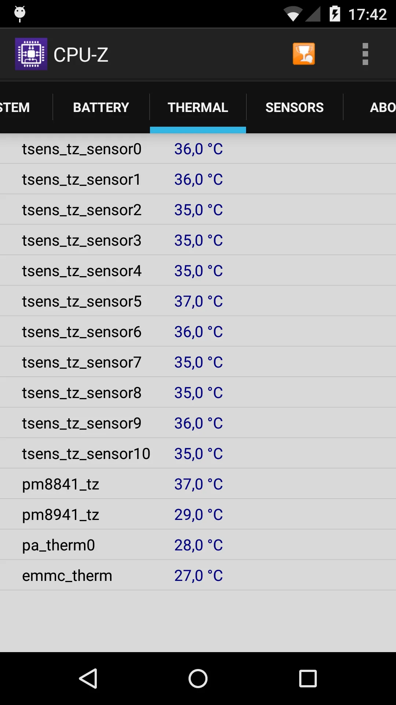

Saat ponsel panas, ia melambat — thermal throttling aktif dan frame drop. Sebuah **[monitor suhu CPU](/id/glossary/what-is-a-cpu-temperature-monitor/)** membiarkan Anda melihat panas sebelum memakan performa. **CPU Monitor** adalah **aplikasi suhu CPU untuk Android** dengan suhu waktu nyata, beban per-core, dan alarm overheat. Di bawah ini kami membandingkannya dengan **CPU-Z**, alat info hardware klasik, untuk mendeteksi panas sejak awal. Inilah daftar pendek yang dimaksud dengan **aplikasi monitor suhu CPU terbaik android** dan **aplikasi alarm overheat CPU**.

## Apa yang dibutuhkan monitor suhu CPU

CPU Monitor dan CPU-Z adalah dua aplikasi yang dibandingkan di sini untuk mendeteksi panas CPU Android sebelum thermal throttling menurunkan performa. Lima kebutuhan utama — suhu waktu nyata, frekuensi dan beban per-core, alarm overheat, penggunaan latar ringan, serta riwayat kurva — menentukan apakah sebuah monitor suhu CPU benar-benar berguna. CPU Monitor menyediakan bacaan langsung, alarm, dan kurva tanpa root; CPU-Z unggul pada inventaris hardware tetapi tanpa peringatan. Keduanya tersedia di Google Play. Pilihan bergantung pada satu hal: apakah Anda ingin diperingatkan lebih awal atau sekadar membaca spesifikasi.

- **Suhu waktu nyata** — suhu CPU saat ini sekilas.
- **Frekuensi dan beban per-core** — lihat core mana yang paling bekerja.
- **Alarm overheat** — peringatan sebelum throttling menyerang.
- **Penggunaan latar ringan** — pemantauan sebaiknya tak memanaskan ponsel.
- **Riwayat** — kurva yang menunjukkan kapan ia melonjak.

## Bagaimana kami memilih aplikasi monitor suhu CPU terbaik

CPU Monitor adalah monitor suhu CPU Android yang memenuhi empat cek pemilihan: bacaan dari sensor thermal perangkat, frekuensi per-core beserta kurva riwayat, alarm overheat yang bisa diatur ambangnya, dan pemantauan ringan read-only tanpa root. Bacaan suhu hanya berguna bila terpercaya dan murah dibiarkan terbuka, karena polling agresif justru memanaskan ponsel yang diukur. Jika angka tak pernah bergerak saat mengisi daya, itu tebakan bukan bacaan sensor. CPU Monitor menang di tiga cek pertama, sementara CPU-Z lebih kuat untuk inventaris hardware.

1. **Dari mana angka berasal** — sebuah aplikasi **monitor suhu CPU android** harus membaca sensor thermal perangkat, bukan memperkirakan panas dari beban CPU. Jika angka tak pernah bergerak saat mengisi daya, itu tebakan.
2. **Semua core, plus kurva** — **monitor suhu dan frekuensi CPU android** berarti frekuensi per-core dan **monitor riwayat frekuensi CPU**, sehingga Anda bisa melihat lonjakan mana yang mendahului throttling.
3. **Peringatan yang bisa ditindak** — sebuah **aplikasi alarm overheat CPU** harus membiarkan Anda menetapkan ambang dan memberi notifikasi sebelum ponsel throttling, alih-alih hanya menampilkan angka merah setelahnya.
4. **Tetap ringan dan read-only** — sebuah **monitor CPU multicore android** yang polling terlalu agresif justru memanaskan ponsel yang diukurnya. CPU Monitor membaca sensor tanpa root dan tak mengubah pengaturan sistem.

CPU Monitor menang di cek 1–3 dengan bacaan waktu nyata, riwayat, dan alarm; CPU-Z lebih kuat bila Anda terutama ingin inventaris hardware.

## Para pesaing sekilas

CPU Monitor memimpin perbandingan empat aplikasi monitor suhu Android — CPU Monitor, CPU-Z, DevCheck, dan AIDA64 — karena satu-satunya yang menggabungkan suhu langsung, beban per-core, dan alarm overheat. Ketiga pesaingnya tetap menyediakan bacaan suhu dan frekuensi, tetapi tidak memberi peringatan dini: CPU-Z dan AIDA64 gratis, DevCheck gratis dengan IAP. CPU Monitor memakai inti gratis plus VIP untuk riwayat lebih panjang. Tabel berikut memetakan suhu langsung, data per-core, alarm, harga, dan kegunaan masing-masing untuk pembaca yang ingin menangkap panas sejak awal.

| App | Harga (2026) | Suhu langsung | Per-core | Alarm | Terbaik untuk |
|---|---|---|---|---|---|
| **CPU Monitor** | Inti gratis + VIP | ✅ | ✅ | ✅ | Peringatan dini panas |
| **CPU-Z** | Gratis | ✅ (sensor) | ✅ | ❌ | Spesifikasi hardware |
| **DevCheck** | Gratis + IAP | ✅ | ✅ | ❌ | Info detail |
| **AIDA64** | Gratis | ✅ | ✅ | ❌ | Spesifikasi mendalam |

## CPU Monitor, lebih dalam

CPU Monitor adalah monitor suhu dan beban CPU untuk Android yang menyediakan suhu langsung, frekuensi per-core, dan alarm overheat tanpa biaya di intinya. Lima layar di bawah menampilkan bacaan thermal, pengaturan peringatan panas, info sensor dan baterai, ikhtisar hardware, serta detail frekuensi core. Fitur unggulannya mencakup kurva riwayat, beban per-core yang menandai core di 100%, dan pemantauan latar ringan yang tidak menambah panas. VIP hanya membuka log jangka panjang; akurasi bacaan bergantung pada sensor yang diekspos perangkat. Aplikasi ini paling cocok untuk menangkap overheat sebelum throttling.

{: width="180" .normal }
{: width="180" .normal }
{: width="180" .normal }
{: width="180" .normal }
{: width="180" .normal }

CPU Monitor adalah **monitor suhu dan beban CPU** untuk Android. Inti — suhu langsung, frekuensi per-core, dan beban — gratis; VIP menambah riwayat dan opsi lebih dalam.

**Keunggulan untuk mengawasi panas**
- **Suhu CPU langsung** — angka jelas yang bisa diawasi saat gaming atau mengisi daya.
- **Frekuensi dan beban per-core** — temukan core yang menempel di 100%.
- **Alarm overheat** — diperingatkan sebelum throttling menurunkan performa.
- **Ringan** — biaya latar minimal, jadi pemantauan tak menambah panas.
- **Kurva riwayat** — lihat kapan suhu melonjak selama sesi.

**Kelemahan untuk mengawasi panas**
- **VIP untuk riwayat lebih dalam** — log jangka panjang di balik upgrade.
- **Akurasi sensor bervariasi** — bacaan bergantung pada yang diekspos perangkat.

**Terbaik untuk:** orang yang ingin menangkap overheat sejak awal, bukan sekadar membaca spesifikasi.

- [Google Play — CPU Monitor](https://play.google.com/store/apps/details?id=com.glgjing.stark)

## CPU-Z, lebih dalam

CPU-Z (paket `com.cpuid.cpu_z`) adalah port Android dari alat CPUID terkenal yang melaporkan detail hardware seperti nama SoC, arsitektur, frekuensi per-core, baterai, dan sensor secara gratis. Lima layar di bawah menampilkan suhu dan frekuensi, detail core, info sensor dan baterai, ikhtisar hardware, serta pengaturan peringatan panas. CPU-Z dihargai karena sumber spesifikasinya terpercaya, tetapi hanya menampilkan suhu tanpa alarm, saran, atau kurva tren. Build Android-nya juga mengekspos lebih sedikit sensor daripada versi PC. Pembaca yang ingin peringatan dini sebaiknya memakai CPU Monitor.

{: width="180" .normal }
{: width="180" .normal }
{: width="180" .normal }
{: width="180" .normal }
{: width="180" .normal }

CPU-Z (paket `com.cpuid.cpu_z`) adalah port Android dari alat CPUID terkenal, berfokus pada pelaporan detail hardware.

**Keunggulan untuk mengawasi panas**
- **Bacaan hardware mendalam** — nama SoC, arsitektur, frekuensi per-core, sistem, baterai, dan sensor.
- **Gratis** — tanpa biaya, tanpa langganan.
- **Sumber terpercaya** — reputasi CPUID untuk spesifikasi akurat.

**Kelemahan untuk mengawasi panas**
- **Hanya info** — ia menampilkan suhu tapi tak memberi alarm atau saran.
- **Tanpa kurva tren** — cuplikan, bukan riwayat.
- **Sensor Android terbatas** — build seluler mengekspos lebih sedikit dari versi PC.

**Terbaik untuk:** pengguna yang ingin membaca spesifikasi hardware dan suhu saat ini yang tepat.

- [Google Play — CPU-Z](https://play.google.com/store/apps/details?id=com.cpuid.cpu_z)

## Bagaimana yang lain membandingkan

DevCheck dan AIDA64 adalah dua pesaing tambahan di sini selain CPU Monitor dan CPU-Z, keduanya kaya informasi hardware namun tanpa alarm overheat. DevCheck menyajikan info perangkat dengan tampilan langsung serta gratis dengan IAP; AIDA64 adalah pembaca spesifikasi paling mendalam. Dengan demikian, keempat aplikasi terbagi dalam dua kelompok: CPU Monitor yang memberi peringatan dini, dan tiga aplikasi lain yang hanya menampilkan data. Pembaca yang bermain game atau mengisi daya berat membutuhkan grup pertama agar throttling bisa dicegah.

- **DevCheck** menampilkan info perangkat kaya dengan tampilan langsung; gratis dengan IAP, tapi tanpa alarm overheat.
- **AIDA64** adalah pembaca spesifikasi paling mendalam; hebat untuk detail, bukan untuk peringatan panas.

## Mana yang harus dipilih?

CPU Monitor adalah jawaban untuk suhu langsung, beban per-core, dan alarm overheat di Android, sementara CPU-Z adalah jawaban untuk spesifikasi hardware gratis dan detail tanpa alarm. Keduanya tersedia di Google Play: CPU Monitor memakai inti gratis plus VIP, CPU-Z sepenuhnya gratis. DevCheck dan AIDA64 melengkapi daftar sebagai pembaca hardware kaya data tanpa peringatan. Keputusan bergantung pada satu hal: apakah Anda ingin diperingatkan sebelum performa turun atau hanya perlu membaca angka spesifikasi.

- Ingin **suhu langsung + beban per-core + alarm overheat** → **CPU Monitor**.
- Ingin **spesifikasi hardware gratis dan detail** → **CPU-Z**.

## Skenario khas

CPU Monitor mendukung empat skenario pemantauan suhu CPU Android yang semuanya bertujuan mencegah throttling sebelum terjadi. Skenario pertama memakai jendela melayang saat gaming dan jeda saat suhu mendekati alarm; kedua membiarkan widget terlihat saat mengisi daya agar baterai panas segera dicabut; ketiga memakai kurva riwayat untuk menemukan aplikasi pemicu lonjakan; keempat memeriksa core yang menempel di 100% lalu mengurangi beban. Di keempat skenario, CPU-Z hanya bisa melengkapi dengan spesifikasi karena tanpa alarm maupun kurva.

- **Gaming sebelum throttling** — buka jendela melayang dan awasi suhu CPU; jeda pertandingan saat mendekati alarm agar frame tak drop.
- **Mengisi daya tanpa memasak** — biarkan widget layar utama terlihat; alarm overheat memberi tahu Anda mencabut atau memindahkan ponsel.
- **Temukan lonjakan** — gunakan kurva riwayat untuk menemukan aplikasi atau momen yang menaikkan suhu, lalu tutup.
- **Cek per-core** — lihat core mana yang menempel di 100% dan putuskan apakah mengurangi beban.

## FAQ

**Apakah CPU Monitor gratis?**
{:.faq-q}

Ya. Suhu langsung inti, beban per-core, dan alarm overheat gratis; VIP membuka riwayat dan opsi lebih dalam.

**CPU Monitor atau CPU-Z — mana yang harus saya pilih?**
{:.faq-q}

Ingin suhu langsung, beban per-core, dan alarm overheat → CPU Monitor; ingin spesifikasi hardware gratis dan detail tanpa alarm → CPU-Z.

**Apakah CPU Monitor menampilkan kurva riwayat suhu?**
{:.faq-q}

Ya. Ia memetakan suhu CPU dan baterai dari waktu ke waktu sehingga Anda bisa melihat kapan lonjakan terjadi selama sesi.

[Dapatkan CPU Monitor](/id/apps/cpu-monitor/) — tersedia di Android.

## Istilah terkait

- [Apa Itu Monitor Suhu CPU?](/id/glossary/what-is-a-cpu-temperature-monitor/)
- [Apa Itu System Monitor?](/id/glossary/what-is-a-system-monitor/)
