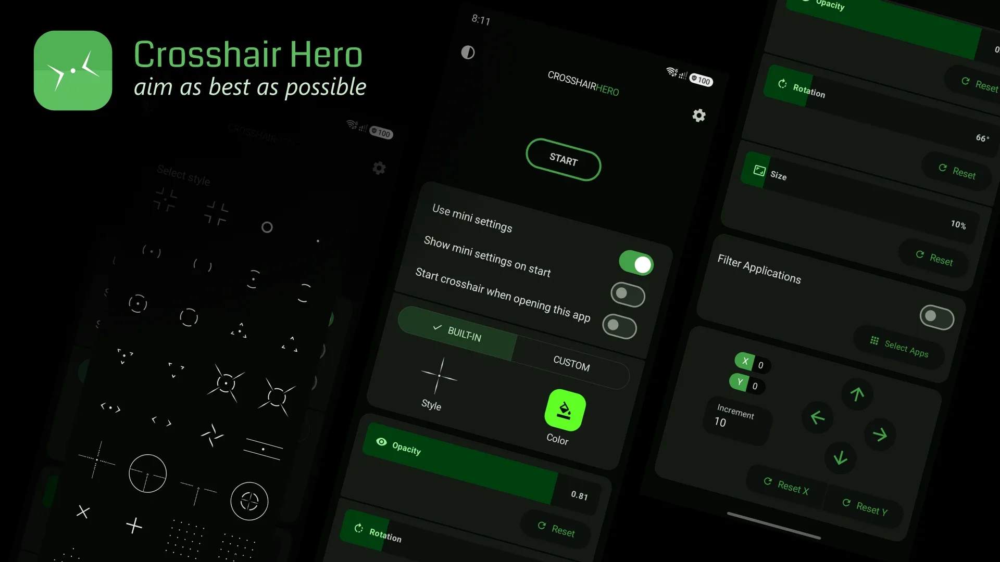

Game FPS mobile seperti PUBG Mobile dan COD Mobile menggambar bidik silangnya sendiri, dan tidak selalu di tempat yang Anda inginkan. Sebuah **[overlay bidik silang](/id/glossary/what-is-a-crosshair/)** menempatkan retikel yang Anda kendalikan di atas game — tanpa root, cukup izin overlay. Jika Anda ingin **aplikasi bidik silang terbaik Android** untuk shooter, sebuah **aplikasi bidik silang kustom** dengan **bidik silang FPS** yang bisa disetel lebih penting daripada titik statis. **Crosshair Aim** adalah **aplikasi bidik silang kustom** untuk Android dengan 80+ gaya dan pengatur melayang saat bermain. Di bawah ini kami bandingkan dengan **Crosshair Hero** untuk penggunaan shooter.

## Apa yang dibutuhkan overlay bidik silang FPS

Crosshair Aim dan Crosshair Hero adalah dua overlay bidik silang Android yang dibandingkan di sini untuk game FPS seperti PUBG Mobile dan COD Mobile, keduanya tanpa root. Crosshair Aim membawa 80+ gaya dan pengatur melayang saat bermain; Crosshair Hero mengandalkan 30+ preset siap pakai; Crosshair X menjadi opsi iPhone saja. Lima kebutuhan utama — overlay di atas game, banyak gaya, warna dan ukuran, pengatur saat main, serta beban ringan — menentukan mana yang paling pas. Pilihan bergantung pada satu hal: apakah Anda ingin menyetel retikel di tengah match atau sebelum meluncur.

- **Overlay di atas game** — tanpa root, cukup satu izin.
- **Banyak gaya** — titik, silang, T, lingkaran, dan hibrida.
- **Warna, ukuran, transparansi** — setel untuk gambar bidik Anda.
- **Pengatur saat main** — geser dan ubah ukuran tanpa keluar match.
- **Ringan** — tidak boleh memakan frame.

## Aplikasi bidik silang terbaik Android di 2026

Crosshair Aim adalah aplikasi bidik silang terbaik Android 2026 untuk setup FPS karena memenuhi empat syarat: pustaka gaya yang bisa disetel, pengatur melayang langsung tanpa keluar match, model gratis tanpa root tanpa iklan, dan overlay visual yang aman dari anti-cheat. Kriteria "terbaik" berarti lebih dari retikel cantik — ukuran dan warna harus bisa diubah di tengah pertandingan. Pengujian dilakukan pada PUBG Mobile, COD Mobile, dan game tembak-menembak Android lainnya, lalu menimbang gratis versus berbayar. Crosshair Hero memenuhi sebagian syarat itu dengan preset cepat.

- **Pustaka gaya yang bisa disetel** — titik, silang, T, lingkaran, dan hibrida, bukan hanya satu bawaan.
- **Pengatur melayang langsung** — ubah ukuran dan warna retikel tanpa keluar match.
- **Tanpa root, gratis untuk mulai** — inti yang bisa dipakai dan tanpa iklan, dengan buka Pro opsional untuk set lengkap.
- **Aman by design** — overlay hanya visual yang tidak menyentuh data game, sehingga aman dari anti-cheat.

Kami menguji lapangan terhadap game yang benar-benar dimainkan — **PUBG Mobile**, **COD Mobile**, dan **game tembak-menembak Android** lainnya — lalu menimbang gratis vs berbayar di bawah.

## Para pesaing sekilas

Crosshair Aim memimpin perbandingan tiga overlay bidik silang — Crosshair Aim, Crosshair Hero, dan Crosshair X — dengan 80+ gaya dan pengatur melayang langsung, sementara Crosshair Hero menawarkan 30+ preset yang disetel sebelum meluncur. Crosshair X hanya untuk iPhone dengan model langganan. Untuk bidik silang PUBG Mobile dan COD Mobile, pengatur melayang menjadi penentu: kecilkan retikel untuk tembakan jarak jauh, besarkan untuk jarak dekat, semuanya di tengah match. Tabel berikut memetakan harga, jumlah gaya, pengatur saat main, dan platform ketiganya.

| Aplikasi | Harga (2026) | Gaya | Pengatur saat main | Platform | Terbaik untuk |
|---|---|---|---|---|---|
| **Crosshair Aim** | Inti gratis + VIP | **80+** (dasar + lanjutan) | ✅ melayang | Android | Kustomisasi mendalam |
| **Crosshair Hero** | Gratis + IAP | 30+ gaya preset | ⚠️ sisi aplikasi | Android | Preset cepat |
| **Crosshair X** | Gratis + berlangganan | Banyak | Sisi aplikasi | Hanya iOS | Shooter iPhone |

Untuk **bidik silang PUBG Mobile** dan COD Mobile khususnya, pengatur melayang adalah penentu: kecilkan retikel untuk tembakan jarak jauh, besarkan untuk jarak dekat, semua di tengah match. Crosshair Aim melakukannya secara langsung; Crosshair Hero menyetel sebelum meluncur.

## Crosshair Aim, lebih dalam

Crosshair Aim adalah overlay bidik silang kustom untuk Android dengan 80+ gaya dan pengatur melayang yang diseret langsung di atas game. Empat layar di bawah menunjukkan beranda aplikasi, pustaka gaya dan kustomisasi, pengaturan transparansi serta posisi, dan efek overlay saat bermain. Pengguna bisa mengubah warna, ukuran, dan transparansi agar retikel kontras di map apa pun, tanpa root dan dengan dampak minimal pada frame rate. Gaya dasar gratis; pustaka lanjutan berada di balik VIP. Izin overlay diperlukan sekali, dan sebagian peluncur butuh toggle tambahan.

{: width="180" .normal }
{: width="180" .normal }
{: width="180" .normal }
{: width="180" .normal }

Crosshair Aim adalah **overlay bidik silang kustom** untuk Android dengan pustaka gaya besar dan pengatur melayang yang Anda seret di atas game.

**Kelebihan untuk pemain FPS**
- **80+ gaya** — retikel dasar dan lanjutan untuk selera apa pun.
- **Pengatur melayang saat main** — ubah ukuran dan posisi langsung, tanpa menutup game.
- **Warna, ukuran, transparansi** — atur kontras terhadap map apa pun.
- **Tanpa root** — bekerja dengan izin overlay standar.
- **Ringan** — dampak minimal pada gameplay.

**Kelemahan untuk pemain FPS**
- **VIP untuk gaya lanjutan** — pustaka terdalam berada di balik upgrade.
- **Izin overlay diperlukan** — Anda memberi akses sekali; sebagian peluncur butuh toggle.

**Terbaik untuk:** pemain shooter mobile yang ingin retikel disetel untuk mereka.

- [Google Play — Crosshair Aim](https://play.google.com/store/apps/details?id=com.glgjing.crosshair.aim.fps.game)

## Crosshair Hero, lebih dalam

Crosshair Hero (paket `me.okitastudio.crosshairherofps`) adalah aplikasi overlay bidik silang Android dengan 30+ gaya preset, dukungan impor PNG kustom, dan setelan warna, ukuran, serta posisi. Satu layar di bawah menampilkan beranda overlay-nya. Aplikasi ini gratis untuk pemakaian dasar, dengan IAP untuk paket gaya tambahan. Keunggulannya adalah preset yang dikenal dan bisa langsung dipakai dalam hitungan detik. Kekurangannya, jumlah gaya lebih sedikit daripada Crosshair Aim dan setelan dilakukan di sisi aplikasi sebelum meluncur, bukan di tengah match.

{: width="720" .normal }

Crosshair Hero (paket `me.okitastudio.crosshairherofps`) adalah **aplikasi overlay bidik silang** populer dengan 30+ gaya preset, dukungan PNG kustom, dan setelan warna/ukuran/posisi.

**Kelebihan untuk pemain FPS**
- **30+ preset** — gaya bidik silang yang dikenal, ketuk dan langsung pakai.
- **PNG kustom** — impor gambar sendiri sebagai retikel.
- **Warna, ukuran, posisi** — penyesuaian cepat di aplikasi.
- **Gratis untuk mulai** — pemakaian dasar dengan IAP untuk paket gaya.

**Kelemahan untuk pemain FPS**
- **Gaya lebih sedikit dari Crosshair Aim** — 30+ vs 80+.
- **Pengatur sisi aplikasi** — Anda setel sebelum meluncur, tidak selalu langsung di tengah match.
- **IAP / dukungan iklan** — paket gaya dan iklan bervariasi.

**Terbaik untuk:** pemain yang ingin preset bidik silang yang dikenal dalam hitungan detik.

- [Google Play — Crosshair Hero](https://play.google.com/store/apps/details?id=me.okitastudio.crosshairherofps)

## Mana yang harus dipilih?

Crosshair Aim adalah jawaban untuk overlay bidik silang terbaik di game FPS Android dengan 80+ gaya dan pengatur melayang langsung, sementara Crosshair Hero adalah jawaban untuk preset cepat yang tinggal ketuk. Keduanya berjalan di Android tanpa root: Crosshair Aim memakai inti gratis plus VIP untuk gaya lanjutan, Crosshair Hero gratis dengan IAP. Crosshair X menjadi pilihan bagi pengguna iPhone. Keputusan bergantung pada satu hal: apakah Anda ingin menyesuaikan retikel di tengah pertandingan atau hanya memakai preset siap pakai.

- Ingin **aplikasi overlay bidik silang terbaik untuk game FPS** dengan **80+ gaya + pengatur melayang langsung** → **Crosshair Aim**.
- Ingin **preset bidik silang cepat** → **Crosshair Hero**.

[Dapatkan Crosshair Aim](/id/apps/cross-hair/) — **aplikasi bidik silang terbaik Android** di 2026, tersedia di Android.

## Skenario umum

Crosshair Aim mencakup lima skenario penggunaan overlay bidik silang di game FPS, mulai dari retikel bawaan yang lemah hingga menjaga frame rate. Skenario pertama menempatkan retikel terkendali di atas PUBG Mobile atau COD Mobile; kedua mengubah ukuran atau warna lewat pengatur melayang tanpa keluar game; ketiga menyesuaikan kontras di map terang maupun gelap; keempat menjaga overlay ringan agar FPS tidak turun; kelima memastikan overlay hanya visual dan aman dari anti-cheat. Crosshair Hero lebih cocok bila kelima skenario itu cukup diatasi dengan preset sebelum meluncur.

- **Shooter dengan retikel bawaan lemah** — PUBG Mobile atau COD Mobile menjaga bidik silang mereka tidak di tengah; letakkan retikel terkendali di atas sehingga setiap tembakan sejajar.
- **Ganti senjata di tengah match** — ubah ukuran atau warna retikel langsung dengan pengatur melayang tanpa keluar game.
- **Map kontras rendah** — setel warna dan transparansi agar retikel tetap terlihat di adegan terang atau gelap.
- **Pertahankan frame rate** — overlay ringan tetap di atas tanpa memakan FPS, sehingga bantuan aim tidak merusak performa.
- **Aman by design** — hanya menggambar retikel dan tidak menyentuh data game, sehingga aman dari anti-cheat.

## FAQ

**Apakah Crosshair Aim gratis?**
{:.faq-q}

Ya. Set gaya dasar gratis; buka VIP membuka pustaka 80+ lengkap dan kustomisasi lebih dalam.

**Crosshair Aim atau Crosshair Hero — mana yang harus saya pilih?**
{:.faq-q}

Ingin 80+ desain siap pakai dengan pengatur melayang langsung saat main → Crosshair Aim; ingin preset cepat yang tinggal ketuk → Crosshair Hero.

**Apakah Crosshair Aim berjalan di iOS?**
{:.faq-q}

Tidak. Crosshair Aim hanya untuk Android; pengguna iOS bisa melihat Crosshair X, yang tidak punya build Android.

**Apakah aman / apakah saya akan dibanned?**
{:.faq-q}

Ini overlay hanya visual yang tidak mengubah data atau memori game, sehingga tidak memicu anti-cheat. Gunakan dalam aturan fair-play setiap game.

## Istilah terkait

- [Apa Itu Bidik Silang?](/id/glossary/what-is-a-crosshair/)
