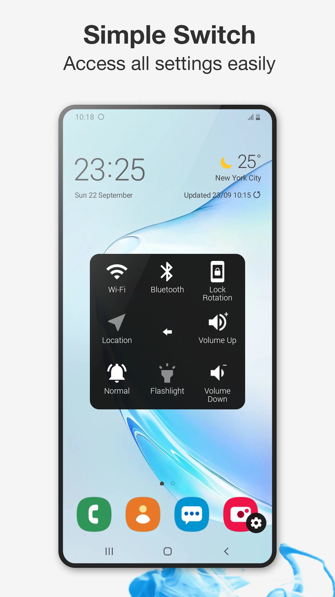

Sebuah [asisten melayang](/id/glossary/what-is-a-floating-window/) menaruh tombol kecil di tepi layar yang memicu aksi yang sering Anda gunakan — back, home, recent, lock, tangkapan layar — tanpa mencari tombol fisik. **Floating Assistant** adalah **aplikasi Android bola tepi melayang** dengan kustomisasi mendalam. Di bawah kami membandingkannya dengan **Assistive Touch**, kelas tombol melayang populer, untuk multitasking sehari-hari. Ini daftar pendek yang dimaksud orang dengan **aplikasi asisten melayang android terbaik** atau **aplikasi assistive touch android terbaik 2026**.

## Apa yang dibutuhkan asisten melayang

Floating Assistant dan Assistive Touch adalah dua aplikasi asisten melayang Android yang dibandingkan di sini untuk aksi cepat sehari-hari seperti back, home, recent, lock, dan tangkapan layar tanpa mencari tombol fisik. Floating Assistant menawarkan bola tepi dengan kustomisasi mendalam dan gestur; Assistive Touch mengandalkan tombol virtual sederhana. Lima kebutuhan — bola melayang tepi, aksi cepat, tombol dan gestur kustom, ringan, serta lokal tanpa akun — menentukan pilihan. Keduanya tidak memerlukan root. Pilihan bergantung pada satu hal: apakah Anda ingin kumpulan aksi yang bisa dipetakan ulang atau tombol virtual yang langsung dipakai.

- **Bola melayang tepi** — tombol terjangkau ibu jari yang tak mengganggu.
- **Aksi cepat** — back, home, recent, kunci layar, tangkapan layar, layar terbelah.
- **Tombol dan gestur kustom** — petakan apa yang benar-benar Anda pakai.
- **Ringan** — tak boleh membuat ponsel lag.
- **Lokal dan privat** — tanpa akun, tanpa unggah.

## Bagaimana kami memilih aplikasi asisten melayang terbaik

Floating Assistant adalah aplikasi asisten melayang Android yang memenuhi empat cek pemilihan: bola di jangkauan ibu jari pada layar jangkung tanpa menutupi konten, pintasan yang benar-benar bisa dipetakan ulang ke aplikasi dan toggle, aksi andal seperti back, home, recent, lock, dan tangkapan layar, serta izin overlay dan aksesibilitas yang jujur tanpa akun maupun root. Bola melayang dinilai dari seberapa sering membantu, bukan seberapa banyak tombolnya. Floating Assistant menang di tiga cek pertama dengan bola bertempel di tepi; Assistive Touch menang bila Anda ingin menu terkecil.

1. **Jangkauan di layar jangkung** — sebuah **aplikasi tombol melayang satu tangan android** sebaiknya berada di mana ibu jari Anda berada, dan tak menutupi konten di belakangnya. Bila menutupi keyboard atau kontrol video, ia akan dipindah atau dihapus.
2. **Pintasan yang benar-benar Anda ubah** — **bola melayang dengan pintasan kustom** berarti aplikasi, kontak, dan toggle sistem, bukan sekadar cincin ikon tetap. Daftar pendek **aplikasi asisten melayang android terbaik** sebaiknya membiarkan setiap slot dipetakan ulang.
3. **Aksi, bukan hiasan** — back, home, recent, lock, dan tangkapan layar harus andal; kumpulan **tombol back home recent floating assistant** adalah minimum, dan gestur adalah bonus.
4. **Izin jujur** — layanan overlay dan aksesibilitas adalah pemberian kuat. **Aplikasi assistive touch android terbaik 2026** sebaiknya menjelaskan apa yang dibacanya, tak butuh akun, dan jalan tanpa root.

Floating Assistant menang di 1–3 dengan bola bertempel di tepi yang sepenuhnya bisa dipetakan ulang; Assistive Touch menang bila Anda ingin menu terkecil. Bila datang dari pencarian **alternatif assistive touch android**, cek 4 seksama seperti 1.

## Para pesaing sekilas

Floating Assistant memimpin perbandingan tiga kelompok asisten melayang Android — Floating Assistant, Assistive Touch, dan alat tepi lainnya — karena bola tepinya sepenuhnya bisa dipetakan ulang dan mendukung aksi serta gestur. Assistive Touch menawarkan tombol virtual dan pintasan dengan model gratis plus IAP; alat tepi lain bervariasi dan lebih sempit. Tabel berikut memetakan bola melayang, jenis aksi, kustomisasi, harga, dan kegunaan. Pembaca yang ingin kendali melayang fleksibel sebaiknya memilih Floating Assistant; yang menginginkan tombol virtual sederhana bisa memakai Assistive Touch.

| App | Harga (2026) | Bola melayang | Aksi | Kustom | Terbaik untuk |
|---|---|---|---|---|---|
| **Floating Assistant** | Inti gratis + VIP | ✅ | Back/home/recent/lock/tangkapan/split | ✅ tombol + gestur | Pengguna kuat |
| **Assistive Touch** | Gratis + IAP | ✅ | Tombol virtual + pintasan | ✅ | Tombol virtual sederhana |
| **Alat tepi lain** | Bervariasi | ✅ | Terbatas | ⚠️ | Ceruk |

## Floating Assistant, lebih dalam

Floating Assistant adalah aplikasi Android bola tepi melayang dengan kumpulan aksi kaya dan kustomisasi penuh untuk pemakaian sehari-hari. Lima layar di bawah menunjukkan bola bertempel di tepi, aksi cepat dan gestur, menu kustom, opsi aksesibilitas, serta setelan izin. Pengguna bisa memetakan ketukan, sapuan, dan tahan lama ke back, home, recent, lock, tangkapan layar, layar terbelah, volume, atau kecerahan. Aplikasi ini ringan, lokal, tanpa akun, dan ramah multi-jendela. Aksi serta gestur ekstra berada di balik VIP; izin overlay diberikan sekali.

{: width="180" .normal }
{: width="180" .normal }
{: width="180" .normal }
{: width="180" .normal }
{: width="180" .normal }

Floating Assistant adalah **aplikasi Android bola tepi melayang** dengan kumpulan aksi kaya dan kustomisasi.

**Keunggulan untuk pemakaian sehari-hari**
- **Bola tepi** — tombol terjangkau ibu jari di layar apa pun.
- **Aksi mendalam** — back, home, recent, lock, tangkapan layar, layar terbelah, volume, kecerahan.
- **Tombol dan gestur kustom** — petakan ketuk, sapu, dan tahan lama ke yang Anda pakai.
- **Ringan dan lokal** — berjalan di perangkat, tanpa akun.
- **Ramah multi-jendela** — layar terbelah cepat untuk multitasking sungguh.

**Kelemahan untuk pemakaian sehari-hari**
- **VIP untuk lebih** — aksi dan gestur ekstra di balik peningkatan.
- **Izin overlay** — Anda memberi akses sekali.

**Terbaik untuk:** pengguna Android yang ingin kendali melayang fleksibel dan bisa dikustomisasi.

- [Google Play — Floating Assistant](https://play.google.com/store/apps/details?id=com.glgjing.floating.apps.assistive.touch.pro)

## Assistive Touch, lebih dalam

Assistive Touch (paket `mtr.assistivetouch.easytools`) adalah aplikasi tombol melayang Android populer yang menawarkan tombol virtual dan pintasan aplikasi. Lima layar di bawah menampilkan bola melayang, aksi cepat dan gestur, menu kustom, opsi aksesibilitas, serta setelan izin. Pengguna bisa mengganti back, home, recent, dan lock dengan ketukan, meluncurkan aplikasi favorit, serta mengatur kecerahan dan volume. Pemakaian dasar gratis dengan IAP. Dibanding Floating Assistant, kumpulan aksinya lebih standar dan kustomisasinya lebih ringan. Aplikasi ini cocok untuk pengganti tombol fisik sederhana.

{: width="180" .normal }
{: width="180" .normal }
{: width="180" .normal }
{: width="180" .normal }
{: width="180" .normal }

Assistive Touch (paket `mtr.assistivetouch.easytools`) adalah aplikasi tombol melayang populer yang menawarkan tombol virtual dan pintasan.

**Keunggulan untuk pemakaian sehari-hari**
- **Bola melayang + tombol virtual** — back, home, recent, lock, dan lainnya sebagai tombol di layar.
- **Pintasan aplikasi cepat** — luncurkan favorit dari bola.
- **Kontrol kecerahan dan volume** — praktis tanpa tombol fisik.
- **Gratis untuk memulai** — pakai dasar dengan IAP untuk ekstra.

**Kelemahan untuk pemakaian sehari-hari**
- **Kumpulan aksi standar** — kurang mendalam dari gestur Floating Assistant.
- **Iklan dan IAP** — konten promosi dan paket bervariasi.
- **Kustomisasi lebih ringan** — lebih sedikit cara memetakan alur kompleks.

**Terbaik untuk:** pengguna yang ingin tombol virtual sederhana menggantikan tombol fisik.

- [Google Play — Assistive Touch](https://play.google.com/store/apps/details?id=mtr.assistivetouch.easytools)

## Mana yang harus dipilih?

Floating Assistant adalah jawaban untuk aksi mendalam, gestur, dan multitasking layar terbelah di Android, sementara Assistive Touch adalah jawaban untuk tombol virtual sederhana yang gratis. Keduanya tanpa root: Floating Assistant memakai inti gratis plus VIP untuk aksi dan gestur ekstra, Assistive Touch gratis dengan IAP. Alat tepi lain menjadi opsi ceruk. Keputusan bergantung pada satu hal: apakah Anda ingin bola yang bisa dipetakan ulang sepenuhnya atau tombol virtual yang langsung bisa diketuk.

- Ingin **aksi mendalam + gestur + multitasking** → **Floating Assistant**.
- Ingin **tombol virtual sederhana, gratis** → **Assistive Touch**.

[Dapatkan Floating Assistant](/id/apps/floating-assistant/) — tersedia di Android.

## Skenario khas

Floating Assistant mendukung lima skenario asisten melayang sehari-hari di Android, dari satu tangan di ponsel besar hingga menghindari dinding iklan. Skenario pertama menyimpan bola di bawah agar back, home, recent, dan tangkapan layar berada di bawah ibu jari; kedua memetakan ketukan ke kunci layar; ketiga memicu layar terbelah dari bola; keempat memberi akses satu ketuk ke Wi-Fi, kecerahan, atau volume; kelima memakai bola inti gratis dengan buka kunci opsional. Assistive Touch lebih cocok bila kelima skenario itu cukup diatasi dengan tombol virtual standar.

- **Satu tangan di ponsel besar** — simpan bola tepi di bawah; back, home, recent, dan tangkapan layar mendarat di bawah ibu jari tanpa mengubah genggaman.
- **Kunci tanpa tombol daya** — petakan ketuk atau gestur ke kunci layar, menghemat tombol keras.
- **Multitasking sungguh** — picu layar terbelah dari bola untuk baca dan balas berdampingan.
- **Jangkau toggle cepat** — satu ketuk ke Wi-Fi, kecerahan, atau volume daripada dua sapuan.
- **Inti bebas iklan** — bola inti gratis dengan buka kunci opsional, sehingga Anda hindari dinding iklan bola lain.

## FAQ

**Apakah Floating Assistant gratis?**
{:.faq-q}

Ya. Inti bola tepi melayang, aksi, dan gestur gratis; buka kunci VIP opsional menambah tema dan opsi lebih dalam.

**Floating Assistant atau Assistive Touch — mana yang harus saya pilih?**
{:.faq-q}

Ingin aksi mendalam, gestur, dan multitasking layar terbelah → Floating Assistant; ingin tombol virtual sederhana gratis → Assistive Touch.

**Apakah Floating Assistant butuh root?**
{:.faq-q}

Tidak. Berjalan sebagai layanan aksesibilitas dan overlay, tanpa root.

**Apakah Floating Assistant bisa di iOS?**
{:.faq-q}

Tidak. Hanya Android; iOS punya AssistiveTouch bawaan di setelan aksesibilitas.

## Istilah terkait

- [Apa Itu Assistive Touch?](/id/glossary/what-is-assistive-touch/)
- [Apa Itu Jendela Melayang?](/id/glossary/what-is-a-floating-window/)
