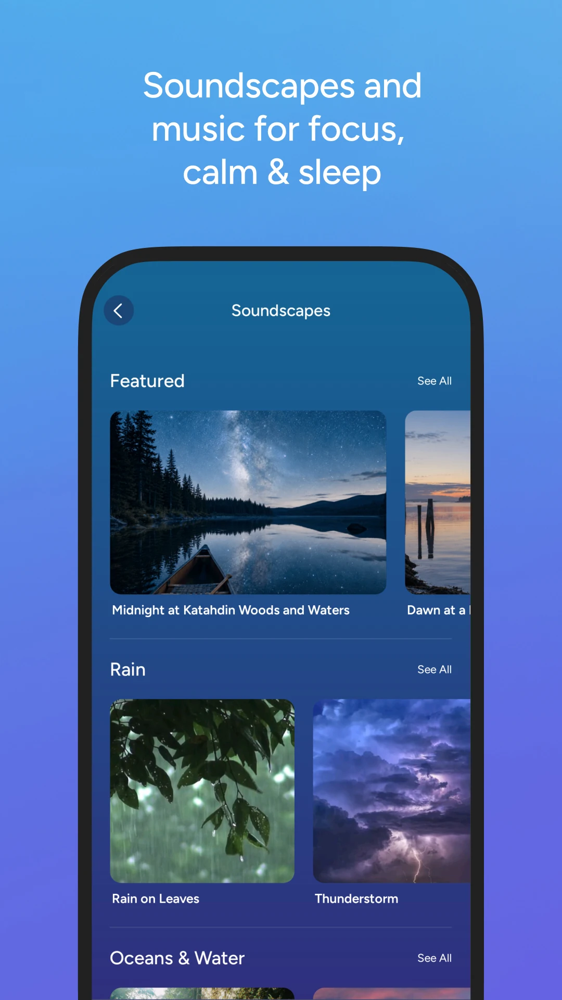

Kantor ruang terbuka, kedai kopi yang ramai, atau teman sekamar yang sedang telepon — musuh fokus biasanya adalah **suara manusia mendadak**, bukan kebisingan secara keseluruhan. Aplikasi **[white noise](/id/glossary/what-is-white-noise/) yang stabil** meratakan lonjakan itu menjadi hening konstan sehingga otak Anda berhenti memantau ruangan. **Meow FM** adalah **pemutar white noise gratis** untuk Android dan iOS dengan soundscape untuk tidur dan konsentrasi. Berikut cara ia dibandingkan untuk kerja mendalam, dan apa yang benar-benar membantu Anda tetap fokus. Perbandingan di bawah menargetkan **suara fokus** daripada konten meditasi, itulah sebabnya pemutar noise tak terputus yang gratis adalah dasarnya.

## Mengapa noise membantu fokus

Meow FM dan Calm adalah dua aplikasi suara fokus yang dibandingkan di sini untuk meratakan suara manusia mendadak di kantor ruang terbuka atau kedai kopi menjadi hening konstan. Noisli, Brain.fm, dan myNoise melengkapi daftar dengan pendekatan berbeda: campuran suara, musik fungsional racikan AI, dan noise yang bisa disetel. Tiga alasan noise membantu fokus — menyamarkan percakapan, menandai rutinitas kerja, dan meredam perubahan lingkungan — berlaku untuk kelimanya. Meow FM menonjol karena memutar white noise offline gratis tanpa akun. Pilihan bergantung pada satu hal: apakah Anda ingin noise murni atau musik terarah.

- **It masks speech** — a flat noise floor hides the words of nearby conversations that would otherwise hijack attention.
- **It anchors a routine** — the same loop signals "work mode" the way a song can.
- **It reduces environment churn** — construction, notifications, and footsteps blend into one bed instead of pinging your awareness.

## Yang dibutuhkan aplikasi suara fokus

Meow FM adalah pemutar white noise gratis untuk Android dan iOS yang memenuhi enam kebutuhan aplikasi suara fokus: loop stabil tanpa sambungan terdengar, pemutaran panjang tanpa reset, pengatur waktu untuk blok pomodoro, pemutaran offline, inti gratis tanpa langganan, dan tanpa iklan di tengah sesi. Calm dan Brain.fm mengandalkan langganan, sementara Noisli dan myNoise menawarkan pencampuran. Meow FM memakai berkas suara lokal sehingga tetap bekerja di pesawat atau kafe tanpa sinyal. Keputusan bergantung pada satu hal: apakah Anda membutuhkan noise murni yang tak terputus atau konten meditasi terpandu.

- **Steady noise** — white, pink, or brown loops that don't audibly seam.
- **Long, seamless playback** — a loop shouldn't reset every three minutes.
- **A timer** — pair sound with a pomodoro block.
- **Offline playback** — works on a plane or a dead Wi-Fi cafe.
- **Free core** — focus shouldn't cost a subscription.
- **No interruptions** — no ads or pop-ups mid-session.

## Apa yang sebenarnya dibutuhkan fokus dari suara

Meow FM adalah aplikasi white noise untuk fokus yang memenuhi tiga detail penentu dalam blok kerja dua jam: loop tanpa sambungan yang tidak menarik perhatian tiap beberapa menit, pengatur waktu yang bisa diatur sekali lalu berhenti sendiri, dan pemutaran yang tetap jalan saat layar terkunci. Berkas suara lokal membuat white noise offline bekerja di kereta atau perpustakaan tanpa sinyal. Daftar periksa di atas soal fitur; sesi kerja soal waktu. Daftar pendek aplikasi white noise gratis terbaik sebaiknya tidak mewajibkan langganan hanya untuk mempertahankan pengatur waktu. Calm dan Noisli memenuhi sebagian, Meow FM memenuhi ketiganya di inti gratis.

- **A loop with no seam** — a three-minute file that restarts audibly pulls attention back every time it ends. White, pink and brown noise need to run continuously, with the option to layer rain underneath if a flat hiss feels too clinical.
- **A timer you set once** — pairing sound with a pomodoro block means the app should stop on its own, so you are not breaking concentration to switch it off.
- **Playback that survives a locked screen** — a **focus music** playlist that pauses when the phone sleeps is worse than no sound at all; the noise has to keep running in the background with the screen off.

Meow FM menangani itu dengan berkas suara lokal, sehingga **white noise offline** bekerja di kereta atau perpustakaan tanpa sinyal, dan daftar pendek **aplikasi white noise gratis terbaik** tak seharusnya mewajibkan langganan sekadar untuk mempertahankan pengatur waktu.

## Para pesaing sekilas

Meow FM memimpin perbandingan lima aplikasi suara fokus — Meow FM, Calm, Noisli, Brain.fm, dan myNoise — karena satu-satunya yang menggabungkan inti gratis, pengatur waktu, pemutaran offline penuh, dan tanpa iklan. Calm berlangganan ~$69.99 per tahun setelah uji coba 14 hari dengan timer terbatas; Noisli, Brain.fm, dan myNoise juga memakai langganan atau IAP. Tabel berikut memetakan harga, dukungan offline, timer, gaya suara, dan kegunaan. Pembaca yang menginginkan fokus gratis dan sederhana sebaiknya memilih Meow FM; yang suka meracik suara bisa memakai Noisli atau myNoise.

| App | Price (2026) | Offline | Timer | Sound style | Best for |
|---|---|---|---|---|---|
| **Meow FM** | Free core + optional VIP | ✅ | ✅ | Nature loops (rain, sea, fireplace) | Free, simple focus |
| **Calm** | ~$69.99/yr (14-day trial) | ⚠️ partial | ❌ | Meditations + focus music | Meditation-style focus |
| **Noisli** | Free + subscription | ✅ | ✅ | White/pink noise + environments | Mix-your-own |
| **Brain.fm** | Subscription | ✅ | ✅ | Functional music (AI-composed) | Scientifically framed focus |
| **myNoise** | Free + IAP | ✅ | ✅ | Generative, tunable | Sound tinkerers |

## Meow FM, secara mendalam

Meow FM adalah pemutar white noise dan fokus bertema kucing untuk Android dan iOS dengan inti gratis berisi loop alami seperti hujan, laut, dan perapian, plus pengatur waktu yang menghentikan pemutaran otomatis. Lima layar di bawah menampilkan daftar stasiun, favorit dan kanal, pengatur waktu untuk blok pomodoro, kualitas audio dan ekualizer, serta pengaturan akun. Soundscape gratis tanpa paywall, timer berhenti sendiri setelah blok 25 menit, dan berkas terunduh diputar tanpa sinyal. VIP sekali bayar membuka adegan ekstra, bukan timer atau putar offline. Antarmukanya sederhana tanpa akun.

{: width="180" .normal }
{: width="180" .normal }
{: width="180" .normal }
{: width="180" .normal }
{: width="180" .normal }

Meow FM adalah **pemutar white noise dan fokus bertema kucing** untuk Android dan iOS. Intinya gratis: loop alami seperti hujan, laut, dan perapian, plus pengatur waktu yang menghentikan pemutaran agar tak jalan sepanjang hari.

**Keunggulan untuk fokus**
- **Free core soundscapes** — rain, sea, and fireplace loops with no paywall on listening.
- **Self-stopping timer** — run sound for a 25-minute block and it ends on its own.
- **True offline playback** — downloaded sounds work with no signal.
- **Simple, cute interface** — open, tap, work; no accounts or setup.
- **Layered mixing** — blend scenes for a bed that fits your space.

**Kelemahan untuk fokus**
- **Not functional music** — it's ambience, not Brain.fm-style focus tracks engineered for attention.
- **Smaller library** — fewer scenes than Noisli or myNoise.
- **No analytics** — it plays sound; it doesn't measure sessions.

**Paling cocok untuk:** orang yang menginginkan **aplikasi white noise gratis** untuk fokus dengan pengatur waktu nyata dan tanpa langganan.

- [Google Play — Meow FM](https://play.google.com/store/apps/details?id=com.glgjing.whitenoise.relax.night.sleep.meow)
- [App Store — Meow FM](https://apps.apple.com/app/id1606715188)

## Calm, secara mendalam

Calm adalah aplikasi meditasi dan tidur terkenal di Google Play dengan 50 juta+ unduhan dan rating 4,3 bintang, yang juga menawarkan musik fokus, pernapasan, dan sesi harian 10 menit untuk konsentrasi. Empat layar di bawah menampilkan beranda meditasi, pernapasan, cerita tidur, serta statistik progres. Keunggulannya ada pada daftar putar fokus terkurasi dan Daily Calm, tetapi konten gratisnya terbatas. Langganan sekitar $69.99 per tahun setelah uji coba 14 hari, dan aplikasi ini mengutamakan meditasi daripada noise murni. Ia cocok untuk pengguna yang fokus lewat meditasi dan bersedia membayar.

{: width="180" .normal }
{: width="180" .normal }
{: width="180" .normal }
{: width="180" .normal }

Calm adalah **aplikasi meditasi dan tidur** paling terkenal di Google Play (50 juta+ unduhan, 4,3 bintang). Selain tidur, ia menawarkan musik fokus, pernapasan, dan sesi harian 10 menit untuk konsentrasi.

**Keunggulan untuk fokus**
- **Focus playlists** — curated calm music for work and study.
- **Daily Calm** — a short daily session to reset attention.
- **Brand trust** — the most recognized name in the category.

**Kelemahan untuk fokus**
- **Paid subscription** — around $69.99/year after a 14-day trial; free content is limited.
- **Not pure noise** — it's meditation-first, so there's no simple "loop brown noise for 50 minutes."
- **Mixed reliability** — some users report the app crashing on first open each day.

**Paling cocok untuk:** orang yang fokus lewat meditasi dan musik tenang, serta bersedia berlangganan.

- [Google Play — Calm](https://play.google.com/store/apps/details?id=com.calm.android)

## Bagaimana yang lain dibandingkan

Noisli, Brain.fm, dan myNoise adalah tiga pesaing tambahan di sini selain Meow FM dan Calm, masing-masing dengan pendekatan khas. Noisli mencampur white dan pink noise dengan suara lingkungan seperti kedai kopi serta angin, gratis dengan langganan untuk lebih banyak; Brain.fm menjual musik fungsional racikan AI dengan langganan berbayar; myNoise menghasilkan noise yang bisa disetel per ruangan dengan IAP. Kelima aplikasi terbagi dalam dua kelompok: pemutar noise sederhana seperti Meow FM, dan alat yang menekankan musik atau peracikan. Pembaca yang ingin noise gratis tanpa akun sebaiknya memilih Meow FM.

- **Noisli** mixes white/pink noise with environmental sounds (coffee shop, wind) and is free with a subscription for more — good if you like building your own blend.
- **Brain.fm** sells AI-composed functional music framed around focus and relaxation; effective for some, but it's a paid subscription.
- **myNoise** generates noise you can tune to a room; free with extras via IAP, the deepest tool for sound nerds.

## Mana yang harus Anda pilih?

Meow FM adalah jawaban untuk suara fokus gratis dengan pengatur waktu nyata dan pemutaran offline, sementara Calm adalah jawaban untuk musik tenang dan meditasi dengan langganan. Noisli cocok untuk racikan suara sendiri, Brain.fm untuk musik fungsional racikan AI, dan myNoise untuk noise yang bisa disetel detail. Kelima aplikasi tersedia untuk Android atau iOS. Keputusan bergantung pada satu hal: apakah Anda ingin noise murni yang berhenti sendiri tanpa biaya atau konten terpandu yang memerlukan langganan.

- Want **free + a real timer + offline** → **Meow FM**.
- Want **calm music and meditation** and accept a subscription → **Calm**.
- Want **a custom blend** → **Noisli**.
- Want **engineered focus tracks** → **Brain.fm**.

[Dapatkan Meow FM](/id/apps/meow-fm/) — tersedia di Android dan iOS.

## Skenario umum

Meow FM mencakup empat skenario fokus dengan white noise, mulai dari kantor ruang terbuka hingga penerbangan tanpa sinyal. Skenario pertama memakai loop hujan atau laut dengan timer 25 menit agar lantai ramai berubah menjadi hening; kedua menutup derak kedai kopi dengan perapian atau brown noise secara offline; ketiga memutar adegan terunduh di pesawat tanpa sinyal; keempat membuka aplikasi, mengetuk adegan, lalu langsung bekerja tanpa akun. Calm lebih cocok bila fokus Anda berasal dari meditasi dan musik tenang, bukan noise murni.

- **Open-plan office** — rain or sea loops with a 25-minute timer turn a chatty floor into a steady hush; the sound stops on its own when the block ends.
- **Coffee-shop focus** — mask the clatter and nearby calls with fireplace or brown-noise; offline playback keeps it running on patchy cafe Wi-Fi.
- **Deep-work flight** — downloaded scenes play with no signal, so a long haul becomes a noise-free workspace.
- **No subscription, no account** — open the app, tap a scene, and work; nothing stands between you and focus.

## FAQ

**Apakah Meow FM gratis untuk fokus?**
{:.faq-q}

Ya. Soundscape fokus inti — hujan, laut, perapian, dan lainnya — gratis tanpa paywall saat diputar; VIP sekali bayar membuka adegan ekstra, bukan pengatur waktu atau putar offline.

**Apakah Meow FM bekerja offline?**
{:.faq-q}

Ya. Adegan terunduh diputar tanpa internet, sehingga Anda bisa fokus di pesawat, kereta bawah tanah, atau kafe ber-Wi-Fi mati.

**Apakah Meow FM punya pengatur waktu untuk pomodoro?**
{:.faq-q}

Ya. Atur 15/30/60 menit atau durasi kustom dan audio berhenti otomatis, cocok untuk blok pomodoro 25 menit.

**Meow FM atau Brain.fm untuk fokus?**
{:.faq-q}

Ingin noise ambient gratis, offline, tanpa akun dengan pengatur waktu nyata → Meow FM; ingin musik fungsional racikan AI untuk atensi → Brain.fm (berlangganan).

## Istilah terkait

- [Apa Itu White Noise?](/id/glossary/what-is-white-noise/)
