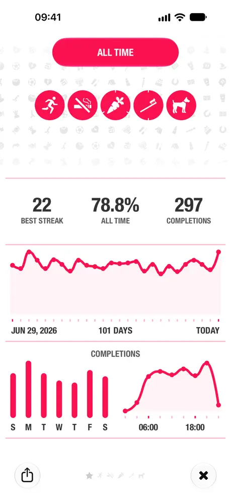

Sebagian besar resolusi kebiasaan gagal karena sistemnya terlalu rumit. **[Aplikasi pelacak kebiasaan](/id/glossary/what-is-a-habit-tracker/) untuk pemula** seharusnya bisa dimulai dalam hitungan detik dan merayakan kemenangan kecil. **Meow Habits** melakukan persis itu lewat template, streak harian, dan desain bertema kucing yang menenangkan. Berikut perbandingannya dengan pilihan lain yang ramah pemula.

## Apa yang benar-benar dibutuhkan pemula

Meow Habits, Loop, Streaks, dan Habitica adalah empat aplikasi pelacak kebiasaan yang dibandingkan di sini untuk pemula, grup yang paling sering meninggalkan resolusi karena sistem terlalu rumit. Meow Habits memakai template satu ketukan dan streak yang memaafkan di Android maupun iOS; Loop gratis dan open-source untuk Android; Streaks rapi tetapi iOS dan berbayar ~$4.99; Habitica memakai motivasi game. Enam kebutuhan pemula — mulai satu ketukan, pustaka template, satu atau dua kebiasaan, pengingat lembut, inti gratis, dan streak yang memaafkan — menentukan pilihan. Pilihan bergantung pada satu hal: apakah Anda ingin langsung mencatat atau membangun sistem.

- **Mulai satu ketukan** — tanpa pengaturan panjang, tanpa formulir 20 kolom.
- **Pustaka template** — "minum air 3× sehari" dalam satu ketukan.
- **Satu atau dua kebiasaan** — mulai kecil; menambahkan sepuluh sekaligus adalah cara streak harian putus.
- **Pengingat kebiasaan yang lembut** — mengingatkan, bukan mengomel.
- **Inti gratis** — buktikan kebiasaannya dulu sebelum membayar.
- **Streak yang memaafkan** — satu hari terlewat tak boleh menghapus semuanya.

## Sekilas para kandidat

Meow Habits, Loop, Streaks, dan Habitica adalah empat kandidat aplikasi kebiasaan ramah pemula yang dirangkum menurut biaya awal, platform, template, dan kelembutan. Meow Habits gratis di intinya dengan template satu ketukan dan tersedia di Android serta iOS; Loop gratis dan open-source tetapi hanya Android; Streaks berbayar ~$4.99 sekali dan hanya iOS; Habitica gratis dengan langganan namun membawa tekanan game. Tabel berikut memetakan perbedaan sebelum pemula memutuskan. Bagi yang baru memulai, Meow Habits menawarkan jalur termudah karena tidak menuntut pembelian maupun penguasaan sistem di awal.

| Aplikasi | Biaya awal | Platform | Template | Lembut? | Terbaik untuk pemula |
|---|---|---|---|---|---|
| **Meow Habits** | Inti gratis | Android + iOS | ✅ | ✅ | Imut, lintas platform |
| **Loop** | Gratis, open-source | Hanya Android | Manual | ✅ | Android minimalis |
| **Streaks** | ~$4.99 sekali bayar | Hanya iOS | Manual | ✅ | iOS rapi |
| **Habitica** | Gratis + langganan | Android + iOS + Web | Manual | ⚠️ tekanan game | Motivasi ala game |

## Meow Habits, secara mendalam

Meow Habits adalah aplikasi habit tracker bertema kucing untuk Android dan iOS dengan inti gratis dan template satu ketukan, dirancang agar pemula langsung bisa mencatat dalam hitungan detik. Lima layar di bawah menampilkan centang hari ini, detail catatan, streak harian dan terpanjang, grafik serta kalender, dan pengingat. Keunggulannya untuk pemula adalah template seperti "Minum air" atau "Baca 10 menit", pencatatan gratis, serta streak yang memaafkan karena rekor terpanjang ditampilkan terpisah. Ekspor CSV ada di balik VIP opsional; yang menginginkan hadiah RPG sebaiknya memakai Habitica.

{: width="180" .normal }
{: width="180" .normal }
{: width="180" .normal }
{: width="180" .normal }
{: width="180" .normal }

Meow Habits adalah **[aplikasi habit tracker bertema kucing](/id/glossary/what-is-a-habit-tracker/)** untuk Android dan iOS dengan inti gratis dan template satu ketukan.

**Keunggulan untuk pemula**
- **Template satu ketukan** — mulai dengan "Minum air" atau "Baca 10 menit" seketika.
- **Gratis untuk membuktikan kebiasaan** — pencatatan inti tidak berbiaya.
- **Streak yang memaafkan** — rentetan saat ini dan terpanjang ditampilkan terpisah, jadi satu kelalaian tidak menghapus progres.
- **Pengingat kebiasaan yang lembut** — atur pengingat tanpa tekanan.
- **Lintas platform** — Android dan iOS, jadi Anda tidak terkunci pada satu sistem operasi.

**Kelemahan untuk pemula**
- **Ekspor CSV khusus VIP** — tak dibutuhkan di awal, tapi jadi batasan belakangan.
- **Gameifikasi lebih sedikit** — jika Anda termotivasi hadiah RPG, Habitica lebih menarik.

**Paling cocok untuk:** pengguna pertama kali yang menginginkan **aplikasi kebiasaan gratis** yang imut dan lintas platform.

- [Google Play — Meow Habits](https://play.google.com/store/apps/details?id=com.glgjing.meow.habit.goal)
- [App Store — Meow Habits](https://apps.apple.com/app/id6758230559)

## Streaks, secara mendalam

Streaks (Crunchy Bagel) adalah aplikasi to-do kebiasaan iOS paling rapi dengan pelacakan otomatis Apple Health, tetapi menuntut pembelian ~$4.99 di awal sebelum pemula tahu apakah kebiasaannya bertahan. Lima layar di bawah menampilkan daftar kebiasaan, detail centang dan catatan, rentang hari beruntun, grafik serta kalender, dan setelan pengingat. Permukaannya minimal — satu daftar, centang tiap hari — dan target langkah serta air terisi otomatis dari Apple Health. Kekurangannya, hanya iOS, dibatasi 24 tugas, dan tanpa versi Android. Pemula iPhone yang bersedia bayar sekali akan cocok; yang lain sebaiknya memakai Meow Habits atau Loop.

{: width="180" .normal }
{: width="180" .normal }
{: width="180" .normal }
{: width="180" .normal }
{: width="180" .normal }

Streaks (Crunchy Bagel) adalah aplikasi to-do kebiasaan iOS paling rapi, dengan pelacakan otomatis Apple Health.

**Keunggulan untuk pemula**
- **Permukaan minimal** — satu daftar, centang tiap hari, selesai.
- **Isi otomatis Apple Health** — target langkah dan air terisi sendiri.

**Kelemahan untuk pemula**
- **Hanya iOS** — tanpa versi Android, penghalang keras bagi banyak orang.
- **Bayar di depan** — Anda membeli sebelum tahu apakah kebiasaannya bertahan.
- **Dibatasi 24 tugas** — cukup, tapi tidak jelas di awal.

**Paling cocok untuk:** pemula khusus iPhone yang menginginkan kesederhanaan dan bersedia bayar sekali.

- [Apple App Store — Streaks](https://apps.apple.com/app/id963034692)

## Bagaimana yang lain dibandingkan

Loop dan Habitica adalah dua pesaing tambahan di sini selain Meow Habits dan Streaks, keduanya cocok untuk pemula dengan syarat berbeda. Loop gratis dan open-source di Android tanpa akun, pas untuk pengguna Android yang menginginkan pelacak minimalis; Habitica mengubah kebiasaan menjadi RPG yang menyenangkan bagi sebagian orang, tetapi lapisan game bisa mengalihkan dari kebiasaan itu sendiri. Keempat aplikasi terbagi dalam dua kelompok: jalur langsung seperti Meow Habits dan Loop, serta jalur yang menuntut komitmen di depan seperti Streaks atau Habitica. Pemula yang ingin mencoba sebelum memutuskan sebaiknya memilih Meow Habits.

- **Loop** gratis dan open-source di Android tanpa akun — pas jika Anda hanya pakai Android dan menginginkan yang minimalis.
- **Habitica** mengubah kebiasaan jadi RPG; menyenangkan bagi sebagian orang, tapi lapisan game bisa mengalihkan dari kebiasaan itu sendiri.

## Apa yang benar-benar dibutuhkan pemula dari aplikasi pelacak kebiasaan

Meow Habits adalah aplikasi kebiasaan gratis yang menangani tiga hal yang justru penting di minggu pertama, saat kebanyakan pelacak ditinggalkan bukan karena fitur kurang. Pertama, mulai dari satu kebiasaan dengan template siap pakai sehingga centang pertama terjadi dalam kurang dari semenit; siklus dan tag bisa menyusul. Kedua, inti gratis tanpa langganan agar pemula tidak perlu memutuskan apakah rutinitas baru sepadan dengan biaya tahunan sebelum tahu ia bertahan. Ketiga, pengingat lembut dan widget satu ketukan dari layar utama. Streaks dan Habitica adalah aplikasi hebat, tetapi keduanya menuntut komitmen di depan; Meow Habits adalah langkah pertama berisiko lebih rendah.

- **Mulai dari satu kebiasaan, bukan satu sistem** — **aplikasi habit tracker** imut dengan template siap pakai membuat centang pertama terjadi dalam kurang dari semenit; siklus dan tag bisa menyusul.
- **Aplikasi kebiasaan gratis tanpa langganan** — pemula tak selayaknya memutuskan apakah rutinitas baru ini sepadan dengan biaya tahunan sebelum tahu ia akan bertahan.
- **Pengingat yang bukan omelan** — **pengingat kebiasaan** dan **aplikasi habit tracker dengan widget** mengubah pencatatan jadi satu ketukan dari layar utama.

Streaks dan Habitica adalah aplikasi hebat, tapi keduanya menuntut komitmen di depan (pembelian sekali, atau mempelajari sebuah game). Untuk **aplikasi kebiasaan gratis** yang bisa dicoba lalu ditinggalkan diam-diam, Meow Habits adalah langkah pertama berisiko lebih rendah.

## Mana yang sebaiknya dipilih pemula?

Meow Habits adalah jawaban untuk pemula yang menginginkan aplikasi gratis, imut, satu ketukan, dan tersedia di kedua ponsel Android maupun iOS. Loop cocok untuk pengguna Android minimalis yang menginginkan open-source, Streaks untuk pemula iPhone yang bersedia bayar sekali ~$4.99, dan Habitica untuk yang termotivasi oleh game. Keempatnya mencakup spektrum dari pencatatan langsung hingga sistem yang menuntut komitmen di awal. Keputusan bergantung pada satu hal: apakah Anda ingin mencatat kebiasaan pertama sekarang atau membangun sistem dulu sebelum memulai.

- Ingin **gratis + imut + satu ketukan + kedua ponsel** → **Meow Habits**.
- Hanya Android dan minimalis → **Loop**.
- Hanya iPhone, bersedia bayar sekali → **Streaks**.
- Butuh motivasi game → **Habitica**.

[Dapatkan Meow Habits](/id/apps/meow-habits/) — tersedia di Android dan iOS.

## Skenario umum

Meow Habits mencakup empat skenario bagi pemula yang memulai kebiasaan, semuanya berpusat pada langkah pertama yang kecil dan mudah dimaafkan. Skenario pertama mengetuk template "Minum air" agar streak harian pertama dimulai seketika tanpa formulir 20 kolom; kedua memulai dua kebiasaan seperti "Baca 10 menit" dan "Jalan 5 menit" dengan streak yang tetap menunjukkan rekor terpanjang; ketiga mengatur pengingat pukul 9 malam yang mengingatkan, bukan mengomel; keempat mencatat inti gratis lalu memutuskan apakah VIP sepadan setelah kebiasaan menempel. Loop lebih cocok bila Anda hanya memakai Android dan menginginkan open-source.

- **Kebiasaan pertama, satu ketukan** — buka Meow Habits, ketuk template 'Minum air', dan streak harian pertama Anda dimulai sebelum kalimat ini selesai dibaca. Tanpa pengaturan 20 kolom.
- **Mulai dengan dua** — awali dengan 'Baca 10 menit' dan 'Jalan 5 menit' agar rantainya terasa bisa ditaklukkan; streak yang memaafkan tetap menunjukkan rekor terpanjang meski pernah terlewat.
- **Pengingat lembut** — atur pengingat pukul 9 malam yang mengingatkan, bukan mengomel, agar kebiasaan bertahan di pekan yang sibuk.
- **Gratis untuk membuktikan** — catat intinya secara gratis, lalu putuskan apakah VIP sepadan setelah kebiasaan benar-benar menempel.

## FAQ

**Apakah Meow Habits cocok untuk pemula?**
{:.faq-q}

Ya. Template satu ketukan, inti gratis, dan streak yang memaafkan membuat Anda mulai dalam hitungan detik tanpa menghukum satu hari yang terlewat.

**Apakah Meow Habits gratis?**
{:.faq-q}

Intinya — pencatatan, streak harian, template, dan pengingat kebiasaan — gratis; ekspor CSV dan beberapa tambahan ada di balik VIP sekali bayar yang opsional.

**Apakah saya perlu akun?**
{:.faq-q}

Tidak. Anda bisa langsung mulai tanpa daftar; data tetap di perangkat sebagai **catatan kebiasaan offline**, dan dicadangkan ke WebDav atau Google Drive saat Anda memilihnya.

**Meow Habits atau Loop untuk pemula?**
{:.faq-q}

Ingin yang imut, gratis, lintas platform (Android + iOS), dengan template → Meow Habits; hanya Android dan ingin open-source minimalis → Loop.

## Istilah terkait

- [Apa Itu Aplikasi Pelacak Kebiasaan (Habit Tracker)?](/id/glossary/what-is-a-habit-tracker/)
