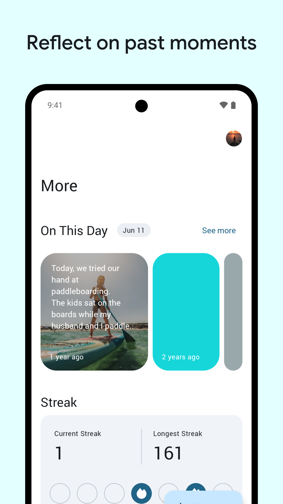

**[Buku harian mood](/id/glossary/what-is-a-mood-tracker/)** membantu Anda melihat pola perasaan — bukan dengan menulis esai, melainkan mencatat perasaan dalam sepuluh detik dan membiarkan tren yang berbicara. **Meow Mood** adalah **aplikasi mood tracker privat** untuk Android dan iOS yang membuat pencatatan terasa ringan: ketuk emosi, tambahkan konteks, lalu lihat grafiknya. Di bawah ini kami bandingkan aplikasi yang benar-benar dipasang orang — **Meow Mood, Day One, Journey, Daylio, dan Grid Diary** — dari sisi pelacakan mood, privasi, harga, dan platform. Daftar pendek yang sama sering dicari sebagai **pelacak mood gratis** atau **aplikasi jurnal mood**, jadi kami membandingkan check-in singkat maupun tulisan panjang.

## Apa yang seharusnya dilakukan buku harian mood

Meow Mood, Day One, Journey, Daylio, dan Grid Diary adalah lima aplikasi buku harian mood yang dibandingkan di sini untuk melihat pola perasaan lewat check-in sepuluh detik, bukan esai panjang. Meow Mood mengutamakan pencatatan satu ketuk dan privasi lokal; Day One kaya foto dengan sinkron cloud berlangganan; Daylio memakai ikon; Grid Diary memakai pertanyaan pemandu; Journey berfokus pada perjalanan. Enam fungsi — pencatatan cepat, tag konteks, tren, privasi, ekspor, dan pengingat — menentukan mana yang masih dipakai di hari ke-30. Pilihan bergantung pada satu hal: apakah Anda ingin mood cepat dan privat atau jurnal panjang berfoto.

- **Pencatatan cepat** — pilih emosi satu ketuk, bukan halaman kosong.
- **Tag konteks** — catat tidur, orang, atau cuaca tanpa paragraf.
- **Tren** — kalender dan grafik yang menunjukkan kapan hari buruk mengelompok.
- **Privasi** — mengutamakan offline, dengan data yang tetap milik Anda.
- **Ekspor** — PDF atau teks untuk merenung atau dibagikan ke profesional.
- **Pengingat** — dorongan harian yang membangun kebiasaan.

## Bagaimana kami memilih aplikasi mood tracker terbaik

Meow Mood adalah aplikasi mood tracker yang diuji dengan empat pemeriksaan yang menentukan apakah Anda masih mencatat di hari ke-30, bukan sekadar jumlah fitur. Pertama, waktu mencatat satu ketuk untuk emosi dengan tag aktivitas opsional, bukan halaman kosong. Kedua, versi gratis yang bertahan tanpa hitung mundur uji coba atau paywall pada kalender. Ketiga, data yang bisa dibawa lewat ekspor dan bawaan lokal, karena akun cloud saja menjadi biaya nyata saat harga berubah. Keempat, grafik yang menjawab pertanyaan lewat peta panas kalender dan rincian mood. Meow Mood terkuat untuk entri cepat dan privat; Day One menang untuk jurnal panjang berfoto dengan langganan.

1. **Waktu mencatat** — satu ketuk untuk emosi, dengan tag aktivitas opsional. Jika satu entri butuh halaman kosong, itu jurnal, bukan **pelacak mood gratis** yang akan terus Anda pakai.
2. **Versi gratis yang bertahan** — **aplikasi mood tracker gratis terbaik** semestinya memungkinkan Anda terus mencatat dan meninjau tren tanpa hitung mundur uji coba atau paywall pada kalender.
3. **Data yang bisa dibawa** — ekspor dan bawaan lokal; akun cloud saja jadi biaya nyata saat aplikasi mengubah harga.
4. **Grafik yang menjawab pertanyaan** — peta panas kalender dan rincian mood/aktivitas, bukan sekadar angka streak.

Dengan pemeriksaan itu, Meow Mood adalah pilihan **aplikasi mood tracker Android** terkuat untuk entri cepat dan privat, sementara Day One menang bila Anda ingin jurnal panjang berfoto dan tidak keberatan berlangganan.

## Sekilas para kandidat

Meow Mood, Day One, Journey, Daylio, dan Grid Diary adalah lima kandidat aplikasi jurnal mood yang dirangkum menurut harga, platform, gaya mood, privasi, dan kegunaan. Meow Mood gratis di inti dengan ketuk ikon dan penyimpanan lokal tanpa unggahan; Day One langganan Silver atau Gold dengan sinkron cloud; Journey langganan berbasis Drive; Daylio dan Grid Diary gratis dengan langganan, masing-masing memakai ikon dan pertanyaan pemandu. Hanya Meow Mood dan Daylio yang mengutamakan privasi lokal. Tabel berikut memetakan perbedaan sebelum Anda memilih.

| Aplikasi | Harga (2026) | Platform | Gaya mood | Privasi | Terbaik untuk |
|---|---|---|---|---|---|
| **Meow Mood** | Inti gratis + VIP opsional | Android + iOS | Ketuk ikon | ✅ lokal, tanpa unggahan | Ringan, privat |
| **Day One** | Langganan (Silver/Gold); gratis terbatas | Android+iOS+Mac+Web | Entri manual | ⚠️ sinkron cloud | Jurnal fitur lengkap |
| **Journey** | Langganan | Android+iOS+Web | Entri manual | ⚠️ cloud (Drive) | Jurnal perjalanan |
| **Daylio** | Gratis + langganan | Android + iOS | Berbasis ikon | ✅ mengutamakan lokal | Catatan mood mikro |
| **Grid Diary** | Gratis + langganan | Android + iOS | Pertanyaan pemandu | ✅ lokal | Prompt terstruktur |

## Meow Mood, secara mendalam

Meow Mood adalah aplikasi mood dan buku harian bertema kucing untuk Android dan iOS yang mencatat cukup satu ketuk: pilih emosi, tambahkan tag opsional atau catatan pendek, selesai. Lima layar di bawah menampilkan check-in harian, pemilih emosi dan tag konteks, grafik tren, kalender dan riwayat, serta cadangan dan ekspor PDF. Keunggulannya untuk pelacakan mood adalah pencatatan satu ketuk, penggunaan sepenuhnya offline tanpa unggahan bawaan, tampilan kalender dan grafik tren, kunci sidik jari, ekspor PDF, dan pengingat harian. Media kaya lebih ringan daripada Day One dan ekspor CSV berada di balik VIP. Aplikasi ini paling cocok untuk buku harian mood gratis yang cepat dan privat.

{: width="180" .normal }
{: width="180" .normal }
{: width="180" .normal }
{: width="180" .normal }
{: width="180" .normal }

Meow Mood adalah **aplikasi mood dan buku harian bertema kucing** untuk Android dan iOS. Mencatat cukup satu ketuk: pilih emosi, tambahkan tag opsional atau catatan pendek, selesai.

**Keunggulan untuk pelacakan mood**
- **Pencatatan satu ketuk** — ikon emosi mengalahkan kolom teks kosong saat hari sedang buruk.
- **Sepenuhnya offline** — berjalan tanpa sinyal dan menyimpan entri di perangkat.
- **Tanpa unggahan bawaan** — data tetap lokal; cadangan hanya ke Google Drive milik Anda bila diaktifkan.
- **Tampilan tren** — kalender dan grafik memunculkan kapan mood rendah mengelompok.
- **Kunci** — sidik jari atau kode sandi menjaga entri tetap milik Anda.
- **Ekspor PDF** — untuk merenung atau dibagikan ke profesional.
- **Pengingat harian** — dorongan yang membuatnya jadi kebiasaan.

**Kelemahan untuk pelacakan mood**
- **Media kaya lebih ringan** — lebih sedikit foto/audio daripada Day One.
- **Ekspor lanjutan (CSV) khusus VIP** — pengguna gratis mendapat PDF.

**Paling cocok untuk:** orang yang menginginkan **buku harian mood gratis** yang cepat, imut, dan privat.

- [Google Play — Meow Mood Diary](https://play.google.com/store/apps/details?id=com.glgjing.meow.mood.diary)
- [App Store — Meow Mood Diary](https://apps.apple.com/app/id6767560237)

## Day One, secara mendalam

Day One adalah jurnal digital paling awal dan banyak meraih penghargaan, dipuji The New York Times dan Wired sebagai "ruang digital yang sepenuhnya privat", dengan sinkronisasi terenkripsi lintas Android, iOS, Mac, dan web. Lima layar di bawah menampilkan editor dan catatan, pemilih mood dan tag, grafik tren, kalender riwayat, serta cadangan dan ekspor cloud. Keunggulannya adalah entri kaya berisi teks, foto, video, audio, lokasi, dan cuaca, plus template dan ekosistem matang satu dekade. Keterbatasannya, versi gratis terbatas pada perangkat dan foto, cloud sejak awal, dan entri kaya lebih berat untuk mulai daripada mood satu ketuk. Ia cocok untuk jurnal fitur lengkap berlangganan.

{: width="180" .normal }
{: width="180" .normal }
{: width="180" .normal }
{: width="180" .normal }
{: width="180" .normal }

Day One adalah jurnal digital paling awal dan paling banyak meraih penghargaan — dipuji *The New York Times* dan *Wired* sebagai "ruang digital yang sepenuhnya privat". Ia tersinkron lintas Android, iOS, Mac, dan web.

**Keunggulan untuk pelacakan mood**
- **Entri kaya** — teks, foto, video, audio, lokasi, dan cuaca dalam satu catatan.
- **Template dan prompt** — awalan terstruktur saat Anda bingung menulis.
- **Sinkronisasi terenkripsi** — entri mengikuti Anda di semua perangkat.
- **Ekosistem matang** — satu dekade pembaruan, aplikasi jurnal paling rapi.

**Kelemahan untuk pelacakan mood**
- **Versi gratis terbatas** — batas perangkat dan foto; penggunaan penuh butuh Silver atau Gold.
- **Cloud sejak awal** — entri hidup di server Day One; privasi bergantung pada kepercayaan ke vendor.
- **Lebih berat untuk mulai** — entri kaya yang kosong lebih banyak hambatan daripada mood satu ketuk.

**Paling cocok untuk:** orang yang menginginkan jurnal fitur lengkap dan menerima langganan plus sinkronisasi cloud.

- [Google Play — Day One](https://play.google.com/store/apps/details?id=com.dayoneapp.dayone)
- [App Store — Day One](https://apps.apple.com/app/id1044867788)

## Bagaimana yang lain dibandingkan

Journey, Daylio, dan Grid Diary adalah tiga pesaing tambahan di sini selain Meow Mood dan Day One, masing-masing menyasar gaya berbeda. Journey adalah jurnal berbasis perjalanan dengan sinkronisasi Drive, bagus untuk bepergian tetapi kurang fokus pada catatan mood cepat; Daylio mencatat mood lewat ikon plus catatan, gratis dengan langganan untuk riwayat dan kerabat pelacakan murni terdekat Meow Mood; Grid Diary menyusun entri lewat pertanyaan harian. Kelima aplikasi terbagi dalam jalur cepat privat seperti Meow Mood dan Daylio serta jalur jurnal kaya seperti Day One dan Journey. Pembaca yang menginginkan mood gratis tanpa akun sebaiknya memilih Meow Mood.

- **Journey** adalah jurnal berbasis perjalanan dengan sinkronisasi Drive; bagus untuk bepergian, kurang fokus pada catatan mood cepat.
- **Daylio** mencatat mood lewat ikon plus catatan, gratis dengan langganan untuk riwayat — kerabat pelacakan mood murni terdekat Meow Mood.
- **Grid Diary** menyusun entri lewat pertanyaan harian; cocok bila prompt membantu Anda menulis.

## Mana yang sebaiknya Anda pilih?

Meow Mood adalah jawaban untuk catatan mood cepat, privat, dan satu ketuk yang tersimpan di perangkat tanpa unggahan. Day One cocok untuk jurnal hidup kaya foto dengan sinkronisasi cloud dan langganan; Daylio untuk catatan mikro berikon; Grid Diary untuk struktur berprompt. Kelima aplikasi tersedia di Android atau iOS. Keputusan bergantung pada satu hal: apakah Anda ingin check-in emosi dalam sepuluh detik tanpa akun atau jurnal panjang yang tersinkron di semua perangkat.

- Ingin **catatan mood cepat, privat, satu ketuk** → **Meow Mood**.
- Ingin **jurnal hidup kaya dan tersinkron** serta menerima langganan → **Day One**.
- Ingin **catatan mikro berikon saja** → **Daylio**.
- Ingin **struktur berprompt** → **Grid Diary**.

[Dapatkan Meow Mood](/id/apps/meow-mood-diary/) — tersedia di Android dan iOS.

## Skenario umum

Meow Mood mencakup empat skenario pencatatan mood yang memanfaatkan check-in satu ketuk, kunci sidik jari, kalender tren, dan penyimpanan offline. Skenario pertama mengetuk satu emosi dan beberapa tag pada malam yang berat agar buku harian tetap bertahan; kedua menjaga entri tetap privat di perangkat keluarga di balik sidik jari tanpa sinkron ke cloud vendor; ketiga memakai kalender dan grafik untuk menemukan "rasa muram hari Minggu" atau lonjakan setelah kopi; keempat mencatat di pesawat atau area bawah tanah tanpa sinyal. Day One lebih cocok bila Anda menginginkan jurnal foto kaya dengan sinkronisasi.

- **Catatan cepat saat hari buruk** — pada malam yang berat, ketuk satu emosi dan beberapa tag; tanpa paragraf, sehingga buku harian tetap bertahan di hari yang biasanya Anda lewatkan.
- **Privat secara bawaan** — entri tetap di perangkat di balik kunci sidik jari; pada ponsel keluarga bersama, pikiran Anda tak pernah tersinkron ke cloud vendor kecuali Anda memilih Google Drive.
- **Menemukan pola** — kalender dan grafik memunculkan 'rasa muram hari Minggu' atau lonjakan setelah kopi, mengubah perasaan samar jadi sesuatu yang bisa ditindaklanjuti.
- **Offline di mana saja** — catat di pesawat atau di area kereta bawah tanah tanpa sinyal; tidak ada yang butuh Wi-Fi untuk merekam momen.

## FAQ

**Apakah Meow Mood gratis?**
{:.faq-q}

Fitur inti — catatan mood cepat, riwayat, grafik, dan penggunaan offline — gratis untuk dipakai; beberapa tambahan (seperti ekspor CSV) ada di balik VIP sekali bayar opsional.

**Apakah Meow Mood bisa dipakai offline?**
{:.faq-q}

Ya. Anda bisa mencatat, melihat, dan mengedit entri tanpa internet dan tanpa akun; data tetap di perangkat Anda.

**Apakah buku harian saya privat?**
{:.faq-q}

Ya — entri tidak pernah diunggah ke server kami; Anda hanya mencadangkan ke Google Drive milik sendiri, dan kunci sidik jari atau kode sandi menjaga buku harian tetap untuk Anda sendiri.

**Meow Mood atau Day One — mana yang sebaiknya saya pilih?**
{:.faq-q}

Ingin buku harian mood gratis, privat, tanpa akun, dan tersimpan di perangkat → Meow Mood; ingin jurnal foto kaya dengan sinkronisasi dan menerima langganan → Day One.

## Istilah terkait

- [Apa Itu Pelacak Suasana Hati?](/id/glossary/what-is-a-mood-tracker/)
