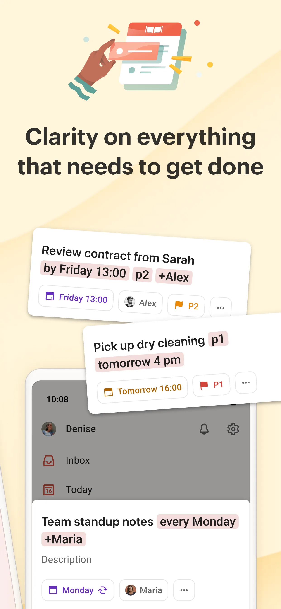

Di Android, **[aplikasi to-do list](/id/glossary/what-is-a-to-do-list/)** dibuka puluhan kali sehari, jadi tempat **daftar tugas** Anda tersimpan itu penting. Sebagian orang ingin sinkron cloud lintas perangkat; yang lain memilih menyimpan tugas di ponsel di balik sidik jari daripada di satu akun lagi. **Meow Todo** adalah **[aplikasi tugas harian](/id/glossary/what-is-a-to-do-list/) gratis untuk Android dan iOS** yang menyimpan tugas secara lokal dengan kunci. Di bawah kami membandingkan aplikasi yang benar-benar dipasang pengguna Android — **Meow Todo, Todoist, Microsoft To Do, dan Google Tasks** — dari sisi privasi, widget, sinkronisasi, dan harga, sekaligus melihat kapan **alternatif Todoist** berbasis lokal lebih masuk akal.

## Apa yang harus bisa dilakukan aplikasi to-do Android

Meow Todo, Todoist, Microsoft To Do, dan Google Tasks adalah empat aplikasi to-do Android yang dibandingkan di sini untuk pengguna yang membuka daftar tugas puluhan kali sehari. Meow Todo menyimpan tugas lokal dengan kunci sidik jari tanpa akun; Todoist mengandalkan sinkron cloud dan bahasa alami dengan Pro ~$48 per tahun; Microsoft To Do terikat ekosistem Microsoft; Google Tasks paling ringan di Gmail. Enam fungsi — opsi local-first, widget layar utama, pengingat andal, tampilan kalender, subtugas, dan harga wajar — menentukan pilihan. Pilihan bergantung pada satu hal: apakah tugas Anda tetap di perangkat atau tersinkron di cloud.

- **Opsi local-first** — simpan tugas di perangkat dengan kunci, bukan cloud wajib.
- **Widget layar utama** — centang tugas tanpa membuka aplikasi.
- **Pengingat andal** — notifikasi yang benar-benar muncul.
- **Aplikasi kalender tugas** — tampilan satu pekan secara sekilas.
- **Subtugas** — pecah pekerjaan menjadi langkah-langkah.
- **Harga wajar** — pencatatan inti tidak boleh terkunci di balik paywall.

## Cara kami memilih task manager Android terbaik

Meow Todo adalah aplikasi to-do Android yang dinilai andal pada empat hal yang baru terasa setelah seminggu pemakaian, bukan sekadar daftar fitur. Pertama, tempat data tinggal — tugas tersimpan di ponsel dengan kunci sidik jari, dengan backup Google Drive sebagai cadangan manual. Kedua, gesekan harian rendah lewat pengingat, subtugas, dan tampilan kalender satu pekan penuh tanpa tutorial. Ketiga, inti gratis berisi daftar, tugas, dan pengingat yang bekerja tanpa langganan. Keempat, tanpa akun wajib sehingga Anda bisa mulai di bus tanpa sinyal. Todoist dan Microsoft To Do mengandalkan cloud; Meow Todo menyimpan data lokal. Aplikasi to-do sederhana mudah dicari, tetapi yang benar-benar andal lebih sulit.

- **Tempat data tinggal** — **aplikasi to-do offline** yang bisa dipercaya menyimpan tugas di ponsel dengan **kunci sidik jari**, sembari tetap menawarkan **backup Google Drive** sebagai cadangan manual.
- **Gesekan harian** — **aplikasi pengingat tugas** dan subtugas tidak boleh perlu tutorial, dan tampilan kalender harus menunjukkan satu pekan penuh sekilas.
- **Inti gratis** — **aplikasi to-do list gratis** bagi kebanyakan orang adalah daftar, tugas, dan pengingat yang bekerja tanpa langganan; itulah arti **aplikasi manajemen tugas gratis**.
- **Tanpa akun wajib** — Anda harus bisa mulai di bus tanpa sinyal dan tanpa login.

## Sekilas para pesaing

Meow Todo, Todoist, Microsoft To Do, dan Google Tasks adalah empat aplikasi pengelola tugas yang dirangkum menurut harga, penyimpanan, widget, sinkronisasi, dan kegunaan. Meow Todo gratis di inti dengan data lokal berkunci dan sinkron manual lewat Drive atau WebDav; Todoist gratis dengan Pro ~$48 per tahun serta sinkron langsung; Microsoft To Do dan Google Tasks keduanya gratis tetapi berbasis cloud. Hanya Meow Todo yang benar-benar lokal tanpa akun wajib. Tabel berikut memetakan perbedaan sebelum Anda memilih aplikasi to-do Android.

| Aplikasi | Harga (2026) | Lokal/privat | Widget | Sinkron | Paling cocok untuk |
|---|---|---|---|---|---|
| **Meow Todo** | Inti gratis + VIP opsional | ✅ di perangkat + kunci | ✅ | Manual (Drive/WebDav) | Privat, lokal |
| **Todoist** | Gratis + Pro ~$48/thn | ❌ cloud | ✅ | ✅ langsung | Daya lintas platform |
| **Microsoft To Do** | Gratis | ❌ cloud (MS) | ✅ | ✅ | Ekosistem MS |
| **Google Tasks** | Gratis | ❌ cloud (Google) | ✅ | ✅ | Gmail ringan |

## Meow Todo, secara mendalam

Meow Todo adalah aplikasi daftar tugas bertema kucing untuk Android dan iOS dengan fitur inti gratis berisi daftar, tugas, pengingat, dan tampilan kalender, sementara VIP menambah daftar tanpa batas, tag, subtugas, ekspor CSV, dan kunci aplikasi. Lima layar di bawah menampilkan tugas hari ini, editor tugas, daftar dan grup tag, tampilan mingguan, serta backup Google Drive dan WebDav. Untuk pengguna Android, keunggulannya adalah penyimpanan di perangkat di balik kunci sidik jari, tanpa akun wajib, widget satu ketukan, subtugas dan pengingat, serta ekspor CSV. Keterbatasannya, daftar tanpa batas berada di balik VIP dan sinkron multi-perangkat hanya manual, bukan real-time.

{: width="180" .normal }
{: width="180" .normal }
{: width="180" .normal }
{: width="180" .normal }
{: width="180" .normal }

Meow Todo adalah **aplikasi daftar tugas bertema kucing** untuk Android dan iOS. Fitur inti — daftar, tugas, pengingat, dan tampilan kalender — gratis; VIP menambah daftar tanpa batas, tag, subtugas, ekspor CSV, dan kunci aplikasi.

**Keunggulan untuk pengguna Android**
- **Penyimpanan di perangkat** — tugas tetap di ponsel di balik kunci sidik jari.
- **Tanpa akun wajib** — buka lalu mulai; tidak ada yang diunggah secara default.
- **Widget** — centang tugas dari layar utama dalam satu ketukan.
- **Subtugas dan pengingat** — pecah dan jadwalkan pekerjaan dengan notifikasi harian.
- **Backup yang Anda kendalikan** — Google Drive atau WebDav, hanya saat Anda aktifkan.
- **Ekspor CSV** — keluarkan data kapan saja.

**Kelemahan untuk pengguna Android**
- **VIP untuk fitur lanjutan** — daftar tanpa batas, tag, dan ekspor CSV ada di balik peningkatan.
- **Tanpa sinkron multi-perangkat langsung** — ini backup manual, bukan akun real-time.

**Paling cocok untuk:** pengguna Android yang ingin **aplikasi to-do gratis** yang tetap tersimpan di perangkat.

- [Google Play — Meow Todo List](https://play.google.com/store/apps/details?id=com.glgjing.money.task.todo.list.meow)
- [App Store — Meow Todo List](https://apps.apple.com/app/id6742345495)

## Todoist, secara mendalam

Todoist adalah pengelola tugas paling banyak dipasang dengan entri bahasa alami dan sinkron lintas platform mendalam, tetapi menyimpan tugas di cloud dan membatasi paket gratis. Lima layar di bawah menampilkan daftar tugas, editor dan pengingat, grup label, tampilan kalender, serta sinkronisasi dan pengaturan. Keunggulannya bagi pengguna Android adalah input seperti "bayar kos tanggal 1" yang langsung mengatur tanggal, sinkron langsung ke semua perangkat, organisasi kaya berisi proyek, subtugas, label, dan prioritas, serta widget rapi. Keterbatasannya, cloud wajib, Pro ~$48 per tahun untuk proyek dan label tanpa batas, dan biaya langganan berulang. Ia cocok untuk sinkron real-time lintas perangkat.

{: width="180" .normal }
{: width="180" .normal }
{: width="180" .normal }
{: width="180" .normal }
{: width="180" .normal }

Todoist adalah pengelola tugas paling banyak dipasang, dengan entri bahasa alami dan sinkron lintas platform yang mendalam.

**Keunggulan untuk pengguna Android**
- **Bahasa alami** — "bayar kos tanggal 1" langsung mengatur tanggalnya.
- **Sinkron langsung** — tugas muncul di semua perangkat seketika.
- **Organisasi kaya** — proyek, subtugas, label, prioritas, dan berbagi.
- **Aplikasi matang** — widget rapi dan tambah-cepat dari panel notifikasi.

**Kelemahan untuk pengguna Android**
- **Cloud wajib** — tugas Anda tersimpan di server Todoist.
- **Paket gratis terbatas** — Pro (~$48/thn) untuk proyek, komentar, dan label tanpa batas.
- **Biaya langganan** — pembayaran berulang untuk pemakaian penuh.

**Paling cocok untuk:** orang yang ingin sinkron real-time lintas ponsel, tablet, dan desktop.

- [Google Play — Todoist](https://play.google.com/store/apps/details?id=com.todoist)
- [App Store — Todoist](https://apps.apple.com/app/id572688855)

## Bagaimana aplikasi lain dibandingkan

Microsoft To Do dan Google Tasks adalah dua pesaing tambahan di sini selain Meow Todo dan Todoist, keduanya gratis tetapi berbasis cloud. Microsoft To Do tersedia dalam Microsoft 365 dengan daftar bersama dan integrasi Outlook; Google Tasks adalah opsi paling ringan yang terikat akun Google dan Gmail, cukup untuk daftar sederhana tetapi tipis di subtugas dan ekspor. Keempat aplikasi terbagi dalam dua kelompok: penyimpanan lokal seperti Meow Todo dan cloud seperti Todoist, Microsoft To Do, dan Google Tasks. Pembaca yang ingin tugas tetap di perangkat tanpa akun sebaiknya memilih Meow Todo.

- **Microsoft To Do** gratis di dalam Microsoft 365, dengan daftar bersama dan integrasi Outlook.
- **Google Tasks** adalah opsi paling ringan, terikat akun Google dan Gmail — cukup untuk daftar sederhana, tipis di subtugas dan ekspor.

## Mana yang sebaiknya dipilih pengguna Android?

Meow Todo adalah jawaban untuk aplikasi to-do lokal, privat, dan tanpa akun yang tersimpan di perangkat di balik kunci sidik jari. Todoist cocok untuk sinkron lintas perangkat langsung dan fitur kuat dengan Pro ~$48 per tahun, Microsoft To Do untuk pengguna sehari-hari Microsoft 365, dan Google Tasks untuk daftar paling ringan yang terikat Gmail. Keempatnya mencakup spektrum dari penyimpanan lokal hingga cloud. Keputusan bergantung pada satu hal: apakah Anda lebih menghargai privasi di perangkat atau sinkronisasi real-time di semua perangkat.

- Ingin **lokal, privat, tanpa akun** → **Meow Todo**.
- Ingin **sinkron lintas perangkat langsung + fitur kuat** → **Todoist**.
- Sehari-hari di **Microsoft 365** → **Microsoft To Do**.
- Ingin **daftar terikat Gmail paling ringan** → **Google Tasks**.

[Dapatkan Meow Todo](/id/apps/meow-todo-list/) — tersedia di Android dan iOS.

## Skenario umum

Meow Todo mencakup empat skenario pengelolaan tugas di Android yang memanfaatkan penyimpanan lokal, tag dan ikon, pengingat harian, serta backup manual. Skenario pertama menambahkan tugas di MRT atau pesawat tanpa sinyal, dengan data tetap di perangkat di balik sidik jari; kedua memakai tag dan 400+ ikon kategori untuk memisahkan "Kerja", "Rumah", dan "Perjalanan"; ketiga memasukkan jadwal kuliah dan tenggat dengan pengingat harian serta subtugas; keempat menyusun daftar periksa perjalanan yang dicentang offline lalu disinkron ke Google Drive atau WebDav. Todoist lebih cocok bila Anda mengutamakan sinkron real-time lintas perangkat.

- **Mencatat tugas secara privat** — di MRT atau pesawat tanpa sinyal, tambahkan tugas seketika; semuanya tetap di perangkat di balik kunci sidik jari, jadi tidak ada yang diunggah ke akun cloud lain.
- **Pemisahan kerja dan hidup** — pakai tag dan 400+ ikon kategori lucu untuk memisahkan "Kerja", "Rumah", dan "Perjalanan", sehingga sekilas hanya yang penting saat ini yang terlihat.
- **Perencanaan semester mahasiswa** — masukkan jadwal kuliah dan tenggat tugas ke satu daftar, biarkan pengingat harian mengingatkan sebelum tiap deadline; subtugas membuat proyek besar tidak terasa seperti dinding teks.
- **Perjalanan offline-first** — susun daftar periksa perjalanan sebelum terbang; centang item tanpa internet dan sinkron ke Google Drive atau WebDav hanya saat kembali online.

## FAQ

**Apakah Meow Todo List gratis?**
{:.faq-q}

Ya untuk pemakaian inti — daftar, tugas, pengingat, dan tampilan kalender gratis; daftar tanpa batas, tag, subtugas, ekspor CSV, dan kunci aplikasi ada di balik VIP sekali bayar opsional.

**Apakah Meow Todo bisa dipakai offline?**
{:.faq-q}

Ya. Anda bisa menambah dan mencentang tugas tanpa internet; **aplikasi to-do offline** ini menyimpan data di perangkat dan hanya menyinkron ke Google Drive atau WebDav saat Anda mengaktifkan backup.

**Apakah saya perlu akun untuk memakai Meow Todo?**
{:.faq-q}

Tidak. Anda bisa langsung mulai tanpa pendaftaran; **daftar tugas tanpa akun** ini tetap tersimpan lokal di balik kunci sidik jari.

**Meow Todo atau Todoist — mana yang sebaiknya dipilih?**
{:.faq-q}

Ingin **alternatif Todoist** yang gratis, privat, ramah offline, dan tanpa akun → Meow Todo; ingin entri bahasa alami dan sinkron real-time lintas perangkat → Todoist (Pro berbayar).

## Istilah terkait

- [Apa Itu Daftar Tugas (To-Do List)?](/id/glossary/what-is-a-to-do-list/)
- [Apa Itu Subtugas?](/id/glossary/what-is-a-subtask/)
