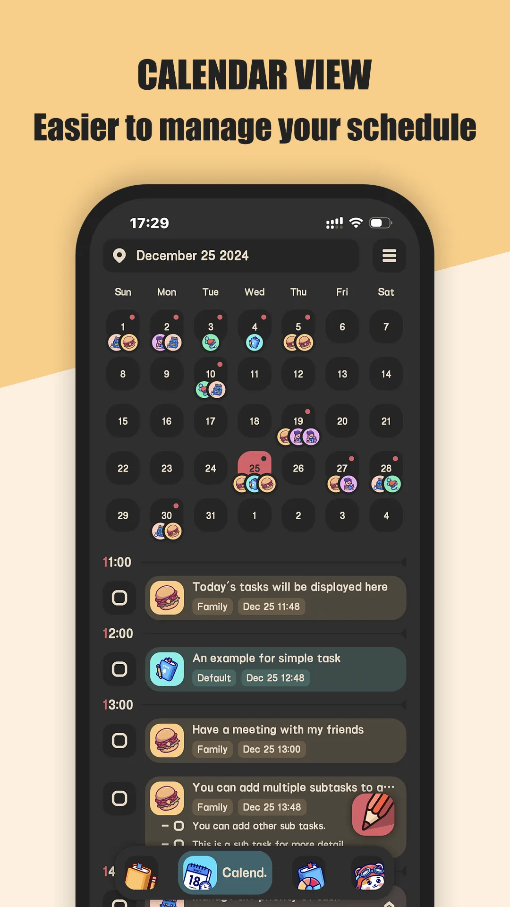

Di antara kuliah, tugas, dan shift kerja paruh waktu, mahasiswa membutuhkan **[pengelola tugas](/id/glossary/what-is-a-to-do-list/)** yang cepat dan gratis. Tenggat silabus tersebar di belasan mata kuliah, proyek kelompok berlangsung berminggu-minggu, dan satu bacaan yang terlewat bisa menurunkan nilai. **Meow Todo** adalah **[aplikasi to-do untuk mahasiswa](/id/glossary/what-is-a-to-do-list/) gratis** dengan subtugas, tampilan kalender, dan pengingat yang bertahan sepanjang semester sibuk. Berikut perbandingannya dengan opsi lain yang ramah mahasiswa.

## Apa yang benar-benar dibutuhkan mahasiswa

Meow Todo, Todoist, Microsoft To Do, dan TickTick adalah empat aplikasi to-do yang dibandingkan di sini untuk mahasiswa yang tenggatnya tersebar di belasan mata kuliah dan proyek kelompok berlangsung berminggu-minggu. Meow Todo menyimpan tugas lokal tanpa akun dengan subtugas dan kalender; Todoist dipercaya 30 juta pengguna dengan bahasa alami dan Pro ~$48 per tahun; Microsoft To Do gratis dalam ekosistem Microsoft; TickTick menyatukan tugas, kalender, dan pomodoro. Enam kebutuhan mahasiswa — inti gratis, subtugas, pengingat tenggat, tampilan kalender, tanpa akun wajib, dan ekspor — menentukan pilihan. Pilihan bergantung pada satu hal: apakah Anda ingin pencatatan gratis privat atau kolaborasi berbasis cloud.

- **Inti gratis** — Anda tidak perlu membayar untuk mencatat tugas kuliah.
- **Subtugas** — pecah esai menjadi riset, draf, sunting, kumpul.
- **Pengingat tenggat** — notifikasi sebelum waktunya, bukan sesudahnya.
- **Tampilan kalender** — lihat semua tenggat mata kuliah dalam satu layar.
- **Tanpa akun wajib** — satu kata sandi lebih sedikit di minggu pertama.
- **Ekspor** — CSV untuk menyerahkan rencana ke teman kelompok atau mencetaknya.

## Sekilas para pesaing

Meow Todo, Todoist, Microsoft To Do, dan TickTick adalah empat aplikasi pengelola tugas yang dirangkum menurut harga, akun, subtugas, kalender, dan kecocokan untuk mahasiswa. Meow Todo gratis di inti tanpa akun dengan data lokal berkunci; Todoist dan TickTick memakai akun cloud dengan langganan; Microsoft To Do gratis tetapi terikat Microsoft. Semua mendukung subtugas dan kalender, tetapi hanya Meow Todo yang bekerja tanpa pendaftaran. Tabel berikut memetakan perbedaan sebelum Anda memilih aplikasi to-do mahasiswa.

| Aplikasi | Harga (2026) | Akun | Subtugas | Kalender | Paling cocok untuk mahasiswa |
|---|---|---|---|---|---|
| **Meow Todo** | Inti gratis + VIP opsional | **Tidak** (lokal + kunci) | ✅ (VIP untuk banyak) | ✅ | Gratis, privat |
| **Todoist** | Gratis + Pro ~$48/thn | Ya (cloud) | ✅ | ✅ | Metode + kolaborasi |
| **Microsoft To Do** | Gratis | Ya (Microsoft) | ✅ | ✅ | Ekosistem MS |
| **TickTick** | Gratis + langganan | Ya (cloud) | ✅ | ✅ | All-in-one |

## Meow Todo, secara mendalam

Meow Todo adalah aplikasi daftar tugas bertema kucing untuk Android dan iOS dengan fitur inti gratis berisi daftar, tugas, pengingat, dan tampilan kalender, sementara VIP membuka daftar tanpa batas, tag, subtugas, ekspor CSV, dan kunci aplikasi. Lima layar di bawah menampilkan tugas hari ini, editor dan pengingat tenggat, daftar mata kuliah dan grup tag, kalender satu semester, serta sinkronisasi dan pengaturan. Untuk mahasiswa, keunggulannya adalah tanpa akun wajib dengan data di balik kunci sidik jari, subtugas untuk memecah esai, pengingat harian dan tenggat, serta backup Google Drive atau WebDav yang Anda kendalikan. Keterbatasannya, daftar tanpa batas berada di balik VIP dan tanpa sinkron cloud otomatis.

{: width="180" .normal }
{: width="180" .normal }
{: width="180" .normal }
{: width="180" .normal }
{: width="180" .normal }

Meow Todo adalah **aplikasi daftar tugas bertema kucing** untuk Android dan iOS. Fitur inti — daftar, tugas, pengingat, dan tampilan kalender — gratis; VIP membuka daftar tanpa batas, tag, subtugas, ekspor CSV, dan kunci aplikasi.

**Keunggulan untuk mahasiswa**
- **Inti gratis** — daftar, tugas, tenggat, dan tampilan kalender tidak berbayar.
- **Tanpa akun wajib** — data tersimpan di perangkat di balik kunci sidik jari.
- **Subtugas** — pecah satu tugas menjadi tahapan agar tidak ada yang terlewat.
- **Pengingat** — notifikasi harian dan tenggat menjaga semester tetap terlihat.
- **Backup yang Anda kendalikan** — Google Drive atau WebDav, hanya saat Anda aktifkan.
- **Ekspor CSV** — serahkan rencana ke teman kelompok atau simpan salinan cetak.

**Kelemahan untuk mahasiswa**
- **VIP untuk fitur lanjutan** — daftar tanpa batas, tag, dan ekspor CSV ada di balik peningkatan.
- **Tanpa sinkron cloud otomatis** — lintas perangkat lewat Drive/WebDav milik Anda, bukan akun langsung.

**Paling cocok untuk:** mahasiswa dengan anggaran ketat yang menjaga privasi dan ingin **pengelola tugas gratis** tanpa pendaftaran.

- [Google Play — Meow Todo List](https://play.google.com/store/apps/details?id=com.glgjing.money.task.todo.list.meow)
- [App Store — Meow Todo List](https://apps.apple.com/app/id6742345495)

## Todoist, secara mendalam

Todoist adalah pengelola tugas paling banyak dipasang yang dipercaya 30 juta pengguna, dengan entri bahasa alami seperti "kumpulkan esai besok jam 5 sore" dan kolaborasi kuat, tetapi mewajibkan akun cloud. Lima layar di bawah menampilkan daftar tugas, editor dan pengingat tenggat, proyek mata kuliah dan grup label, kalender jadwal kuliah, serta sinkronisasi dan pengaturan akun. Untuk mahasiswa, keunggulannya adalah input bahasa alami, proyek dan subtugas per mata kuliah, berbagi daftar dengan teman kelompok, serta streak karma. Keterbatasannya, paket gratis membatasi proyek dan label, Pro ~$48 per tahun membuka sisanya, dan biaya langganan menumpuk di anggaran mahasiswa.

{: width="180" .normal }
{: width="180" .normal }
{: width="180" .normal }
{: width="180" .normal }
{: width="180" .normal }

Todoist adalah pengelola tugas paling banyak dipasang, dipercaya 30 juta pengguna, dengan entri bahasa alami ("kumpulkan esai besok jam 5 sore") dan kolaborasi yang kuat.

**Keunggulan untuk mahasiswa**
- **Bahasa alami** — ketik tugas, tanggal dan prioritas langsung dikenali.
- **Proyek dan subtugas** — atur per mata kuliah, dengan langkah bertingkat.
- **Lintas platform + berbagi** — bagikan daftar proyek dengan teman kelompok.
- **Karma/batas** — streak ringan yang menghargai konsistensi.

**Kelemahan untuk mahasiswa**
- **Paket gratis terbatas** — proyek, komentar, dan label dibatasi; Pro (~$48/thn) membuka sisanya.
- **Akun cloud wajib** — tugas Anda tersimpan di server Todoist.
- **Biaya menumpuk** — langganan tiap tahun di anggaran mahasiswa.

**Paling cocok untuk:** mahasiswa yang menginginkan metode, kolaborasi, dan bersedia membayar Pro.

- [Google Play — Todoist](https://play.google.com/store/apps/details?id=com.todoist)
- [App Store — Todoist](https://apps.apple.com/app/id572688855)

## Bagaimana aplikasi lain dibandingkan

Microsoft To Do dan TickTick adalah dua pesaing tambahan di sini selain Meow Todo dan Todoist, keduanya menawarkan nilai berbeda bagi mahasiswa. Microsoft To Do sepenuhnya gratis dalam ekosistem Microsoft dengan daftar bersama dan integrasi Outlook, pas bila kampus memakai Microsoft 365; TickTick menggabungkan tugas, kalender, timer pomodoro, dan pelacakan kebiasaan, gratis dengan langganan untuk paket lengkap. Keempat aplikasi terbagi dalam pencatat lokal seperti Meow Todo dan sistem cloud seperti Todoist, Microsoft To Do, dan TickTick. Mahasiswa dengan anggaran ketat sebaiknya memilih Meow Todo.

- **Microsoft To Do** sepenuhnya gratis di ekosistem Microsoft, dengan daftar bersama dan integrasi Outlook — pas bila kampus memakai Microsoft 365.
- **TickTick** menggabungkan tugas, kalender, timer pomodoro, dan pelacakan kebiasaan; gratis dengan langganan untuk paket lengkap.

## Apa yang membuat aplikasi to-do bagus untuk mahasiswa

Meow Todo adalah aplikasi to-do untuk mahasiswa yang menangani tiga hal yang lebih penting daripada daftar fitur panjang: tenggat datang bergelombang, satu tugas berlangsung berminggu-minggu, dan anggarannya biasanya nol. Pertama, subtugas gratis di paket dasar agar "riset, draf, revisi, kumpul" tidak terkunci paywall saat minggu ujian. Kedua, tampilan kalender untuk satu semester penuh sehingga minggu ke-3 dan ke-10 terlihat bersamaan. Ketiga, antarmuka lucu yang benar-benar dibuka, karena aplikasi yang terasa seperti PR akan terbengkalai di tengah semester. Aplikasi to-do list gratis terbaik bagi mahasiswa jarang yang paling bertenaga; yang terbaik adalah yang masih dibuka pada Minggu malam.

- **Aplikasi subtask gratis** di paket dasar — memecah "riset, draf, revisi, kumpul" tidak boleh terkunci di balik paywall saat minggu ujian.
- **Tampilan kalender untuk satu semester penuh**, agar minggu ke-3 dan ke-10 terlihat bersamaan, bukan satu hari demi satu hari.
- **Pengelola tugas Android yang lucu** dan benar-benar Anda buka — kalau aplikasinya terasa seperti PR, daftarnya akan terbengkalai di tengah semester.

Itu pula sebabnya **aplikasi to-do list gratis** terbaik bagi mahasiswa jarang yang paling bertenaga: yang terbaik adalah yang masih Anda buka pada Minggu malam.

## Mana yang sebaiknya dipilih mahasiswa?

Meow Todo adalah jawaban untuk mahasiswa yang menginginkan pencatatan gratis, privat, tanpa akun, dengan subtugas dan pengingat yang bertahan sepanjang semester. Todoist cocok untuk bahasa alami dan kolaborasi dengan Pro ~$48 per tahun, Microsoft To Do untuk pengguna sehari-hari Microsoft 365, dan TickTick untuk satu aplikasi tugas, kalender, dan fokus. Keempatnya mencakup spektrum dari penyimpanan lokal hingga sistem cloud. Keputusan bergantung pada satu hal: apakah Anda ingin tugas tetap di perangkat tanpa biaya atau kolaborasi real-time dengan teman kelompok.

- Ingin **gratis + privat + tanpa akun** → **Meow Todo**.
- Ingin **bahasa alami + kolaborasi** dan menerima Pro → **Todoist**.
- Sehari-hari di **Microsoft 365** → **Microsoft To Do**.
- Ingin **satu aplikasi untuk tugas, kalender, dan fokus** → **TickTick**.

[Dapatkan Meow Todo](/id/apps/meow-todo-list/) — tersedia di Android dan iOS.

## Skenario umum

Meow Todo mencakup empat skenario pengelolaan tugas mahasiswa yang memanfaatkan kalender satu semester, subtugas, tag dan ikon, serta penyimpanan lokal berkunci. Skenario pertama memasukkan semua tenggat mata kuliah ke satu daftar dengan pengingat harian agar tidak ada yang tersembunyi antara minggu ke-3 dan ke-10; kedua memecah proyek kelompok menjadi riset, draf, sunting, dan kumpul lalu mengekspor CSV; ketiga memakai tag dan 400+ ikon untuk memisahkan "Kuliah", "Tugas", dan "Kerja paruh waktu"; keempat mulai tanpa pendaftaran dengan rencana tetap di perangkat di balik sidik jari. Todoist lebih cocok bila Anda membutuhkan kolaborasi real-time.

- **Minggu silabus** — di awal semester, masukkan semua tenggat mata kuliah ke satu daftar, pasang pengingat harian, dan biarkan tampilan kalender menunjukkan seluruh semester agar tidak ada yang tersembunyi di antara minggu ke-3 dan ke-10.
- **Proyek kelompok** — pecah hasil akhir menjadi subtugas (riset, draf, sunting, kumpul) dan ekspor CSV untuk membagikan rencana ke teman kelompok.
- **Menjelang ujian** — pakai tag dan 400+ ikon kategori lucu untuk memisahkan "Kuliah", "Tugas", dan "Kerja paruh waktu", sehingga sekilas hanya yang segera jatuh tempo yang terlihat.
- **Tenang tanpa akun** — buka dan mulai di hari pertama tanpa pendaftaran; rencana Anda tetap di perangkat di balik kunci sidik jari, aman dari kata sandi yang terlupa.

## FAQ

**Apakah Meow Todo gratis untuk mahasiswa?**
{:.faq-q}

Ya — daftar, tugas, tenggat, dan tampilan kalender gratis; daftar tanpa batas, tag, subtugas, ekspor CSV, dan kunci aplikasi ada di balik VIP sekali bayar opsional.

**Apakah saya perlu akun?**
{:.faq-q}

Tidak. Anda bisa mulai di hari pertama perkuliahan tanpa pendaftaran; tugas tetap tersimpan lokal di balik kunci sidik jari.

**Bisakah saya melacak proyek kelompok?**
{:.faq-q}

Bisa — subtugas memecah hasil akhir menjadi beberapa langkah, dan ekspor CSV memungkinkan Anda menyerahkan rencana ke teman kelompok atau menyimpan salinan cetak.

**Meow Todo atau Todoist untuk mahasiswa?**
{:.faq-q}

Ingin pencatatan gratis, privat, tanpa akun, dengan subtugas dan pengingat → Meow Todo; ingin entri bahasa alami, kolaborasi, dan bersedia membayar Pro → Todoist.

## Istilah terkait

- [Apa Itu Daftar Tugas (To-Do List)?](/id/glossary/what-is-a-to-do-list/)
- [Apa Itu Subtugas?](/id/glossary/what-is-a-subtask/)
